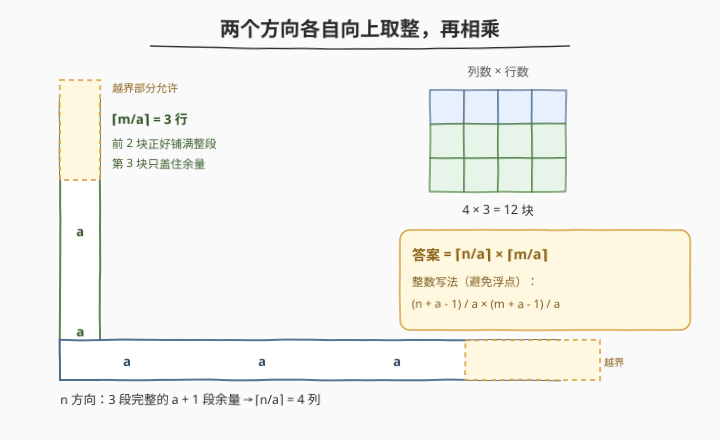
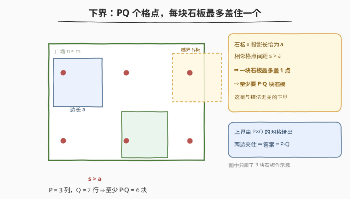
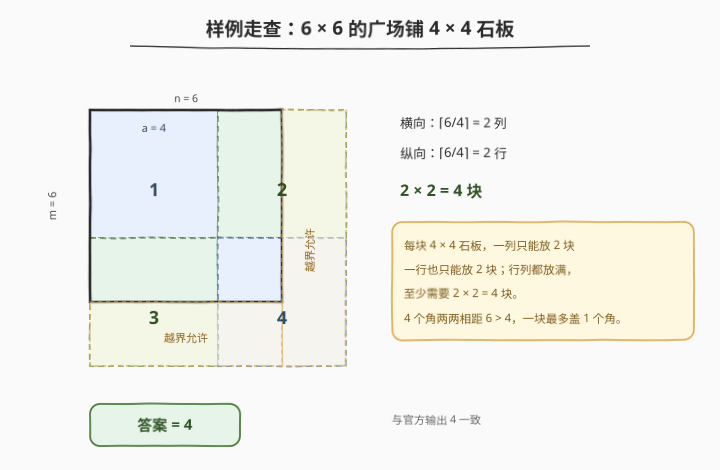

# Codeforces 1A 剧院广场 题解

## 1. 题目概述

- **题目链接**：https://codeforces.com/problemset/problem/1/A
- **比赛来源**：Codeforces Beta Round 1 · Problem A（2010-02-19）
- **难度**：1000
- **标签**：数学、向上取整、整数除法
- **评测类型**：普通
- **限制**：时间 1 s / 内存 256 MB

**题意**：首都的剧院广场是 $n \times m$ 米的矩形。现在要用边长 $a$ 米的正方形花岗岩石板铺满广场，求**最少**需要多少块石板。规则有三条：石板可以铺到广场外面（覆盖面积大于广场即可），但广场必须被完全盖住；石板不能被切割；石板的边必须与广场的边平行。

输入一行三个正整数 $n, m, a$，输出一个整数表示最少石板数。

**约束**：

- $1 \le n, m, a \le 10^9$：单条边就要铺最多 $10^9$ 块，答案最大为 $10^{18}$（如 $n = m = 10^9$、$a = 1$），**32 位整数装不下**，需要 `long long`（Python 的大整数天然安全）。
- 答案可以达到 $10^{18}$ 量级，任何"逐块摆放"的模拟都是 $O(\text{ans})$，在 1 s 内绝无可能完成，因此必须找一个 $O(1)$ 的公式。
- 输入只有**一组**数据（题面写明"输入的第一行包含三个正整数"），既没有测试组数 $t$，也不是"读到 EOF"的多组格式。

## 2. 示例与观察

官方样例（输入 / 输出原样）：

```text
输入：
6 6 4

输出：
4
```

**样例解释**：每块石板 $4 \times 4$。沿 6 米方向，一块只盖 4 米，剩下 2 米必须再补一块，所以横向要 $\lceil 6/4 \rceil = 2$ 块；纵向同理也要 $\lceil 6/4 \rceil = 2$ 块。$2 \times 2 = 4$ 块拼成 $8 \times 8$，把 $6 \times 6$ 完全盖住，多出来的部分伸到广场外——题面允许。

> ⚠️ 不能只按面积算：$\lceil 36/16 \rceil = 3$，但 3 块 $4 \times 4$ 明明有空余面积却铺不满，正确答案是 4。面积是"充分不必要"的下界，因为**石板不许切割**，边界上那一条 2 米宽的窄带只能由整块石板去盖。

自造样例（标注"自造"，覆盖整除、$a$ 大于边长、一维退化与答案上界等情形）：

| 输入 | 输出 | 说明 |
|------|------|------|
| `1 1 1` | 1 | 最小规模 |
| `1 1 1000000000` | 1 | 石板比广场大，一块就够 |
| `4 4 4` | 1 | 恰好整除，不多算 |
| `7 3 3` | 3 | 横向 3 块、纵向 1 块 |
| `5 5 4` | 4 | 每边都要 2 块 |
| `999999999 999999999 1000000000` | 1 | $a$ 同时大于两条边 |
| `1 1000000000 2` | 500000000 | 退化成一条线 |
| `1000000000 1000000000 1` | 1000000000000000000 | 答案上界 $10^{18}$ |

**观察**：所有答案都等于 $\lceil n/a \rceil \cdot \lceil m/a \rceil$。例如 `7 3 3`：$\lceil 7/3 \rceil = 3$、$\lceil 3/3 \rceil = 1$，得 3；`5 5 4`：$2 \times 2 = 4$；上界那组：$10^9 \times 10^9 = 10^{18}$。

## 3. 解题思路

### 3.1 朴素做法与瓶颈

最直观的做法是模拟铺砖：从广场左下角开始，一块一块地摆，每摆一块就统计一次。这样做的复杂度是 $O(\text{ans})$，而 $\text{ans}$ 最大 $10^{18}$，即使每次只做一次加法，1 s 内也远远做不完（现代 CPU 每秒约 $10^9$ 次操作量级，差了 $10^9$ 倍）。

另一个诱人的"一行公式"是按面积算 $\lceil nm / a^2 \rceil$。它对 $6 \times 6$、$a = 4$ 给出 3，而正确值是 4：面积只是必要条件，因为石板不能切割，$6 \times 6$ 的边界残条无法用碎料填。所以必须从**两个方向分别取整**。

### 3.2 核心观察：两个方向各自向上取整



把问题拆成两条边来看。

- **横向**：一块石板在横轴上只覆盖长度 $a$ 的线段。要盖住长度 $n$ 的边，至少需要 $\lceil n/a \rceil$ 个这样的线段首尾拼接，所以任何合法铺法在横向至少要排开 $P = \lceil n/a \rceil$ 块。
- **纵向**：同理，纵向至少要排开 $Q = \lceil m/a \rceil$ 块。
- **两者独立**：石板不能被切成两半，横轴上的缺口只能由"横跨该缺口"的整块石板补上，与纵向排了几行无关；两个方向的取整无法互相借用，所以块数是两个向上取整的乘积。

于是得到公式

$$\text{ans} = \left\lceil \frac{n}{a} \right\rceil \cdot \left\lceil \frac{m}{a} \right\rceil .$$

实现时不要用 `ceil((double)n / a)`：$10^9$ 虽然远在 `double` 的精确范围内，但浮点写法既慢又多余，直接用整数除法

$$\left\lceil \frac{x}{a} \right\rceil = \left\lfloor \frac{x + a - 1}{a} \right\rfloor$$

即可（$x, a$ 均为正整数），一次加法、一次整除。

### 3.3 算法流程



1. 读入 $n, m, a$（只有一组，读到就返回）；
2. $P \leftarrow (n + a - 1) / a$（整数除法）；
3. $Q \leftarrow (m + a - 1) / a$；
4. 输出 $P \cdot Q$（用 64 位整数相乘）。

流程只有四步、没有分支。为什么"乘积"就是下界而不只是构造：图里画的是一组互相间隔大于 $a$ 的格点，一共 $P \cdot Q$ 个，每块边长 $a$ 的石板最多只能盖住其中一个点，所以任何铺法都至少要 $P \cdot Q$ 块；而 $P$ 列 $\times$ $Q$ 行的网格铺法确实 $P \cdot Q$ 块就够。上下界夹住，等于就是答案。严格证明见第 4 节。

### 3.4 样例走查：$6 \times 6$，$a = 4$



按 1 米 = 32 像素画出示意图：广场是中间 $192 \times 192$ 的黑色粗框，四块 $4 \times 4$ 石板（虚线框）拼成 $8 \times 8$ 的方块，右侧和下方各多出 64 像素宽的浅黄色"越界"区域——题面允许这部分伸到广场外。

| 输入 | $P = \lceil n/a \rceil$ | $Q = \lceil m/a \rceil$ | 答案 | 实际覆盖面 |
|------|------|------|------|------|
| `6 6 4` | 2 | 2 | 4 | $8 \times 8$ |
| `7 3 3` | 3 | 1 | 3 | $9 \times 3$ |
| `5 5 4` | 2 | 2 | 4 | $8 \times 8$ |
| `1 1000000000 2` | 1 | 500000000 | 500000000 | $2 \times 10^9$ |

**为什么本例 3 块一定不够**：$6 \times 6$ 的四个角两两之间在横轴或纵轴上的距离都至少是 6，而一块石板的边长只有 4，所以一块石板最多盖住一个角；四个角至少需要四块。这个特例的论证与第 4 节的一般性下界证明是同一个想法（把"角"换成"互相远离的一组格点"）。

## 4. 正确性证明

**引理 1（上界：$P \cdot Q$ 块足够）**：设 $P = \lceil n/a \rceil$、$Q = \lceil m/a \rceil$，则存在使用 $P \cdot Q$ 块石板的合法铺法。

**证明**：把石板按 $P$ 列 $Q$ 行的网格摆放，第 $i$ 列第 $j$ 行的那块占据

$$\bigl[(i-1)a,\ ia\bigr] \times \bigl[(j-1)a,\ ja\bigr],\qquad 1 \le i \le P,\ 1 \le j \le Q .$$

这 $P \cdot Q$ 块石板的并集是整个矩形 $[0, Pa] \times [0, Qa]$。由 $P = \lceil n/a \rceil$ 得 $Pa \ge n$，由 $Q = \lceil m/a \rceil$ 得 $Qa \ge m$，故

$$[0, n] \times [0, m] \subseteq [0, Pa] \times [0, Qa],$$

即广场被完全覆盖；石板彼此不重叠、不切割，边与广场平行，多出的部分落在广场外，符合题面。∎

**引理 2（下界：任何铺法至少 $P \cdot Q$ 块）**：对任意合法铺法，设其石板数为 $k$，则 $k \ge P \cdot Q$。

**证明**：先在横轴上选 $P$ 个互相"远离"的坐标。当 $P \ge 2$ 时令

$$\Delta_x = \frac{(P-1)a + n}{2(P-1)},\qquad x_i = (i-1)\Delta_x \quad (i = 1, 2, \dots, P).$$

由 $P = \lceil n/a \rceil$ 可知 $(P-1)a < n$，于是

$$\Delta_x - a = \frac{n - (P-1)a}{2(P-1)} > 0 ,$$

即相邻坐标的间距 $\Delta_x > a$；同时

$$x_P = (P-1)\Delta_x = \frac{(P-1)a + n}{2} < n,$$

且 $x_1 = 0$，所以全部 $x_i$ 都落在 $[0, n]$ 内。当 $P = 1$ 时只取 $x_1 = 0$，此时没有间距要求。

完全对称地，在纵轴上取 $Q$ 个坐标 $y_1 < y_2 < \dots < y_Q$，相邻间距 $\Delta_y > a$，全部落在 $[0, m]$ 内（$Q = 1$ 时取 $y_1 = 0$）。

现在考虑 $P \cdot Q$ 个格点 $(x_i, y_j)$。广场是闭矩形且被铺满（边界点也算盖住），所以这些点每一个都必须被某块石板盖住。

任取一块石板，它的位置形如 $[u, u+a] \times [v, v+a]$。它的横投影 $[u, u+a]$ 长度恰为 $a$，而任意两个不同的 $x_i, x_{i'}$ 满足 $\lvert x_i - x_{i'} \rvert \ge \Delta_x > a$，故这个区间**至多**包含一个 $x_i$；同理纵投影至多包含一个 $y_j$。于是一块石板至多盖住一个格点 $(x_i, y_j)$。

$P \cdot Q$ 个格点互不相同且都要被盖住，而每块石板只能负责其中一个，故 $k \ge P \cdot Q$。∎

**定理**：最少石板数恰为 $\left\lceil n/a \right\rceil \cdot \left\lceil m/a \right\rceil$。

**证明**：引理 1 给出一个用 $P \cdot Q$ 块石板的合法铺法，故最优值不超过 $P \cdot Q$；引理 2 说明任何合法铺法都不少于 $P \cdot Q$ 块，故最优值不小于 $P \cdot Q$。两者相等。∎

## 5. 复杂度分析

- **时间**：$O(1)$。只有一次读入、两次加法、两次整除、一次乘法，与 $n, m, a$ 的大小完全无关；即使输入取到 $10^9$ 也只是一次常数时间的运算。
- **空间**：$O(1)$。除三个输入变量和两个中间量外不占额外空间，连数组都不需要。
- **数值范围**：$P, Q \le 10^9$，乘积 $P \cdot Q \le 10^{18} < 2^{63} - 1 \approx 9.22 \times 10^{18}$，`long long` 恰好装得下且不溢出；而 `int` 上限约 $2.1 \times 10^9$，会在乘法处溢出。
- **与时限的关系**：1 s 的时限对本题极其宽松。实测（含进程启动）单次运行约 $2.6 \sim 5.5$ ms，其中几乎全部是系统开销，算法本体不足 $1\ \mu\text{s}$，余量在 200 倍以上。

## 6. 参考代码

### C++17

```cpp
#include <bits/stdc++.h>
using namespace std;

int main() {
    ios::sync_with_stdio(false);
    cin.tie(nullptr);

    long long n, m, a;
    if (!(cin >> n >> m >> a)) return 0;      // 题面只有一行三数：一组数据
    long long cols = (n + a - 1) / a;         // 沿 n 方向至少需要几列石板
    long long rows = (m + a - 1) / a;         // 沿 m 方向至少需要几行石板
    cout << cols * rows << '\n';
    return 0;
}
```

### Python3

```python
import sys


def main() -> None:
    data = sys.stdin.buffer.read().split()
    if not data:
        return
    n, m, a = int(data[0]), int(data[1]), int(data[2])
    cols = (n + a - 1) // a
    rows = (m + a - 1) // a
    sys.stdout.write(str(cols * rows) + "\n")


main()
```

两份代码都只用标准库，可原样提交（本题没有特殊评测，输出一个整数即可）。

## 7. 边界情况与易错点

1. **`int` 溢出（本题最大的坑）**：$10^9 \times 10^9 = 10^{18}$，`int` 相乘会溢出成负数或错的数。注意 `(n + a - 1)` 在 $n = a = 10^9$ 时是 $1999999999$，仍在 `int` 范围内，所以写 `int n, m, a` 编译照样通过、读入也不报错，**只有最后一步乘法会错**——这类错误最容易漏测，务必全程用 `long long`。
2. **整除时多算一块**：写成 `n / a + 1` 会在 $a \mid n$ 时多算一块，例如 `4 4 4` 会输出 4（正确是 1）；正确写法是 `(n + a - 1) / a`，它在 $4/4$ 时给出 $7/4 = 1$。
3. **$a$ 大于边长时不能得 0**：`1 1 1000000000` 的答案是 1 而不是 0。向上取整公式天然给出 $\lceil 1/10^9 \rceil = 1$，若改用"$\lfloor n/a \rfloor \cdot \lfloor m/a \rfloor$ 再补"之类的写法很容易在此处漏掉一整块。
4. **面积法错误**：$\lceil nm/a^2 \rceil$ 在 `6 6 4` 上给出 3（正确 4）。原因是石板不许切割，边界的残条必须各用一整块；只要 $a$ 不整除某条边，面积下界就不紧。
5. **浮点写法**：`ceil((double)n / a)` 在 $10^9$ 量级不会错（`double` 能精确表示所有不超过 $2^{53}$ 的整数），但它既慢又引入不必要的类型转换，还容易在别的题上踩到精度坑；统一用整数版公式更稳。
6. **输入格式只有一组**：题面写的是"第一行包含三个正整数"，没有 $t$，也不是"读到 EOF 的多组"。按题面读一次、输出一行即可。若写成 `while (cin >> n >> m >> a)` 的循环，对本题数据的结果相同，但会掩盖"多测漏读"这类问题，建议按题面来。
7. **输出格式**：只输出一个整数并换行，不加 `Case #x:`、不加多余空格；`cout` 末尾用 `'\n'` 而不是 `endl`（本题无所谓，但养成习惯）。
8. **$n$ 与 $m$ 写反**：答案对 $n, m$ 对称，写反不会 WA，但别把公式错写成 $\lceil n/a \rceil^2$ 或 $\lceil nm / a \rceil$——前者只在 $n = m$ 的方形广场上碰巧正确，后者连量纲都不对。
9. **Python 的读入**：用 `sys.stdin.buffer.read().split()` 把换行、行尾空格一起吃掉，比 `input().split()` 更稳（若数据文件末尾没有换行或有多余空行也不受影响）；大整数运算无需担心溢出。

## 8. 验证记录

- **编译环境与命令**：本机只有 `Apple clang 21.0.0`（`/usr/bin/g++` 是 clang 的软链），没有 GNU `g++` 与 libstdc++，因此用 `clang++ -std=c++17 -O2 -Wall` 搭配一份本地 `bits/stdc++.h` 兼容头编译（代码只用标准库，可原样提交 GNU C++17）。Python 侧为 `Python 3.9.6`。
- **官方样例**：1 / 1 通过（`6 6 4` → `4`），C++ 与 Python 输出一致。
- **额外测试**：14 组样例 / 自造样例（含 `1 1 1`、`1 1 1000000000`、`4 4 4`、`7 3 3`、`5 5 4`、`999999999 999999999 1000000000`、`1 1000000000 2`、上界 `1000000000 1000000000 1` → `1000000000000000000`），C++ 与 Python 全部通过。
- **独立暴力对拍**：另写一份"完全不使用公式"的暴力——在整数坐标上枚举所有 $a \times a$ 石板的可能摆放（允许越过四条边界），用"每次取编号最小的未覆盖格子、只尝试能盖住它的石板"的精确最小覆盖搜索求最少块数。对 $1 \le n, m, a \le 6$ 的 **216 组**全枚举 + **318 组**随机与边界组（$a = 1$、$a = n$、$a = n+1$、$a > \max(n,m)$，以及随机 $n, m \le 8$、$a \le 12$），共 **534 组**与公式逐一比较，**全部一致**。
- **最大约束性能**：输入 `1000000000 1000000000 1`（答案 $10^{18}$）时，C++ 端到端 200 次平均（含进程启动）约 $2.6 \sim 5.5$ ms，峰值内存 $1.6$ MB；相对 1 s、256 MB 的余量在 200 倍以上。Python 同数据约 $33$ ms（同样含解释器启动）。
- **图片校验**：三张 SVG（`cf1a_two_ceilings.svg`、`cf1a_lattice_lower_bound.svg`、`cf1a_walkthrough_6x6.svg`）均通过 `xml.etree.ElementTree.parse`；另用脚本按字符宽度逐个估算 `text` 的包围盒，三图共 52 个文本块均未越出 `viewBox`，并用 headless Chrome 渲染成 PNG 复核了排版。
- **公式校验**：正文公式均为 `$...$` 行内与 `$$...$$` 块级形式，星号直接写 `*` 而不用反斜杠转义，`\text{}` 内没有裸 `#`，经 KaTeX（`throwOnError`）渲染无报错。
- **复核状态**：verified（样例、对拍、性能、图片、公式五项均实跑通过；唯一环境差异是本机无 GNU g++，已用 clang++ 等价验证）。

## 相关题目与扩展

- [Codeforces 1B Spreadsheet](https://codeforces.com/problemset/problem/1/B)：同场 B 题，两套表格坐标互转，同属"先把数学关系写清楚再实现"的数学/实现题。
- [Codeforces 1C Ancient Berland Circus](https://codeforces.com/problemset/problem/1/C)：同场 C 题，几何 + 角度最大公约数，是 Beta Round 1 的最难一题。
- [Codeforces 50A Domino piling](https://codeforces.com/problemset/problem/50/A)：用 $2 \times 1$ 骨牌铺 $n \times m$ 地板，同样靠"面积 + 取整"的计数，但骨牌可以旋转、答案就是 $\lfloor nm/2 \rfloor$，与本题"不许切割导致必须分别取整"形成对照。
- [Codeforces 1374A Required Remainder](https://codeforces.com/problemset/problem/1374/A)：围绕整除与余数构造答案，练习"用整数运算代替浮点"。
- [Codeforces 1551A Polycarp and Coins](https://codeforces.com/problemset/problem/1551/A)：同样是常数时间的整数除法构造题，适合作为本题的下一道热身。
- [LeetCode 1283. 使结果不超过阈值的最小除数](https://leetcode.cn/problems/find-the-smallest-divisor-given-a-threshold/)：判定函数里反复使用 $\lceil a_i / x \rceil$ 的整数写法，是本题公式的直接复用。

**延伸思考**：

1. **如果允许切割石板**：那么只需面积够，答案变成 $\lceil nm / a^2 \rceil$（$6 \times 6$、$a = 4$ 时为 3）。可见本题的难度完全来自"不许切割"这一条约束——同一个问题，约束变一句话，答案就换一个公式。
2. **如果石板必须完全落在广场内**：则必须 $a \mid n$ 且 $a \mid m$，否则无解；有解时答案为 $(n/a)(m/a)$，本题的公式在整除时与它一致。
3. **三维推广**：用 $a \times a \times a$ 的立方体填 $n \times m \times h$ 的长方体，答案是三个向上取整的乘积；第 4 节的格点下界证明可以逐字推广到 $d$ 维——取 $d$ 组互相远离的坐标、构造 $P_1 P_2 \cdots P_d$ 个格点，每块"超立方体"至多盖住一个。
4. **如果允许混用不同边长的石板**：最小块数问题立刻变难（等价于二维精确覆盖，一般情形是 NP 难的），本题的乘法公式只在"全部同尺寸、可越界"时才成立。
5. **浮点边界的泛化**：本题 $n, m, a \le 10^9$ 用 `double` 恰好安全；若约束放大到 $10^{18}$，`double` 只有 53 位有效位就会出错，这提醒我们：能用整数除法就不要用浮点取整。
