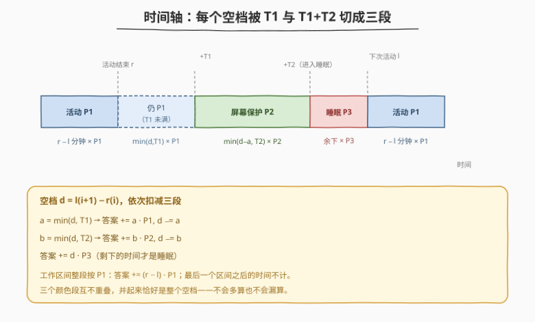
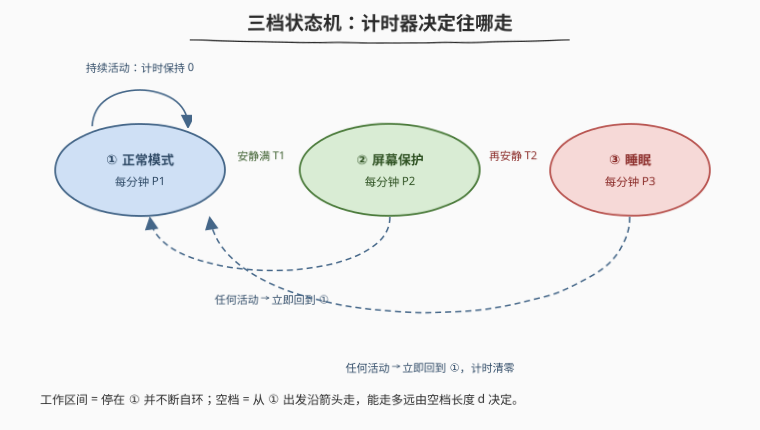
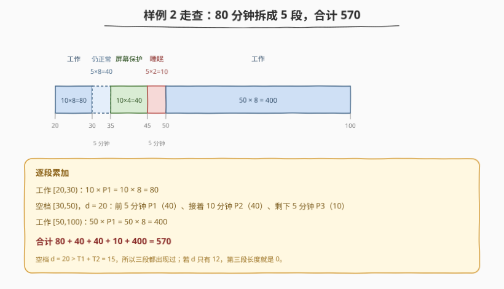

# Codeforces 10A 笔记本功耗分段计算 题解

## 1. 题目概述

- **题目链接**：https://codeforces.com/problemset/problem/10/A
- **比赛来源**：Codeforces Beta Round 10 · Problem A（UTC 2010-04-15）
- **难度**：900
- **标签**：实现（implementation）
- **评测类型**：普通
- **限制**：时间 1 s / 内存 256 MB

**题意**：Tom 的笔记本有三种功耗模式：

- **正常模式**：每分钟耗电 $P_1$ 瓦。Tom 每动一次鼠标或按一次键，就处于该模式，并重新开始计时；
- **屏幕保护**：从最后一次活动算起，安静满 $T_1$ 分钟后进入，每分钟耗电 $P_2$ 瓦；
- **睡眠**：从屏幕保护启动算起，再经过 $T_2$ 分钟进入，每分钟耗电 $P_3$ 瓦。

第二种、第三种模式下只要 Tom 一动，就立刻回到正常模式。

Tom 的工作被分成 $n$ 个区间 $[l_1, r_1], \dots, [l_n, r_n]$（严格递增、互不重叠，且 $r_i < l_{i+1}$）。在每个区间内 Tom 一直在操作电脑，区间之间他离开。求 $[l_1, r_n]$ 这段时间内笔记本的总耗电量。

**约束**：

- $n \le 100$：把每个区间和每个空档各处理一次即可，$O(n)$ 绰绰有余。
- $0 \le P_1, P_2, P_3 \le 100$：功耗可能为 $0$，不能因为"耗电为 0"就提前退出或做特殊判断。
- $1 \le T_1, T_2 \le 60$：两段阈值都是正数，不会出现"零长度档位"之外的退化（但空档本身可能很短）。
- $0 \le l_i < r_i \le 1440$：时间值域只有 $1440$ 分钟，逐分钟模拟也只要 $1440$ 步，在 1 s 内完全可行——这正是"朴素做法在本题也能过"的原因；但如果把时间上限改成 $10^9$，逐分钟就会超时，所以我们给出与时间值域无关的 $O(n)$ 分段做法。
- 答案上界：$1440 \times 100 = 144000$，`int` 足够；代码里仍用 `long long` 兜底，零成本。
- 输入只有一组数据，没有测试组数 $t$。

## 2. 示例与观察

官方样例 1（输入 / 输出原样）：

```text
输入：
1 3 2 1 5 10
0 10

输出：
30
```

官方样例 2（输入 / 输出原样）：

```text
输入：
2 8 4 2 5 10
20 30
50 100

输出：
570
```

**样例 1 演算**：只有一段工作区间 $[0,10]$，Tom 全程都在操作，每分钟都是正常模式，$10 \times 3 = 30$。

**样例 2 演算**：$P = (8,4,2)$、$T_1 = 5$、$T_2 = 10$。

| 时段 | 时长 | 状态 | 计算 |
|------|------|------|------|
| $[20,30)$ | 10 | 工作，正常模式 | $10 \times 8 = 80$ |
| $[30,35)$ | 5 | 空档前 $T_1$ 分钟，仍正常 | $5 \times 8 = 40$ |
| $[35,45)$ | 10 | 屏幕保护 $T_2$ 分钟 | $10 \times 4 = 40$ |
| $[45,50)$ | 5 | 空档剩余，睡眠 | $5 \times 2 = 10$ |
| $[50,100)$ | 50 | 工作，正常模式 | $50 \times 8 = 400$ |

合计 $80 + 40 + 40 + 10 + 400 = 570$，与样例一致。

**观察 1**：档位只由"距上一次活动的时长" $dt$ 决定：$dt < T_1$ 是正常，$T_1 \le dt < T_1 + T_2$ 是屏幕保护，$dt \ge T_1 + T_2$ 是睡眠。工作区间内每分钟都在活动，等价于 $dt$ 始终为 $0$。

**观察 2**：空档 $d = l_{i+1} - r_i$ 一旦确定，三段长度就固定为 $\min(d, T_1)$、$\min(d - T_1, T_2)$（减到负数就取 $0$）和剩下的部分——不需要逐分钟判断。

自造样例（标注"自造"，`⏎` 表示换行，均已用参考程序与暴力核对）：

| 输入 | 输出 | 说明 |
|------|------|------|
| `1 3 2 1 5 10 ⏎ 0 10` | `30` | 官方样例 1 |
| `2 8 4 2 5 10 ⏎ 20 30 ⏎ 50 100` | `570` | 官方样例 2 |
| `1 0 0 0 5 5 ⏎ 0 100` | `0` | 三档功耗全 0，答案就是 0 |
| `2 10 20 30 5 10 ⏎ 0 10 ⏎ 15 20` | `200` | 空档恰好 $5 = T_1$，全部按 $P_1$ 计 |
| `2 10 20 30 5 10 ⏎ 0 10 ⏎ 30 40` | `600` | 空档恰好 $20 = T_1 + T_2$，一分钱 $P_3$ 都没有 |
| `2 1 10 100 2 3 ⏎ 0 1 ⏎ 2 3` | `3` | 空档只有 1 分钟，比 $T_1$ 还短 |
| `3 5 6 7 4 6 ⏎ 0 5 ⏎ 10 15 ⏎ 20 30` | `152` | 多个空档，其中最后一个 $10 > T_1+T_2$ |
| `1 100 100 100 1 1 ⏎ 0 1440` | `144000` | 时间与功耗同时取上界 |

第 4、5 组正好卡在档位切换的边界上：$d = T_1$ 时整段都算正常模式，$d = T_1 + T_2$ 时屏幕保护刚好占满剩余时间，这两处最容易写成"多算一分钟"或"少算一分钟"。

## 3. 解题思路

### 3.1 朴素做法与瓶颈

最直观的做法是逐分钟模拟：从 $l_1$ 到 $r_n$ 枚举每一分钟 $[t, t+1)$，维护"上一次活动的时刻" $last$；如果 $t$ 落在某个工作区间里，就按 $P_1$ 计并令 $last = t + 1$；否则用 $dt = t - last$ 判断档位。

这个做法的时间是 $O(r_n - l_1) \le 1440$，在本题 1 s 内当然能过。它有两个问题：

1. **依赖时间值域小**：题意里的 $1440$ 只是"一天"的巧合，若把上限改成 $10^9$，逐分钟立刻超时；
2. **边界难写对**：$dt = T_1$ 的那一分钟属于屏幕保护，$dt = T_1 + T_2$ 的那一分钟属于睡眠，逐分钟写法稍有疏忽就会错开一分钟。

所以我们改用**按段计算**：工作区间整段按 $P_1$，空档一次性切成三段，复杂度 $O(n)$，与时间值域无关，也把边界集中到一个地方处理。

### 3.2 核心观察：档位只由"安静了多久"决定



把时间轴按"最后一次活动"切成几块来看：

- 工作区间 $[l_i, r_i)$ 内，Tom 每一分钟都在活动，$dt$ 始终为 $0$，所以整段都是 $P_1$，贡献 $(r_i - l_i) P_1$。
- 空档从 $r_i$ 开始。取 $t \in [r_i, l_{i+1})$，则 $dt = t - r_i$：
  - $0 \le dt < T_1$：正常模式，持续 $T_1$ 分钟（$dt = T_1$ 已经切换）；
  - $T_1 \le dt < T_1 + T_2$：屏幕保护，持续 $T_2$ 分钟；
  - $dt \ge T_1 + T_2$：睡眠，直到下一次活动。
- 空档长度 $d = l_{i+1} - r_i$ 可能比 $T_1$ 短、比 $T_1 + T_2$ 短，所以三段要用 $\min$ 截断，剩下的才是下一档。

这三种状态之间的迁移关系如图所示：



状态机说明为什么只需要看"最后一段空档"：一旦 Tom 重新活动，计时器立刻清零回到正常模式，之前空档里走到哪一档都不影响后续——所以每个空档可以独立计算，区间之间没有耦合。

### 3.3 算法流程

1. 读入 $n, P_1, P_2, P_3, T_1, T_2$ 与 $n$ 个区间；
2. 对每个区间 $i$：
   1. 工作段贡献：`ans += (r_i - l_i) * P1`；
   2. 若 $i = n$ 则结束（最后一段之后不统计）；
   3. 空档 $d = l_{i+1} - r_i$：
      - `a = min(d, T1)`，`ans += a * P1`，`d -= a`；
      - `b = min(d, T2)`，`ans += b * P2`，`d -= b`；
      - `ans += d * P3`；
3. 输出 `ans`。

注意第 2.3 步里 $d$ 是**边减边用**的：三段依次从同一个 $d$ 里"扣掉"，天然处理了"空档还没走到下一档就结束了"的情况，不需要写 `max(0, ...)`。

### 3.4 样例走查：样例 2



按 1 分钟 = 6 像素画时间轴（区间 $[20,100]$ 共 80 分钟，对应 480 像素宽）：

| 段 | 区间 | 分钟数 | 单价 | 小计 |
|----|------|--------|------|------|
| 工作 | $[20,30)$ | 10 | $P_1 = 8$ | 80 |
| 空档前段 | $[30,35)$ | $\min(20, 5) = 5$ | $P_1 = 8$ | 40 |
| 空档中段 | $[35,45)$ | $\min(15, 10) = 10$ | $P_2 = 4$ | 40 |
| 空档尾段 | $[45,50)$ | $20 - 5 - 10 = 5$ | $P_3 = 2$ | 10 |
| 工作 | $[50,100)$ | 50 | $P_1 = 8$ | 400 |

累加得 $570$。空档 $d = 20$ 大于 $T_1 + T_2 = 5 + 10 = 15$，所以三段都非空；如果空档只有 $12$ 分钟，第三段就是 $12 - 5 - 7 = 0$，代码里 `d` 减到 $0$ 后自动不计。

## 4. 正确性证明

**引理 1（工作段恒为正常模式）**：对任意 $i$ 与任意 $t \in [l_i, r_i)$，笔记本在 $[t, t+1)$ 内处于正常模式，耗电 $P_1$。

**证明**：题面说在每个区间内 Tom "持续移动鼠标和按键盘"，即区间内每一分钟都有活动。活动会把笔记本切回第一种模式并重置计时，因此在 $[l_i, r_i)$ 内 $dt$ 恒为 $0 < T_1$，处于正常模式。∎

**引理 2（空档三段的长度与档位）**：设空档为 $[r_i, l_{i+1})$，长度 $d = l_{i+1} - r_i$。则在该空档内，正常模式恰占前 $a = \min(d, T_1)$ 分钟，屏幕保护恰占接下来的 $b = \min(d - a, T_2)$ 分钟，其余 $d - a - b$ 分钟为睡眠。

**证明**：空档内没有活动，$last = r_i$ 不再变化，于是对 $t \in [r_i, l_{i+1})$ 有 $dt = t - r_i$。由题面，$dt < T_1$ 是正常模式、$T_1 \le dt < T_1 + T_2$ 是屏幕保护、$dt \ge T_1 + T_2$ 是睡眠。把 $dt$ 的取值范围 $[0, d)$ 按分界点 $T_1$ 与 $T_1 + T_2$ 切开，长度分别是 $\min(d, T_1)$、$\min(\max(d - T_1, 0), T_2)$ 与剩余量；由于 $a \le d$，第二个长度就是 $\min(d - a, T_2)$，而第三个是 $d - a - b \ge 0$。∎

**引理 3（时间轴被不重不漏地覆盖）**：各个工作段与各段空档互不重叠，并集恰为 $[l_1, r_n]$。

**证明**：由约束 $l_i < r_i$ 且 $r_i < l_{i+1}$，相邻工作段之间留下非空空档，所有区间按时间顺序首尾相接；第一个工作段从 $l_1$ 开始，最后一个到 $r_n$ 结束，中间没有缺口也没有重叠。∎

**定理**：算法输出的数值等于 $[l_1, r_n]$ 内的总耗电量。

**证明**：由引理 3，算法把 $[l_1, r_n]$ 划分成互不重叠的若干段；由引理 1 与引理 2，每一段的档位与长度都与真实情况一致；算法对该段用对应单价乘以长度累加，故总和等于真实总耗电。∎

## 5. 复杂度分析

- **时间**：$O(n)$。每个区间做一次减法、两次 $\min$、三次乘法，与时间值域无关；$n = 100$ 时只有几百次运算。
- **空间**：$O(n)$ 存区间（其实可以边读边算，做到 $O(1)$；代码里存下来只是为了结构清楚），另有几个整型变量。
- **数值范围**：总时长不超过 $1440$ 分钟，单价不超过 $100$，答案不超过 $144000$，`int` 足够；代码用 `long long` 只是习惯性兜底。
- **与时限的关系**：时限 1 s，实测 $n = 100$、时间铺满 $[0,1440]$ 的数据端到端约 $2.4$ ms（C++，含进程启动）、$15$ ms（Python，含解释器启动），余量在 60 倍以上。

## 6. 参考代码

### C++17

```cpp
#include <bits/stdc++.h>
using namespace std;

int main() {
    ios::sync_with_stdio(false);
    cin.tie(nullptr);

    int n, P1, P2, P3, T1, T2;
    if (!(cin >> n >> P1 >> P2 >> P3 >> T1 >> T2)) return 0;

    vector<pair<int, int>> seg(n);
    for (auto &s : seg) cin >> s.first >> s.second;

    long long ans = 0;
    for (int i = 0; i < n; ++i) {
        // 工作区间内一直在动鼠标/键盘，全程正常模式
        ans += 1LL * (seg[i].second - seg[i].first) * P1;
        if (i + 1 == n) continue;

        int d = seg[i + 1].first - seg[i].second;   // 两次工作之间的空档
        int a = min(d, T1);                          // 前 T1 分钟仍是正常模式
        ans += 1LL * a * P1;
        d -= a;
        int b = min(d, T2);                          // 接着 T2 分钟是屏幕保护
        ans += 1LL * b * P2;
        d -= b;
        ans += 1LL * d * P3;                         // 剩下的时间进入睡眠
    }

    cout << ans << '\n';
    return 0;
}
```

### Python3

```python
import sys


def main() -> None:
    data = sys.stdin.buffer.read().split()
    if not data:
        return
    n, P1, P2, P3, T1, T2 = (int(x) for x in data[:6])
    seg = []
    p = 6
    for _ in range(n):
        seg.append((int(data[p]), int(data[p + 1])))
        p += 2

    ans = 0
    for i in range(n):
        ans += (seg[i][1] - seg[i][0]) * P1        # 工作时段：正常模式
        if i + 1 == n:
            continue
        d = seg[i + 1][0] - seg[i][1]              # 空档时长
        a = min(d, T1)
        ans += a * P1
        d -= a
        b = min(d, T2)
        ans += b * P2
        d -= b
        ans += d * P3
    sys.stdout.write(str(ans) + "\n")


main()
```

两份代码都只有一层循环、没有分支嵌套，可以直接提交。

## 7. 边界情况与易错点

1. **区间长度是 $r - l$ 而不是 $r - l + 1$**：时间点是"分钟刻度"，$[l, r]$ 覆盖的是 $l, l+1, \dots, r-1$ 共 $r-l$ 分钟。写成 $r-l+1$ 会整体多算一分钟，样例 1 就会输出 33 而不是 30。
2. **空档边界 $dt = T_1$**：安静满 $T_1$ 分钟后才进入屏幕保护，因此正常模式占 $T_1$ 分钟、第 $T_1$ 分钟已经属于屏幕保护。用 `min(d, T1)` 恰好表达"最多 $T_1$ 分钟"，不要写成 `min(d, T1 - 1)` 或 `T1 + 1`。
3. **空档比阈值短时不能用负数**：若 $d < T_1$，则屏幕保护与睡眠都不该出现；代码里 `d -= a` 后 $d = 0$，后续两段自然为 0。若改写成 `d - T1` 而不取 `min`，就会得到负的分钟数，答案反而变小。
4. **最后一段之后不统计**：题目只问 $[l_1, r_n]$，$r_n$ 之后即使笔记本还在耗电也不算。循环里 `if (i + 1 == n) continue;` 就是这一条；漏掉会把"最后一个区间之后的睡眠时间"也算进去。
5. **第一段之前也不统计**：模拟式写法如果从 $t = 0$ 开始，就会把 $[0, l_1)$ 也算上。按段计算天然没有这个问题，但如果你是逐分钟模拟，起点必须是 $l_1$。
6. **功耗为 0 不是终止条件**：$P_1 = P_2 = P_3 = 0$ 时答案就是 0，不能因为"当前档位耗电为 0"就跳过计时或提前返回，否则后续如果功耗不为 0 就会算错（本题三档固定，但习惯要养好）。
7. **`int` 与 `long long`**：本题答案最大 $144000$，`int` 不会溢出；但把 `(r - l) * P1` 写成 `int` 乘法在其他题里经常出事，统一用 `long long` 累加是零成本的保险。
8. **输入只有一组**：没有测试组数 $t$，读一次 $n$ 和六个参数，再读 $n$ 行即可；不要写 `while (cin >> n)`。
9. **区间严格递增**：题面保证 $r_i < l_{i+1}$，所以空档长度 $d \ge 1$，不会出现 $d = 0$ 的退化；但即使出现，`min` 写法也能正确处理为 0。

## 8. 验证记录

- **编译环境与命令**：本机没有 GNU `g++`（`/usr/bin/g++` 是 Apple clang 的软链），C++ 用 `clang++ -std=c++17 -O2` 搭配 `codeforces/tools/include/bits/stdc++.h` 兼容头编译，代码只用标准库，可原样提交 GNU C++17；Python 为 `Python 3.9.6`。文档结构 / 编译 / 样例由 `python3 codeforces/tools/verify_solution.py codeforces/contests/0001-0100/10/A_笔记本功耗分段计算.md` 一条命令复核。
- **官方样例**：2 / 2 通过（`samples 2`、`C++ 编译 OK, 样例 2/2`、`Python 语法 OK, 样例 2/2`）。
- **独立暴力对拍**：另写逐分钟模拟程序（每秒判断 $t$ 是否落在工作区间内，否则用 $dt = t - last$ 与 $T_1$、$T_1 + T_2$ 比较定档），生成 **250 组**随机小数据（$n \le 5$，起点、间隔、区间长度随机，$P_i \in [0,10]$，$T_1, T_2 \in [1,10]$，两种模式：时间值域 $40$ 与 $18$），C++ 与 Python 各跑一遍，合计 **500 次**比对，**0 处不符**。
- **最大约束性能**：$n = 100$、区间铺满 $[0,1440]$（$P = (100,50,1)$，$T_1 = 5$、$T_2 = 10$）时输出 $129400$；C++ 端到端 $2.4 \sim 2.7$ ms、峰值内存 $1.7$ MB，Python $15.4 \sim 16.2$ ms，远低于 1 s / 256 MB。另测了功率全 0（输出 0）与 $[0,1440]$ 单区间上界（输出 $144000$）两组极端数据。
- **图片校验**：三张 SVG（`cf10a_timeline.svg`、`cf10a_mode_machine.svg`、`cf10a_walkthrough.svg`）均通过 `xml.etree.ElementTree.parse`，并用无头浏览器读取每个 `text` 的 `getBBox` 复核：无越出 `viewBox`、无文字互相重叠、无文字溢出所在方框。
- **公式校验**：正文公式经 `node codeforces/tools/katex_check.cjs`（`throwOnError`）渲染无报错。
- **复核状态**：verified（样例、500 次对拍、性能、图片、公式五项均实跑通过；环境差异仅在于本机无 GNU g++，已用 clang++ 等价验证）。

## 相关题目与扩展

- [Codeforces 10B Cinema Cashier](https://codeforces.com/problemset/problem/10/B)：同场 B 题，选座模拟 + 距离和最小化，是"按定义枚举 + 剪枝"的典型。
- [Codeforces 4A 西瓜](https://codeforces.com/problemset/problem/4/A)、[Codeforces 4B Before an Exam](https://codeforces.com/problemset/problem/4/B)：更早的入门题，适合热身。
- [Codeforces 617A Elephant](https://codeforces.com/problemset/problem/617/A)：同样是"按固定步长分段计数"的入门实现题。
- [Codeforces 279B Books](https://codeforces.com/problemset/problem/279/B)：时间轴上的双指针/前缀和，把"连续时间段"的模型再推进一步。
- [LeetCode 1109. 航班预订统计](https://leetcode.cn/problems/corporate-flight-bookings/)：差分数组处理时间区间上的累加，和本篇"按时间段分段累加"是同一类思维。

**延伸思考**：

1. **如果 $\max(r_n)$ 放大到 $10^9$**：本篇的 $O(n)$ 分段写法完全不受影响，而逐分钟模拟会直接超时。这说明了"先想清楚档位由什么决定、再按段计算"比"照着时间轴模拟"更有弹性。
2. **如果知道"睡醒后要预热 $T_3$ 分钟"**：只需在空档计算后再加一段 $T_3$，并在下一个工作区间前扣除；分段的框架不变，但要小心预热段与工作段的先后顺序。
3. **如果要求输出"各档分别用了多少分钟"**：把累加的 `ans` 换成三个计数器即可，这正是分段做法的额外好处——逐分钟模拟也能统计，但边界处更容易数错。
4. **如果区间可以重叠或乱序**：题目给的严格递增保证不再成立，需要先按左端点排序并合并重叠区间，把时间轴重新整理成不相交的段，再套用本篇的公式。
5. **浮点时间**：若时间是实数（例如 $0.5$ 分钟），"安静满 $T_1$ 分钟"的边界要用容差比较，纯整数写法不再适用；这也提示我们，本题的整数时间是一个重要的隐含便利条件。
