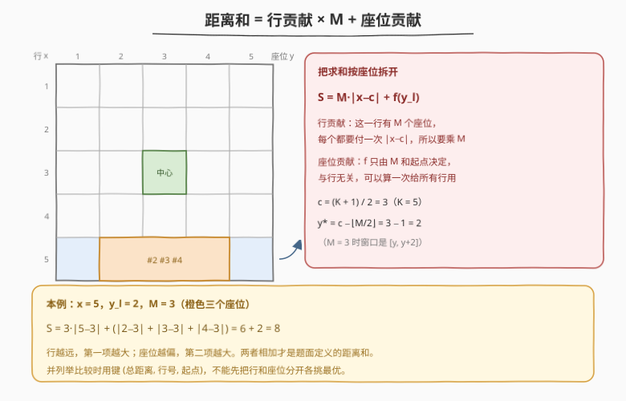
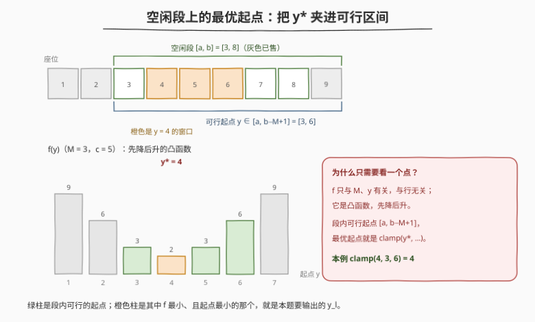
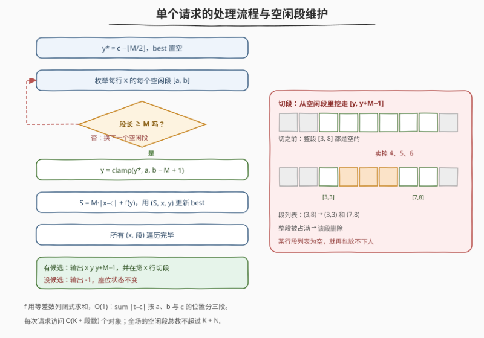
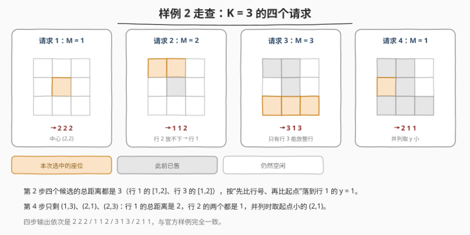

# Codeforces 10B 电影院售票选座 题解

## 1. 题目概述

- **题目链接**：https://codeforces.com/problemset/problem/10/B
- **比赛来源**：Codeforces Beta Round 10 · Problem B（2010-04-15）
- **难度**：1500
- **标签**：动态规划、实现（dp, implementation）
- **评测类型**：普通
- **限制**：时间 1 s / 内存 256 MB

**题意**：Berland 的影厅是 $K$ 行 $K$ 列的方阵，$K$ 是奇数，行列编号都从 $1$ 到 $K$。售票系统按请求依次出票：每次请求 $M$ 个人，必须给他们安排**同一行**里连续的 $M$ 个空座位（记行号为 $x$、座位区间为 $[y_l, y_r]$，$y_r - y_l + 1 = M$）。影厅中心是

$$\left(\frac{K+1}{2},\ \frac{K+1}{2}\right),$$

在所有可行方案中选 $M$ 个座位到中心的"距离和"最小者：

$$\sum_{i=1}^{M}\left(\left|x - \frac{K+1}{2}\right| + \left|y_i - \frac{K+1}{2}\right|\right).$$

若距离和相同，选行号 $x$ 更小的；若还相同，选 $y_l$ 更小的。对每个请求输出 `x y_l y_r`；若找不到连续 $M$ 个空座位，输出 `-1`（该请求不占座）。

**约束**：

- $1 \le N \le 1000$：请求要逐个模拟，且每次请求后座位状态会变，必须维护"哪些座位已售"。
- $1 \le K \le 99$（奇数）：最多约 $9801$ 个座位；每次请求的可能方案是 $O(K^2)$ 个。
- 若每次请求都枚举所有 $(x, y_l)$ 并逐座位累加距离，复杂度 $O(K^2 M) \le 10^6$，再乘 $N = 1000$ 就是 $10^9$，Python 必然超时、C++ 也很紧。必须把"距离和"用 $O(1)$ 算出来，或直接按空闲段处理。
- $1 \le M_i \le K$：单个请求一定放得进一行（只要有整行空着），但多次请求后可能放不下，需要输出 `-1`。
- 答案对每个请求唯一确定（不是多解），普通评测逐 token 比对。

## 2. 示例与观察

官方样例 1（输入 / 输出原样）：

```text
输入：
2 1
1 1

输出：
1 1 1
-1
```

官方样例 2（输入 / 输出原样）：

```text
输入：
4 3
1 2 3 1

输出：
2 2 2
1 1 2
3 1 3
2 1 1
```

**样例 1 演算**：$K = 1$，影厅只有一个座位，中心就是 $(1,1)$。

- 第 1 次请求 $M = 1$：唯一方案 $(1,[1,1])$，距离和 $0$，输出 `1 1 1`；
- 第 2 次请求 $M = 1$：唯一的座位已售，输出 `-1`。

**样例 2 演算**：$K = 3$，中心 $(2,2)$。逐次请求：

| 请求 | $M$ | 当前空闲情况 | 候选的距离和 | 选择 |
|------|-----|--------------|--------------|------|
| 1 | 1 | 全空 | 行 2 座 2：$0+0=0$ 最小 | `2 2 2` |
| 2 | 2 | 行 2 只剩座 1、3 | 行 1 的 $[1,2]$：$2|1-2| + (1+0) = 3$；行 3 同理 $3$；行 2 放不下 | `1 1 2`（并列取行号小） |
| 3 | 3 | 行 1 剩座 3，行 2 剩 1、3，行 3 全空 | 只有行 3 能放整行，$3 \cdot 1 + (1+0+1) = 5$ | `3 1 3` |
| 4 | 1 | 只剩 $(1,3)$、$(2,1)$、$(2,3)$ | 行 1 座 3：$1+1=2$；行 2 座 1：$0+1=1$；行 2 座 3：$0+1=1$ | `2 1 1`（并列取 $y_l$ 小） |

自造样例（标注"自造"，`⏎` 表示换行，均已用参考程序与暴力核对）：

| 输入 | 输出 | 说明 |
|------|------|------|
| `2 1 ⏎ 1 1` | `1 1 1` / `-1` | 官方样例 1，$K=1$ 的退化 |
| `4 3 ⏎ 1 2 3 1` | 见上 | 官方样例 2 |
| `3 5 ⏎ 3 1 1` | `3 2 4` / `2 3 3` / `4 3 3` | 第 3 次时中心行只剩两侧座位，第 4 行反而更优 |
| `2 3 ⏎ 3 3` | `2 1 3` / `1 1 3` | 整行售出后再来一个整行请求，换行而非 `-1` |
| `3 3 ⏎ 2 2 2` | `2 1 2` / `1 1 2` / `3 1 2` | 行 2 被切开后只能换行 |
| `3 5 ⏎ 1 1 1` | `3 3 3` / `2 3 3` / `3 2 2` | 并列时先比行号：第 2 次选行 2 而非行 3 的邻座 |
| `2 9 ⏎ 1 1` | `5 5 5` / `4 5 5` | 行 4 与行 6 完全对称，行号小的胜出 |
| `2 5 ⏎ 5 5` | `3 1 5` / `-1` | $M = K$ 只能占整行，第二次无解 |

第 3 组是本题的核心陷阱：**不能"先找离中心最近的可放行，再在该行里选座位"**。前两次请求之后，中心行 3 只剩 $1$、$5$ 两个座位，放一个 $M = 1$ 的人距离和是 $2$；而第 4 行中间空着，距离和只有 $0 + 1 = 1$，反而更优。必须把 $(总距离, 行号, 起点)$ 放在一起比较。

## 3. 解题思路

### 3.1 朴素做法与瓶颈

最直接的做法：对每个请求，枚举所有行 $x$ 和所有起点 $y_l$，检查 $[y_l, y_l + M - 1]$ 是否全空，再逐座位累加距离和，取最优。

复杂度是 $O(K^2 M)$ 每次请求。$K = 99$、$M = 99$、$N = 1000$ 时约 $10^9$ 次座位判断，C++ 勉强、Python 必然超时。即使把距离和用前缀和优化成 $O(1)$，每次仍有 $O(K^2) \approx 10^4$ 个候选，总计 $10^7$，对 1 s 的 Python 来说也偏紧。

真正的结构是：**每行的空闲座位天然是若干段连续区间**，而"距离和"对行、对段都能拆开算。据此可以把每次请求的代价降到 $O(K + \text{段数})$。

### 3.2 核心观察：距离和可以拆成"行贡献 + 座位贡献"



对固定的 $M$、行 $x$ 和区间 $[y_l, y_l + M - 1]$，距离和

$$\sum_{i}\Bigl(\bigl|x - c\bigr| + \bigl|y_i - c\bigr|\Bigr) = M\bigl|x - c\bigr| + f(y_l), \qquad f(y) = \sum_{t=y}^{y+M-1}\bigl|t - c\bigr|,$$

其中 $c = (K+1)/2$。注意两点：

1. **行贡献要乘 $M$**：这一行有 $M$ 个座位，每个座位都要付一次 $|x - c|$。漏掉这个 $M$ 会让"远行 + 好座位"错误地胜出。
2. **座位贡献 $f(y)$ 与行无关**：它只取决于 $M$ 和起点 $y$。所以同一个 $M$ 只要算一次 $f$ 序列，所有行都能复用。

$f$ 是凸函数：相邻两项之差

$$f(y+1) - f(y) = \bigl|y + M - c\bigr| - \bigl|y - c\bigr|$$

关于 $y$ 单调不减，所以 $f$ 先降后升。它的最小点在"窗口中心尽量靠近 $c$"处，即

$$y^{*} = c - \left\lfloor \frac{M}{2} \right\rfloor.$$



于是一行里的某个空闲段 $[a, b]$（长度 $\ge M$）上，可行的起点是 $[a,\ b - M + 1]$，由凸性，$f$ 在其中的最小值点就是把 $y^{*}$ **夹**到这个区间里：

$$y = \min\bigl(\max(y^{*}, a),\ b - M + 1\bigr).$$

这个 $y$ 还是该段内"取到最小值的起点中最小的一个"，正好符合"并列时 $y_l$ 最小"的规定。

### 3.3 算法流程



1. 令 $c = (K+1)/2$；给每一行维护一个**空闲段列表**，初始都是 `[(1, K)]`。
2. 对每个请求 $M$：
   1. 令 $y^{*} = c - \lfloor M/2 \rfloor$，初始化最优解为空；
   2. 枚举每一行 $x$ 与它的每个空闲段 $[a, b]$：
      - 若 $b - a + 1 < M$，跳过；
      - 否则 $y = \min(\max(y^{*}, a),\ b - M + 1)$，计算 `总距离 = M * |x - c| + f(y)`（$f$ 用闭式求和）；
      - 用键 $(总距离, x, y)$ 与当前最优比较，更小则替换；
   3. 若没有任何候选，输出 `-1`，该请求不占座；
   4. 否则输出 `x y y+M-1`，并在第 $x$ 行的空闲段列表中把 $[y, y+M-1]$ 这一段切掉（可能剩左半段、右半段、两段都有或都不剩）。
3. 处理完所有请求即结束。

$f$ 用等差数列闭式求和，$O(1)$：

```text
sum_{t=a}^{b} |t-c| =
  b <= c          : (c-a + c-b) * (b-a+1) / 2
  a >= c          : (a-c + b-c) * (b-a+1) / 2
  否则（a < c < b）: (c-a)(c-a+1)/2 + (b-c)(b-c+1)/2
```

这样每次请求只访问 $O(K + \text{段数})$ 个对象，而全场的空闲段总数不超过 $K + N$，整体非常轻。

### 3.4 样例走查：样例 2



$K = 3$、$c = 2$，初始三行都是 `[(1,3)]`。

| 请求 | $M$ | $y^{*}$ | 各候选 $(总距离, x, y)$ | 输出 | 选后第 $x$ 行空闲段 |
|------|-----|---------|--------------------------|------|----------------------|
| 1 | 1 | 2 | $(0,2,2)$、$(1,1,2)$、$(1,3,2)$ | `2 2 2` | `[(1,1),(3,3)]` |
| 2 | 2 | 1 | $(3,1,1)$、$(3,1,2)$、$(3,3,1)$、$(3,3,2)$ | `1 1 2` | `[(3,3)]` |
| 3 | 3 | 1 | $(5,3,1)$ | `3 1 3` | `[]` |
| 4 | 1 | 2 | $(2,1,3)$、$(1,2,1)$、$(1,2,3)$ | `2 1 1` | `[(2,3)]` |

第 2 次请求是并列最多的一步：四个候选的总距离都是 $3$，按"行号小优先"落到行 1，再按"起点小优先"落到 $y_l = 1$，与样例输出一致。

第 3 次请求只枚举到行 3 的唯一候选：$M|x - c| = 3 \cdot 1 = 3$，$f(1) = |1-2| + |2-2| + |3-2| = 2$，合计 $5$。

## 4. 正确性证明

**引理 1（距离和的可分解性）**：对任意行 $x$ 与区间 $[y, y+M-1]$，距离和 $S(x, y) = M|x - c| + f(y)$，其中 $f(y) = \sum_{t=y}^{y+M-1}|t - c|$。

**证明**：把求和项按座位拆开，$\sum_{i=1}^{M}\bigl(|x-c| + |y_i-c|\bigr) = \sum_{i=1}^{M}|x-c| + \sum_{i=1}^{M}|y_i-c|$。第一项是 $M$ 个相同的数，等于 $M|x-c|$；第二项正是 $f(y)$（座位号是 $y, y+1, \dots, y+M-1$）。∎

**引理 2（$f$ 是凸函数，最小值点已知）**：$f(y+1) - f(y) = |y+M-c| - |y-c|$ 关于 $y$ 单调不减；且当 $y^{*} = c - \lfloor M/2 \rfloor$ 落在定义域内时，它是 $f$ 的最小值点之一，也是最小的最小值点。

**证明**：差分为 $d(y) = |y+M-c| - |y-c|$。绝对值函数是凸的、且 $y+M-c$ 与 $y-c$ 的差是常数 $M > 0$，故 $d(y)$ 关于 $y$ 单调不减，$f$ 为离散凸函数。

求最小值点：令 $y = c - M/2 + \delta$，则 $y - c = -M/2 + \delta$、$y + M - c = M/2 + \delta$，于是
$d(y) = |M/2 + \delta| - |\delta - M/2|$。当 $\delta < 0$ 时 $d < 0$（还要看 $|\delta|$ 与 $M/2$ 的大小），当 $\delta > 0$ 时 $d > 0$；$\delta = 0$ 时 $d = 0$。因此 $f$ 在 $y \le c - M/2$ 上不增、在 $y \ge c - M/2$ 上不减，最小值点集非空。$c - M/2 \ge c - \lfloor M/2 \rfloor - 1/2$；对整数 $y$，最小的使 $d(y) \ge 0$ 的 $y$ 正是 $y^{*} = c - \lfloor M/2 \rfloor$（$M$ 偶数是 $d(y^{*}) = 0$ 的平底起点，$M$ 奇数是斜率变号处），故 $y^{*}$ 是最小值点且是最小的一个。∎

**引理 3（空闲段上的最优起点就是夹住的 $y^{*}$）**：设某行的一段连续空座为 $[a, b]$ 且 $b - a + 1 \ge M$，则可行起点集合是 $[a, b - M + 1]$，其中使 $f$ 最小、且最小的起点是 $y = \min(\max(y^{*}, a), b - M + 1)$。

**证明**：由引理 2，$f$ 在 $y \le y^{*}$ 上不增、在 $y \ge y^{*}$ 上不减。若 $y^{*} < a$，则 $f$ 在整个可行区间上不减，最小点在左端点 $a$，夹取给出 $a$；若 $y^{*} > b - M + 1$，则 $f$ 在整个区间上不增，最小点在右端点，夹取给出 $b - M + 1$；否则 $y^{*}$ 本身在区间内，是（最小的）最小值点。三种情况都与夹取公式一致。∎

**引理 4（空闲段列表的不变式）**：每次请求处理完后，第 $x$ 行的空闲段列表恰好是"该行所有空座位构成的极大连续区间"。

**证明**：初始时每行整行是一段，成立。请求售出 $[y, y+M-1]$ 时，该区间必然完整落在某个段 $[a, b]$ 内（因为候选只从段内产生），把这一段替换为 $[a, y-1]$（若非空）与 $[y+M, b]$（若非空），其余段不变；这正好是从极大连续区间里挖掉一个子区间后的结果。∎

**定理**：算法对每个请求输出的三元组与题面定义的选择完全一致；无可行方案时输出 `-1`。

**证明**：由引理 4，算法枚举的候选集恰是"该行该段内所有合法区间"的代表——由引理 3，每段内使 $S$ 最小的方案就取在夹取的 $y$ 处，且并列时取最小起点；把这些代表按键 $(S, x, y)$ 取最小，等于在所有合法方案中按"距离和最小 → 行号最小 → 起点最小"取最优（因为对同一段内其他 $y$，$S$ 不减且 $y$ 更大，键一定更差）。若所有段都放不下 $M$，则不存在合法方案，输出 `-1` 且不改动座位，符合题面。∎

## 5. 复杂度分析

- **时间**：每次请求枚举 $K$ 行与这些行的全部空闲段。全场空闲段数不超过 $K + N$（初始 $K$ 段，每次售出最多把一段切成两段，净增至多 1），故单次请求 $O(K + N)$，总计 $O\bigl(N(K + N)\bigr)$，$N = 1000$、$K = 99$ 时约 $1.1 \times 10^6$ 次操作。
- **空间**：$O(K + N)$ 存空闲段，外加 $O(1)$ 的当前最优；不存 $K \times K$ 的座位表也能做，但存了也只有 $9801$ 字节。
- **数值范围**：$M|x-c| \le 99 \times 49 \approx 4.9 \times 10^3$，$f \le 99 \times 49 \approx 4.9 \times 10^3$，总距离不超过 $10^4$，`int` 完全够用。
- **与时限的关系**：时限 1 s，四组 $N = 1000$、$K = 99$ 的极端数据（全为单人请求、整行包场、随机大小、交替大小制造碎片）实测 C++ 端到端 $3.4 \sim 4.1$ ms、峰值内存 $1.7$ MB；Python $39 \sim 68$ ms、峰值 $10.1$ MB。相对 1 s 的余量在 14 倍以上（Python 也在 15 倍以上），不需要依赖 PyPy3。

## 6. 参考代码

### C++17

```cpp
#include <bits/stdc++.h>
using namespace std;

// 区间 [a, b] 上所有座位到中心 c 的距离和：sum_{t=a}^{b} |t-c|
static long long distSum(int a, int b, int c) {
    if (b <= c) {
        long long len = b - a + 1;
        return static_cast<long long>(c - a + c - b) * len / 2;
    }
    if (a >= c) {
        long long len = b - a + 1;
        return static_cast<long long>(a - c + b - c) * len / 2;
    }
    long long L = c - a, R = b - c;
    return L * (L + 1) / 2 + R * (R + 1) / 2;
}

int main() {
    ios::sync_with_stdio(false);
    cin.tie(nullptr);

    int n, K;
    if (!(cin >> n >> K)) return 0;
    const int c = (K + 1) / 2;             // 影厅中心（K 为奇数，c 是整数）

    // 每行维护若干段“连续空座”，初始整行都是一段
    vector<vector<pair<int, int>>> blocks(K + 1);
    for (int x = 1; x <= K; ++x) blocks[x].push_back({1, K});

    for (int q = 0; q < n; ++q) {
        int M;
        cin >> M;

        // 座位方向的最优起点：窗口中心尽量贴近 c，M 为偶数时取靠左的那个
        const int ystar = c - M / 2;

        int bestX = -1, bestY = -1;
        long long bestTotal = LLONG_MAX;

        for (int x = 1; x <= K; ++x) {
            long long rowCost = 1LL * M * abs(x - c);   // 行方向贡献，M 个座位各算一次
            if (rowCost > bestTotal) continue;          // 已经比当前最优差，不必再看
            for (const auto &blk : blocks[x]) {
                int a = blk.first, b = blk.second;
                if (b - a + 1 < M) continue;            // 这一段装不下 M 个人
                int R = b - M + 1;                      // 起点允许的最大值
                int y = ystar;                          // 凸函数在区间上的最优点 = clamp
                if (y < a) y = a;
                else if (y > R) y = R;

                long long total = rowCost + distSum(y, y + M - 1, c);
                if (total < bestTotal ||
                    (total == bestTotal && (x < bestX || (x == bestX && y < bestY)))) {
                    bestTotal = total;
                    bestX = x;
                    bestY = y;
                }
            }
        }

        if (bestX == -1) {
            cout << -1 << '\n';
            continue;
        }
        cout << bestX << ' ' << bestY << ' ' << bestY + M - 1 << '\n';

        // 从该行的空闲段中切掉 [bestY, bestY+M-1]
        auto &v = blocks[bestX];
        for (size_t i = 0; i < v.size(); ++i) {
            int a = v[i].first, b = v[i].second;
            if (a <= bestY && bestY + M - 1 <= b) {
                vector<pair<int, int>> nv;
                if (a <= bestY - 1) nv.push_back({a, bestY - 1});
                if (bestY + M <= b) nv.push_back({bestY + M, b});
                v.erase(v.begin() + i);
                v.insert(v.begin() + i, nv.begin(), nv.end());
                break;
            }
        }
    }
    return 0;
}
```

### Python3

```python
import sys


def dist_sum(a: int, b: int, c: int) -> int:
    """sum_{t=a}^{b} |t-c|，闭式求和"""
    if b <= c:
        return (c - a + c - b) * (b - a + 1) // 2
    if a >= c:
        return (a - c + b - c) * (b - a + 1) // 2
    left, right = c - a, b - c
    return left * (left + 1) // 2 + right * (right + 1) // 2


def main() -> None:
    data = sys.stdin.buffer.read().split()
    if not data:
        return
    n, K = int(data[0]), int(data[1])
    req = [int(x) for x in data[2:2 + n]]
    c = (K + 1) // 2                      # 影厅中心

    blocks = {x: [(1, K)] for x in range(1, K + 1)}   # 每行的连续空座段
    out = []

    for M in req:
        ystar = c - M // 2                # 座位方向最优点（可能越界，后面 clamp）
        best = None                       # (total, x, y)

        for x in range(1, K + 1):
            row_cost = M * abs(x - c)
            if best is not None and row_cost > best[0]:
                continue
            for a, b in blocks[x]:
                if b - a + 1 < M:
                    continue
                R = b - M + 1
                y = a if ystar < a else (R if ystar > R else ystar)
                total = row_cost + dist_sum(y, y + M - 1, c)
                cand = (total, x, y)
                if best is None or cand < best:
                    best = cand

        if best is None:
            out.append("-1")
            continue
        _, x, y = best
        out.append(f"{x} {y} {y + M - 1}")

        v = blocks[x]
        for i, (a, b) in enumerate(v):
            if a <= y and y + M - 1 <= b:
                nv = []
                if a <= y - 1:
                    nv.append((a, y - 1))
                if y + M <= b:
                    nv.append((y + M, b))
                v[i:i + 1] = nv
                break

    sys.stdout.write("\n".join(out) + "\n")


main()
```

Python 版用元组 `(total, x, y)` 直接比较，字典序恰好就是题目要求的"距离和 → 行号 → 起点"，不用手写三段比较。

## 7. 边界情况与易错点

1. **行贡献忘了乘 $M$**：距离和对每个座位都要算一次 $|x - c|$，所以是 $M|x-c|$。只写 $|x-c|$ 会让远处的行被严重低估，样例 2 的第 2 步就可能选错。
2. **并列规则的三层顺序**：先比总距离，再比行号 $x$，最后比起点 $y_l$。实现时直接用键 $(总距离, x, y)$ 比较即可；若把行号放在总距离之前，就会退化成"永远选最靠中心的可行行"。
3. **不能先选最近的可放行**：自造样例 `3 5 ⏎ 3 1 1` 的第 3 步就是反例——中心行 3 只剩两侧座位，距离和 $2$；第 4 行中间空着，距离和 $1$，更优。必须把行贡献和座位贡献合成总距离再比较。
4. **$f$ 的最小点要夹到可行区间**：窗口的全局最优起点 $y^{*}$ 可能落在段外（段被切过之后很常见），必须 `clamp` 到 $[a,\ b - M + 1]$，否则会给出一个越界或已被占用的方案。
5. **切分空闲段的三种结果**：卖掉 `[y, y+M-1]` 后，某段可能剩下左边一段、右边一段、两段都剩（从中间挖走）、或什么都不剩（整段刚好被占满）。四种情况都要正确，漏掉"两边都剩"会在后续请求里漏掉可用座位。
6. **`-1` 时不能占座**：找不到方案时只输出 `-1`，座位状态不变；如果误把某个候选标记为已售，后续答案会全错。
7. **$M = K$ 只能整行**：此时每行只有 $y_l = 1$ 一个候选，$y^{*}$ 会被夹成 $1$；若某行只剩部分座位，该行直接不可用。
8. **$K = 1$ 的退化**：第一次请求 $M = 1$ 输出 `1 1 1`，第二次必然 `-1`（样例 1 就是这一组）。
9. **座位号是 1-based**：输出的是 $y_l$ 与 $y_r = y_l + M - 1$，不要输出 0-based 下标，也不要把 $y_r$ 写成 $y_l + M$。
10. **$f$ 的闭式求和边界**：当 $a = c$ 或 $b = c$ 时，公式的分支要能正确处理等号（代码里用 `b <= c` 与 `a >= c` 两支，覆盖了等号）。

## 8. 验证记录

- **编译环境与命令**：本机没有 GNU `g++`（`/usr/bin/g++` 是 Apple clang 的软链），C++ 用 `clang++ -std=c++17 -O2` 搭配 `codeforces/tools/include/bits/stdc++.h` 兼容头编译，代码只用标准库，可原样提交 GNU C++17；Python 为 `Python 3.9.6`。文档结构 / 编译 / 样例由 `python3 codeforces/tools/verify_solution.py codeforces/contests/0001-0100/10/B_电影院售票选座.md` 一条命令复核。
- **官方样例**：2 / 2 通过（`samples 2`、`C++ 编译 OK, 样例 2/2`、`Python 语法 OK, 样例 2/2`）。
- **独立暴力对拍**：另写完全按题面定义的暴力程序（枚举所有 $(x, y_l)$，逐座位累加 $|x-c| + |y_i-c|$，用键 $(总距离, x, y_l)$ 取最小，再标记已售），生成 **250 组**随机小数据（$K \in \{1,3,5,7\}$ 或 $\{1,3,5,5,7,9\}$，$N \le 12$，$M_i \in [1, K]$ 随机，两种模式分别侧重"小场次"与"高密度请求"），C++ 与 Python 各跑一遍，合计 **500 次**逐行文本比对，**0 处不符**。
- **最大约束性能**：四组 $N = 1000$、$K = 99$ 数据——(a) 1000 个单人请求；(b) 先来一个 99 人整行请求，再来 999 个单人请求；(c) 1000 个随机 $M \in [1,99]$ 的请求（654 个 `-1`）；(d) 单人请求与 2~4 人请求交替（大量切段）。C++ 端到端 $3.4 \sim 4.1$ ms、峰值内存 $1.7$ MB；Python $39 \sim 68$ ms、峰值 $10.1$ MB。
- **图片校验**：三张 SVG（`cf10b_cost_split.svg`、`cf10b_block_clamp.svg`、`cf10b_algorithm_flow.svg`）均通过 `xml.etree.ElementTree.parse`，并用无头浏览器读取每个 `text` 的 `getBBox` 复核：无越出 `viewBox`、无文字互相重叠、无文字溢出所在方框。
- **公式校验**：正文公式经 `node codeforces/tools/katex_check.cjs`（`throwOnError`）渲染无报错。
- **复核状态**：verified（样例、500 次对拍、性能、图片、公式五项均实跑通过；环境差异仅在于本机无 GNU g++，已用 clang++ 等价验证）。

## 相关题目与扩展

- [Codeforces 10A Power Consumption Calculation](https://codeforces.com/problemset/problem/10/A)：同场 A 题，按时间段分段累加，和本篇一起构成"实现 + 细心"的入门组合。
- [Codeforces 4A 西瓜](https://codeforces.com/problemset/problem/4/A)、[Codeforces 4B Before an Exam](https://codeforces.com/problemset/problem/4/B)：更早的入门题。
- [Codeforces 567C Geometric Progression](https://codeforces.com/problemset/problem/567/C)：同样是"按定义统计方案"，但要用哈希/前后缀把 $O(n^2)$ 压到 $O(n)$。
- [LeetCode 855. 考场就座](https://leetcode.cn/problems/exam-room/)：与本题神似——动态维护空段并找"离最近的人最远"的座位，只是距离定义换成了"最大最小距离"，可以用有序集合实现。
- [LeetCode 1229. 安排会议日程](https://leetcode.cn/problems/meeting-scheduler/)：区间匹配的另一种"连续段"问题，训练对区间的处理直觉。

**延伸思考**：

1. **如果 $K$ 放大到 $10^5$**：$O(K)$ 每请求的代价变成 $10^8$，需要把"行"也做成有序结构：以 $(M|x-c|)$ 为关键字维护每行当前的最优候选，售出后只更新该行。由于行贡献只与 $x$ 有关，可以用线段树/堆在 $O(\log K)$ 内取全局最优。
2. **如果要求"整场最优"而不是逐个请求**：即给定请求序列，允许调整出票顺序来最大化收益（或多安排人），问题会变成区间打包的组合优化，远难于逐个模拟。
3. **如果距离改成欧氏距离** $\sqrt{(x-c)^2 + (y-c)^2}$：距离和不再能拆成"行 + 座位"两部分，凸性也被破坏，只能逐候选计算，$O(K^2)$ 每次请求成为必须；这正说明本题可分解是"曼哈顿距离 + 矩形厅"共同给的便利。
4. **如果把"连续 $M$ 个座位"换成"任意 $M$ 个空座"**：问题退化成"选 $M$ 个最近的空座"，只需按距离排序取前 $M$ 个，行号的并列规则也随之改变——约束里"必须在同一行连续"是本篇所有结构（行贡献 × $M$、空闲段）的前提。
5. **如果影厅不是奇数阶**：中心 $c = (K+1)/2$ 会变成半整数，距离和出现 $1/2$ 的倍数，最小化结论不变但比较时要把所有距离乘 2 用整数做，避免浮点误差。
