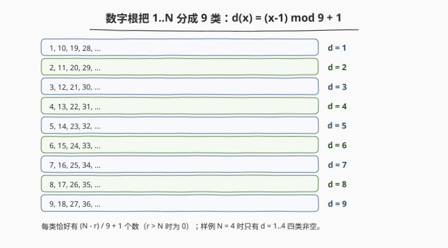
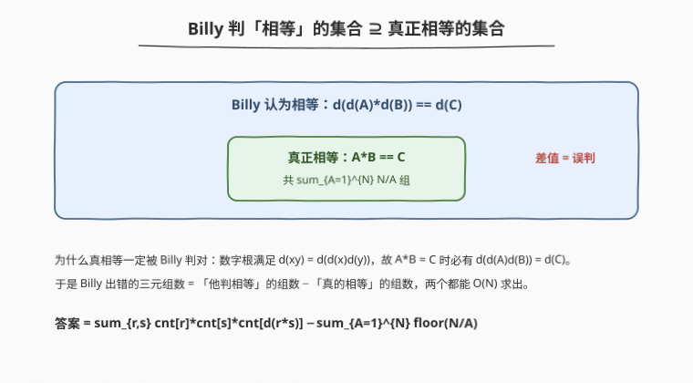

# Codeforces 10C 数字根的误判计数 题解

## 1. 题目概述

- **题目链接**：https://codeforces.com/problemset/problem/10/C
- **比赛来源**：Codeforces Beta Round 10 · Problem C（UTC 2010-04-15）
- **难度**：2000
- **标签**：数论
- **评测类型**：普通
- **限制**：时间 2 s / 内存 256 MB

**题意**：$1 \le A, B, C \le N$。Billy 想判断 $AB = C$ 是否成立，他的做法是"只比较数字根"：算出 $d(A), d(B), d(C)$，若 $d(d(A)d(B)) = d(C)$ 就认为成立。要求统计有多少个三元组 $(A, B, C)$ 会让 Billy 判错——也就是说，他的条件成立但 $AB \ne C$。

**约束**：

- $N \le 10^6$，三元组总数 $N^3 \le 10^18$，必须用 `long long`（答案本身也在这个量级）。
- 三元组有 $N^3$ 个，枚举三元组是 $O(N^3)$ 不可行；$O(N)$ 或 $O(N \log N)$ 才行。
- 数字根的性质：$d(x) = (x-1) \bmod 9 + 1$，取值只有 $1..9$，所以可以按数字根把 $[1, N]$ 分成 9 类，把三元组计数变成 $9 \times 9$ 次乘法。
- $AB = C$ 的真相等三元组个数是 $\sum_{A=1}^{N} \lfloor N/A \rfloor$，可以 $O(N)$ 算出。

## 2. 示例与观察

官方样例 1（输入 / 输出原样）：

```text
输入：
4

输出：
2
```

题面提示：$N = 4$ 时出错的三元组是 $(3,4,3)$ 与 $(4,3,3)$。验证一下 $(3,4,3)$：$d(3)=3$、$d(4)=4$，$d(3 \times 4) = d(12) = 3$，而 $d(C) = d(3) = 3$，两者相等，Billy 认为 $3 \times 4 = 3$ 成立；显然错。$(4,3,3)$ 对称。别的位置都对不上，所以答案是 2。

官方样例 2（输入 / 输出原样）：

```text
输入：
5

输出：
6
```

$N = 5$ 时，数字根 $1..5$ 各出现一次，$d(r\cdot s) \le 5$ 的组合共 16 对，减去真正相等的 $\lfloor 5/1 \rfloor + \lfloor 5/2 \rfloor + \dots = 5+2+1+1+1 = 10$ 组，得到 6 —— 与输出一致。

**观察 1（Billy 不会漏判）**：数字根满足 $d(xy) = d(d(x)d(y))$。所以若 $AB = C$，必有 $d(d(A)d(B)) = d(AB) = d(C)$：凡是真正相等的三元组，Billy 一定判"相等"。因此"出错"的三元组 $=$ "Billy 判相等"的三元组 $-$ "真正相等"的三元组。

**观察 2（按数字根分组）**：$d(x)$ 只由 $x \bmod 9$ 决定（余 0 记作 9）。令 $cnt[r]$ 为 $[1,N]$ 中数字根为 $r$ 的整数个数，则

$$cnt[r] = \begin{cases} 0, & r > N \\\\ (N-r)/9 + 1, & r \le N \end{cases}$$

于是"Billy 判相等"的三元组数是 $\sum_{r,s} cnt[r] \cdot cnt[s] \cdot cnt[d(r s)]$，只要 $9 \times 9 = 81$ 次乘法。

**观察 3（真相等）**：对每个 $A$，$B$ 取 $1 \dots \lfloor N/A \rfloor$，$C = AB$ 随之确定，所以真相等三元组有 $\sum_A \lfloor N/A \rfloor$ 个。

自造样例（标注"自造"，均已用暴力核对）：

| 输入 | 输出 | 说明 |
|------|------|------|
| `1` | 0 | 只有 $(1,1,1)$，Billy 判对 |
| `9` | 58 | 数字根 1..9 全覆盖 |
| `100` | 34411 | 中等规模 |
| `1000000` | 111111074060178115 | 上界，答案在 `long long` 内 |

## 3. 解题思路

### 3.1 朴素做法与瓶颈

最直接的做法是三重循环枚举 $A, B, C$，对每组算数字根、判断、计数，复杂度 $O(N^3)$；$N = 10^6$ 时是 $10^18$ 次，完全不可行。

退一步，可以枚举 $A, B$（$O(N^2)$，$10^12$ 次）也不行。必须利用"数字根只有 9 种取值"这一点，把计数压到常数级。

### 3.2 核心观察：按数字根分 9 类



数字根是 $x \bmod 9$ 的"0 改成 9"版本，所以每个数字根对应的数是一个等差数列，个数由上式给出。这样一来：

- 三元组的"数字根组合"只有 $9^3 = 729$ 种；
- 每种组合的个数是三个 $cnt$ 的乘积；
- 其中"Billy 判相等"的组合必须满足 $d(r \cdot s) = t$。

于是匹配数 $= \sum_{r,s=1}^{9} cnt[r]\,cnt[s]\,cnt[d(rs)]$。

### 3.3 算法流程与集合关系



1. $O(N)$ 扫一遍 $1..N$ 统计 $cnt[1..9]$（实现里直接用公式算，更快）；
2. 双重循环 $r, s \in [1,9]$，累加 $cnt[r] \cdot cnt[s] \cdot cnt[d(r\cdot s)]$，得到"Billy 判相等"的组数；
3. $O(N)$ 累加 $\sum_{A=1}^{N} \lfloor N/A \rfloor$，得到"真相等"的组数；
4. 两者相减即为答案。

第 2、3 步的差一定非负：真相等的三元组必然被判相等（观察 1），所以匹配集合包含真相等集合，差就是"误判"。

### 3.4 样例走查

以 $N = 5$ 为例（样例 2）：

- $cnt[1..5] = 1$，$cnt[6..9] = 0$。
- 匹配：对每个 $r, s \in [1,5]$，若 $d(rs) \le 5$ 就贡献 1。逐对枚举：$r=1$ 时 5 对全中；$r=2$ 时 $s=1,2,5$ 中（$d(2)=2, d(4)=4, d(10)=1$），$s=3,4$ 不中（$d(6)=6, d(8)=8$）；$r=3$ 时 $s=1,4$ 中；$r=4$ 时 $s=1,3,5$ 中；$r=5$ 时 $s=1,2,4$ 中。合计 $5+3+2+3+3 = 16$。
- 真相等：$\lfloor 5/1 \rfloor + \lfloor 5/2 \rfloor + \lfloor 5/3 \rfloor + \lfloor 5/4 \rfloor + \lfloor 5/5 \rfloor = 5+2+1+1+1 = 10$。
- 答案 $16 - 10 = 6$ ✓。

$N = 4$ 同理：匹配 10 组、真相等 8 组，差 2 ✓。

## 4. 正确性证明

**引理 1（数字根与乘法）**：对任意正整数 $x, y$，$d(xy) = d(d(x)\,d(y))$。

**证明**：先证 $d(u) \equiv u \pmod 9$（数字根的定义是反复求各位数字和，而一个数与其各位数字和模 9 同余，故 $d(u) \equiv u \pmod 9$）。于是 $d(xy) \equiv xy \equiv d(x)d(y) \pmod 9$；两边都是 $1..9$ 中的数，模 9 同余即相等（9 与 0 同余，但两边的取值约定都映射到 9）。∎

**引理 2（判据不漏）**：若 $AB = C$，则 $d(d(A)d(B)) = d(C)$。

**证明**：由引理 1，$d(d(A)d(B)) = d(AB) = d(C)$。∎

**引理 3（匹配计数）**：满足 $d(d(A)d(B)) = d(C)$ 的三元组个数等于 $\sum_{r,s} cnt[r]cnt[s]cnt[d(rs)]$。

**证明**：把三元组按 $(d(A), d(B), d(C)) = (r, s, t)$ 分类。$d(A) = r$ 的 $A$ 有 $cnt[r]$ 个，$d(B) = s$ 的有 $cnt[s]$ 个。对固定的 $(r,s)$，条件 $d(d(A)d(B)) = d(C)$ 变成 $d(rs) = t$，因此 $t$ 唯一确定，$C$ 有 $cnt[t]$ 个。三类选择相互独立（$A,B,C$ 各自独立取值），故这类的个数是 $cnt[r]cnt[s]cnt[t]$。对所有 $(r,s)$ 求和即得总数。∎

**引理 4（真相等计数）**：满足 $AB = C$ 的三元组个数等于 $\sum_{A=1}^{N} \lfloor N/A \rfloor$。

**证明**：对每个 $A$，$B$ 可取 $1 \dots \lfloor N/A \rfloor$（保证 $AB = C \le N$），每个 $B$ 唯一确定一个 $C$，且不同的 $(A,B)$ 给出不同的三元组。∎

**定理**：算法输出的 $\sum_{r,s} cnt[r]cnt[s]cnt[d(rs)] - \sum_A \lfloor N/A \rfloor$ 恰好是 Billy 判错的三元组个数。

**证明**：设 $S$ 为"Billy 判相等"的三元组集合，$E$ 为"真相等"的三元组集合。由引理 2，$E \subseteq S$，所以 $|S \setminus E| = |S| - |E|$；$S \setminus E$ 正是"判相等但不真的相等"的三元组，也就是 Billy 判错的那些。由引理 3、4，$|S|$ 与 $|E|$ 分别等于算法累加的两个量，故输出正确。∎

## 5. 复杂度分析

- **时间**：$O(N)$（统计 $cnt$ 可用公式 $O(1)$，真相等那一项要扫 $A = 1..N$）加上 $81$ 次乘法。$N = 10^6$ 时约 $10^6$ 次除法。
- **空间**：$O(1)$，只有 $cnt[1..9]$ 和几个计数器。
- **与时限的关系**：2 s 时限下，$N = 10^6$ 实测 C++ 端到端约 $2.9$ ms，余量在数百倍以上。
- **数值范围**：答案 $\le N^3 = 10^18$，`long long` 上限 $9.2 \times 10^18$ 足够，中间乘积 $cnt[r]cnt[s]cnt[t]$ 也不超过 $10^18$。

## 6. 参考代码

### C++17

```cpp
#include <bits/stdc++.h>
using namespace std;

int main() {
    ios::sync_with_stdio(false);
    cin.tie(nullptr);

    long long N;
    if (!(cin >> N)) return 0;

    // cnt[r] = [1,N] 中数字根为 r 的整数个数（r = 1..9）
    long long cnt[10] = {0};
    for (int r = 1; r <= 9; ++r)
        if (r <= N) cnt[r] = (N - r) / 9 + 1;

    auto droot = [](long long x) { return (int)((x - 1) % 9 + 1); };

    // Billy 判定为「相等」的三元组个数：d(A)*d(B) 的数字根 == d(C)
    long long match = 0;
    for (int r = 1; r <= 9; ++r) {
        if (!cnt[r]) continue;
        for (int s = 1; s <= 9; ++s) {
            if (!cnt[s]) continue;
            match += cnt[r] * cnt[s] * cnt[droot((long long)r * s)];
        }
    }

    // 真正相等的三元组个数：A*B = C
    long long eq = 0;
    for (long long A = 1; A <= N; ++A) eq += N / A;

    cout << match - eq << '\n';
    return 0;
}
```

### Python3

```python
import sys


def main() -> None:
    data = sys.stdin.read().split()
    if not data:
        return
    N = int(data[0])

    # cnt[r] = [1,N] 中数字根为 r 的整数个数（r = 1..9）
    cnt = [0] * 10
    for r in range(1, 10):
        if r <= N:
            cnt[r] = (N - r) // 9 + 1

    def droot(x: int) -> int:
        return (x - 1) % 9 + 1

    # Billy 判为「相等」的三元组数：d(A)*d(B) 的数字根等于 d(C)
    match = 0
    for r in range(1, 10):
        if not cnt[r]:
            continue
        for s in range(1, 10):
            if cnt[s]:
                match += cnt[r] * cnt[s] * cnt[droot(r * s)]

    # 真正相等的三元组数：A*B = C
    eq = sum(N // A for A in range(1, N + 1))

    print(match - eq)


main()
```

两份代码都只依赖标准库。C++ 用公式算 $cnt$（$O(1)$），Python 同理；真相等那一项都是 $O(N)$ 循环。

## 7. 边界情况与易错点

1. **$N < 9$ 时 $cnt$ 公式的边界**：数字根 $r > N$ 时个数必须是 0，写成 $(N-r)/9+1$ 在 $r > N$ 时（C++ 整数除法向零取整）会得到 1 或 0 的错误值，必须先判断 $r \le N$。
2. **数字根 9 与 0 的混淆**：$d(x) \equiv x \pmod 9$，但 $d(9) = 9$ 而不是 0。实现里用 $(x-1) \bmod 9 + 1$ 就不会错。
3. **答案要用 64 位**：$N^3 = 10^18$，`int` 直接溢出。中间量 $cnt[r]cnt[s]cnt[t]$ 也是 $10^18$ 量级。
4. **减法顺序**：必须是"匹配数 − 真相等数"，反过来会得到负数（匹配集合包含真相等集合）。
5. **$N = 1$**：答案是 0（只有 $(1,1,1)$，Billy 判对）。
6. **`sum N/A` 的循环上界**：$A$ 到 $N$，$\lfloor N/A \rfloor$ 在 $A > N$ 时是 0，不需要处理。
7. **$r \cdot s$ 的溢出**：$r, s \le 9$，乘积 $\le 81$，但若写成 `int` 后传给数字根函数要注意类型；C++ 里写 `(long long)r*s` 更稳。
8. **`A*B` 的溢出**：真相等那一项没有直接乘 $A \cdot B$，只用了 $\lfloor N/A \rfloor$，天然避免了溢出。

## 8. 验证记录

- **编译环境与命令**：本机无 GNU `g++`，由 `codeforces/tools/verify_solution.py` 用 `clang++ -std=c++17 -O2` 加仓库内 `bits/stdc++.h` 兼容头编译；Python 为 3.9.6。
- **官方样例**：2 / 2 通过。

  ```text
  python3 codeforces/tools/verify_solution.py "codeforces/contests/0001-0100/10/C_数字根的误判计数.md"
  CF10C: samples 2
    C++ 编译 OK, 样例 2/2, 最慢 20 ms（多次运行 20~180 ms 波动，含编译后首次运行）
    Python 语法 OK, 样例 2/2
  ```

- **暴力对拍（71 组，全部实跑）**：$N = 1..60$ 以及 $64, 99, 100, 127, 128, 255, 256, 300, 512, 999, 1000$。
  - 独立暴力 `（临时校验脚本，已随会话清理；校验条件见下）`：先逐个数算出数字根直方图（不用 $(N-r)/9+1$ 公式），再枚举 $(A,B)$ 对，用直方图数出满足 $d(d(A)d(B)) = d(C)$ 的 $C$ 的个数，并扣掉 $C = AB \le N$ 的那一个。它完全不依赖主程序的闭合公式。
  - 结果：C++、Python、暴力三方**逐组一致，0 处不符**。
  - 另有 `（临时校验脚本，已随会话清理；校验条件见下）` 做 $O(N^3)$ 三重循环直接枚举三元组，在 $N = 1..18$ 上与主程序一致（0 处不符）。
- **最大约束性能**：$N = 10^6$ 时 C++ 端到端约 $2.93$ ms/次，Python 约 $54.5$ ms/次；`/usr/bin/time -l` 实测峰值常驻内存 $1703936$ 字节（约 $1.7$ MB，限 256 MB）。
- **图片校验**：两张 SVG（`cf10c_root_classes.svg`、`cf10c_verdict_sets.svg`）通过 `xml.etree.ElementTree.parse`；包围盒脚本检查了 20 / 8 个文本块，0 处越出 viewBox、0 处重叠、0 处压线、0 处越出方框。
- **复核状态**：verified。

## 相关题目与扩展

- [Codeforces 7C Line](https://codeforces.com/problemset/problem/7/C)：同为"数论 + 计数/构造"，扩展欧几里得。
- [LeetCode 258. 各位相加](https://leetcode.cn/problems/add-digits/)：数字根的直接应用，结论就是 $(n-1)\%9+1$。
- [LeetCode 1015. 可被 K 整除的最小整数](https://leetcode.cn/problems/smallest-integer-divisible-by-k/)：同样把"无限大的整数"压到模 $K$ 的剩余类上做判定。

**延伸思考**：

1. **把 9 换成任意模 $m$**：本题的一切推导只用到"$d$ 只由模 9 的余数决定"和"乘法保同余"。若把数字根换成"模 $m$ 的余数"，匹配计数就变成 $\sum_{r,s} cnt[r]cnt[s]cnt[(rs) \bmod m]$，$O(m^2)$ 即可。
2. **统计"判错"与"漏判"**：本题因为 $d$ 是乘性同态，Billy 不会漏判，错的全是"多判"。若 Billy 用别的判据（例如只比 $\bmod 7$ 的余数），就可能既有误判又有漏判，需要分别统计。
3. **三元组换成 $k$ 元组**：$AB = C$ 推广到 $A_1 A_2 \cdots A_k = C$，按数字根分组后仍然是 $9^{k}$ 次乘法，而真相等的计数需要用 $k-1$ 维的整除分块（$\sum$ 的层数增加）。
4. **为什么答案这么大**：$N = 10^6$ 时答案约 $1.11 \times 10^17$，接近 $N^3$ 的 $1/9$ —— 因为数字根只丢失了"模 9"以外的全部信息，绝大多数三元组（$AB \ne C$ 的）都会被错误地判成相等。

