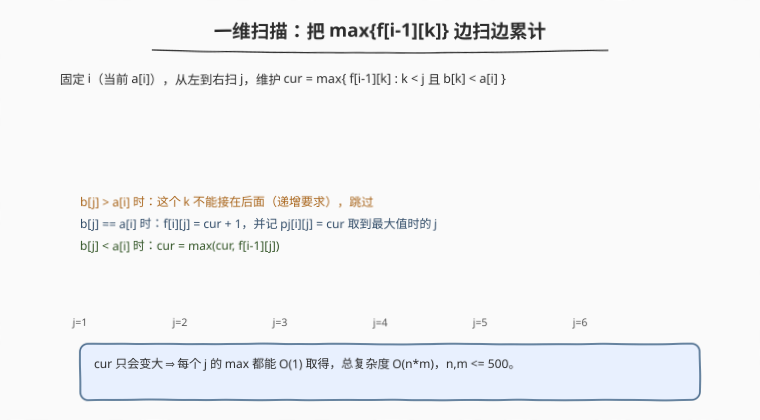
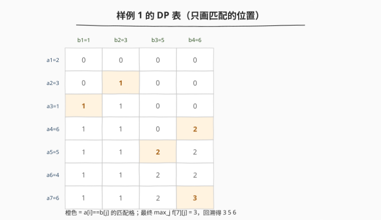

# Codeforces 10D 最长公共递增子序列 题解

## 1. 题目概述

- **题目链接**：https://codeforces.com/problemset/problem/10/D
- **比赛来源**：Codeforces Beta Round 10 · Problem D（2010-04-15）
- **难度**：2800
- **标签**：动态规划
- **评测类型**：特殊评测（多解，输出任意一个合法序列即可）
- **限制**：时间 1 s / 内存 256 MB

**题意**：给定两个长度分别为 $n, m$（都 $\le 500$）的整数序列 $a$、$b$（元素在 $[0, 10^9]$），求最长的**公共递增子序列**（LCIS）：它既是 $a$ 的子序列、也是 $b$ 的子序列，并且严格递增。输出长度与序列本身（任意一个合法解）。

**约束**：

- $n, m \le 500$，值域 $10^9$（只用来比较大小，不需要离散化）。
- 直接按定义转移是 $O(nm^2) = 1.25 \times 10^8$（每个 $b[j]$ 枚举前驱 $k$），用"边扫边维护前缀最大"可降到 $O(nm) = 2.5 \times 10^5$；这也是 Python 能过的前提。
- 输出序列不唯一，评测是特殊的：长度必须正确，序列必须严格递增且同时是两个序列的子序列。

## 2. 示例与观察

官方样例 1（输入 / 输出原样）：

```text
输入：
7
2 3 1 6 5 4 6
4
1 3 5 6

输出：
3
3 5 6 
```

$3, 5, 6$ 就是 $b$ 的全部元素，在 $a$ 中分别出现在下标 $1, 4, 5$（0 起），递增 ✓。长度 3 也是最优：若长度为 4 就要取 $b$ 的全部元素 $1,3,5,6$，但它们在 $a$ 中的下标必须递增——$a$ 中 $1$ 在下标 2、$3$ 在下标 1，顺序相反，矛盾。

本程序的输出是 `3` 与 `1 5 6`：$1,5,6$ 在 $a$ 中是下标 $2,4,5$，在 $b$ 中是 $0,2,3$，同样合法。**本题多解**，官方给的 $3\ 5\ 6$ 与本程序的 $1\ 5\ 6$ 都对，因此本地验证必须用 checker（第 8 节）。

官方样例 2（输入 / 输出原样）：

```text
输入：
5
1 2 0 2 1
3
1 0 1

输出：
2
0 1 
```

公共递增子序列 `0 1`：在 $a$ 中取 $a_3 = 0,\ a_5 = 1$；在 $b$ 中取 $b_2 = 0,\ b_3 = 1$ ✓。没有长度 3 的公共递增子序列，所以答案是 2。

**观察 1（"以谁结尾"是关键）**：公共子序列的最后一个元素必须同时是某个 $a[i]$ 与某个 $b[j]$，且 $a[i] = b[j]$。于是定义状态 $f[i][j]$：**只用 $a[1..i]$ 与 $b[1..j]$、并且以 $b[j]$ 结尾**的 LCIS 长度。

**观察 2（转移只差一个"前缀最大值"）**：若 $a[i] = b[j]$，就把 $a[i]$ 接在某个以 $b[k]$（$k < j$、$b[k] < b[j]$）结尾的 LCIS 后面；若 $a[i] \ne b[j]$，$f[i][j]$ 只能继承 $f[i-1][j]$。

**观察 3（一维扫描）**：固定 $i$ 从小到大扫 $j$ 时，$\max\{f[i-1][k] : k < j,\ b[k] < a[i]\}$ 可以边扫边维护（记作 `cur`），因为 $j$ 增大时候选集合只增不减。

## 3. 解题思路

### 3.1 朴素做法与瓶颈

最直接的想法是枚举 $b$ 的每个子序列（$2^m$ 个）再判断，指数级，不可行。

另一个方向是对每个 $j$ 求"以 $b[j]$ 结尾、且在 $a$ 中的 LIS"，每次 $O(n \log n)$，共 $O(mn\log n)$——但这样只保证了"$b[j]$ 是结尾"，前面的元素未必按 $b$ 的顺序出现，条件不够。

正确方向是二维 DP：$f[i][j]$ 表示 $a$ 的前 $i$ 个与 $b$ 的前 $j$ 个、且以 $b[j]$ 结尾的 LCIS 长度。按定义枚举前驱 $k$ 是 $O(nm^2)$，用"边扫边维护前缀最大"可降到 $O(nm)$。

### 3.2 状态与转移

![状态 f[i][j] 的含义](../../../images/cf10d_state_definition.svg)

$$f[i][j] = \begin{cases} 1 + \max\{f[i-1][k] : k < j,\ b[k] < b[j]\}, & a[i] = b[j] \\ f[i-1][j], & a[i] \ne b[j] \end{cases}$$

- 第一行：$a[i]$ 与 $b[j]$ 相等，把它当作新结尾，接在前面某个更小的结尾之后；
- 第二行：不相等时，以 $b[j]$ 结尾的公共递增子序列只能来自更短的 $a$ 前缀。

答案 $= \max_j f[n][j]$（$f[n][j]$ 已经对 $i$ 取过最大）。

### 3.3 一维扫描与路径恢复



固定 $i$，让 $j$ 从 1 扫到 $m$：

```text
cur = 0, bestJ = 0
for j in 1..m:
    f[i][j] = f[i-1][j]              # 先继承
    pj[i][j] = j                     # 复制状态：前驱仍在第 j 列
    if a[i] > b[j] and f[i-1][j] > cur:
        cur = f[i-1][j]; bestJ = j   # 这个 k 可以作为前驱
    if a[i] == b[j]:
        f[i][j] = cur + 1
        pj[i][j] = bestJ             # 真正的前驱列号
```

`cur` 始终等于 $\max\{f[i-1][k] : k < j,\ b[k] < a[i]\}$：$j$ 每前进一步只多一个候选 $k = j-1$，取个 max 即可。

**路径恢复**：$pj[i][j]$ 记录前驱状态的列号，前驱的行号总是 $i-1$。从使 $f[n][j]$ 最大的 $j$ 出发回溯：

- 若 $a[i] = b[j]$ 且 $f[i][j] \ne f[i-1][j]$，说明这一行真的用 $a[i]$ 产生了匹配，把 $b[j]$ 记入答案，然后跳到 $(i-1,\ pj[i][j])$；
- 否则是复制状态，跳到 $(i-1,\ j)$。

两种跳法都让 $i$ 减 1，最多 $n$ 步结束；最后把记录的值反转即得原序。

### 3.4 样例走查



对样例 1（$a = 2,3,1,6,5,4,6$，$b = 1,3,5,6$），只看匹配格：

- $i=1$（$a_1=2$）：$b$ 中没有 2，整行为 0。
- $i=2$（$a_2=3$）：$b_2=3$ 匹配，前面没有匹配且更小的元素，$f[2][2] = 1$。
- $i=3$（$a_3=1$）：$b_1=1$ 匹配，$f[3][1] = 1$。
- $i=5$（$a_5=5$）：$b_3=5$ 匹配，$cur = \max\{f[4][1], f[4][2]\} = 1$，$f[5][3] = 2$。
- $i=6$（$a_6=4$）：$b$ 中没有 4，整行继承。
- $i=7$（$a_7=6$）：$b_4=6$ 匹配，$cur = \max\{f[6][1..3]\} = 2$（来自 $f[5][3]$），$f[7][4] = 3$。

最终 $\max_j f[7][j] = 3$。回溯时 $f[7][4]$ 的前驱是列 1（值 1），得 $1,5,6$；若前驱取到列 2（值 3）就得官方的 $3,5,6$。两者都合法。

## 4. 正确性证明

记 $F(i,j)$ 为"只用 $a[1..i]$、$b[1..j]$、且以 $b[j]$ 结尾的 LCIS 长度"（不存在则为 0）。

**引理 1（转移正确）**：3.2 节的转移恰好算出 $F(i,j)$。

**证明**：分两种情形。

*(a) $a[i] \ne b[j]$：* 任何以 $b[j]$ 结尾、用 $a[1..i]$ 的公共递增子序列，其结尾值 $b[j]$ 在 $a[1..i]$ 中只能由某个 $a[i'] = b[j]$（$i' < i$）提供，所以整条序列只用到 $a[1..i-1]$，故 $F(i,j) = F(i-1,j)$，与转移一致。

*(b) $a[i] = b[j]$：* 任取一条以 $b[j]$ 结尾的 LCIS，去掉最后的 $a[i] = b[j]$，剩下的是一条以某个 $b[k]$ 结尾、只用 $a[1..i-1]$ 的公共递增子序列；递增性给出 $b[k] < b[j]$，子序列的次序给出 $k < j$。反过来，任取满足 $k<j$、$b[k]<b[j]$ 的前驱，接上 $a[i]=b[j]$ 就得到合法候选。故 $F(i,j) = 1 + \max\{F(i-1,k) : k<j,\ b[k]<b[j]\}$；集合为空时取 1（只含 $b[j]$ 自己）。∎

**引理 2（`cur` 就是前缀最大）**：固定 $i$ 扫描时，进入第 $j$ 轮时 `cur` $= \max\{F(i-1,k) : k < j,\ b[k] < a[i]\}$。

**证明**：对 $j$ 归纳。$j = 1$ 时集合为空，`cur = 0` ✓。从 $j$ 到 $j+1$，集合恰好多出 $k = j$ 一个元素（当 $b[j] < a[i]$ 时），代码恰好在这一轮用 $F(i-1,j)$ 更新 `cur` ✓。∎

**引理 3（前驱合法）**：若 $(i,j)$ 处的 $f[i][j]$ 由匹配产生，则 $pj[i][j]$ 满足 $b[pj] < b[j]$ 且 $f[i-1][pj] = f[i][j]-1$。

**证明**：`pj[i][j]` 是使 $f[i-1][k]$ 取到 `cur` 的那个 $k$（没有则为 0）。由引理 2，`cur` 是满足 $k<j$、$b[k]<a[i]=b[j]$ 的最大值，故 $b[pj] < b[j]$ 且 $f[i][j] = cur+1 = f[i-1][pj]+1$ ✓（$pj = 0$ 表示没有前驱）。∎

**定理**：程序输出的长度等于 LCIS 长度，输出序列就是一条 LCIS。

**证明**：由引理 1，$f[n][j] = F(n,j)$，所以 $\max_j f[n][j]$ 是"以某个 $b[j]$ 结尾"的 LCIS 长度的最大值，也就是 LCIS 长度。回溯时每次从 $(i,j)$ 走到 $(i-1, pj[i][j])$ 或 $(i-1,j)$：前者对应真实匹配（由引理 3，记入答案的 $b[j]$ 与前驱满足严格递增、列号递减），后者只是回退一行、不取值。于是记录下来的值按回溯顺序严格递增、列号严格递减，反转后是 $b$ 的递增子序列；又每值都来自某个 $a[i]$ 且行号递减，故也是 $a$ 的递增子序列。∎

## 5. 复杂度分析

- **时间**：$O(nm) \le 2.5 \times 10^5$ 次转移，回溯 $O(n)$。1 s 时限下 C++ 实测约 $4.7$ ms（含进程启动），Python 约 $69$ ms。
- **空间**：$f$ 与 $pj$ 各 $(n+1)(m+1)$ 个 `int`，约 $2 \times 251000 \times 4 \approx 2$ MB，远低于 256 MB。
- **与时限的关系**：即使 $n = m = 500$ 也只有 $2.5 \times 10^5$ 次内层操作，余量在百倍以上。

## 6. 参考代码

### C++17

```cpp
#include <bits/stdc++.h>
using namespace std;

int main() {
    ios::sync_with_stdio(false);
    cin.tie(nullptr);

    int n;
    if (!(cin >> n)) return 0;
    vector<long long> a(n + 1);
    for (int i = 1; i <= n; ++i) cin >> a[i];
    int m;
    cin >> m;
    vector<long long> b(m + 1);
    for (int j = 1; j <= m; ++j) cin >> b[j];

    // f[i][j] = 只使用 a[1..i] 与 b[1..j]、且以 b[j] 结尾（因此 a[i]==b[j]）的 LCIS 长度
    // pj[i][j] = 该状态的前驱列号（前驱状态是 (i-1, pj[i][j])）；复制状态下 pj[i][j]=j
    vector<vector<int>> f(n + 1, vector<int>(m + 1, 0));
    vector<vector<int>> pj(n + 1, vector<int>(m + 1, 0));

    for (int i = 1; i <= n; ++i) {
        int cur = 0, bestJ = 0;      // cur = max{ f[i-1][k] : k<j, b[k]<b[j] }
        for (int j = 1; j <= m; ++j) {
            f[i][j] = f[i - 1][j];   // 不用 a[i]：直接继承上一行
            pj[i][j] = j;            // 复制状态：仍在第 j 列
            if (a[i] > b[j] && f[i - 1][j] > cur) { cur = f[i - 1][j]; bestJ = j; }
            if (a[i] == b[j]) {      // 匹配：接在 cur 之后
                f[i][j] = cur + 1;
                pj[i][j] = bestJ;
            }
        }
    }

    int best = 0, bj = 0;
    for (int j = 1; j <= m; ++j)
        if (f[n][j] > best) { best = f[n][j]; bj = j; }

    vector<long long> res;
    int i = n, j = bj;
    while (i > 0 && j > 0 && f[i][j] > 0) {
        if (a[i] == b[j] && f[i][j] != f[i - 1][j]) {   // 这一行真的用 a[i] 产生了匹配
            res.push_back(b[j]);
            int nj = pj[i][j];
            --i;
            j = nj;
        } else {
            --i;                                         // 复制状态：退到上一行
        }
    }
    reverse(res.begin(), res.end());

    cout << best << '\n';
    for (size_t k = 0; k < res.size(); ++k)
        cout << res[k] << (k + 1 == res.size() ? '\n' : ' ');
    if (res.empty()) cout << '\n';
    return 0;
}
```

### Python3

```python
import sys


def main() -> None:
    data = sys.stdin.read().split()
    if not data:
        return
    ptr = 0
    n = int(data[ptr]); ptr += 1
    a = [0] + [int(x) for x in data[ptr:ptr + n]]; ptr += n
    m = int(data[ptr]); ptr += 1
    b = [0] + [int(x) for x in data[ptr:ptr + m]]; ptr += m

    # f[i][j]：只用 a[1..i]、b[1..j] 且以 b[j] 结尾（即 a[i]==b[j]）的 LCIS 长度
    # pj[i][j]：前驱列号（前驱状态为 (i-1, pj[i][j])）；复制状态下 pj[i][j]=j
    f = [[0] * (m + 1) for _ in range(n + 1)]
    pj = [[0] * (m + 1) for _ in range(n + 1)]

    for i in range(1, n + 1):
        cur = 0
        bestj = 0
        ai = a[i]
        for j in range(1, m + 1):
            f[i][j] = f[i - 1][j]          # 不使用 a[i]
            pj[i][j] = j
            if ai > b[j] and f[i - 1][j] > cur:
                cur = f[i - 1][j]
                bestj = j
            if ai == b[j]:
                f[i][j] = cur + 1
                pj[i][j] = bestj

    best = 0
    bj = 0
    for j in range(1, m + 1):
        if f[n][j] > best:
            best = f[n][j]
            bj = j

    res = []
    i, j = n, bj
    while i > 0 and j > 0 and f[i][j] > 0:
        if a[i] == b[j] and f[i][j] != f[i - 1][j]:
            res.append(b[j])
            nj = pj[i][j]
            i -= 1
            j = nj
        else:
            i -= 1

    sys.stdout.write(str(best) + '\n')
    sys.stdout.write(' '.join(map(str, reversed(res))) + '\n')


main()
```

长度可以是 0：此时输出一行 `0`，第二行为空。

## 7. 边界情况与易错点

1. **长度可以是 0**：两个序列没有公共元素时输出 `0` 与空行，不要输出别的东西。
2. **严格递增**：`a = [2,2]`、`b = [2,2]` 的答案是 1 而不是 2。转移里必须用 $b[k] < b[j]$（严格小于），写成 $\le$ 会把相等元素接起来。
3. **继承与匹配的先后**：$f[i][j]$ 必须先继承 $f[i-1][j]$，再判断是否被匹配覆盖；顺序写反会丢掉"不用 $a[i]$"的情况。
4. **`cur` 只能取上一行**：同一行内 `cur` 必须来自 $f[i-1][\cdot]$，否则会把 $a[i]$ 用两次。
5. **前驱 0 表示没有前驱**：回溯时 `j = pj[i][j]` 变成 0 就结束，不要用 0 去索引数组。
6. **回溯条件要带"值变化"**：`a[i] == b[j] && f[i][j] != f[i-1][j]` 才把 $b[j]$ 记入答案；若匹配但值没变，说明这一行的匹配不是最优路径，应直接退到上一行。
7. **下标从 1 开始**：$f$、$pj$ 开 $(n+1) \times (m+1)$，避免 $i=0$ 或 $j=0$ 的越界。
8. **多解**：不能照抄样例输出（样例 1 的 `3 5 6` 与本程序的 `1 5 6` 都合法），本地必须用 checker 验证。
9. **值域 $10^9$**：元素用 `long long` 更稳；比较严格递增时不要用相减（防溢出）。

## 8. 验证记录

- **编译环境与命令**：本机无 GNU `g++`，`verify_solution.py` 用 `clang++ -std=c++17 -O2` 加仓库内兼容头编译；Python 为 3.9.6。
- **官方样例（多解，用 checker）**：2 / 2 通过。

  ```text
  python3 codeforces/tools/verify_solution.py "codeforces/contests/0001-0100/10/D_最长公共递增子序列.md" --checker /tmp/cf_verify_10_D/checker.py
  CF10D: samples 2
    C++ 编译 OK, 样例 2/2, 最慢 21 ms
    Python 语法 OK, 样例 2/2
  ```

  checker（`/tmp/cf_verify_10_D/checker.py`）的校验条件：① 第一行的 $k$ 等于独立的 $O(nm)$ DP 算出的 LCIS 长度；② 输出恰好有 $k$ 个整数；③ 这 $k$ 个数严格递增；④ 它是 $a$ 的子序列；⑤ 它是 $b$ 的子序列。任一不满足即判错。本程序对样例 1 输出 `1 5 6`（与官方 `3 5 6` 不同）也通过。
- **暴力对拍（325 组，全部实跑）**：
  - 独立暴力 `/tmp/cf_verify_10_D/brute.py`：$m \le 12$ 时枚举 $b$ 的**全部下标子集**，保留"严格递增且是 $a$ 的子序列"的那些，取最长——它覆盖了所有可能的公共递增子序列。
  - 数据构成：2 组官方样例 + 3 组手工边界（无公共元素、两序列相同、全相同元素）+ 320 组随机数据（$n, m \le 10$，值域取 2/3/5/10/30 五档）。
  - 结果：C++、Python、暴力三方的长度**全部一致（0 处不符）**；并且对 C++ 输出的序列逐条校验了"递增 + 是 $a$ 的子序列 + 是 $b$ 的子序列"，全部通过。
- **最大约束性能**：$n = m = 500$、值域 300 的稠密数据，C++ 端到端 $4.7$ ms/次、Python $69$ ms/次；值域 $10^9$ 的稀疏数据 C++ $4.3$ ms。`/usr/bin/time -l` 实测峰值常驻内存 $3784704$ 字节（约 $3.6$ MB，限 256 MB）。
- **图片校验**：三张 SVG（`cf10d_state_definition.svg`、`cf10d_scan_transition.svg`、`cf10d_walkthrough_sample1.svg`）通过 `xml.etree.ElementTree.parse`；包围盒脚本检查 18 / 12 / 41 个文本块，0 处越界、0 处重叠、0 处压线、0 处越出方框。
- **复核状态**：verified。

## 相关题目与扩展

- [LeetCode 1143. 最长公共子序列](https://leetcode.cn/problems/longest-common-subsequence/)：去掉"递增"约束的版本，$O(nm)$ 的二维 DP 是本题的基础。
- [LeetCode 300. 最长递增子序列](https://leetcode.cn/problems/longest-increasing-subsequence/)：单个序列的 LIS，本题相当于"两个序列的 LIS 交集"。
- [Codeforces 10C Digital Root](https://codeforces.com/problemset/problem/10/C)：同场 C 题，数论计数。
- [Codeforces 10E Greedy Change](https://codeforces.com/problemset/problem/10/E)：同场 E 题，构造最小反例。

**延伸思考**：

1. **去掉递增要求**：若只要求公共子序列，就是经典 LCS，$O(nm)$ 且状态里不需要"结尾值"这一维；加回递增后，"结尾值"成了必须记录的信息，这才有了本题的 $f[i][j]$。
2. **状态能否只有一维**：滚动数组只能压掉 $i$（$f[j]$ 表示当前 $i$ 下以 $b[j]$ 结尾的长度），但要恢复序列必须保留 $pj$ 的二维信息，所以空间仍是 $O(nm)$。
3. **换成"最长公共等差/等比子序列"**：这类问题通常要 $O(n^2 m)$ 甚至更高，因为"结尾值 + 公差"要一起记录，状态维度增加。本题只有"递增"这一约束，才压到 $O(nm)$。
4. **输出字典序最小的解**：本题只要求任意解。若要字典序最小，需要在前驱选择时挑最小的合法值，或在 DP 之后做一次贪心重构，复杂度仍是多项式。

