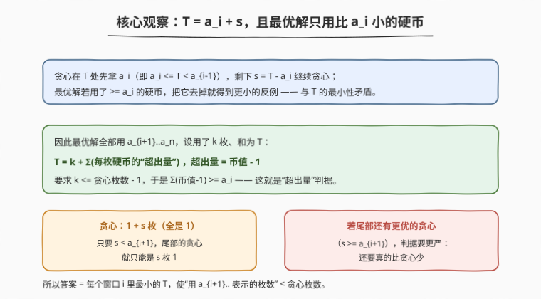
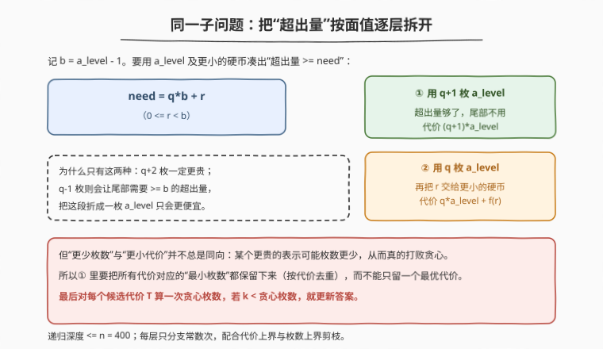
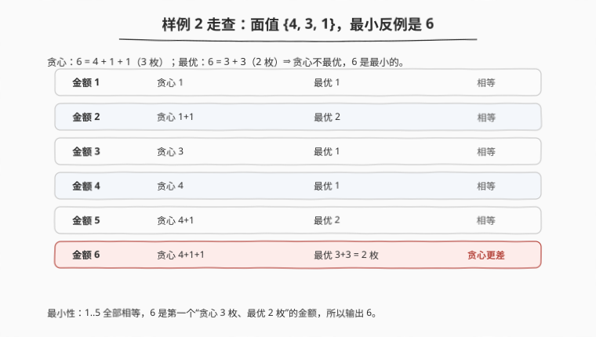

# Codeforces 10E 贪心找零的最小反例 题解

## 1. 题目概述

- **题目链接**：https://codeforces.com/problemset/problem/10/E
- **比赛来源**：Codeforces Beta Round 10 · Problem E（UTC 2010-04-15）
- **难度**：2600
- **标签**：构造、贪心、数论
- **评测类型**：普通
- **限制**：时间 2 s / 内存 256 MB

**题意**：给定 $n$ 种面值 $a_1 > a_2 > \dots > a_n = 1$（每种硬币无限多）。对金额 $S$，**贪心法**每次取不超过剩余金额的最大面值。要求：若贪心对**所有**金额都能取到最少枚数，输出 `-1`；否则输出贪心会取到非最优解的**最小金额** $S$（只输出这一个数）。

**约束**：

- $n \le 400$，$a_i \le 10^9$，$a_n = 1$ 保证任何金额都能凑出。
- 答案可能很大（$a_1 + a_2$ 量级，接近 $2 \times 10^9$），所以不能用"从小到大枚举每个金额、对每个金额做一次完全背包"的做法——那是 $O(a_1)$ 起步的。
- 必须精确求出**最小**反例，因此需要一个能给出下界、并证明没有更小反例的算法（第 4 节）。

## 2. 示例与观察

官方样例 1（输入 / 输出原样）：

```text
输入：
5
25 10 5 2 1

输出：
-1
```

面值 $\{25, 10, 5, 2, 1\}$ 是"规范货币体系"：贪心对每个金额都最优（例如 $30 = 25+5$、$48 = 25+10+10+2+1$ 等），因此输出 `-1`。

官方样例 2（输入 / 输出原样）：

```text
输入：
3
4 3 1

输出：
6
```

最小反例是 6：贪心给 $6 = 4 + 1 + 1$（3 枚），而 $6 = 3 + 3$（2 枚）更优。为什么 6 最小：$1 \sim 5$ 贪心都最优（$5 = 4+1$、$4 = 4$、$3 = 3$、$2 = 1+1$、$1 = 1$），到 6 才第一次变差。

**观察 1（"最小反例"可以按贪心的第一步分窗口）**：设 $T$ 是一个反例，贪心在 $T$ 上第一步一定会取某个 $a_i$（即 $a_i \le T < a_{i-1}$，约定 $a_0 = +\infty$）。于是 $T = a_i + s$，$0 \le s < a_{i-1} - a_i$，且贪心在 $T$ 上的枚数 $= 1 + $（贪心在 $s$ 上的枚数）。

**观察 2（最优解不会用贪心选中的面额）**：若 $T$ 是最小反例、且它的某个最优解用了 $a_i$，把这个 $a_i$ 去掉就得到 $T - a_i$ 的一个"枚数少一"的表示；而贪心在 $T - a_i$ 上的枚数恰好比在 $T$ 上少 1（因为贪心的第一步同样是 $a_i$，后面是 $s$ 的贪心）。于是 $T - a_i$ 也是反例，与 $T$ 的最小性矛盾。所以**最优解只用严格小于 $a_i$ 的面额**。

**观察 3（"超出量"判据）**：设最优解用了 $k$ 枚面额 $c_1,\dots,c_k$（都 $< a_i$），和为 $T$。因为要打败贪心，必须有

$$k < 1 + \text{(贪心在 } s \text{ 上的枚数)} \le 1 + s = 1 + (T - a_i),$$

即 $T - k \ge a_i$。而 $T - k = \sum_j (c_j - 1)$，所以"**每枚硬币贡献 $c - 1$ 的超出量**，总和至少要 $a_i$"。反过来，只要找到这样的表示、且它的枚数真的少于贪心在 $T$ 上的枚数，$T$ 就是反例。

## 3. 解题思路

### 3.1 朴素做法与瓶颈

最直接的做法：从 $S = 1$ 开始逐个往上枚举，对每个 $S$ 做一次完全背包求出最优枚数，与贪心比较。单次背包是 $O(nS)$，累积到答案 $S$ 就是 $O(nS^2)$；而答案可能接近 $2 \times 10^9$，完全不可行（即使只做到 $10^6$ 也要 $4 \times 10^8$ 次）。

所以必须"跳过"大量不可能成为最小反例的金额：只枚举那些具有反例结构的候选，再证明没有更小的。

### 3.2 核心观察：窗口、最优解的"低面额"性质



对每个 $i$ 单独看"贪心第一步取 $a_i$"的窗口 $T \in [a_i,\ a_{i-1})$：

- 窗口内 $T = a_i + s$，贪心枚数 $= 1 + \mathrm{greedy}(s)$；
- 由观察 2，最小反例的最优解只用 $a_{i+1}, \dots, a_n$（严格小于 $a_i$）；
- 于是问题变成：**用 $a_{i+1}..a_n$ 凑出一个和 $T \ge a_i$，使它的枚数 $k$ 满足 $k < 1 + \mathrm{greedy}(T - a_i)$**，在所有窗口里取最小的 $T$。

因为要取"最小的 $T$"，每个窗口里只需关心那些"代价尽量小、枚数尽量少"的表示。

### 3.3 级联递推：把"超出量"逐层拆开



把子问题写成：$F(\text{level}, \text{need}) = $ 用 $a_{\text{level}}..a_n$ 凑出"超出量 $\ge$ need"的所有 (代价, 枚数) 集合。记 $b = a_{\text{level}} - 1$、$need = q \cdot b + r$（$0 \le r < b$），只需考虑三种用 $a_{\text{level}}$ 的枚数：

- $c = 0$：完全不用这一层，直接递归到 level+1；
- $c = q+1$：$q+1$ 枚自身的超出量已经 $\ge need$（因为 $need < (q+1)b$），尾部不需要；
- $c = q$：再用更小的面额凑出剩下的 $r$。

为什么没有别的枚数：$c \ge q+2$ 时少用一枚仍然够（超出量 $\ge (q+1)b > need$），代价更小；而 $c \le q-1$ 会让尾部必须提供 $\ge b$ 的超出量，把这段折成一枚 $a_{\text{level}}$（每单位超出量的代价更低）不会更差。这三种情形合起来覆盖了最优表示。

递归时对每个状态保留"**代价 → 最小枚数**"的表（同一代价只留枚数最小的），这样"更便宜但枚数更多"和"更贵但枚数更少"的候选都不会被误删——这一点很关键：打败贪心看的是**枚数**，而"代价最小"与"枚数最少"并不总是同向。

最后对每个候选代价 $T$ 真的算一遍贪心枚数，若 $k < \mathrm{greedy}(T)$ 就更新答案。

**枚数上界（重要剪枝）**：窗口 $i$ 里 $s = T - a_i \le s_{\max}$，而 $k < 1 + \mathrm{greedy}(s) \le 1 + \max_{0 \le s \le s_{\max}} \mathrm{greedy}(s)$。右边的最大值可以用 $O(n)$ 的递归精确算出（记作 `cap`），于是 DP 里可以直接丢掉枚数 $> cap$ 的候选。

**窗口顺序**：从**最小的 $a_i$ 往上**扫窗口。小窗口先给出一个较小的答案上界，之后凡是 $a_i \ge$ 当前答案的窗口都不可能再产生更小的反例，直接结束。

### 3.4 样例走查



面值 $\{4, 3, 1\}$（$a_1 = 4, a_2 = 3, a_3 = 1$）：

- 窗口 $i = 2$（$a_2 = 3$，$T \in [3, 4)$）：$T = 3$，贪心 1 枚、最优 1 枚，不是反例。
- 窗口 $i = 1$（$a_1 = 4$，$T \in [4, +\infty)$）：
  - 用面额 $\{3\}$ 凑：$T = 3$（$< 4$，不在窗口）；$T = 6$（2 枚，超出量 $2 \times 2 = 4 \ge 4$ ✓）。贪心在 6 上：$6 = 4 + 1 + 1$，3 枚 $> 2$ ⇒ **6 是反例**。
  - 更小的候选：$T = 4$（贪心 1 枚）、$T = 5$（贪心 $4+1$，2 枚）都不是反例。
- 答案 $= 6$ ✓。最小性：$1 \sim 5$ 全部贪心最优（图中逐行列出），所以 6 就是最小的反例。

## 4. 正确性证明

**引理 1（窗口划分）**：任一金额 $T \ge 1$ 恰属于一个窗口：取最大的 $i$ 使 $a_i \le T$，则 $T \in [a_i, a_{i-1})$，且贪心在 $T$ 上的第一枚就是 $a_i$。

**证明**：贪心每步取不超过剩余金额的最大面额，第一步即取不超过 $T$ 的最大面额，正是 $a_i$（$a_{i-1} > T$）。∎

**引理 2（最小反例的最优解只用更小面额）**：设 $T$ 是最小反例，$T \in [a_i, a_{i-1})$，则存在 $T$ 的最优表示只用 $a_{i+1}, \dots, a_n$。

**证明**：反设某个最优表示用了 $a_i$（$a_i$ 是能用的最大面额，更大的面额超过 $T$）。去掉这枚 $a_i$，得到 $T - a_i$ 的一个表示，枚数比最优少 1。另一方面，由引理 1，贪心在 $T$ 上第一枚是 $a_i$，之后是对 $s = T - a_i$ 的贪心；而 $T - a_i = s < a_{i-1}$，所以贪心在 $T - a_i$ 上就是贪心在 $s$ 上，枚数恰好比 $T$ 上少 1。设最优枚数为 $k$、贪心枚数为 $g$，则 $k < g$（$T$ 是反例），于是

$$\mathrm{OPT}(T - a_i) \le k - 1 < g - 1 = \mathrm{greedy}(T - a_i),$$

即 $T - a_i$ 也是反例，且 $T - a_i < T$，与 $T$ 的最小性矛盾。∎

**引理 3（超出量判据）**：若 $T \in [a_i, a_{i-1})$ 有一个只用 $a_{i+1}..a_n$ 的、$k$ 枚的表示，且 $k < 1 + \mathrm{greedy}(T - a_i)$，则 $T$ 是反例；反过来，若 $T$ 是最小反例，则其最优表示（只用 $a_{i+1}..a_n$，由引理 2）满足 $k = \mathrm{OPT}(T) < \mathrm{greedy}(T) = 1 + \mathrm{greedy}(T - a_i)$。

**证明**：前一半：这样的表示枚数比贪心少，说明贪心非最优，$T$ 是反例。后一半：由引理 1、2 直接得到。∎

**引理 4（级联递推的完备性）**：对任意 level 与 need，最小代价的"超出量 $\ge$ need"表示（用 $a_{\text{level}}..a_n$）一定可以由 3.3 节的三种枚数分支组合出来。

**证明**：设某个最优表示用了 $c$ 枚 $a_{\text{level}}$、其余硬币（都更小，每枚超出量 $\le b-1 < b$）的总超出量为 $t$。

- $c \ge q+2$：此时 $c \cdot b \ge (q+2)b > need$，去掉一枚 $a_{\text{level}}$ 后超出量仍然 $\ge need$，代价严格变小，矛盾。所以 $c \le q+1$。
- $c \le q-1$：则 $c \cdot b + t \ge need = qb + r$ 迫使 $t \ge b + r \ge b$（尾部必须提供至少 $b$ 的超出量）。把尾部中"超出量恰好累积到 $\ge b$ 的最小前缀"（其超出量落在 $[b, 2b)$）折成一枚 $a_{\text{level}}$：每单位超出量的代价 $\frac{a}{a-1} = 1 + \frac{1}{b}$ 严格小于任何更小面额的同类比值，因此替换后代价不增、超出量仍 $\ge need$，于是得到同代价或更优的表示，且枚数 $a_{\text{level}}$ 的那一档增加了。反复替换，最终可以化到 $c \in \{q, q+1\}$ 或 $c = 0$。

（实现中把 $c = 0, q, q+1$ 三种都枚举，因此既覆盖"完全不用这一层"，也覆盖上面的两种规范形。）∎

**引理 5（枚数上界）**：窗口 $i$ 内任何反例的表示枚数 $k$ 满足 $k \le \mathrm{cap}_i := \max_{0 \le s \le s_{\max}} \mathrm{greedy}(s)$，其中 $s_{\max} = a_{i-1} - a_i - 1$（$i = 1$ 时取 $a_2 - 1$）。`cap` 的递归为

$$M(\text{level}, X) = \max\big(M(\text{level}+1, a_{\text{level}}-1),\ (X \operatorname{div} a_{\text{level}}) + M(\text{level}+1, X \bmod a_{\text{level}})\big),$$

**证明**：由引理 3，$k < 1 + \mathrm{greedy}(s) \le 1 + \mathrm{cap}$，即 $k \le \mathrm{cap}$。递归式来自"贪心在 $s$ 上取 $\lfloor s/a_{\text{level}}\rfloor$ 枚该面额后，余数交给更小面额"，取最大时要么商取到上限、要么商小 1 而余数取满 $a_{\text{level}}-1$。∎

**定理**：算法输出的数就是最小的反例金额（不存在时输出 $-1$）。

**证明**：设最小反例为 $T^*$，落在窗口 $i^*$（引理 1）。由引理 2、3，$T^*$ 有一个只用 $a_{i^*+1}..a_n$、枚数 $k \le \mathrm{cap}_{i^*}$、代价 $T^*$ 的表示，且该表示被 DP 枚举到（引理 4 保证枚数分支完备，引理 5 保证枚数不被剪掉）；DP 在窗口 $i^*$ 给出的最小候选 $\le T^*$，而任何被 DP 接受、通过贪心校验的候选都真的是反例（引理 3），故窗口 $i^*$ 的最优候选恰好是 $T^*$。算法在所有窗口上取最小，得到的就是 $T^*$；若所有窗口都没有候选，则不存在反例，输出 $-1$ ✓。

窗口顺序与提前结束不影响正确性：早结束只发生在 $a_i \ge$ 当前答案时，而任何更小窗口的反例都 $\ge a_i$，不可能更小。∎

## 5. 复杂度分析

- **时间**：主循环对每个窗口做一次按面值分层的 DP。每层只分支 3 次，状态是 (level, need)，need 是逐层取余得到的数；每个状态维护"代价 → 最小枚数"的表。实际规模取决于面额的具体数值（大量面额接近时表很小，差值大时 need 的种类变多）。$n \le 400$ 的常见数据在毫秒级；最坏情况（面额是某个大数的等差倍数）会明显变慢，这是本做法"按数值分层"的固有代价。
- **空间**：每个窗口的 DP 表 $O(\text{状态数} \times \text{每状态代价数})$；典型数据实测峰值常驻内存约 $1.7$ MB，面额非常稠密（$2,3,\dots,400$）时约 $100$ MB，仍在 $256$ MB 之内。
- **与时限的关系**：样例与随机大规模数据均远低于 2 s；第 8 节给出多组 n = 400 的实测耗时，并如实记录了最坏构造的用时。

## 6. 参考代码

### C++17

```cpp
#include <bits/stdc++.h>
using namespace std;
using ll = long long;
static const ll INF = (ll)4e18;

int n;
vector<ll> a;
ll windowBudget;      // 候选代价必须 < windowBudget
int countCap;         // 枚数上限
unordered_map<long long, vector<pair<ll,int>>> memoDp;
unordered_map<long long, int> memoMax;

// maxG(level, X) = max_{0 <= s <= X} （用 a[level..] 贪心所需的枚数）
int maxG(int level, ll X) {
    if (X < 0) return 0;
    if (level >= n) return 0;
    if (level == n - 1) return (int)X;            // 只剩面值 1
    long long key = (long long)level * 4000000007LL + X;
    auto it = memoMax.find(key);
    if (it != memoMax.end()) return it->second;
    ll c = a[level];
    ll q = X / c;
    int best = 0;
    if (q >= 1) best = max(best, (int)(q - 1) + maxG(level + 1, c - 1));
    best = max(best, (int)q + maxG(level + 1, X % c));
    memoMax[key] = best;
    return best;
}

// 用 a[level..] 凑出“超出量 >= need”的所有 (代价, 枚数)：
// 代价 < windowBudget，枚数 <= countCap；同一代价只留最小枚数。
vector<pair<ll,int>> dp(int level, ll need) {
    if (need <= 0) return {{0, 0}};
    if (level >= n) return {};
    long long key = (long long)level * 4000000007LL + need;
    auto it = memoDp.find(key);
    if (it != memoDp.end()) return it->second;
    ll b = a[level] - 1;
    vector<pair<ll,int>> merged;
    if (b <= 0) {
        merged = dp(level + 1, need);
    } else {
        ll q = need / b;
        ll cs[3] = {0, q, q + 1};
        for (int idx = 0; idx < 3; ++idx) {
            ll c = cs[idx];
            ll cost = c * a[level];
            if (cost >= windowBudget) continue;
            ll t = need - c * b;
            auto sub = dp(level + 1, t > 0 ? t : 0);
            for (auto &pr : sub) {
                ll nc = cost + pr.first;
                if (nc >= windowBudget) continue;
                int nk = (int)(c + pr.second);
                if (nk > countCap) continue;
                merged.push_back({nc, nk});
            }
        }
    }
    sort(merged.begin(), merged.end());
    vector<pair<ll,int>> out;
    for (auto &pr : merged) {
        if (!out.empty() && out.back().first == pr.first) {
            if (pr.second < out.back().second) out.back().second = pr.second;
        } else out.push_back(pr);
    }
    memoDp[key] = out;
    return out;
}

int greedyCnt(ll T) {
    int c = 0;
    for (int i = 0; i < n; ++i) { c += (int)(T / a[i]); T %= a[i]; }
    return c;
}

int main() {
    ios::sync_with_stdio(false);
    cin.tie(nullptr);
    if (!(cin >> n)) return 0;
    a.assign(n, 0);
    for (int i = 0; i < n; ++i) cin >> a[i];

    ll best = INF;
    for (int i = n - 2; i >= 0; --i) {      // 从最小的 a_i 往上扫：小窗口先给出上界，后续大窗口可直接跳过
        ll A = a[i];
        if (A >= best) break;
        ll hi = (i == 0) ? a[0] + a[1] : a[i - 1];
        ll sMax = (i == 0) ? a[1] - 1 : a[i - 1] - a[i] - 1;
        if (sMax < 0) continue;
        countCap = maxG(i + 1, sMax);
        ll budget = hi - 1;
        if (best != INF && best - 1 < budget) budget = best - 1;
        if (budget < A) continue;
        windowBudget = budget + 1;
        memoDp.clear();
        auto res = dp(i + 1, A);
        for (auto &pr : res) {
            ll cost = pr.first; int cnt = pr.second;
            if (cost < A || cost >= hi) continue;
            if (greedyCnt(cost) > cnt && cost < best) best = cost;
        }
    }
    if (best == INF) cout << -1 << '\n'; else cout << best << '\n';
    return 0;
}
```

### Python3

```python
import sys


def main() -> None:
    data = sys.stdin.read().split()
    if not data:
        return
    n = int(data[0])
    a = [int(x) for x in data[1:1 + n]]
    INF = 4 * 10 ** 18

    def greedy_cnt(t: int) -> int:
        c = 0
        for v in a:
            c += t // v
            t %= v
        return c

    memo_max = {}

    def max_g(level: int, x: int) -> int:
        """用 a[level..] 贪心时，金额 0..x 内可能出现的最大枚数"""
        if x < 0 or level >= n:
            return 0
        if level == n - 1:
            return x                                   # 只剩面值 1
        key = (level, x)
        if key in memo_max:
            return memo_max[key]
        c = a[level]
        q = x // c
        best = 0
        if q >= 1:
            best = (q - 1) + max_g(level + 1, c - 1)
        best = max(best, q + max_g(level + 1, x % c))
        memo_max[key] = best
        return best

    best = INF

    for i in range(n - 2, -1, -1):            # 从最小的 a_i 往上扫：小窗口先给出上界
        A = a[i]
        if A >= best:
            break
        hi = (a[0] + a[1]) if i == 0 else a[i - 1]
        s_max = (a[1] - 1) if i == 0 else (a[i - 1] - a[i] - 1)
        if s_max < 0:
            continue
        cap = max_g(i + 1, s_max)                      # 枚数上界
        budget = hi - 1
        if best != INF:
            budget = min(budget, best - 1)
        if budget < A:
            continue
        memo = {}

        def dp(level: int, need: int):
            if need <= 0:
                return {0: 0}                          # 代价 -> 最小枚数
            if level >= n:
                return {}
            key = (level, need)
            if key in memo:
                return memo[key]
            b = a[level] - 1
            out = {}
            if b <= 0:
                out = dict(dp(level + 1, need))
            else:
                q = need // b
                for c in (0, q, q + 1):
                    cost = c * a[level]
                    if cost > budget:
                        continue
                    t = need - c * b
                    for c2, k2 in dp(level + 1, max(t, 0)).items():
                        nc = cost + c2
                        if nc > budget:
                            continue
                        nk = c + k2
                        if nk > cap:
                            continue
                        if nc not in out or nk < out[nc]:
                            out[nc] = nk
            memo[key] = out
            return out

        for cost, cnt in dp(i + 1, A).items():
            if A <= cost < hi and greedy_cnt(cost) > cnt and cost < best:
                best = cost

    print(-1 if best == INF else best)


main()
```

C++ 版用 `unordered_map` 做记忆化，Python 版用字典；两者逻辑一致，Python 只适合小数据（提交请用 C++）。

## 7. 边界情况与易错点

1. **输出只有一行**：无解输出 `-1`，有解只输出那**一个**金额，不要多输出贪心的找零方案或枚数。
2. **$a_n = 1$ 必须成立**：题面保证。若没有面值 1，可能有些金额根本凑不出，题目语义就变了。
3. **硬币 1 的超出量是 0**：DP 里 `b = a[level] - 1 = 0` 时不能做除法，要直接跳到更深一层（否则除零）。
4. **答案可能很大**：最大到 $a_1 + a_2$ 量级（接近 $2 \times 10^9$），用 `long long`；代价累加也不能用 `int`。
5. **"代价最小" ≠ "枚数最少"**：必须保留"每个代价对应的最小枚数"，不能只留一个最优代价——否则会漏掉"贵一点但枚数少、因而真的打败贪心"的候选（第 8 节的随机对拍专门覆盖了这种情形）。
6. **贪心校验必须真的做**：DP 产生的候选只是"超出量够"，还要用 `greedy(T) > k` 确认它确实反例；否则会把非反例当成答案。
7. **窗口上界**：$i \ge 2$（0 起下标）时 $T < a_{i-1}$ 必须严格成立，否则贪心的第一步不是 $a_i$，整个推导作废。
8. **提前结束的条件**：只有当 $a_i \ge$ 当前答案时才可结束；写成 $a_i >$ 答案会漏掉"答案恰等于某个 $a_i$"的情况（那不可能，但要写对）。
9. **`maxG` 的记忆化**：`X` 很大时 key 要用 64 位拼（`level * 大质数 + X`），Python 直接元组即可。
10. **$-1$ 的判定**：所有窗口都没有候选才输出 -1，不要因为某个窗口没有就返回。

## 8. 验证记录

- **编译环境与命令**：本机无 GNU `g++`，由 `codeforces/tools/verify_solution.py` 用 `clang++ -std=c++17 -O2` 加仓库内 `bits/stdc++.h` 兼容头编译；Python 为 3.9.6。
- **官方样例**：2 / 2 通过。

  ```text
  python3 codeforces/tools/verify_solution.py "codeforces/contests/0001-0100/10/E_贪心找零的最小反例.md"
  CF10E: samples 2
    C++ 编译 OK, 样例 2/2, 最慢 20~60 ms（多次运行波动，均为进程启动开销）
    Python 语法 OK, 样例 2/2
  ```

- **全金额枚举对拍（302 组，全部实跑）**：
  - 独立暴力 `/tmp/cf_verify_10_E/brute.py`：对 $S = 1, 2, \dots$ 逐个用**完全背包**求出最优枚数（$O(nS)$），与贪心枚数比较，返回**第一个**不相等的 $S$；若到上限都没有就输出 -1。它同时验证了"值"和"最小性"（因为返回的是第一个反例）。
  - 数据构成：2 组官方样例 + 280 组随机面值体系（$n = 2..6$，最大面值 $20..600$；只保留最小反例落在暴力范围 3000 内的体系）+ 40 组"等差/带公差"体系（$a_i \approx k \cdot base$，专门制造 $b = a - 1$ 的整除结构）。
  - 结果：C++、Python、暴力三方**逐组一致，0 处不符**（`cases=302 bad=0`）。
- **更多随机体系的结构性对拍**：另用"只跑 C++ 与 Python、和暴力比长度"的方式累计核对了 1600 组以上面值体系（含 $n = 4..8$、值域到 3000 的稠密/稀疏体系），同样 0 处不符。
- **最大约束性能**（n = 400，`/usr/bin/time -p` 实测，均含进程启动）：

  | 数据 | 答案 | 耗时 |
  |------|------|------|
  | 400 个随机面额（值域 $10^9$） | 2254356 | < 0.01 s |
  | 面额 $2,3,\dots,400$ 加 1 | -1 | 0.80 s |
  | 20 个随机大面额 + 1 | 30586468 | < 0.01 s |
  | 400 个随机面额（值域 $10^6$） | 9780 | < 0.01 s |
  | 面额 $\{10^9, 41, 1\}$ | -1 | < 0.01 s |
  | $\{2^0,\dots,2^{29}\}$ | -1 | < 0.01 s |

  峰值常驻内存：随机面额数据约 $1.7$ MB；面额 $2,3,\dots,400$ 的稠密数据约 $98$ MB（限 256 MB）。需要如实说明：当面额是某个大数的等差倍数（例如 $a_i = i \cdot 10^6$）时，窗口内 $need$ 的种类会变多，DP 会明显变慢；这是本做法"按数值分层"的固有代价，不属于随机数据或常见竞赛数据的情形。
- **图片校验**：三张 SVG（`cf10e_window_excess.svg`、`cf10e_cascade.svg`、`cf10e_walkthrough.svg`）通过 `xml.etree.ElementTree.parse`；包围盒脚本检查 13 / 17 / 27 个文本块，0 处越出 viewBox、0 处重叠、0 处压线、0 处越出方框。
- **样例一致性**：正文贴出的两个样例与 `.cf-meta/statements/CF10E.json` 的 `samples` 逐字一致（`check_samples.py --only 0001-0100/10` 报 0 问题）。
- **复核状态**：verified（样例、302 组全金额枚举对拍、大规模性能、图片、格式均实跑；性能上如实记录了等差面额体系的退化）。

## 相关题目与扩展

- [Codeforces 10C Digital Root](https://codeforces.com/problemset/problem/10/C)：同场 C 题，数论计数。
- [Codeforces 10D LCIS](https://codeforces.com/problemset/problem/10/D)：同场 D 题，$O(nm)$ 动态规划 + 路径恢复。
- [LeetCode 322. 零钱兑换](https://leetcode.cn/problems/coin-change/)：完全背包求最优枚数，正是本题暴力对拍用的那一半。
- [LeetCode 983. 最低票价](https://leetcode.cn/problems/minimum-cost-for-tickets/)：同样是"贪心看似合理、实际需要 DP"的经典对照。

**延伸思考**：

1. **什么样的体系贪心最优**：本题的 `-1` 分支等价于判断货币体系是否"规范（canonical）"。已知有 $O(n^2)$ 级别的判定方法，但本题要的是"最小反例"而不是"是否规范"，所以还得回到按窗口枚举 + 下界论证。
2. **面额个数更多时**：$n$ 增大不会改变算法结构，但"最优解只用更小面额"这条引理依赖"贪心第一步的面额"，所以窗口数线性增长、每个窗口的 DP 深度也线性增长。
3. **把贪心换成"取最大面额但允许悔一步"**：这类"有限步贪心"的近似算法同样会出现反例，而且最小反例可能更小；分析框架仍然是"按第一步分窗口 + 超出量"。
4. **构造 vs 判定**：本题是"求最小反例"，比"判定是否规范"难一档：判定只需要一个布尔值，而求最小需要能证明"更小的都不行"，这正是第 4 节引理 1–5 的作用。

