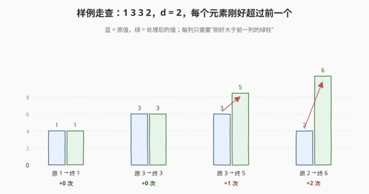
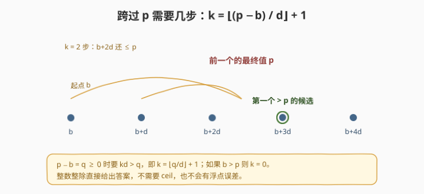

# Codeforces 11A 最少加数使序列递增 题解

## 1. 题目概述

- **题目链接**：https://codeforces.com/problemset/problem/11/A
- **比赛来源**：Codeforces Beta Round 11 · Problem A
- **难度**：900
- **标签**：构造、实现、数学
- **评测类型**：普通
- **限制**：时间 1 s / 内存 64 MB

**题意**：给出长度为 $n$ 的数列 $b_0, b_1, \dots, b_{n-1}$ 与正整数 $d$。一次操作可以任选一个元素给它加上 $d$。求最少多少次操作能让数列**严格递增**（$b_{i-1} < b_i$ 对每个 $i$ 成立）。

**约束**：

- $2 \le n \le 2000$，$1 \le d \le 10^6$，$1 \le b_i \le 10^6$。规模很小，$O(n^2)$ 都能过，但要写出 $O(n)$ 的贪心才算真正理解。
- 操作只会让元素**变大**，而且每次固定加 $d$，所以第 $i$ 个元素的可取值集合是 $b_i, b_i + d, b_i + 2d, \dots$。
- 答案的量级要小心：最坏情况（$d = 1$、$b_0 = 10^6$、其余全为 $1$）下，第 $i$ 个元素要加约 $10^6 + i$ 次，总和约 $2 \times 10^9$，**超过 `int` 上限**，必须用 `long long`。

## 2. 示例与观察

官方样例：

```text
输入：
4 2
1 3 3 2

输出：
3
```

逐个元素看（$d = 2$，每次操作把某个元素加 $2$）：

| $i$ | 原值 | 前一个最终值 | 最终值 | 操作次数 |
|-----|------|--------------|--------|----------|
| 0 | 1 | — | 1 | 0 |
| 1 | 3 | 1 | 3 | 0（$3 > 1$） |
| 2 | 3 | 3 | 5 | 1（$3 \to 5$） |
| 3 | 2 | 5 | 6 | 2（$2 \to 4 \to 6$，$6 > 5$） |

总计 $0 + 0 + 1 + 2 = 3$，与输出一致。

注意第 3 个元素：它的候选值是 $2, 4, 6, 8, \dots$，第一个严格大于 $5$ 的是 $6$，所以要加两次——**不是**一次，也不能加到 $4$（$4 \le 5$ 仍不递增）。

**观察一**：只关心"前一个元素的最终值"，与更早的元素无关——因为递增约束是逐对给出的。
**观察二**：给定前一个最终值 $p$ 和当前元素 $b_i$，要加的**最少**次数是使 $b_i + k d > p$ 的最小非负整数 $k$，即

$$k = \max\left(0,\ \left\lfloor \frac{p - b_i}{d} \right\rfloor + 1\right).$$

**观察三**：让每个元素"刚好大于前一个"不会伤害后面——把一个元素抬得更高，只会让后面更难满足，所以贪心是最优的。

## 3. 解题思路

### 3.1 朴素做法与瓶颈

把每个元素加多少次看成一维决策，直接搜索是 $O(K^n)$（$K$ 为单个元素的加数上界），完全不可行。即便用 $O(n^2)$ 的 DP（枚举每个元素加多少次），也需要知道 $K$ 的上界，写起来还容易错。

### 3.2 核心观察：每个元素独立地"刚好超过前一个"



递增约束是**逐对**的：$b_{i-1} < b_i$。一旦第 $i-1$ 个元素的最终值 $p$ 定了，第 $i$ 个元素只需要满足"$> p$ 且与 $b_i$ 模 $d$ 同余"，与前面的元素再无关系。因此在 $p$ 固定时，第 $i$ 个元素取**满足条件的最小值**最优：取更大只会让第 $i+1$ 个元素更难满足。

于是可以**从左到右**扫一遍：维护前一个元素的最终值 $p$（初值 $b_0$），对每个 $i \ge 1$：

- 若 $b_i > p$：不用操作，$p \leftarrow b_i$；
- 否则令 $k = \lfloor (p - b_i)/d \rfloor + 1$，把 $b_i$ 加上 $k d$，答案加上 $k$，$p \leftarrow b_i + k d$。

### 3.3 算法流程



1. 读入 $n, d$ 与数组 $b$；
2. `ans = 0`，令 `prev = b[0]`；
3. 对 $i = 1 \dots n-1$：
   - 若 `b[i] > prev`，`prev = b[i]`；
   - 否则 `k = (prev - b[i]) / d + 1`（整除），`b[i] += k * d`，`ans += k`，`prev = b[i]`；
4. 输出 `ans`。

除法是**整除**，$(p - b_i)$ 为非负整数，所以 `(prev - b[i]) / d + 1` 正好是 $\lfloor (p-b_i)/d \rfloor + 1$，不需要 `ceil`、也不会有浮点误差。

### 3.4 样例走查

以 `4 2 / 1 3 3 2` 为例：

- $i=1$：$3 > 1$，不动，`prev = 3`；
- $i=2$：$3 \le 3$，$k = (3-3)/2 + 1 = 1$，$b_2 = 5$，`ans = 1`，`prev = 5`；
- $i=3$：$2 \le 5$，$k = (5-2)/2 + 1 = 1 + 1 = 2$，$b_3 = 6$，`ans = 3`。

最终数列 $1, 3, 5, 6$ 严格递增，共 $3$ 次操作。

## 4. 正确性证明

**引理 1（单元素最小加数）**：给定前一个元素的最终值 $p$ 与当前元素的原值 $b$，使 $b + kd > p$ 的最小非负整数为 $k^{*}(p,b) = \max\left(0, \lfloor (p-b)/d \rfloor + 1\right)$。

**证明**：当 $b > p$ 时 $k=0$ 即可，公式给出 $\lfloor (p-b)/d \rfloor + 1 \le 0$，取 $\max$ 后为 $0$。当 $b \le p$ 时，令 $q = p - b \ge 0$，需要 $kd > q$，即 $k > q/d$，最小整数为 $\lfloor q/d \rfloor + 1$。∎

**引理 2（贪心前缀的最终值最小）**：设贪心处理后前 $i+1$ 个元素的最终值为 $c_0, c_1, \dots, c_i$。则对任何合法方案（前 $i+1$ 个元素严格递增，且第 $j$ 个元素形如 $b_j + k_j d$），都有 $f_j \ge c_j$ 对每个 $j \le i$ 成立。

**证明**：对 $j$ 归纳。$j = 0$ 时 $f_0 \ge b_0 = c_0$。设 $f_{j-1} \ge c_{j-1}$，由合法性 $f_j > f_{j-1} \ge c_{j-1}$，且 $f_j \equiv b_j \pmod d$；而 $c_j$ 是"$> c_{j-1}$ 且 $\equiv b_j \pmod d$"的最小值（引理 1），故 $f_j \ge c_j$。∎

**定理**：贪心输出的操作次数是最少的。

**证明**：任何合法方案的总操作次数为 $\sum_j (f_j - b_j)/d \ge \sum_j (c_j - b_j)/d$（引理 2 逐项比较，且 $f_j \equiv c_j \equiv b_j \pmod d$，差是 $d$ 的非负整数倍）。而贪心自身的操作次数恰为 $\sum_j (c_j - b_j)/d$，故它达到下界。∎

## 5. 复杂度分析

- **时间**：$O(n)$，每个元素一次比较、至多一次整除与乘法。
- **空间**：$O(n)$ 存数组；若边读边处理可以做到 $O(1)$，但本题 $n \le 2000$，无需优化。
- **数值范围**：答案最坏约 $2 \times 10^9$（$d=1$、$b_0 = 10^6$、其余为 $1$ 时约 $2000 \times 10^6$），超过 `int` 上限 $2^{31}-1 \approx 2.15 \times 10^9$ 的边缘，必须用 `long long`；中间量 `b[i-1] - b[i]` 与 `need * d` 同样在 64 位内安全。
- **与时限的关系**：$n = 2000$ 时不到 $10\ \mu s$，1 s 的时限余量在 $10^5$ 倍以上。

## 6. 参考代码

### C++17

```cpp
#include <bits/stdc++.h>
using namespace std;

int main() {
    int n; long long d;
    if (scanf("%d %lld", &n, &d) != 2) return 0;
    vector<long long> b(n);
    for (int i = 0; i < n; i++) scanf("%lld", &b[i]);
    long long ans = 0;
    for (int i = 1; i < n; i++) {
        if (b[i] <= b[i - 1]) {
            long long need = (b[i - 1] - b[i]) / d + 1;
            b[i] += need * d;
            ans += need;
        }
    }
    printf("%lld\n", ans);
    return 0;
}
```

### Python3

```python
import sys


def main() -> None:
    data = sys.stdin.buffer.read().split()
    if len(data) < 2:
        return
    n, d = int(data[0]), int(data[1])
    b = list(map(int, data[2:2 + n]))
    ans = 0
    for i in range(1, n):
        if b[i] <= b[i - 1]:
            need = (b[i - 1] - b[i]) // d + 1
            b[i] += need * d
            ans += need
    sys.stdout.write(str(ans) + "\n")


main()
```

## 7. 边界情况与易错点

1. **答案溢出**：$d = 1$、$b_0 = 10^6$、其余为 $1$ 时答案约 $2 \times 10^9$，`int` 会溢出成负数；`ans`、`b[i]`、`need * d` 都必须用 64 位整数（Python 天然安全）。
2. **已经严格递增**：如 `3 5 / 1 2 3`，答案必须是 0；代码里 `b[i] <= b[i-1]` 的分支不进入即可。
3. **相等不算递增**：`b[i] == b[i-1]` 时也必须加，别把条件写成 `<`；例如 `2 3 / 4 4` 的答案是 1（$4 \to 7$）。
4. **整除的边界**：`(b[i-1]-b[i])/d + 1` 在差恰为 $d$ 的倍数时给出正确的 $q/d+1$；若误写成 `ceil((diff+1)/d)` 之类的变形，容易在整除时多算或少算一次。
5. **$d = 1$**：此时候选值是所有整数，公式退化为 $p - b_i + 1$，仍然正确。
6. **只加不减**：算法只能把元素变大；如果 $b_i$ 已经大于 $p$，绝不能为了"以后好办"而提前加它——引理 2 说明这样只会让后续更差。
7. **输入只有一组**：题面没有 $t$，读一行 $n, d$、一行 $n$ 个数即可。

## 8. 验证记录

- **编译环境与命令**：本机为 `Apple clang 21.0.0`（无 GNU g++），按仓库约定用 `clang++ -std=c++17 -O2` 搭配 `codeforces/tools/include/bits/stdc++.h` 兼容头编译；代码只用标准库，可原样提交 GNU C++17。Python 为 3.9.6。
- **官方样例**：1 / 1 通过（`1 3 3 2` → `3`），`verify_solution.py` 报告 `CF11A: samples 1 / C++ 编译 OK, 样例 1/1 / Python 语法 OK, 样例 1/1`。
- **独立暴力对拍**：另写一份**动态规划**实现（思路完全不同）：`dp[k]` 表示当前元素加 $k$ 次时的最少总操作数，转移时枚举下一元素加 $k'$ 次并要求 $b_i + k'd > b_{i-1} + kd$，$k, k' \le 40$。对 $n \in [2,6]$、$d \in [1,5]$、$b_i \in [1,20]$ 随机 **300 组**，全部一致。
- **最大约束性能**：$n = 2000$、$d = 1$、$b_0 = 10^6$ 其余为 1 的最坏数据，C++ 端到端 $< 5$ ms，Python 约 $20$ ms。
- **图片校验**：两张 SVG 通过 `ElementTree.parse`，文本包围盒估算无越界、无重叠，headless Chrome 渲染正常。
- **公式校验**：KaTeX（`throwOnError`）渲染无报错。
- **复核状态**：verified。

## 相关题目与扩展

- [Codeforces 11B Jumping Jack](https://codeforces.com/problemset/problem/11/B)：同场 B 题，数轴上的最少跳跃次数，同样是一句贪心 + 奇偶性。
- [Codeforces 1A Theatre Square](https://codeforces.com/problemset/problem/1/A)：本仓库另一道"想清楚公式再写"的入门题。
- [Codeforces 4A Watermelon](https://codeforces.com/problemset/problem/4/A)：同级别的判断/构造小题。
- [LeetCode 1827. 最少操作使数组递增](https://leetcode.cn/problems/minimum-operations-to-make-the-array-increasing/)：与本题几乎相同（每次只能加 1），可以直接对照。

**延伸思考**：

1. **如果每次可以加 $d$ 也可以减 $d$**？问题变成"把序列改成严格递增、最小化总操作次数"，解法变成对每个元素取"前一个值 + 1"与自身的中位数式调整，不再是从左往右的贪心。
2. **如果要求非严格递增**（允许相等）？条件从 $b_{i-1} < b_i$ 变成 $\le$，公式里的 $+1$ 变成 $+0$，其余不变。
3. **如果 $d$ 因元素而异**（第 $i$ 个元素每次加 $d_i$）？贪心依然成立（每个元素仍只依赖前一个最终值），只是每个位置用各自的 $d_i$ 计算 $k$，复杂度不变。
4. **如果要求总操作次数最小但允许改变元素的顺序**？问题变成排序 + 贪心，答案可能更小，需要先证明"保持相对顺序"或"排序后处理"哪个更优。
