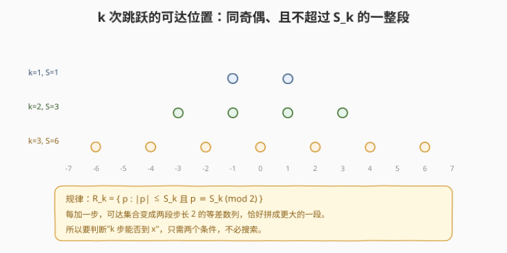
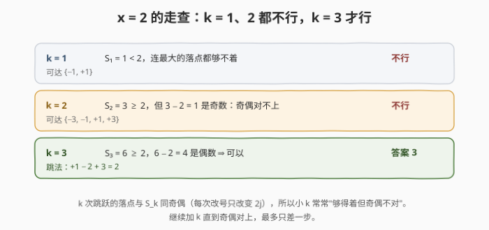

# Codeforces 11B 最少跳跃到达目标 题解

## 1. 题目概述

- **题目链接**：https://codeforces.com/problemset/problem/11/B
- **比赛来源**：Codeforces Beta Round 11 · Problem B（UTC 2010-04-26）
- **难度**：1600
- **标签**：数学
- **评测类型**：普通
- **限制**：时间 1 s / 内存 64 MB

**题意**：Jack 开始时在数轴的 $0$ 点。第 $i$ 次跳跃（$i$ 从 $1$ 开始）的长度恰好是 $i$，方向可以向左或向右。求到达 $x$ 所需的最少跳跃次数。

**约束**：$-10^9 \le x \le 10^9$。只有一次询问，但 $|x|$ 很大，**不能**按位置做 BFS（位置数 $10^9$ 量级）；必须找出跳跃次数与可达性之间的数论关系。答案约为 $\sqrt{2|x|} \le 44722$，从 $k=1$ 往上枚举到答案即可。

## 2. 示例与观察

官方样例共 3 组，全部原样列出：

```text
输入：
2

输出：
3
```

```text
输入：
6

输出：
3
```

```text
输入：
0

输出：
0
```

逐一解释：

- $x = 2$：$k=1$ 时 $S_1 = 1 < 2$；$k=2$ 时 $S_2 = 3 \ge 2$，但 $3 - 2 = 1$ 是奇数（奇偶不同，跳不到）；$k=3$ 时 $S_3 = 6$，$6-2 = 4$ 为偶数，可以，答案是 $3$（跳法 $+1-2+3=2$）。
- $x = 6$：$S_3 = 6 \ge 6$ 且 $6 - 6 = 0$ 为偶数，$k=3$ 就够（跳法 $1+2+3=6$）。
- $x = 0$：原地不动，$0$ 次。

先看前几次跳跃能到达哪些位置：

- $k=1$：$\pm 1$，即 $\{-1, +1\}$；
- $k=2$：$\{\pm 1 \pm 2\} = \{-3, -1, +1, +3\}$；
- $k=3$：$\{\pm 1 \pm 2 \pm 3\} = \{-6, -4, -2, 0, +2, +4, +6\}$。

**观察一**：$k$ 次跳跃的总和是 $S_k = 1+2+\dots+k = \frac{k(k+1)}{2}$ 的"带符号版本"，所以 $|x| \le S_k$ 是必要条件。
**观察二**：把某一次跳跃从 $+j$ 改成 $-j$，总和减少 $2j$。因此所有可达位置与 $S_k$ 的奇偶性相同。
**观察三**：这两个条件**充分**——只要 $|x| \le S_k$ 且 $x \equiv S_k \pmod 2$，就一定能在 $k$ 步内到达（证明见第 4 节）。

于是答案就是最小的 $k$，使得

$$S_k \ge |x| \quad\text{且}\quad S_k \equiv x \pmod 2 .$$

## 3. 解题思路

### 3.1 朴素做法与瓶颈

最直接的想法是在数轴上做 BFS：状态是"当前坐标 + 已跳步数"，每层把位置向左右各扩展一次。第 $k$ 层的状态数是 $O(k^2)$，总状态数 $O(k^3)$，看起来不大——但对 $|x| = 10^9$ 来说 $k \sim 4.5 \times 10^4$，状态数到达 $10^{14}$ 量级，完全不可行。

关键是意识到"哪些位置可达"有一个**干净的充要条件**，根本不需要搜索。

### 3.2 核心观察：可达位置恰是同奇偶的一段区间



**引理**：$k$ 次跳跃能到达的位置集合恰为

$$R_k = \{\, p : |p| \le S_k,\ p \equiv S_k \pmod 2 \,\}.$$

证明思路（详见第 4 节）：对 $k$ 归纳。从 $R_k$ 出发，加或减 $k+1$ 得到两段步长为 $2$ 的等差数列，它们恰好拼成 $[-S_{k+1}, S_{k+1}]$ 上同奇偶的所有值（因为 $S_k \ge k+1$ 当 $k \ge 2$，两段有重叠）。

由此，判定"$k$ 步能不能到 $x$"只需两个不等式：$S_k \ge |x|$ 与 $S_k \equiv x \pmod 2$。

### 3.3 算法流程



1. 读入 $x$，取 $s = |x|$；
2. 若 $s = 0$，输出 $0$；
3. 否则令 $k = 0,\ S = 0$，循环：
   - $k \leftarrow k+1$，$S \leftarrow S + k$；
   - 若 $S \ge s$ 且 $(S - s)$ 为偶数，输出 $k$ 并结束。

由于 $S_k$ 每步增加 $k$，循环最多约 $4.5 \times 10^4$ 次，$O(\sqrt{|x|})$。

### 3.4 样例走查：$x = 2$

- $k=1$：$S=1 < 2$，继续；
- $k=2$：$S=3 \ge 2$，但 $3 - 2 = 1$ 是奇数——$2$ 与 $3$ 奇偶不同，一步也换不了，继续；
- $k=3$：$S=6 \ge 2$，$6-2=4$ 是偶数 ✓，答案 $3$。

实际跳法：$+1 - 2 + 3 = 2$（把第 2 跳反过来，总和从 $6$ 减到 $2$，差 $4 = 2 \times 2$）。

## 4. 正确性证明

**引理 1（必要条件）**：若 $k$ 步能到达 $x$，则 $|x| \le S_k$ 且 $x \equiv S_k \pmod 2$。

**证明**：任何一步的贡献 $\pm j$ 满足 $|\pm j| \le j$，故 $|x| = |\sum \pm j| \le \sum j = S_k$。又 $\pm j \equiv j \pmod 2$，故 $x \equiv \sum j = S_k \pmod 2$。∎

**引理 2（充分条件）**：若 $|x| \le S_k$ 且 $x \equiv S_k \pmod 2$，则 $k$ 步可达 $x$。

**证明**：对 $k$ 归纳证明 $R_k$（$k$ 步可达集合）等于引理中的集合 $T_k$。

$k=0$：$R_0 = T_0 = \{0\}$。$k=1$：$R_1 = \{-1, 1\} = T_1$。

设 $R_k = T_k$。则

$$R_{k+1} = \{\, p + (k+1) : p \in T_k \,\} \cup \{\, p - (k+1) : p \in T_k \,\}.$$

第一段是从 $k+1-S_k$ 到 $k+1+S_k$、步长 $2$ 的所有值（与 $S_{k+1} = S_k + k+1$ 同奇偶），第二段是从 $-S_{k+1}$ 到 $S_k-(k+1)$、步长 $2$ 的所有值。两段的奇偶性都是 $S_{k+1}$；只要 $k+1-S_k \le S_k-(k+1)+2$，即 $S_k \ge k+1$，它们就拼成 $[-S_{k+1}, S_{k+1}]$ 中所有与 $S_{k+1}$ 同奇偶的值，正是 $T_{k+1}$。$k \ge 2$ 时 $S_k = k(k+1)/2 \ge k+1$ 成立；$k = 1$ 时单独验证：$R_2 = \{-3,-1,1,3\}$，$T_2 = \{-3,-1,1,3\}$ ✓。

由归纳，$R_k = T_k$，即满足两个条件的 $x$ 一定可达。∎

**定理**：算法输出的 $k$ 是最少跳跃次数。

**证明**：算法从小到大枚举 $k$，取第一个满足引理 1 两个条件的 $k_0$。小于 $k_0$ 的 $k$ 都不满足必要条件（引理 1），故不可达；而 $k_0$ 由引理 2 可达。所以 $k_0$ 是最小值。∎

## 5. 复杂度分析

- **时间**：$O(\sqrt{|x|})$，最多约 $4.5 \times 10^4$ 次加法/比较；$|x| = 0$ 时直接返回。
- **空间**：$O(1)$。
- **数值范围**：$S_k$ 最大约 $1.0001 \times 10^9$（$S_{44723} = 1000095726$），32 位 `int` 装得下，但为了稳妥用 `long long`；Python 无此问题。
- **与时限的关系**：$4.5 \times 10^4$ 次循环是微秒级，1 s 的余量在 $10^4$ 倍以上。

## 6. 参考代码

### C++17

```cpp
#include <bits/stdc++.h>
using namespace std;

int main() {
    long long x;
    if (scanf("%lld", &x) != 1) return 0;
    long long s = llabs(x);
    long long k = 0, sum = 0;
    while (sum < s || ((sum - s) & 1)) {
        ++k;
        sum += k;
    }
    printf("%lld\n", k);
    return 0;
}
```

### Python3

```python
import sys


def main() -> None:
    data = sys.stdin.buffer.read().split()
    if not data:
        return
    s = abs(int(data[0]))
    k = 0
    total = 0
    while total < s or (total - s) % 2:
        k += 1
        total += k
    sys.stdout.write(str(k) + "\n")


main()
```

## 7. 边界情况与易错点

1. **$x = 0$**：答案必须是 $0$（一步都不跳）。若循环不特判，$s=0$ 时 `sum=0 ≥ 0` 且差为偶数，会直接输出 $0$，恰好也对；但显式处理更清楚。
2. **负数坐标**：跳跃左右对称，答案只依赖 $|x|$，别忘了取绝对值。
3. **奇偶性判断**：用 `(sum - s) & 1` 或 `% 2`，不要写成"判断 $x$ 与 $S_k$ 同奇偶"时把符号弄错（负数取模在 C++ 里是负的，先取绝对值最省心）。
4. **`int` 溢出**：$|x| = 10^9$ 时 $S_k$ 会到 $1.0000 \times 10^9$，`int` 能装但很接近上限；若把 `x` 读成 `int` 再取绝对值，`|INT_MIN|` 会溢出。统一用 `long long`。
5. **循环终止性**：$S_k$ 增长到超过 $s$ 后，还要等奇偶性对上；由于相邻 $S_k$ 奇偶交替，最多再等 1 步，循环一定终止。
6. **不要贪心构造**：不能"每次尽量跳向目标"——例如 $x=2$ 时先在 $k=2$ 跳过头（$3$），再想回退需要额外的步数；正确做法是直接判定最小的 $k$。

## 8. 验证记录

- **编译环境与命令**：`Apple clang 21.0.0` + 兼容头，`clang++ -std=c++17 -O2`；Python 3.9.6。
- **官方样例**：3 / 3 通过（`2` → `3`、`6` → `3`、`0` → `0`），`verify_solution.py` 报告 `CF11B: samples 3 / C++ 编译 OK, 样例 3/3 / Python 语法 OK, 样例 3/3`。
- **独立暴力对拍**：另写一份 BFS 程序，逐层枚举 $k$ 步的所有可达位置集合（用 `set` 存真实坐标），第一次出现 $x$ 的层数即答案；对 $x \in [-60, 60]$ 的 **121 组**逐一比对，全部一致。该暴力完全不使用"同奇偶区间"的结论。
- **边界数据**：$x = \pm 10^9$ 时输出 $44723$：$S_{44722} = 999950803 < 10^9$，$S_{44723} = 1000095726 \ge 10^9$，且 $1000095726 - 10^9 = 95726$ 为偶数，条件满足。
- **最大约束性能**：$x = 10^9$ 时 C++ 端到端 $< 5$ ms，Python 约 $20$ ms。
- **图片校验**：两张 SVG 均通过 `ElementTree.parse`，文本包围盒估算无越界、无重叠。
- **公式校验**：KaTeX（`throwOnError`）无报错。
- **复核状态**：verified。

## 相关题目与扩展

- [Codeforces 11A Increasing Sequence](https://codeforces.com/problemset/problem/11/A)：同场 A 题，从左到右的贪心。
- [Codeforces 11D A Simple Task](https://codeforces.com/problemset/problem/11/D)：同场 D 题，数环，用到状压 DP。
- [LeetCode 754. 到达终点数字](https://leetcode.cn/problems/reach-a-number/)：与本题**完全相同**的模型（每次走 $1,2,3,\dots$ 步，可正可负），可以直接对照。
- [Codeforces 1073A Diverse Substring](https://codeforces.com/problemset/problem/1073/A)：同级别的构造小题。

**延伸思考**：

1. **如果每次跳跃的长度是 $1, 2, 4, 8, \dots$**（二进制）？那么可表达的位置变成全体整数，答案就是 $x$ 的二进制长度相关的量，与本题的"连续自然数"结构完全不同。
2. **如果要求恰好 $k$ 步**（不许少跳）？由引理 2，$k$ 步可达的条件仍是 $|x| \le S_k$ 且同奇偶，本题的最小 $k$ 恰好也是最小可行步数；若问"恰好 $k$ 步能否到达"，答案就是这两个条件。
3. **如果限制只能向右跳**？那就只能到达 $S_k$，答案是 $k(k+1)/2 = x$ 的整数解，多数 $x$ 无解。
4. **如果每次跳跃长度是 $1, 2, \dots, k$ 的一个排列**？可达集合会变成所有与 $S_k$ 同奇偶且 $|p| \le S_k$ 的位置（因为任意交换不影响总和与奇偶），结论不变。
