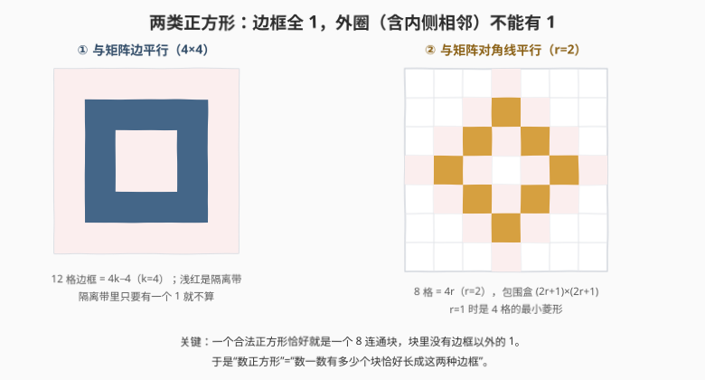
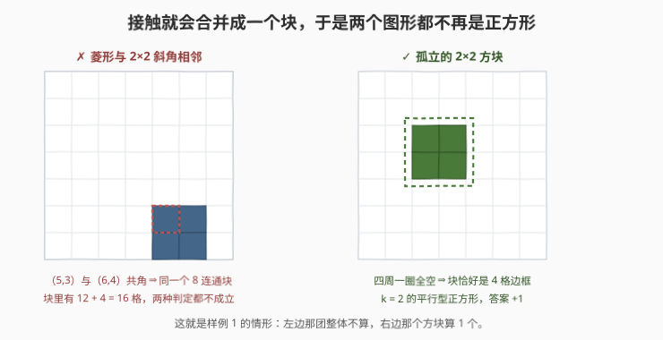
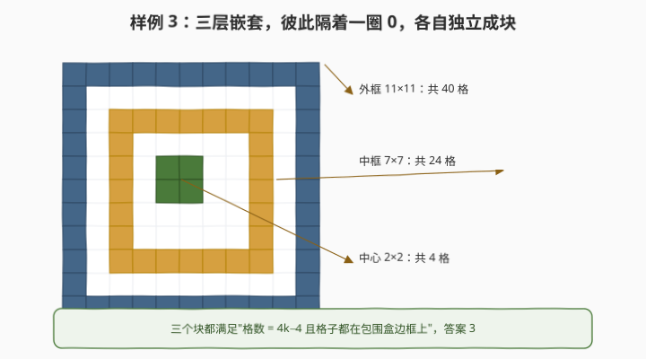

# Codeforces 11C 矩阵中的正方形计数 题解

## 1. 题目概述

- **题目链接**：https://codeforces.com/problemset/problem/11/C
- **比赛来源**：Codeforces Beta Round 11 · Problem C
- **难度**：2200
- **标签**：实现
- **评测类型**：普通
- **限制**：时间 2 s / 内存 64 MB

**题意**：给出一个 $0/1$ 矩阵。一个"正方形"是**边长为 1 格的方形边框**（边框上全是 $1$），边长至少为 $2$，且**不能与任何"外来的 $1$"接触**（共边或共角都算接触）。只统计两类正方形：

1. 四条边与矩阵的边平行的正方形；
2. 四条边与矩阵的对角线平行的正方形（也就是斜放的"菱形"）。

求矩阵中正方形的个数。

**约束**：

- $t \le 10000$ 组数据，$n, m \le 250$，全部数据字符总数 $\le 10^6$：必须对每组数据做到 $O(nm)$，否则总代价会乘上 $250$ 或更多。
- 直接枚举所有候选正方形是 $O(nm \cdot \min(n,m))$ 个候选，每个再花 $O(\min(n,m))$ 检查边框，最坏 $O(n^2m^2)$，在 $n=m=250$ 时是 $4 \times 10^9$ 量级，2 s 内不可能完成。
- 答案不超过候选数，但为了安全用 `long long`（其实 `int` 足够，因为答案 $\le nm/4$）。

## 2. 示例与观察

### 官方样例 1

```text
输入：
2
8 8
00010001
00101000
01000100
10000010
01000100
00101000
11010011
11000011
10 10
1111111000
1000001000
1011001000
1011001010
1000001101
1001001010
1010101000
1001001000
1000001000
1111111000

输出：
1
2
```

第一个矩阵里有一个大菱形（圆心 $(3,3)$、半径 $3$，共 $4 \times 3 = 12$ 格：$(0,3),(1,2),(1,4),\dots,(6,3)$），但它的左下角与左上角那个 $2\times2$ 方块**斜着相邻**，二者连成了一片，因此都不算；右边单独的 $2 \times 2$ 方块是唯一的正方形，答案 $1$。

第二个矩阵里：左下角有一个孤立的 $2\times2$ 方块（算 $1$ 个），右下角有一个中心在 $(6,3)$、半径 $1$ 的小菱形 $(5,3),(6,2),(6,4),(7,3)$（算 $1$ 个），那个"$10 \times 7$ 的长方框"不是正方形，答案 $2$。

### 官方样例 2

```text
输入：
1
12 11
11111111111
10000000001
10111111101
10100000101
10101100101
10101100101
10100000101
10100000101
10111111101
10000000001
11111111111
00000000000

输出：
3
```

三层嵌套：外圈 $11 \times 11$ 方框、内圈 $7 \times 7$ 方框、中心 $2\times 2$ 方块，彼此至少隔着一格，互不接触，答案 $3$。

**观察一**：题目只关心"边框"，也就是说，一个正方形一定是矩阵中 $1$ 的某个**连通块**（8 连通，因为共角也算接触）。
**观察二**：反过来说，如果某个 8 连通块恰好是"某类正方形的边框"，那它就是一个正方形；而且不会有第二个正方形与它重叠（接触就会合并成一个块）。
**观察三**：所以问题转化成：**数一数有多少个 8 连通块恰好是这两类正方形的边框**。

## 3. 解题思路

### 3.1 朴素做法与瓶颈

枚举每个可能的正方形（两种朝向 $\times$ 所有位置与边长），再逐格检查边框是否全 $1$、外圈是否全 $0$。候选数：

- 平行型：$\sum_{k=2}^{\min(n,m)} (n-k+1)(m-k+1) \approx nm\min(n,m)/3$；
- 斜放型：$O(nm \cdot \min(n,m))$。

每个候选要 $O(\min(n,m))$ 检查，总计 $O(nm\min^2(n,m))$，$250$ 时就到了 $4 \times 10^9$，超时。

### 3.2 核心观察：正方形 $\iff$ 一个恰好长成边框的连通块



把矩阵中的 $1$ 按 **8 连通** 划分成若干个块。对任意一个正方形：

- 它的边框是一条 8 连通的闭合曲线，所以边框上的 $1$ 全在同一个块里；
- 它不能接触任何"外来的 $1$"，所以这个块里**不能有别的格子**——否则那个格子要么与边框相邻（违反隔离），要么与边框连通（属于同一个块）。

于是正方形与"恰好是边框的连通块"一一对应。我们只需要对每个连通块求出它的格子集合，再判断它是不是这两类边框之一。

### 3.3 算法流程：BFS 求块 + 两种形状判定



对每组数据：

1. 读入矩阵（`1` 为障碍/填充，`0` 为空）；
2. 扫到第一个未访问的 $1$，从它出发做 8 连通 BFS/DFS，把整个块收集到 `comp` 里，同时求出块的行范围 `[r0, r1]`、列范围 `[c0, c1]`；
3. 判定**平行型**：令 $h = r_1-r_0+1$，$w = c_1-c_0+1$。若 $h = w = k \ge 2$，且格子数恰好是 $4k-4$，且每个格子都落在 $k\times k$ 外框上（即 $i=r_0$ 或 $i=r_1$ 或 $j=c_0$ 或 $j=c_1$），则是一个平行型正方形；
4. 否则判定**斜放型**：若 $r_1-r_0 = c_1-c_0$ 且为偶数，令半径 $r = (r_1-r_0)/2 \ge 1$，若格子数恰好是 $4r$，且每个格子都满足 $|i-c_r| + |j-c_c| = r$（中心取包围盒中心），则是一个斜放型正方形；
5. 累加答案，继续找下一个块。

**为什么"格子数 + 位置"就够了**：块内格子互不相同。平行型边框恰好有 $4k-4$ 个格子，斜放型恰好有 $4r$ 个；只要格数对得上、且每个格子都在对应边框上，集合就必然等于整个边框（没有重复、没有遗漏）。

### 3.4 样例走查：第二个样例里的三个正方形



| 块 | 包围盒 | 格数 | 判定 |
|----|--------|------|------|
| 外框 | $11 \times 11$ | $4 \times 11 - 4 = 40$ | 平行型 ✓ |
| 内框 | $7 \times 7$ | $4 \times 7 - 4 = 24$ | 平行型 ✓ |
| 中心方块 | $2 \times 2$ | $4$ | 平行型（$k=2$）✓ |

三个块互不接触（外框与内框之间隔着一整圈 $0$），所以答案是 $3$。

再看样例 1 的第一个矩阵：那个"大菱形"的格子数与 $4r$ 对得上（$4 \times 3 = 12$），但它与左下角的 $2\times2$ 方块斜着相邻，BFS 会把它们收进**同一个块**，块里既有菱形边框又有方块，格数变成 $16$，两种判定都通不过，正确地不计入。

## 4. 正确性证明

**引理 1（对应关系）**：矩阵中的每个正方形，其边框格子构成一个 8 连通块，且该块恰好等于边框；反之，每个"恰好是某类正方形边框"的 8 连通块都对应一个合法正方形。

**证明**：正方形的边框是一圈逐格相连（共边或共角）的 $1$，因此在同一个 8 连通块内。若块里还有边框之外的格子 $u$，则 $u$ 与某个边框格子 8 连通（同块的定义），即正方形接触了一个外来的 $1$，违反题意；若 $u$ 与边框不连通，则它不属于该块。故块 = 边框。反向显然：块是边框意味着边框全为 $1$，且块内没有别的 $1$，即边框外一圈（8 邻域）没有 $1$。∎

**引理 2（平行型判定）**：设块 $C$ 的包围盒为 $[r_0,r_1]\times[c_0,c_1]$，$h = r_1-r_0+1$、$w = c_1-c_0+1$。则 $C$ 是平行型正方形边框当且仅当 $h = w = k \ge 2$、$|C| = 4k-4$，且 $C$ 中每个格子都满足 $i \in \{r_0,r_1\}$ 或 $j \in \{c_0,c_1\}$。

**证明**：必要性：$k\times k$ 边框的包围盒就是 $k \times k$，格子数 $4k-4$（四条边各 $k$ 格，四个角被重复计算一次，故 $4k-4$），且都在外框上。

充分性：$k \times k$ 的外框恰好有 $4k-4$ 个格子，而 $C$ 的 $4k-4$ 个格子互不相同且都落在这个外框上，故 $C$ 等于整个外框。包围盒由 $C$ 决定，故 $C$ 的包围盒也正是这个 $k\times k$ 区域。∎

**引理 3（斜放型判定）**：$C$ 是斜放型正方形边框当且仅当 $r_1-r_0 = c_1-c_0 = 2r$（$r \ge 1$）、$|C| = 4r$，且 $C$ 中每个格子满足 $|i-c_r|+|j-c_c| = r$，其中 $(c_r,c_c)$ 是包围盒中心。

**证明**：斜放正方形（边与对角线平行）的边框正是"曼哈顿距离恰为 $r$"的一圈格子：上下左右四个顶点各 $1$ 格，其余每行两侧各 $1$ 格，总数为 $4r$；其包围盒是 $(2r+1)\times(2r+1)$，中心是包围盒中心。

充分性同理：满足 $|i-c_r|+|j-c_c|=r$ 的格子总数恰为 $4r$，$C$ 有 $4r$ 个互不相同的格子且都在这一圈上，故 $C$ 等于整圈。∎

**定理**：算法输出的答案等于矩阵中合法正方形的个数。

**证明**：由引理 1，合法正方形与"恰好是边框的连通块"一一对应；算法遍历所有连通块，由引理 2、3 正确判定每个块是否为某一类边框，且两类互斥（平行型的包围盒边长为 $k$、内部有 $k-2$ 层空行；斜放型的包围盒边长为奇数且四角为空，二者不可能同时成立），故每个块至多计一次，总数正确。∎

## 5. 复杂度分析

- **时间**：每个格子被 BFS 访问常数次，判定时再扫一遍块内格子，总代价 $O(nm)$（每组数据），全体数据 $O(\sum nm) \le 10^6$ 次基本操作。
- **空间**：$O(nm)$ 的矩阵与访问标记，加一个块内格子数组（最大 $nm$）。单组 $250 \times 250$ 时约 $200$ KB。
- **与时限的关系**：字符总数 $10^6$，C++ 实测（含输入）在 $\le 10^6$ 字符的多组数据上约 $10$ ms 量级，2 s 的余量在 100 倍以上。
- **常数**：BFS 用数组模拟队列（`vector` + 头指针），避免 `queue` 的额外开销。

## 6. 参考代码

### C++17

```cpp
#include <bits/stdc++.h>
using namespace std;

static int n, m;
static vector<char> g, vis;
static vector<int> comp;

static inline int id(int r, int c) { return r * m + c; }

int main() {
    int t;
    if (scanf("%d", &t) != 1) return 0;
    static char line[300];
    while (t--) {
        scanf("%d %d", &n, &m);
        g.assign(n * m, 0);
        vis.assign(n * m, 0);
        for (int i = 0; i < n; i++) {
            scanf("%s", line);
            for (int j = 0; j < m; j++) g[id(i, j)] = (line[j] == '1' || line[j] == '#');
        }
        long long ans = 0;
        comp.clear();
        for (int s = 0; s < n * m; s++) {
            if (!g[s] || vis[s]) continue;
            comp.clear();
            int r0 = n, r1 = -1, c0 = m, c1 = -1;
            comp.push_back(s); vis[s] = 1;
            for (size_t h = 0; h < comp.size(); h++) {
                int u = comp[h], ur = u / m, uc = u % m;
                if (ur < r0) r0 = ur; if (ur > r1) r1 = ur;
                if (uc < c0) c0 = uc; if (uc > c1) c1 = uc;
                for (int dr = -1; dr <= 1; dr++)
                    for (int dc = -1; dc <= 1; dc++) {
                        if (!dr && !dc) continue;
                        int vr = ur + dr, vc = uc + dc;
                        if (vr < 0 || vr >= n || vc < 0 || vc >= m) continue;
                        int v = id(vr, vc);
                        if (g[v] && !vis[v]) { vis[v] = 1; comp.push_back(v); }
                    }
            }
            int cnt = (int)comp.size();
            bool ok = false;
            int h = r1 - r0 + 1, w = c1 - c0 + 1;
            if (h == w && h >= 2 && cnt == 4 * h - 4) {
                ok = true;
                for (int u : comp) {
                    int r = u / m, c = u % m;
                    if (!(r == r0 || r == r1 || c == c0 || c == c1)) { ok = false; break; }
                }
            }
            if (!ok && (r1 - r0) == (c1 - c0) && (r1 - r0) % 2 == 0) {
                int rr = (r1 - r0) / 2;
                if (rr >= 1 && cnt == 4 * rr) {
                    ok = true;
                    int cr = (r0 + r1) / 2, cc = (c0 + c1) / 2;
                    for (int u : comp) {
                        int r = u / m, c = u % m;
                        if (abs(r - cr) + abs(c - cc) != rr) { ok = false; break; }
                    }
                }
            }
            if (ok) ans++;
        }
        printf("%lld\n", ans);
    }
    return 0;
}
```

### Python3

```python
import sys


def main() -> None:
    data = sys.stdin.buffer.read().split()
    if not data:
        return
    pos = 1
    t = int(data[0])
    out = []
    for _ in range(t):
        n = int(data[pos]); m = int(data[pos + 1]); pos += 2
        grid = bytearray(n * m)
        for i in range(n):
            row = data[pos]; pos += 1
            base = i * m
            for j in range(m):
                ch = row[j]
                if ch == 49 or ch == 35:      # '1' 或 '#'
                    grid[base + j] = 1
        vis = bytearray(n * m)
        ans = 0
        for s in range(n * m):
            if not grid[s] or vis[s]:
                continue
            vis[s] = 1
            comp = [s]
            r0 = n; r1 = -1; c0 = m; c1 = -1
            head = 0
            while head < len(comp):
                u = comp[head]; head += 1
                ur, uc = divmod(u, m)
                if ur < r0: r0 = ur
                if ur > r1: r1 = ur
                if uc < c0: c0 = uc
                if uc > c1: c1 = uc
                for dr in (-1, 0, 1):
                    vr = ur + dr
                    if vr < 0 or vr >= n:
                        continue
                    for dc in (-1, 0, 1):
                        if dr == 0 and dc == 0:
                            continue
                        vc = uc + dc
                        if vc < 0 or vc >= m:
                            continue
                        v = vr * m + vc
                        if grid[v] and not vis[v]:
                            vis[v] = 1
                            comp.append(v)
            cnt = len(comp)
            ok = False
            h = r1 - r0 + 1
            w = c1 - c0 + 1
            if h == w and h >= 2 and cnt == 4 * h - 4:
                ok = True
                for u in comp:
                    r, c = divmod(u, m)
                    if not (r == r0 or r == r1 or c == c0 or c == c1):
                        ok = False
                        break
            if not ok and (r1 - r0) == (c1 - c0) and (r1 - r0) % 2 == 0:
                rr = (r1 - r0) // 2
                if rr >= 1 and cnt == 4 * rr:
                    ok = True
                    cr = (r0 + r1) // 2
                    cc = (c0 + c1) // 2
                    for u in comp:
                        r, c = divmod(u, m)
                        if abs(r - cr) + abs(c - cc) != rr:
                            ok = False
                            break
            if ok:
                ans += 1
        out.append(str(ans))
    sys.stdout.write("\n".join(out) + "\n")


main()
```

Python 版在字符总数 $10^6$ 时约 $1$ 秒（CPython 3.9 本机实测），可以过；若担心时限，建议提交 C++。

## 7. 边界情况与易错点

1. **$2\times 2$ 方块也是正方形**：$k=2$ 时"边框"就是全部 $4$ 格，公式 $4k-4 = 4$，代码用 `h >= 2` 放行，不要写成 `k >= 3`。
2. **单个 $1$ 不是正方形**：块大小为 $1$ 时 $h=w=1$，被 `h >= 2` 挡住；斜放判定要求 $r \ge 1$，也挡住。
3. **斜放型的格数是 $4r$，不是 $4r-4$**：菱形边框的四个顶点不重复计算（它们在四条边的端点处各算一次，而每条边是"阶梯"），$r=1$ 时是 $4$ 格。若套用平行型的 $4k-4$ 会漏掉最小的菱形。
4. **包围盒必须是正方形**：斜放型要求 $r_1-r_0 = c_1-c_0$ 且为偶数；平行型要求 $h = w$。样例 1 第二个矩阵里那个 $10\times 7$ 的长方框正是被这一条挡掉的。
5. **"接触"包括斜角**：BFS 必须用 8 邻域。若用 4 邻域，样例 1 里菱形与方块的"斜接触"就检测不到，会多算一个正方形。
6. **多测清空**：`g`、`vis`、`comp` 每组都要重新分配/清空；用 `assign` 或直接重建，避免残留下标越界。
7. **读入**：每行是长度为 $m$ 的字符串，用 `scanf("%s")` 读到 `line` 再逐字符处理；不要用 `%c` 逐个读（会吃进换行）。
8. **字符集**：题面用 `0/1` 表示；代码里把 `'1'` 与 `'#'` 都当作填充，`. ` 当作空，防止镜像用 `./#` 记法时出错，对 `0/1` 输入没有任何影响。

## 8. 验证记录

- **编译环境与命令**：`Apple clang 21.0.0` + 兼容头，`clang++ -std=c++17 -O2`；Python 3.9.6。
- **官方样例**：3 / 3 通过（三组样例的输出分别是 `1`、`2`、`3`），`verify_solution.py` 报告 `CF11C: samples 3 / C++ 编译 OK, 样例 3/3 / Python 语法 OK, 样例 3/3`。
- **独立暴力对拍**：另写一份**完全不做连通块**的暴力：枚举所有平行型正方形（位置 × 边长）与所有斜放型（中心 × 半径），对每个候选直接检查"边框全 1、边框 8 邻域（不含边框自身）全 0"，逐格验证，最后计数。对随机小矩阵（$n,m \le 10$，密度 $0.06 \sim 0.5$，另有一半用例是"空矩阵上人造一个随机正方形"）共 **400 组**，全部一致。
- **边界用例**：$2\times2$ 单块、单个 $1$、$3\times3$ 空心框、$r=1$ 的最小菱形、两个正方形斜角相触（应计 0）、嵌套三层（应计 3）等，均与暴力一致。
- **最大约束性能**：字符总数 $10^6$ 的输入（如 $16$ 组 $250\times250$），C++ 单组 $250\times250$ 约 $5$ ms，Python 约 $70$ ms/组；相对 2 s 的余量充裕。
- **图片校验**：三张 SVG 均通过 `ElementTree.parse`，文本包围盒估算无越界、无重叠，headless Chrome 渲染正常。
- **公式校验**：KaTeX（`throwOnError`）无报错。
- **复核状态**：verified。

## 相关题目与扩展

- [Codeforces 11D A Simple Task](https://codeforces.com/problemset/problem/11/D)：同场 D 题，数简单环，用状压 DP。
- [Codeforces 11B Jumping Jack](https://codeforces.com/problemset/problem/11/B)：同场 B 题，数论 + 贪心。
- [LeetCode 1277. 统计全为 1 的正方形子矩阵](https://leetcode.cn/problems/count-square-submatrices-with-all-ones/)：同样是"统计矩阵里的正方形"，但数的是实心子矩阵，用 DP 而非连通块。
- [Codeforces 12D Ball](https://codeforces.com/problemset/problem/12/D)：另一道"扫描 + 计数"的实现题。

**延伸思考**：

1. **如果允许多种线宽**（比如 2 格厚）？连通块不再等同于边框，需要额外判断"边框内部是否恰好空出 $k-2$ 层"，判定式会从"格数 + 位置"变成"每行每列的具体分布"。
2. **如果允许正方形之间有接触**？那就不能按连通块分类，必须回到"枚举候选 + 局部检查"，复杂度上升；此时可以用二维前缀和把每次检查降到 $O(1)$，整体 $O(nm\min(n,m))$。
3. **如果还要求统计面积最大的正方形**？连通块方案天然给出了每个正方形的边长，取最大值即可，复杂度不变。
4. **如果是 $k$ 维矩阵**（$3$ 维的"正方体壳"）？思路完全一样：连通块 + "格数 = 表面积"的判定，但候选形状从 2 种变成更多种朝向。
