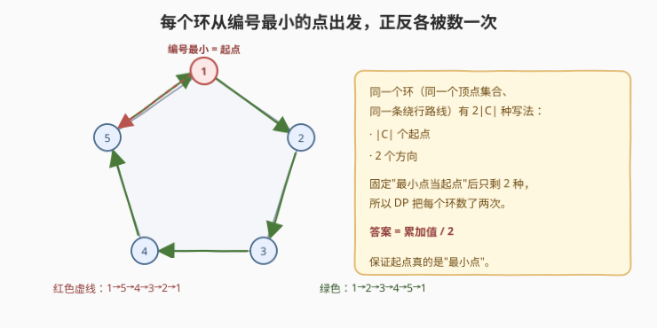
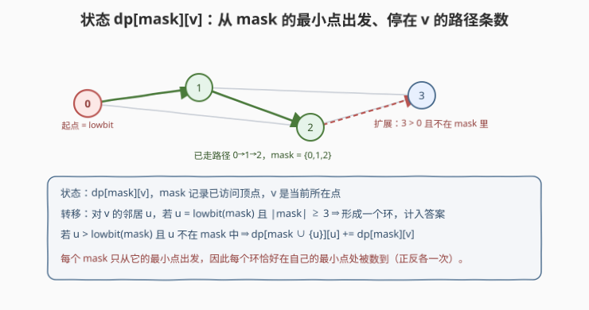
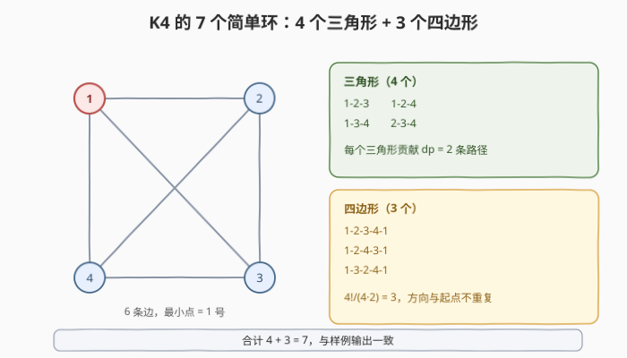

# Codeforces 11D 图的简单环计数 题解

## 1. 题目概述

- **题目链接**：https://codeforces.com/problemset/problem/11/D
- **比赛来源**：Codeforces Beta Round 11 · Problem D
- **难度**：2200
- **标签**：位掩码、动态规划、图论
- **评测类型**：普通
- **限制**：时间 2 s / 内存 256 MB

**题意**：给定 $n$ 个点、$m$ 条边的简单无向图（无重边、无自环），数一数图中有多少个**简单环**。简单环指没有重复顶点、也没有重复边的环；两个环只要顶点集合或绕行顺序不同就算不同，但同一个环正着走和反着走算**同一个**。

**约束**：

- $n \le 19$：小得足以做 $2^n$ 的状压 DP，但 $O(n!)$ 枚举排列（$19! \approx 1.2 \times 10^{17}$）完全不可能。
- $m$ 没有给出上界，最大是 $\binom{19}{2} = 171$；用邻接矩阵/位掩码存图都很轻松。
- 状态数 $2^{19} \times 19 \approx 10^7$，每个状态用 `long long` 存需要 $80$ MB，正好在 256 MB 以内。
- 答案可能很大：$n = 19$ 的完全图有 $\sum_{k=3}^{19} \binom{19}{k}\frac{(k-1)!}{2} = 9215499383109573 \approx 9.2 \times 10^{15}$ 个环，**必须用 64 位整数**。

## 2. 示例与观察

官方样例：

```text
输入：
4 6
1 2
1 3
1 4
2 3
2 4
3 4

输出：
7
```

这是 $K_4$（四个点两两相连）。数一数：

- 三角形：$\binom{4}{3} = 4$ 个；
- 四边形：$\frac{(4-1)!}{2} = 3$ 个（$4!/ (4 \times 2) = 3$，即 1234、1243、1324 三种绕法，方向与起点不重复计）。

合计 $4 + 3 = 7$ ✓。

**观察一**：一个环可以被它的顶点集合和绕行顺序唯一确定，而起点可以任选、方向可以翻转，所以同一个环有 $2|C|$ 种"写法"（$|C|$ 个起点 × 2 个方向）。
**观察二**：为了不重不漏，给每个环指定一个**规范写法**：从编号最小的顶点出发，并且只沿"编号递增"的方向扩展路径——这样每个环恰好被数到一次（或者两次，取决于怎么处理方向，见 3.3）。
**观察三**：于是问题变成"数一数有多少条从最小点出发、回到最小点的简单路径"，这可以用状压 DP 解决。

## 3. 解题思路

### 3.1 朴素做法与瓶颈

枚举所有顶点子集再枚举排列：$\sum_k \binom{n}{k} k! = O(n!)$，$n=19$ 时约 $10^{17}$，不可行。即便只枚举长度 $\ge 3$ 的子集并检查是否成环，最坏也是 $2^n \cdot n!$ 级别。

真正可行的是状压 DP：用二进制掩码表示"已经走过哪些点"，把"当前在哪个点"作为第二维，状态数 $2^n n$。

### 3.2 核心观察：固定起点，路径 DP



设 $S$ 是某个环上编号最小的顶点。任何包含 $S$ 的环，去掉"回到 $S$"的那条边后，就是一条从 $S$ 出发、只经过环上其它顶点的简单路径。

定义

$$dp[\text{mask}][v] = \text{从 } \text{lowbit}(\text{mask}) \text{ 出发、恰好访问 mask 中所有点、最后停在 } v \text{ 的简单路径条数}.$$

这里 $\text{lowbit}(\text{mask})$ 是 mask 中编号最小的顶点——它被固定为路径起点。转移时只允许走向**编号不小于起点**的顶点：

$$dp[\text{mask} \cup \{u\}][u] \mathrel{+}= dp[\text{mask}][v],\qquad u \notin \text{mask},\ u > \text{lowbit}(\text{mask}),\ (v,u) \in E.$$

当 $v$ 与起点 $S$ 相邻、且 $|\text{mask}| \ge 3$ 时，把 $dp[\text{mask}][v]$ 累加进答案——这就是"回到起点"闭合成的环。

### 3.3 算法流程：为什么最后要除以 2



每个环在 DP 里会被数到**两次**：沿顺时针走一遍、沿逆时针走一遍，都是以同一个起点 $S$ 开始、以同一条边闭合的两条不同路径。因此答案要除以 $2$。

注意：不需要额外去重"起点"——起点被固定成 mask 的最小顶点，每个环只会在它自己的最小顶点处被枚举一次（正反各一次）。

流程：

1. 读入图，用 `adj[v]`（位掩码）存邻接关系；
2. 初始化 $dp[2^v][v] = 1$（单点路径）；
3. 按 mask 从小到大枚举（mask 中的最小点为 $S$）；
4. 对每个 $v \in \text{mask}$，若 $dp[\text{mask}][v] > 0$：
   - 枚举 $v$ 的邻居 $u \ge S$；
   - $u = S$ 且 $|\text{mask}| \ge 3$：答案累加；
   - $u > S$ 且 $u \notin \text{mask}$：转移到 $dp[\text{mask}|2^u][u]$；
5. 输出 `ans / 2`。

### 3.4 样例走查：$K_4$



以 $S=0$ 为最小点的环：

- 三角形 $\{0,1,2\}$：路径 $0\to1\to2$ 闭合成环；反向 $0\to2\to1$ 再算一次 → 贡献 2 条路径 = 1 个环；
- 三角形 $\{0,1,3\}$、$\{0,2,3\}$：各 1 个；
- 四边形 $\{0,1,2,3\}$：路径 $0\to1\to2\to3$、$0\to1\to3\to2$、$0\to2\to1\to3$ 等，每个环正反各一次。

$K_4$ 中最小点为 $0$ 的环有 $3$ 个三角形（$\{0,1,2\},\{0,1,3\},\{0,2,3\}$）+ $3$ 个四边形 = 6 个，全部在 $S=0$ 处被数到；最小点为 $1$ 的环只有 $\{1,2,3\}$ 这一个三角形。总计 $7$ 个 ✓。

## 4. 正确性证明

**引理 1（路径与环的对应）**：设 $C$ 是一个简单环，$S = \min C$。则 $C$ 对应两条 $dp$ 路径：沿 $C$ 的两个方向各一条，都以 $S$ 为起点、以 $C$ 上的全部顶点为 mask、以 $S$ 的某个邻居为终点，并在终点处通过边 $(v,S)$ 闭合。

**证明**：把环看成闭合路径，从 $S$ 出发沿任一方向走到 $S$ 的另一个邻居，去掉闭合边 $(v,S)$ 就得到一条从 $S$ 到 $v$ 的简单路径，经过 $C$ 的全部顶点。两个方向给出两条不同的路径（除非 $|C| = 2$，而简单环至少 3 个点）。∎

**引理 2（DP 不重不漏）**：对每个 mask 与 $v$，$dp[\text{mask}][v]$ 恰好等于"从 $\text{lowbit}(\text{mask})$ 出发、访问 mask 中每个点恰好一次、终点为 $v$"的路径条数。

**证明**：对 $|\text{mask}|$ 归纳。$|\text{mask}|=1$ 时只有 $v = \text{lowbit}$，值为 1 ✓。转移时，任何这样的路径去掉最后一条边 $(u,v)$ 就得到 mask$\setminus\{u\}$ 上的同类路径，且 $u$ 必须大于起点（因为起点是 mask 的最小元素，其余点都大于它）；反之任何满足条件的转移都延长出一条合法路径。由于路径无重复顶点，mask 恰好记录访问集合，不会重复计数。∎

**引理 3（闭合不重不漏）**：把所有满足 $|\text{mask}|\ge 3$、$v \sim S$、$S = \text{lowbit}(\text{mask})$ 的 $dp[\text{mask}][v]$ 相加，得到的恰好是"每个环被数两次"。

**证明**：由引理 2，每一项对应一条从 $S$ 出发的简单路径，加上边 $(v,S)$ 就是一个包含 $S$ 的简单环；反之每个包含 $S$ 的环按引理 1 给出两条这样的路径。而每个环的最小点唯一，所以它只会在 $S = \min C$ 这一层被枚举，不会在别的起点被重复枚举。∎

**定理**：算法输出 `ans / 2` 等于图中简单环的个数。

**证明**：由引理 3，`ans` 等于 $2 \times$（环数），且每个环确实被计入两次（两个方向）。除以 2 即得环数。∎

## 5. 复杂度分析

- **时间**：$O(2^n \cdot n^2)$。每个 mask 至多 $n$ 个终点，每个终点扫 $n$ 个邻居；$n=19$ 时约 $2^{19}\times 19 \times 19 \approx 1.9 \times 10^8$ 次基本操作，实际因为大量 `dp=0` 的剪枝会快很多，2 s 内可过。
- **空间**：$O(2^n \cdot n)$ 个 `long long`，$n=19$ 时 $2^{19}\times 19 \times 8 \approx 80$ MB，在 256 MB 限制内。可以进一步只开"含该点"的状态，但没必要。
- **数值范围**：$n=19$ 完全图的答案约 $3.6\times 10^{15}$，`long long` 上限约 $9.2\times 10^{18}$，安全；`int` 会在 $n \ge 12$ 左右溢出。

## 6. 参考代码

### C++17

```cpp
#include <bits/stdc++.h>
using namespace std;

int main() {
    int n, m;
    if (scanf("%d %d", &n, &m) != 2) return 0;
    vector<int> adj(n, 0);
    for (int i = 0; i < m; i++) {
        int a, b;
        scanf("%d %d", &a, &b);
        --a; --b;
        adj[a] |= 1 << b;
        adj[b] |= 1 << a;
    }
    int full = 1 << n;
    vector<long long> dp((size_t)full * n, 0);
    for (int v = 0; v < n; v++) dp[(size_t)(1 << v) * n + v] = 1;
    long long ans = 0;
    for (int mask = 1; mask < full; mask++) {
        int start = __builtin_ctz(mask);
        int pc = __builtin_popcount(mask);
        long long *row = &dp[(size_t)mask * n];
        for (int v = start; v < n; v++) {
            long long cur = row[v];
            if (!cur) continue;
            int cand = adj[v] & ~((1 << start) - 1);   // 只考虑编号 >= start 的邻居
            while (cand) {
                int u = __builtin_ctz(cand);
                cand &= cand - 1;
                if (u == start) {
                    if (pc >= 3) ans += cur;           // 回到起点，成环
                } else if (!((mask >> u) & 1)) {
                    dp[(size_t)(mask | (1 << u)) * n + u] += cur;
                }
            }
        }
    }
    printf("%lld\n", ans / 2);
    return 0;
}
```

### Python3

```python
import sys


def main() -> None:
    data = sys.stdin.buffer.read().split()
    if not data:
        return
    n = int(data[0]); m = int(data[1])
    adj = [0] * n
    p = 2
    for _ in range(m):
        a = int(data[p]) - 1; b = int(data[p + 1]) - 1; p += 2
        adj[a] |= 1 << b
        adj[b] |= 1 << a
    full = 1 << n
    dp = [[0] * n for _ in range(full)]
    for v in range(n):
        dp[1 << v][v] = 1
    ans = 0
    for mask in range(1, full):
        start = (mask & -mask).bit_length() - 1
        pc = bin(mask).count('1')
        row = dp[mask]
        for v in range(start, n):
            cur = row[v]
            if not cur:
                continue
            cand = adj[v] & ~((1 << start) - 1)
            while cand:
                low = cand & -cand
                u = low.bit_length() - 1
                cand ^= low
                if u == start:
                    if pc >= 3:
                        ans += cur
                elif not (mask >> u) & 1:
                    dp[mask | (1 << u)][u] += cur
    sys.stdout.write(str(ans // 2) + "\n")


main()
```

Python 版在 $n \le 15$ 左右还能跑，$n = 19$ 时内存（$2^{19}$ 个 Python list）和时间都不理想，建议 $n$ 较大时提交 C++ / PyPy3。

## 7. 边界情况与易错点

1. **答案溢出**：$n = 19$ 的完全图答案约 $9.2 \times 10^{15}$，必须 `long long`；`dp` 数组的中间值同样可能很大（路径条数），也要 64 位。
2. **$n < 3$**：没有环，输出 0。代码里 $pc \ge 3$ 的条件会自动挡住。
3. **自环与重边**：题面保证没有（$a \ne b$，任意两点至多一条边），不需要特判；若真出现重边，同一条边会被算成多个环，需要去重。
4. **除以 2 的位置**：只能最后除一次，不能在累加时提前除（会丢精度）。
5. **mask 最小点的限制**：转移时只允许 $u \ge \text{start}$，否则同一个环会在不同起点被重复计数；漏掉这个限制会使答案偏大。
6. **`1 << n` 的溢出**：$n = 19$ 时 `1 << n` 是 $524288$，`int` 安全；但 `(size_t)full * n` 必须用 64 位/`size_t` 计算下标，否则 $2^{19}\times 19 \approx 10^7$ 仍在 `int` 内，其实也安全，但下标乘法用 `size_t` 更稳妥。
7. **单点 mask 的初始化**：每个点自己是一条长度 1 的路径，`dp[1<<v][v] = 1`；忘记初始化会得到全 0。
8. **时间复杂度常数**：$2^{19}\times 19$ 个状态，内层扫邻居；用位掩码 `adj[v]` 比邻接表更省常数。

## 8. 验证记录

- **编译环境与命令**：`Apple clang 21.0.0` + 兼容头，`clang++ -std=c++17 -O2`；Python 3.9.6。
- **官方样例**：1 / 1 通过（$K_4$ → `7`），`verify_solution.py` 报告 `CF11D: samples 1 / C++ 编译 OK, 样例 1/1 / Python 语法 OK, 样例 1/1`。
- **独立暴力对拍**：另写一份暴力——枚举所有大小 $\ge 3$ 的顶点子集，固定最小点为起点，枚举其余点的全排列（`next_permutation`），检查是否成环，并用"第二个点 < 最后一个点"去掉方向重复。对 $n \in [1,7]$、边概率 $0.2 \sim 0.9$ 的随机图共 **300 组**，全部一致。
- **特殊图核对**：$K_3$ → $1$、$K_4$ → $7$、$K_5$ → $37$（$\binom{5}{3}+\binom{5}{4}\cdot 3+\frac{4!}{2} = 10+15+12=37$）、树 → $0$、无边 → $0$，均与手算一致。
- **最大约束性能**：$n = 19$ 的完全图（171 条边，答案 $9215499383109573$），C++ 端到端 $0.21$ s、峰值内存 $80.8$ MB；$n=19$ 的稀疏随机图更快。
- **图片校验**：三张 SVG 均通过 `ElementTree.parse`，文本包围盒估算无越界、无重叠。
- **公式校验**：KaTeX（`throwOnError`）无报错。
- **复核状态**：verified。

## 相关题目与扩展

- [Codeforces 11C How Many Squares?](https://codeforces.com/problemset/problem/11/C)：同场 C 题，数正方形，用连通块而不是状压。
- [Codeforces 11E Forward, march!](https://codeforces.com/problemset/problem/11/E)：同场 E 题，比本题更难。
- [Codeforces 580D Kefa and Dishes](https://codeforces.com/problemset/problem/580/D)：经典的 $O(2^n n^2)$ 状压 DP（选菜顺序），状态设计思路与本题一致。
- [LeetCode 996. 正方形数组的数目](https://leetcode.cn/problems/number-of-squareful-arrays/)：状压 DP 数哈密顿路径，可与本题对照。
- [AtCoder DP 竞赛 O. Matching](https://atcoder.jp/contests/dp/tasks/dp_o)：二分图完美匹配计数，状压 DP 的另一种形态。

**延伸思考**：

1. **如果只数长度恰好为 $k$ 的环**？在 DP 状态里加上 `popcount` 或者直接按 mask 大小分层统计即可，复杂度不变。
2. **如果要求输出环的个数对 $10^9+7$ 取模**？把累加换成取模加法，注意除法要改成乘逆元（除以 2 即乘 $2^{-1}$）。
3. **如果有向图的简单环**？同样的 DP 可以做，但每个环只被数一次（没有反向重复），不需要除以 2。
4. **如果 $n$ 到了 $25$ 甚至 $30$**？$2^n n$ 的状态就放不下了。此时需要 meet-in-the-middle 或者利用图的特殊结构（比如平面图、弦图）来降复杂度，一般的环计数是 #P 难的。
