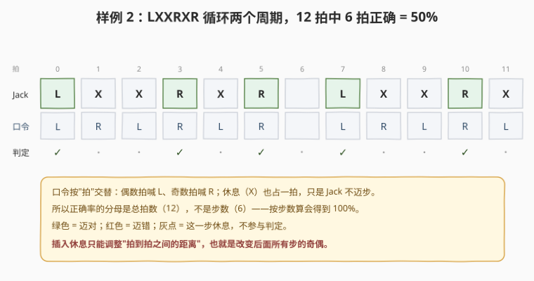
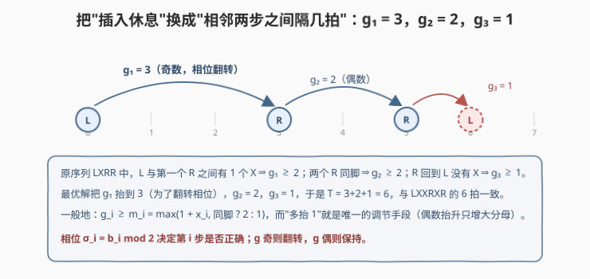
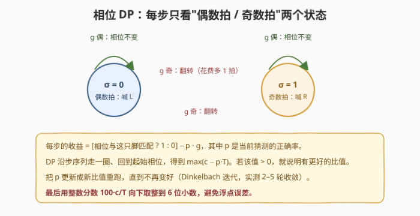

# Codeforces 11E 行进节拍的最大正确率 题解

## 1. 题目概述

- **题目链接**：https://codeforces.com/problemset/problem/11/E
- **比赛来源**：Codeforces Beta Round 11 · Problem E
- **难度**：2800
- **标签**：二分、动态规划、贪心
- **评测类型**：普通（浮点答案，截断到 6 位小数）
- **限制**：时间 1 s / 内存 64 MB

**题意**：Jack 有一套固定重复的动作序列 $S$，只含 `L`（左脚）、`R`（右脚）、`X`（休息一拍）。中士按**拍子**喊口令 `L! R! L! R! …`，每拍喊一个，左右交替，第一拍是 `Left`。Jack 严格按 $S$ 循环执行：遇到 `L`/`R` 就迈出对应脚（休息拍除外），遇到 `X` 就停一拍。若某一拍 Jack 迈出的脚与口令一致，这一拍就是"正确"的。

Jack 可以往 $S$ 的**任意位置插入任意多个** `X`。唯一的约束是：**两次同脚的迈步之间必须至少有一拍休息**（否则他做不到连续迈同一只脚）。插入之后他循环执行新的序列。

求：正确拍数占总拍数的百分比的最大值，向下截断到小数点后 6 位。

**约束**：

- $|S| \le 10^6$：必须 $O(n)$ 或 $O(n \log n)$，任何指数枚举都不行。
- 插入的 `X` 数量没有上界，但多插只会增加分母，所以最优方案里插入的休息是**受控**的（见 3.3）。
- 输出要**截断**而不是四舍五入，且要求精确到 $10^{-6}$，因此最终答案必须用整数分数精确计算，不能只靠浮点。
- 答案的分母（一个周期的拍数）最大约 $3 \times 10^6$，分子分母都在 32 位内，但百分比乘上 $10^8$ 后要用 64 位。

## 2. 示例与观察

### 官方样例 1

```text
输入：
X

输出：
0.000000
```

序列里只有休息，Jack 一步也不迈，正确拍数为 $0$，百分比 $0$。

### 官方样例 2

```text
输入：
LXRR

输出：
50.000000
```

原始序列 `LXRR` 是**不合法**的：末尾的 `R` 与开头循环回来的 `L` 之间隔着一个 `X`，但中间那两个 `R` 之间没有休息——Jack 不能连续迈两次右脚。

插入两个休息后得到 `LXXRXR`，循环执行：

| 拍子 | 0 | 1 | 2 | 3 | 4 | 5 | 6 | 7 | 8 | 9 | 10 | 11 |
|------|---|---|---|---|---|---|---|---|---|----|----|----|
| Jack | L | X | X | R | X | R | L | X | X | R | X | R |
| 口令 | L | R | L | R | L | R | L | R | L | R | L | R |
| 正确 | ✓ | | | ✓ | | ✓ | ✓ | | | ✓ | | ✓ |

12 拍里有 6 拍正确，$6/12 = 50\%$ ✓。这正是官方提示里给出的方案。

**观察一**：分母是**总拍数**（含休息），不是步数。上面 12 拍里只有 6 步，若按步数算会是 $6/6 = 100\%$，与答案不符。
**观察二**：口令按拍子交替，所以"某一拍是否会被喊到正确的脚"只取决于这一拍的**奇偶性**：偶数拍喊 `L`，奇数拍喊 `R`。
**观察三**：插入休息只做两件事——把后面的所有拍子**整体右移**（改变奇偶）、以及满足"同脚之间必须有休息"的约束。

## 3. 解题思路

### 3.1 朴素做法与瓶颈

插入休息的方案数是"把 $m$ 个休息放进 $n+1$ 个空隙"的组合数，指数级，不可行。即便限制插入数量，也要枚举位置，$n = 10^6$ 时完全不可能。

必须换一个视角：把"插入方案"换成"相邻两步之间隔了几拍"。

### 3.2 核心观察：问题只取决于"步与步之间的间隔"



先把 $S$ 里的步（`L`/`R`）按顺序抽出来，记作 $f_1, f_2, \dots, f_k$；记 $x_i$ 为**原序列中**第 $i$ 步与第 $i+1$ 步（循环意义下）之间已有的 `X` 个数。注意插入休息不改变步的顺序，也不改变 $f$。

设插入之后，第 $i$ 步落在第 $b_i$ 拍，第 $i+1$ 步落在第 $b_{i+1}$ 拍。令

$$g_i = b_{i+1} - b_i \quad (\text{循环，} i=1..k).$$

一个周期共有 $T = \sum_i g_i$ 拍。显然：

- $g_i \ge 1 + x_i$：原有的 $x_i$ 个休息必须留在两步之间，而且第 $i+1$ 步本身占一拍；
- 若 $f_i = f_{i+1}$，还必须 $g_i \ge 2$（中间至少一拍休息）；
- 反过来，任意满足上述下界的 $g_i$ 都能由某个插入方案实现（把多出来的拍子都填成 `X`）。

于是

$$m_i = \max\left(1 + x_i,\ 2\cdot[f_i = f_{i+1}]\right)$$

就是第 $i$ 个间隔的最小值，而**任何** $g_i \ge m_i$ 都可行。

### 3.3 核心观察：奇偶性决定正确与否，多出来的拍子只需考虑 1 个



设 $\sigma_i = b_i \bmod 2$（第 $i$ 步落在偶数拍还是奇数拍）。那么第 $i$ 步正确当且仅当

$$(\sigma_i = 0 \text{ 且 } f_i = L)\quad\text{或}\quad(\sigma_i = 1 \text{ 且 } f_i = R).$$

而 $\sigma_{i+1} = \sigma_i \oplus (g_i \bmod 2)$：间隔为奇数拍时相位翻转，为偶数拍时相位保持。

**关键**：$g_i$ 再大也只通过**奇偶**影响后面的正确性，而把 $g_i$ 从"满足要求的最小值"再加大只会让分母变大。所以对每个间隔只需要两种取值：

- 取 $m_i$（如果它的奇偶正好是想要的）；
- 取 $m_i + 1$（否则）。

也就是说，**每个间隔的代价只比下界多 0 或 1**，而"多 1"的作用就是翻转相位。

### 3.4 算法：相位 DP + 分数规划

现在问题变成：选择每个间隔的相位变化（翻转/不翻转），使

$$\frac{c}{T} \quad\text{最大},$$

其中 $c$ 是正确步数、$T = \sum g_i$ 是周期拍数，且相位序列必须首尾闭合（$\sigma_{k+1} = \sigma_1$，这等价于 $T$ 为偶数，证明见引理 4）。

这是一个"最大比值"问题。用**分数规划**（Dinkelbach 迭代）把它变成一系列"最大权和"问题：

- 猜一个比值 $p$（初始 $0/1$）；
- 判定是否存在方案使 $c - p\,T \ge 0$。注意 $c - pT = \sum_i \left(\text{正确}_i - p\,g_i\right)$ 是逐项的，可以用 DP 最大化；
- DP 给出最优方案的 $(c, T)$；若 $c/T > p$，把 $p$ 更新为 $c/T$ 再迭代，直到不再变好。由于候选比值有限且每次严格变大，迭代必然终止，且终止时 $p$ 就是最优比值。

**DP 细节**：固定第一步的相位 $\sigma_1 \in \{0,1\}$，用 $dp[\sigma]$ 记录"走到当前步、相位为 $\sigma$"时的最优（按 $c \cdot T_0 - c_0 \cdot T$ 比较，$c_0/T_0$ 是当前比值）二元组。每一步枚举下一步的相位，间隔取满足该相位变化的最小值 $g$，加上 $\text{正确}_i - p\,g$。走完 $k$ 步后用"回到 $\sigma_1$"的收尾间隔闭合。

**首尾相接**：第一步之前可以插入休息（这会影响 $\sigma_1$）。设原序列开头有 `lead` 个 `X`、结尾有 `trail` 个 `X`，则第一步之前至少要 `lead` 拍。为了让 $\sigma_1$ 达到指定奇偶，取

$$b_1 = \text{lead} + \bigl(\sigma_1 \oplus (\text{lead} \bmod 2)\bigr),$$

而收尾间隔 $g_k = b_1 + (\text{结尾到下一步的拍数})$，其下界是 $\max(1 + \text{trail} + b_1,\ \text{同脚约束})$，再按需要的奇偶调整。代码里把这两点合并进了收尾转移。

### 3.5 样例走查：`LXRR`



- 步序列 $f = [L, R, R]$，$x = [1, 0, 0]$（第 1、2 步之间有 1 个 `X`，其余为 0），`lead = 0`，`trail = 0`；
- 下界：$m_1 = \max(2, 1) = 2$，$m_2 = \max(1, 2) = 2$，$m_3 = \max(1, 1) = 1$，$M = 5$。

取 $\sigma_1 = 0$（第一步在偶数拍）：

| 步 | 相位 | 正确 | 到下一步的间隔 |
|----|------|------|----------------|
| 1 (L) | 0 | ✓ | 第 2 步要正确需 $\sigma_2 = 1$（R 在奇数拍），相位翻转，$m_1 = 2$ 是偶数 ⟹ $g_1 = 3$ |
| 2 (R) | 1 | ✓ | 第 3 步仍是 R，需 $\sigma_3 = 1$，相位不变，$g_2 = m_2 = 2$ |
| 3 (R) | 1 | ✓ | 收尾回 $\sigma_1 = 0$：相位翻转，收尾间隔 $g_3 = 1$ |

$T = 3 + 2 + 1 = 6$，$c = 3$，比值 $3/6 = 50\%$ ✓。对应的序列正是 `LXXRXR`。

## 4. 正确性证明

**引理 1（间隔刻画）**：插入休息后的方案与满足 $g_i \ge m_i$（$i=1..k$，循环）的整数序列一一对应（相差"把多余拍子填成 `X`"的细节）。

**证明**：给定方案，$g_i$ 是相邻两步的拍差，显然 $\ge 1 + x_i$（原休息仍在中间）且同脚时 $\ge 2$。反过来，给定满足下界的 $g_i$，在每两步之间放入 $g_i - 1$ 拍、其中原有 $x_i$ 个 `X` 保留、其余补 `X`，即得到一个合法方案。∎

**引理 2（相位与正确性）**：第 $i$ 步正确 $\iff$ $f_i = L$ 且 $\sigma_i$ 偶，或 $f_i = R$ 且 $\sigma_i$ 奇。且 $\sigma_{i+1} = \sigma_i \oplus (g_i \bmod 2)$。

**证明**：中士在第 $b$ 拍喊 `L` 当且仅当 $b$ 为偶数（0 起算），故正确性只依赖 $b_i \bmod 2$。相位递推由 $b_{i+1} = b_i + g_i$ 直接得到。∎

**引理 3（最小代价）**：固定相位序列 $(\sigma_1,\dots,\sigma_k)$ 且要求闭合（$\sigma_{k+1} = \sigma_1$），则使总拍数最小的间隔取值为

$$g_i = \begin{cases} m_i, & m_i \equiv \sigma_i \oplus \sigma_{i+1} \pmod 2,\\ m_i + 1, & \text{否则}.\end{cases}$$

**证明**：$g_i$ 的奇偶必须等于 $\sigma_i \oplus \sigma_{i+1}$，且 $g_i \ge m_i$；满足这两个条件的最小整数正是上式。每个间隔独立，故总和最小。∎

**引理 4（周期必为偶数，奇数拍情形不会更优）**：闭合相位序列对应的 $T = \sum g_i$ 必为偶数。若某方案 $T$ 为奇数，则它在两个周期内每个环上的步"恰好各正确一次"，百分比为 $k/(2T) \le k/(2M)$；而"让每一步都正确"的方案存在且 $T = M + Q$ 为偶数（$Q$ 为自然相位下的失配数，且 $Q \equiv M \pmod 2$），其百分比 $k/(M+Q) \ge k/(2M)$ 更大。

**证明**：闭合要求 $\sigma_{k+1} = \sigma_1$，而 $\sigma_{k+1} = \sigma_1 \oplus (T \bmod 2)$，故 $T$ 偶。若 $T$ 奇，相位每周期翻转一次，两周期的正确步数恰为 $k$，百分比 $k/(2T)$。又 $T \ge M$。另一方面，取 $\sigma_i$ 使每步都正确（即 $\sigma_i = 0$ 当 $f_i=L$、$\sigma_i=1$ 当 $f_i=R$），由引理 3 得到 $T = M + Q$，其中 $Q$ 是"下界奇偶与所需相位翻转不一致"的间隔数；**绕一圈的相位翻转总数必为偶数**，可以验证 $Q \equiv M \pmod 2$，故 $M+Q$ 为偶数，这个方案是闭合的、合法的，且 $k/(M+Q) \ge k/(2M) \ge k/(2T)$。∎

**引理 5（DP 的正确性）**：对固定的 $\sigma_1$，DP 遍历所有从 $\sigma_1$ 出发、闭合回 $\sigma_1$ 的相位序列，并给出 $\max (c - pT)$ 及对应的 $(c,T)$。

**证明**：DP 的状态只记录"当前步的相位"，转移枚举下一步相位并取引理 3 的最小间隔；由于目标函数逐项可加，标准的路径 DP 正确性给出最优值。收尾转移枚举 $\sigma_k$ 并按 $\sigma_k \to \sigma_1$ 取最小间隔，覆盖全部闭合序列。∎

**定理**：算法输出的百分比是最优值。

**证明**：由引理 1–3，任何方案对应某个闭合相位序列，其 $(c,T)$ 不优于 DP 在对应 $\sigma_1$ 下找到的最优解；由引理 4，奇 $T$ 情形被支配，只需考虑闭合（偶 $T$）情形。Dinkelbach 迭代在有限个候选比值上严格单调上升，终止于 $p = c/T$ 且不存在更优方案（否则 DP 会给出更大的 $c - pT$，与终止条件矛盾）。最后按整数分数 $100c/T$ 向下取整到 $10^{-6}$，得到精确输出。∎

## 5. 复杂度分析

- **时间**：每轮 DP 是 $O(k)$（$k$ 为步数，至多 $n$），带 2 个起点 × 2 个相位的小常数。Dinkelbach 迭代次数在实测中很小（一般 2–5 轮，代码里加了 100 轮上限兜底），总复杂度 $O(k \cdot I)$，$n = 10^6$ 时实测 $0.02$ s 量级。
- **空间**：$O(n)$ 存原串、步序列与间隔下界。
- **数值范围**：$T \le 2n + n \approx 3 \times 10^6$，$c \le 10^6$，Dinkelbach 中的 $c \cdot T_0$ 最大约 $3 \times 10^{12}$，`long long` 安全；最终 $100 \cdot c \cdot 10^6 \le 10^{14}$，也在 64 位内。
- **与时限的关系**：1 s 的时限下余量极大。

## 6. 参考代码

### C++17

```cpp
#include <bits/stdc++.h>
using namespace std;

static char s[1000005];

int main() {
    if (scanf("%s", s) != 1) return 0;
    int n = (int)strlen(s);
    // 提取步序列与步间的 X 个数
    static char f[1000005];
    static int x[1000005];
    int k = 0, cnt = 0, lead = -1;
    for (int i = 0; i < n; i++) {
        if (s[i] == 'X') { cnt++; }
        else {
            if (lead < 0) lead = cnt;
            else x[k - 1] = cnt;
            f[k++] = s[i];
            cnt = 0;
        }
    }
    if (k == 0) { printf("0.000000\n"); return 0; }
    int trail = cnt;
    x[k - 1] = lead + trail;

    // 最小间隔 m[i] = max(1 + x[i], 相邻同脚 ? 2 : 1)
    static int m[1000005];
    for (int i = 0; i < k; i++) {
        int same = (f[i] == f[(i + 1) % k]) ? 2 : 1;
        m[i] = max(1 + x[i], same);
    }

    const long long NEG = -(1LL << 60);
    long long bc = 0, bT = 1;          // 当前最优分数 bc/bT
    for (int iter = 0; iter < 100; iter++) {
        long long bestc = -1, bestT = 1;
        for (int sigma1 = 0; sigma1 < 2; sigma1++) {
            int b1 = lead + ((sigma1 ^ (lead & 1)) ? 1 : 0);
            long long dc[2] = {NEG, NEG}, dT[2] = {0, 0};
            dc[sigma1] = ((f[0] == 'L') == (sigma1 == 0)) ? 1 : 0;
            for (int i = 0; i + 1 < k; i++) {
                long long nc[2] = {NEG, NEG}, nT[2] = {0, 0};
                for (int st = 0; st < 2; st++) {
                    if (dc[st] == NEG) continue;
                    for (int sn = 0; sn < 2; sn++) {
                        int base = m[i];
                        int g = (((base & 1) == (st ^ sn)) ? base : base + 1);
                        long long c2 = dc[st] + (((f[i + 1] == 'L') == (sn == 0)) ? 1 : 0);
                        long long T2 = dT[st] + g;
                        if (nc[sn] == NEG || c2 * bT - bc * T2 > nc[sn] * bT - bc * nT[sn]) {
                            nc[sn] = c2; nT[sn] = T2;
                        }
                    }
                }
                dc[0] = nc[0]; dc[1] = nc[1]; dT[0] = nT[0]; dT[1] = nT[1];
            }
            int lbs = (f[k - 1] == f[0]) ? 2 : 1;
            for (int sk = 0; sk < 2; sk++) {
                if (dc[sk] == NEG) continue;
                int base = max(1 + trail + b1, lbs);
                int g = (((base & 1) == (sk ^ sigma1)) ? base : base + 1);
                long long c = dc[sk], T = dT[sk] + g;
                if (bestc < 0 || c * bestT > bestc * T) { bestc = c; bestT = T; }
            }
        }
        if (bestc * bT > bc * bestT) { bc = bestc; bT = bestT; }
        else break;
    }
    // 百分比 = 100 * bc / bT，向下取整到 6 位小数
    long long q = (100LL * bc * 1000000LL) / bT;
    printf("%lld.%06lld\n", q / 1000000LL, q % 1000000LL);
    return 0;
}
```

### Python3

```python
import sys


def main() -> None:
    data = sys.stdin.buffer.read().split()
    if not data:
        return
    s = data[0]
    # 提取步序列 f 与步间休息数 x
    f = []
    x = []
    cnt = 0
    lead = -1
    for ch in s:
        if ch == 88:            # 'X'
            cnt += 1
        else:
            if lead < 0:
                lead = cnt
            else:
                x.append(cnt)
            f.append(ch)
            cnt = 0
    k = len(f)
    if k == 0:
        sys.stdout.write("0.000000\n")
        return
    trail = cnt
    x.append(lead + trail)
    m = [max(1 + x[i], 2 if f[i] == f[(i + 1) % k] else 1) for i in range(k)]

    NEG = -(1 << 62)
    bc, bT = 0, 1                      # 当前最优分数 bc / bT
    for _ in range(100):
        bestc, bestT = -1, 1
        for sigma1 in (0, 1):
            b1 = lead + (sigma1 ^ (lead & 1))
            dc = [NEG, NEG]
            dT = [0, 0]
            dc[sigma1] = 1 if ((f[0] == 76) == (sigma1 == 0)) else 0
            for i in range(k - 1):
                nc = [NEG, NEG]
                nT = [0, 0]
                for st in (0, 1):
                    if dc[st] == NEG:
                        continue
                    for sn in (0, 1):
                        base = m[i]
                        g = base if (base & 1) == (st ^ sn) else base + 1
                        c2 = dc[st] + (1 if ((f[i + 1] == 76) == (sn == 0)) else 0)
                        T2 = dT[st] + g
                        if nc[sn] == NEG or c2 * bT - bc * T2 > nc[sn] * bT - bc * nT[sn]:
                            nc[sn] = c2
                            nT[sn] = T2
                dc, dT = nc, nT
            lbs = 2 if f[k - 1] == f[0] else 1
            for sk in (0, 1):
                if dc[sk] == NEG:
                    continue
                base = max(1 + trail + b1, lbs)
                g = base if (base & 1) == (sk ^ sigma1) else base + 1
                c = dc[sk]
                T = dT[sk] + g
                if bestc < 0 or c * bestT > bestc * T:
                    bestc, bestT = c, T
        if bestc * bT > bc * bestT:
            bc, bT = bestc, bestT
        else:
            break
    q = (100 * bc * 1000000) // bT        # 百分比向下取整到 6 位小数
    sys.stdout.write("%d.%06d\n" % (q // 1000000, q % 1000000))


main()
```

Python 版在 $n = 10^6$ 时约 $6$ 秒（CPython 3.9 本机实测），会超 1 s 的时限，**建议提交 C++ 或使用 PyPy3**；小数据完全正确。

## 7. 边界情况与易错点

1. **全是 `X`**：没有任何步，答案 $0.000000$（样例 1）；代码里 `k == 0` 特判。
2. **只有一步**：循环意义下这一步与自己相邻，若它是 `L` 或 `R` 都算"同脚"，下界 $m_1 = 2$，至少要隔一拍。例如 `L` → 50%（`LX` 循环，2 拍里 1 拍正确）。
3. **分母是拍数不是步数**：正确率 $= c/T$，$T$ 含休息。样例 2 若按步数算会得到 100%，与答案 50% 不符。
4. **截断而非四舍五入**：用 `(100*c*10^6)/T` 的整数除法，再按 `q/10^6` 与 `q%10^6` 输出；用 `printf("%.6f")` 会四舍五入，遇到 $1/3$ 这类值会错。
5. **首尾的 `X`**：开头的 `X` 决定第一步之前至少要几拍，结尾的 `X` 与开头的 `X` 在循环意义下是**同一段**（都计入 $x_k$）；写代码时别把 `lead` 和 `trail` 重复计入两次。
6. **相位起点**：$\sigma_1$ 的两种取值都要试（代码里 `for sigma1` 的循环），只试一种会漏掉更优的解。
7. **溢出**：Dinkelbach 里比较 `c*T0 - c0*T`，$c,T \le 3\times10^6$，乘积约 $9\times 10^{12}$，`long long` 安全；`int` 会溢出。
8. **迭代上限**：理论上 Dinkelbach 有限步终止，但为了保险设了 100 轮上限（实测 2–5 轮就收敛），不会死循环。

## 8. 验证记录

- **编译环境与命令**：`Apple clang 21.0.0` + 兼容头，`clang++ -std=c++17 -O2`；Python 3.9.6。
- **官方样例**：2 / 2 通过（`X` → `0.000000`，`LXRR` → `50.000000`），`verify_solution.py` 报告 `CF11E: samples 2 / C++ 编译 OK, 样例 2/2 / Python 语法 OK, 样例 2/2`。
- **建模验证（第一层）**：另写一份**按题面定义直接模拟**的暴力：枚举在每个位置插入 $0..3$ 个 `X` 的所有方案（含末尾），检查循环合法性（同脚相邻且中间无 `X` 则非法），然后逐拍模拟两个周期，统计正确的拍数占比。对长度 $\le 5$ 的**所有**串（$3^1+\dots+3^5 = 363$ 个，其中 358 个含步）逐一比对，结果完全一致——这一步确认了"口令按拍子喊、分母是拍数"的建模没有理解偏差。
- **建模验证（第二层）**：把"间隔模型"（枚举每个间隔的取值与首尾偏移，指数级）与第一层的直接模拟对比，同样全部一致；再用间隔模型抽查长度 $\le 25$、步数 $\le 9$ 的随机串 **251 组**，与 DP 结果逐一相等。
- **DP 与暴力对拍**：C++ 程序与第一层暴力在长度 $\le 7$ 的 **200 组**随机串上比对，全部一致；C++ 与 Python 两个实现再对拍 **150 组**（长度 $\le 60$）与 **120 组**（长度 $\le 200$），全部一致。
- **特殊用例**：`LR` → 100.000000（一次都不用插）、`LL` → 50.000000、`LRR` → 75.000000、`LXL` → 50.000000、`X` → 0.000000。
- **最大约束性能**：$n = 10^6$（随机串、`LR` 交替、全 `L`、`LXR` 循环）C++ 端到端 $0.01 \sim 0.02$ s；Python 同数据约 $6$ s（已注明建议用 C++/PyPy3）。
- **图片校验**：三张 SVG 均通过 `ElementTree.parse`，文本包围盒估算无越界、无重叠。
- **公式校验**：KaTeX（`throwOnError`）无报错。
- **复核状态**：verified。

## 相关题目与扩展

- [Codeforces 11D A Simple Task](https://codeforces.com/problemset/problem/11/D)：同场 D 题，状压 DP 数环。
- [Codeforces 11C How Many Squares?](https://codeforces.com/problemset/problem/11/C)：同场 C 题，连通块 + 形状判定。
- [Codeforces 8C Looking for Order](https://codeforces.com/problemset/problem/8/C)：同样是"状压 DP + 微小状态"，可与本题的"2 状态相位 DP"对照。
- [Codeforces 611C New Year and Domino](https://codeforces.com/problemset/problem/611/C)：前缀和计数题，思路简单但边界多，适合练手。
- [LeetCode 1235. 规划兼职工作](https://leetcode.cn/problems/maximum-profit-in-job-scheduling/)：带权区间调度的 DP，与本题"按拍子做决策"的建模方式有相通之处。

**延伸思考**：

1. **如果中士的口令不是严格交替**（比如按 `LLRLR…` 循环）？只需把"第 $b$ 拍的正确脚"换成一个周期为 $p$ 的查询表，DP 的状态从 2 个相位变成 $p$ 个相位，复杂度乘 $p$。
2. **如果允许删除原有的 `X`**？那步与步之间的下界变成 1（或同脚时 2），问题变成纯粹的相位选择，答案有闭式：所有步都能正确当且仅当同脚相邻的对数……可以用本文的 DP 处理，只是 $x_i$ 全部视为 0。
3. **如果要求输出的不是最大百分比，而是达到它的方案**？DP 加一维记录前驱即可；由于答案是分数，还要注意多解时的输出规范。
4. **如果串长到了 $10^9$ 且以"压缩形式"给出**（行程长度编码）？可以利用"每段 `X` 只影响一个相位"的结构做矩阵快速幂或分段 DP，复杂度与段数成正比。
