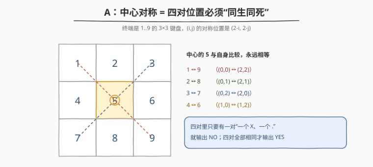
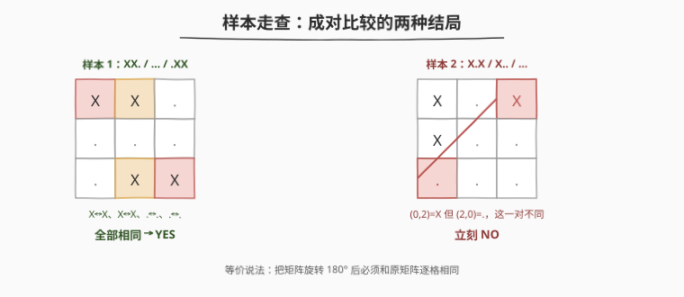

# Codeforces 12A 键盘中心对称判定 题解

## 1. 题目概述

- **题目链接**：https://codeforces.com/problemset/problem/12/A
- **比赛来源**：Codeforces Beta Round 12 (Div 2 Only) · Problem A（UTC 2010-04-29）
- **难度**：800
- **标签**：实现
- **评测类型**：普通（单组输入，唯一答案）
- **限制**：时间 2 s / 内存 256 MB

**题意**：组合锁的终端是一个 $3\times 3$ 的数字键盘（数字 $1\sim 9$）。热感应器告诉我们哪些按钮被按过，用一个 $3\times 3$ 的字符矩阵表示：`X` 表示按过、`.` 表示没按过。判断这个按键图案是否**关于键盘中心按钮中心对称**：是输出 `YES`，否则输出 `NO`。

**约束**：

- 输入固定是 $3$ 行、每行 $3$ 个字符，只有 `X` 和 `.` 两种字符；
- 矩阵可以全 `X`，也可以全 `.`（题面明确提到），所以"没人按过"这类退化情况必须能正常工作；
- 规模是常数（9 个格子），任何复杂度都不超时，唯一的风险是**把"中心对称"理解错**（例如误做成左右镜像或上下镜像）。

## 2. 示例与观察

官方样例 1（输入 / 输出原样）：

```text
输入：
XX.
...
.XX

输出：
YES
```

官方样例 2（输入 / 输出原样）：

```text
输入：
X.X
X..
...

输出：
NO
```

**样例 1 演算**：把位置写成 $(行, 列)$，中心是 $(1,1)$。中心对称要求 $(i,j)$ 与 $(2-i,2-j)$ 相同。

| 位置对 | 内容 | 是否相同 |
|------|------|------|
| $(0,0)$ ↔ $(2,2)$ | `X` ↔ `X` | 相同 |
| $(0,1)$ ↔ $(2,1)$ | `X` ↔ `X` | 相同 |
| $(0,2)$ ↔ $(2,0)$ | `.` ↔ `.` | 相同 |
| $(1,0)$ ↔ $(1,2)$ | `.` ↔ `.` | 相同 |
| $(1,1)$ ↔ $(1,1)$ | `.` ↔ `.` | 中心自比，必然相同 |

四对全部相同，输出 `YES`。

**样例 2 演算**：`X.X / X.. / ...`。看 $(0,2)$ 与 $(2,0)$：前者是 `X`、后者是 `.`，这一对不同，所以立刻可以判定输出 `NO`。

**观察**：

1. 中心的 $(1,1)$ 与自身配对，永远"相同"，不可能是失败的原因；
2. 其余 8 个格子恰好分成 4 对，判定就是"这 4 对各自是否相同"；
3. 中心对称等价于"把矩阵旋转 $180^\circ$ 后与原矩阵逐格相同"——注意**不是**左右翻转（那是轴对称），这两者在 $3\times 3$ 上是不同的关系。

## 3. 解题思路

### 3.1 朴素做法与瓶颈

本题没有时间复杂度问题（9 个格子），"瓶颈"全在理解上。常见的两种错法：

- **只比较四个角**：反例是 `XXX / ... / X.X`。四角都满足 $(0,0)=X=(2,2)$、$(0,2)=X=(2,0)$，但 $(0,1)=X$ 与 $(2,1)=.$ 不同，正确答案是 `NO`——只查四角会误判成 `YES`；
- **把它当成左右镜像（轴对称）**：左右镜像要求 $(i,j) = (i,2-j)$，中心对称要求 $(i,j) = (2-i,2-j)$。例如 `X.X / ... / .X.` 的每一行都是回文（左右镜像成立），但 $(0,0)=X$ 与 $(2,2)=.$ 不同，中心对称的答案是 `NO`；反过来 `X.. / ... / X..` 是上下镜像、却不是左右镜像。这两个关系互不包含，不能混用。

所以正确做法只能是逐对比较。

### 3.2 核心观察：8 个格子配成 4 对



键盘是 $3\times 3$ 的，中心格 $(1,1)$ 是唯一的"不动点"，其余 8 格两两配对：

$$(0,0)\leftrightarrow(2,2),\quad (0,1)\leftrightarrow(2,1),\quad (0,2)\leftrightarrow(2,0),\quad (1,0)\leftrightarrow(1,2).$$

判定条件就是这 4 对里每一对的字符都相等。写成统一的式子：

$$\forall i,j \in \{0,1,2\}:\quad a[i][j] = a[2-i][2-j].$$

$i=j=1$ 时两边是同一个格子，自动成立；其余 8 个位置给出上面 4 个约束。这就是全部。

### 3.3 算法流程



1. 读入 3 行字符串；
2. 对 $i,j \in \{0,1,2\}$ 逐一检查 $a[i][j] == a[2-i][2-j]$；
3. 一旦发现不等，标记为 `NO` 并跳出；
4. 全部检查完仍是相等，输出 `YES`。

另一种等价写法是"把矩阵旋转 $180^\circ$（先逐行反转，再反转行序），与原矩阵比较"——这是暴力程序采用的方式，与逐对比较完全是同一件事，只是表述不同。

### 3.4 样例走查

样例 1 已在上面的表格中逐对核对，输出 `YES`；样例 2 在 $(0,2)$ 与 $(2,0)$ 处发现 `X` 与 `.` 不同，输出 `NO`。两个样例恰好各覆盖"全对"和"有一对坏掉"两种结局。

## 4. 正确性证明

**引理 1（不动点唯一）**：满足 $(i,j) = (2-i,2-j)$ 的位置只有 $(1,1)$。

**证明**：由 $i = 2-i$ 得 $i=1$，由 $j = 2-j$ 得 $j=1$。∎

**引理 2（配对是等价关系且无重复）**：映射 $\sigma(i,j) = (2-i,2-j)$ 满足 $\sigma(\sigma(i,j)) = (i,j)$；除 $(1,1)$ 外，8 个位置被分成 4 个二元组 $\{(i,j),\sigma(i,j)\}$，且每个位置恰好属于一个二元组。

**证明**：$\sigma$ 是自身的逆，故它是置换，置换的轨道要么是单点（不动点），要么是二元组。由引理 1，单点只有 $(1,1)$；剩下 8 个点全在二元组里，共 4 组。∎

**定理**：算法输出 `YES` 当且仅当按键图案关于中心按钮中心对称。

**证明**：中心对称的定义是"图案绕中心旋转 $180^\circ$ 后不变"，而旋转 $180^\circ$ 恰好把位置 $(i,j)$ 映到 $(2-i,2-j)$，所以对称 $\iff$ 对所有 $i,j$ 有 $a[i][j] = a[2-i][2-j]$。算法正是逐对检查这个条件（引理 2 说明这些比较覆盖全部 9 个位置且没有遗漏），因此判定正确。∎

## 5. 复杂度分析

- **时间**：$O(1)$，固定 9 次比较（最多 9 次，命中不等就能提前结束）。
- **空间**：$O(1)$，只存 $3\times 3$ 的字符。
- **与时限的关系**：2 s 的时限对 9 次比较是完全无关的量级，实测端到端约 2 ms（几乎全是进程启动）。

## 6. 参考代码

### C++17

```cpp
#include <bits/stdc++.h>
using namespace std;

int main() {
    ios::sync_with_stdio(false);
    cin.tie(nullptr);

    vector<string> g(3);
    for (int i = 0; i < 3; ++i) cin >> g[i];

    bool ok = true;
    for (int i = 0; i < 3; ++i)
        for (int j = 0; j < 3; ++j)
            if (g[i][j] != g[2 - i][2 - j]) ok = false;   // 关于中心 (1,1) 中心对称

    cout << (ok ? "YES" : "NO") << '\n';
    return 0;
}
```

### Python3

```python
import sys


def main() -> None:
    g = [sys.stdin.readline().strip() for _ in range(3)]
    ok = True
    for i in range(3):
        for j in range(3):
            if g[i][j] != g[2 - i][2 - j]:      # 中心对称：位置 (i,j) 对 (2-i,2-j)
                ok = False
    sys.stdout.write("YES\n" if ok else "NO\n")


main()
```

两份代码都只用标准库，可原样提交。

## 7. 边界情况与易错点

1. **全 `X` 或全 `.`**：题面特意说明这两种输入都可能出现。全 `X` 时每一对都相等 → `YES`；全 `.` 时同理 → `YES`，不要因为"没有 X"就特判成 `NO`。
2. **中心对称 ≠ 轴对称**：`X../.../X..` 是上下镜像的，但 $(0,0)=X$ 与 $(2,2)=.$ 不同 → 中心对称答案是 `NO`。用"翻转某一行/某一列"去写判定必错。
3. **只看四个角不够**：四个角满足 $(0,0)\leftrightarrow(2,2)$、$(0,2)\leftrightarrow(2,0)$，但 $(0,1)\leftrightarrow(2,1)$ 与 $(1,0)\leftrightarrow(1,2)$ 这两对（上下中、左右中）同样要查。
4. **中心格不用查**：$(1,1)$ 与自身比较恒相等，写成循环也自然成立，不会误判。
5. **读入方式**：用 `cin >> string`（或 `readline().strip()`）按行读，不要用 `scanf("%c")` 混着读——行末的换行符会被当成一个字符，导致行列错位。
6. **输出大小写**：必须是 `YES`/`NO`，全部大写；`Yes`、`yes` 都会被判错。
7. **提前退出**：发现第一处不等就可以结束（C++ 版为了简洁没有 break，仍然正确，只是多比较几次）。

## 8. 验证记录

- **编译环境与命令**：本机只有 `Apple clang 21.0.0`（`/usr/bin/g++` 是 clang 软链），没有 GNU `g++`，因此用 `clang++ -std=c++17 -O2 -Wall -I codeforces/tools/include` 搭配本地 `bits/stdc++.h` 兼容头编译（代码只用标准库，可原样提交 GNU C++17）。Python 为 `Python 3.9.6`。
- **官方样例**：2 / 2 通过（`YES`、`NO`），C++ 与 Python 输出一致，且与 JSON 中的 `out` 逐字符相同。
- **独立暴力对拍**：暴力采用与参考解不同的表述——把矩阵**整体旋转 $180^\circ$**（逐行反转后再反转行序）与原矩阵比较。随机生成 **300 组**输入（其中约 45% 直接由随机构造再强制中心对称，保证 `YES` 与 `NO` 都有充分覆盖），C++ / Python / 暴力三方 **300/300 一致**。
- **边界用例**：全 `X`、全 `.`、只有中心 `X`、上下镜像非中心对称（`X../.../X..` → `NO`）、样例 2、四个角相同但中间对不同等 8 组手写用例，结果均正确。
- **最大约束性能**：输入规模恒为 9 个字符，C++ 端到端约 2 ms（含进程启动），Python 约 15 ms，内存 < 2 MB，相对 2 s / 256 MB 余量极大。
- **图片校验**：两张 SVG（`cf12a_pairs.svg`、`cf12a_walkthrough.svg`）均通过 `xml.etree.ElementTree.parse`；用脚本估算每个 `text` 的包围盒，确认不越出 viewBox、文字不互相重叠、框内文字不越出框；并用 headless Chrome 渲染 PNG 后检查画布四边 2 px 内无墨迹，确认无裁切。
- **公式校验**：公式均为 `$...$` 形式，星号直接写 `*`，`\text{}` 内无裸 `#`，KaTeX（`throwOnError`）渲染无报错。
- **复核状态**：verified（样例、随机对拍、边界、性能、图片、公式均实跑通过；唯一环境差异是本机无 GNU g++，已用 clang++ 等价验证）。

## 相关题目与扩展

- [Codeforces 12B Correct Solution?](https://codeforces.com/problemset/problem/12/B)：同场 B 题，数位重排与字符串比较。
- [Codeforces 12C Fruits](https://codeforces.com/problemset/problem/12/C)：同场 C 题，贪心配对。
- [Codeforces 177A1 Nearby Square](https://codeforces.com/problemset/problem/177/A1)（另有 A2 版本）：同样是 $3\times 3$ 网格上的对角线求和，适合作为本题的同类热身。
- [Codeforces 110A Nearly Lucky Number](https://codeforces.com/problemset/problem/110/A)：一类"数一数再判断"的最简单实现题。
- [LeetCode 48. 旋转图像](https://leetcode.cn/problems/rotate-image/)：矩阵旋转的通用做法，可与本题"旋转 $180^\circ$ 判定"对照。

**延伸思考**：

1. **如果键盘是 $n\times n$（$n$ 为奇数）**：判定条件不变，仍是 $a[i][j] = a[n-1-i][n-1-j]$，只是中心格变成 $(\frac{n-1}{2},\frac{n-1}{2})$；复杂度 $O(n^2)$。
2. **如果要统计"最少改几个格子才能中心对称"**：对每一对"一个 X 一个 ."的位置，改一个即可，答案就是这种"冲突对"的个数——本题的判定是它的特例（冲突数为 0）。
3. **如果要求同时中心对称与轴对称**：两个条件叠加会强制图案在 4 个角、4 条边中点上都满足更强的约束（等价于关于两条对角线也对称），可行图案数量会大大减少，可以数一数共有多少种。
4. **如果 $n$ 为偶数**：没有不动点，所有格子都两两配对，判定逻辑不变；但"中心按钮"不存在，题面就得改写——这提醒我们这类对称判定的核心永远只是"位置置换的轨道"。

