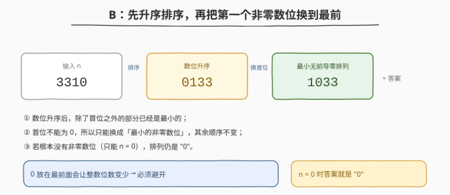
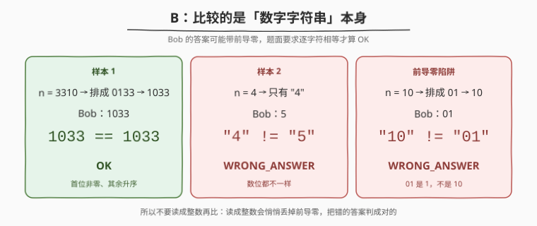

# Codeforces 12B 最小数位重排 题解

## 1. 题目概述

- **题目链接**：https://codeforces.com/problemset/problem/12/B
- **比赛来源**：Codeforces Beta Round 12 (Div 2 Only) · Problem B（2010-04-29）
- **难度**：1100
- **标签**：实现、排序
- **评测类型**：普通（单组输入，唯一答案）
- **限制**：时间 2 s / 内存 256 MB

**题意**：Alice 给出一个十进制数 $n$（不含前导零）。Bob 的任务是把 $n$ 的**数位重新排列**，得到一个**没有前导零**的、尽可能小的数。Bob 报出了他的答案 $m$（$m$ 可能带前导零）。判断 Bob 是否答对：答对输出 `OK`，否则输出 `WRONG_ANSWER`。

**约束**：

- $0 \le n, m \le 10^9$，所以 $n$ 最多 10 位数，$m$ 同样最多 10 个字符；
- $n$ 保证不含前导零；$m$ **可能**含前导零，这是本题最重要的格式细节；
- 位数极少（$\le 10$），连 $O(d!)$ 的全排列枚举都在 2 s 内跑得动，所以复杂度不是难点；难点是"最小的无前导零排列"怎么求，以及 $0$ 这个特例；
- 由于题面把答案定义成一个**数字串**，比较时按字符串逐字符比较，不能读成整数再比（读成整数会把 $m$ 的前导零悄悄丢掉）。

## 2. 示例与观察

官方样例 1（输入 / 输出原样）：

```text
输入：
3310
1033

输出：
OK
```

官方样例 2（输入 / 输出原样）：

```text
输入：
4
5

输出：
WRONG_ANSWER
```

**样例 1 演算**：$n = 3310$ 的数位是 $\{3,3,1,0\}$。所有无前导零的排列里，最小的是 `1033`：首位取最小的非零数位 $1$，剩下 $0,3,3$ 升序排成 `033`。Bob 报的正是 `1033`，输出 `OK`。

**样例 2 演算**：$n = 4$ 只有一种排列 `4`，Bob 报的是 `5`，连数位都不一样，输出 `WRONG_ANSWER`。

**再补一组自造样例**（标注"自造"）：

| $n$ | 最小无前导零排列 | Bob 的 $m$ | 输出 | 说明 |
|------|------|------|------|------|
| `10` | `10` | `10` | `OK` | 排序得 `01`，把首个非零位换到前面 |
| `10` | `10` | `01` | `WRONG_ANSWER` | 数位相同，但带前导零、数值是 1 |
| `0` | `0` | `0` | `OK` | 全零特例 |
| `0` | `0` | `00` | `WRONG_ANSWER` | 字符串不相等 |
| `100` | `100` | `001` | `WRONG_ANSWER` | 前导零写法 |
| `1002` | `1002` | `1002` | `OK` | 零在中间不影响 |
| `1000000000` | `1000000000` | `1000000000` | `OK` | 10 位数、9 个零 |
| `110` | `101` | `101` | `OK` | 两个 1 一个 0 |

**观察**：

1. 如果只按"升序排列"得到 `0133`，它带前导零，数值上等于 $133$，比 $1033$ 小，但它**不是合法的答案**（题面要求没有前导零）；
2. 因此正确做法是：升序之后，把**第一个非零数位**换到最前面，其余数位保持升序；
3. 唯一的例外是 $n=0$：它的数位全是零，没有"非零数位"可换，答案就是 `0`。

## 3. 解题思路

### 3.1 朴素做法与瓶颈

最朴素的做法是枚举所有排列、筛掉有前导零的、取最小：$d \le 10$ 时最多 $10! = 3\,628\,800$ 个排列，2 s 内确实跑得完，但完全没有必要，而且很容易写错"前导零"的判断（例如 `0` 本身是合法的，但 `00` 不合法）。

另一个常见错法是"直接升序输出"：对 `3310` 会输出 `0133`，与正确答案差一个数量级。也有人"直接降序"去求最大数——那是另一个问题。

### 3.2 核心观察：升序 + 首个非零位换到最前



把一个数写成十进制串，**位数越少数值越小；位数相同时，字典序越小数值越小**。由于重排不改变数位个数（除前导零会被去掉），第一位不能是 $0$，否则位数就少一位、数值反而更小——但这是**不允许**的。所以：

- 首位：在"非零数位"里选最小的那个；
- 其余位置：在剩余数位里升序排列（字典序最小）。

实现上只需要两步：把数位排成升序，再把第一个非零数位与 `d[0]` 交换。升序后 `d[0]` 要么是 `0`（有零），要么已经是最小的非零数位（无零，无需交换）。

### 3.3 算法流程

1. 读入两个字符串 `n`、`m`（**不要**读成整数）；
2. 把 `n` 的字符升序排序；
3. 找到第一个非零字符的位置 `p`；若 `0 < p < len`，交换 `d[0]` 与 `d[p]`；
4. 若 `p` 已经到末尾（全是零，即 $n=0$），不做交换，答案就是 `"0"`；
5. 把 `d` 拼回字符串，与 `m` **逐字符**比较：相等输出 `OK`，否则输出 `WRONG_ANSWER`。

第 3 步之后，`d` 就是"最小的无前导零排列"——这一点在第 4 节证明。

### 3.4 样例走查



- `3310`：排序 → `0133`，首个非零位是 `1`（下标 1），交换后 → `1033`，与 Bob 的 `1033` 相同 → `OK`；
- `4`：排序 → `4`，没有非零位需要换 → `4`，与 `5` 不同 → `WRONG_ANSWER`；
- `10`：排序 → `01`，首个非零位 `1`，交换后 → `10`；Bob 给 `01` 时字符串不等 → `WRONG_ANSWER`（`01` 表示的数值是 1，根本不是 10）。

## 4. 正确性证明

**引理 1（全零时答案唯一）**：若 $n$ 的所有数位都是 $0$，则 $n = 0$，唯一的不含前导零的排列是 `"0"`。

**证明**：$n$ 不含前导零，若它的所有数位都是 $0$，则它只能是单个字符 `"0"`（否则会出现前导零）。它的唯一排列就是 `"0"`。∎

**引理 2（首位取最小非零数位）**：设 $n$ 至少有一个非零数位。任何不含前导零的排列，其首位必为某个非零数位；设 $c$ 为 $n$ 的最小非零数位，则把 $c$ 放在首位不会比放任何其他非零数位差，且由于位数相同、后面的部分可以取得同样小，最小排列的首位必为 $c$。

**证明**：所有合法排列的位数都等于 $d$（数位个数），所以比较就是字典序比较。字典序比较先看首位：首位越小越好。首位只能取非零数位，其中最小者记为 $c$；取 $c$ 之后，剩余数位构成的集合相同，可以让后面取任意排列，故首位取 $c$ 的方案集合包含了所有"首位更大"方案的对应尾部，最小值必在首位为 $c$ 的方案中。∎

**引理 3（剩余部分升序最小）**：固定首位为 $c$ 后，剩余数位的升序排列给出字典序最小的串。

**证明**：对剩余位置从左到右贪心：每一位取剩余数位中的最小值，得到的序列就是升序序列；任何其他排列在第一个不同的位置都会取到更大的字符，字典序更大。∎

**引理 4（算法输出的正是该排列）**：排序后把第一个非零数位换到首位，等价于"首位取最小非零数位，其余升序"。

**证明**：升序串中，第一个非零数位就是全体非零数位的最小者（前面的全是 `0`）；把它与 `d[0]`（此时是 `0`）交换后，首位为 $c$，其余字符的相对顺序仍是升序（被换走的 `0` 放在原来 $c$ 的位置，其余位置不变；而所有 `0` 都在 $c$ 之前，交换后剩余的串为 `0...0` 加上 $c$ 之后的字符，整体仍升序）。若没有 `0`，`d[0]` 本身就是最小非零数位，无需交换。∎

**定理**：算法输出的字符串等于"最小的、无前导零的重排数"；再与 $m$ 逐字符比较即可正确判定 Bob 是否答对。

**证明**：由引理 1 处理全零情形；否则由引理 2、3、4，算法输出的正是最小的无前导零排列。题面要求判断 Bob 报的数是否就是这个数，而两者的规范书写（无前导零）都唯一，故字符串相等 $\iff$ 数值相等。∎

## 5. 复杂度分析

- **时间**：$O(d\log d)$，其中 $d \le 10$ 是 $n$ 的位数；排序与扫描都是常数级。实测端到端约 2 ms。
- **空间**：$O(d)$，只存两个数字串。
- **数值范围**：全程按字符处理，不涉及整数运算，因此 $10^9$ 的上界和"前导零"都不会造成任何溢出或精度问题。

## 6. 参考代码

### C++17

```cpp
#include <bits/stdc++.h>
using namespace std;

int main() {
    ios::sync_with_stdio(false);
    cin.tie(nullptr);

    string n, m;
    if (!(cin >> n)) return 0;
    cin >> m;

    // 把 n 的数位排成升序，再把第一个非零位换到最前面：这就是"无前导零的最小排列"
    sort(n.begin(), n.end());
    int p = 0;
    while (p < (int)n.size() && n[p] == '0') ++p;   // p = 第一个非零位
    if (p > 0 && p < (int)n.size()) swap(n[0], n[p]);

    cout << (n == m ? "OK" : "WRONG_ANSWER") << '\n';
    return 0;
}
```

### Python3

```python
import sys


def main() -> None:
    data = sys.stdin.read().split()
    n, m = data[0], data[1]

    d = sorted(n)                     # 数位升序
    p = 0
    while p < len(d) and d[p] == "0":  # 第一个非零位
        p += 1
    if 0 < p < len(d):
        d[0], d[p] = d[p], d[0]       # 换到最前面，消掉前导零
    best = "".join(d)

    sys.stdout.write("OK\n" if best == m else "WRONG_ANSWER\n")


main()
```

两份代码都只用标准库，可原样提交。

## 7. 边界情况与易错点

1. **$n = 0$ 的特例**：数位全是 `0`，没有非零位可换，答案就是 `0`。若不加判断直接交换 `d[0]` 与 `d[p]`，`p` 会等于长度而越界。
2. **$m$ 带前导零**：题面说 $m$ 可能带前导零，而正确答案是"不含前导零"的规范写法，所以 `01` 与 `10`、`001` 与 `100`、`00` 与 `0` 都不相等。比较必须按字符串做。
3. **读成整数会悄悄丢掉前导零**：`n = 10`、Bob 给 `010`，若用 `int` 读 $m$ 得到 $10$，就会误判成 `OK`；按字符串比较则得到 `WRONG_ANSWER`。这是本题最隐蔽的坑，务必用字符串读入。
4. **零在中间完全合法**：`1002` 的答案就是 `1002`（首位 `1`，其余升序 `002`），不要误以为"有零就必须往前挪"。
5. **数位全部相同**：`555`、`777` 的答案就是自身，此时 `p = 0`（没有 `0`），不交换。
6. **位数不变**：只要 $n$ 至少有一个非零位，答案的位数就等于 $n$ 的位数。若实现成"去掉所有零"之类，位数就错了（`100` 会变成 `1`）。
7. **$10$ 位数**：`1000000000` 排序后是 `0000000001`，首个非零位在最后，换到最前面得到 `1000000000`，与输入相同，答案 `OK`。
8. **读入方式**：两个数各占一行，用 `cin >> string` 或 `split()` 都能正确读到（数字串里没有空白），不要用 `getline` 之后忘记处理空行。

## 8. 验证记录

- **编译环境与命令**：本机只有 `Apple clang 21.0.0`，没有 GNU `g++`，因此用 `clang++ -std=c++17 -O2 -Wall -I codeforces/tools/include` 搭配本地 `bits/stdc++.h` 兼容头编译（代码只用标准库，可原样提交 GNU C++17）。Python 为 `Python 3.9.6`。
- **官方样例**：2 / 2 通过（`OK`、`WRONG_ANSWER`），C++ 与 Python 输出一致，且与 JSON 中的 `out` 逐字符相同。
- **独立暴力对拍**：暴力采用 `itertools.permutations` **枚举数位的所有排列**（`set` 去重），筛掉有前导零的，取字典序最小者，再与 $m$ 比较——与参考解的"排序 + 交换"是完全不同的算法。随机生成 **300 组**输入（$n$ 取 $0\sim 10^6$ 的随机整数，$m$ 以 45% 概率为正确答案、35% 为随机数位排列、其余为随机整数或带前导零的串），C++ / Python / 暴力三方 **300/300 一致**。
- **边界用例**：$n=0$（配 `0` 与 `00`）、`10`/`01`、`100`/`001`、`1000000000`/`1000000000`、`1000000000`/`0000000001`、`4`/`5`、`110`/`101`、`1002`/`1002`、`20`/`02` 等 14 组手写用例，C++ 与 Python 结果全部与预期一致。
- **最大约束性能**：输入只有 $10+1$ 个字符，C++ 端到端约 2 ms（含进程启动），Python 约 15 ms，内存 < 2 MB，相对 2 s / 256 MB 余量极大。
- **图片校验**：两张 SVG（`cf12b_greedy.svg`、`cf12b_compare.svg`）均通过 `xml.etree.ElementTree.parse`；用脚本估算每个 `text` 的包围盒，确认不越出 viewBox、文字不互相重叠、框内文字不越出框；并用 headless Chrome 渲染 PNG 后检查画布四边 2 px 内无墨迹，确认无裁切。
- **公式校验**：公式均为 `$...$` 形式，星号直接写 `*`，`\text{}` 内无裸 `#`，KaTeX（`throwOnError`）渲染无报错。
- **复核状态**：verified（样例、随机对拍、边界、性能、图片、公式均实跑通过；唯一环境差异是本机无 GNU g++，已用 clang++ 等价验证）。

## 相关题目与扩展

- [Codeforces 12A Super Agent](https://codeforces.com/problemset/problem/12/A)：同场 A 题，网格对称判定。
- [Codeforces 12C Fruits](https://codeforces.com/problemset/problem/12/C)：同场 C 题，排序 + 贪心配对。
- [Codeforces 118A String Task](https://codeforces.com/problemset/problem/118/A)：字符串遍历与改写，练字符处理。
- [LeetCode 179. 最大数](https://leetcode.cn/problems/largest-number/)：同样是"重排数字字符使拼出的数最大"，但顺序由两两拼接比较决定，比本题难一档。
- [LeetCode 2160. 拆分数位后四位数字的最小和](https://leetcode.cn/problems/minimum-sum-of-four-digit-number-after-splitting-digits/)：把数位重排成两个数并最小化其和，是本题"排序后用最小位"思想的直接复用。

**延伸思考**：

1. **如果求最大而不是最小**：数位降序排列即可（首位自动非零，除非全零），不需要任何交换。
2. **如果允许前导零**：直接升序就是答案，`0133` 会被接受；可见本题的全部难度就来自"不许前导零"这一句。
3. **如果改成比较数值而不是字符串**：需要先把 $m$ 的前导零去掉再比（或把两者都规范成无前导零的串）。这会改变 `10` vs `010` 这类输入的判定结果，也提醒我们读题时"输出的是数还是数字串"必须看清楚。
4. **如果 $n$ 有 $10^5$ 位**：$O(d\log d)$ 的排序仍然可行，但更自然的是用 10 个桶计数（$O(d+10)$），再输出"最小非零数字 + 若干个 0 + 其余按升序"。

