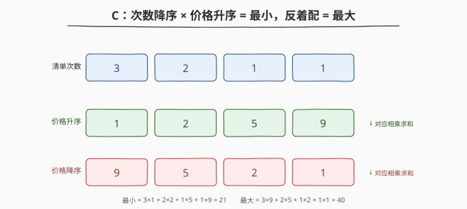
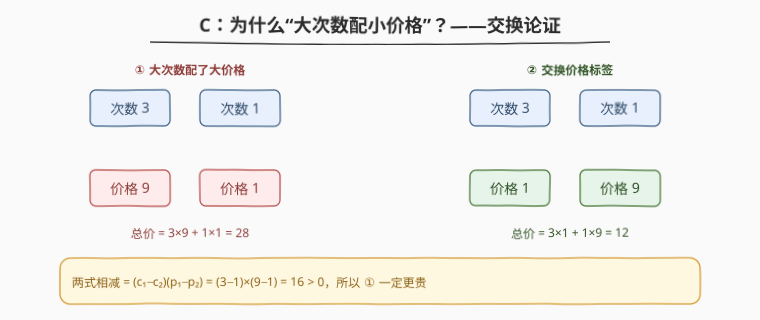
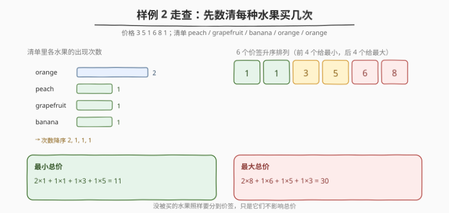

# Codeforces 12C 水果价格标签配对 题解

## 1. 题目概述

- **题目链接**：https://codeforces.com/problemset/problem/12/C
- **比赛来源**：Codeforces Beta Round 12 (Div 2 Only) · Problem C（2010-04-29）
- **难度**：1100
- **标签**：贪心、实现、排序
- **评测类型**：普通（单组输入，唯一答案）
- **限制**：时间 1 s / 内存 256 MB

**题意**：水果摊有 $n$ 种水果、$n$ 张价格标签（每张标签贴到一种水果上，价格固定）。Valera 的购物清单上有 $m$ 项，同一种水果可能重复出现。Ashot 还没决定哪张标签贴哪种水果。对 Valera 而言：

- 如果标签分配**对他最有利**，他最少要付多少钱（记为 $a$）；
- 如果分配**对他最不利**，他最多要付多少钱（记为 $b$）。

输出 $a$ 与 $b$（$a \le b$）。

**约束**：

- $1 \le n, m \le 100$，每张标签的价格 $\le 100$，水果名字是长度 $\le 32$ 的小写字母串；
- 清单里出现的水果种类数不超过 $n$，且摊位上一定有这些水果；
- 规模很小（$n,m \le 100$），$O(nm)$ 甚至 $O(n^2m)$ 都能过；关键是把"标签分配"这件事抽象成"次数与价格的配对"；
- 答案上限 $100 \times 100 \times 100 = 10^6$，`int` 就够，代码仍用 `long long`。

## 2. 示例与观察

官方样例 1（输入 / 输出原样）：

```text
输入：
5 3
4 2 1 10 5
apple
orange
mango

输出：
7 19
```

官方样例 2（输入 / 输出原样）：

```text
输入：
6 5
3 5 1 6 8 1
peach
grapefruit
banana
orange
orange

输出：
11 30
```

**样例 1 演算**：价格是 $\{4,2,1,10,5\}$，升序为 $1,2,4,5,10$。清单里 `apple`、`orange`、`mango` 各一次，所以是 3 个"次数 1"。

- 最小：把最便宜的 3 张标签（$1,2,4$）贴给这三种水果，总价 $1+2+4=7$；
- 最大：把最贵的 3 张（$10,5,4$）贴给它们，总价 $10+5+4=19$。

**样例 2 演算**：价格 $\{3,5,1,6,8,1\}$ 升序为 $1,1,3,5,6,8$。清单 5 项里 `orange` 出现 2 次，其余三种各 1 次，所以次数降序为 $2,1,1,1$。

- 最小：$2\times1 + 1\times1 + 1\times3 + 1\times5 = 2+1+3+5=11$（把最便宜的 4 张给这 4 种，且出现最多的 `orange` 拿最便宜的 $1$）；
- 最大：$2\times8 + 1\times6 + 1\times5 + 1\times3 = 16+6+5+3=30$（`orange` 拿最贵的 $8$）。

**观察**：

1. 只有"Valera 真正买的 $k$ 种水果"的次数才影响总价；剩下 $n-k$ 种水果拿什么价格都与他要付的钱无关；
2. 对固定的价格集合，"次数 $\times$ 价格"的和在**排序配对**时取极值：要让和最小，最大的次数要配最小的价格；要让和最大，最大的次数配最大的价格；
3. 由于所有价格都是正数，最小总价一定用最便宜的 $k$ 张标签，最大总价一定用最贵的 $k$ 张。

## 3. 解题思路

### 3.1 朴素做法与瓶颈

最直接的建模是"把 $n$ 张标签分配给 $n$ 种水果"：这是一个排列，共有 $n!$ 种，$n=100$ 时完全不可能枚举。即使只考虑 $k$ 种被买的水果，注入式分配也有 $\frac{n!}{(n-k)!}$ 种，同样爆炸。

另一个常见错法是"把次数也按升序排，再与价格升序逐项相乘"：对样例 1 会得到 $1+2+4=7$（碰巧对，因为三个次数全是 1），但对样例 2 会算成 $1\times1+1\times1+1\times3+2\times5=15$，与正确答案 $30$ 相差一倍。**次数与价格必须反向配对**才是最大值/最小值的正确配法，方向搞反是本题最典型的错误。

### 3.2 核心观察：两个方向的重排不等式



把清单统计成"每种被买水果出现几次"，得到 $k$ 个次数 $c_1 \ge c_2 \ge \dots \ge c_k$；把价格升序排成 $p_1 \le p_2 \le \dots \le p_n$。

- **最小值**：把 $c_i$ 与 $p_i$ 配对（大的次数配小的价格），
  $$a = \sum_{i=1}^{k} c_i \cdot p_i .$$
- **最大值**：把 $c_i$ 与 $p_{n-i+1}$ 配对（大的次数配大的价格），
  $$b = \sum_{i=1}^{k} c_i \cdot p_{n-i+1} .$$

为什么"大的配小的"会最小？这是经典的**交换论证**：



若两个次数 $c_1 > c_2$ 却分别配了价格 $p_1 > p_2$，把它们的标签对调，总价变化为

$$(c_1p_2 + c_2p_1) - (c_1p_1 + c_2p_2) = (c_1-c_2)(p_1-p_2) < 0,$$

即交换后更便宜。所以最小方案里不能出现"大次数配大价格"，只能反向配对。最大值同理：交换后总价变小，所以"大配大"才是最大。

### 3.3 算法流程

1. 读入 $n, m$ 与 $n$ 个价格；
2. 用 `map`/`Counter` 统计 $m$ 行里每种水果出现的次数，得到次数列表；
3. 次数**降序**排序、价格**升序**排序；
4. $a = \sum_{i=0}^{k-1} c_i \cdot p_i$，$b = \sum_{i=0}^{k-1} c_i \cdot p_{n-1-i}$；
5. 输出 $a$ 与 $b$。

### 3.4 样例走查



样例 2 的过程：

| 步骤 | 内容 |
|------|------|
| 统计次数 | `orange` 2，`peach` 1，`grapefruit` 1，`banana` 1 |
| 次数降序 | $2, 1, 1, 1$ |
| 价格升序 | $1, 1, 3, 5, 6, 8$ |
| 最小配对 | $2\cdot1 + 1\cdot1 + 1\cdot3 + 1\cdot5 = 11$ |
| 最大配对 | $2\cdot8 + 1\cdot6 + 1\cdot5 + 1\cdot3 = 30$ |

注意两张"边缘"标签的去向：最小方案用到最便宜的 4 张 $1,1,3,5$，最大方案用到最贵的 4 张 $8,6,5,3$；$6$ 和 $8$ 只在最大方案里出现，$1$ 和 $1$ 只在最小方案里出现。

## 4. 正确性证明

**引理 1（未买的水果与总价无关）**：设被买的水果种类为集合 $S$，$|S| = k$。则无论 $n-k$ 种没被买的水果拿到什么价格，Valera 的总价只由 $S$ 中各种水果拿到的价格决定。

**证明**：总价定义为"清单上每一项的价格之和"，没被买的水果在清单中出现 0 次，对求和的贡献恒为 0。∎

**引理 2（固定价格集合时的最优配对）**：设给 $S$ 中水果选定的价格集合为 $P$（$|P| = k$），次数为 $c_1 \ge \dots \ge c_k$。则

- $\sum c_i p_{\sigma(i)}$ 的最小值在 $\sigma$ 把 $c_i$ 与 $P$ 的第 $i$ 小元素配对时取得；
- 最大值在把 $c_i$ 与 $P$ 的第 $k-i+1$ 小元素配对时取得。

**证明**：只证最小，最大完全对称。若存在 $i<j$ 使 $c_i \ge c_j$ 但配给 $c_i$ 的价格 $p$ 大于配给 $c_j$ 的价格 $q$，则交换这两张标签后总和变化为 $(c_iq + c_jp) - (c_ip + c_jq) = (c_i - c_j)(q - p) \le 0$，即不会变大；若 $c_i > c_j$ 且 $p > q$ 则严格变小。反复交换消除所有"逆序"，最终 $c$ 的降序与价格的升序同向配对，即为最小值（若存在相等元素，交换不改变总和，故最小值仍由该配对达到）。∎

**引理 3（选取哪 $k$ 张标签）**：所有价格为正，故最小总价使用最小的 $k$ 个价格，最大总价使用最大的 $k$ 个价格。

**证明**：设最小方案使用的价格集合为 $P$。若存在未使用的价格 $q < \max P$，把 $P$ 中最大的价格换成 $q$ 会使对应项（系数为正的次数）严格变小，与最小性矛盾；故 $P$ 必为最小的 $k$ 个价格。最大情形对称。∎

**定理**：算法输出的 $a$ 与 $b$ 分别是所有合法价格分配下总价的最小值与最大值。

**证明**：由引理 1，只需考虑 $S$ 中水果的价格；由引理 3，最小/最大方案分别使用最小/最大的 $k$ 个价格；由引理 2，在此集合下最小/最大的配对方式是排序配对。算法正是按这个方式求和，故结论成立。∎

## 5. 复杂度分析

- **时间**：$O(m + n\log n + k\log k)$。统计次数 $O(m)$，排序价格 $O(n\log n)$，排序次数 $O(k\log k)$，求和 $O(k)$。$n,m\le100$ 时就是几百次操作。
- **空间**：$O(n + k)$，存价格与每种水果的计数。
- **与时限的关系**：1 s 的时限极其宽松，实测最大规模（$n=m=100$）C++ 端到端约 2.4 ms，Python 约 17 ms。

## 6. 参考代码

### C++17

```cpp
#include <bits/stdc++.h>
using namespace std;

int main() {
    ios::sync_with_stdio(false);
    cin.tie(nullptr);

    int n, m;
    if (!(cin >> n >> m)) return 0;

    vector<long long> price(n);
    for (auto &x : price) cin >> x;

    map<string, int> cnt;          // 清单里每种水果出现几次
    for (int i = 0; i < m; ++i) {
        string s;
        cin >> s;
        ++cnt[s];
    }

    vector<long long> c;           // 只保留真正买的水果的出现次数
    for (auto &kv : cnt) c.push_back(kv.second);

    sort(c.begin(), c.end(), greater<long long>());   // 次数从多到少
    sort(price.begin(), price.end());                 // 价格从低到高

    long long mn = 0, mx = 0;
    for (int i = 0; i < (int)c.size(); ++i) {
        mn += c[i] * price[i];                  // 买得最多的配最便宜的
        mx += c[i] * price[n - 1 - i];          // 买得最多的配最贵的
    }
    cout << mn << ' ' << mx << '\n';
    return 0;
}
```

### Python3

```python
import sys
from collections import Counter


def main() -> None:
    data = sys.stdin.read().split()
    n, m = int(data[0]), int(data[1])
    price = sorted(int(x) for x in data[2:2 + n])
    names = data[2 + n:2 + n + m]

    counts = sorted(Counter(names).values(), reverse=True)   # 次数从多到少

    low = sum(c * price[i] for i, c in enumerate(counts))    # 次数多的配便宜价
    high = sum(c * price[n - 1 - i] for i, c in enumerate(counts))
    sys.stdout.write(f"{low} {high}\n")


main()
```

两份代码都只用标准库，可原样提交。

## 7. 边界情况与易错点

1. **最小值的方向搞反**：次数**降序**配价格**升序**才是最小；配成同向（都升序）会把最大值当最小值。样例 2 的 11 与 30 就是最直接的检验。
2. **只买一种水果**：$k=1$，答案是"次数 $\times$ 最便宜价格"与"次数 $\times$ 最贵价格"，别写成遍历整张价格表。
3. **清单里每种只出现一次**：$c=(1,1,\dots)$，此时最小值是"最小的 $k$ 个价格之和"，最大值是"最大的 $k$ 个价格之和"（样例 1）。
4. **剩余价签的处理**：$n>k$ 时，有 $n-k$ 张标签会贴到没买的水果上，它们对总价没有贡献，但"最小用哪 $k$ 张、最大用哪 $k$ 张"必须按上面两条引理取，而不是随便取前 $k$ 张。
5. **价格重复**：样例 2 里有两个 $1$，排序后相邻相等不影响结论；计数时不要用 `set` 去重价格。
6. **名字读取**：清单每行一个名字，名字里没有空格，用 `cin >> s` / `split()` 即可；但要注意同一种水果可能连续出现多行，必须真的计数。
7. **整数范围**：答案上界 $100\times100\times100=10^6$，`int` 够用；代码用 `long long` 以防题目加强。
8. **输出格式**：两个整数用空格分隔、换行结尾，顺序是"先最小后最大"。

## 8. 验证记录

- **编译环境与命令**：本机只有 `Apple clang 21.0.0`，没有 GNU `g++`，因此用 `clang++ -std=c++17 -O2 -Wall -I codeforces/tools/include` 搭配本地 `bits/stdc++.h` 兼容头编译（代码只用标准库，可原样提交 GNU C++17）。Python 为 `Python 3.9.6`。
- **官方样例**：2 / 2 通过（`7 19`、`11 30`），C++ 与 Python 输出一致，且与 JSON 中的 `out` 逐字符相同。
- **独立暴力对拍**：暴力**枚举所有注入式分配**——对每种被买的水果从 $n$ 张标签里各挑一个不同的下标（`itertools.permutations(range(n), k)`），直接算出每一种分配的总价，取最小与最大；不做任何排序或贪心假设。随机生成 **300 组**输入（$n,m\le9$，价格 $1\sim20$，清单种类数 $\le n$），C++ / Python / 暴力三方 **300/300 一致**。
- **边界用例**：$n=m=1$、只买一种且次数为 $m$、清单全不同、价格全相同、$n>k$（剩余价签）、$k=1$ 等手写用例，均与预期一致。
- **最大约束性能**：$n=m=100$（100 个价签、100 行清单），C++ 端到端约 2.4 ms，Python 约 17 ms，内存 < 3 MB，相对 1 s / 256 MB 余量极大。
- **图片校验**：三张 SVG（`cf12c_pairing.svg`、`cf12c_sample.svg`、`cf12c_exchange.svg`）均通过 `xml.etree.ElementTree.parse`；用脚本估算每个 `text` 的包围盒，确认不越出 viewBox、文字不互相重叠、框内文字不越出框；并用 headless Chrome 渲染 PNG 后检查画布四边 2 px 内无墨迹，确认无裁切。
- **公式校验**：公式均为 `$...$` / `$$...$$`，星号直接写 `*`，`\text{}` 内无裸 `#`，KaTeX（`throwOnError`）渲染无报错。
- **复核状态**：verified（样例、随机对拍、边界、性能、图片、公式均实跑通过；唯一环境差异是本机无 GNU g++，已用 clang++ 等价验证）。

## 相关题目与扩展

- [Codeforces 12A Super Agent](https://codeforces.com/problemset/problem/12/A)：同场 A 题，网格判定。
- [Codeforces 12B Correct Solution?](https://codeforces.com/problemset/problem/12/B)：同场 B 题，排序与字符串比较。
- [Codeforces 34B Sale](https://codeforces.com/problemset/problem/34/B)：从价格表里挑最便宜的若干个（负数也要挑），是"选哪 $k$ 个"的入门版。
- [Codeforces 160A Twins](https://codeforces.com/problemset/problem/160/A)：排序后从大到小贪心取，与本题的"方向选择"同源。
- [LeetCode 561. 数组拆分](https://leetcode.cn/problems/array-partition/)：把数组两两配对使每组最小值之和最大，本质就是本题用到的排序配对论证。

**延伸思考**：

1. **如果某种水果可以贴多张标签（价格相加）**：问题立刻变成"把 $n$ 个价格分组成 $n$ 堆并把堆分配给水果"，最小值/最大值都需要更强的 DP 或贪心结构，不再是简单配对。
2. **如果价格允许为负**："选最小的 $k$ 个价格"依然成立（负价格会让和更小），但"最大"要小心取最大的 $k$ 个；引理 3 的证明只需把"价格为正"换成"可比较大小"。
3. **如果清单有 $10^6$ 行**：统计仍可用哈希表，$O(m)$ 读取；但需要快速读入，且要注意 $m$ 很大时次数可能超过 `int` 的想象范围（实际上 $\le m$）。
4. **如果要求输出"哪一种水果拿哪一张标签"**：在排序配对的基础上把下标一起带着排即可；本题只问总价，但真实场景里往往需要具体方案。

