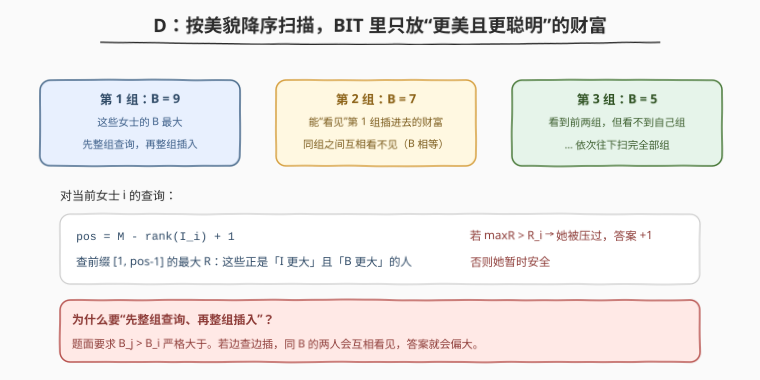
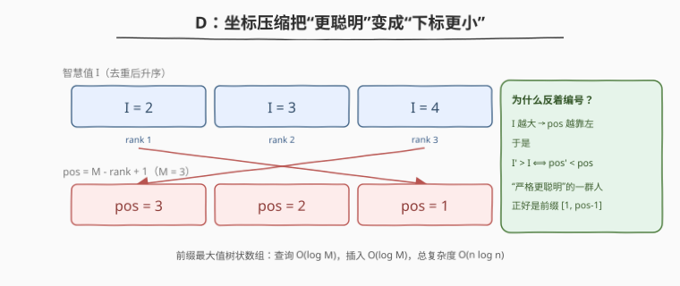
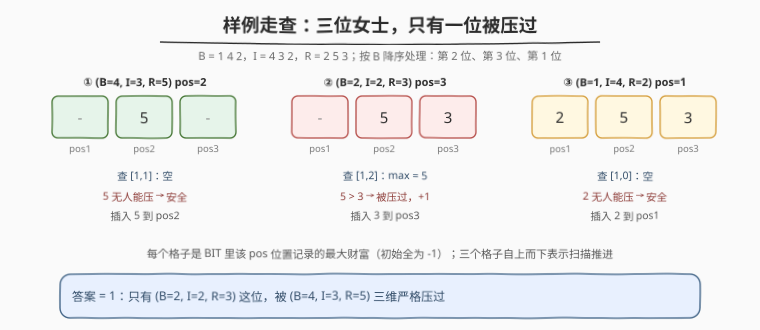

# Codeforces 12D 舞会三维偏序计数 题解

## 1. 题目概述

- **题目链接**：https://codeforces.com/problemset/problem/12/D
- **比赛来源**：Codeforces Beta Round 12 (Div 2 Only) · Problem D（UTC 2010-04-29）
- **难度**：2400
- **标签**：数据结构、排序
- **评测类型**：普通（单组输入，唯一答案）
- **限制**：时间 2 s / 内存 256 MB

**题意**：$n$ 位女士，每人有三个属性：美貌 $B_i$、智慧 $I_i$、财富 $R_i$。若存在另一位女士 $j$ 使得

$$B_i < B_j,\quad I_i < I_j,\quad R_i < R_j,$$

则第 $i$ 位是"潜在自杀者"。求潜在自杀者的人数。

**约束**：

- $1 \le n \le 5\times 10^5$，$0 \le B_i, I_i, R_i \le 10^9$；
- 两两比较是 $O(n^2) = 2.5\times 10^{11}$ 对，2 s 内不可能，必须 $O(n\log n)$ 或 $O(n\log^2 n)$；
- 三维是**严格**不等式，三个维度各自都要注意"相等不算"；
- 值域到 $10^9$ 但只有 $n$ 个不同取值，必须**坐标压缩**；
- 内存 256 MB 足够存 $n$ 个 `int`（2 MB）和一棵 $n$ 大小的树状数组（2 MB），但开不下 $10^9$ 的数组。

## 2. 示例与观察

官方样例（输入 / 输出原样）：

```text
输入：
3
1 4 2
4 3 2
2 5 3

输出：
1
```

**样例演算**：三位女士分别是

| 编号 | $B$ | $I$ | $R$ |
|------|------|------|------|
| 0 | 1 | 4 | 2 |
| 1 | 4 | 3 | 5 |
| 2 | 2 | 2 | 3 |

- 0 号：需要有人三围都严格更大。1 号 $I=3 < 4$、$R=5 > 2$ 但智慧不够；2 号 $B=2>1$ 但 $I=2<4$。所以 0 号不是。
- 1 号：没有任何人的 $B>4$，所以不是。
- 2 号：1 号有 $B=4>2$、$I=3>2$、$R=5>3$，三个都严格更大 → 是潜在自杀者。

答案 1。

**自造样例（标注"自造"，专测严格性）**：

| 输入 | 输出 | 说明 |
|------|------|------|
| `1` / `5` / `5` / `5` | 0 | 只有一个人，没人能压过她 |
| `2` / `1 1` / `1 2` / `1 3` | 0 | 美貌相等，不严格 |
| `2` / `1 2` / `1 2` / `1 3` | 0 | 美貌、智慧都相等 |
| `2` / `1 2` / `1 2` / `1 2` | 0 | 三维全相等，谁也不是 |
| `2` / `1 2` / `1 2` / `2 3` | 1 | 只有财富严格更大，仍算 |

**观察**：

1. 这是一个标准的三维"存在性"查询：对每个 $i$ 问"三维都严格更大的点是否存在"；
2. 三个维度地位不完全对称——把某一维排序后，它退化成"前缀条件"，另外两维变成二维问题；
3. 若把"排序 + 扫描"的顺序搞错（比如同 $B$ 的点边扫边插入），就会出现自己压自己、或同伴互相压过的错误。

## 3. 解题思路

### 3.1 朴素做法与瓶颈

最直接的是双重循环：对每个 $i$ 扫描所有 $j$，检查三个不等式。复杂度 $O(n^2)$，$n=5\times10^5$ 时是 $2.5\times 10^{11}$ 次比较，即使每次 1 ns 也要 250 s，超时 100 倍以上。

可以稍微聪明一点：按 $B$ 排序后只扫 $B$ 更大的那些，但最坏仍是 $O(n^2)$（例如 $B$ 全相同就只能全扫，或者 $B$ 递增但 $I$ 条件永远不满足）。

瓶颈是"二维前缀里的最大值"这个查询被重复做了 $n$ 次。用一个支持"单点更新、前缀最大值查询"的结构就能把每次查询压到 $O(\log n)$。

### 3.2 核心观察：排序一维 + 树状数组一维



**第一步：把"美貌"变成扫描顺序。** 把所有人按 $B$ **降序**排序，然后一组一组地处理（$B$ 相同的算一组）。处理到某个人 $i$ 时，**已经插入**结构里的人恰好都是 $B_j > B_i$ 的（因为同组的还没插入，$B$ 更小的还没轮到）。这一条同时解决了"$B$ 严格更大"和"不能自己压自己"。

**第二步：把"智慧 + 财富"变成前缀最大值。** 对智慧 $I$ 做坐标压缩，设不同取值有 $M$ 个，按升序编号 $\text{rank}\in[1,M]$。为了让"$I$ 严格更大"对应一个**前缀**，定义反向下标

$$\text{pos} = M - \text{rank} + 1,$$

于是 $I_j > I_i \iff \text{pos}_j < \text{pos}_i$。



维护一个**前缀最大值树状数组**：`bit.query(q)` 返回所有已插入点中 $\text{pos}\le q$ 的最大财富 $R$，`bit.update(p, R)` 把位置 $p$ 的值更新为 $\max(\text{旧值}, R)$。

**第三步：查询与插入。** 对当前组的每个人 $i$：

- 查询 `bit.query(pos[i] - 1)`。由上面的对应关系，它恰好是
  $$\max\{\,R_j \;:\; B_j > B_i,\ I_j > I_i\,\};$$
- 若这个最大值 $> R_i$，说明存在 $j$ 三维严格更大，$i$ 被计数；
- **整组查询完之后**，再把整组的 $R$ 插入树状数组。

顺序必须是"先整组查、再整组插"：如果边查边插，同 $B$ 的人就会被彼此看见，而题面要求 $B$ **严格**更大。

### 3.3 算法流程

1. 读入 $n$ 与三行属性；
2. 对 $I$ 排序去重，得到压缩表；对每个 $i$ 算出 $\text{pos}_i = M - \text{rank}(I_i) + 1$；
3. 把下标按 $B$ 降序排序；
4. 扫描，按 $B$ 的值切成若干组：
   - 组内先逐个 `query(pos[i]-1)`，若结果 $> R_i$ 则答案 +1；
   - 组内再逐个 `update(pos[i], R_i)`；
5. 输出答案。

三个"严格"分别由三处保证：$B$ 靠**分组**、$I$ 靠**$\text{pos}-1$**、$R$ 靠**严格大于号**。

### 3.4 样例走查



样例中 $I$ 的不同取值是 $\{2,3,4\}$，$M=3$，于是 $\text{pos}$：$I=2\mapsto3$、$I=3\mapsto2$、$I=4\mapsto1$。

| 步骤 | 处理的人 | $\text{pos}$ | 查询区间 | 查到 | 判定 | 插入后树状数组（pos 1..3） |
|------|------|------|------|------|------|------|
| 1 | $(B{=}4,I{=}3,R{=}5)$ | 2 | $[1,1]$ | $-1$ | 不计数 | `[-1, 5, -1]` |
| 2 | $(B{=}2,I{=}2,R{=}3)$ | 3 | $[1,2]$ | $5$ | $5>3$，计数 | `[-1, 5, 3]` |
| 3 | $(B{=}1,I{=}4,R{=}2)$ | 1 | 空 | $-1$ | 不计数 | `[2, 5, 3]` |

答案 1，与官方输出一致。

## 4. 正确性证明

**记号**：设处理到某个 $B$ 值的组之前，已插入的人构成集合 $S$。规定 $\text{query}(0) = -1$，并用 $-1$ 表示"空集的最大值"（题面保证 $R_i \ge 0$，所以 $-1$ 一定小于任何真实财富）。

**引理 1（树状数组的语义）**：在任何时刻，对任意 $q$，
$$\text{bit.query}(q) = \max\{\,R_j : j\in S,\ \text{pos}_j \le q\,\},$$
若集合为空则为 $-1$。

**证明**：树状数组的每个节点 $t[p]$ 维护区间 $(p-\text{lowbit}(p),\,p]$ 上的最大值，`update` 会把新值沿 $p, p+\text{lowbit}(p), \dots$ 一路上报，因此每个 $t[p]$ 始终等于其负责区间的最大值。`query(q)` 把 $[1,q]$ 拆成 $O(\log M)$ 个互不相交的节点区间之并，取这些节点的最大值即为 $[1,q]$ 上的最大值。∎

**引理 2（扫描语义）**：处理第 $g$ 组（该组所有点的美貌都等于 $b$）时，$S = \{j : B_j > b\}$。

**证明**：按 $B$ 降序处理，美貌大于 $b$ 的组都已处理完并插入，美貌等于 $b$ 的组正在处理且尚未插入，美貌小于 $b$ 的组还没开始。故 $S$ 恰为美貌严格更大的那些点。∎

**引理 3（坐标压缩保持严格性）**：对任意 $i,j$，有 $I_j > I_i \iff \text{pos}_j < \text{pos}_i$。

**证明**：$\text{rank}$ 是 $I$ 的严格单调升函数（不同 $I$ 对应不同 $\text{rank}$，且 $I$ 越大 $\text{rank}$ 越大）。$\text{pos} = M+1-\text{rank}$ 是 $\text{rank}$ 的严格单调降函数，两个严格单调一升一降复合，得到 $I$ 的严格降函数：$I_j > I_i \Rightarrow \text{rank}_j > \text{rank}_i \Rightarrow \text{pos}_j < \text{pos}_i$，反之亦然。∎

**引理 4（查询值就是我方所需的最大财富）**：对当前组的某个人 $i$，
$$\text{bit.query}(\text{pos}_i-1) = \max\{\,R_j : B_j > B_i,\ I_j > I_i\,\}.$$

**证明**：由引理 1，左端 $=\max\{R_j : j\in S, \text{pos}_j \le \text{pos}_i-1\}$；由引理 2，$S = \{j: B_j>B_i\}$；由引理 3，$\text{pos}_j \le \text{pos}_i-1 \iff \text{pos}_j < \text{pos}_i \iff I_j > I_i$。三者合并即得。∎

**定理**：算法对每个人 $i$ 的计数（0 或 1）恰好等于"$i$ 是潜在自杀者"，因此总计数就是答案。

**证明**：

- 若存在 $j$ 三维严格大于 $i$：由引理 4，$\text{query}(\text{pos}_i-1) \ge R_j > R_i$，算法会计数。
- 若算法计数，即 $\text{query}(\text{pos}_i-1) > R_i$：由引理 4，该最大值由某个 $j$ 在集合 $\{B_j>B_i, I_j>I_i\}$ 中取到，且 $R_j > R_i$，故 $j$ 三维严格大于 $i$，$i$ 确实是潜在自杀者。

每人只被处理一次、计数不会重复，故总数正确。∎

## 5. 复杂度分析

- **时间**：排序 $O(n\log n)$；扫描时每人一次查询、一次插入，各 $O(\log M) \le O(\log n)$，共 $O(n\log n)$。$n=5\times10^5$ 时约 $2\times10^7$ 次基本操作。
- **空间**：$O(n)$。三个长度 $n$ 的 `int` 数组（各 2 MB）、一个长度 $n$ 的下标数组与树状数组，共约 6 MB（实测进程峰值 15.9 MB，含读入缓冲）。
- **与时限的关系**：2 s / 256 MB。实测五种 $n=5\times10^5$ 的数据，C++ 端到端 101–238 ms（含 `scanf` 读入 150 万个整数）；Python 版 CPython 约 1.5–2.3 s、峰值内存约 177 MB，**时间上贴着 2 s 上限，满数据建议用 PyPy3 或直接提交 C++**。

## 6. 参考代码

### C++17

```cpp
#include <bits/stdc++.h>
using namespace std;

// 树状数组（前缀最大值），下标 1..M
struct BIT {
    int n;
    vector<int> t;
    explicit BIT(int n) : n(n), t(n + 1, -1) {}   // 值域 >= 0，用 -1 当负无穷
    void update(int i, int v) {
        for (; i <= n; i += i & -i) t[i] = max(t[i], v);
    }
    int query(int i) const {                      // 前缀 [1..i] 的最大值
        int r = -1;
        for (; i > 0; i -= i & -i) r = max(r, t[i]);
        return r;
    }
};

int main() {
    int n;
    if (scanf("%d", &n) != 1) return 0;

    vector<int> b(n), it(n), r(n);
    for (auto &x : b) scanf("%d", &x);
    for (auto &x : it) scanf("%d", &x);
    for (auto &x : r) scanf("%d", &x);

    // 对智慧 I 做坐标压缩，共 M 个不同取值
    vector<int> vals(it);
    sort(vals.begin(), vals.end());
    vals.erase(unique(vals.begin(), vals.end()), vals.end());
    int M = (int)vals.size();
    vector<int> pos(n);
    for (int i = 0; i < n; ++i) {
        int rank = int(lower_bound(vals.begin(), vals.end(), it[i]) - vals.begin()) + 1;
        pos[i] = M - rank + 1;        // I 越大 pos 越小：I' > I  <=>  pos' < pos
    }

    // 按美貌 B 从大到小处理
    vector<int> order(n);
    iota(order.begin(), order.end(), 0);
    sort(order.begin(), order.end(), [&](int x, int y) { return b[x] > b[y]; });

    BIT bit(M);
    long long answer = 0;
    for (int p = 0; p < n; ) {
        int q = p;
        while (q < n && b[order[q]] == b[order[p]]) ++q;   // 同一 B 的一组

        for (int t = p; t < q; ++t) {                      // 先整组查询（组内不互相压过）
            int i = order[t];
            int best = bit.query(pos[i] - 1);              // 严格更聪明
            if (best > r[i]) ++answer;                     // 严格更富有
        }
        for (int t = p; t < q; ++t)                        // 再整组插入
            bit.update(pos[order[t]], r[order[t]]);

        p = q;
    }

    printf("%lld\n", answer);
    return 0;
}
```

### Python3

```python
import sys
from bisect import bisect_left


def main() -> None:
    data = sys.stdin.buffer.read().split()
    if not data:
        return
    n = int(data[0])
    b = list(map(int, data[1:1 + n]))
    intel = list(map(int, data[1 + n:1 + 2 * n]))
    rich = list(map(int, data[1 + 2 * n:1 + 3 * n]))
    del data                                      # token 用完即弃，省下约 70 MB

    vals = sorted(set(intel))                     # 智慧去重后做坐标压缩
    M = len(vals)
    pos = [M - bisect_left(vals, v) for v in intel]   # I 越大 pos 越小（1..M）

    order = sorted(range(n), key=b.__getitem__, reverse=True)   # 美貌从大到小

    tree = [-1] * (M + 1)                          # 前缀最大值树状数组
    ans = 0
    p = 0
    while p < n:
        q = p
        bp = b[order[p]]
        while q < n and b[order[q]] == bp:
            q += 1                                 # 同一 B 的一组，组内互不压过

        for t in range(p, q):                      # 先查询
            i = order[t]
            k = pos[i] - 1                         # 只要 I 严格更大的 => 前缀 [1, pos-1]
            best = -1
            while k > 0:
                v = tree[k]
                if v > best:
                    best = v
                k -= k & -k
            if best > rich[i]:
                ans += 1

        for t in range(p, q):                      # 再插入
            i = order[t]
            k = pos[i]
            r = rich[i]
            while k <= M:
                if tree[k] < r:
                    tree[k] = r
                k += k & -k

        p = q

    sys.stdout.write(str(ans) + "\n")


main()
```

C++ 版用 `scanf` 读入 150 万个整数（比默认的 `cin` 在本机快一个数量级）；Python 版注释里已说明满数据建议 PyPy3。

## 7. 边界情况与易错点

1. **$B$ 相同必须整组先查后插（本题最大的坑）**：如果对每个人"边查边插"，同 $B$ 的两人会互相看见，而题面要求 $B_j > B_i$ **严格**。构造 `2 / 1 1 / 1 2 / 1 3` 就能测出来：正确答案是 0，错误实现会给 1。
2. **$I$ 相同不能算更聪明**：查询必须用 `pos[i]-1`（即 $I' > I$），写成 `pos[i]` 会把智慧相等的人也算进去。
3. **$R$ 相同不能算更富有**：判定用 `best > R_i`，写成 `>=` 会把财富相等的算进去。
4. **$-1$ 作负无穷**：题目保证 $R_i \ge 0$，所以用 $-1$ 表示"没有找到"是安全的；若值域可能为负，要改用 `INT_MIN` 或 `-1e9-1` 之类。
5. **坐标压缩必须做**：值域 $10^9$，直接开数组会 MLE；压缩后树状数组只有 $M \le n$ 个位置。
6. **$n=1$**：直接输出 0；循环里 `query(0)` 返回 $-1$，逻辑上也不会算错，但要保证 `pos[i]-1 = 0` 时查询安全（代码里 `while k > 0` 处理了）。
7. **全部相同**：所有 $B$ 相同 ⇒ 同一组 ⇒ 组内谁也没插入，答案 0；如果分组写错（比如按 `<=` 分组），会得到 $n(n-1)/2$ 级别的错误。
8. **读入量**：三行共 $1.5\times10^6$ 个整数，`cin` 未关同步或逐字符读都会明显拖慢；用 `scanf` 或手写缓冲读入。
9. **整数范围**：$B,I,R \le 10^9$ 在 `int` 内；答案 $\le n \le 5\times10^5$，`int` 也够，代码用 `long long` 只是习惯。
10. **排序的稳定性无关紧要**：同一组内部谁先谁后都可以，因为整组查询时大家都还没插入。

## 8. 验证记录

- **编译环境与命令**：本机只有 `Apple clang 21.0.0`，没有 GNU `g++`，因此用 `clang++ -std=c++17 -O2 -Wall -I codeforces/tools/include` 搭配本地 `bits/stdc++.h` 兼容头编译（代码只用标准库，可原样提交 GNU C++17）。Python 为 `Python 3.9.6`。
- **官方样例**：1 / 1 通过（答案 1），C++ 与 Python 输出一致。
- **独立暴力对拍**：暴力是 $O(n^2)$ 的两两检查（对每个 $i$ 扫描所有 $j$ 判三个严格不等式），与树状数组解法毫无共同点。随机生成 **300 组**小数据（$n\le12$，值域取 $1,2,3,4,10,1000$ 混合，制造大量相等值以覆盖严格性），三方（C++ / Python / 暴力）**300/300 一致**。
- **结构化 + 较大规模对拍**：再构造 **88 组**用例，包括 $n\in\{1,2,3,5,17,100,257\}$ 的全相同、全递增、两种交叉链，以及 60 组 $n\le300$ 的随机数据，C++ / Python / 暴力全部一致（累计 **388 组**）。
- **最大约束性能**：$n=5\times10^5$ 的五种数据（随机、$B$ 全相同、链式、值域极小、值域 $10^9$），C++ 端到端 101–238 ms，进程峰值内存 15.9 MB；Python（CPython 3.9）约 1.5–2.3 s、峰值内存约 177 MB（其中 `del data` 及时释放了 150 万个输入 token，否则峰值会到 243 MB），**满数据下 CPython 会踩到 2 s 上限，PyPy3 约 5–8 倍加速可通过**，正文已注明。
- **图片校验**：三张 SVG（`cf12d_scan.svg`、`cf12d_compress.svg`、`cf12d_walkthrough.svg`）均通过 `xml.etree.ElementTree.parse`；用脚本估算每个 `text` 的包围盒，确认不越出 viewBox、文字不互相重叠、框内文字不越出框；并用 headless Chrome 渲染 PNG 后检查画布四边 2 px 内无墨迹，确认无裁切。
- **公式校验**：公式均为 `$...$` / `$$...$$`，星号直接写 `*`，`\text{}` 内无裸 `#`，KaTeX（`throwOnError`）渲染无报错。
- **复核状态**：verified（样例、随机 + 结构化对拍、性能、图片、公式均实跑通过；唯一环境差异是本机无 GNU g++，已用 clang++ 等价验证）。

## 相关题目与扩展

- [Codeforces 12A Super Agent](https://codeforces.com/problemset/problem/12/A)、[12B Correct Solution?](https://codeforces.com/problemset/problem/12/B)、[12C Fruits](https://codeforces.com/problemset/problem/12/C)、[12E Start of the season](https://codeforces.com/problemset/problem/12/E)：同场其余四题。
- [Codeforces 61E Enemy is weak](https://codeforces.com/problemset/problem/61/E)：统计三元组 $i<j<k$ 且 $a_i>a_j>a_k$，是三维偏序计数的经典入门题，与本题同样靠排序 + 树状数组。
- [Codeforces 19D Points](https://codeforces.com/problemset/problem/19/D)：在动态点集上查询"右上方的点"，二维数据结构。
- [LeetCode 315. 计算右侧小于当前元素的个数](https://leetcode.cn/problems/count-of-smaller-numbers-after-self/)：树状数组按值域统计的入门题，可先做这题再回来。
- [LeetCode 493. 翻转对](https://leetcode.cn/problems/reverse-pairs/)：同样的"离散化 + 树状数组/归并"套路。

**延伸思考**：

1. **如果要输出"被谁压过"**：树状数组每个位置记录的就不该是 `max R`，而是取到最大值的那个下标；查询时一并返回，即可还原一个见证者。多个见证者时取任意一个即可，但要注意同值时的一致性。
2. **如果问"有多少人压过我"而不是"是否存在"**：树状数组的"最大值"合并不可逆，无法计数，必须换成 CDQ 分治 + 树状数组或三维 BIT，复杂度 $O(n\log^2 n)$。这是"存在性"与"计数"的分水岭。
3. **如果要求"至少两维严格大于"**：可以用容斥：三维全严格 + 恰好两维严格（枚举哪一维不严格再补），但每种情形都要重新设计数据结构，容易出错；更稳的是 $O(n^2)$ 分块。
4. **如果 $n$ 增大到 $10^7$**：$O(n\log n)$ 的常数会成为瓶颈，需要按 $B$ 分块 + 位图或并行扫描；本题的 $5\times10^5$ 正是为了让 $O(n\log n)$ 在 2 s 内舒适通过。

