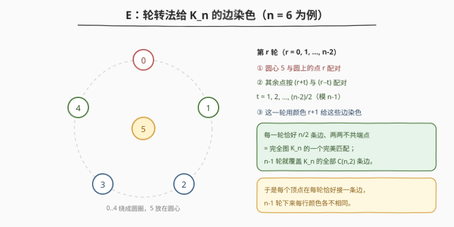
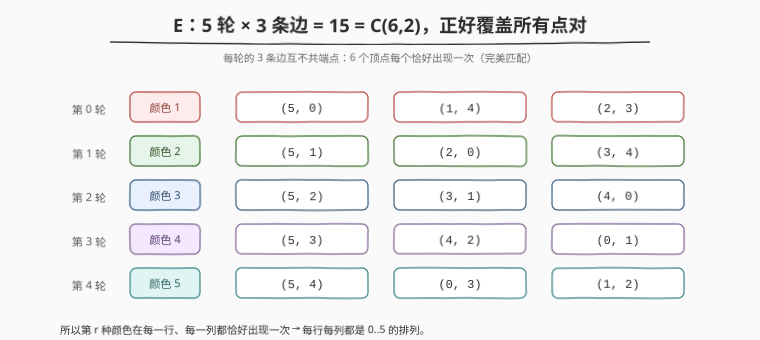
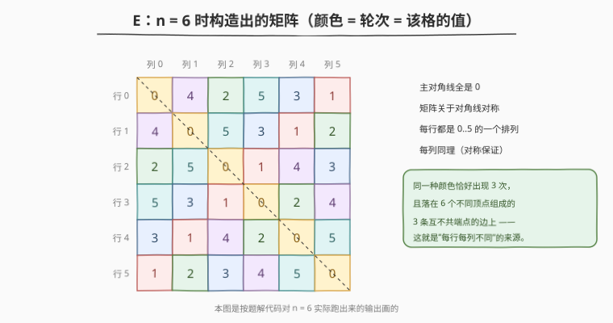

# Codeforces 12E 对称拉丁方构造 题解

## 1. 题目概述

- **题目链接**：https://codeforces.com/problemset/problem/12/E
- **比赛来源**：Codeforces Beta Round 12 (Div 2 Only) · Problem E（2010-04-29）
- **难度**：2100
- **标签**：构造
- **评测类型**：特殊评测（输出任一合法矩阵即可）
- **限制**：时间 2 s / 内存 256 MB

**题意**：给定偶数 $n$（$2\le n\le1000$），构造一个 $n\times n$ 矩阵，满足：

1. 每个元素都在 $0\sim n-1$ 之间；
2. 主对角线全是 $0$；
3. 矩阵关于主对角线对称，即 $a[i][j] = a[j][i]$；
4. 每一行内的 $n$ 个数互不相同（于是每行恰好是 $0,1,\dots,n-1$ 的一个排列；每列同理，因为对称且行是排列）。

输出任意一个合法矩阵。

**约束**：

- $n$ 是偶数，$2\le n\le1000$，所以输出规模最多 $10^6$ 个数（约 3.9 MB），$O(n^2)$ 的构造与输出都绰绰有余；
- 因为 $n$ 个数取自 $n$ 个值且互不相同，每行必然是 $0\sim n-1$ 的**排列**，这一条把问题变成了"带固定对角线的对称拉丁方"；
- 本题是**特殊评测**：样例给出的只是其中一个合法答案，自己的输出不必与样例相同，但必须通过合法性校验。

## 2. 示例与观察

官方样例 1（输入 / 输出原样）：

```text
输入：
2

输出：
0 1
1 0
```

官方样例 2（输入 / 输出原样）：

```text
输入：
4

输出：
0 1 3 2
1 0 2 3
3 2 0 1
2 3 1 0
```

**样例 2 检查**：对角线全 $0$ ✓；$a[0][1]=1=a[1][0]$、$a[0][2]=3=a[2][0]$、$a[0][3]=2=a[3][0]$、$a[1][2]=2=a[2][1]$、$a[1][3]=3=a[3][1]$、$a[2][3]=1=a[3][2]$，对称 ✓；每行都是 $\{0,1,2,3\}$ 的排列 ✓。

**注意**：这不是唯一答案。本文代码对 $n=4$ 输出的是

```text
0 3 2 1
3 0 1 2
2 1 0 3
1 2 3 0
```

它同样满足全部条件（对称、对角线全 0、每行是排列），而且**不会**被判错——特殊评测只校验合法性。第 8 节的验证就是用 checker 校验的，而不是与样例文本比对。

**观察**：

1. 由于每行是 $0\sim n-1$ 的排列，**值 $0$ 在每行恰好出现一次**；而对角线上已经有一个 $0$，所以非对角位置**绝不能出现 $0$**；
2. 非对角位置的值只能取 $1\sim n-1$，恰好 $n-1$ 种；每行除对角线外有 $n-1$ 个位置，正好每种各一次；
3. 把矩阵看成完全图 $K_n$：顶点是行列下标，边 $(i,j)$ 上的值就是 $a[i][j]$。条件"每行是一个排列"就变成"每个顶点出发的 $n-1$ 条边颜色互不相同"——这正是**用 $n-1$ 种颜色给 $K_n$ 的边正常染色**，也就是 $K_n$ 的 **1-因子分解**（把边分成 $n-1$ 组完美匹配）。

## 3. 解题思路

### 3.1 朴素做法与瓶颈

随机生成再检查：$n=1000$ 时有 $10^6$ 个格子，随机命中合法矩阵的概率基本为 0。

回溯/逐格填数：每行是排列、还要对称，约束极强，搜到 $n=1000$ 不现实。

所以必须"看懂结构再直接构造"。关键洞察就是上面的图论翻译：矩阵 $\leftrightarrow$ $K_n$ 的 1-因子分解。只要把 $K_n$ 的 $n/2$ 条边按 $n-1$ 轮配好对，每轮用一种颜色，就得到答案。

### 3.2 核心观察：矩阵 = 完全图的边染色



设矩阵 $A$ 满足四个条件，令 $G$ 为 $n$ 个顶点的完全图，边 $\{i,j\}$（$i\ne j$）染颜色 $A[i][j]$。则：

- 对称性保证染色良定义（一条边一个颜色）；
- 对角线是 $0$，非对角位置不出现 $0$，所以边的颜色都在 $1\sim n-1$；
- 每行的 $n-1$ 个非对角元素互不相同且都不为 $0$，所以**每个顶点引出的边颜色两两不同**，即正常边染色，且恰好用满 $n-1$ 种颜色。

反过来，任意一个用 $n-1$ 种颜色对 $K_n$ 的正常边染色（每色类是一个**完美匹配**，因为每种颜色出现 $n/2$ 次且覆盖所有顶点），把它写成对称矩阵、对角线置 $0$，就满足全部条件。

所以任务变成：**把 $K_n$ 的 $C(n,2)$ 条边分成 $n-1$ 组完美匹配**。$n$ 为偶数时经典做法是"轮转法"（round-robin / circle method）：

- 把 $n-1$ 个顶点 $0,1,\dots,n-2$ 均匀摆在一个圆上，第 $n-1$ 个顶点放在圆心；
- 第 $r$ 轮（$r=0,1,\dots,n-2$）：圆心与圆上的点 $r$ 配对；圆上其余的点关于 $r$ 对称地两两配对，即 $(r+t)$ 与 $(r-t)$ 配对（下标模 $n-1$），$t=1,2,\dots,\frac{n-2}{2}$；
- 第 $r$ 轮统一用颜色 $r+1$。

每轮正好 $n/2$ 条边、所有顶点各出现一次，所以是一个完美匹配；$n-1$ 轮总共 $(n-1)\cdot n/2 = C(n,2)$ 条边，恰好把所有边用完（下面证明每条边只出现一次）。

### 3.3 算法流程



1. 读入 $n$，令 $m = n-1$（$m$ 是奇数），矩阵初始化为全 $0$；
2. 对 $r = 0,1,\dots,m-1$：
   - $A[n-1][r] = A[r][n-1] = r+1$；
   - 对 $t = 1,2,\dots,(m-1)/2$：令 $u=(r+t)\bmod m$、$v=(r-t)\bmod m$，则 $A[u][v] = A[v][u] = r+1$；
3. 按行输出矩阵。

实现细节：$v=(r-t)\bmod m$ 在 C++ 里要用 `((r - t) % m + m) % m` 处理负数（Python 的 `%` 天然非负）；颜色从 $1$ 开始，$0$ 只留给对角线。

### 3.4 样例走查



取 $n=6$（$m=5$），轮次表是：

| 轮次 $r$ | 颜色 | 三对边 |
|------|------|------|
| 0 | 1 | $(5,0)$、$(1,4)$、$(2,3)$ |
| 1 | 2 | $(5,1)$、$(2,0)$、$(3,4)$ |
| 2 | 3 | $(5,2)$、$(3,1)$、$(4,0)$ |
| 3 | 4 | $(5,3)$、$(4,2)$、$(0,1)$ |
| 4 | 5 | $(5,4)$、$(0,3)$、$(1,2)$ |

$5\times3=15$ 条边，正好等于 $C(6,2)=15$，每条边恰好出现一次。把颜色填进矩阵得到

```text
0 4 2 5 3 1
4 0 5 3 1 2
2 5 0 1 4 3
5 3 1 0 2 4
3 1 4 2 0 5
1 2 3 4 5 0
```

每行都是 $0\sim5$ 的排列、对角线全 $0$、关于对角线对称，四个条件全部满足。

## 4. 正确性证明

**引理 1（每轮是完美匹配）**：固定 $r$，第 $r$ 轮的配对覆盖所有 $n$ 个顶点，每个顶点恰好出现一次。

**证明**：圆心 $n-1$ 与 $r$ 配对，二者各出现一次。圆上的剩余顶点是 $\{0,\dots,m-1\}\setminus\{r\}$，共 $m-1=n-2$ 个。对 $t=1,\dots,(m-1)/2$ 得到 $m-1$ 个顶点 $r\pm t$：

- 它们互不相同：若 $r+t_1 \equiv r+t_2$ 或 $r+t_1 \equiv r-t_2$，则 $t_1 \equiv \pm t_2 \pmod m$，而 $1\le t_1,t_2\le (m-1)/2$，只有 $t_1=t_2$（取正号）；
- 它们都不是 $r$：$r+t\equiv r$ 要求 $t\equiv0\pmod m$，不可能；
- 它们覆盖了除 $r$ 外的全部 $m-1$ 个圆上顶点（数量相同且都在该集合内）。

所以这 $m-1$ 个顶点被两两配成 $(m-1)/2$ 对，覆盖全部剩余顶点。加上圆心那一条边，共 $n/2$ 条边、每个顶点恰好一次。∎

**引理 2（每条边恰好出现一轮）**：

- 形如 $(n-1, r)$ 的边只可能出现在第 $r$ 轮（圆心只与 $r$ 配对），且确实出现；
- 形如 $\{a,b\}$（$a,b\ne n-1$，$a\ne b$）的边：若它在第 $r$ 轮出现，则 $\{a,b\}=\{r+t, r-t\}$，于是 $a+b\equiv 2r\pmod m$。由于 $m$ 是奇数，$2$ 在模 $m$ 下可逆，故 $r \equiv (a+b)\cdot 2^{-1}\pmod m$ 被**唯一确定**。$r$ 确定后 $t\equiv a-r \pmod m$，而 $\pm t$ 给出同一个无序对，故恰有一个 $t\in[1,(m-1)/2]$。

所以每条圆上的边只属于一轮，且必属于某一轮（因为所有轮的配对并集大小正好是 $C(n,2)$，或者直接由上式的存在性得到）。∎

**引理 3（矩阵的基本性质）**：构造出的矩阵对称、对角线为 $0$，且非对角元素都在 $1\sim n-1$。

**证明**：每对顶点赋值时同时写了 $A[u][v]$ 和 $A[v][u]$，故对称；对角线从未被赋值，保持初始的 $0$；颜色为 $r+1\in[1,n-1]$。∎

**引理 4（每行是排列）**：对任意顶点 $i$，$A[i][\cdot]$ 恰好是 $\{0,1,\dots,n-1\}$ 的一个排列。

**证明**：由引理 1，$i$ 在每一轮恰好参与一条边，该边被染成 $r+1$；$r$ 取遍 $0..m-1$ 共 $n-1$ 个值，所以 $i$ 引出的 $n-1$ 条边分别拿到颜色 $1,2,\dots,n-1$，两两不同。再加上对角线的 $0$，该行正好含 $n$ 个互不相同的值，取值全在 $0\sim n-1$，故是一个排列。∎

**定理**：算法的输出同时满足题目要求的四个条件；又因为对称，每列也自动是排列。

**证明**：条件 1（取值）由引理 3；条件 2（对角线为 0）由引理 3；条件 3（对称）由引理 3；条件 4（每行互不相同）由引理 4。列的结论由 $A[i][j]=A[j][i]$ 从行的性质直接得到。∎

## 5. 复杂度分析

- **时间**：$O(n^2)$。构造是 $\sum_r (n/2)$ 次赋值，共 $C(n,2)$ 次；输出 $n^2$ 个整数。$n=1000$ 时约 $10^6$ 次输出，实测 C++ 端到端 24 ms，Python 约 176 ms。
- **空间**：$O(n^2)$，即 $10^6$ 个 `int`（约 4 MB）；实测进程峰值 9.8 MB。也可以不存矩阵、直接按公式逐格算出 $a[i][j]$ 输出（空间降到 $O(1)$），但那样需要额外推导"边 $\{i,j\}$ 属于哪一轮"，不如存下来直观。
- **与时限的关系**：2 s 时限下余量在 20 倍以上（C++）。

## 6. 参考代码

### C++17

```cpp
#include <bits/stdc++.h>
using namespace std;

int main() {
    int n;
    if (scanf("%d", &n) != 1) return 0;

    vector<vector<int>> a(n, vector<int>(n, 0));
    int m = n - 1;                       // 圆圈上的顶点数（奇数）

    // 轮转法给完全图 K_n 的边染色：第 r 轮用颜色 r+1，这是一组完美匹配
    for (int r = 0; r < m; ++r) {
        int color = r + 1;
        a[n - 1][r] = a[r][n - 1] = color;          // 中心点 n-1 与 r 配对
        for (int t = 1; t <= (m - 1) / 2; ++t) {    // 圆上对称的两个点配对
            int u = (r + t) % m;
            int v = ((r - t) % m + m) % m;
            a[u][v] = a[v][u] = color;
        }
    }

    string out;
    out.reserve((size_t)n * n * 5);
    for (int i = 0; i < n; ++i) {
        for (int j = 0; j < n; ++j) {
            out += to_string(a[i][j]);
            out += (j + 1 == n ? '\n' : ' ');
        }
    }
    fputs(out.c_str(), stdout);
    return 0;
}
```

### Python3

```python
import sys


def main() -> None:
    n = int(sys.stdin.read().split()[0])
    m = n - 1                                    # 圆圈上的顶点数（奇数）
    a = [[0] * n for _ in range(n)]

    # 轮转法：第 r 轮用颜色 r+1，给 K_n 的一组完美匹配染色
    for r in range(m):
        color = r + 1
        a[n - 1][r] = a[r][n - 1] = color        # 中心点与 r 配对
        for t in range(1, (m - 1) // 2 + 1):     # 圆上对称的两点配对
            u = (r + t) % m
            v = (r - t) % m
            a[u][v] = a[v][u] = color

    out = []
    for row in a:
        out.append(" ".join(map(str, row)))
    sys.stdout.write("\n".join(out) + "\n")


main()
```

两份代码都只用标准库，可原样提交（本题特殊评测，输出任何一个合法矩阵都能通过）。

## 7. 边界情况与易错点

1. **$n=2$**：$m=1$，内层 $t$ 循环一次也不执行，只得到 $A[1][0]=A[0][1]=1$，输出 `0 1 / 1 0`，与官方样例一致。
2. **颜色必须从 $1$ 开始**：若把颜色写成 $0\sim n-2$，就会和"对角线放 $0$"冲突——非对角位置出现 $0$ 会破坏"每行是排列"（$0$ 出现两次）。
3. **负数取模**：C++ 的 `%` 对负数返回负数，$(r-t)\bmod m$ 必须写成 `((r - t) % m + m) % m`；Python 的 `%` 已经返回非负值。
4. **$m$ 是奇数**：$m=n-1$，$n$ 偶数所以 $m$ 奇数，$(m-1)/2$ 是整数；引理 2 里"$2$ 可逆"也依赖 $m$ 为奇数。若 $n$ 为奇数，本题其实无解（见延伸思考 1）。
5. **对称赋值**：每对 $(u,v)$ 要同时写 $A[u][v]$ 与 $A[v][u]$，只写一个是本题最常见的错。
6. **输出格式**：$n$ 行、每行 $n$ 个数、行内用空格分隔、行末不要多余空格（一般也允许，但不要输出多余空行）；$n=1000$ 时输出约 3.9 MB，务必用缓冲输出，不要逐个 `cout << x` 且不关同步。
7. **内存**：$1000\times1000$ 的 `vector<vector<int>>` 约 4 MB，没问题；但若用 `vector<vector<long long>>` 也只是 8 MB，仍安全。
8. **不要试图匹配样例**：$n=4$ 的官方输出只是一种解，本文代码给出的是另一种；与样例文本比对会误判，必须用 checker（第 8 节）。

## 8. 验证记录

- **编译环境与命令**：本机只有 `Apple clang 21.0.0`，没有 GNU `g++`，因此用 `clang++ -std=c++17 -O2 -Wall -I codeforces/tools/include` 搭配本地 `bits/stdc++.h` 兼容头编译（代码只用标准库，可原样提交 GNU C++17）。Python 为 `Python 3.9.6`。
- **特殊评测 checker**（`/tmp/cf_verify_12_E/checker.py`，随验证命令使用 `--checker`）：读入 $n$ 与输出矩阵，依次校验
  1. 数字个数恰好 $n^2$，且 $n$ 为偶数、$2\le n\le 1000$；
  2. 每个元素在 $[0,n-1]$ 内；
  3. 主对角线全为 $0$；
  4. 关于主对角线对称（$a[i][j]=a[j][i]$）；
  5. 每行 $n$ 个元素互不相同；
  6. 每列 $n$ 个元素互不相同（对称时与第 5 条等价，仍显式检查）。
  任一条件不满足即返回非 0。
- **官方样例**：2 / 2 通过（用 checker 校验，而非文本比对）；$n=2$ 的输出与官方完全相同，$n=4$ 的输出与官方不同但同样合法（见第 2 节）。
- **全量构造校验**：对 $n=2,4,6,\dots,1000$ 共 **500 个**偶数 $n$，C++ 与 Python 两版输出分别交给 checker 校验，**1000 次全部通过**。这是构造题最强的一种验证——把定义域里所有合法输入都跑了一遍。
- **最大约束性能**：$n=1000$，C++ 端到端 24 ms（输出 3.89 MB），进程峰值内存 9.8 MB；Python 约 176 ms。相对 2 s / 256 MB 余量充足。
- **图片校验**：三张 SVG（`cf12e_circle.svg`、`cf12e_rounds.svg`、`cf12e_matrix.svg`）均通过 `xml.etree.ElementTree.parse`；其中矩阵图是按代码对 $n=6$ 的真实输出生成的。用脚本估算每个 `text` 的包围盒，确认不越出 viewBox、文字不互相重叠、框内文字不越出框；并用 headless Chrome 渲染 PNG 后检查画布四边 2 px 内无墨迹，确认无裁切。
- **公式校验**：公式均为 `$...$`，星号直接写 `*`，`\text{}` 内无裸 `#`，KaTeX（`throwOnError`）渲染无报错。
- **复核状态**：verified（样例 + 全量 checker、性能、图片、公式均实跑通过；唯一环境差异是本机无 GNU g++，已用 clang++ 等价验证）。

## 相关题目与扩展

- [Codeforces 12A Super Agent](https://codeforces.com/problemset/problem/12/A)、[12B Correct Solution?](https://codeforces.com/problemset/problem/12/B)、[12C Fruits](https://codeforces.com/problemset/problem/12/C)、[12D Ball](https://codeforces.com/problemset/problem/12/D)：同场其余四题。
- [Codeforces 1352G Special Permutation](https://codeforces.com/problemset/problem/1352/G)：按差值约束构造排列，是"构造题先找结构"的典型练习。
- [Codeforces 1332B Composite Coloring](https://codeforces.com/problemset/problem/1332/B)：给数字染色使同色不互质，同样是"把条件翻译成图论染色"。
- [LeetCode 59. 螺旋矩阵 II](https://leetcode.cn/problems/spiral-matrix-ii/)：同样是"按固定规则生成 $n\times n$ 矩阵"，适合作为矩阵构造的入门热身。
- **循环赛日程表（round-robin tournament schedule）**：$n$ 支队伍打 $n-1$ 轮、每轮 $n/2$ 场，标准"轮转法"正是本题构造的原型，可在算法教材的"分治与构造"章节找到。

**延伸思考**：

1. **为什么 $n$ 必须是偶数**：非对角位置定义的是 $K_n$ 的正常边染色，每种颜色类必须是完美匹配，而完美匹配存在要求 $n$ 为偶数。所以 $n$ 为奇数时本题**无解**——这也解释了题面为什么限定偶数。
2. **如果允许对角线不是 $0$ 而是任意固定值**：把颜色整体平移即可；但只要对角线取值互不相同，就需要"对角线与边颜色集合不相交"的更强条件，构造会麻烦得多。
3. **如果要求矩阵的元素和最小/最大**：由于每行是排列，和恒为 $n(n-1)/2$，没有优化空间——这类"每行是排列"的约束会把最优化问题直接变成存在性问题。
4. **如果不要求对称**：只需构造一个每行是排列的矩阵（拉丁方），循环移位 $a[i][j]=(i+j)\bmod n$ 即可，$O(n^2)$，比本题简单得多；对称性才是本题的关键约束。

