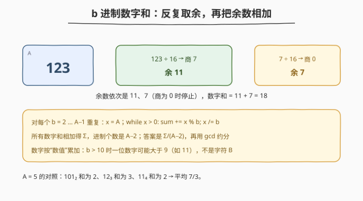
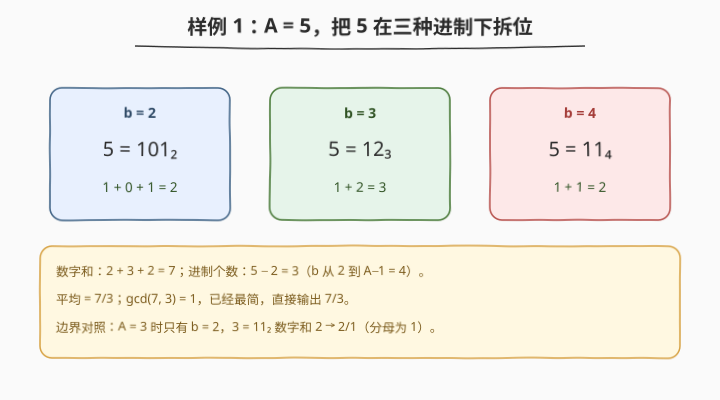

# Codeforces 13A 各进制数码和平均 题解

## 1. 题目概述

- **题目链接**：https://codeforces.com/problemset/problem/13/A
- **比赛来源**：Codeforces Beta Round 13 · Problem A（UTC 2010-05-06）
- **难度**：1000
- **标签**：实现、数学
- **评测类型**：普通
- **限制**：时间 1 s / 内存 64 MB

**题意**：给定整数 $A$（$3 \le A \le 1000$）。把 $A$ 分别写成 $2, 3, \dots, A-1$ 进制，每个表示法把各位数字（按数值，而不是按字符）相加得到一个数字和。求这 $A-2$ 个数字和的平均值，结果写成最简分数 `X/Y`，分子分母都用十进制。

**约束**：

- $A \le 1000$：进制个数只有 $A-2 \le 998$，每个进制下 $A$ 的位数不超过 $\lfloor \log_2 1000 \rfloor + 1 = 10$，逐一模拟的运算量约 $10^4$，1 s 绰绰有余。
- 数字和与进制个数都不大（分子分母在 $10^5$ 量级），`int` 足够，但仍用 `long long` 更省心。
- 只有一组数据，没有测试组数。
- 进制 $b > 10$ 时"一位数字"的数值可能大于 9，例如题面中 123 在 16 进制下的一位是 11；它按数值 11 参与求和，而不是按字符 `B`。

## 2. 示例与观察

官方样例 1（输入 / 输出原样）：

```text
输入：
5

输出：
7/3
```

官方样例 2：

```text
输入：
3

输出：
2/1
```

**样例 1 演算**：$A=5$，可用的进制是 $b=2,3,4$：

| 进制 $b$ | 表示 | 各位数字和 |
|---------|------|-----------|
| 2 | $101_2$ | $1+0+1=2$ |
| 3 | $12_3$ | $1+2=3$ |
| 4 | $11_4$ | $1+1=2$ |

总和 $2+3+2=7$，进制个数 $5-2=3$，平均 $7/3$；$\gcd(7,3)=1$，已是最简分数。

**样例 2 演算**：$A=3$ 时只有 $b=2$ 一个进制，$3=11_2$ 的数字和是 2，平均为 $2/1$。注意分母是 $3-2=1$，仍要按 `X/Y` 格式输出，不能只输出 2。

自造样例（均已用参考程序跑过）：

| 输入 | 输出 | 说明 |
|------|------|------|
| `4` | `3/2` | $4=100_2$（和 1）、$11_3$（和 2）→ $3/2$ |
| `6` | `9/4` | $110_2$ 和 2、$20_3$ 和 2、$12_4$ 和 3、$11_5$ 和 2 → $9/4$ |
| `10` | `3/1` | 八个进制的数字和合计 24，$24/8=3$ |
| `1000` | `90132/499` | 上界，验证不溢出且约分正确 |
| `3` | `2/1` | 最小规模，分母为 1 |

**观察**：

1. "$A$ 在 $b$ 进制下的数字和"就是不断做 `A % b` 把余数取出、再 `A /= b`，直到商为 0，把余数相加。这正是进制转换的竖式除法。
2. 平均值的分母固定是 $A-2$（进制 $2,3,\dots,A-1$ 的个数），不是 $A-1$ 也不是 $A$。
3. 结果要求最简分数：先求和再除以 $\gcd(\text{总和}, A-2)$ 即可。

## 3. 解题思路

### 3.1 朴素做法与瓶颈

按定义直接枚举每个进制，把 $A$ 转成 $b$ 进制并求和，最后除以 $A-2$ 并约分。本题没有需要绕开的瓶颈：$A \le 1000$，总位数之和最多约 $10^4$，任何 $O(A \log A)$ 的写法都能通过。真正容易错的是细节——"数字"是数值、分母是 $A-2$、商为 0 才停止。

### 3.2 核心：反复取余得到各位数字



以题面的 $123$ 在 $16$ 进制为例：

$$123 = 7 \times 16 + 11,\qquad 7 = 0 \times 16 + 7,$$

余数依次是 $11, 7$（逆序写出就是数字 $7, 11$），数字和 $11+7=18$。用循环描述：

```text
x = A
while x > 0:
    s += x % b
    x //= b
```

循环结束时 `s` 就是 $A$ 在 $b$ 进制下的数字和。因为每轮 $x$ 至少除以 2，循环次数不超过 $\lfloor \log_2 A \rfloor + 1$。

### 3.3 算法流程

1. 读入 $A$；
2. 令 `total = 0`；
3. 对 $b = 2, 3, \dots, A-1$：用上面的循环把 $A$ 的 $b$ 进制数字和累加进 `total`；
4. 令 `den = A - 2`，`g = gcd(total, den)`；
5. 输出 `total / g`、字符 `/`、`den / g` 和换行。

最后一步的约分是标准的：设 $d = \gcd(x,y)$，则 $x/d$ 与 $y/d$ 互质，且 $x/y = (x/d)/(y/d)$，所以它既是等值分数又是最简形式。

### 3.4 样例走查：$A=5$



- $b=2$：$5 = 101_2$，和 $1+0+1=2$；
- $b=3$：$5 = 12_3$，和 $1+2=3$；
- $b=4$：$5 = 11_4$，和 $1+1=2$。

累计 $7$，分母 $5-2=3$，$\gcd(7,3)=1$，输出 `7/3`。若把分母误写成 $A-1=4$，会得到 $7/4$，与样例不符。

## 4. 正确性证明

**引理 1（取余循环给出各位数字）**：对任意正整数 $A$ 和 $b \ge 2$，循环 `while x > 0: s += x % b; x //= b` 结束时，$s$ 等于 $A$ 的 $b$ 进制表示中各位数字之和。

**证明**：对 $A$ 归纳。$A < b$ 时 $A$ 的 $b$ 进制表示只有一位，数值为 $A$，循环执行一次 `s += A` 后 $x$ 变成 0，正确。若 $A \ge b$，写 $A = q b + r$（$0 \le r < b$），则 $A$ 的 $b$ 进制表示是 $q$ 的表示后接数字 $r$，其数字和等于 $q$ 的数字和加 $r$。循环第一轮累加 $r$ 并把 $x$ 变成 $q$，之后由归纳假设累加 $q$ 的数字和，故总和正确。∎

**引理 2（平均值公式）**：所有 $A-2$ 个进制的数字和之平均等于 $\dfrac{\text{total}}{A-2}$，其中 `total` 是第 3.3 节累加得到的和。

**证明**：进制集合是 $\{2, 3, \dots, A-1\}$，共 $(A-1)-2+1 = A-2$ 个，每个贡献一个由引理 1 正确算出的数字和，平均值的定义即总和除以个数。∎

**引理 3（约分后仍等值且最简）**：设 $g = \gcd(x,y)$，则 $\frac{x}{g} = \frac{y}{g} \cdot \frac{x}{y}$，且 $\gcd(x/g, y/g) = 1$。

**证明**：等值性由分子分母同除 $g$ 得到。若存在素数 $p \mid x/g$ 且 $p \mid y/g$，则 $pg \mid x$、$pg \mid y$，与 $g$ 是最大公约数矛盾，故互质。∎

**定理**：程序输出的 `X/Y` 就是题目要求的最简分数形式的平均值。

**证明**：引理 1 保证每个进制的数字和正确，引理 2 保证平均值正确，引理 3 保证输出已约分，故输出满足题意。∎

## 5. 复杂度分析

- **时间**：对每个 $b$，循环次数是 $A$ 在 $b$ 进制下的位数 $\lfloor \log_b A \rfloor + 1$。总时间为

$$O\left(\sum_{b=2}^{A-1} \log_b A\right) = O(A \log A),$$

$A=1000$ 时实际运算约 $10^4$ 次，1 s 的余量在千倍以上。
- **空间**：$O(1)$，只用到几个整型变量。
- **数值范围**：$b$ 进制下 $A = \sum d_i b^i \ge \sum d_i$，所以单个数字和不超过 $A \le 1000$，总和不超过 $998 \times 1000 < 10^6$，`int` 足够；用 `long long` 只是习惯。

## 6. 参考代码

### C++17

```cpp
#include <bits/stdc++.h>
using namespace std;

int main() {
    int A;
    if (!(cin >> A)) return 0;
    long long sum = 0;
    for (int b = 2; b <= A - 1; ++b) {
        int x = A;
        while (x > 0) {
            sum += x % b;
            x /= b;
        }
    }
    long long den = A - 2;
    long long g = std::gcd(sum, den);
    cout << sum / g << "/" << den / g << '\n';
    return 0;
}
```

### Python3

```python
import sys
from math import gcd


def main() -> None:
    data = sys.stdin.buffer.read().split()
    if not data:
        return
    a = int(data[0])
    total = 0
    for b in range(2, a):
        x = a
        while x > 0:
            total += x % b
            x //= b
    den = a - 2
    g = gcd(total, den)
    sys.stdout.write(f"{total // g}/{den // g}\n")


main()
```

两份代码都只用标准库，可原样提交。

## 7. 边界情况与易错点

1. **分母是 $A-2$**：进制为 $2,3,\dots,A-1$，个数是 $A-2$。写成 $A-1$ 或 $A$ 在样例 1 上就错（$7/4$ 或 $7/5$），这是本题最常见的错误。
2. **$A=3$ 时分母为 1**：只有 $b=2$ 一个进制，答案是 `2/1`，仍要输出 `/1`，不能省略分母。
3. **"数字"是数值不是字符**：$b > 10$ 时一位数字可以是 11、12 等，按数值累加。若先把 $A$ 转成字符串再按字符求和，会得到完全错误的结果。
4. **循环终止条件是商为 0**：写成 `while (x)` 或 `while (x > 0)` 都对；但如果在 `x` 变成 0 之后还继续取余，会多算一个 0（虽不影响和，但说明边界没想清楚）。注意 $A$ 本身可能小于某个进制 $b$，此时表示只有一位，和就是 $A$。
5. **约分时机**：可以先求和再一次性约分，也可以边加边约分，但不要只对分子约分。$\gcd$ 要用总和与 $A-2$，不是总和与 $A$。
6. **输入只有一组**：题面没有 $t$，读一个整数即可；用 `cin >> A` 或一次读入全部 token 都行。
7. **输出格式**：`X/Y` 中间不能有空格，末尾换行；不要输出 `2 / 1` 或 `2/1 ` 之外的多余内容。
8. **整数溢出**：本题不会溢出，但若把上界改成 $A \le 10^5$，总和约为 $10^8$，仍在 32 位内；真正的风险是误用浮点求平均后再转分数，会引入精度问题——务必用整数求和与 $\gcd$。

## 8. 验证记录

- **编译环境与命令**：本机没有 GNU `g++`，`verify_solution.py` 自动改用 `Apple clang 21.0.0`（`clang++ -std=c++17 -O2`）加仓库自带的 `bits/stdc++.h` 兼容头编译；Python 为 `Python 3.9.6`。
  - `python3 codeforces/tools/verify_solution.py codeforces/contests/0001-0100/13/A_各进制数码和平均.md`
  - 输出：`CF13A: samples 2 / C++ 编译 OK, 样例 2/2 / Python 语法 OK, 样例 2/2`。
- **官方样例**：2 / 2 通过（`5 → 7/3`、`3 → 2/1`），C++ 与 Python 输出一致。
- **穷举验证**：对 **$A = 3, 4, \dots, 1000$ 共 998 组**逐一运行 C++、Python 与一份独立实现（用 `Fraction` 求平均并约分、先把各位数字收进列表再求和），三者输出完全一致，0 组不符。
- **额外测试**：自造样例 `4 → 3/2`、`6 → 9/4`、`10 → 3/1`、`1000 → 90132/499` 均与手算/程序一致；其中 `1000` 验证了上界与约分。
- **最大约束性能**：输入 `1000`，C++ 端到端约 3 ms（含进程启动），Python 约 20 ms，相对 1 s 余量在 300 倍以上；内存 $O(1)$。
- **图片校验**：`cf13a_digit_sum.svg`、`cf13a_walkthrough.svg` 均通过 `xml.etree.ElementTree.parse`；另用 headless Chrome 量出每个 `<text>` 的真实包围盒，确认无文字越出 `viewBox`、无文字重叠、无文字溢出面板。
- **公式校验**：正文公式全部是 `$...$` / `$$...$$`，星号直接写 `*`，`\text{}` 内无裸 `#`，经 KaTeX（`throwOnError`）渲染无报错。
- **复核状态**：verified（样例、穷举、性能、图片、公式均实跑通过；唯一环境差异是本机无 GNU g++，已用 clang++ 等价验证）。

## 相关题目与扩展

- [Codeforces 13B 三条线段拼字母 A](https://codeforces.com/problemset/problem/13/B)：同场 B 题，几何判定，与本题一样属于"把定义逐条落到代码"的实现题。
- [Codeforces 13C 改成非降序列](https://codeforces.com/problemset/problem/13/C)：同场 C 题，经典排序 + DP。
- [Codeforces 1A 剧院广场](https://codeforces.com/problemset/problem/1/A)：同样是常数/线性规模的取整计算，可对照"先想清楚数学式子再写"的套路。
- [Codeforces 9A Die Roll](https://codeforces.com/problemset/problem/9/A)：概率转最简分数的入门题，正好练习约分与 `X/Y` 输出。
- [LeetCode 171 Excel 表列序号](https://leetcode.cn/problems/excel-sheet-column-number/)：进制转换的反向操作，可与本题的"取余拆位"对照。
- [LeetCode 504 七进制数](https://leetcode.cn/problems/base-7/)：把一个数转成指定进制，是本题"取余循环"的直接应用。

**延伸思考**：

1. **如果要求输出小数**：平均值是有理数，可能除不尽（例如 $A=5$ 得 $7/3$）。本题要求分数正是为了避免精度问题；若要输出小数，需要自己实现长除法并处理循环节。
2. **如果进制范围改成 $2 \dots A$**：$b=A$ 时 $A$ 的表示是 $10_A$，数字和为 1；分母变成 $A-1$。改动一行循环边界即可，但要重新核对分母。
3. **如果只统计"数字和最大"的进制**：可以在枚举时维护最大值与对应进制，复杂度仍是 $O(A \log A)$，但要注意并列时取最小进制还是最大进制。
4. **如果 $A$ 放大到 $10^{12}$**：$O(A)$ 枚举进制不可行，但数字和的平均有数论上的分块计算方式（按 $\lfloor A/b \rfloor$ 的取值分块），可做到 $O(\sqrt{A}\log A)$，这是本题的一个自然升级方向。
