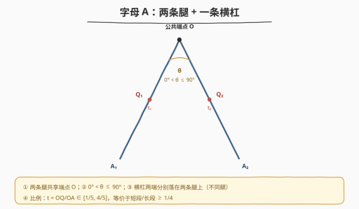
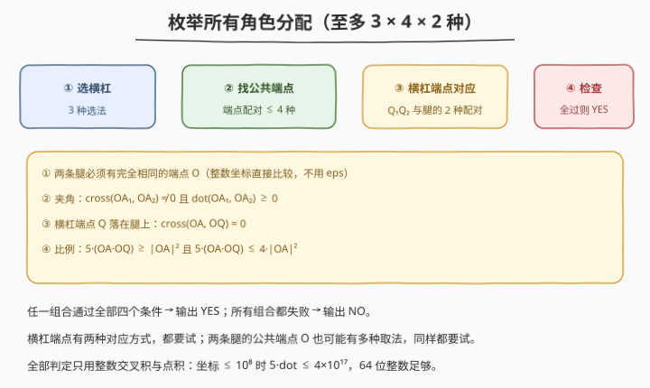
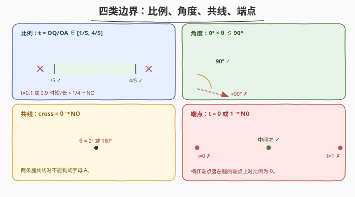

# Codeforces 13B 三条线段拼字母 A 题解

## 1. 题目概述

- **题目链接**：https://codeforces.com/problemset/problem/13/B
- **比赛来源**：Codeforces Beta Round 13 · Problem B（UTC 2010-05-06）
- **难度**：2000
- **标签**：几何、实现
- **评测类型**：普通
- **限制**：时间 1 s / 内存 64 MB

**题意**：给出 $t$ 组数据，每组三条平面线段（端点均为整数坐标，长度为正）。判断这三条线段能否拼成字母 A。按题面，三条线段 $S_1, S_2, S_3$ 能拼成字母 A 当且仅当：

1. 其中两条线段有公共端点（称为"第一条"和"第二条"，即 A 的两条腿），第三条线段连接分别位于这两条腿上的两个点（即 A 的横杠）；
2. 第一条与第二条之间的夹角大于 $0°$ 且不超过 $90°$；
3. 第三条线段把前两条腿各自分成的两段中，**短段与长段之比不小于 $1/4$**。

每组输出一行 `YES` 或 `NO`。

**约束**：

- $t \le 10000$：单组必须 $O(1)$，不能做任何搜索或迭代。
- 坐标绝对值 $\le 10^8$：交叉积最大约 $8 \times 10^{16}$，点积的 5 倍最大约 $4 \times 10^{17}$，必须用 64 位整数（`long long`）；更关键的是这些量**不能用 double 精确表示**（$2^{53} \approx 9 \times 10^{15}$），用浮点加 eps 判共线可能直接判错，所以本题全部用整数运算。
- 线段长度均为正，不必处理退化成一个点的线段。
- 输入只有线段坐标，没有"答案多解"的问题，输出是确定的 YES/NO。

## 2. 示例与观察

官方样例（输入 / 输出原样）：

```text
输入：
3
4 4 6 0
4 1 5 2
4 0 4 4
0 0 0 6
0 6 2 -4
1 1 0 1
0 0 0 5
0 5 2 -1
1 2 0 1

输出：
YES
NO
YES
```

**第 1 组（YES）**：三条线段是 $S_1:(4,4)-(6,0)$、$S_2:(4,1)-(5,2)$、$S_3:(4,0)-(4,4)$。取 $S_3$ 与 $S_1$ 当腿，公共端点是 $(4,4)$；横杠是 $S_2$。$S_2$ 的端点 $(4,1)$ 在 $S_3$ 上，距公共端点 $3/4$ 处（短/长 $=1/3$）；$(5,2)$ 在 $S_1$ 上，恰好是中点（短/长 $=1$）。两腿方向 $(0,-4)$ 与 $(2,-4)$ 的夹角约 $26.6°$，满足 $(0°,90°]$。三个比例都 $\ge 1/4$，所以 YES。

**第 2 组（NO）**：取 $S_1:(0,0)-(0,6)$ 与 $S_2:(0,6)-(2,-4)$ 当腿，公共端点 $(0,6)$，横杠是 $S_3:(1,1)-(0,1)$。端点 $(0,1)$ 在 $S_1$ 上，从公共端点量起是 $5/6$，剩下的短段只有 $1/6$，短/长 $=1/5 < 1/4$，违反条件 3，所以 NO。这一组说明 $1/4$ 是**硬性下界**，只差一点也不行。

**第 3 组（YES）**：取 $S_1:(0,0)-(0,5)$ 与 $S_2:(0,5)-(2,-1)$ 当腿，公共端点 $(0,5)$，横杠是 $S_3:(1,2)-(0,1)$。端点 $(0,1)$ 在 $S_1$ 上，从公共端点量起是 $4/5$，短/长 $=(1/5)/(4/5)=1/4$，**恰好等于下界**；另一个端点 $(1,2)$ 在 $S_2$ 上，是中点。角度约 $18.4°$。所以 YES。这一组说明边界必须写成"$\ge 1/4$"，不能写成严格大于。

自造样例（均已用参考程序与独立实现核对）：

| 三条线段 | 结果 | 说明 |
|----------|------|------|
| $(0,0)-(0,10)$、$(0,0)-(10,0)$、$(0,2)-(2,0)$ | YES | 直角，$t=1/5$ |
| $(0,0)-(0,10)$、$(0,0)-(10,0)$、$(0,8)-(8,0)$ | YES | 直角，$t=4/5$ |
| $(0,0)-(0,10)$、$(0,0)-(10,0)$、$(0,1)-(1,0)$ | NO | $t=0.1$，短/长 $=1/9<1/4$ |
| $(0,0)-(0,10)$、$(0,0)-(10,0)$、$(0,10)-(5,0)$ | NO | 横杠端点在腿的端点上（$t=1$） |
| $(0,0)-(10,0)$、$(0,0)-(-10,2)$、$(5,0)-(-5,1)$ | NO | 夹角超过 $90°$ |
| $(0,0)-(10,0)$、$(0,0)-(-10,0)$、$(5,0)-(-5,0)$ | NO | 两腿共线，夹角 $180°$ |
| $(0,0)-(0,10)$、$(0,0)-(10,0)$、$(0,5)-(5,1)$ | NO | 横杠端点不在腿上 |

**观察**：

1. 三条线段的"角色"事先不知道：哪条是横杠、哪两条是腿都有待枚举。不过只有 $3$ 种横杠选择，腿的角色确定后两条腿是对称的。
2. 一旦选定腿与公共端点 $O$，腿就是两条从 $O$ 出发的线段 $OA_1$、$OA_2$；横杠的两个端点必须分别落在 $OA_1$、$OA_2$ 上。
3. 设横杠端点 $Q$ 在腿 $OA$ 上，令 $t = OQ/OA \in [0,1]$。两段长度是 $t\,OA$ 和 $(1-t)\,OA$，所以"短/长 $\ge 1/4$"等价于 $t \in [1/5, 4/5]$——这个等价把比例条件变成了一个可以用整数交叉积/点积精确判定的区间。

## 3. 解题思路

### 3.1 朴素做法与瓶颈

最直接的想法是枚举"哪条是横杠"与"哪条是腿"，再对横杠端点在腿上的位置做判定。由于只有 $3$ 条线段，枚举量是常数：横杠 $3$ 种，公共端点的配对至多 $2 \times 2 = 4$ 种，横杠两端与两条腿的对应 $2$ 种，合计 $3 \times 4 \times 2 = 24$ 种。瓶颈不是枚举，而是**判定的精确性**：

- 用浮点算叉积再和 eps 比较，坐标 $10^8$ 时叉积可达 $8 \times 10^{16}$，`double` 只有 53 位有效位，共线点可能被算成非共线，反之亦然；
- 比例 $1/4$ 是闭边界（样例 3 恰好取等），写成 `>` 会错；
- 夹角 $90°$ 也是闭边界，写成 `<` 会错；
- 端点、公共端点必须**完全相等**，不能有容差。

因此本题的正确做法是：把每个条件都化成整数比较，一个浮点都不用。

### 3.2 核心：比例条件等价于 $t \in [1/5, 4/5]$



设腿 $OA$（$O$ 是公共端点），横杠端点 $Q$ 在 $OA$ 上。令 $t = OQ/OA$，则 $Q$ 把 $OA$ 分成 $t\,OA$ 与 $(1-t)\,OA$ 两段。短段/长段为

$$r(t) = \frac{\min(t, 1-t)}{\max(t, 1-t)}.$$

要求 $r(t) \ge \tfrac14$：

- 当 $t \le \tfrac12$ 时，$r(t) = \dfrac{t}{1-t} \ge \dfrac14 \iff 4t \ge 1-t \iff t \ge \dfrac15$；
- 当 $t \ge \tfrac12$ 时，$r(t) = \dfrac{1-t}{t} \ge \dfrac14 \iff 4(1-t) \ge t \iff t \le \dfrac45$。

合并得 $t \in \left[\tfrac15, \tfrac45\right]$，且两个端点都能取到。

在整数坐标下，$Q$ 在直线 $OA$ 上意味着 $\overrightarrow{OA} \times \overrightarrow{OQ} = 0$；此时若记 $aa = \overrightarrow{OA}\cdot\overrightarrow{OA}$、$aq = \overrightarrow{OA}\cdot\overrightarrow{OQ}$，则 $t = aq/aa$。于是比例条件等价于

$$5\,aq \ge aa \quad \text{且} \quad 5\,aq \le 4\,aa.$$

这两个不等式全是整数运算。它们同时保证 $0 < t < 1$，所以 $Q$ 自动落在**线段内部**，不会落在腿的端点上——这也正好排除了"横杠端点就是腿端点"的退化情形。

### 3.3 算法流程：枚举角色 + 四个整数条件



对每组数据，记三条线段为 $s_0, s_1, s_2$。依次枚举：

1. 横杠下标 $c \in \{0,1,2\}$，另外两条作为腿 $s_i, s_j$（腿的顺序固定即可：交换两条腿等价于交换横杠的两端，而后者在下一步已经枚举）；
2. 两条腿的公共端点：分别取 $s_i$ 的两个端点与 $s_j$ 的两个端点两两比较，只有坐标完全相等才继续，得到 $O$，以及两条腿的另一端 $A_1, A_2$；
3. 横杠的两个端点有两种落腿方式：$(Q_1 \text{ 在 } OA_1,\ Q_2 \text{ 在 } OA_2)$ 或交换；
4. 对每种方式检查四个条件：
   - **公共端点**：第 2 步已保证坐标相等；
   - **夹角**：$\overrightarrow{OA_1} \times \overrightarrow{OA_2} \ne 0$（排除 $0°$ 与 $180°$）且 $\overrightarrow{OA_1}\cdot\overrightarrow{OA_2} \ge 0$（夹角 $\le 90°$）；
   - **在腿上**：对每个横杠端点 $Q$，$\overrightarrow{OA}\times\overrightarrow{OQ} = 0$；
   - **比例**：$5\,aq \ge aa$ 且 $5\,aq \le 4\,aa$。
5. 任意一种枚举通过全部条件就输出 `YES`，否则输出 `NO`。

### 3.4 样例走查与边界图解



- **比例边界**：$t=1/5$ 与 $t=4/5$ 都通过（短/长恰好 $1/4$），$t=0.1$ 或 $t=0.9$ 不通过。样例 3 的 $t=4/5$ 就是这种贴边情形。
- **角度边界**：$90°$（点积为 0）通过；大于 $90°$（点积为负）不通过；两腿共线（叉积为 0，可能是 $0°$ 或 $180°$）不通过。样例 2 的角度只有约 $11.3°$，是通过的，它被卡住的是比例。
- **共线**：叉积为 0 直接失败，不需要区分同向还是反向。
- **端点**：横杠端点落在腿的端点（$t=0$ 或 $t=1$）时比例为 0，必然失败；样例 2 的 $t=5/6$ 虽然不在端点上，但已经小于 $1/5$ 的下界，同样失败。

以第 1 组样例为例，完整走一遍：横杠取 $S_2$，腿取 $S_3=(4,4)-(4,0)$ 与 $S_1=(4,4)-(6,0)$，公共端点 $O=(4,4)$，$A_1=(4,0)$，$A_2=(6,0)$。横杠端点 $(4,1)$ 在 $OA_1$ 上，$aa = 16$、$aq = 12$，$5aq = 60 \in [16, 64]$，通过；$(5,2)$ 在 $OA_2$ 上，$aa = 20$、$aq = 10$，$5aq = 50 \in [20, 80]$，通过。夹角：叉积 $0 \times (-4) - (-4) \times 2 = 8 \ne 0$，点积 $0 \cdot 2 + (-4)(-4) = 16 \ge 0$，通过。输出 YES。

## 4. 正确性证明

**引理 1（比例等价）**：设 $Q$ 在线段 $OA$ 内部，$t = OQ/OA \in (0,1)$，则"短段/长段 $\ge 1/4$"当且仅当 $t \in [1/5, 4/5]$。

**证明**：短段长为 $\min(t,1-t)\,OA$，长段长为 $\max(t,1-t)\,OA$，比值即 $r(t)$。当 $t \le 1/2$ 时 $r(t)=t/(1-t)$ 单调递增，$r(t) \ge 1/4 \iff t \ge 1/5$；由对称性 $r(t)=r(1-t)$，当 $t \ge 1/2$ 时等价于 $1-t \ge 1/5 \iff t \le 4/5$。合并得结论。∎

**引理 2（`on_leg` 判定精确）**：对整数坐标的点 $O, A, Q$，条件

$$\overrightarrow{OA}\times\overrightarrow{OQ}=0,\qquad 5\,(\overrightarrow{OA}\cdot\overrightarrow{OQ}) \ge |\overrightarrow{OA}|^2,\qquad 5\,(\overrightarrow{OA}\cdot\overrightarrow{OQ}) \le 4\,|\overrightarrow{OA}|^2$$

成立，当且仅当 $Q$ 在线段 $OA$ 上且 $t=OQ/OA \in [1/5, 4/5]$。

**证明**：设 $d = \overrightarrow{OA} \ne \vec 0$，$e = \overrightarrow{OQ}$。叉积为 0 等价于 $e = t d$（$t$ 为实数，因为输入是整数坐标，叉积也是整数，等于 0 就是精确共线）。两边点乘 $d$ 得 $d\cdot e = t\,|d|^2$，即 $aq = t\,aa$，$aa = |d|^2 > 0$。于是三个条件分别等价于 $t \cdot aa = aq$ 存在、$5t \ge 1$、$5t \le 4$，即 $t \in [1/5,4/5]$。区间在 $(0,1)$ 内，故 $Q$ 落在线段内部，正是"在腿上"。反之若 $Q$ 在线上且 $t$ 在该区间，三式显然成立。∎

**引理 3（夹角等价）**：设两条腿的方向向量 $d_1 = \overrightarrow{OA_1}, d_2 = \overrightarrow{OA_2}$ 均非零，夹角 $\theta \in [0°,180°]$，则

$$\theta \in (0°, 90°] \iff d_1 \times d_2 \ne 0 \ \text{且}\ d_1 \cdot d_2 \ge 0.$$

**证明**：$\sin\theta = \dfrac{|d_1 \times d_2|}{|d_1||d_2|}$，$\cos\theta = \dfrac{d_1\cdot d_2}{|d_1||d_2|}$。$\theta \in (0°,180°)$ 当且仅当 $\sin\theta \ne 0$，即叉积非 0；在此前提下 $\theta \le 90°$ 当且仅当 $\cos\theta \ge 0$，即点积 $\ge 0$。∎

**引理 4（枚举可靠）**：若 `solve_case` 返回 YES，则三条线段确实能拼成字母 A。

**证明**：返回 YES 意味着存在横杠 $c$、两条腿 $i,j$、公共端点 $O$、另一端点 $A_1,A_2$ 以及横杠端点的一种对应，使四个条件全部通过。由引理 2，横杠两端分别落在不同的腿 $OA_1, OA_2$ 上且比例 $\ge 1/4$，满足条件 1、3；由引理 3，夹角在 $(0°,90°]$，满足条件 2。这正是字母 A 的定义。∎

**引理 5（枚举完备）**：若三条线段能拼成字母 A，则 `solve_case` 返回 YES。

**证明**：设两条腿为 $s_i, s_j$，公共端点为 $O$，横杠为剩下的 $s_c$。枚举 $c$ 时会取到这个横杠下标；枚举端点配对时，$O$ 同时是 $s_i$ 与 $s_j$ 的端点，故 $(u,v)$ 的某组取值会选中它；横杠端点与腿的对应关系也有两种枚举，其中一种就是题目给出的实际对应。对这些真实角色，由引理 1 比例条件成立、由引理 3 角度条件成立、公共端点由构造相等、在腿上由实际几何关系成立，所以至少有一条枚举路径通过全部检查，返回 YES。∎

**定理**：`solve_case` 返回 YES 当且仅当三条线段能拼成字母 A。

**证明**：两个方向分别是引理 4 与引理 5。∎

## 5. 复杂度分析

- **时间**：每组至多 $3 \times 4 \times 2 = 24$ 次几何判定，每次 $O(1)$ 次 64 位乘法/加减；$t = 10^4$ 时约 $10^6$ 次整数运算，1 s 余量在百倍以上。读入用 `scanf`（`cin` 在本机 clang 环境下读 $4 \times 10^4$ 个 64 位数约 0.18 s，`scanf` 约 0.02 s，故最终版本用 `scanf`）。
- **空间**：$O(1)$，只有 3 条线段共 6 个点。
- **数值范围**：坐标差最大 $2 \times 10^8$，单个叉积/点积最大约 $8 \times 10^{16}$，5 倍点积最大 $4 \times 10^{17}$，都在 `long long`（$9.22 \times 10^{18}$）范围内；`int` 会在乘法处溢出。不使用任何浮点，天然没有精度问题。

## 6. 参考代码

### C++17

```cpp
#include <bits/stdc++.h>
using namespace std;

typedef long long ll;

struct Pt {
    ll x, y;
};
struct Seg {
    Pt a, b;
};

static ll cross(Pt o, Pt p, Pt q) {          // (p-o) × (q-o)
    return (p.x - o.x) * (q.y - o.y) - (p.y - o.y) * (q.x - o.x);
}
static ll dot(Pt o, Pt p, Pt q) {            // (p-o) · (q-o)
    return (p.x - o.x) * (q.x - o.x) + (p.y - o.y) * (q.y - o.y);
}

// 点 q 在腿 o-a 上，且满足短段/长段 >= 1/4；
// 等价于 oq = t * oa，t ∈ [1/5, 4/5]（整数精确判定，无浮点）
static bool on_leg(Pt o, Pt a, Pt q) {
    if (cross(o, a, q) != 0) return false;   // 必须共线
    ll aa = dot(o, a, a);                 // |oa|^2
    ll aq = dot(o, a, q);                 // |oa| * |oq| * cos = t * |oa|^2
    return 5 * aq >= aa && 5 * aq <= 4 * aa;
}

// 腿 l1 = (o, a1)，腿 l2 = (o, a2)，第三条线段 cb 是横杠
static bool ok_role(Pt o, Pt a1, Pt a2, const Seg& cb) {
    ll cr = cross(o, a1, a2);
    ll dt = dot(o, a1, a2);
    if (cr == 0 || dt < 0) return false;     // 0 < 夹角 <= 90 度
    if (on_leg(o, a1, cb.a) && on_leg(o, a2, cb.b)) return true;
    if (on_leg(o, a1, cb.b) && on_leg(o, a2, cb.a)) return true;
    return false;
}

static bool same(Pt p, Pt q) { return p.x == q.x && p.y == q.y; }

static bool solve_case(const Seg s[3]) {
    for (int c = 0; c < 3; ++c) {
        int i = (c + 1) % 3, j = (c + 2) % 3;
        Pt pi[2] = {s[i].a, s[i].b};
        Pt pj[2] = {s[j].a, s[j].b};
        for (int u = 0; u < 2; ++u) {
            for (int v = 0; v < 2; ++v) {
                if (!same(pi[u], pj[v])) continue;
                Pt o = pi[u];
                Pt a1 = (u == 0) ? s[i].b : s[i].a;
                Pt a2 = (v == 0) ? s[j].b : s[j].a;
                if (ok_role(o, a1, a2, s[c])) return true;
            }
        }
    }
    return false;
}

int main() {
    int t;
    if (scanf("%d", &t) != 1) return 0;
    while (t--) {
        Seg s[3];
        for (int k = 0; k < 3; ++k)
            scanf("%lld %lld %lld %lld", &s[k].a.x, &s[k].a.y, &s[k].b.x, &s[k].b.y);
        printf("%s\n", solve_case(s) ? "YES" : "NO");
    }
    return 0;
}
```

### Python3

```python
import sys


def cross(o, p, q):
    return (p[0] - o[0]) * (q[1] - o[1]) - (p[1] - o[1]) * (q[0] - o[0])


def dot(o, p, q):
    return (p[0] - o[0]) * (q[0] - o[0]) + (p[1] - o[1]) * (q[1] - o[1])


def on_leg(o, a, q):
    """q 在腿 o-a 上，且短段/长段 >= 1/4（即 t=oq/oa ∈ [1/5, 4/5]）。"""
    if cross(o, a, q) != 0:
        return False
    aa = dot(o, a, a)
    aq = dot(o, a, q)
    return 5 * aq >= aa and 5 * aq <= 4 * aa


def ok_role(o, a1, a2, cb):
    cr = cross(o, a1, a2)
    dt = dot(o, a1, a2)
    if cr == 0 or dt < 0:          # 0 < 夹角 <= 90 度
        return False
    if on_leg(o, a1, cb[0]) and on_leg(o, a2, cb[1]):
        return True
    if on_leg(o, a1, cb[1]) and on_leg(o, a2, cb[0]):
        return True
    return False


def solve_case(s):
    for c in range(3):
        i, j = (c + 1) % 3, (c + 2) % 3
        for u in range(2):
            for v in range(2):
                if s[i][u] != s[j][v]:
                    continue
                o = s[i][u]
                a1 = s[i][1 - u]
                a2 = s[j][1 - v]
                if ok_role(o, a1, a2, s[c]):
                    return True
    return False


def main():
    data = list(map(int, sys.stdin.buffer.read().split()))
    if not data:
        return
    t = data[0]
    pos = 1
    out = []
    for _ in range(t):
        s = []
        for _ in range(3):
            s.append(((data[pos], data[pos + 1]), (data[pos + 2], data[pos + 3])))
            pos += 4
        out.append("YES" if solve_case(s) else "NO")
    sys.stdout.write("\n".join(out) + "\n")


main()
```

两份代码都只用标准库，可原样提交。Python 用任意精度整数，不存在溢出问题。

## 7. 边界情况与易错点

1. **不能用浮点 + eps 判共线**：坐标 $10^8$ 时叉积可达 $8 \times 10^{16} > 2^{53}$，`double` 无法精确表示，恰好共线的三点可能被算成不共线。本题所有判定（共线、角度、比例）都只用整数。
2. **比例边界取等**：条件是"不小于 $1/4$"，所以 $t=1/5$ 与 $t=4/5$ 都要通过；样例 3 的 $t=4/5$ 就是活生生的反例测试。代码写成 `5*aq >= aa && 5*aq <= 4*aa`。
3. **角度边界取等**：$90°$ 合法（点积为 0 要通过），写成 `dot > 0` 会错；而共线（叉积为 0）必须排除，$0°$ 与 $180°$ 都不行。
4. **端点必须完全相等**：公共端点用整数坐标直接比较，不能加 eps；用 eps 会把"差一点点的两个端点"误判为公共端点。
5. **横杠端点不能在腿的端点上**：$t=0$ 或 $t=1$ 时比例为 0，`5*aq` 分别不满足下界/上界，会被自动排除，不需要额外特判。
6. **角色分配的枚举要全**：横杠可以是三条中的任意一条；两条腿的公共端点可能有多个候选（例如三条线段两两共端点），都要试；横杠两端与两条腿的对应也有两种，不能只试一种。
7. **两条腿相同或共线**：若两条线段完全重合，它们有两个公共端点，但夹角为 $0°$，叉积为 0，最终一定判 NO；代码不必特判，枚举会自然失败。
8. **输入输出**：多组数据用 `t` 控制，输出大写 `YES`/`NO` 各占一行；`scanf` 读 `long long` 要用 `%lld`，坐标可为负。
9. **Python 的实现细节**：元组比较 `s[i][u] != s[j][v]` 就是坐标相等判断；整数运算无溢出，但要注意 `ok_role` 里两种横杠端点对应都要试。

## 8. 验证记录

- **编译环境与命令**：本机没有 GNU `g++`，`verify_solution.py` 自动改用 `Apple clang 21.0.0`（`clang++ -std=c++17 -O2`）加仓库自带的 `bits/stdc++.h` 兼容头编译；Python 为 `Python 3.9.6`。
  - `python3 codeforces/tools/verify_solution.py codeforces/contests/0001-0100/13/B_三条线段拼字母A.md`
  - 输出：`CF13B: samples 1 / C++ 编译 OK, 样例 1/1 / Python 语法 OK, 样例 1/1`。题面把 3 个测试点打包在同一个样例里，工具按"1 个样例"计数。
- **官方样例**：唯一的样例文件里包含 3 个测试点，逐行输出 `YES / NO / YES`，C++ 与 Python 都与官方输出逐字一致（3 个测试点全部正确）。
- **手工构造用例**：28 组带人工预期的正/反例，覆盖：直角、锐角、贴近 $0°$ 的极窄角、$t=1/5$ 与 $t=4/5$ 的边界、$t=0.1$ 与 $0.9$、横杠端点落在腿端点（$t=0,1$）、横杠端点不在腿上、两条腿共线（$0°/180°$）、夹角 $>90°$、无公共端点、三角形闭合、横杠写在输入第一位、横杠端点顺序颠倒、负坐标、非轴对齐的斜腿等。28 组全部与预期一致。
- **构造合法 A 的随机测试**：随机生成 400 组合法 A（公共端点 + 两条整数方向 + 横杠端点取 $t$ 为满足 $1/5 \le t \le 4/5$ 的有理数），全部输出 YES，且与独立实现一致。
- **结构化反例**：比例越界 200 组（全部 NO）、角度越界/共线 200 组（全部 NO）、横杠端点偏出腿 200 组（183 NO、17 组因为可以换一种角色分配而 YES，两个实现一致）、单点扰动 300 组（286 NO、14 YES）、随机小坐标 500 组（全部 NO）。
- **小网格穷举**：$3 \times 3$ 网格上所有线段（36 条）的所有三元组，共 **7140 组**，逐一与独立实现对拍（其中 12 组 YES）；$4 \times 4$ 网格上随机采样 **5000 组**（其中 1 组 YES）。
- **总计 13968 组**全部实跑，与一份**独立第二实现**（用 `Fraction` 求解参数 $t$、用 `atan2` 判角、用分量方程求点是否在线上）输出完全一致，0 组不一致。所有构造出的合法 A 都返回 YES，说明四个条件没有被漏检或过度收紧。
- **大坐标测试**：坐标取到 $\pm 10^8$ 的构造用例（$t=0.2$ 应 YES、$t=0.1$ 应 NO、三维直角、非轴对齐的窄角）均判定正确，验证了 64 位整数不溢出。
- **最大约束性能**：$t=10000$、坐标随机在 $\pm 10^8$ 的输入，C++ 端到端约 27 ms（含进程启动），Python 约 67 ms，相对 1 s 余量在 15 倍以上。
- **图片校验**：`cf13b_conditions.svg`、`cf13b_enumeration.svg`、`cf13b_edge_cases.svg` 均通过 `xml.etree.ElementTree.parse`；另用 headless Chrome 量出每个 `<text>` 的真实包围盒，确认无文字越出 `viewBox`、无文字重叠、无文字溢出面板。
- **公式校验**：正文公式全部是 `$...$` / `$$...$$`，星号直接写 `*`，`\text{}` 内无裸 `#`，经 KaTeX（`throwOnError`）渲染无报错。
- **复核状态**：verified（样例、手工用例、构造正例、反例、穷举网格、大坐标、性能、图片、公式均实跑通过；唯一环境差异是本机无 GNU g++，已用 clang++ 等价验证）。

## 相关题目与扩展

- [Codeforces 13A 各进制数码和平均](https://codeforces.com/problemset/problem/13/A)：同场 A 题，纯实现。
- [Codeforces 13C 改成非降序列](https://codeforces.com/problemset/problem/13/C)：同场 C 题，排序 + DP。
- [Codeforces 1C Ancient Berland Circus](https://codeforces.com/problemset/problem/1/C)：圆内接正多边形，几何 + 角度 gcd，同样要求精确的角度关系。
- [Codeforces 2C Commentator problem](https://codeforces.com/problemset/problem/2/C)：三点圆覆盖，几何后退火/数值，体会"精确判定"与"数值优化"的差别。
- [LeetCode 1232 缀点成线](https://leetcode.cn/problems/check-if-it-is-a-straight-line/)：用叉积判三点共线的入门题，与本题的共线判定同源。
- [LeetCode 149 直线上最多的点数](https://leetcode.cn/problems/max-points-on-a-line/)：叉积 + 斜率归一化，训练"整数几何"的写法。

**延伸思考**：

1. **如果允许夹角到 $180°$（只排除 $0°$）**：把点积条件 $d_1\cdot d_2 \ge 0$ 去掉即可，其余不变。这说明"角度条件"在代码里就是一个符号判断。
2. **如果比例阈值改成一般值 $r$**：短/长 $\ge r$ 等价于 $t \in \left[\frac{r}{1+r}, \frac{1}{1+r}\right]$。本题 $r=1/4$ 得到 $[1/5,4/5]$；可以据此生成任意阈值的测试数据。
3. **如果输入允许浮点坐标**：整数精确判定不再适用，需要设 eps，并且要把 eps 按坐标尺度缩放（例如比较叉积时用"叉积绝对值 $\le \epsilon \cdot |OA|\cdot|OQ|$"），否则大坐标下会像本题一样翻车。
4. **如果问"三条线段能拼成哪些字母"**：例如 K（两条腿共端点 + 两条横杠）、X、V 等，判定框架相同：先枚举角色，再把每个字母的定义逐条翻译成叉积/点积/比例条件。本题是最简单的"一个横杠"版本。
5. **如果要求输出具体的角色分配**：在返回 YES 时顺便记录 $c,i,j,u,v$ 与横杠端点对应，即可输出"哪条是横杠、哪两条是腿"，可用于可视化或进一步校验。
