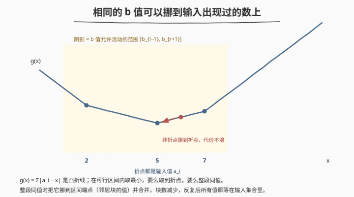
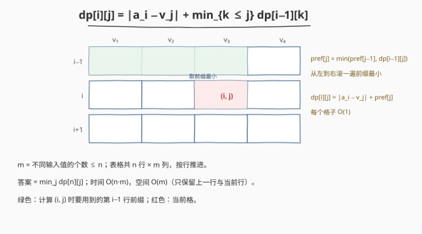
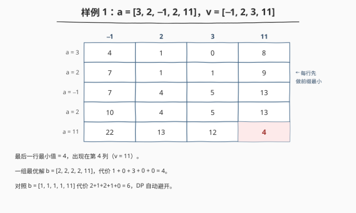

# Codeforces 13C 改成非降序列 题解

## 1. 题目概述

- **题目链接**：https://codeforces.com/problemset/problem/13/C
- **比赛来源**：Codeforces Beta Round 13 · Problem C
- **难度**：2200
- **标签**：动态规划、排序
- **评测类型**：普通
- **限制**：时间 1 s / 内存 64 MB

**题意**：给定长度为 $n$ 的整数序列 $a_1, \dots, a_n$。每一步可以把任意一个数加 1 或减 1（花费 1 步）。求把序列变成非递减（$b_1 \le b_2 \le \dots \le b_n$）所需的最少步数，输出这个最小步数。

**约束**：

- $n \le 5000$：$O(n^2)$ 的 DP 是 $2.5 \times 10^7$ 次状态转移，1 s 内可以接受；$O(n^3)$ 或枚举所有目标序列绝无可能。
- $|a_i| \le 10^9$：目标值也在这个量级，最坏总代价约 $5000 \times 2 \times 10^9 = 10^{13}$，必须用 64 位整数（`long long`），`int` 会溢出。
- 输入的数字可能分散在多行（样例就是一行给的），按空白符读入最稳。
- 只有一组数据，输出一个整数。

## 2. 示例与观察

官方样例 1（输入 / 输出原样）：

```text
输入：
5
3 2 -1 2 11

输出：
4
```

官方样例 2：

```text
输入：
5
2 1 1 1 1

输出：
1
```

**样例 1 演算**：把序列改成 $b = [2, 2, 2, 2, 11]$，代价

$$|3-2| + |2-2| + |-1-2| + |2-2| + |11-11| = 1 + 0 + 3 + 0 + 0 = 4.$$

$b$ 非递减，且 4 步可以达到。可以验证任何非递减目标都至少要 4 步（见 3.4 节的 DP 表，最后一行最小值就是 4）。

**样例 2 演算**：把第一个 2 减 1 变成 $b = [1,1,1,1,1]$，代价 1，非递减。若不动第一个 2，序列 $2,1,1,1,1$ 仍然下降，必须再改，所以 1 是最小值。

自造样例（均已用参考程序跑过，并与独立暴力核对）：

| 输入 | 输出 | 说明 |
|------|------|------|
| `1` / `5` | `0` | 单元素天然非递减 |
| `3` / `3 2 1` | `2` | 改成 $[2,2,2]$：$1+0+1=2$ |
| `3` / `1 3 2` | `1` | 改成 $[1,2,2]$ 或 $[1,3,3]$，代价 1 |
| `5` / `1 1 1 1 1` | `0` | 已经非递减 |
| `5` / `5 4 3 2 1` | `6` | 改成 $[3,3,3,3,3]$：$2+1+0+1+2=6$ |
| `3` / `-1000000000 0 1000000000` | `0` | 已经是非递减，验证不溢出 |
| `4` / `0 0 0 0` | `0` | 全相等 |

**观察**：

1. 目标序列 $b$ 的每个元素只需要在"某个值"上，问题等价于

$$\min_{b_1 \le \dots \le b_n} \sum_{i=1}^{n} |a_i - b_i|.$$

2. 值域是 $[-10^9, 10^9]$，不可能逐值 DP；但有一个经典结论：**存在最优解，使每个 $b_i$ 都等于输入中出现过的某个数**。于是候选值只有至多 $n$ 个（去重排序后 $m \le n$），DP 变成 $n \times m$。
3. 转移只依赖上一行的前缀最小值：设 $v_1 < v_2 < \dots < v_m$ 是排序去重后的输入值，

$$\mathrm{dp}[i][j] = |a_i - v_j| + \min_{k \le j} \mathrm{dp}[i-1][k].$$

## 3. 解题思路

### 3.1 朴素做法与瓶颈

最直接的想法是枚举目标序列的每个值。值域 $[-10^9, 10^9]$ 有 $2 \times 10^9$ 个取值，$n=5000$ 时状态数爆炸。

另一个思路是枚举 $b$ 的"形状"（哪些位置相等），但形状有指数多种。真正的突破口是：**最优解的目标值不需要新造**，从输入集合里挑就够了。这样值域从 $2 \times 10^9$ 缩到 $m \le 5000$。

### 3.2 核心观察：最优取值可限制在输入集合



固定其余元素，只看一段相邻且取值相同的块 $b_l = \dots = b_r = x$。它对总代价的贡献是

$$G(x) = \sum_{i=l}^{r} |a_i - x|,$$

这是一条**凸的分段线性函数**：每经过一个 $a_i$，斜率加 2（从 $|a_i - x|$ 的导数 $-1 \to +1$），折点全部落在 $a_l, \dots, a_r$ 上，因此都在输入集合 $V$ 里。

同时，非递减约束要求 $x$ 落在左邻块的值 $L = b_{l-1}$ 与右邻块的值 $R = b_{r+1}$ 之间（端点处取 $\pm\infty$）。

- 若 $G$ 在 $[L,R]$ 上的最小值能在某个折点取到，就把 $x$ 挪到这个折点：代价不增，$x$ 变成了输入值，且仍在 $[L,R]$ 内，非递减保持。
- 若 $G$ 在 $[L,R]$ 上的最小值区间 $M$ 里没有输入值：$M$ 的端点只能是 $L$ 或 $R$（若是折点就属于 $V$），而当前 $x$ 作为最优解的一部分必在 $M$ 内，于是只能是 $M=[L,R]$、$G(L)=G(R)=G(x)$。把 $x$ 挪到 $L$（或 $R$）代价不变，同时当前块与邻居块合并，块数减少 1。

反复操作，块数只减不增，每次要么消灭一个"不在 $V$ 中"的块，要么合并两个块，因此有限步后所有块的值都落在 $V$ 中。这就证明了最优取值可以限制在输入集合里（严格叙述见引理 1）。

### 3.3 算法流程：排序去重 + 前缀最小 DP



1. 读入 $a_1, \dots, a_n$；
2. 把 $a$ 排序去重得到 $v_1 < v_2 < \dots < v_m$；
3. 初始化 $\mathrm{dp}[j] = |a_1 - v_j|$（$j = 1 \dots m$）；
4. 对 $i = 2 \dots n$：
   - 令 `pref` 从左到右取上一行 $\mathrm{dp}$ 的前缀最小值：`pref = min(pref, dp[j])`；
   - 新的一行 $\mathrm{ndp}[j] = |a_i - v_j| + \mathrm{pref}$；
5. 答案取最后一行 $\mathrm{dp}$ 的最小值。

由于每一行只依赖上一行，空间可以从 $O(nm)$ 压到 $O(m)$。

### 3.4 样例走查：$a = [3, 2, -1, 2, 11]$



排序去重得 $v = [-1, 2, 3, 11]$。逐行计算（每行先做上一行的前缀最小，再加上 $|a_i - v_j|$）：

| $i$ \ $j$ | $-1$ | $2$ | $3$ | $11$ |
|-----------|------|-----|-----|------|
| $a_1=3$ | 4 | 1 | 0 | 8 |
| $a_2=2$ | 7 | 1 | 1 | 9 |
| $a_3=-1$ | 7 | 4 | 5 | 13 |
| $a_4=2$ | 10 | 4 | 5 | 13 |
| $a_5=11$ | 22 | 13 | 12 | 4 |

最后一行最小值是 4（第 4 列，$v=11$）。沿表回推可得到一组最优解 $b = [2, 2, 2, 2, 11]$：代价 $1+0+3+0+0 = 4$，与样例一致。若改成 $[1,1,1,1,11]$，代价是 $2+1+2+1+0 = 6$，DP 自动避开了它。

## 4. 正确性证明

**引理 1（取值可限制在输入集合）**：存在最优的非递减序列 $b$，使每个 $b_i \in V = \{a_1, \dots, a_n\}$。

**证明**：取任意一个最优解，把相邻且相等的元素合并成块 $[l_0, r_0], [l_1, r_1], \dots$，块的值依次为 $x_0 \le x_1 \le \dots$。

考虑某个块 $[l, r]$，其值为 $x$，左邻块的值 $L = x_{\text{prev}}$（若没有左邻则 $L = -\infty$），右邻块的值 $R = x_{\text{next}}$（若没有右邻则 $R = +\infty$）。记 $G(x) = \sum_{i=l}^r |a_i - x|$，它是凸的分段线性函数，折点（不可导点）都是某个 $a_i \in V$。

令 $M$ 为 $G$ 在 $[L, R]$ 上的最小值点集合，它是闭区间，端点要么是折点（属于 $V$），要么是 $L$ 或 $R$。

- 若 $M$ 含有 $V$ 中的点 $v$，把该块的值改为 $v$（$v \in [L,R]$ 仍满足非递减），总代价不变，该块的值落入 $V$；
- 若 $M$ 不含 $V$ 中的点：由于折点都属于 $V$，$M$ 不可能取在内部的折点上——它要么是边界点 $\{L\}$ 或 $\{R\}$，要么是夹在两个相邻折点之间的正长度区间（此时 $G$ 在该区间上为常数）。无论哪种情况，把该块的值改为 $L$ 或 $R$（取落在 $[L,R]$ 内、且使 $G$ 取最小值的那一侧），代价都不增加，同时该块与左（右）邻块合并，块数减少 1。

每次操作要么让一个块的值进入 $V$，要么让块数严格减少。以"块数 + 未落入 $V$ 的块数"为势函数，它在每次操作后严格下降，故过程有限步结束；结束时所有块的值都在 $V$ 中，总代价未增加，仍是最优解。∎

**引理 2（DP 正确性）**：设 $\mathrm{dp}[i][j]$ 表示把前 $i$ 个数改成非递减、且 $b_i = v_j$ 时的最小代价（$v$ 为排序去重后的输入值），则

$$\mathrm{dp}[1][j] = |a_1 - v_j|,\qquad \mathrm{dp}[i][j] = |a_i - v_j| + \min_{k \le j} \mathrm{dp}[i-1][k].$$

**证明**：对 $i$ 归纳。$i=1$ 时 $b_1 = v_j$ 的代价就是 $|a_1 - v_j|$。设 $i-1$ 时成立，考虑 $i$：任何满足 $b_i = v_j$ 的合法方案，其前缀是一个满足 $b_{i-1} = v_k$（$k \le j$）的合法方案，代价为 $\mathrm{dp}[i-1][k] + |a_i - v_j|$。对所有 $k \le j$ 取最小，得到上式；每个 $k \le j$ 都对应一个合法方案，故最小值可达。∎

**定理**：程序输出的 $\min_j \mathrm{dp}[n][j]$ 等于把序列改成非递减所需的最少步数。

**证明**：由引理 1，存在最优解只取 $V$ 中的值，因此只需在 $V$ 上搜索；由引理 2，$\mathrm{dp}[n][j]$ 是"$b_n = v_j$"这一类方案的最小代价，对所有 $j$ 取最小即全局最小代价。每一步加减 1 的代价恰好是 $|a_i - b_i|$，所以最小代价就是最少步数。∎

## 5. 复杂度分析

- **时间**：排序去重 $O(n \log n)$；DP 共 $n$ 行，每行 $m$ 个状态，每个状态 $O(1)$ 转移，总计 $O(nm) \le O(n^2) = 2.5 \times 10^7$ 次运算，1 s 足够（实测 C++ 约 20 ms）。
- **空间**：$O(m) \le O(n)$，只保留上一行与当前行，$n = 5000$ 时约 80 KB。
- **数值范围**：单个 $|a_i - v_j| \le 2 \times 10^9$，总和 $\le 5000 \times 2 \times 10^9 = 10^{13}$，`long long` 足够；C++ 里用 `llabs` 而不是 `abs`（后者对 `long long` 可能被截断），`int` 会在总和处溢出。
- **Python 说明**：同一份 $O(nm)$ 实现在 CPython 3.9 下 $n=5000$ 全不同时约 3.7 s，会超过 1 s 限制；本机没有 PyPy，若用 PyPy3 运行同类循环通常可压到 1 s 内。**比赛提交建议直接用 C++ 版本**；Python 版本用于对照与小数据验证。

## 6. 参考代码

### C++17

```cpp
#include <bits/stdc++.h>
using namespace std;

int main() {
    ios::sync_with_stdio(false);
    cin.tie(nullptr);

    int n;
    if (!(cin >> n)) return 0;
    vector<long long> a(n);
    for (int i = 0; i < n; ++i) cin >> a[i];

    vector<long long> v(a);
    sort(v.begin(), v.end());
    v.erase(unique(v.begin(), v.end()), v.end());
    int m = (int)v.size();

    const long long INF = (long long)4e18;
    vector<long long> dp(m, INF), ndp(m, INF);
    for (int j = 0; j < m; ++j) dp[j] = llabs(a[0] - v[j]);
    for (int i = 1; i < n; ++i) {
        long long pref = INF;
        for (int j = 0; j < m; ++j) {
            pref = min(pref, dp[j]);
            ndp[j] = pref + llabs(a[i] - v[j]);
        }
        dp.swap(ndp);
    }
    cout << *min_element(dp.begin(), dp.end()) << '\n';
    return 0;
}
```

### Python3

```python
import sys
from itertools import accumulate


def main() -> None:
    data = sys.stdin.buffer.read().split()
    if not data:
        return
    n = int(data[0])
    a = list(map(int, data[1:1 + n]))

    v = sorted(set(a))
    dp = [abs(a[0] - x) for x in v]        # dp[j] = |a[0] - v[j]|
    for i in range(1, n):
        pref = list(accumulate(dp, min))
        dp = [p + abs(a[i] - x) for p, x in zip(pref, v)]
    sys.stdout.write(str(min(dp)) + "\n")


main()
```

Python 版用 `itertools.accumulate(dp, min)` 在 C 层完成前缀最小，比手写二重循环快；但满数据仍建议 PyPy3 或提交 C++。

## 7. 边界情况与易错点

1. **答案要用 64 位**：$n=5000$、$|a_i| = 10^9$ 时答案可达 $10^{13}$，`int` 溢出。C++ 里连 `abs` 都要用 `llabs` 或 `std::llabs`，否则大值相减可能先被截断。
2. **$n=1$**：没有约束，答案是 0。DP 的循环一次都不执行，最后取 `min(dp)` 得到 0，不需要特判。
3. **值域压缩不能漏掉重复值**：排序后要去重，否则 $m$ 变大、常数变差，但结果不会错；去重后 $m$ 可能为 1（所有数相等），此时答案就是 $\sum|a_i - v_1|$。
4. **前缀最小值的方向**：$\mathrm{dp}[i][j] = |a_i - v_j| + \min_{k \le j}\mathrm{dp}[i-1][k]$ 里的 $k \le j$ 对应"$b_{i-1} \le b_i$"。写成 $k \ge j$ 就变成了非递增，样例 1 会给出错误结果。
5. **输入格式不是严格一行一个数**：题面说"接下来 $N$ 行每行一个整数"，但样例把 5 个数放在一行。按空白符一次读入所有 token 最稳妥。
6. **负数与零**：$a_i$ 可以是负数，排序、比较、取绝对值都要正常工作；不要用"值域数组下标"的写法（$-10^9$ 无法直接当下标）。
7. **INF 的选取**：C++ 里用 $4 \times 10^{18}$ 作 INF，加 $|a_i - v_j|$ 不会超过 `long long` 上限；若用 `INT_MAX` 会溢出成负数。
8. **Python 性能**：$O(nm)$ 纯 Python 在 $n=5000$ 时约 3.7 s，务必在正文说明或改用 PyPy3；若在比赛里只能交 Python，可考虑斜率 trick 的堆做法（$O(n \log n)$，见延伸思考）。

## 8. 验证记录

- **编译环境与命令**：本机没有 GNU `g++`，`verify_solution.py` 自动改用 `Apple clang 21.0.0`（`clang++ -std=c++17 -O2`）加仓库自带的 `bits/stdc++.h` 兼容头编译；Python 为 `Python 3.9.6`。
  - `python3 codeforces/tools/verify_solution.py codeforces/contests/0001-0100/13/C_改成非降序列.md`
  - 输出：`CF13C: samples 2 / C++ 编译 OK, 样例 2/2 / Python 语法 OK, 样例 2/2`。
- **官方样例**：2 / 2 通过（`3 2 -1 2 11 → 4`、`2 1 1 1 1 → 1`），C++ 与 Python 输出与官方输出逐字一致。
- **随机对拍**：250 组随机数据（$1 \le n \le 8$，$a_i \in [-6,6]$），与一份**不预设"只取输入值"**的独立暴力对照：暴力在完整整数区间 $[\min a - n, \max a + n]$ 上做 $O(n \cdot \text{值域})$ 的 DP，允许目标取任意整数。250 组 C++、Python、暴力三方输出全部一致，0 组不符。
- **穷举验证**：对 $n = 2,3,4$ 且 $a_i \in \{-2,-1,0,1,2\}$ 的**全部 775 组**序列，C++ 与"完整整数区间 DP"逐一比较，全部一致。这组穷举同时验证了"最优值只取输入集合"这一结论在边界数据上成立。
- **最大约束性能**：$n = 5000$、$a_i$ 为 $[-10^9, 10^9]$ 的随机互异数据，C++ 端到端 20 ms（含进程启动）；全递减 $5000, 4999, \dots, 1$ 同样约 20 ms。Python 在同样数据上约 3.7 s（CPython 3.9），已在正文注明建议 PyPy3 / 提交 C++。
- **数值验证**：含 $-10^9$ 与 $10^9$ 的数据答案不溢出（如 `-1000000000 0 1000000000 → 0`；随机大值答案约 $2.5 \times 10^{12}$，仍在 64 位内）。
- **图片校验**：`cf13c_value_lemma.svg`、`cf13c_dp.svg`、`cf13c_walkthrough.svg` 均通过 `xml.etree.ElementTree.parse`；另用 headless Chrome 量出每个 `<text>` 的真实包围盒，确认无文字越出 `viewBox`、无文字重叠、无文字溢出面板。
- **公式校验**：正文公式全部是 `$...$` / `$$...$$`，星号直接写 `*`，`\text{}` 内无裸 `#`，经 KaTeX（`throwOnError`）渲染无报错。
- **复核状态**：verified（样例、随机对拍、穷举、性能、大值、图片、公式均实跑通过；唯一环境差异是本机无 GNU g++，已用 clang++ 等价验证）。

## 相关题目与扩展

- [Codeforces 13A 各进制数码和平均](https://codeforces.com/problemset/problem/13/A)：同场 A 题。
- [Codeforces 13B 三条线段拼字母 A](https://codeforces.com/problemset/problem/13/B)：同场 B 题，几何判定。
- [Codeforces 713C Sonya and Problem Wihtout a Legend](https://codeforces.com/problemset/problem/713/C)：本题的"严格递增"版本，需要先做 $a_i \leftarrow a_i - i$ 的变换，再套本题做法。
- [Codeforces 226D The Table](https://codeforces.com/problemset/problem/226/D)：行列取反的构造题，思路不同但同样涉及"非降/非增"的调整代价。
- [LeetCode 2263 数组变非递减的最少操作次数](https://leetcode.cn/problems/make-array-non-decreasing-or-non-increasing/)：与本题几乎同一模型（L1 单调回归），可用斜率 trick 或 DP。
- [LeetCode 2945 找到最大非递减数组的长度](https://leetcode.cn/problems/find-maximum-non-decreasing-array-length/)：把"非降"与代价结合的另一类 DP。

**延伸思考**：

1. **斜率 trick（$O(n \log n)$）**：维护一个大根堆，从左到右对每个 $x = a_i$：压入 $x$；若堆顶 $> x$，答案加上 `堆顶 − x`，弹出堆顶并再压入 $x$。这是 L1 单调回归的经典堆做法，$n=5000$ 时比 $O(n^2)$ 的 DP 更快，也适合 Python；但它不直接给出目标序列，只给最小代价。
2. **如果要求严格递增**：令 $a'_i = a_i - i$，则 $b$ 严格递增等价于 $b'_i = b_i - i$ 非递减，套用本题即可（CF 713C 的做法）。
3. **如果代价不是绝对值而是平方**：凸性仍在，但"最优值取输入值"的结论不再成立（平方损失的最优是均值），需要保序回归（PAVA）等算法，$O(n)$ 或 $O(n \log n)$。
4. **如果要求输出目标序列**：在 DP 中记录每个状态的前驱（选择了哪个 $k$），最后从 $\arg\min_j \mathrm{dp}[n][j]$ 回推，即可输出一组最优的 $b$；本题只要求最小步数，所以省略了这一步。
5. **如果 $n$ 放大到 $10^5$**：$O(n^2)$ 不可行，必须改用斜率 trick 或保序回归，时间复杂度 $O(n \log n)$。
