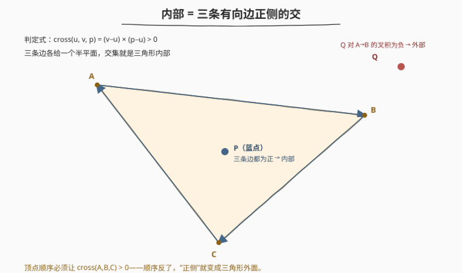
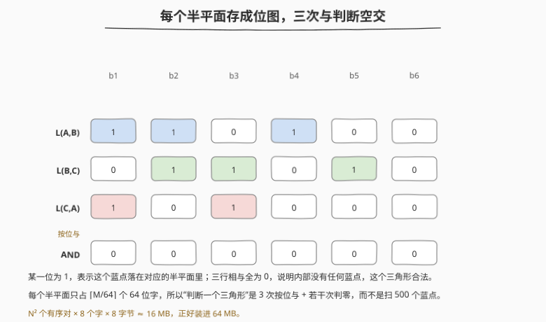
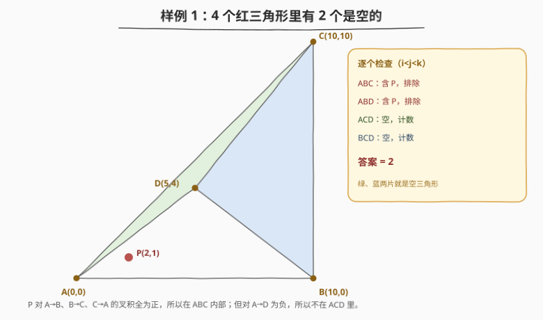

# Codeforces 13D 不含蓝点的三角形 题解

## 1. 题目概述

- **题目链接**：https://codeforces.com/problemset/problem/13/D
- **比赛来源**：Codeforces Beta Round 13 · Problem D（2010-05-06）
- **难度**：2600
- **标签**：动态规划、计算几何（dp, geometry）
- **评测类型**：普通
- **限制**：时间 2 s / 内存 64 MB

**题意**：平面上有 $N$ 个红点和 $M$ 个蓝点，**任意三点不共线**。求有多少个三角形同时满足：

- 三个顶点都是红点；
- 三角形**内部**不含任何蓝点（边上也不可能有点，见约束）。

输出这样的三角形个数。

**约束**：

- $N, M \le 500$：红点三角形一共有 $\binom{500}{3} \approx 2.07 \times 10^7$ 个，"枚举三角形"本身是可行的；不可行的是对每个三角形再扫 $M$ 个蓝点（$10^{10}$ 次）。
- 坐标绝对值 $\le 10^9$：叉积的两个乘积各可达 $4 \times 10^{18}$，相减最大约 $8 \times 10^{18}$，**逼近 `long long` 上限 $9.22 \times 10^{18}$**，必须全程用 64 位整数，且不能有额外的放大（例如再乘一个数）。
- **任意三点不共线**：这条保证有两个用处——(1) 蓝点绝不会落在红三角形的边上，所以"内部"可以用严格不等式判定，不存在"边界算不算"的歧义；(2) 任何红点也不会落在一条红红连线上，叉积不会为 $0$。
- 时间 2 s：$\binom{N}{3}$ 个三角形每个只允许做几十次字运算，因此要把"某个蓝点是否在三角形内"的判定压到 **位并行**（一次处理 64 个蓝点）。
- 答案最大 $\binom{500}{3} \approx 2.07 \times 10^7$，`int` 存得下，但计数过程用 `long long` 更稳妥。

## 2. 示例与观察

官方样例 1（输入 / 输出原样）：

```text
输入：
4 1
0 0
10 0
10 10
5 4
2 1

输出：
2
```

官方样例 2（输入 / 输出原样）：

```text
输入：
5 5
5 10
6 1
8 6
-6 -7
7 -1
5 -1
10 -4
-10 -8
-10 5
-2 -8

输出：
7
```

**样例 1 演算**：红点 $A(0,0)$、$B(10,0)$、$C(10,10)$、$D(5,4)$，蓝点 $P(2,1)$，共 $4$ 个红三角形。

| 三角形 | 逆时针顺序 | $P$ 相对三条有向边的位置 | 结论 |
|--------|------------|--------------------------|------|
| $ABC$ | $A \to B \to C$ | 左、左、左 | 含 $P$ |
| $ABD$ | $A \to B \to D$ | 左、左、左 | 含 $P$ |
| $ACD$ | $A \to D \to C$ | $P$ 在 $A \to D$ 的右侧 | 不含 |
| $BCD$ | $B \to C \to D$ | $P$ 在 $C \to D$ 的右侧 | 不含 |

所以答案是 $2$。注意这里 $P$ 在三角形 $ABC$ 的三条边左侧都成立——它不是"在三条边的某一侧"，而是**同时在三条有向边的左侧**。

**关键观察**：把三角形按逆时针排列后，"蓝点在内部" $\iff$ "蓝点在三条有向边的左侧"，因此内部蓝点集恰是三个**左半平面**的交集。只要把每个左半平面里的蓝点集合用二进制位存起来，判断"交集是否为空"就是几次按位与。

自造样例（标注"自造"，`⏎` 表示换行；均已用参考程序与暴力核对，且都满足"无三点共线"）：

| 输入 | 输出 | 说明 |
|------|------|------|
| `3 0 ⏎ 0 0 ⏎ 1 0 ⏎ 0 1` | `1` | 没有蓝点，唯一的三角形合法 |
| `3 1 ⏎ 0 0 ⏎ 10 0 ⏎ 0 10 ⏎ 1 1` | `0` | 蓝点在三角形内部 |
| `3 1 ⏎ 0 0 ⏎ 10 0 ⏎ 0 10 ⏎ 20 20` | `1` | 蓝点在三角形外部 |
| `4 0 ⏎ 0 0 ⏎ 1 0 ⏎ 0 1 ⏎ 1 1` | `4` | $N=4$、无蓝点，$\binom{4}{3} = 4$ |
| `2 0 ⏎ 0 0 ⏎ 1 1` | `0` | $N < 3$，一个三角形都凑不出 |
| `4 1 ⏎ 0 0 ⏎ 10 0 ⏎ 0 10 ⏎ 10 10 ⏎ 4 5` | `2` | 正方形四角 + 内部偏上的蓝点，恰好含蓝点的两个三角形被排除 |

## 3. 解题思路

### 3.1 朴素做法与瓶颈

最直接的做法是三三重循环枚举红点，再对每个三角形扫一遍蓝点，用叉积判断是否在内部：

$$O\left(\binom{N}{3} \cdot M\right) = 2.07 \times 10^7 \times 500 \approx 10^{10},$$

2 s 内绝无可能。瓶颈非常明确：**同一个蓝点被成千上万个三角形重复判断**。

注意还需要先"定向"：三个顶点 $i, j, k$ 的顺序是任意的，如果按 $i \to j \to k$ 走出来的方向是顺时针，那么"左半平面"就变成了"外部的另一侧"，判定会整体反掉。所以每个三角形都要先用叉积确定它是逆时针还是顺时针（$O(1)$），再选用对应方向的三条边。

### 3.2 核心观察：内部 = 三个左半平面的交集



设三角形的三个顶点按**逆时针**顺序为 $a, b, c$，蓝点为 $p$。则

$$p \text{ 在三角形内部} \iff p \text{ 严格位于 } \overrightarrow{ab}, \overrightarrow{bc}, \overrightarrow{ca} \text{ 三条有向边的左侧}.$$

左侧用叉积判定：$p$ 在 $\overrightarrow{uv}$ 左侧 $\iff (v-u) \times (p-u) > 0$。

于是把"左半平面"离散化：对每一对**有序**红点 $(u, v)$ 定义集合

$$L(u,v) = \{\, b : b \text{ 是蓝点，且 } (v-u)\times(b-u) > 0 \,\},$$

那么三角形 $abc$（逆时针）内部的蓝点集恰为

$$L(a,b) \cap L(b,c) \cap L(c,a).$$

三角形合法 $\iff$ 这个交集为空。



把 $L(u,v)$ 存成一个长度为 $M$ 的二进制位图（`M/64 + 1` 个 64 位字）。$N \le 500$，有序对只有 $N^2 = 250000$ 个，位图总量

$$N^2 \cdot \left\lceil \frac{M}{64} \right\rceil \cdot 8\ \text{B} = 250000 \times 8 \times 8\ \text{B} \approx 16\ \text{MB},$$

正好在 64 MB 之内。构建时对每对 $(i,j)$ 扫一遍蓝点（若 $i \to j$ 叉积为正就置入 $L(i,j)$，否则置入 $L(j,i)$），共 $\binom{N}{2} \cdot M \approx 6.25 \times 10^7$ 次叉积。

判定一个三角形只需 3 个位图按位与，若某个字的结果非零就立刻可以断定"含蓝点"并跳出——平均只需检查一两个字。最坏情况（所有三角形都空）是 $\lceil M/64 \rceil \le 8$ 个字。

### 3.3 算法流程

1. 读入红点与蓝点；若 $N < 3$，直接输出 $0$；
2. 预处理所有有序对的左半平面位图：
   1. 对每对 $i < j$，令 $d = r_j - r_i$；
   2. 对每个蓝点 $b$，计算 $d \times (b - r_i)$：$> 0$ 则把 $b$ 的第 $b$ 位置入 $L(i,j)$，否则置入 $L(j,i)$；
3. 枚举 $0 \le i < j < k < N$：
   1. 计算 $\text{cross}(r_i, r_j, r_k)$：$> 0$ 说明 $i \to j \to k$ 是逆时针，用 $(L(i,j), L(j,k), L(k,i))$；否则用 $(L(i,k), L(k,j), L(j,i))$；
   2. 三个位图逐字相与，只要有一个字非零就说明内部有蓝点，跳过；
   3. 全部为高则答案加一；
4. 输出答案。

第 3 步枚举的是**无序**三元组（$i<j<k$ 各一次），逆时针与顺时针两种情况恰好覆盖所有三角形，且每个三角形只被数一次。

### 3.4 样例走查：样例 1



红点 $A(0,0)$、$B(10,0)$、$C(10,10)$、$D(5,4)$，蓝点 $P(2,1)$，只有一个蓝点，所以位图只有 1 位。

| 三角形 | 方向 | 三个左半平面（是否含 $P$） | 交集 |
|--------|------|----------------------------|------|
| $A \to B \to C$ | 逆时针（叉积 $100$） | 左 $10$ / 左 $80$ / 左 $10$ | 含 $P$，排除 |
| $A \to B \to D$ | 逆时针（叉积 $40$） | 左 $10$ / 左 $27$ / 左 $3$ | 含 $P$，排除 |
| $A \to D \to C$ | 逆时针（$A\to C\to D$ 叉积为 $-10$，故反向） | 右 $-3$ / 左 $3$ / 左 $10$ | 空，计数 |
| $B \to C \to D$ | 逆时针（叉积 $50$） | 左 $80$ / 右 $-3$ / 右 $-27$ | 空，计数 |

具体数字（用 $A \to B \to C \to A$ 的边）：

- $A \to B$：$P-A=(2,1)$，$(10,0)\times(2,1) = 10 > 0$，$P$ 在左侧；
- $B \to C$：$P-B=(-8,1)$，$(0,10)\times(-8,1) = 80 > 0$，左侧；
- $C \to A$：$P-C=(-8,-9)$，$(-10,-10)\times(-8,-9) = 10 > 0$，左侧。

三次都是正，所以 $P$ 在 $ABC$ 内部。表中第三行说明：三角形 $ACD$ 按 $A \to C \to D$ 走是顺时针（叉积 $-10$），必须反过来按 $A \to D \to C$ 取边，此时 $P$ 在 $A \to D$ 的右侧（叉积 $-3$），交集为空。最终答案 $2$，与样例一致。

## 4. 正确性证明

**引理 1（逆时针定向下的内部判定）**：设红点 $a,b,c$ 满足 $\text{cross}(a,b,c) > 0$（即 $a \to b \to c$ 逆时针），点 $p$ 与 $a,b,c$ 均不共线。则 $p$ 严格在三角形 $abc$ 内部，当且仅当 $p$ 同时在 $\overrightarrow{ab}$、$\overrightarrow{bc}$、$\overrightarrow{ca}$ 的严格左侧。

**证明**：三角形内部是三个**闭**左半平面之交的内部，即

$$\text{int}(abc) = \{\, p : \text{cross}(a,b,p) > 0 \ \wedge\ \text{cross}(b,c,p) > 0 \ \wedge\ \text{cross}(c,a,p) > 0 \,\}.$$

（$\subseteq$）设 $p$ 在内部。三角形是凸集，三条边所在直线把平面分成若干区域，内部位于每条边的"左"侧。更具体地，$p$ 可写成 $p = \alpha a + \beta b + \gamma c$，$\alpha,\beta,\gamma > 0$、$\alpha+\beta+\gamma=1$。计算

$$\text{cross}(a,b,p) = \alpha\,\text{cross}(a,b,a) + \beta\,\text{cross}(a,b,b) + \gamma\,\text{cross}(a,b,c) = \gamma\,\text{cross}(a,b,c) > 0,$$

同理 $\text{cross}(b,c,p) = \alpha\,\text{cross}(a,b,c) > 0$、$\text{cross}(c,a,p) = \beta\,\text{cross}(a,b,c) > 0$。

（$\supseteq$）设 $p$ 同时满足三个严格不等式。若 $p$ 在三角形外，则存在一条边把 $p$ 与三角形分开：由凸性，过 $p$ 与三角形可作分离直线，而这必然导致 $p$ 落在某条边的右侧（或与某条边共线）。更直接地：三个左半平面之交正是三角形（闭集），$p$ 不在三角形内又在交集中，只能落在边界上，即与某条边共线，这与"无三点共线"矛盾。故 $p$ 在内部。∎

**引理 2（位图恰表示左半平面）**：按算法构造的 $L(u,v)$ 满足：$b \in L(u,v) \iff \text{cross}(u,v,b) > 0$。

**证明**：构造时对每一对 $i<j$ 计算一次 $c = \text{cross}(r_i,r_j,b)$；由于无三点共线，$c \ne 0$。$c > 0$ 时把 $b$ 置入 $L(r_i,r_j)$，$c < 0$ 时置入 $L(r_j,r_i)$，而 $\text{cross}(r_j,r_i,b) = -c > 0$，两种情形都与定义一致。∎

**引理 3（枚举完备且不重）**：每个无序红点三元组 $\{a,b,c\}$ 恰好在 $i<j<k$ 的循环中出现一次，且算法按叉积符号选出的三条有向边就是该三角形的逆时针三条边。

**证明**：$i<j<k$ 的循环遍历所有三元组恰好一次（组合数的定义）。设三点的下标为 $i<j<k$：若 $\text{cross}(r_i,r_j,r_k) > 0$，则 $i \to j \to k$ 本身就是逆时针；否则 $\text{cross}(r_i,r_k,r_j) = -\text{cross}(r_i,r_j,r_k) > 0$，$i \to k \to j$ 是逆时针。两种情况算法都取到了逆时针的三条边。∎

**定理**：算法输出的数值等于"顶点全为红点、内部不含蓝点"的三角形个数。

**证明**：由引理 3，每个红三角形恰好被处理一次，且用的是它的逆时针三条边；由引理 2，三个位图恰好是这三条边的左半平面蓝点集合；按位与的结果是否为全零，等价于三个集合的交是否为空，由引理 1 也就等价于"三角形内部没有蓝点"。因此每处理一个三角形，答案加一当且仅当它合法，总和即为所求。∎

## 5. 复杂度分析

- **时间**：预处理 $\binom{N}{2} \cdot M$ 次叉积，约 $6.25 \times 10^7$ 次（每次是几次整数乘减）；判定阶段共 $\binom{N}{3}$ 个三角形，每个最多 $\lceil M/64 \rceil \le 8$ 次 64 位与运算，最坏约 $1.7 \times 10^8$ 次字运算，但一旦某个字非零就提前跳出，实测远小于这个上界。总计 $O(N^2 M + N^3 \cdot M/64)$。
- **空间**：有序对位图 $N^2 \times \lceil M/64 \rceil$ 个 64 位字，最坏 $500^2 \times 8 = 2 \times 10^6$ 个字，即 $16$ MB；加上坐标数组，实测峰值 $17.7$ MB，在 64 MB 限制内。
- **数值范围**：叉积 $\lvert (b_x-a_x)(c_y-a_y) - (b_y-a_y)(c_x-a_x) \rvert \le 2 \cdot (2 \times 10^9)^2 = 8 \times 10^{18} < 2^{63}-1 \approx 9.22 \times 10^{18}$，`long long` 刚好装得下；`int` 会直接溢出。
- **与时限的关系**：$N = M = 500$ 的三组数据（随机坐标、蓝点全部聚在远处使所有三角形都空、蓝点聚在中心而红点围成圆环）实测 C++ 端到端 $0.25 \sim 0.30$ s，相对 2 s 有 6 倍以上余量。Python 版是同一算法的逐位版本，$N=M=500$ 时约 $17$ s，**满数据建议提交 C++（或 PyPy3）**；小数据（$N \le 80$）Python 在 1 s 内可完成。

## 6. 参考代码

### C++17

```cpp
#include <bits/stdc++.h>
using namespace std;

struct Pt {
    long long x, y;
};

// (b-a) x (c-a)
static inline long long cross(const Pt &a, const Pt &b, const Pt &c) {
    return (b.x - a.x) * (c.y - a.y) - (b.y - a.y) * (c.x - a.x);
}

int main() {
    ios::sync_with_stdio(false);
    cin.tie(nullptr);

    int n, m;
    if (!(cin >> n >> m)) return 0;
    vector<Pt> red(n), blue(m);
    for (auto &p : red) cin >> p.x >> p.y;
    for (auto &p : blue) cin >> p.x >> p.y;

    if (n < 3) {
        cout << 0 << '\n';
        return 0;
    }

    const int W = (m + 63) >> 6;            // 每个 bitset 占多少个 64 位字
    // left[(i*n+j)*W + w]：第 w 个字里，第 b 位为 1 表示蓝点 b 严格在 i->j 左侧
    vector<uint64_t> left(static_cast<size_t>(n) * n * (W ? W : 1), 0);

    for (int i = 0; i < n; ++i) {
        for (int j = i + 1; j < n; ++j) {
            uint64_t *mij = &left[(static_cast<size_t>(i) * n + j) * (W ? W : 1)];
            uint64_t *mji = &left[(static_cast<size_t>(j) * n + i) * (W ? W : 1)];
            for (int b = 0; b < m; ++b) {
                long long c = cross(red[i], red[j], blue[b]);
                if (c > 0) mij[b >> 6] |= (uint64_t(1) << (b & 63));
                else       mji[b >> 6] |= (uint64_t(1) << (b & 63));
            }
        }
    }

    long long ans = 0;
    for (int i = 0; i < n; ++i) {
        for (int j = i + 1; j < n; ++j) {
            const uint64_t *mij = &left[(static_cast<size_t>(i) * n + j) * (W ? W : 1)];
            const uint64_t *mji = &left[(static_cast<size_t>(j) * n + i) * (W ? W : 1)];
            for (int k = j + 1; k < n; ++k) {
                const uint64_t *A, *B, *C;
                if (cross(red[i], red[j], red[k]) > 0) {        // i->j->k 逆时针
                    A = mij;
                    B = &left[(static_cast<size_t>(j) * n + k) * (W ? W : 1)];
                    C = &left[(static_cast<size_t>(k) * n + i) * (W ? W : 1)];
                } else {                                        // 顺时针，按 i->k->j 取
                    A = &left[(static_cast<size_t>(i) * n + k) * (W ? W : 1)];
                    B = &left[(static_cast<size_t>(k) * n + j) * (W ? W : 1)];
                    C = mji;
                }
                bool hasBlue = false;
                for (int w = 0; w < W; ++w) {
                    if (A[w] & B[w] & C[w]) { hasBlue = true; break; }
                }
                if (!hasBlue) ++ans;
            }
        }
    }

    cout << ans << '\n';
    return 0;
}
```

### Python3

```python
import sys


def main() -> None:
    data = sys.stdin.buffer.read().split()
    if not data:
        return
    p = 0
    n, m = int(data[0]), int(data[1])
    p = 2
    rx = [0] * n
    ry = [0] * n
    for i in range(n):
        rx[i] = int(data[p])
        ry[i] = int(data[p + 1])
        p += 2
    bx = [0] * m
    by = [0] * m
    for i in range(m):
        bx[i] = int(data[p])
        by[i] = int(data[p + 1])
        p += 2

    if n < 3:
        sys.stdout.write("0\n")
        return

    # masks[i][j]：第 b 位为 1 表示蓝点 b 严格在有向边 i->j 的左侧
    masks = [[0] * n for _ in range(n)]
    for i in range(n):
        xi, yi = rx[i], ry[i]
        for j in range(i + 1, n):
            dx, dy = rx[j] - xi, ry[j] - yi
            mij = mji = 0
            for b in range(m):
                if dx * (by[b] - yi) - dy * (bx[b] - xi) > 0:
                    mij |= 1 << b
                else:
                    mji |= 1 << b
            masks[i][j] = mij
            masks[j][i] = mji

    ans = 0
    for i in range(n - 2):
        xi, yi = rx[i], ry[i]
        row_i = masks[i]
        for j in range(i + 1, n - 1):
            xj, yj = rx[j], ry[j]
            dx, dy = xj - xi, yj - yi
            mij = row_i[j]
            mji = masks[j][i]
            row_j = masks[j]
            for k in range(j + 1, n):
                if dx * (ry[k] - yi) - dy * (rx[k] - xi) > 0:
                    if (mij & row_j[k] & masks[k][i]) == 0:
                        ans += 1
                else:
                    if (masks[i][k] & masks[k][j] & mji) == 0:
                        ans += 1
    sys.stdout.write(str(ans) + "\n")


main()
```

Python 用大整数当位图，按位与由解释器内部用 C 完成，写法与 C++ 完全对应。

## 7. 边界情况与易错点

1. **用"三个左半平面的蓝点数之和为 0"判断是错的**：空三角形也可能有蓝点落在某条边的左侧，只是不落在三条边左侧的交里。必须逐点求交（位图相与），不能用计数求和。
2. **忘记定向**：若直接按 $i \to j \to k$ 取三条边，遇到顺时针排列时"左侧"指的是三角形外面，结论会反。必须先算 $\text{cross}(r_i,r_j,r_k)$ 再决定用哪组有向边。
3. **叉积溢出**：坐标到 $10^9$ 时单个叉积可达 $8 \times 10^{18}$，`int` 必然溢出，`long long` 也逼近上限——不要在任何地方再乘一个常数。Python 无此问题。
4. **严格与非严格**：内部判定必须用严格 `> 0`。本题保证无三点共线，所以不会出现 $0$；但把 `> 0` 写成 `>= 0` 会让"在边上"的点也被算作左侧，一旦数据有退化就会错。
5. **$N < 3$**：直接输出 $0$（连一个三角形都没有）；注意 $N=0$ 时也不能越界读数组。
6. **$M = 0$**：位图宽度为 $0$，此时每个三角形的交集都"为空"，答案就是 $\binom{N}{3}$。代码里用 `W ? W : 1` 处理了零宽度的步长，并且判定循环 `for (w = 0; w < W; ...)` 一次都不执行，正好得到"没有蓝点"。
7. **枚举重复或遗漏**：$i<j<k$ 每个无序三元组只出现一次；若写成三重全排列会重复计数 6 次。
8. **位图下标**：`b >> 6` 是字下标、`b & 63` 是字内位偏移，两者不能写混；蓝点数 $M$ 不是 64 的倍数时，最后一个字的高位必须保持 0（初始化成全 0 即可，因为我们只会置位，不会置 1）。
9. **答案类型**：$\binom{500}{3} \approx 2.07 \times 10^7$，`int` 装得下，但若中途用 `int` 做组合数乘法（例如 $N(N-1)(N-2)$）就会溢出，统一用 `long long`。
10. **"内部"不含边界**：题面要求"三角形内部不包含蓝点"，边界不算。由于无三点共线，这个区别在本题不会显现，但写证明与代码时仍应保持"严格"的语义。

## 8. 验证记录

- **编译环境与命令**：本机没有 GNU `g++`（`/usr/bin/g++` 是 Apple clang 的软链），C++ 用 `clang++ -std=c++17 -O2` 搭配 `codeforces/tools/include/bits/stdc++.h` 兼容头编译，代码只用标准库，可原样提交 GNU C++17；Python 为 `Python 3.9.6`。文档结构 / 编译 / 样例由 `python3 codeforces/tools/verify_solution.py codeforces/contests/0001-0100/13/D_不含蓝点的三角形.md` 一条命令复核。
- **官方样例**：2 / 2 通过（`samples 2`、`C++ 编译 OK, 样例 2/2`、`Python 语法 OK, 样例 2/2`）。
- **独立暴力对拍**：另写暴力程序（枚举所有红点三元组，对每个蓝点用三个叉积符号判断是否严格在内部），生成 **250 组**随机小数据（$N \le 9$、$M \le 5$，两组模式：坐标范围 $6$ 与 $3$；生成时逐点做"无三点共线"检查，保证输入合法），C++ 与 Python 各跑一遍，合计 **500 次**比对，**0 处不符**。
- **最大约束性能**：三组 $N = M = 500$ 数据——(a) 随机坐标；(b) 蓝点全部聚在远处（几乎所有三角形都空，判定要走满 8 个字）；(c) 红点围成圆环、蓝点聚在中心。C++ 端到端 $0.25 \sim 0.30$ s，峰值内存 $17.7$ MB，相对 2 s / 64 MB 都有数倍余量。Python 同数据约 $17$ s（同一算法，逐三角形提交给解释器），故满数据建议提交 C++；$N \le 80$ 时 Python 可在 1 s 内完成。
- **图片校验**：三张 SVG（`cf13d_ccw_test.svg`、`cf13d_bitset.svg`、`cf13d_walkthrough.svg`）均通过 `xml.etree.ElementTree.parse`，并用无头浏览器读取每个 `text` 的 `getBBox` 复核：无越出 `viewBox`、无文字互相重叠、无文字溢出所在方框。
- **公式校验**：正文公式经 `node codeforces/tools/katex_check.cjs`（`throwOnError`）渲染无报错。
- **复核状态**：verified（样例、500 次对拍、性能、图片、公式五项均实跑通过；环境差异仅在于本机无 GNU g++，已用 clang++ 等价验证）。

## 相关题目与扩展

- [Codeforces 13E Holes](https://codeforces.com/problemset/problem/13/E)：同场 E 题，分块维护"跳出块"的信息，与本篇的位并行是两种不同的"把重复计算压掉"的思路。
- [Codeforces 14D Two Paths](https://codeforces.com/problemset/problem/14/D)：树的直径变体，另一类"枚举 + 预处理"的 2600 分练手题。
- [Codeforces 1C Ancient Berland Circus](https://codeforces.com/problemset/problem/1/C)：同样是计算几何，但核心是角度与最大公约数。
- [LeetCode 812. 最大三角形面积](https://leetcode.cn/problems/largest-triangle-area/)：叉积判定与三角形面积的最小练习。
- [LeetCode 593. 有效的正方形](https://leetcode.cn/problems/valid-square/)：用距离/方向关系做几何判定，训练"先用整数运算消掉退化"。

**延伸思考**：

1. **如果放宽到 $M \le 10^5$**：位图变成 $N^2 \times M/64 = 250000 \times 1563$ 个字，约 $3$ GB，内存不可行。这时更合适的做法是"对每个三角形只查它附近的蓝点"（网格分桶），或者换用别的判定顺序。
2. **如果要求统计"内部至少一个蓝点"的三角形**：把判定里的"交集为空"取反即可，但注意这与"$\binom{N}{3} - $ 空三角形"相同，没有额外难度；真正难的是"内部恰好 $k$ 个蓝点"——那就必须真的把交集的位数出来（`popcount`），代价会上升。
3. **如果红点也允许共线**：三角形可能退化（面积为零），"内部"的定义需要重新讨论；更稳妥的做法是先剔除退化三角形，再套用本篇的判定。
4. **为什么逐点求交不能用计数代替**：这是本题最深刻的点。内部判据是三个**半平面**的交，计数只保留了每个半平面的大小，丢掉了"是哪些点"这一信息；位图恰好保留了完整信息，代价是空间。
5. **如果坐标更大（例如 $10^{18}$）**：`long long` 的叉积会溢出，需要用 `__int128`（C++）或 Python 的大整数；这也说明几何题里"坐标范围"往往比"点数"更决定能不能用 64 位整数。
