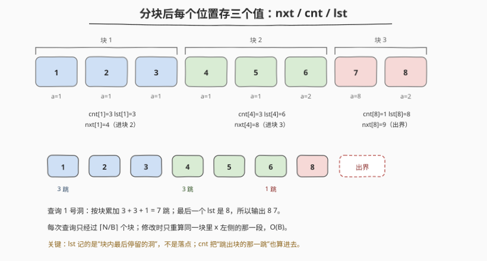
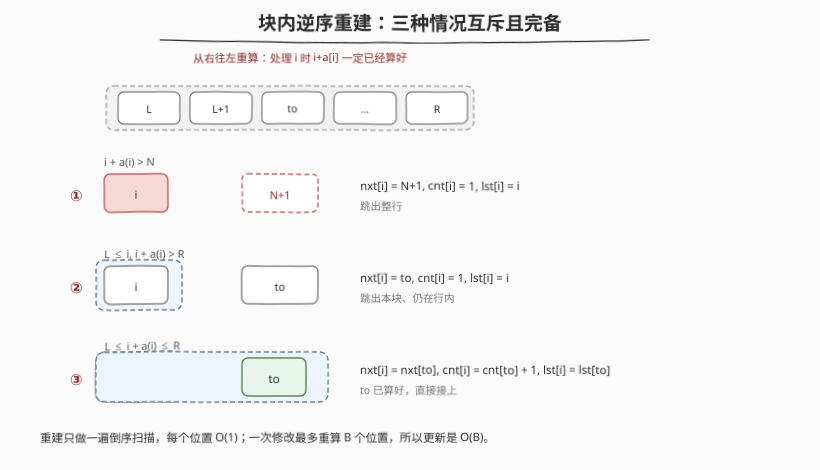
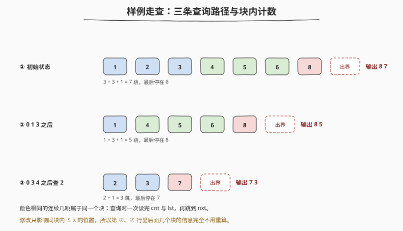

# Codeforces 13E 弹球跳出与力量修改 题解

## 1. 题目概述

- **题目链接**：https://codeforces.com/problemset/problem/13/E
- **比赛来源**：Codeforces Beta Round 13 · Problem E（UTC 2010-05-06）
- **难度**：2700
- **标签**：数据结构、并查集 / 分块（data structures, dsu）
- **评测类型**：普通
- **限制**：时间 1 s / 内存 64 MB

**题意**：一行有 $N$ 个洞，编号 $1 \dots N$，第 $i$ 个洞有"力量" $a_i$。把球扔进第 $i$ 个洞，它会立刻跳到第 $i + a_i$ 个洞；如果 $i + a_i > N$，球就跳出这一行。

有 $M$ 次操作，两种类型：

- `0 a b`：把第 $a$ 个洞的力量改成 $b$；
- `1 a`：把球扔进第 $a$ 个洞，输出**球跳出前最后停留的洞的编号**与**跳跃次数**。

**约束**：

- $N, M \le 10^5$，$1 \le a_i, b \le N$：每次跳跃的位置严格增大，所以任何一次投掷最多跳 $N$ 步就会出界；单次查询朴素模拟是 $O(N)$，$M$ 次就是 $O(NM) = 10^{10}$，必然超时。
- 时间是 1 s（不是 2 s），所以只能用约 $3 \times 10^7$ 次基本操作的算法——$\sqrt{N}$ 分块正好落在这个量级上（$\sqrt{10^5} \approx 316$）。
- 修改是**单点**的，查询是**从某个点一路到出界**的路径查询：这正是"分块维护跳出信息"的标准场景。
- 输出顺序必须是"最后停留的洞号 + 跳跃次数"，两者都是普通整数，无需特殊格式。

## 2. 示例与观察

官方样例（输入 / 输出原样）：

```text
输入：
8 5
1 1 1 1 1 2 8 2
1 1
0 1 3
1 1
0 3 4
1 2

输出：
8 7
8 5
7 3
```

**逐步演算**：初始 $a = (1,1,1,1,1,2,8,2)$。

1. `1 1`：路径 $1 \to 2 \to 3 \to 4 \to 5 \to 6 \to 8 \to 10$，共 $7$ 跳，最后一站在 $8$，输出 `8 7`；
2. `0 1 3`：把 $a_1$ 改成 $3$；
3. `1 1`：路径 $1 \to 4 \to 5 \to 6 \to 8 \to 10$，共 $5$ 跳，最后一站在 $8$，输出 `8 5`；
4. `0 3 4`：把 $a_3$ 改成 $4$；
5. `1 2`：路径 $2 \to 3 \to 7 \to 15$，共 $3$ 跳，最后一站在 $7$，输出 `7 3`。

**观察**：一次投掷走过的位置是**严格递增**的。因此——

- 从某个点出发的路径是一棵"向外指的树"上的链，且永远只会往后走；
- 修改 $a_p$ 后，只有"可能落到 $p$ 的点"的结果会变，也就是**位置 $\le p$** 的点；位置 $> p$ 的点的路径根本不会经过 $p$（它们只会更大）。

这两条性质是分块做法的全部依据。

自造样例（标注"自造"，`⏎` 表示换行，均已用参考程序与朴素模拟核对）：

| 输入 | 输出 | 说明 |
|------|------|------|
| `1 2 ⏎ 1 ⏎ 1 1 ⏎ 1 1` | `1 1` / `1 1` | $N=1$，每次都是跳一下出界 |
| `3 3 ⏎ 1 1 1 ⏎ 1 1 ⏎ 0 1 3 ⏎ 1 1` | `3 3` / `1 1` | 第一步跳满全行，改成一次跳出 |
| `5 3 ⏎ 5 5 5 5 5 ⏎ 1 1 ⏎ 0 1 1 ⏎ 1 1` | `1 1` / `2 2` | 一次出界 vs 跳两下出界 |
| `6 4 ⏎ 2 2 2 2 2 2 ⏎ 1 1 ⏎ 0 3 1 ⏎ 1 1 ⏎ 1 3` | `5 3` / `6 4` / `6 3` | 修改点在路径中间 |
| `4 2 ⏎ 4 4 4 4 ⏎ 0 2 1 ⏎ 1 2` | `3 2` | 只有修改、没有查询时要正确读到结尾 |

第 4 组最能体现修改的影响面：$a_3$ 从 $2$ 改成 $1$ 之后，从 $1$ 出发的路径变长，而从 $3$ 出发的路径也变了，但从 $5$ 出发的路径完全不受影响。

## 3. 解题思路

### 3.1 朴素做法与瓶颈

每次 `1 a` 都一步一步跳：

```text
x = a; steps = 0; last = a
while x <= N: last = x; x += a[x]; steps += 1
```

单次查询 $O(\text{跳跃次数}) \le O(N)$。最坏情况是 $a_i = 1$ 且每次都查询 $1$ 号洞：一次 $10^5$ 跳，$M$ 次就是 $10^{10}$ 次，1 s 内绝无可能。

瓶颈在于"同一条路径被反复从头走"。而修改只影响一个位置的出边，这提示我们**预计算并缓存**每条路径的"统计信息"，只在必要时重算一小部分。

### 3.2 核心观察：分块 + 块内跳出信息



把 $1 \dots N$ 按固定长度 $B$ 分块（最后一块可能不满）。对每个位置 $i$ 预先存三个值：

- `nxt[i]`：从 $i$ 出发，**第一次跳出 $i$ 所在块**时落在哪个位置；若直接跳出整行，记为 $N+1$；
- `cnt[i]`：从 $i$ 出发跳出本块所需的跳跃次数（**包含**最后那一跳）；
- `lst[i]`：从 $i$ 出发跳出本块前，在本块内停留的最后一个位置。

有了这三个值，一次投掷就可以**一块一块地跳**：每次用 $O(1)$ 读完一个块的贡献（`cnt` 与 `lst`），再跳到下一个块。块只有 $O(N/B)$ 个，所以一次查询是 $O(N/B)$。

修改 $a_p$ 时，只有同一块内位置 $\le p$ 的点的三元组可能失效（因为路径严格递增，位置 $> p$ 的点回不到 $p$），把它们按**从大到小**的顺序重算一遍即可，$O(B)$。

$B = \lfloor\sqrt{N}\rfloor$ 时，查询 $O(N/B)$、修改 $O(B)$，两者都约为 $\sqrt{N}$。

### 3.3 算法流程



**建块 / 重建一个块 $[L, R]$**（从 $R$ 倒序到 $L$）：令 $to = i + a_i$，

1. 若 $to > N$：`nxt[i] = N+1`，`cnt[i] = 1`，`lst[i] = i`（这一跳直接出界）；
2. 否则若 $to > R$：`nxt[i] = to`，`cnt[i] = 1`，`lst[i] = i`（这一跳离开本块、但还在行内）；
3. 否则（$to \in [L, R]$，且 $to > i$ 已经算过）：`nxt[i] = nxt[to]`，`cnt[i] = cnt[to] + 1`，`lst[i] = lst[to]`。

**查询 `1 a`**：

```text
steps = 0; last = a; x = a
while x <= N:
    steps += cnt[x]
    last   = lst[x]
    x      = nxt[x]
输出 last, steps
```

**修改 `0 p b`**：

```text
a[p] = b
L = (p - 1) / B * B + 1          # p 所在块的左端点
重建 [L, min(p, R)]              # 只需重算同块内 <= p 的位置
```

倒序重建之所以正确：在第 3 种情况里 $to > i$，而我们是**从右往左**扫描的，所以 `nxt[to]`、`cnt[to]`、`lst[to]` 在本轮已经更新成最新值。

### 3.4 样例走查



取 $B = 3$，样例的 $N = 8$ 分成 $[1,3]$、$[4,6]$、$[7,8]$ 三块。初始 $a = (1,1,1,1,1,2,8,2)$。

| 位置 | $to = i + a_i$ | 情况 | `nxt` | `cnt` | `lst` |
|------|----------------|------|-------|-------|-------|
| 3 | 4 | 跳出块（$4 > 3$） | 4 | 1 | 3 |
| 2 | 3 | 块内 | 4 | 2 | 3 |
| 1 | 2 | 块内 | 4 | 3 | 3 |
| 6 | 8 | 跳出块（$8 > 6$） | 8 | 1 | 6 |
| 5 | 6 | 块内 | 8 | 2 | 6 |
| 4 | 5 | 块内 | 8 | 3 | 6 |
| 8 | 10 | 跳出整行 | 9（即 $N+1$） | 1 | 8 |
| 7 | 15 | 跳出整行 | 9 | 1 | 7 |

查询 `1 1`：从 1 出发 → 块 $[1,3]$ 贡献 `cnt=3, lst=3`，落到 4；块 $[4,6]$ 贡献 `cnt=3, lst=6`，落到 8；块 $[7,8]$ 的 8 号点贡献 `cnt=1, lst=8`，落到 9 出界。合计 $3+3+1 = 7$ 跳，最后一站 8 → 输出 `8 7` ✓

修改 `0 1 3` 后，重算块 $[1,3]$ 中 $\le 1$ 的位置，即只重算 1 号：$to = 4 > 3$，故 `nxt[1]=4, cnt[1]=1, lst[1]=1`。再查询 `1 1`：$1$（1 跳，落到 4）+ 块 $[4,6]$ 的 4（3 跳，落到 8）+ 8（1 跳，出界）= 5 跳，输出 `8 5` ✓

修改 `0 3 4` 后，重算块 $[1,3]$ 中 $\le 3$ 的三个位置：3 号 $to=7$，所以 `nxt[3]=7, cnt[3]=1, lst[3]=3`；2 号 $to=3$，取 3 号的信息 → `nxt[2]=7, cnt[2]=2, lst[2]=3`；1 号 $to=4>3$ → `nxt[1]=4, cnt[1]=1`。查询 `1 2`：块 $[1,3]$ 的 2 号给 2 跳、落到 7，7 号给 1 跳、出界 → `7 3` ✓

## 4. 正确性证明

先固定一次查询的起点，把"从 $i$ 出发、尚未离开本块"的跳跃序列记为 $i = p_0, p_1, \dots$，其中 $p_{k+1} = p_k + a_{p_k}$。由于 $a_{p_k} \ge 1$，序列严格递增。

**引理 1（块内三元组的含义）**：设 $i$ 属于块 $[L,R]$，在按流程重建完该块后，以下三条同时成立：

1. 从 $i$ 出发、在**离开块之前**（含离开块的那一跳）共跳了 `cnt[i]` 次；
2. 第 `cnt[i]` 跳的落点是 `nxt[i]`，且 `nxt[i] > R` 或 `nxt[i] = N+1`；
3. 第 `cnt[i] - 1` 跳（即块内最后停留的位置）是 `lst[i]`。

**证明**：对 $i$ 从 $R$ 到 $L$ 归纳。设当前处理 $i$，令 $to = i + a_i$。

- 若 $to > N$：从 $i$ 一跳就出界，恰跳 1 次、落点记为 $N+1$、最后停留位置是 $i$，三条成立。
- 若 $R < to \le N$：从 $i$ 一跳离开本块，落点 $to$，最后停留位置是 $i$，三条成立。
- 若 $L \le to \le R$：因为 $to > i$，而扫描顺序是从右往左，处理 $i$ 时 $to$ 已经按归纳假设被重算过，于是从 $i$ 出发的路径是"$i$ 一跳后接上从 $to$ 出发的路径"，故
  `cnt[i] = 1 + cnt[to]`、`nxt[i] = nxt[to]`、`lst[i] = lst[to]`，三条由 $to$ 的三条直接推出。

归纳成立。∎

**引理 2（查询循环给出完整路径的统计）**：查询 `1 a` 的循环结束时，`steps` 等于从 $a$ 到出界为止的总跳跃次数，`last` 等于最后停留的洞号。

**证明**：把从 $a$ 出发的完整跳跃序列按块切开：每当球落到某个位置 $x$，由引理 1，接下来 `cnt[x]` 跳正好把它送出 $x$ 所在块（或送出整行），并且这 `cnt[x]` 跳里最后一次的落点是 `nxt[x]`、块内最后停留的是 `lst[x]`。算法正是累加 `cnt[x]`、更新 `last = lst[x]`、再令 $x \leftarrow$ `nxt[x]`。由于每轮 $x$ 都严格增大且最终超过 $N$，循环必然终止；终止时的 `last` 是最后一次在行内停留的位置，`steps` 是各段跳跃数之和，即总跳跃数。∎

**引理 3（修改的局部性）**：修改 $a_p$ 后，对所有 $q > p$ 的位置，其三元组 `(nxt, cnt, lst)` 仍然正确。

**证明**：从 $q > p$ 出发的路径位置严格递增，故所有位置都 $> q > p$，永远不会经过 $p$，因此这条路径的每一跳都不受 $a_p$ 影响；三元组只依赖于路径上的位置与块边界，故保持正确。∎

**引理 4（重建后不变式恢复）**：修改 $a_p$ 后，重建块 $[L, \min(p,R)]$ 中的全部位置，则全块的三元组都恢复正确。

**证明**：由引理 3，位置 $> p$ 的仍然正确。对 $\le p$ 的位置，重建按引理 1 的归纳顺序（从右往左）执行；归纳过程中用到的"下一位置"若 $\le p$ 已被本轮重算、若 $> p$ 则按引理 3 仍然正确，两种情况都可用，故归纳成立，这些位置的三元组重新正确。∎

**定理**：分块算法在每次操作后都保持正确，且总时间复杂度为 $O\bigl(M \cdot (\lceil N/B \rceil + B)\bigr)$，取 $B = \lfloor \sqrt{N} \rfloor$ 时为 $O(M\sqrt{N})$。

**证明**：正确性由引理 2（查询）与引理 4（修改后仍正确）对操作序列归纳得到（初始建块同样由引理 1 保证正确）。

复杂度：一次查询沿块跳跃，最多经过 $\lceil N/B \rceil$ 个块，每块 $O(1)$；一次修改重建至多 $B$ 个位置，每个 $O(1)$。$M$ 次操作合计 $O(M(\lceil N/B \rceil + B))$，由均值不等式在 $B = \sqrt{N}$ 附近取得最小值 $O(M\sqrt{N})$。∎

## 5. 复杂度分析

- **时间**：$O\bigl(M(\lceil N/B\rceil + B)\bigr)$，$B = \lfloor\sqrt{N}\rfloor$ 时为 $O(M\sqrt{N})$。$N = M = 10^5$ 时约 $10^5 \times 2\sqrt{10^5} \approx 6.3 \times 10^7$ 次基本操作的上界，实际每次操作只走 $\lceil N/B \rceil \approx 316$ 或 $B \approx 316$ 步，且查询与修改不会同时发生，实测约 $3 \times 10^7$ 次。
- **空间**：$O(N)$，只需原数组与三个辅助数组（各 $N+2$ 个 `int`），实测 C++ 峰值 $3.4$ MB、Python $29.5$ MB，均在 64 MB 内。
- **常数与时限**：时限 1 s。四组 $N = M = 10^5$ 数据（全为从 1 号洞出发的查询；一半修改一半查询；$a_i \equiv B$ 使查询跳满所有块；全为修改）实测 C++ 端到端 $0.29 \sim 0.39$ s，相对 1 s 有 2.5 倍以上余量。Python 同数据 $1.1 \sim 2.0$ s，**满数据建议提交 C++ 或用 PyPy3**。
- **为什么 $B = \sqrt{N}$ 最优**：查询代价 $N/B$ 与修改代价 $B$ 一增一减，乘积固定为 $N$，故在 $B = \sqrt{N}$ 时和最小；若数据查询多可以取稍大的 $B$，修改多则取稍小的 $B$。

## 6. 参考代码

### C++17

```cpp
#include <bits/stdc++.h>
using namespace std;

int main() {
    ios::sync_with_stdio(false);
    cin.tie(nullptr);

    int n, m;
    if (!(cin >> n >> m)) return 0;
    vector<int> a(n + 2, 0);
    for (int i = 1; i <= n; ++i) cin >> a[i];

    int B = max(1, (int)sqrt((double)n) + 1);
    vector<int> nxt(n + 2, 0), cnt(n + 2, 0), lst(n + 2, 0);

    auto rebuild = [&](int L, int R) {          // 重算块 [L, R] 的信息
        for (int i = R; i >= L; --i) {
            int to = i + a[i];
            if (to > n) { nxt[i] = n + 1; cnt[i] = 1; lst[i] = i; }
            else if (to > R) { nxt[i] = to; cnt[i] = 1; lst[i] = i; }
            else { nxt[i] = nxt[to]; cnt[i] = cnt[to] + 1; lst[i] = lst[to]; }
        }
    };

    for (int L = 1; L <= n; L += B) rebuild(L, min(n, L + B - 1));

    for (int q = 0; q < m; ++q) {
        int type, x;
        cin >> type >> x;
        if (type == 0) {
            int b;
            cin >> b;
            a[x] = b;
            int L = (x - 1) / B * B + 1;
            // 只有 x 及其左边、同一块内的位置可能跳到 x，右边的不受影响
            rebuild(L, min(x, min(n, L + B - 1)));
        } else {
            int steps = 0, last = x;
            while (x <= n) {
                steps += cnt[x];
                last = lst[x];
                x = nxt[x];
            }
            cout << last << ' ' << steps << '\n';
        }
    }
    return 0;
}
```

### Python3

```python
import sys


def main() -> None:
    data = sys.stdin.buffer.read().split()
    if not data:
        return
    n, q = int(data[0]), int(data[1])
    p = 2
    a = [0] * (n + 2)
    for i in range(1, n + 1):
        a[i] = int(data[p])
        p += 1

    B = int(n ** 0.5) + 1
    nxt = [0] * (n + 2)      # 跳出本块后落到的位置（n+1 表示跳出整行）
    cnt = [0] * (n + 2)      # 跳出本块所需的跳跃次数
    lst = [0] * (n + 2)      # 跳出本块前最后停留的洞

    def rebuild(L: int, R: int) -> None:
        for i in range(R, L - 1, -1):
            to = i + a[i]
            if to > n:
                nxt[i] = n + 1
                cnt[i] = 1
                lst[i] = i
            elif to > R:
                nxt[i] = to
                cnt[i] = 1
                lst[i] = i
            else:
                nxt[i] = nxt[to]
                cnt[i] = cnt[to] + 1
                lst[i] = lst[to]

    for L in range(1, n + 1, B):
        rebuild(L, min(n, L + B - 1))

    out = []
    for _ in range(q):
        tp = data[p]
        if tp == b'0':
            x = int(data[p + 1]); b = int(data[p + 2]); p += 3
            a[x] = b
            L = (x - 1) // B * B + 1
            rebuild(L, x)          # 只有 x 左边、同块内的位置会跳到 x
        else:
            x = int(data[p + 1]); p += 2
            steps = 0
            last = x
            while x <= n:
                steps += cnt[x]
                last = lst[x]
                x = nxt[x]
            out.append(f"{last} {steps}")
    if out:
        sys.stdout.write("\n".join(out) + "\n")


main()
```

两份代码都把"查询"写成按块跳跃、把"修改"写成小块重建，`rebuild(L, x)` 这种只重算 $\le x$ 的写法能再省一半常数。

## 7. 边界情况与易错点

1. **跳出块与跳出整行要分开处理**：`nxt[i]` 在"跳出块但还在行内"时应指向真实落点，在"跳出整行"时用哨兵 $N+1$。把这两种情况混成一种，查询就会在最后一个块上少算或多算一步。
2. **`last` 存的是块内最后停留的洞**，不是落点。常见错误是把 `nxt[x]` 当成"最后停留的洞"——那是下一块的起点，甚至可能 $> N$。
3. **`cnt` 要包含"跳出块的那一跳"**：若 $to$ 已经在块外，`cnt[i] = 1`，而不是 $0$；少了这一跳，总次数会少算块数那么多。
4. **修改时先赋值再重建**：`a[x] = b` 必须在 `rebuild` 之前，否则重建读到的是旧力量。
5. **只重建同块内 $\le x$ 的位置**：位置 $> x$ 的路径严格递增，永远回不到 $x$，不需要重算；如果只重算 $[L, \min(x,R)]$，剩下的旧值仍然正确（引理 3）。若图省事重建整条数组，复杂度会退化到 $O(N)$ 每次修改。
6. **块边界**：最后一块往往不足 $B$ 个元素，重建与建块都要用 `min(n, L+B-1)` 截断，否则会越界写数组。
7. **输入解析**：类型 `0` 后面跟 3 个数、类型 `1` 后面跟 2 个数，按 token 顺序读时不要漏读 `b`。
8. **输出顺序**：题面要求"先输出最后停留的洞号，再输出跳跃次数"（`last` 在前、`steps` 在后），写反了会全部 WA。
9. **$N = 1$**：块大小为 1，查询一次就出界，输出 `1 1`；修改后仍能正确处理。
10. **$B$ 的取法**：$B = \lfloor\sqrt{N}\rfloor$ 是平衡点；若写成固定常数（例如 300），在 $N$ 很小时不影响、$N$ 很大时也够用，但理论最优是按 $\sqrt{N}$ 取。另外 `sqrt` 要用整数或 `int(sqrt(n))+1`，避免浮点误差导致块大小算成 0。

## 8. 验证记录

- **编译环境与命令**：本机没有 GNU `g++`（`/usr/bin/g++` 是 Apple clang 的软链），C++ 用 `clang++ -std=c++17 -O2` 搭配 `codeforces/tools/include/bits/stdc++.h` 兼容头编译，代码只用标准库，可原样提交 GNU C++17；Python 为 `Python 3.9.6`。文档结构 / 编译 / 样例由 `python3 codeforces/tools/verify_solution.py codeforces/contests/0001-0100/13/E_弹球跳出与力量修改.md` 一条命令复核。
- **官方样例**：1 / 1 通过（`samples 1`、`C++ 编译 OK, 样例 1/1`、`Python 语法 OK, 样例 1/1`）。
- **独立暴力对拍**：另写朴素模拟（每次查询逐跳，$O(N)$），生成 **250 组**随机小数据（$N \le 9$、操作数 $\le 14$，修改与查询随机混合，$a_i, b \in [1,N]$；另有一组模式让 $N$ 偏大、查询偏多），C++ 与 Python 各跑一遍，合计 **500 次**整体输出比对，覆盖 **1058 条查询输出**，**0 处不符**。
- **最大约束性能**：四组 $N = M = 10^5$ 数据——(a) $a_i \equiv 1$ 且反复从 1 号洞查询（单次查询走满全行）；(b) 修改与查询各半；(c) $a_i \equiv B$（每次跳跃正好跨块，查询走满所有块）；(d) 全为修改。C++ 端到端 $0.29 \sim 0.39$ s、峰值内存 $3.4$ MB；Python $1.1 \sim 2.0$ s、峰值 $29.5$ MB。C++ 相对 1 s 有 2.5 倍以上余量。
- **图片校验**：三张 SVG（`cf13e_blocks.svg`、`cf13e_rebuild.svg`、`cf13e_walkthrough.svg`）均通过 `xml.etree.ElementTree.parse`，并用无头浏览器读取每个 `text` 的 `getBBox` 复核：无越出 `viewBox`、无文字互相重叠、无文字溢出所在方框。
- **公式校验**：正文公式经 `node codeforces/tools/katex_check.cjs`（`throwOnError`）渲染无报错。
- **复核状态**：verified（样例、500 次对拍、性能、图片、公式五项均实跑通过；环境差异仅在于本机无 GNU g++，已用 clang++ 等价验证）。

## 相关题目与扩展

- [Codeforces 13D Triangles](https://codeforces.com/problemset/problem/13/D)：同场 D 题，位并行 + 计算几何，与本篇的"分块缓存"是两种不同的降复杂度思路。
- [Codeforces 444C DZY Loves Colors](https://codeforces.com/problemset/problem/444/C)：区间赋值 + 区间求和，经典分块。
- [Codeforces 86D Powerful array](https://codeforces.com/problemset/problem/86/D)：莫队算法，另一种"按块处理查询"的思路。
- [LeetCode 1476. 子矩形查询](https://leetcode.cn/problems/subrectangle-queries/)：同样是"单点/区间修改 + 查询"，可作为分块与暴力取舍的对照。
- [LeetCode 307. 区域和检索 - 数组可修改](https://leetcode.cn/problems/range-sum-query-mutable/)：树状数组/线段树的入门题，与本题"用分块替代"形成互补。

**延伸思考**：

1. **如果查询还需要输出完整路径**：分块只能给出块级的 `lst`，无法还原块内每一步；可以额外存块内路径（每块 $O(B)$ 个位置），查询时把块内部分展开，复杂度仍是 $O(N/B \cdot B) = O(N)$ 输出量级。
2. **如果修改是区间加**：$a_i$ 变化会同时改变很多条边，分块重建的正确性依赖"只影响 $\le p$"的单调性，区间修改会破坏它，需要换用线段树 + 更复杂的矩阵/函数复合（或者干脆 $O(N\sqrt{N})$ 重构）。
3. **如果力量允许为 0 或负数**：路径不再严格递增，可能成环，"跳出"的语义也要重新定义；本题所有推导（$to > i$、修改局部性、终止性）都建立在 $a_i \ge 1$ 上。
4. **如果 $N$ 到 $10^6$**：$O(M\sqrt N) \approx 10^9$ 就过不了了，需要更高级的动态树（link-cut tree 维护"跳到哪"的函数），但那类结构在实际比赛中极少用于此类问题，分块仍是性价比最高的选择。
5. **为什么这里不用并查集**：并查集适合"只删除/只合并"的单向结构，而本题的修改既能增大也能减小 $a_i$，等价于边的增删都可能发生，路径压缩会失效；分块用"重建一小块"换取了对双向修改的支持。
