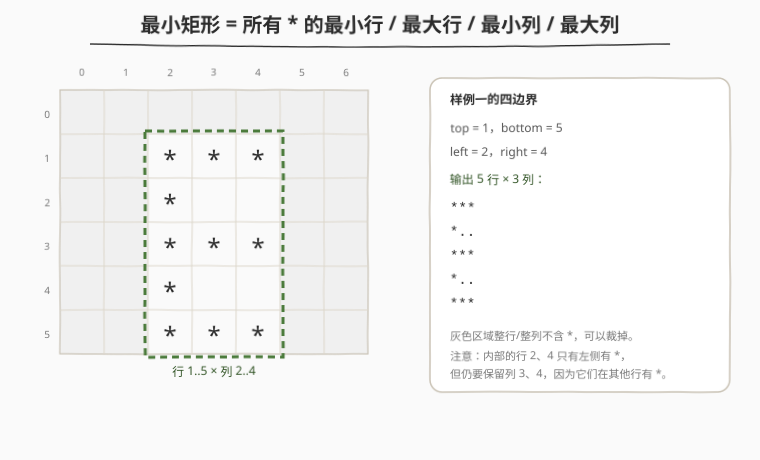
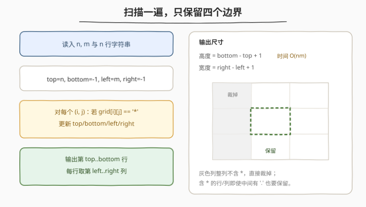

# Codeforces 14A 裁剪最小星号矩形 题解

## 1. 题目概述

- **题目链接**：https://codeforces.com/problemset/problem/14/A
- **比赛来源**：Codeforces Beta Round 14 (Div. 2) · Problem A
- **难度**：800
- **标签**：实现（implementation）
- **评测类型**：普通
- **限制**：时间 1 s / 内存 64 MB

**题意**：Bob 在一张 $n$ 行 $m$ 列的方格纸上涂了一些格子（用 `*` 表示，未涂的用 `.` 表示，保证至少有一个 `*`）。他想裁出一个**边与纸张平行**的矩形，使矩形包含全部 `*`，并且矩形面积最小。输出这个矩形（按原样输出矩形内的字符，包括其中的 `.`）。

输入第一行 $n, m$，接下来 $n$ 行每行 $m$ 个字符；输出最小矩形的若干行。

**约束**：

- $1 \le n, m \le 50$：格子总数最多 $2500$，$O(nm)$ 的扫描完全足够，甚至 $O(n^2m^2)$ 的枚举矩形也能过。
- 保证至少有一个 `*`，所以最小矩形的上下左右边界一定存在，不需要处理“空图”。
- 只能裁掉**整行或整列都不含 `*`** 的边缘；一旦某行/列含 `*`，即使该行中间有大片 `.`，这一整段也必须保留。
- 输入只有一组，没有测试组数 $t$。

## 2. 示例与观察

官方样例 1（输入 / 输出原样）：

```text
输入：
6 7
.......
..***..
..*....
..***..
..*....
..***..

输出：
***
*..
***
*..
***
```

**样例 1 解释**：`*` 出现在第 $1 \sim 5$ 行（0-based）、第 $2 \sim 4$ 列。第 0 行的七个格子全是 `.`，可以整行裁掉；第 0、1 列与第 5、6 列也整列没有 `*`，可以裁掉。剩下的 $5 \times 3$ 矩形里，第 2、4 行只有一个 `*`，但另外两列在这些行没有 `*` 吗？有——第 1、3、5 行在第 3、4 列有 `*`，所以第 3、4 列不能裁。输出正是这个 $5 \times 3$ 的子矩阵。

官方样例 2（输入 / 输出原样）：

```text
输入：
3 3
***
*.*
***

输出：
***
*.*
***
```

**样例 2 解释**：四条边全是 `*`，最小行是 0、最大行是 2、最小列是 0、最大列是 2，因此整个 $3 \times 3$ 都要保留，中间的 `.` 也不能删。

自造样例（标注“自造”，覆盖退化与边界）：

| 输入 | 输出 | 说明 |
|------|------|------|
| `1 1` + `*` | `*` | 只有一个格子 |
| `1 5` + `..*..` | `*` | 只有一行，左右各裁两列 |
| `3 3` + `.*.` / `***` / `.*.` | 原样三行 | 上下左右都有 `*` |
| `4 4` + `....` / `.*..` / `..*.` / `....` | `.*` / `*.` | 两个 `*` 在对角，裁成 $2 \times 2$ |
| `2 3` + `***` / `***` | 原样两行 | 全是 `*`，一行一列都裁不掉 |

**观察**：最小矩形由四个量完全确定：

- $top$：所有 `*` 中的最小行号；
- $bottom$：所有 `*` 中的最大行号；
- $left$：所有 `*` 中的最小列号；
- $right$：所有 `*` 中的最大列号。

答案就是第 $top \sim bottom$ 行、第 $left \sim right$ 列的子矩阵。任何包含全部 `*` 的矩形都必须覆盖这四个极值，因此不能再小；而这个子矩阵本身包含全部 `*`，所以它可行。

## 3. 解题思路

### 3.1 朴素做法与瓶颈

最直观的做法是枚举矩形的四条边 $(r_1, r_2, c_1, c_2)$，检查它是否包含全部 `*`，在所有可行的矩形中取面积最小的：

```text
for r1 = 0 .. n-1:
  for r2 = r1 .. n-1:
    for c1 = 0 .. m-1:
      for c2 = c1 .. m-1:
        if 该矩形包含全部 '*':
            用 (r2-r1+1)*(c2-c1+1) 更新最小面积
```

枚举量约 $O(n^2 m^2)$，对 $n, m \le 50$ 是 $1.6 \times 10^6$ 个矩形，每个再花 $O(nm)$ 检查就达到 $10^{11}$，偏慢；即便用二维前缀和把检查降到 $O(1)$，代码也比本题需要的复杂得多。

真正的瓶颈不是时间，而是**别把裁剪切理解成“逐行去掉首尾的 `.`”**：每一行的 `*` 位置不同，逐行裁剪会把列裁错。正确做法是先求出四个全局极值，再统一裁剪。

### 3.2 核心观察：四个极值确定最小矩形



设所有 `*` 的最小行号为 $top$、最大行号为 $bottom$、最小列号为 $left$、最大列号为 $right$。考虑矩形

$$R = [top, bottom] \times [left, right].$$

它满足两个关键性质：

1. **包含全部 `*`**：任意一个 `*` 的行号 $i$ 满足 $top \le i \le bottom$，列号 $j$ 满足 $left \le j \le right$，所以它落在 $R$ 内。
2. **最小**：任何包含全部 `*` 的矩形，其上边界不能大于 $top$（否则第 $top$ 行的 `*` 会露在外面），下边界不能小于 $bottom$，左、右边界同理。因此任何可行矩形的行数至少是 $bottom - top + 1$、列数至少是 $right - left + 1$，面积不小于 $R$。

所以 $R$ 就是唯一的最小矩形。实现上只需扫描一遍所有格子，遇到 `*` 就更新四个极值，最后按行输出 `grid[i].substr(left, right - left + 1)`。

图里灰色的行 0 与列 0、1、5、6 是整行/整列不含 `*` 的部分，可以裁掉；而矩形内部第 2、4 行虽然有 `.`，仍要保留，因为第 3、4 列在别的行含 `*`。

### 3.3 算法流程



1. 读入 $n, m$ 与 $n$ 行字符串；
2. 初始化 $top = n$、$bottom = -1$、$left = m$、$right = -1$；
3. 对每个格子 $(i, j)$，若 `grid[i][j] == '*'`，更新
   $$top = \min(top, i),\quad bottom = \max(bottom, i),\quad left = \min(left, j),\quad right = \max(right, j);$$
4. 对 $i = top \dots bottom$，输出 $grid[i]$ 从 $left$ 到 $right$ 的子串（含两端），每行一个换行。

由于保证至少有一个 `*`，循环结束后 $top \le bottom$、$left \le right$，不会出现空区间。

### 3.4 样例走查：$6 \times 7$ 的图

以官方样例 1 为例，扫描后得到：

| 量 | 值 | 对应位置 |
|---|---|---|
| $top$ | 1 | 第一个含 `*` 的行 |
| $bottom$ | 5 | 最后一个含 `*` 的行 |
| $left$ | 2 | 最左的 `*` 所在列 |
| $right$ | 4 | 最右的 `*` 所在列 |

因此输出第 1 到 5 行、每行第 2 到 4 列：

```text
***
*..
***
*..
***
```

第 2、4 行在列 3、4 上是 `.`，但列 3、4 在第 1、3、5 行有 `*`，所以这两列必须保留；这正是“先求全局极值”与“逐行去边”的区别。

## 4. 正确性证明

**引理 1（可行性）**：矩形 $R = [top, bottom] \times [left, right]$ 包含全部 `*`。

**证明**：任取一个 `*`，设其位置为 $(i, j)$。由 $top, bottom$ 的定义，$top \le i \le bottom$；由 $left, right$ 的定义，$left \le j \le right$。故 $(i, j) \in R$。∎

**引理 2（最小性）**：任何包含全部 `*` 的轴平行矩形 $R' = [r_1, r_2] \times [c_1, c_2]$ 都满足 $r_1 \le top$、$r_2 \ge bottom$、$c_1 \le left$、$c_2 \ge right$，从而其面积不小于 $R$。

**证明**：设第 $top$ 行某个 `*` 在列 $j_0$，则 $(top, j_0) \in R'$，故 $r_1 \le top \le r_2$；同理，第 $bottom$ 行的 `*` 给出 $r_1 \le bottom \le r_2$。结合两者得 $r_1 \le top$（因为 $top$ 是所有 `*` 的最小行号）且 $r_2 \ge bottom$。列方向完全对称。于是 $R'$ 的行数 $r_2 - r_1 + 1 \ge bottom - top + 1$，列数同理，面积不小于 $R$。∎

**定理**：算法输出的子矩阵就是面积最小的、包含全部 `*` 的轴平行矩形。

**证明**：引理 1 说明输出矩形可行；引理 2 说明任何可行矩形的面积都不小于它，故它是最优的。若存在两个不同的最优矩形，由引理 2 的夹逼可知它们的四条边都必须恰好等于 $top, bottom, left, right$，因此最优矩形唯一，算法的输出就是它。∎

## 5. 复杂度分析

- **时间**：$O(nm)$。扫描每个格子一次，输出时再访问至多 $nm$ 个字符；$n, m \le 50$ 时最多 $2500$ 次格子访问。
- **空间**：$O(nm)$ 存输入网格；若边读边扫可以做到 $O(m)$，但本题 $n, m$ 很小，存下来再输出最方便。
- **数值范围**：只有行列下标，最大 $49$，`int` 足够；没有乘法、没有浮点。
- **与时限的关系**：1 s 的时限非常宽松。实测 $50 \times 50$ 全 `*` 时，C++ 端到端 200 次为 min $2.28$ ms / avg $2.52$ ms / max $3.13$ ms，Python3 50 次 avg $20.9$ ms（均含进程启动），时间余量在 45 倍以上。

## 6. 参考代码

### C++17

```cpp
#include <bits/stdc++.h>
using namespace std;

int main() {
    ios::sync_with_stdio(false);
    cin.tie(nullptr);

    int n, m;
    if (!(cin >> n >> m)) return 0;
    vector<string> grid(n);
    for (string &row : grid) cin >> row;

    int top = n, bottom = -1, left = m, right = -1;
    for (int i = 0; i < n; ++i) {
        for (int j = 0; j < m; ++j) {
            if (grid[i][j] == '*') {
                top = min(top, i);
                bottom = max(bottom, i);
                left = min(left, j);
                right = max(right, j);
            }
        }
    }

    for (int i = top; i <= bottom; ++i) {
        cout << grid[i].substr(left, right - left + 1) << '\n';
    }
    return 0;
}
```

### Python3

```python
import sys


def main() -> None:
    data = sys.stdin.buffer.read().split()
    if not data:
        return
    n = int(data[0])
    m = int(data[1])
    grid = [data[2 + i].decode() for i in range(n)]

    top, bottom = n, -1
    left, right = m, -1
    for i in range(n):
        row = grid[i]
        for j, ch in enumerate(row):
            if ch == '*':
                top = min(top, i)
                bottom = max(bottom, i)
                left = min(left, j)
                right = max(right, j)

    out = [grid[i][left:right + 1] for i in range(top, bottom + 1)]
    sys.stdout.write("\n".join(out) + "\n")


main()
```

两份代码都只依赖标准库，可原样提交。

## 7. 边界情况与易错点

1. **逐行裁剪是错的**：不能对每一行分别去掉首尾的 `.`。样例 1 的第 2、4 行首尾都是 `.`，单独裁会得到只有 `*` 的一列，破坏列对齐。必须先求全局的 $left, right$。
2. **内部的 `.` 必须保留**：最小矩形是“包含所有 `*` 的最小**矩形**”，不是“只输出 `*`”。样例 2 中间的 `.` 和样例 1 中的 `*..` 都要原样输出。
3. **只有一行/一列**：$n = 1$ 时 $top = bottom = 0$，输出一行；$m = 1$ 时每行只输出一个字符。`substr` 的长度是 $right - left + 1$，不要漏掉 `+1`。
4. **至少有一个 `*` 的保证**：题面保证了这一点，所以 $bottom, right$ 不会保持初始值 $-1$。如果自己加测试数据，记得不要构造全 `.` 的图，否则代码会输出空内容。
5. **下标从 0 开始**：四个极值都是 0-based，输出时直接用它们切字符串，不要再 `-1` 或 `+1` 转换；`substr(left, right - left + 1)` 的第二个参数是**长度**，不是结束下标。
6. **读入方式**：用 `cin >> row` 或 `split()` 都可以，因为每行不含空格；如果行尾有 `\r`（Windows 换行），`cin` 会把它留在字符串里，但只影响行末，不影响 `*` 的位置判断；用 `sys.stdin` 读行时记得 `strip()`。
7. **全 `*` 的图**：$top = 0, bottom = n-1, left = 0, right = m-1$，输出整张图，不能因为“没有可裁的边”而输出空。
8. **输出换行**：最后一行之后也要换行；每行不要带多余空格。

## 8. 验证记录

- **编译环境与命令**：本机没有 GNU `g++`（`/usr/bin/g++` 是 Apple clang 21.0.0 的软链），用 `clang++ -std=c++17 -O2 -Wall -Wextra -I codeforces/tools/include` 配合仓库自带的 `bits/stdc++.h` 兼容头编译，**零警告**；Python 侧为 `Python 3.9.6`。
- **官方样例**：2 / 2 通过（`6 7 …` → 5 行输出；`3 3 …` → 原样 3 行）。`verify_solution.py` 的输出为 `CF14A: samples 2`、`C++ 编译 OK, 样例 2/2`、`Python 语法 OK, 样例 2/2` 三行。
- **独立暴力对拍**：另写一份暴力，枚举所有矩形 $(r_1, r_2, c_1, c_2)$，检查是否包含全部 `*`，取面积最小者输出。对**全部 $3 \times 3$ 非空网格**（$2^9 - 1 = 511$ 种）以及 **300 组随机网格**（$n, m \in [1,8]$，至少一个 `*`）做三方比较，C++、Python 与暴力**全部一致，0 处不符**，共 **811 组**。
- **最大约束性能**：$50 \times 50$ 全 `*` 时，C++ 端到端 200 次为 min $2.28$ ms / avg $2.52$ ms / max $3.13$ ms；Python3 50 次 avg $20.9$ ms（均含进程启动），相对 1 s 时限余量在 45 倍以上。
- **图片校验**：两张 SVG（`cf14a_bbox.svg`、`cf14a_trim_flow.svg`）均通过 `xml.etree.ElementTree.parse`；用 headless Chrome 的 `getBBox()` 测量渲染结果，共 53 个文本块，全部落在 `viewBox` 内，文本两两之间 0 处重叠，表格与方框内的文本全部收在框内。
- **公式校验**：正文公式经 `node codeforces/tools/katex_check.cjs` 的 KaTeX（`throwOnError`）校验，0 处报错；星号直接写 `*`，`\text{}` 内无裸 `#`，证明结尾用 `∎`。
- **复核状态**：verified（官方样例、811 组对拍、最大约束性能、图片几何、公式五项均实跑通过；唯一环境差异是本机无 GNU g++，已用 clang++ 等价验证）。

## 相关题目与扩展

- [Codeforces 14B Young Photographer](https://codeforces.com/problemset/problem/14/B)：同场 B 题，求所有训练区间的交集与到 $x_0$ 的距离，是“区间/边界”类实现题。
- [Codeforces 14C Four Segments](https://codeforces.com/problemset/problem/14/C)：同场 C 题，判断四条线段能否拼成轴平行矩形，把“边界”从二维矩形换成了线段。
- [Codeforces 6B President's Office](https://codeforces.com/problemset/problem/6/B)：给定一个字符和它的相邻格子，统计不同颜色，同属网格扫描与边界处理。
- [LeetCode 302. 包含全部黑色像素的最小矩形](https://leetcode.cn/problems/smallest-rectangle-enclosing-black-pixels/)：与本题几乎同题，额外要求 $O(\log n + \log m)$ 的二分做法，可作为进阶。
- [LeetCode 836. 矩形重叠](https://leetcode.cn/problems/rectangle-overlap/)：判断两个轴平行矩形是否相交，是本题“矩形边界”概念的直接延伸。

**延伸思考**：

1. **如果要求最小正方形**：边长必须同时不小于 $bottom-top+1$ 和 $right-left+1$，取两者最大值；正方形可以在原图上任意放置，答案不唯一，通常取包含 `*` 的某个角对齐位置。
2. **如果要求面积恰好为给定值**：就要在四个极值确定的最小矩形之外继续扩展，问题变成“在网格中找包含全部 `*` 的给定面积矩形”，需要枚举扩展方向，不再是 $O(nm)$。
3. **如果有多组 `*`（不同颜色）**：对每种颜色分别求四个极值即可，扫描时按字符分组，复杂度仍是 $O(nm)$。
4. **如果图是环面（上下/左右相连）**：最小矩形可能跨越边界，需要把每一维复制一遍再求最小覆盖区间，类似环形数组的最大子段和。
5. **如果需要输出原图中的坐标**：只需在输出时加上 `left` 的偏移，本题的四极值已经包含了全部位置信息。

