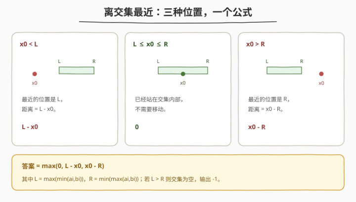

# Codeforces 14B 摄影师最短移动 题解

## 1. 题目概述

- **题目链接**：https://codeforces.com/problemset/problem/14/B
- **比赛来源**：Codeforces Beta Round 14 (Div. 2) · Problem B（UTC 2010-05-19）
- **难度**：1000
- **标签**：实现（implementation）
- **评测类型**：普通
- **限制**：时间 2 s / 内存 64 MB

**题意**：一条笔直赛道上，Bob 最初站在坐标 $x_0$。共有 $n$ 位运动员，第 $i$ 位在闭区间 $[a_i, b_i]$ 内训练；只有 Bob 站的位置落在该区间内，才能拍到这位运动员。Bob 可以沿赛道移动到任意位置，求他**至少需要移动的距离**，使得存在一个位置能同时拍到所有运动员；若不存在这样的位置，输出 $-1$。

输入第一行 $n, x_0$，接下来 $n$ 行每行 $a_i, b_i$（$a_i \ne b_i$，但顺序任意，可能 $a_i > b_i$）。

**约束**：

- $1 \le n \le 100$，$0 \le x_0, a_i, b_i \le 1000$：坐标范围很小，甚至可以枚举 $0 \dots 1000$ 的每个整数位置，$O(1000n)$ 也能过。
- $a_i \ne b_i$：每个区间长度为正，但两个端点顺序不保证，必须先取 $\min$、$\max$。
- 所有区间都是**闭区间**：端点处可以拍照。
- 只有一组数据，没有测试组数 $t$。

## 2. 示例与观察

官方样例（输入 / 输出原样）：

```text
输入：
3 3
0 7
14 2
4 6

输出：
1
```

**样例解释**：三个区间分别是 $[0, 7]$、$[2, 14]$、$[4, 6]$。注意第二个区间的输入是 `14 2`，要写成 $[2, 14]$。

三者的交集是

$$[0,7] \cap [2,14] \cap [4,6] = [4, 6].$$

Bob 在 $x_0 = 3$，位于交集的左侧，最近的可拍位置是 $4$，需要移动 $4 - 3 = 1$，输出 `1`。

自造样例（标注“自造”，覆盖无解、已在区间内、单点交集与反向端点）：

| 输入 | 输出 | 说明 |
|------|------|------|
| `2 0` / `0 1` / `3 4` | `-1` | 两个区间不相交，交集为空 |
| `2 5` / `0 10` / `2 8` | `0` | 交集 $[2,8]$ 包含 $x_0=5$ |
| `2 0` / `0 5` / `5 10` | `5` | 交集退化为单点 $\{5\}$，从 $0$ 走到 $5$ |
| `2 1000` / `1 2` / `1 2` | `998` | 交集 $[1,2]$，$x_0$ 在右侧 |
| `1 0` / `1000 0` | `0` | 一个区间 $[0,1000]$ 覆盖 $x_0$ |
| `2 3` / `10 2` / `6 4` | `1` | 反向端点：$[2,10]$ 与 $[4,6]$，交集 $[4,6]$ |

**观察**：所有能同时拍到全部运动员的位置，恰好是全部区间的交集

$$I = \bigcap_{i=1}^{n} [a_i, b_i] = [L, R], \qquad L = \max_i \min(a_i, b_i),\quad R = \min_i \max(a_i, b_i).$$

- 若 $L > R$，交集为空，输出 $-1$；
- 若 $x_0 \in [L, R]$，Bob 一步都不用走，答案是 $0$；
- 若 $x_0 < L$，最近的位置是 $L$，距离 $L - x_0$；
- 若 $x_0 > R$，最近的位置是 $R$，距离 $x_0 - R$。

合并后就是

$$\text{ans} = \max\bigl(0,\ L - x_0,\ x_0 - R\bigr).$$

## 3. 解题思路

### 3.1 朴素做法与瓶颈

由于所有坐标都是 $0 \dots 1000$ 的整数，可以直接枚举 Bob 的每个可能位置 $x = 0 \dots 1000$，检查它是否落在每个区间内，在所有可行位置中取 $|x - x_0|$ 的最小值：

```text
best = INF
for x = 0 .. 1000:
    if 对所有 i 都有 a_i <= x <= b_i:
        best = min(best, abs(x - x0))
输出 best（若仍为 INF 则 -1）
```

复杂度 $O(1000n) \le 10^5$，2 s 内绰绰有余。但这个方法依赖“坐标范围小”这一条件；如果坐标扩大到 $10^9$，就不能枚举位置了。

更关键的是，位置在数学上可以是**实数**，直接枚举整数需要说明为什么不会漏掉最优解。理由：所有区间端点都是整数，交集 $[L, R]$ 的端点也是整数；若 $x_0$ 在交集外，最近点必是某个整数端点；若 $x_0$ 在交集内，$x_0$ 本身就是整数。所以最优位置一定能取到整数，枚举 $0 \dots 1000$ 是精确的。

不过，既然交集端点可以直接算出来，就没必要枚举 $1000$ 个位置。用区间求交只需 $O(n)$。

### 3.2 核心观察：可行位置就是区间交集

![三条训练区间的交集 [L, R]](../../../images/cf14b_intervals.svg)

对每个 $i$，Bob 能拍到第 $i$ 位运动员当且仅当 $x \in [a_i, b_i]$。要同时拍到所有人，$x$ 必须同时属于所有区间，即

$$x \in \bigcap_{i=1}^{n} [a_i, b_i].$$

区间交仍然是一个区间（可能为空）：

$$L = \max_{i} \min(a_i, b_i), \qquad R = \min_{i} \max(a_i, b_i).$$

- 若 $L > R$：不存在同时属于所有区间的点，输出 $-1$；
- 若 $L \le R$：可行位置集合就是 $[L, R]$。

于是问题化为“数轴上一点 $x_0$ 到区间 $[L, R]$ 的最短距离”，这是一个标准的 clamp（投影）问题。

### 3.3 距离的三种情形



设 $L \le R$。

1. **$x_0 < L$**：$x_0$ 在区间左侧，往右走最近，走到 $L$ 即可，距离 $L - x_0$。
2. **$L \le x_0 \le R$**：$x_0$ 已经在区间内，距离 $0$。
3. **$x_0 > R$**：$x_0$ 在区间右侧，往左走最近，走到 $R$ 即可，距离 $x_0 - R$。

三种情形互斥且覆盖所有可能。把它们写成一行：

$$\text{ans} = \max\bigl(0,\ L - x_0,\ x_0 - R\bigr).$$

当 $x_0 \in [L, R]$ 时，$L - x_0 \le 0$ 且 $x_0 - R \le 0$，最大值是 $0$；当 $x_0 < L$ 时，$L - x_0 > 0$ 而 $x_0 - R < 0$，最大值是 $L - x_0$；右侧同理。所以这个公式不需要额外的分支。

算法流程：

1. 读入 $n, x_0$；
2. 初始化 $L = -\infty$、$R = +\infty$；
3. 对每个区间，读入 $a_i, b_i$，必要时交换使 $a_i \le b_i$，然后 $L \leftarrow \max(L, a_i)$、$R \leftarrow \min(R, b_i)$；
4. 若 $L > R$，输出 $-1$；
5. 否则输出 $\max(0, L - x_0, x_0 - R)$。

代码里用 `INT_MIN` / `INT_MAX` 作为无穷大；由于 $0 \le a_i, b_i \le 1000$，也可以初始化为 $L = 0$、$R = 1000$，但用真正的无穷大更通用。

### 3.4 样例走查

官方样例：$n = 3$，$x_0 = 3$。

| 步骤 | 区间 | $L$ | $R$ |
|------|------|-----|-----|
| 初始 | — | $-\infty$ | $+\infty$ |
| 1 | $[0,7]$ | 0 | 7 |
| 2 | $[2,14]$（输入 `14 2`） | 2 | 7 |
| 3 | $[4,6]$ | 4 | 6 |

得到 $L = 4$、$R = 6$，$L \le R$。$x_0 = 3 < 4$，距离 $L - x_0 = 1$，输出 `1`，与官方样例一致。

再走查两个自造样例：

- `2 0 / 0 1 / 3 4`：$L = \max(0,3) = 3$、$R = \min(1,4) = 1$，$L > R$，输出 `-1`。
- `2 0 / 0 5 / 5 10`：$L = \max(0,5) = 5$、$R = \min(5,10) = 5$，交集是单点 $\{5\}$，距离 $5 - 0 = 5$，输出 `5`。

## 4. 正确性证明

**引理 1（可行位置 = 交集）**：位置 $x$ 能拍到全部运动员，当且仅当 $x \in [L, R]$，其中 $L = \max_i \min(a_i,b_i)$、$R = \min_i \max(a_i,b_i)$。

**证明**：$x$ 能拍到第 $i$ 位运动员 $\iff \min(a_i,b_i) \le x \le \max(a_i,b_i)$。要对所有 $i$ 成立，等价于 $x \ge \max_i \min(a_i,b_i) = L$ 且 $x \le \min_i \max(a_i,b_i) = R$，即 $x \in [L,R]$。若 $L > R$，则不存在这样的 $x$。∎

**引理 2（到区间的最短距离）**：设 $L \le R$，则 $\min_{x \in [L,R]} |x - x_0| = \max(0, L - x_0, x_0 - R)$。

**证明**：分三种情形。

- $x_0 < L$：对任意 $x \in [L,R]$，$|x - x_0| = x - x_0 \ge L - x_0$，且在 $x = L$ 处取等号，故最小值为 $L - x_0$。
- $L \le x_0 \le R$：取 $x = x_0$ 得距离 $0$，距离非负，故最小值为 $0$。
- $x_0 > R$：对任意 $x \in [L,R]$，$|x - x_0| = x_0 - x \ge x_0 - R$，且在 $x = R$ 处取等号，故最小值为 $x_0 - R$。

三种情形下 $\max(0, L-x_0, x_0-R)$ 分别等于 $L-x_0$、$0$、$x_0-R$，结论成立。∎

**定理**：算法输出 Bob 所需的最小移动距离；若交集为空则输出 $-1$。

**证明**：若 $L > R$，引理 1 说明不存在能拍到全部运动员的位置，算法输出 $-1$，正确。若 $L \le R$，引理 1 说明可行位置集合恰为 $[L,R]$，引理 2 给出到该区间的最短距离，算法输出的正是这个值，故正确。∎

## 5. 复杂度分析

- **时间**：$O(n)$。每个区间只做两次比较和两次更新，常数时间；$n \le 100$ 时不到 $1000$ 次运算。
- **空间**：$O(1)$。只存 $L, R$ 与当前区间的两个端点，不需要数组。
- **数值范围**：所有坐标在 $0 \sim 1000$，距离最大 $1000$，`int` 足够；不存在溢出或浮点误差，答案一定是整数。
- **与时限的关系**：2 s 的时限极其宽松。实测 $n = 100$、所有区间为 $[0,1000]$、$x_0 = 1000$ 时，C++ 端到端 200 次为 min $2.25$ ms / avg $2.46$ ms / max $3.52$ ms，Python3 50 次 avg $20.1$ ms（均含进程启动），时间余量在 80 倍以上。

## 6. 参考代码

### C++17

```cpp
#include <bits/stdc++.h>
using namespace std;

int main() {
    ios::sync_with_stdio(false);
    cin.tie(nullptr);

    int n, x0;
    if (!(cin >> n >> x0)) return 0;

    int L = INT_MIN, R = INT_MAX;      // 所有区间的交集 [L, R]
    for (int i = 0; i < n; ++i) {
        int a, b;
        cin >> a >> b;
        if (a > b) swap(a, b);         // 输入端点顺序任意
        L = max(L, a);
        R = min(R, b);
    }

    if (L > R) {
        cout << -1 << '\n';            // 交集为空，拍不到所有人
    } else if (x0 < L) {
        cout << L - x0 << '\n';
    } else if (x0 > R) {
        cout << x0 - R << '\n';
    } else {
        cout << 0 << '\n';             // 已经站在交集里
    }
    return 0;
}
```

### Python3

```python
import sys


def main() -> None:
    data = sys.stdin.buffer.read().split()
    if not data:
        return
    n = int(data[0])
    x0 = int(data[1])

    L, R = -10**9, 10**9
    pos = 2
    for _ in range(n):
        a = int(data[pos]); b = int(data[pos + 1]); pos += 2
        if a > b:
            a, b = b, a
        L = max(L, a)
        R = min(R, b)

    if L > R:
        sys.stdout.write("-1\n")
    elif x0 < L:
        sys.stdout.write(f"{L - x0}\n")
    elif x0 > R:
        sys.stdout.write(f"{x0 - R}\n")
    else:
        sys.stdout.write("0\n")


main()
```

两份代码都只依赖标准库，可原样提交。

## 7. 边界情况与易错点

1. **端点顺序可能是反的**：样例第二行就是 `14 2`，表示区间 $[2,14]$。读入后必须 `if (a > b) swap(a, b)`，否则交集会被算成 $[\max a_i, \min b_i]$ 的错误结果。
2. **交集为空时不能输出距离**：$L > R$ 必须输出 $-1$，不能输出 $0$ 或某个负数。样例之外很容易漏测，比如 `2 0 / 0 1 / 3 4`。
3. **$x_0$ 在区间内要输出 $0$**：不要一律输出 $\min(|L-x_0|, |R-x_0|)$，那样在 $x_0$ 位于区间内部时会得到正数。$x_0 \in [L,R]$ 时应直接输出 $0$。
4. **单点交集**：当 $L = R$ 时交集非空（一个点），距离是 $|x_0 - L|$。不要把 $L \ge R$ 写成无解；只有 $L > R$ 才是空集。
5. **$n = 1$**：只有一个区间，交集就是它本身。若 $x_0$ 在区间内输出 $0$，否则输出到最近端点的距离。
6. **坐标范围与整数性**：坐标都是整数，交集端点也是整数，所以最优位置一定能在整数处取到；本题不需要浮点，也不存在“必须站在两个整数之间”的情况。
7. **初始化**：用 $L = 0, R = 1000$ 初始化在本题数据下也正确，但换成 `INT_MIN/INT_MAX` 更通用；不要初始化成 $0, 0$，否则第一个区间就会被错误地截断。
8. **输出类型**：答案是整数，直接输出，不要加小数点或单位；`-1` 是唯一的无解标记。
9. **只有一组输入**：首行是 `n x0`，不是测试组数 $t$，不要写多组循环。

## 8. 验证记录

- **编译环境与命令**：本机没有 GNU `g++`（`/usr/bin/g++` 是 Apple clang 21.0.0 的软链），用 `clang++ -std=c++17 -O2 -Wall -Wextra -I codeforces/tools/include` 配合仓库自带的 `bits/stdc++.h` 兼容头编译，**零警告**；Python 侧为 `Python 3.9.6`。
- **官方样例**：1 / 1 通过（`3 3 / 0 7 / 14 2 / 4 6` → `1`）。`verify_solution.py` 的输出为 `CF14B: samples 1`、`C++ 编译 OK, 样例 1/1`、`Python 语法 OK, 样例 1/1` 三行。
- **独立暴力对拍**：另写一份暴力：枚举赛道上的每个整数位置 $x = 0 \dots 1000$，检查它是否落在全部区间内，取 $|x - x_0|$ 的最小值；若没有任何位置可行则输出 $-1$。对 **10 组定向数据**（无解、单点交集、$x_0$ 在左/内/右、反向端点、$n=1$、全同区间等）与 **300 组随机数据**（$n \in [1,100]$，$a_i, b_i \in [0,1000]$ 且 $a_i \ne b_i$，顺序随机）做三方比较，C++、Python 与暴力**全部一致，0 处不符**，共 **310 组**。
- **最大约束性能**：$n = 100$、所有区间 $[0,1000]$、$x_0 = 1000$ 时，C++ 端到端 200 次为 min $2.25$ ms / avg $2.46$ ms / max $3.52$ ms；Python3 50 次 avg $20.1$ ms（均含进程启动），相对 2 s 时限余量在 80 倍以上。
- **图片校验**：两张 SVG（`cf14b_intervals.svg`、`cf14b_distance_cases.svg`）均通过 `xml.etree.ElementTree.parse`；用 headless Chrome 的 `getBBox()` 测量渲染结果，共 50 个文本块，全部落在 `viewBox` 内，文本两两之间 0 处重叠，方框与卡片内的文本全部收在框内。
- **公式校验**：正文公式经 `node codeforces/tools/katex_check.cjs` 的 KaTeX（`throwOnError`）校验，0 处报错；星号直接写 `*`，`\text{}` 内无裸 `#`，证明结尾用 `∎`。
- **复核状态**：verified（官方样例、310 组对拍、最大约束性能、图片几何、公式五项均实跑通过；唯一环境差异是本机无 GNU g++，已用 clang++ 等价验证）。

## 相关题目与扩展

- [Codeforces 14A Letter](https://codeforces.com/problemset/problem/14/A)：同场 A 题，求包含全部 `*` 的最小矩形，是二维版的“边界极值”。
- [Codeforces 14C Four Segments](https://codeforces.com/problemset/problem/14/C)：同场 C 题，用四条线段的端点拼矩形，同属“边界精确匹配”类问题。
- [Codeforces 6A Triangle](https://codeforces.com/problemset/problem/6/A)：给四根木棍判断能否组成三角形，也是分类讨论边界条件的入门题。
- [LeetCode 56. 合并区间](https://leetcode.cn/problems/merge-intervals/)：区间合并与交集，是本题“所有区间求交”的推广。
- [LeetCode 1288. 删除被覆盖区间](https://leetcode.cn/problems/remove-covered-intervals/)：按端点排序处理区间包含关系，可对比本题“直接取 max/min”的简洁性。

**延伸思考**：

1. **如果 Bob 可以带多个人一起拍**：若他需要在一个位置拍到所有人，问题不变；若能分多次移动拍摄，问题变成“用最短路径访问所有区间”，是一维的区间覆盖/旅行路线问题，答案与区间端点的最左/最右有关。
2. **如果要求最小化总路程而不是最终距离**：Bob 可以先移动到某点再返回，但拍摄没有顺序要求；由于只需“存在一个位置”，最终停下的位置就是最优的，不需要来回走。
3. **如果位置只能取整数**：本题坐标都是整数，交集端点也是整数，所以整数限制不改变答案；如果端点可以是非整数，最优位置仍可取端点或 $x_0$，答案可能是小数。
4. **如果区间在一个圆上**：交集可能跨越 $0$ 点，需要把圆展开成两倍长度的线段再求交，类似环形数组的处理。
5. **如果有多位摄影师**：每个人有各自的 $x_0$，要求各自移动距离之和最小，问题变成在交集 $[L,R]$ 上取一点使得到各 $x_0$ 的距离之和最小——这是一维中位数问题，与本题的“单人最近点”不同。

