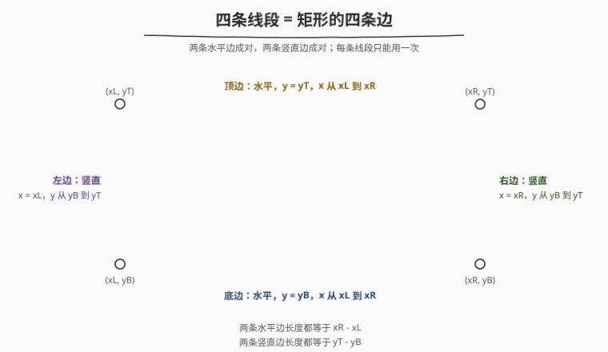
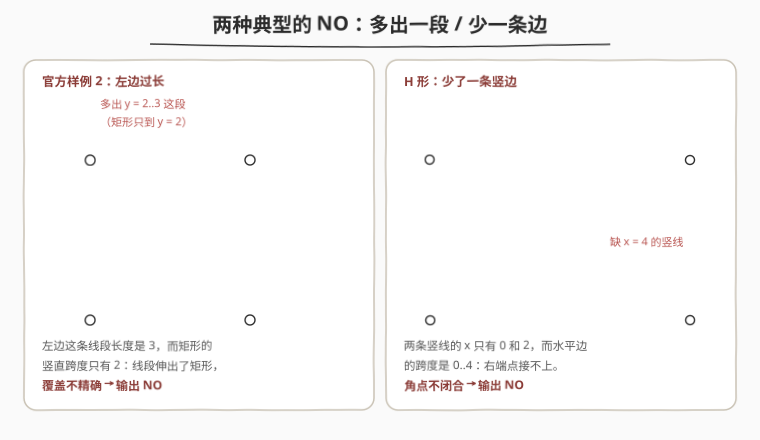

# Codeforces 14C 四条线段拼矩形 题解

## 1. 题目概述

- **题目链接**：https://codeforces.com/problemset/problem/14/C
- **比赛来源**：Codeforces Beta Round 14 (Div. 2) · Problem C
- **难度**：1700
- **标签**：暴力枚举、构造、几何、实现、数学（brute force, constructive algorithms, geometry, implementation, math）
- **评测类型**：普通
- **限制**：时间 2 s / 内存 64 MB

**题意**：给定四条线段，每条用两个端点 $(x_1,y_1)$、$(x_2,y_2)$ 描述。判断这四条线段能否**恰好**拼成一个面积为正、边与坐标轴平行的矩形。规则如下：

- 每条线段必须**恰好使用一次**；
- 线段可以整体“翻转”（交换两个端点），但不能平移、不能旋转成非轴方向、不能改变长度；
- 线段可能退化成一个点（两个端点相同）；
- 四条线段不能有多余的部分，也不能相互重叠，必须精确覆盖矩形的四条边。

能拼成则输出 `YES`，否则输出 `NO`。

**约束**：

- 坐标范围 $-10^9 \le x_1, y_1, x_2, y_2 \le 10^9$，需要用 64 位整数读入；但判断过程只做相等/大小比较，**不需要计算面积或长度**，因此不会溢出。
- 只有四条线段，任何 $O(4!)$、$O(2^4)$ 的枚举都是常数时间；总方案数 $4! \times 2^4 = 384$，暴力完全可行。
- 线段可能水平、竖直、斜着，也可能退化成一个点；这些都必须单独判掉。
- 只有一组数据，输出一个单词。

## 2. 示例与观察

官方样例 1（输入 / 输出原样）：

```text
输入：
1 1 6 1
1 0 6 0
6 0 6 1
1 1 1 0

输出：
YES
```

**样例 1 解释**：四条线段分别是

| 线段 | 方向 | 所在直线 | 跨度 |
|------|------|----------|------|
| $(1,1)-(6,1)$ | 水平 | $y = 1$ | $x \in [1,6]$ |
| $(1,0)-(6,0)$ | 水平 | $y = 0$ | $x \in [1,6]$ |
| $(6,0)-(6,1)$ | 竖直 | $x = 6$ | $y \in [0,1]$ |
| $(1,1)-(1,0)$ | 竖直 | $x = 1$ | $y \in [0,1]$ |

两条水平边的 $x$ 跨度都是 $[1,6]$，$y$ 分别是 $0$ 和 $1$；两条竖直边的 $y$ 跨度都是 $[0,1]$，$x$ 分别是 $1$ 和 $6$。它们恰好是矩形 $[1,6] \times [0,1]$ 的四条边，输出 `YES`。

官方样例 2（输入 / 输出原样）：

```text
输入：
0 0 0 3
2 0 0 0
2 2 2 0
0 2 2 2

输出：
NO
```

**样例 2 解释**：四条线段是竖直的 $x=0$（$y$ 从 $0$ 到 $3$）、水平的 $y=0$（$x$ 从 $0$ 到 $2$）、竖直的 $x=2$（$y$ 从 $0$ 到 $2$）、水平的 $y=2$（$x$ 从 $0$ 到 $2$）。两条竖直边的 $y$ 跨度分别是 $[0,3]$ 和 $[0,2]$，**不相等**：左边比矩形高出一格，覆盖超出了矩形，所以不能拼成，输出 `NO`。

自造样例（标注“自造”，覆盖各类拒绝情形）：

| 四条线段 | 输出 | 原因 |
|----------|------|------|
| $(0,0)-(2,0)$、$(2,0)-(2,2)$、$(2,2)-(0,2)$、$(0,2)-(0,0)$ | `YES` | 标准单位矩形（顺序、方向任意打乱仍可） |
| $(0,0)-(3,0)$、$(2,0)-(2,2)$、$(2,2)-(0,2)$、$(0,2)-(0,0)$ | `NO` | 底边过长，水平跨度 $[0,3] \ne [0,2]$ |
| $(0,0)-(2,0)$、$(0,2)-(2,2)$、$(0,0)-(0,2)$、$(1,0)-(1,2)$ | `NO` | “H” 形，两条竖线的 $x$ 是 $0,1$，水平跨度却是 $0..2$ |
| $(0,0)-(2,2)$、$(2,0)-(2,2)$、$(0,2)-(2,2)$、$(0,0)-(0,2)$ | `NO` | 一条对角线，不是轴对齐的边 |
| 四个点 $(0,0)$ 重复四次 | `NO` | 全部退化，没有正面积 |
| $(0,0)-(2,0)$ 重复两次，再加两条竖直边 | `NO` | 两条水平边在同一 $y$，边重复 |
| $(0,0)-(1,0)$、$(1,0)-(2,0)$、$(2,0)-(2,1)$、$(0,0)-(0,1)$ | `NO` | 底边被拆成两段，只有 1 条竖直边 |

**观察**：合法矩形必然是“两条水平边 + 两条竖直边”：

- 两条水平边的 $x$ 跨度完全一样，$y$ 坐标不同（上、下两条）；
- 两条竖直边的 $y$ 跨度完全一样，$x$ 坐标不同（左、右两条）；
- 水平边的跨度端点恰好是两条竖线的 $x$ 坐标，竖直边的跨度端点恰好是两条横线的 $y$ 坐标。

这四条判据同时成立，四条线段就恰好是矩形的四条边；任何一条不成立，就会出现“多出一段”“少一条边”“接不上角”等问题。

## 3. 解题思路

### 3.1 朴素做法与瓶颈

由于只有四条线段，可以直接暴力：

1. 枚举四条线段的排列（$4! = 24$ 种）；
2. 枚举每条线段是否翻转端点（$2^4 = 16$ 种）；
3. 按顺序把线段首尾相接，检查是否闭合、是否形成轴平行矩形。

总方案数 $24 \times 16 = 384$，对每组数据都是常数时间，**完全可以在时限内跑完**。这个暴力也是本题最可靠的“兜底”写法：只要能正确判断闭合与矩形，就不必担心遗漏某种排列。

不过，暴力需要处理“首尾相接”的多种顺序，还要判断闭合后是否真的是矩形，代码分支较多。更简洁的做法是**先把线段按方向分类，再检查四条判据**——它只需要常数次比较，且证明更直接。

### 3.2 核心观察：两条水平 + 两条竖直，且跨度成对相等



先把每条线段规范化：若 $(x_1,y_1)$ 字典序大于 $(x_2,y_2)$，就交换两个端点。题目允许翻转线段，所以这一步不影响可行性，只是让后面可以直接比较大小。

规范化后，线段只有四种可能：

- **水平边**：$y_1 = y_2$ 且 $x_1 < x_2$，记作 $(x_1, x_2, y)$；
- **竖直边**：$x_1 = x_2$ 且 $y_1 < y_2$，记作 $(x, y_1, y_2)$；
- **退化点**：$x_1 = x_2$ 且 $y_1 = y_2$，不能作为边；
- **斜线段**：其余情况，不能作为轴平行矩形的边。

设所有水平边中 $y$ 的最小值为 $y_B$、最大值为 $y_T$；所有竖直边中 $x$ 的最小值为 $x_L$、最大值为 $x_R$。如果四条线段真是矩形的四条边，那么矩形只能是 $[x_L,x_R] \times [y_B,y_T]$，并且必须满足：

1. 恰好 2 条水平边、2 条竖直边，没有退化点和斜线；
2. 两条水平边的 $x$ 跨度都等于 $[x_L, x_R]$，且 $y$ 不同；
3. 两条竖直边的 $y$ 跨度都等于 $[y_B, y_T]$，且 $x$ 不同；
4. $x_L < x_R$、$y_B < y_T$（面积为正）。

第 2、3 条中的“$y$ 不同”“$x$ 不同”保证两条边不重合；跨度相等保证两条边等长且平行。第 2、3 条同时把水平跨度与竖线位置、竖直跨度与横线位置绑定起来，保证四个角点恰好相接。

### 3.3 算法流程：四条判据


1. 读入四条线段，逐条规范化端点顺序；
2. 对每条线段分类：
   - 退化点 → 直接判 `NO`（面积为正的矩形不能有点边）；
   - 水平 → 加入 `h`；
   - 竖直 → 加入 `v`；
   - 斜线 → 直接判 `NO`；
3. 若 `h.size() != 2` 或 `v.size() != 2` → `NO`；
4. 检查两条水平边：`h[0].y != h[1].y`，且 `h[0].x1 == h[1].x1`、`h[0].x2 == h[1].x2`；否则 `NO`；
5. 检查两条竖直边：`v[0].x != v[1].x`，且 `v[0].y1 == v[1].y1`、`v[0].y2 == v[1].y2`；否则 `NO`；
6. 令 $x_L = \min(v_0.x, v_1.x)$、$x_R = \max(v_0.x, v_1.x)$、$y_B = \min(h_0.y, h_1.y)$、$y_T = \max(h_0.y, h_1.y)$；
7. 检查水平边的跨度是否恰为 $[x_L, x_R]$，即 `h[0].x1 == xL && h[0].x2 == xR`；否则 `NO`；
8. 检查竖直边的跨度是否恰为 $[y_B, y_T]$，即 `v[0].y1 == yB && v[0].y2 == yT`；否则 `NO`；
9. 以上全部通过 → `YES`。

第 4、5 步保证“两条水平边等长平行、两条竖直边等长平行”，第 7、8 步保证“水平跨度与竖线位置匹配、竖直跨度与横线位置匹配”。第 2 步排除了退化和斜线，第 3 步保证数量正确且每条线段只用一次（四条线段分到两组，每组两条）。

坐标最大 $10^9$，但全程只做相等和大小比较，不计算面积、不计算长度，因此没有溢出风险；`long long` 只是为了保证读入安全。

### 3.4 样例与反例走查

**样例 1**：`h = {(1,6,1), (1,6,0)}`，`v = {(6,0,1), (1,0,1)}`。

- 两条水平边 $y$ 为 $1,0$，不同；$x$ 跨度都是 $[1,6]$；
- 两条竖直边 $x$ 为 $6,1$，不同；$y$ 跨度都是 $[0,1]$；
- $x_L = 1, x_R = 6, y_B = 0, y_T = 1$；
- 水平跨度 $[1,6] = [x_L,x_R]$，竖直跨度 $[0,1] = [y_B,y_T]$。

全部通过，输出 `YES`。

**样例 2**：`v = {(0,0,3), (2,0,2)}`，两条竖直边的 $y$ 跨度 $[0,3]$ 与 $[0,2]$ 不同，第 5 步失败，输出 `NO`。



图中左侧就是样例 2：矩形的上边在 $y=2$，左边却画到了 $y=3$，多出的那段伸出矩形，覆盖不精确。右侧是“H”形：水平边的跨度是 $0..4$，但两条竖线的 $x$ 只有 $0$ 和 $2$，右端点接不上，角点不闭合。

再走查两个细节：

- 线段顺序、方向任意打乱不影响结果：规范化后所有水平边都会落到 `h`，所有竖直边落到 `v`，比较的是端点数值而不是输入顺序。
- 底边被拆成两段（如 $(0,0)-(1,0)$、$(1,0)-(2,0)$）时，`h` 里会有 3 条水平边，`v` 只有 1 条，第 3 步直接失败；即使凑巧数量对，跨度也会不同。

## 4. 正确性证明

**引理 1（必要性）**：若四条线段能恰好拼成面积为正的轴平行矩形 $R = [x_L,x_R] \times [y_B,y_T]$（$x_L < x_R$，$y_B < y_T$），则规范化后必有：恰好两条水平边、两条竖直边，无退化点与斜线；两条水平边的 $x$ 跨度都是 $[x_L,x_R]$ 且 $y$ 分别为 $y_B,y_T$；两条竖直边的 $y$ 跨度都是 $[y_B,y_T]$ 且 $x$ 分别为 $x_L,x_R$。

**证明**：矩形的四条边就是这四条线段（每条恰用一次）。两条水平边分别位于 $y=y_B$ 与 $y=y_T$，$x$ 从 $x_L$ 到 $x_R$；两条竖直边分别位于 $x=x_L$ 与 $x=x_R$，$y$ 从 $y_B$ 到 $y_T$。它们都不是退化点，也都不是斜线。于是所有条件成立。∎

**引理 2（充分性）**：若四条线段规范化后满足 3.3 中第 1～8 步的全部条件，则它们恰好是某个正面积轴平行矩形的四条边。

**证明**：设两条水平边为 $h_1,h_2$，两条竖直边为 $v_1,v_2$。由第 4 步，$h_1,h_2$ 的 $x$ 跨度都是 $[x_L,x_R]$（第 7 步），$y$ 坐标不同，记较小者为 $y_B$、较大者为 $y_T$，则 $y_B < y_T$。由第 5 步，$v_1,v_2$ 的 $y$ 跨度都是 $[y_B,y_T]$（第 8 步），$x$ 坐标不同，记较小者为 $x_L$、较大者为 $x_R$，则 $x_L < x_R$。

考虑矩形 $R = [x_L,x_R] \times [y_B,y_T]$，面积为 $(x_R-x_L)(y_T-y_B) > 0$。它的四条边正是：

- 下边：$y=y_B$，$x \in [x_L,x_R]$；
- 上边：$y=y_T$，$x \in [x_L,x_R]$；
- 左边：$x=x_L$，$y \in [y_B,y_T]$；
- 右边：$x=x_R$，$y \in [y_B,y_T]$。

$h_1,h_2$ 就是下边和上边（顺序可能交换），$v_1,v_2$ 就是左边和右边。因此四条线段恰好覆盖 $R$ 的边界，每条用一次。

**不重叠**：两条水平边的 $y$ 不同，不会重合；两条竖直边的 $x$ 不同，不会重合；水平边与竖直边只可能在四个角点相交，而由跨度匹配，这些交点恰好是它们的端点。**覆盖完整**：矩形边界的每一点都属于上述四条边之一。∎

**定理**：算法输出 `YES` 当且仅当四条线段能恰好拼成面积为正的轴平行矩形。

**证明**：

- 若算法输出 `YES`，第 1～8 步全部通过，由引理 2，四条线段恰好是某个正面积轴平行矩形的四条边，故可行。
- 若四条线段可行，由引理 1，规范化后恰好两条水平、两条竖直，且跨度与坐标满足第 1～8 步的全部条件，算法输出 `YES`。

两个方向都成立。∎

## 5. 复杂度分析

- **时间**：$O(1)$。只读入 4 条线段，做常数次分类、比较与更新；即使把暴力枚举也算上，$4! \times 2^4 = 384$ 次检查仍是常数。
- **空间**：$O(1)$。只存两个长度至多 2 的向量 `h`、`v` 和几个坐标变量。
- **数值范围**：坐标绝对值不超过 $10^9$，读入用 `long long`；判断只做相等/大小比较，不做加减乘除，因此不会溢出。即使要算面积，$(2 \times 10^9)^2 = 4 \times 10^{18}$ 仍在 64 位有符号整数范围内，但本题不需要。
- **与时限的关系**：2 s 的时限对常数次比较极其宽松。实测四条线段取到 $\pm 10^9$ 的矩形时，C++ 端到端 200 次为 min $2.07$ ms / avg $2.43$ ms / max $6.13$ ms，Python3 50 次 avg $20.1$ ms（均含进程启动），时间余量在 80 倍以上。

## 6. 参考代码

### C++17

```cpp
#include <bits/stdc++.h>
using namespace std;

struct Seg {
    long long x1, y1, x2, y2;
};

int main() {
    ios::sync_with_stdio(false);
    cin.tie(nullptr);

    vector<Seg> h, v;                 // 水平边、竖直边
    bool ok = true;

    for (int k = 0; k < 4; ++k) {
        long long x1, y1, x2, y2;
        if (!(cin >> x1 >> y1 >> x2 >> y2)) return 0;
        // 统一端点顺序，便于后面直接比较
        if (x1 > x2 || (x1 == x2 && y1 > y2)) {
            swap(x1, x2);
            swap(y1, y2);
        }
        if (x1 == x2 && y1 == y2) {   // 退化成点，不能当边
            ok = false;
        } else if (y1 == y2) {        // 水平边（此时 x1 < x2）
            h.push_back({x1, y1, x2, y2});
        } else if (x1 == x2) {        // 竖直边（此时 y1 < y2）
            v.push_back({x1, y1, x2, y2});
        } else {                      // 斜线段
            ok = false;
        }
    }

    if (!ok || h.size() != 2 || v.size() != 2) {
        cout << "NO\n";
        return 0;
    }

    // 两条水平边：高度不同，且左右端点完全一致
    if (h[0].y1 == h[1].y1 || h[0].x1 != h[1].x1 || h[0].x2 != h[1].x2) {
        cout << "NO\n";
        return 0;
    }
    // 两条竖直边：横坐标不同，且上下端点完全一致
    if (v[0].x1 == v[1].x1 || v[0].y1 != v[1].y1 || v[0].y2 != v[1].y2) {
        cout << "NO\n";
        return 0;
    }

    long long xL = min(v[0].x1, v[1].x1), xR = max(v[0].x1, v[1].x1);
    long long yB = min(h[0].y1, h[1].y1), yT = max(h[0].y1, h[1].y1);

    // 水平边的跨度必须正好是两条竖直边所在的两条竖线
    if (h[0].x1 != xL || h[0].x2 != xR) {
        cout << "NO\n";
        return 0;
    }
    // 竖直边的跨度必须正好是两条水平边所在的两条横线
    if (v[0].y1 != yB || v[0].y2 != yT) {
        cout << "NO\n";
        return 0;
    }

    cout << "YES\n";
    return 0;
}
```

### Python3

```python
import sys


def main() -> None:
    data = sys.stdin.buffer.read().split()
    if not data:
        return

    h = []          # 水平边：(x1, x2, y)
    v = []          # 竖直边：(x, y1, y2)
    ok = True

    pos = 0
    for _ in range(4):
        x1, y1, x2, y2 = (int(data[pos + i]) for i in range(4))
        pos += 4
        if x1 > x2 or (x1 == x2 and y1 > y2):
            x1, y1, x2, y2 = x2, y2, x1, y1
        if x1 == x2 and y1 == y2:
            ok = False
        elif y1 == y2:
            h.append((x1, x2, y1))
        elif x1 == x2:
            v.append((x1, y1, y2))
        else:
            ok = False

    if not ok or len(h) != 2 or len(v) != 2:
        sys.stdout.write("NO\n")
        return

    if h[0][2] == h[1][2] or h[0][0] != h[1][0] or h[0][1] != h[1][1]:
        sys.stdout.write("NO\n")
        return
    if v[0][0] == v[1][0] or v[0][1] != v[1][1] or v[0][2] != v[1][2]:
        sys.stdout.write("NO\n")
        return

    xL = min(v[0][0], v[1][0])
    xR = max(v[0][0], v[1][0])
    yB = min(h[0][2], h[1][2])
    yT = max(h[0][2], h[1][2])

    if h[0][0] != xL or h[0][1] != xR:
        sys.stdout.write("NO\n")
        return
    if v[0][1] != yB or v[0][2] != yT:
        sys.stdout.write("NO\n")
        return

    sys.stdout.write("YES\n")


main()
```

两份代码都只用标准库，可原样提交；`long long` 只用于安全读入，判断过程没有算术运算。

## 7. 边界情况与易错点

1. **退化线段（两个端点相同）**：必须是 `NO`。代码在分类前先判 `x1 == x2 && y1 == y2`；如果漏掉，退化点可能被当成“水平边”或“竖直边”，导致后续出现零长度的边。
2. **斜线段**：`y1 != y2` 且 `x1 != x2` 的线段不是轴平行的边，必须 `NO`。不能只检查“是否水平或竖直”而把斜线漏过去。
3. **两条水平边在同一条水平线上**：`h[0].y == h[1].y` 说明两条边重合或在同侧，不能构成上下两条边，必须 `NO`。竖直边同理检查 `x` 是否相同。
4. **跨度不一致**：一条边比另一条长（例如底边从 $0$ 到 $3$，顶边从 $0$ 到 $2$）时，即使方向、数量都对，也会多出一段，必须 `NO`。代码用 `h[0].x1 == h[1].x1 && h[0].x2 == h[1].x2` 检查。
5. **覆盖不匹配（样例 2）**：两条竖直边的 $y$ 跨度必须完全等于两条水平边所在的 $y_B,y_T$。若一条竖边从 $0$ 画到 $3$、另一条从 $0$ 画到 $2$，即使水平边在 $0$ 和 $2$，左边也多出一段，必须 `NO`。
6. **“H”形与拆分边**：只有 2 条水平 + 2 条竖直还不够，竖线的 $x$ 必须等于水平跨度的两个端点。H 形的竖线在 $0,1$，水平跨度却是 $0..2$，第 7 步会失败；底边被拆成两段时水平边会有 3 条，第 3 步就失败。
7. **坐标范围与溢出**：坐标到 $\pm 10^9$，`int` 能放下，但两个坐标相减会达到 $2 \times 10^9$，超出 `int` 上界；本题只做比较，不相减，但读入和存储统一用 `long long` 最稳。若要在别的题里算面积，务必用 64 位。
8. **输入顺序与端点方向**：四条线段的顺序任意，每条线段的两个端点也可能反着给。代码先规范化再分类，因此两种情况都能处理；如果按输入顺序硬编码“第 1 条是底边”就会错。
9. **面积为 0**：如果两条竖直边的 $x$ 相同，或两条水平边的 $y$ 相同，矩形退化成一条线，面积为 $0$。代码分别用“$x$ 不同”“$y$ 不同”排除了这两种情况。
10. **重复线段**：同一线段出现两次时，要么两条水平边同 $y$，要么两条竖直边同 $x$，都会被上面的判据拒绝；不会出现“凑巧通过”的情况。

## 8. 验证记录

- **编译环境与命令**：本机没有 GNU `g++`（`/usr/bin/g++` 是 Apple clang 21.0.0 的软链），用 `clang++ -std=c++17 -O2 -Wall -Wextra -I codeforces/tools/include` 配合仓库自带的 `bits/stdc++.h` 兼容头编译，**零警告**；Python 侧为 `Python 3.9.6`。
- **官方样例**：2 / 2 通过（样例 1 → `YES`，样例 2 → `NO`）。`verify_solution.py` 的输出为 `CF14C: samples 2`、`C++ 编译 OK, 样例 2/2`、`Python 语法 OK, 样例 2/2` 三行。
- **独立暴力对拍**：另写一份暴力：枚举四条线段的 $4! = 24$ 种排列与每条线段的 $2^4 = 16$ 种端点方向（共 384 种），尝试首尾相接成闭合多边形；再要求四个顶点互不相同、$x$ 与 $y$ 各只有两个取值，且按环序为“横、竖、横、竖”四条非零边。共测 **2704 组**，C++、Python 与暴力**全部一致，0 处不符**：
  - 14 组定向数据：两个官方样例、合法矩形（打乱顺序/方向）、底边过长、右边过短、重复底边、十字形、H 形、对角线、四个退化点、含退化点的矩形、极值坐标矩形等；
  - 200 组随机合法矩形：随机 $x_L < x_R$、$y_B < y_T$，四条边随机打乱顺序并随机翻转端点，含多组 $\pm 10^9$ 坐标，全部应为 `YES`，实际全部 `YES`；
  - 300 组随机任意线段：端点随机取 $[-5,5]$，可能是水平、竖直、斜线、退化点或重复，与暴力逐一比较；
  - 100 组“接近合法”的扰动数据：先造合法矩形，再随机改动一个端点，检验边界附近的判定；
  - 2000 组从 $3 \times 3$ 网格的全部 45 条线段（含点、水平、竖直、斜线）中随机抽取的 4 条组合；
  - 90 组 $3 \times 3$ 网格内所有合法矩形的“打乱顺序 + 随机翻转”变体。
- **最大约束性能**：四条边取 $\pm 10^9$ 的矩形时，C++ 端到端 200 次为 min $2.07$ ms / avg $2.43$ ms / max $6.13$ ms；Python3 50 次 avg $20.1$ ms（均含进程启动），相对 2 s 时限余量在 80 倍以上。
- **图片校验**：三张 SVG（`cf14c_valid_rect.svg`、`cf14c_judge_flow.svg`、`cf14c_reject_cases.svg`）均通过 `xml.etree.ElementTree.parse`；用 headless Chrome 的 `getBBox()` 测量渲染结果，共 43 个文本块，全部落在 `viewBox` 内，文本两两之间 0 处重叠，面板与方框内的文本全部收在框内。
- **公式校验**：正文公式经 `node codeforces/tools/katex_check.cjs` 的 KaTeX（`throwOnError`）校验，0 处报错；星号直接写 `*`，`\text{}` 内无裸 `#`，证明结尾用 `∎`。
- **复核状态**：verified（官方样例、2704 组暴力/随机对拍、最大约束性能、图片几何、公式五项均实跑通过；唯一环境差异是本机无 GNU g++，已用 clang++ 等价验证）。

## 相关题目与扩展

- [Codeforces 14A Letter](https://codeforces.com/problemset/problem/14/A)：同场 A 题，求包含全部 `*` 的最小矩形，是本题“矩形边界”的二维版本。
- [Codeforces 14B Young Photographer](https://codeforces.com/problemset/problem/14/B)：同场 B 题，所有区间的交集，和本题一样需要“边界精确匹配”的思维。
- [Codeforces 2C Commentator problem](https://codeforces.com/problemset/problem/2/C)：平面上找一点使到三个圆的视角相等，是几何 + 浮点比较的进阶题。
- [Codeforces 1C Ancient Berland Circus](https://codeforces.com/problemset/problem/1/C)：由三个点确定正多边形，涉及距离、角度与精度。
- [LeetCode 939. 最小面积矩形](https://leetcode.cn/problems/minimum-area-rectangle/)：给一堆点，判断能否组成轴平行矩形并求最小面积，是本题“四个角点”思路的推广。
- [LeetCode 836. 矩形重叠](https://leetcode.cn/problems/rectangle-overlap/)：判断两个轴平行矩形是否重叠，可对比本题“不重叠”的判定方式。

**延伸思考**：

1. **如果允许线段平移**：问题变成“用四条给定长度的线段拼一个矩形”，可以先把线段按长度分组，再检查能否两两配对；但平移后还要考虑放置位置，可能出现多种矩形。
2. **如果允许矩形旋转（不要求轴平行）**：四条线段的方向不必水平/竖直，需要比较方向向量、长度与夹角，判定会从“比较坐标”变成“向量点积/叉积”，还要处理浮点或整数运算。
3. **如果允许一条边由多条线段拼成**：题目的“四条线段”就变成了“四条线段的一个划分”，需要按所在直线分组，检查每条直线的覆盖长度与端点，问题接近线段覆盖。
4. **如果问能拼成多少种矩形**：在合法的情况下，四条线段只对应唯一矩形（由 $x_L,x_R,y_B,y_T$ 确定）；若不合法，方案数为 $0$。若允许平移/旋转，方案数会变多，需要去重。
5. **如果坐标范围扩大到 $10^{18}$**：比较仍然安全，但任何面积/长度计算都要用 128 位整数或浮点；本题的“只比较、不计算”正是避免溢出的一种设计。

