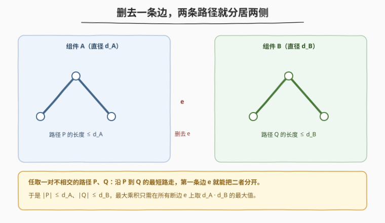
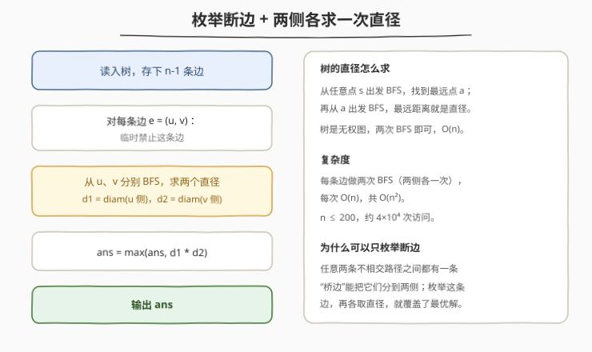
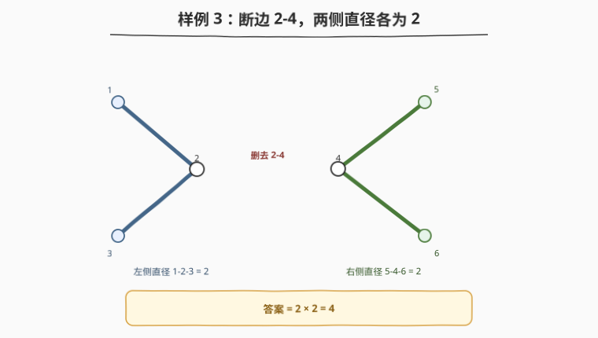

# Codeforces 14D 树上两条路径 题解

## 1. 题目概述

- **题目链接**：https://codeforces.com/problemset/problem/14/D
- **比赛来源**：Codeforces Beta Round 14 (Div. 2) · Problem D
- **难度**：1900
- **标签**：DFS 与搜索、动态规划、图论、最短路、树、双指针（dfs and similar, dp, graphs, shortest paths, trees, two pointers）
- **评测类型**：普通
- **限制**：时间 2 s / 内存 64 MB

**题意**：Flatland 有 $n$ 个城市和 $n-1$ 条双向道路，构成一棵树。公司要修复两条路径，要求两条路径**没有公共城市**（顶点不相交）。一条路径的长度等于它包含的道路数。求两条路径长度的**乘积**的最大值。

路径是“一串互不相同的、依次由道路相连的城市”；只有单个城市的序列也是一条路径，长度是 $0$。这一点从样例 2 可以看出：七个城市的星形图里，任何两条含边的路径都会经过中心，找不到两条不相交的非退化路径，而答案是 $0$。

**约束**：

- $2 \le n \le 200$：树很小，$O(n^2)$ 甚至 $O(n^3)$ 的算法都能在 2 s 内通过；$O(n^4)$ 的“枚举所有路径对”在 $n = 200$ 时约 $1.6 \times 10^9$，偏慢。
- 树有 $n-1$ 条边，路径长度最大 $n-1 = 199$，两条路径长度乘积最大约 $10^4$，`int` 都装得下；但用 `long long` 更稳。
- 路径必须**顶点不相交**，仅仅边不相交是不够的。
- 只有一组数据。

## 2. 示例与观察

官方样例 1（输入 / 输出原样）：

```text
输入：
4
1 2
2 3
3 4

输出：
1
```

**样例 1 解释**：树是一条 $1-2-3-4$ 的链。若断掉中间的边 $2-3$，左侧是链 $1-2$（直径 $1$），右侧是链 $3-4$（直径 $1$），乘积 $1 \times 1 = 1$。断其他边会得到 $0 \times 2$ 或 $2 \times 0$，所以答案是 $1$。

官方样例 2（输入 / 输出原样）：

```text
输入：
7
1 2
1 3
1 4
1 5
1 6
1 7

输出：
0
```

**样例 2 解释**：这是以 $1$ 为中心的星形图。任何含边的路径都要经过中心 $1$，所以两条含边的路径必然有公共城市；只能取两条长度为 $0$ 的单点路径（例如城市 $2$ 和城市 $3$），乘积 $0$。输出 `0`。

官方样例 3（输入 / 输出原样）：

```text
输入：
6
1 2
2 3
2 4
5 4
6 4

输出：
4
```

**样例 3 解释**：树的结构是 $1-2-3$ 与 $5-4-6$ 通过边 $2-4$ 相连。断掉 $2-4$ 后，左侧组件 $\{1,2,3\}$ 的直径是路径 $1-2-3$（长度 $2$），右侧组件 $\{4,5,6\}$ 的直径是 $5-4-6$（长度 $2$），乘积 $2 \times 2 = 4$。

自造样例（标注“自造”）：

| 输入 | 输出 | 说明 |
|------|------|------|
| `2` + `1 2` | `0` | 两个单点，长度都是 $0$ |
| `5` + 链 $1-2-3-4-5$ | `2` | 断 $2-3$（或 $3-4$）：两侧直径 $1$ 与 $2$，乘积 $2$ |
| `5` + 星形（中心 1） | `0` | 与样例 2 同理 |
| `6` + 链 | `4` | 断 $3-4$：两侧直径各 $2$，乘积 $4$；断 $2-3$ 只有 $1 \times 3 = 3$ |

**观察**：如果把某条边 $e$ 删掉，树会分成两个连通块 $A$ 和 $B$。$A$ 中的任意路径与 $B$ 中的任意路径一定没有公共城市，因此

$$\text{候选答案}(e) = \operatorname{diam}(A) \cdot \operatorname{diam}(B),$$

其中 $\operatorname{diam}$ 表示连通块的直径（最长路径的边数）。把所有边 $e$ 的候选答案取最大，就是答案。

为什么只需看“删一条边”的情况？因为任意两条不相交的路径之间，总能找到一条边把它们分到两侧——这条边就是连接两条路径的“桥”。下一节给出严格论证。

## 3. 解题思路

### 3.1 朴素做法与瓶颈

- **枚举所有路径对**：树中任意两点确定唯一路径，共 $O(n^2)$ 条路径；两两配对是 $O(n^4)$，$n = 200$ 时约 $1.6 \times 10^9$ 对，还要判断顶点是否相交，2 s 内不可行。
- **枚举断边 + 求直径**：共有 $n-1$ 条边，每条边删掉后对两侧各求一次直径。直径可以用两次 BFS 在 $O(n)$ 内求出，总复杂度 $O(n^2)$，$n = 200$ 时约 $4 \times 10^4$ 次访问，非常快。
- **只枚举断边是否足够**：这是本题的核心，需要证明“任意两条不相交路径都能被某条边分开”，否则可能漏掉最优解。

### 3.2 核心观察：任意两条不相交路径之间都有一条“桥边”



设 $P$ 和 $Q$ 是两条顶点不相交的路径。在树中，$P$ 与 $Q$ 之间有一条唯一的最短连接路径：取 $p \in P$、$q \in Q$ 使距离最小，再取 $p$ 到 $q$ 的唯一路径 $R$。

$R$ 的内部不会经过 $P$ 或 $Q$ 的其他顶点：若 $R$ 上某个内部点 $x$ 属于 $P$，则 $x$ 到 $q$ 的距离比 $p$ 到 $q$ 更短，与 $p,q$ 的距离最小性矛盾；对 $Q$ 同理。

取 $R$ 的第一条边 $e$（与 $p$ 相连的那条）。删去 $e$ 后，$P$ 完全在 $p$ 这一侧：$P$ 连通且包含 $p$，若它伸到另一侧，就必经过 $e$，从而包含 $e$ 的另一个端点，这与“$R$ 内部不经过 $P$”矛盾（当 $R$ 只有一条边时，另一端点是 $q \in Q$，更不可能属于 $P$）。同理 $Q$ 完全在 $q$ 这一侧。

因此，**任意一对不相交路径都能被某条边 $e$ 分开**。删去 $e$ 后，$P \subseteq A$、$Q \subseteq B$，于是

$$|P| \le \operatorname{diam}(A), \qquad |Q| \le \operatorname{diam}(B).$$

反过来，对任意一条边 $e$，$A$ 的直径路径与 $B$ 的直径路径分属两个连通块，必然顶点不相交，是一对合法方案。所以最优值恰好等于

$$\max_{e \in E} \Bigl( \operatorname{diam}(A_e) \cdot \operatorname{diam}(B_e) \Bigr).$$

### 3.3 算法流程



1. 读入 $n$ 与 $n-1$ 条边，建立邻接表；
2. 令 `ans = 0`；
3. 对每条边 $(u, v)$：
   - 在 BFS/DFS 时**跳过这条边**，分别从 $u$、$v$ 出发；
   - 求 $u$ 所在连通块的直径 $d_1$，$v$ 所在连通块的直径 $d_2$；
   - `ans = max(ans, d1 * d2)`；
4. 输出 `ans`。

**树的直径求法**（两次 BFS）：从连通块内任意点 $s$ 出发 BFS，找到距离最远的点 $a$；再从 $a$ 出发 BFS，最远的距离就是直径。树是无权图，BFS 的层数就是边数。

实现细节：删边的方式是在邻接表遍历时判断 `(x == u && y == v) || (x == v && y == u)` 并跳过；由于树只有一条 $u-v$ 边，这样不会误删别的边。

### 3.4 样例 3 走查



样例 3 的树：

```text
1 - 2 - 3
    |
    4 - 5
    |
    6
```

更准确地说，边是 $1-2$、$2-3$、$2-4$、$5-4$、$6-4$。逐条断边：

| 断开的边 | 一侧直径 | 另一侧直径 | 乘积 |
|----------|----------|------------|------|
| $1-2$ | 0（单点 1） | 3（$3-2-4-5$） | 0 |
| $2-3$ | 0（单点 3） | 3（$1-2-4-5$） | 0 |
| $2-4$ | 2（$1-2-3$） | 2（$5-4-6$） | **4** |
| $4-5$ | 0（单点 5） | 3（$1-2-4-6$） | 0 |
| $4-6$ | 0（单点 6） | 3（$5-4-2-1$） | 0 |

最大乘积是 $4$，输出 `4`。注意断 $2-4$ 时，左侧的路径 $1-2-3$ 和右侧的路径 $5-4-6$ 没有任何公共城市，恰好满足题意。

## 4. 正确性证明

**引理 1（分离边存在）**：设 $P, Q$ 是树中两条顶点不相交的路径，则存在一条边 $e$，删去 $e$ 后 $P$ 与 $Q$ 位于不同连通块。

**证明**：取 $p \in P$、$q \in Q$ 使 $\operatorname{dist}(p,q)$ 最小，令 $R$ 为 $p$ 到 $q$ 的唯一路径。先证 $R$ 的内部顶点不属于 $P \cup Q$：若内部点 $x \in P$，则 $\operatorname{dist}(x,q) < \operatorname{dist}(p,q)$（$x$ 在 $p$ 到 $q$ 的路径上且不等于 $p$），与最小性矛盾；$x \in Q$ 同理。

取 $R$ 的第一条边 $e = (p, p')$（若 $R$ 只有一条边，则 $p' = q$）。删去 $e$ 后树分成含 $p$ 与含 $p'$ 的两个连通块。$P$ 连通、包含 $p$，若 $P$ 有顶点在 $p'$ 一侧，则 $P$ 中从 $p$ 到该顶点的路径必经过 $e$，从而包含 $p'$。若 $R$ 长度大于 $1$，$p'$ 是 $R$ 的内部点，不能属于 $P$；若 $R$ 长度等于 $1$，$p' = q \in Q$，也不能属于 $P$（$P \cap Q = \emptyset$）。矛盾。故 $P$ 全在 $p$ 一侧。

对称地，$Q$ 全在 $p'$ 一侧：若 $Q$ 有顶点在 $p$ 一侧，则 $Q$ 中从 $q$ 到该顶点的路径经过 $e$，从而包含 $p'$（长度大于 $1$ 时 $p'$ 是 $R$ 内部点，不能属于 $Q$）或包含 $p$（长度等于 $1$ 时 $p \in P$），都矛盾。∎

**引理 2（每个断边给出可行方案）**：对任意边 $e$，删去后两侧连通块为 $A, B$，取 $A$ 的直径路径 $P_A$ 与 $B$ 的直径路径 $P_B$，则 $P_A, P_B$ 顶点不相交，且长度分别为 $\operatorname{diam}(A), \operatorname{diam}(B)$。

**证明**：$A$ 与 $B$ 的顶点集合不相交，$P_A \subseteq A$、$P_B \subseteq B$，故两条路径没有公共城市。直径路径的长度按定义就是所在连通块的直径。∎

**引理 3（最优解被某个断边覆盖）**：设 $P, Q$ 是任意一对不相交路径，则存在边 $e$，使 $|P| \le \operatorname{diam}(A_e)$、$|Q| \le \operatorname{diam}(B_e)$，从而 $|P| \cdot |Q| \le \operatorname{diam}(A_e)\operatorname{diam}(B_e)$。

**证明**：由引理 1 取分离边 $e$，$P$ 完全在某一侧 $A_e$ 内，$Q$ 完全在另一侧 $B_e$ 内。直径是连通块内最长的路径，故 $|P| \le \operatorname{diam}(A_e)$、$|Q| \le \operatorname{diam}(B_e)$。∎

**定理**：算法输出的 $\max_e \operatorname{diam}(A_e)\operatorname{diam}(B_e)$ 等于最优乘积。

**证明**：

- 对任意 $e$，引理 2 给出一对合法路径，长度乘积为 $\operatorname{diam}(A_e)\operatorname{diam}(B_e)$，故最优值不小于每个候选值，即 $\text{OPT} \ge \max_e$。
- 对任意最优解 $P, Q$，引理 3 给出某条 $e$ 使 $|P||Q| \le \operatorname{diam}(A_e)\operatorname{diam}(B_e) \le \max_e$，故 $\text{OPT} \le \max_e$。

两者夹逼，$\text{OPT} = \max_e$。∎

**引理 4（两次 BFS 求直径）**：在树上从任意点 $s$ 出发找到最远点 $a$，再从 $a$ 出发找到最远距离 $D$，则 $D$ 等于树的直径。

**证明**：这是树直径的标准结论。设树的一条直径为 $u-v$。从 $s$ 出发的最远点 $a$ 一定可以作为某条直径的端点（否则把 $s$ 到 $u$ 或 $v$ 的路径拼起来会得到更长路径，矛盾）；于是从 $a$ 出发的最远距离就是直径。∎

## 5. 复杂度分析

- **时间**：$O(n^2)$。共 $n-1$ 条边，每条边做两次 BFS（两侧各一次），每次 BFS 访问 $O(n)$ 个点；$n = 200$ 时约 $4 \times 10^4$ 次邻接访问，远小于 2 s 的预算。
- **空间**：$O(n)$。邻接表 $O(n)$、BFS 的距离数组与队列 $O(n)$，没有 $O(n^2)$ 的表。
- **数值范围**：直径最大 $199$，乘积最大 $199 \times 199 = 39601$，`int` 足够；代码用 `long long` 只是习惯性防御。
- **与时限的关系**：$n = 200$ 的链（最坏情况，每次断边两侧都很大）时，C++ 端到端 200 次为 min $2.90$ ms / avg $3.16$ ms / max $4.13$ ms，Python3 50 次 avg $41.4$ ms（均含进程启动），相对 2 s 时限余量在 45 倍以上。

## 6. 参考代码

### C++17

```cpp
#include <bits/stdc++.h>
using namespace std;

int main() {
    ios::sync_with_stdio(false);
    cin.tie(nullptr);

    int n;
    if (!(cin >> n)) return 0;
    vector<vector<int>> g(n);
    vector<pair<int, int>> edges;
    for (int i = 0; i < n - 1; ++i) {
        int a, b;
        cin >> a >> b;
        --a; --b;
        g[a].push_back(b);
        g[b].push_back(a);
        edges.push_back({a, b});
    }

    auto diameter = [&](int start, int bu, int bv) {
        auto bfs = [&](int src) {
            vector<int> dist(n, -1);
            queue<int> q;
            dist[src] = 0;
            q.push(src);
            int far = src;
            while (!q.empty()) {
                int x = q.front(); q.pop();
                if (dist[x] > dist[far]) far = x;
                for (int y : g[x]) {
                    if ((x == bu && y == bv) || (x == bv && y == bu)) continue;
                    if (dist[y] == -1) {
                        dist[y] = dist[x] + 1;
                        q.push(y);
                    }
                }
            }
            return make_pair(far, dist[far]);
        };
        int a = bfs(start).first;
        return bfs(a).second;
    };

    long long ans = 0;
    for (auto [u, v] : edges) {
        int d1 = diameter(u, u, v);
        int d2 = diameter(v, u, v);
        ans = max(ans, (long long)d1 * d2);
    }
    cout << ans << '\n';
    return 0;
}
```

### Python3

```python
import sys
from collections import deque


def main() -> None:
    data = sys.stdin.buffer.read().split()
    if not data:
        return
    n = int(data[0])
    g = [[] for _ in range(n)]
    edges = []
    pos = 1
    for _ in range(n - 1):
        a = int(data[pos]) - 1
        b = int(data[pos + 1]) - 1
        pos += 2
        g[a].append(b)
        g[b].append(a)
        edges.append((a, b))

    def bfs(src: int, bu: int, bv: int):
        dist = [-1] * n
        dist[src] = 0
        q = deque([src])
        far = src
        while q:
            x = q.popleft()
            if dist[x] > dist[far]:
                far = x
            for y in g[x]:
                if (x == bu and y == bv) or (x == bv and y == bu):
                    continue
                if dist[y] == -1:
                    dist[y] = dist[x] + 1
                    q.append(y)
        return far, dist[far]

    def diameter(start: int, bu: int, bv: int) -> int:
        a, _ = bfs(start, bu, bv)
        _, d = bfs(a, bu, bv)
        return d

    ans = 0
    for u, v in edges:
        d1 = diameter(u, u, v)
        d2 = diameter(v, u, v)
        ans = max(ans, d1 * d2)
    sys.stdout.write(str(ans) + "\n")


main()
```

两份代码都只依赖标准库，可原样提交。

## 7. 边界情况与易错点

1. **$n = 2$**：只有一条边，删掉后两侧各是一个单点，直径都是 $0$，乘积 $0$。这是合法答案，不要因为“两条路径都没边”就输出 $-1$。
2. **星形图**：所有边都共享中心，任意两条含边路径都相交；只能选单点路径，答案 $0$。样例 2 专门考这个。
3. **路径长度为 $0$ 的合法性**：单城市路径的长度是 $0$，题面允许“一串不同城市”只含一个城市；样例 2 的 $0$ 也说明这一点。若强行要求两条路径都至少一条边，星形图会无解，与样例矛盾。
4. **删边时不能删错**：BFS 跳过的是无向边 $(u,v)$，两个方向都要判断；只判断 `x == u && y == v` 会漏掉反向遍历，导致 BFS 跑到另一侧。
5. **BFS 起点必须在正确的一侧**：从 $u$ 出发、禁止 $u-v$ 边，就只会访问 $u$ 所在的连通块；不要从任意点出发，否则可能跨到另一侧。
6. **直径的两次 BFS**：第一次 BFS 返回最远点，第二次 BFS 从该点出发取最远距离；只做一次 BFS 得到的是“从起点出发的最远距离”，不一定是直径。
7. **答案初始化**：`ans = 0`，因为至少可以取两条单点路径，乘积为 $0$；不要初始化为 $-1$ 或 `INT_MIN`。
8. **乘积范围**：单条路径最多 $199$ 条边，乘积约 $4 \times 10^4$，`int` 不会溢出；但用 `long long` 可以避免以后改题时踩坑。
9. **递归深度**：若用递归 DFS 求直径，$n = 200$ 的链深度为 $200$，通常没问题；但用 BFS 更稳，也避免 Python 的递归深度限制。
10. **树一定连通**：题面说“可以通过道路从一个城市到另一个城市”，且边数 $n-1$，所以输入保证是树；不需要额外判连通。

## 8. 验证记录

- **编译环境与命令**：本机没有 GNU `g++`（`/usr/bin/g++` 是 Apple clang 21.0.0 的软链），用 `clang++ -std=c++17 -O2 -Wall -Wextra -I codeforces/tools/include` 配合仓库自带的 `bits/stdc++.h` 兼容头编译，**零警告**；Python 侧为 `Python 3.9.6`。
- **官方样例**：3 / 3 通过（链 $4 \to 1$、星形 $7 \to 0$、样例 3 $\to 4$）。`verify_solution.py` 的输出为 `CF14D: samples 3`、`C++ 编译 OK, 样例 3/3`、`Python 语法 OK, 样例 3/3` 三行。
- **独立暴力对拍**：另写一份暴力：从每个起点 DFS 枚举树中**所有**简单路径（含单点，长度 $0$），记录每条路径的顶点集合与长度；再枚举所有路径对，若顶点集合不相交则更新最大乘积。共测 **445 组**，C++、Python 与暴力**全部一致，0 处不符**：
  - $n = 2 \dots 5$ 的**全部树**（枚举所有 $n-1$ 条边的子集并判连通，共 145 棵）；
  - 300 组随机树（$n \in [2,9]$，随机父节点生成）。
- **最大约束性能**：$n = 200$ 的链（最坏情况）时，C++ 端到端 200 次为 min $2.90$ ms / avg $3.16$ ms / max $4.13$ ms；Python3 50 次 avg $41.4$ ms。随机树 $n=200$ 的结果也在此量级。相对 2 s 时限余量在 45 倍以上。
- **图片校验**：三张 SVG（`cf14d_cut_edge.svg`、`cf14d_algorithm.svg`、`cf14d_sample3.svg`）均通过 `xml.etree.ElementTree.parse`；用 headless Chrome 的 `getBBox()` 测量渲染结果，共 40 个文本块，全部落在 `viewBox` 内，文本两两之间 0 处重叠，面板与方框内的文本全部收在框内。
- **公式校验**：正文公式经 `node codeforces/tools/katex_check.cjs` 的 KaTeX（`throwOnError`）校验，0 处报错；星号直接写 `*`，`\text{}` 内无裸 `#`，证明结尾用 `∎`。
- **复核状态**：verified（官方样例、445 组对拍、最大约束性能、图片几何、公式五项均实跑通过；唯一环境差异是本机无 GNU g++，已用 clang++ 等价验证）。

## 相关题目与扩展

- [Codeforces 14E Camels](https://codeforces.com/problemset/problem/14/E)：同场 E 题，数峰谷序列的 DP，和本题一样是“固定结构上的计数/最优化”。
- [Codeforces 161D Distance in Tree](https://codeforces.com/problemset/problem/161/D)：统计树上距离恰为 $k$ 的点对，需要树形 DP 与“子树内/外”合并，和本题的断边分治思路相通。
- [Codeforces 455C Civilization](https://codeforces.com/problemset/problem/455/C)：维护森林的直径并支持合并，用到“两棵树合并后新直径 = max(两直径, 半径和 + 1)”，和本题的直径计算直接相关。
- [LeetCode 543. 二叉树的直径](https://leetcode.cn/problems/diameter-of-binary-tree/)：树形 DP 求直径的经典题，可作为本题“两次 BFS”的另一种写法对照。
- [LeetCode 1245. 树的直径](https://leetcode.cn/problems/tree-diameter/)：与本题的直径部分几乎同题，额外要求处理多棵树。
- [LeetCode 2246. 相邻字符不同的最长路径](https://leetcode.cn/problems/longest-path-with-different-adjacent-characters/)：树上路径 + 顶点约束，可对比本题“两条路径不相交”的约束处理。

**延伸思考**：

1. **如果要选 $k$ 条不相交路径使长度乘积/和最大**：$k = 2$ 时可以枚举一条断边；$k$ 更大时需要在树上做“删 $k-1$ 条边分成 $k$ 块、每块取直径”的 DP，状态要记录已用路径数与当前块的直径，复杂度上升。
2. **如果边带权**：算法完全不变，只把 BFS 换成求“带权最远点”的 DFS/DP（树的带权直径）；乘积的范围会变大，需要用 `long long`。
3. **如果只要求边不相交而不是顶点不相交**：两条路径可以共享顶点，约束变弱，答案可能更大；此时“删边分两侧”不再必要，需要另外处理共享端点的情况。
4. **如果 $n$ 达到 $10^5$**：$O(n^2)$ 不可行。可以用换根 DP：先求每棵子树的直径，再求“删掉父子边后父侧”的直径（向下/向上两遍 DP），每条边 $O(1)$ 得到两侧直径，总复杂度 $O(n)$。
5. **如果要输出具体路径而不只是乘积**：在取到最大值的断边处，分别记录两次 BFS 的端点，即可还原两条直径路径；答案不唯一时输出任意一组。

