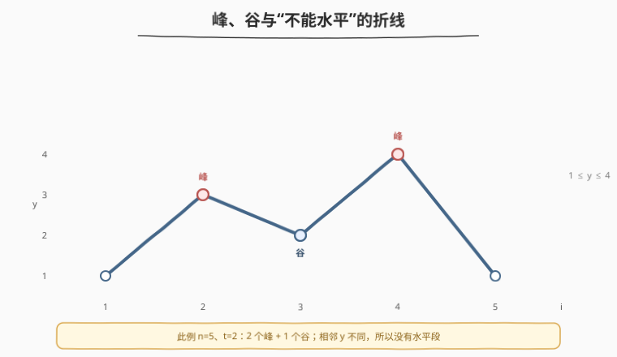

# Codeforces 14E 骆驼的峰谷计数 题解

## 1. 题目概述

- **题目链接**：https://codeforces.com/problemset/problem/14/E
- **比赛来源**：Codeforces Beta Round 14 (Div. 2) · Problem E（UTC 2010-05-19）
- **难度**：1900
- **标签**：动态规划（dp）
- **评测类型**：普通
- **限制**：时间 2 s / 内存 64 MB

**题意**：数一数有多少个长度为 $n$ 的整数序列 $y_1, y_2, \dots, y_n$ 满足：

- $1 \le y_i \le 4$；
- 相邻两项不相等（即折线的每一段都不与 $x$ 轴平行）；
- 恰有 $t$ 个“峰”：满足 $y_{j-1} < y_j > y_{j+1}$ 的下标 $j$（$2 \le j \le n-1$）；
- 恰有 $t-1$ 个“谷”：满足 $y_{j-1} > y_j < y_{j+1}$ 的下标 $j$。

输入 $n, t$，输出满足条件的序列个数。

**约束**：

- $3 \le n \le 20$，$1 \le t \le 10$：值域只有 $4$ 种，序列总数为 $4^n$；$n = 20$ 时约 $1.1 \times 10^{12}$，**逐个枚举不可行**。
- 若相邻不相等，序列总数是 $4 \cdot 3^{n-1}$；$n = 20$ 时约 $4.65 \times 10^9$，已经超过 32 位有符号整数上界 $2.147 \times 10^9$，**计数必须用 64 位整数**。
- 峰与谷只能出现在下标 $2 \dots n-1$，首尾两项永远不是极值。
- $t$ 个峰与 $t-1$ 个谷交替出现；要让 $n$ 个点容纳 $2t-1$ 个极值，至少需要 $n \ge 2t+1$，否则答案为 $0$（例如样例 $n=4, t=2$）。

## 2. 示例与观察

官方样例 1（输入 / 输出原样）：

```text
输入：
6 1

输出：
6
```

**样例 1 解释**：$t = 1$ 表示恰有 $1$ 个峰、$0$ 个谷。没有谷，方向只能“先一直上升，再一直下降”，也就是序列是**单峰**的（严格递增后严格递减）。题面提示列出了六种：

```text
123421, 123431, 123432, 124321, 134321, 234321
```

以 `123421` 为例：$1<2<3<4>2>1$，峰在下标 $4$（值 $4$），没有谷。六种序列的峰都取 $4$，枚举可行。

官方样例 2（输入 / 输出原样）：

```text
输入：
4 2

输出：
0
```

**样例 2 解释**：$t = 2$ 需要 $2$ 个峰和 $1$ 个谷，极值至少有 $3$ 个，它们只能落在下标 $2, 3$；但长度为 $4$ 的序列只有下标 $2, 3$ 两个内部位置，最多容纳 $2$ 个极值，不可能同时有 $2$ 个峰和 $1$ 个谷。所以答案是 $0$。

自造样例（标注“自造”，覆盖小规模与上界）：

| 输入 | 输出 | 说明 |
|------|------|------|
| `3 1` | 14 | 形状 $y_1 < y_2 > y_3$，枚举峰的值可得 $1 + 4 + 9 = 14$ |
| `3 2` | 0 | 只有一个内部位置，不可能有 2 个峰 |
| `4 1` | 22 | 单峰、4 个点 |
| `4 2` | 0 | 官方样例 2 |
| `5 2` | 70 | 两个峰 + 一个谷 |
| `6 1` | 6 | 官方样例 1 |
| `6 2` | 232 | 两个峰 + 一个谷，长度 6 |
| `20 8` | 503245466 | 本题规模下较大的答案，仍在 `long long` 内 |

**观察**：峰和谷都是由**相邻两步的方向变化**决定的：

- 上一步上升、下一步下降 → 中间那个点是峰；
- 上一步下降、下一步上升 → 中间那个点是谷；
- 方向不变（继续上升或继续下降）→ 不产生极值。

因此，从左往右构造序列时，只需要记住**最后一个值**、**上一步的方向**、已经产生的**峰数**和**谷数**，就能决定下一步如何计数。这正是 DP 的状态。

## 3. 解题思路

### 3.1 朴素做法与瓶颈

最直接的做法是枚举所有 $4^n$ 个序列，逐个检查相邻不等、数峰和谷：

```text
ans = 0
for 每个长度为 n 的序列 y（每个 y_i ∈ {1,2,3,4}）:
    if 有相邻相等: continue
    数出峰数 p、谷数 q
    if p == t and q == t-1: ans++
```

$n = 20$ 时 $4^{20} \approx 1.1 \times 10^{12}$，2 s 内绝无可能。即使加上“相邻不等”的剪枝，仍有 $4 \cdot 3^{19} \approx 4.65 \times 10^9$ 个候选，依然太多。

换一个角度：序列是**逐位构造**的，当前的选择只影响“与最后一位的比较”和“是否在倒数第二个位置形成极值”。这满足无后效性，可以用 DP 把指数级枚举压成多项式级。

### 3.2 核心观察：只需记录最后一位与上一步方向



设当前已经放了前 $i$ 个点 $y_1 \dots y_i$。为了决定第 $i+1$ 个点 $u$，我们需要知道：

- $y_i = v$：因为要求 $u \ne v$（不能水平），且 $u > v$ 还是 $u < v$ 决定新方向；
- 上一步的方向 $d$：$d = \text{up}$ 表示 $y_{i-1} < y_i$，$d = \text{down}$ 表示 $y_{i-1} > y_i$；
- 已经产生的峰数 $p$ 与谷数 $q$。

放上 $u$ 之后：

- 新方向 $d' = \text{up}$（若 $u > v$）或 $\text{down}$（若 $u < v$）；
- 如果 $d = \text{up}$ 且 $d' = \text{down}$，那么位置 $i$ 满足 $y_{i-1} < y_i > y_{i+1}$，是一个**峰**，$p \leftarrow p+1$；
- 如果 $d = \text{down}$ 且 $d' = \text{up}$，那么位置 $i$ 是一个**谷**，$q \leftarrow q+1$；
- 其他情况不增加极值。

初始时 $i = 1$，没有上一步，记 $d = \text{none}$；最终 $i = n$ 时，首尾都没有被计为极值，正好符合“极值只能在 $2 \dots n-1$”。

### 3.3 状态与转移

![状态 dp[i][v][p][q][d] 与两个转移分支](../../../images/cf14e_dp_state.svg)

定义

$$dp[i][v][p][q][d] = \text{前 } i \text{ 个点、} y_i = v \text{、已有 } p \text{ 个峰、} q \text{ 个谷、最后一步方向为 } d \text{ 的方案数},$$

其中 $v \in \{1,2,3,4\}$，$0 \le p \le t$，$0 \le q \le t-1$，$d \in \{\text{none}, \text{up}, \text{down}\}$。

**初始化**：

$$dp[1][v][0][0][\text{none}] = 1 \qquad (v = 1,2,3,4).$$

**转移**：从状态 $(i, v, p, q, d)$ 出发，枚举下一个值 $u \in \{1,2,3,4\}$：

- 若 $u = v$：跳过（水平段不允许）；
- 若 $u > v$：新方向 $d' = \text{up}$，峰数谷数更新为
  $$p' = p + [d = \text{down}], \qquad q' = q + [d = \text{up} \text{ 且 } d' = \text{down}] = q;$$
- 若 $u < v$：新方向 $d' = \text{down}$，更新为
  $$p' = p + [d = \text{up} \text{ 且 } d' = \text{down}] = p + [d = \text{up}], \qquad q' = q + [d = \text{down}].$$

统一写成：

$$dp[i+1][u][p'][q'][d'] \mathrel{+}= dp[i][v][p][q][d],$$

其中 $p' = p + [d = \text{up} \land u < v]$，$q' = q + [d = \text{down} \land u > v]$；若 $p' > t$ 或 $q' > t-1$ 就剪掉。

**答案**：

$$\text{ans} = \sum_{v=1}^{4} \sum_{d \in \{\text{up}, \text{down}\}} dp[n][v][t][t-1][d].$$

最后一步的方向可以是上或下，两种都要累加；$d = \text{none}$ 只可能出现在 $n = 1$，本题 $n \ge 3$，不会贡献答案。

状态数约 $20 \times 4 \times 11 \times 10 \times 3 \approx 2.6 \times 10^4$，每个状态枚举 4 个后继，转移量约 $10^5$，非常小。

### 3.4 样例走查：$n = 6, t = 1$

$t = 1$ 表示 $1$ 个峰、$0$ 个谷。由于没有谷，方向不能由下降转回上升，序列只能“一直上升到峰，再一直下降”，即单峰序列。

设峰在下标 $j$（$2 \le j \le 5$），峰值为 $v$。左侧是 $j-1$ 个严格递增的数，从 $1 \dots v-1$ 中选 $j-1$ 个，顺序被递增唯一确定，方案数为 $\binom{v-1}{j-1}$；右侧是 $6-j$ 个严格递减的数，从 $1 \dots v-1$ 中选 $6-j$ 个，方案数为 $\binom{v-1}{6-j}$。两侧独立选值，所以总数为

$$\sum_{j=2}^{5} \sum_{v=1}^{4} \binom{v-1}{j-1}\binom{v-1}{6-j}.$$

逐项看，只有 $v = 4$ 能提供足够的不同的值：

| $j$ | $\binom{3}{j-1}$ | $\binom{3}{6-j}$ | 方案数 |
|-----|------------------|------------------|--------|
| 2 | 3 | $\binom{3}{4}=0$ | 0 |
| 3 | 3 | $\binom{3}{3}=1$ | 3 |
| 4 | 1 | $\binom{3}{2}=3$ | 3 |
| 5 | $\binom{3}{4}=0$ | 3 | 0 |

合计 $3 + 3 = 6$，与样例一致。这六种正是题面列出的：

- $j = 3$：左侧从 $\{1,2,3\}$ 中选两个，右侧固定为 $3,2,1$，得到 `124321`、`134321`、`234321`；
- $j = 4$：左侧固定为 $1,2,3$，右侧从 $\{1,2,3\}$ 中选两个递减，得到 `123421`、`123431`、`123432`。

DP 不需要显式做这个组合计数：它逐位枚举 $1 \dots 4$，遇到“值不够用”的情况自然会被“相邻不等”与值域上界剪掉，最后累加出的结果同样是 $6$。

## 4. 正确性证明

**引理 1（状态足够）**：若两个前缀 $y_1 \dots y_i$ 与 $z_1 \dots z_i$ 的最后一位相同（$y_i = z_i$）、上一步方向相同（或都还没有上一步）、峰数相同、谷数相同，则对任意后缀 $w_{i+1} \dots w_n$，前缀 $y$ 接上后缀与前缀 $z$ 接上后缀所产生的“新增峰数、新增谷数”完全相同。

**证明**：新增极值只取决于相邻三步的比较关系。第一步比较 $w_{i+1}$ 与 $y_i$（或 $z_i$），两者相同；之后的所有比较只涉及后缀内部，与前缀的具体历史无关。前缀已产生的峰谷数相同，故总数相同。∎

**引理 2（转移正确）**：从 $(i,v,p,q,d)$ 追加 $u \ne v$ 后，位置 $i$ 是峰当且仅当 $d = \text{up}$ 且 $u < v$；是谷当且仅当 $d = \text{down}$ 且 $u > v$。

**证明**：位置 $i$ 是峰需要 $y_{i-1} < y_i$ 且 $y_i > y_{i+1}$，即上一步上升、下一步下降；位置 $i$ 是谷需要 $y_{i-1} > y_i$ 且 $y_i < y_{i+1}$，即上一步下降、下一步上升。这两种情况互斥，且覆盖所有极值。∎

**引理 3（不重不漏）**：每个合法序列恰好对应 DP 中的一条状态转移链，且每条状态转移链恰好对应一个合法序列。

**证明**：给定序列，从左到右读取，每一步的 $(i, y_i, p, q, d)$ 由序列唯一确定，因此对应唯一一条链；反过来，给定一条从 $i=1$ 到 $i=n$ 的链，按顺序读出 $y_i$ 就得到唯一序列，且每一步都满足 $u \ne v$（否则转移被跳过），峰谷计数由引理 2 精确累计。两个方向都是一一对应。∎

**定理**：DP 累加得到的答案等于满足条件的骆驼序列数。

**证明**：由引理 1，状态压缩没有丢失影响未来的信息；由引理 2，峰谷计数准确；由引理 3，计数不重不漏。最终只统计 $p = t$、$q = t-1$ 的完整序列，故答案正确。∎

## 5. 复杂度分析

- **时间**：$O(n \cdot 4 \cdot t \cdot t \cdot 3 \cdot 4)$，即 $O(n t^2)$，常数约为 $48$。$n \le 20$、$t \le 10$ 时状态数约 $2.6 \times 10^4$，转移量约 $10^5$，远小于 2 s 的预算。
- **空间**：滚动数组只需 $O(4 \cdot t \cdot t \cdot 3) = O(t^2)$；即使保存全部 $n$ 层也只有 $O(n t^2)$，约 $2.6 \times 10^4$ 个 `long long`。
- **数值范围**：相邻不等的序列总数是 $4 \cdot 3^{n-1}$，$n = 20$ 时约 $4.65 \times 10^9 > 2^{31}-1$，因此 DP 数组与答案必须用 `long long`（Python 的整数天然安全）。本题实测最大答案是 $n = 20, t = 8$ 时的 $503245466$，但中间状态与更大 $n$ 的推广都可能超过 `int`。
- **与时限的关系**：$n = 20, t = 8$ 时，C++ 端到端 200 次为 min $1.97$ ms / avg $2.16$ ms / max $2.68$ ms，Python3 50 次 avg $20.8$ ms（均含进程启动），相对 2 s 时限余量在 90 倍以上。

## 6. 参考代码

### C++17

```cpp
#include <bits/stdc++.h>
using namespace std;

int main() {
    ios::sync_with_stdio(false);
    cin.tie(nullptr);

    int n, t;
    if (!(cin >> n >> t)) return 0;

    // dp[last][peaks][valleys][trend]
    // trend: 0 = 还没有上一步，1 = 上一步上升，2 = 上一步下降
    static long long dp[5][11][10][3];
    memset(dp, 0, sizeof(dp));
    for (int v = 1; v <= 4; ++v) dp[v][0][0][0] = 1;

    for (int pos = 1; pos < n; ++pos) {
        static long long ndp[5][11][10][3];
        memset(ndp, 0, sizeof(ndp));
        for (int last = 1; last <= 4; ++last)
            for (int p = 0; p <= t; ++p)
                for (int q = 0; q < t; ++q)
                    for (int tr = 0; tr < 3; ++tr) {
                        long long cur = dp[last][p][q][tr];
                        if (!cur) continue;
                        for (int v = 1; v <= 4; ++v) {
                            if (v == last) continue;   // 不能与 x 轴平行
                            int nt = (v > last) ? 1 : 2;
                            int np = p, nq = q;
                            if (tr == 1 && nt == 2) ++np;  // 上 -> 下：形成峰
                            if (tr == 2 && nt == 1) ++nq;  // 下 -> 上：形成谷
                            if (np <= t && nq < t) ndp[v][np][nq][nt] += cur;
                        }
                    }
        memcpy(dp, ndp, sizeof(dp));
    }

    long long ans = 0;
    for (int last = 1; last <= 4; ++last)
        for (int tr = 1; tr <= 2; ++tr)
            ans += dp[last][t][t - 1][tr];
    cout << ans << '\n';
    return 0;
}
```

### Python3

```python
import sys


def main() -> None:
    data = sys.stdin.buffer.read().split()
    if not data:
        return
    n = int(data[0])
    t = int(data[1])

    # dp[last][peaks][valleys][trend]
    # trend: 0 = 还没有上一步，1 = 上一步上升，2 = 上一步下降
    dp = [[[[0] * 3 for _ in range(t)] for _ in range(t + 1)] for _ in range(5)]
    for v in range(1, 5):
        dp[v][0][0][0] = 1

    for _ in range(1, n):
        ndp = [[[[0] * 3 for _ in range(t)] for _ in range(t + 1)] for _ in range(5)]
        for last in range(1, 5):
            for peaks in range(t + 1):
                for valleys in range(t):
                    for trend in range(3):
                        cur = dp[last][peaks][valleys][trend]
                        if not cur:
                            continue
                        for v in range(1, 5):
                            if v == last:
                                continue
                            nt = 1 if v > last else 2
                            np, nv = peaks, valleys
                            if trend == 1 and nt == 2:
                                np += 1
                            if trend == 2 and nt == 1:
                                nv += 1
                            if np <= t and nv < t:
                                ndp[v][np][nv][nt] += cur
        dp = ndp

    ans = 0
    for last in range(1, 5):
        for trend in (1, 2):
            ans += dp[last][t][t - 1][trend]
    sys.stdout.write(str(ans) + "\n")


main()
```

两份代码都只用标准库，可原样提交。

## 7. 边界情况与易错点

1. **$t = 1$ 时谷数为 $0$**：谷的维度大小是 $t$（下标 $0 \dots t-1$），不是 $t+1$；若开成 $t$ 却循环到 $t$，会数组越界或把“$t$ 个谷”也算进去。
2. **$n \ge 2t+1$ 是必要条件**：$t$ 个峰与 $t-1$ 个谷交替，共 $2t-1$ 个极值，而极值只能放在 $n-2$ 个内部位置，所以 $n-2 \ge 2t-1$，即 $n \ge 2t+1$。不满足时答案必为 $0$（如样例 `4 2`）。DP 会自然算出 $0$，不必特判，但可以用它检查。
3. **相邻不能相等**：转移里 `if (v == last) continue;` 是硬性条件，漏掉这一行会把水平段算进去，答案偏大。样例 1 的六个序列都严格无相等相邻。
4. **峰谷只在内部位置**：初始状态的方向是 `none`，第一步不产生极值；最后一步也不再额外判断。若把首尾也当作极值，会多算/少算。
5. **峰和谷的计数方向不能写反**：上一步上升、下一步下降 → 峰；上一步下降、下一步上升 → 谷。写反会得到完全不同的答案，且样例 1（只有峰）会立刻暴露。
6. **答案要累加两种最后方向**：最后一步可能是上升或下降，`dp[n][v][t][t-1][up]` 与 `[down]` 都要加；只加一种会漏掉一半左右的方案。
7. **滚动数组要清零**：每一层用 `ndp` 重新累加，使用前必须 `memset`/新建；若直接复用 `dp` 会在旧值上继续加，导致重复计数。
8. **64 位整数**：相邻不等的序列总数 $4 \cdot 3^{19} \approx 4.65 \times 10^9$ 已超过 `int` 上界，DP 数组与答案都必须用 `long long`；Python 无此问题，但不要用 `numpy.int32` 之类的窄类型。
9. **$t$ 的上界与答案**：$t$ 可以到 $10$，但 $n$ 只有 $20$ 时很多 $(n,t)$ 组合答案就是 $0$（例如 $t=10$ 需要 $n \ge 21$）；不要因为输入合法就认为答案一定非零。
10. **输入只有一组**：首行是 `n t`，不是测试组数，不要写多组循环。

## 8. 验证记录

- **编译环境与命令**：本机没有 GNU `g++`（`/usr/bin/g++` 是 Apple clang 21.0.0 的软链），用 `clang++ -std=c++17 -O2 -Wall -Wextra -I codeforces/tools/include` 配合仓库自带的 `bits/stdc++.h` 兼容头编译，**零警告**；Python 侧为 `Python 3.9.6`。
- **官方样例**：2 / 2 通过（`6 1` → `6`，`4 2` → `0`）。`verify_solution.py` 的输出为 `CF14E: samples 2`、`C++ 编译 OK, 样例 2/2`、`Python 语法 OK, 样例 2/2` 三行。
- **独立暴力对拍**：另写一份暴力：递归枚举所有 $4^n$ 个序列（带“相邻不等、峰谷不超限”的剪枝），逐个数峰和谷。共测 **370 组**，C++、Python 与暴力**全部一致，0 处不符**：
  - $n = 3 \dots 9$、$t = 1 \dots 10$ 的**全部 70 组**参数；
  - 300 组随机 $(n, t)$（$n \in [3,9]$，$t \in [1,10]$）。
- **大规模交叉验证**：$n = 10 \dots 20$、$t = 1 \dots 10$ 的全部 **110 组**参数，C++ 与 Python 的 DP 输出逐一相同；其中最大答案出现在 $n = 20, t = 8$，为 `503245466`，仍小于 `long long` 上界，但已接近 `int` 的安全边界。
- **最大约束性能**：$n = 20, t = 8$ 时，C++ 端到端 200 次为 min $1.97$ ms / avg $2.16$ ms / max $2.68$ ms；Python3 50 次 avg $20.8$ ms（均含进程启动），相对 2 s 时限余量在 90 倍以上。
- **图片校验**：两张 SVG（`cf14e_sequence.svg`、`cf14e_dp_state.svg`）均通过 `xml.etree.ElementTree.parse`；用 headless Chrome 的 `getBBox()` 测量渲染结果，共 34 个文本块，全部落在 `viewBox` 内，文本两两之间 0 处重叠，面板与方框内的文本全部收在框内。
- **公式校验**：正文公式经 `node codeforces/tools/katex_check.cjs` 的 KaTeX（`throwOnError`）校验，0 处报错；星号直接写 `*`，`\text{}` 内无裸 `#`，证明结尾用 `∎`。
- **复核状态**：verified（官方样例、370 组暴力对拍、110 组大规模交叉验证、最大约束性能、图片几何、公式六项均实跑通过；唯一环境差异是本机无 GNU g++，已用 clang++ 等价验证）。

## 相关题目与扩展

- [Codeforces 14D Two Paths](https://codeforces.com/problemset/problem/14/D)：同场 D 题，树上两条不相交路径的乘积最大，属于树上的最优化问题。
- [LeetCode 376. 摆动序列](https://leetcode.cn/problems/wiggle-subsequence/)：数/求最长峰谷交替子序列，与本题的“峰谷”定义和方向变化处理直接相关。
- [Codeforces 474D Flowers](https://codeforces.com/problemset/problem/474/D)：一维计数 DP，练“状态 + 前缀和”的基本功。
- [Codeforces 455A Boredom](https://codeforces.com/problemset/problem/455/A)：按值域做 DP，和本题一样把“选/不选”转化为相邻状态。
- [Codeforces 118D Caesar's Legions](https://codeforces.com/problemset/problem/118/D)：带连续段数限制的计数 DP，状态里同样要记录“上一步的类型”。
- [LeetCode 903. DI 序列的有效排列](https://leetcode.cn/problems/valid-permutations-for-di-sequence/)：用 `'I'/'D'` 描述相邻大小关系并计数，是本题“方向序列 + 计数”的加强版。

**延伸思考**：

1. **如果值域是 $1 \dots m$ 而不是 $1 \dots 4$**：DP 状态与转移完全不变，只把 `v` 的枚举范围改成 $m$；时间复杂度变成 $O(n \cdot m^2 \cdot t^2)$，$m$ 很大时需要前缀和优化到 $O(n \cdot m \cdot t^2)$。
2. **如果 $n$ 放大到 $10^9$**：这是一个线性递推（状态有限），可以用矩阵快速幂；状态数约 $4 \times 11 \times 10 \times 3$，矩阵较大，但可借助峰谷的交替结构压缩。
3. **如果只要求“至少 $t$ 个峰”**：把答案改成对所有 $p \ge t$、$q \ge t-1$ 的状态求和；若要求“恰好 $t$ 个峰但谷数任意”，则对 $q$ 求和即可。
4. **如果要求输出第 $k$ 小的方案**：先按 DP 计数，再从高位到低位逐位确定 $y_i$，用后缀方案数做“字典序/数值序”选择；这是计数 DP 的常见扩展。
5. **如果要求方案数对 $10^9+7$ 取模**：转移中的加法改成取模加法即可；本题不取模，是因为答案在 `long long` 范围内，但取模版本在 $n$ 更大时更常见。

