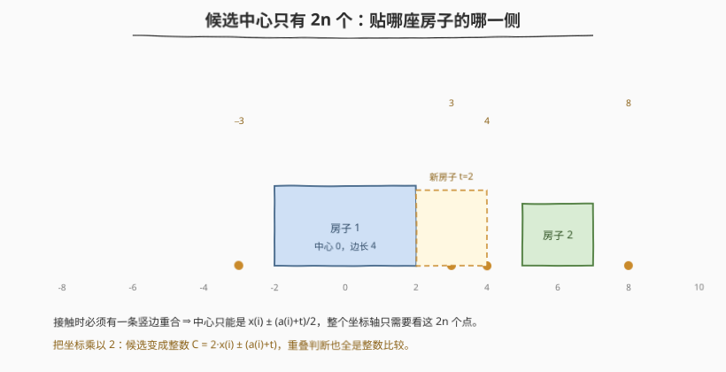
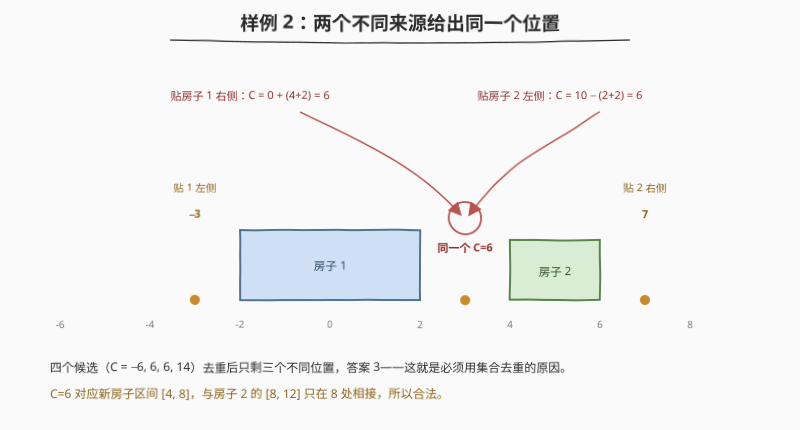

# Codeforces 15A 小屋村庄的建造位置 题解

## 1. 题目概述

- **题目链接**：https://codeforces.com/problemset/problem/15/A
- **比赛来源**：Codeforces Beta Round 15 · Problem A（UTC 2010-05-29）
- **难度**：1200
- **标签**：实现、排序（implementation, sortings）
- **评测类型**：普通
- **限制**：时间 2 s / 内存 64 MB

**题意**：平面直角坐标系上已经有 $n$ 座正方形房子，第 $i$ 座的**中心**是 $(x_i, 0)$、边长是 $a_i$，边与坐标轴平行，任意两座房子**不重叠**（可以相切）。现在要再建一座边长为 $t$ 的正方形房子，要求：

- 中心在 $Ox$ 轴上，边与坐标轴平行；
- 与已有的**至少一座**房子相接（贴着）；
- 与任何已有房子都不重叠。

问新房子的**中心位置**共有多少种。题面特别提示：中心的横坐标**可以是半整数**（非整数）。

**约束**：

- $1 \le n, t \le 1000$，$-1000 \le x_i \le 1000$，$1 \le a_i \le 1000$：规模极小，$O(n^2)$ 完全够用（只是要枚举 $2n$ 个候选而不是整条坐标轴）。
- 边长可能是奇数，中心又可以是半整数：用 `double` 做相等判断会踩精度，必须换一种**精确**的表示（见 3.2 的"二倍坐标"）。
- 已有的房子互不重叠、但允许相切：所以"不重叠"的判定必须是**严格**的——新房子和别的房子仅仅相切是合法的。
- 答案不超过 $2n \le 2000$，`int` 足够。

## 2. 示例与观察

官方样例 1（输入 / 输出原样）：

```text
输入：
2 2
0 4
6 2

输出：
4
```

官方样例 2（输入 / 输出原样）：

```text
输入：
2 2
0 4
5 2

输出：
3
```

官方样例 3（输入 / 输出原样）：

```text
输入：
2 3
0 4
5 2

输出：
2
```

**样例 1 演算**：两座房子的横向区间分别是 $[-2, 2]$（中心 $0$、边长 $4$）和 $[5, 7]$（中心 $6$、边长 $2$）。新房子边长 $t = 2$，它只有可能贴在四"侧"上：

| 贴法 | 新中心 | 新房子区间 | 是否与其他房子重叠 | 结论 |
|------|--------|------------|--------------------|------|
| 贴第一座左侧 | $-3$ | $[-4,-2]$ | 否 | 合法 |
| 贴第一座右侧 | $3$ | $[2,4]$ | 否 | 合法 |
| 贴第二座左侧 | $4$ | $[3,5]$ | 否 | 合法 |
| 贴第二座右侧 | $8$ | $[7,9]$ | 否 | 合法 |

四种位置互不相同，答案 $4$。

**样例 2 演算**：房子是 $[-2,2]$ 与 $[4,6]$，中间的空隙宽度是 $4-2 = 2$，恰好等于 $t = 2$。于是"贴第一座右侧"得到中心 $3$、区间 $[2,4]$，"贴第二座左侧"得到中心 $3$、区间 $[2,4]$——**这是同一个位置**。四个候选去重后只剩 $3$ 个：$-3, 3, 7$，答案 $3$。

**样例 3 演算**：$t = 3$，空隙只有 $2$，塞不下。中心 $3.5$（贴第一座右侧，区间 $[2,5]$）会与 $[4,6]$ 重叠；中心 $2.5$（贴第二座左侧，区间 $[1,4]$）会与 $[-2,2]$ 重叠。剩下的 $-3.5$ 与 $7.5$ 合法，答案 $2$。注意这两个中心是**半整数**——这正是题面提示"坐标可以是非整数"的原因。

**观察**：新房子的位置不是连续的一片，而是离散的 $2n$ 个候选；"接触"这个条件把中心的位置完全钉死了。

自造样例（标注"自造"，`⏎` 表示换行，均已用参考程序与暴力核对）：

| 输入 | 输出 | 说明 |
|------|------|------|
| `1 5 ⏎ 0 2` | `2` | 只有一座房子，左右各一个位置 |
| `2 2 ⏎ 0 4 ⏎ 5 2` | `3` | 官方样例 2：两个候选重合 |
| `3 1 ⏎ -5 2 ⏎ 0 2 ⏎ 5 2` | `6` | 三座等距房子，每个空隙都放得下 |
| `3 4 ⏎ -5 2 ⏎ 0 2 ⏎ 5 2` | `2` | 空隙只有 $3$、$t=4$，只能贴在两头 |
| `2 1 ⏎ -1 1 ⏎ 1 1` | `3` | 两座房子之间有 $1$ 的空隙，正中间那个位置同时贴着两座 |
| `2 2 ⏎ 0 1 ⏎ 1 1` | `2` | 两座房子相切，只有两个外侧位置合法 |

第 5、6 组专门覆盖退化情形：第 5 组空隙恰好等于 $t$，正中的位置会同时贴着两座房子；第 6 组两座房子本身相切（空隙为 $0$），贴中间必然重叠，只剩两个外侧位置。

## 3. 解题思路

### 3.1 朴素做法与瓶颈

最直接的想法：既然中心可以是半整数，就在坐标轴上按 $0.5$ 的步长枚举所有可能位置，逐个检查"是否贴着某座房子"和"是否与其他房子重叠"。

问题是**枚举范围**：坐标可以到 $\pm 1000$，$t$ 又可以到 $1000$，要保证不漏就得枚举到 $\pm (1000 + 1000 + 1000)$，约 $12000$ 个位置，每个位置再花 $O(n)$ 检查，总共 $1.2 \times 10^7$ 次——虽然勉强能过，但用浮点做"相等"判断（判断贴着）非常危险：$0.5$ 的加法累积误差会让 `c - t/2 == x_i + a_i/2` 时对时错。

正确的观察是：合法位置根本不是"一片连续区间"，而是**有限个点**。

### 3.2 核心观察：接触把中心钉死在 $2n$ 个点上



一座中心为 $x$、边长为 $a$ 的房子占据横轴上的区间

$$\left[\,x - \frac{a}{2},\ x + \frac{a}{2}\,\right].$$

新房子的中心是 $c$、边长 $t$，占据 $\left[c - \tfrac{t}{2},\ c + \tfrac{t}{2}\right]$。

**两座房子"接触而不重叠"**：两者的横区间只在端点处相遇。由于两座房子的中心都在 $Ox$ 轴上、边都与坐标轴平行，接触只能发生在竖直边上（见引理 1）。于是新房子的某个竖直边必须与某座房子的某条竖直边重合：

$$c - \frac{t}{2} = x_i + \frac{a_i}{2} \quad\text{或}\quad c + \frac{t}{2} = x_i - \frac{a_i}{2},$$

即

$$c = x_i + \frac{a_i + t}{2} \quad\text{或}\quad c = x_i - \frac{a_i + t}{2}.$$

每个 $i$ 至多贡献两个候选，总共至多 $2n$ 个。**没有一个候选依赖于坐标轴的连续取值**，所以不需要枚举网格。

**消除半整数**：所有候选都可能带 $1/2$。把整个坐标轴放大两倍：令 $X_i = 2x_i$、$C = 2c$，区间变成

$$[X_i - a_i,\ X_i + a_i], \qquad [C - t,\ C + t],$$

候选变成

$$C = X_i \pm (a_i + t),$$

全是整数。重叠判定 $[C-t, C+t] \cap [X_j - a_j, X_j + a_j]$ 的内部相交条件就是

$$C - t < X_j + a_j \ \wedge\ X_j - a_j < C + t,$$

也是整数比较，**完全不需要浮点**。

### 3.3 算法流程

1. 读入 $n, t$ 与所有 $(x_i, a_i)$，令 $X_i = 2x_i$；
2. 用一个集合 `positions` 存所有合法的二倍中心坐标；
3. 对每个 $i$ 与 $s \in \{+1, -1\}$：
   1. $C = X_i + s\,(a_i + t)$；
   2. 检查所有 $j \ne i$：若 $C - t < X_j + a_j$ 且 $X_j - a_j < C + t$，说明与第 $j$ 座房子内部重叠，丢弃这个候选；
   3. 全部通过则 `positions.insert(C)`；
4. 输出 `positions.size()`。

去重是必须的：样例 2 中两个不同的房子会给出同一个 $C$，用集合自动处理。

### 3.4 样例走查：样例 2



二倍坐标下：第一座 $X_1 = 0, a_1 = 4$，区间 $[-4, 4]$；第二座 $X_2 = 10, a_2 = 2$，区间 $[8, 12]$；$t = 2$。

| 候选来源 | 计算 | $C$ | 对应区间 | 检查结果 |
|----------|------|-----|----------|----------|
| 贴第一座右侧 | $0 + (4+2)$ | $6$ | $[4, 8]$ | 与 $[8,12]$ 只在 $8$ 相接，合法 |
| 贴第一座左侧 | $0 - (4+2)$ | $-6$ | $[-8,-4]$ | 合法 |
| 贴第二座左侧 | $10 - (2+2)$ | $6$ | $[4, 8]$ | 与上一个候选**相同** |
| 贴第二座右侧 | $10 + (2+2)$ | $14$ | $[12, 16]$ | 合法 |

四个候选、三个不同的 $C$：$\{-6, 6, 14\}$，答案 $3$。

## 4. 正确性证明

**引理 1（接触只能发生在竖边之间）**：设两座房子中心都在 $Ox$ 轴上、边平行于坐标轴、边长分别为 $a, b$、中心分别为 $x, y$。若它们接触且不重叠，则

$$y = x + \frac{a+b}{2} \quad\text{或}\quad y = x - \frac{a+b}{2}.$$

**证明**：两座房子的纵区间分别是 $[-\tfrac a2, \tfrac a2]$ 与 $[-\tfrac b2, \tfrac b2]$，它们关于 $Ox$ 轴对称。若两个闭方形有公共点，因为都不含内部重叠，公共点必然落在边界上。取公共点 $p = (u, v)$：它同时满足 $|v| \le a/2$、$|v| \le b/2$，且 $u$ 在两者横区间内。若公共点只出现在角上，则 $|v| = a/2 = b/2$（两方形等高）或 $v$ 同时等于两个半高，这要求 $a = b$；此时横区间只能在端点相接，于是 $y - x = \pm a = \pm\frac{a+b}{2}$，仍是竖边接触。否则公共点落在某条竖边上，即 $u = x \pm a/2 = y \mp b/2$，整理即得 $y = x \pm \frac{a+b}{2}$。∎

**引理 2（候选集完备）**：任意合法的新房子，其中心必属于 $\{\,X_i \pm (a_i+t) \,\}$ 对应的点集（二倍坐标）。

**证明**：合法位置必须与至少一座房子接触，由引理 1 把"那座房子"看作边长 $a_i$、中心 $x_i$，新房子边长 $t$、中心 $c$，即得 $c = x_i \pm \frac{a_i+t}{2}$，二倍后即候选形式。∎

**引理 3（重叠判定正确）**：二倍坐标下，新房子 $[C-t, C+t]$ 与第 $j$ 座 $[X_j-a_j, X_j+a_j]$ 的内部有交，当且仅当 $C-t < X_j+a_j$ 且 $X_j - a_j < C+t$。

**证明**：两个开区间 $(C-t, C+t)$ 与 $(X_j-a_j, X_j+a_j)$ 有交，当且仅当左端点互小于对方的右端点，即两个严格不等式同时成立。而"内部有交"等价于"两座房子内部重叠"（内部都是开矩形，纵方向总有公共部分 $(-\min/2, \min/2)$ 非空）。∎

**定理**：算法输出的数等于合法建造位置的数量。

**证明**：由引理 2，所有合法位置都在候选集中，算法不会漏数；对每个候选，算法用引理 3 精确判断它是否与其他房子重叠，只把真正合法的候选插入集合；集合自动去掉重复的候选（同一个 $C$ 只算一个位置）。因此集合的大小恰为不同合法位置的个数。∎

## 5. 复杂度分析

- **时间**：$O(n^2)$。候选至多 $2n$ 个，每个候选检查 $n-1$ 座房子，每次 $O(1)$ 次整数比较；$n \le 1000$ 时约 $2 \times 10^6$ 次比较。插入集合的代价 $O(n \log n)$，可以忽略。
- **空间**：$O(n)$ 存房子与候选集合，实测峰值不到 $2$ MB。
- **数值范围**：$|X_i| \le 2000$，$a_i, t \le 1000$，$|C| \le 2000 + 2000 = 4000$，全部在 `int` 范围内；用 `long long` 只是顺手。
- **与时限的关系**：时限 2 s，$n = 1000$ 的最坏数据实测 C++ 端到端 $2 \sim 5$ ms、Python 约 $60$ ms（含解释器启动），余量在几百倍以上。

## 6. 参考代码

### C++17

```cpp
#include <bits/stdc++.h>
using namespace std;

int main() {
    ios::sync_with_stdio(false);
    cin.tie(nullptr);

    int n, t;
    if (!(cin >> n >> t)) return 0;

    vector<long long> X(n), A(n);   // 二倍坐标：X = 2*x，A = a（边长不变）
    for (int i = 0; i < n; ++i) {
        long long x, a;
        cin >> x >> a;
        X[i] = 2 * x;
        A[i] = a;
    }

    set<long long> positions;       // 新房子中心的二倍坐标
    for (int i = 0; i < n; ++i) {
        for (int s = -1; s <= 1; s += 2) {
            // 贴在第 i 座房子的右侧（s=+1）或左侧（s=-1）
            long long C = X[i] + (long long)s * (A[i] + t);
            bool ok = true;
            for (int j = 0; j < n && ok; ++j) {
                if (j == i) continue;                 // 与 i 只接触，不算重叠
                // 两区间内部相交 ⇔ C-t < Xj+Aj 且 Xj-Aj < C+t
                if (C - t < X[j] + A[j] && X[j] - A[j] < C + t) ok = false;
            }
            if (ok) positions.insert(C);
        }
    }

    cout << positions.size() << '\n';
    return 0;
}
```

### Python3

```python
import sys


def main() -> None:
    data = sys.stdin.buffer.read().split()
    if not data:
        return
    n, t = int(data[0]), int(data[1])
    X = [0] * n
    A = [0] * n
    p = 2
    for i in range(n):
        X[i] = 2 * int(data[p])      # 二倍坐标，避免半整数
        A[i] = int(data[p + 1])
        p += 2

    positions = set()
    for i in range(n):
        for s in (-1, 1):
            C = X[i] + s * (A[i] + t)         # 贴在第 i 座房子右侧 / 左侧
            ok = True
            for j in range(n):
                if j == i:
                    continue
                if C - t < X[j] + A[j] and X[j] - A[j] < C + t:
                    ok = False
                    break
            if ok:
                positions.add(C)

    sys.stdout.write(str(len(positions)) + "\n")


main()
```

## 7. 边界情况与易错点

1. **用 `double` 判断"贴着"**：$a_i$ 为奇数时中心是半整数，浮点相等在累加后并不可靠。把坐标乘以 $2$ 之后全部是整数，判定就变成精确的 `==` 与 `<`。
2. **忘记去重**：样例 2 就是"两个不同的房子给出同一个位置"的情形，答案会比候选数少一。必须用集合（或排序去重）。
3. **把"相切"当成重叠**：已有房子之间可以相切，新房子与别的房子相切也合法。重叠判定必须是**严格**不等式；写成 `<=` 会把合法的相切位置丢掉（样例 1 的 $[2,4]$ 与第一座房子的 $[-2,2]$ 正好相切）。
4. **只检查了接触的那一座**：新房子可能同时碰到两座（空隙恰好够宽）或者碰到一座却撞上第三座；必须对**所有** $j \ne i$ 检查。
5. **$n = 1$**：只有左右两个候选，若都合法答案是 $2$，不要漏掉任意一侧。
6. **中心可以为负**：$x_i$ 允许为负，候选自然也可能为负，用有符号整数即可，别用 `unsigned`。
7. **$t$ 很大**：$t$ 可以比两座房子之间的空隙大得多，这时贴着放一定会撞上另一座，判定逻辑必须能处理"候选直接被否掉"。
8. **空隙恰好为 $0$**：两座房子已经相切时，中间没有任何空间，贴左房右侧与贴右房左侧给出的候选其实是同一个位置且必然重叠，会被正确丢弃。
9. **答案上界**：最多 $2n = 2000$，用 `int` 输出即可；但候选坐标用 `long long` 更省心。

## 8. 验证记录

- **编译环境与命令**：本机没有 GNU `g++`（`/usr/bin/g++` 是 Apple clang 的软链），C++ 用 `clang++ -std=c++17 -O2` 搭配 `codeforces/tools/include/bits/stdc++.h` 兼容头编译，代码只用标准库，可原样提交 GNU C++17；Python 为 `Python 3.9.6`。文档结构 / 编译 / 样例由 `python3 codeforces/tools/verify_solution.py codeforces/contests/0001-0100/15/A_小屋村庄的建造位置.md` 一条命令复核。
- **官方样例**：3 / 3 通过（`samples 3`、`C++ 编译 OK, 样例 3/3`、`Python 语法 OK, 样例 3/3`）。
- **独立暴力对拍**：暴力程序在二倍坐标上**枚举所有整数中心**（等价于枚举所有半整数位置），逐个判断"是否与至少一座房子相切"且"是否与任何房子内部相交"，完全不使用"候选只有 $2n$ 个"这一结论。生成 **250 组**随机小数据（$n \le 4$、$t \le 5$、$|x| \le 6$、$a \le 5$，生成时保证房子互不重叠；两种模式分别取范围 $6$ 与 $3$），C++ 与 Python 各跑一遍，合计 **500 次**比对，**0 处不符**。
- **最大约束性能**：$n = 1000$、$t = 1000$、$1000$ 座边长 $1$ 或 $2$ 的小房子塞满 $[-1000, 1000]$ 的数据，C++ 端到端 $4.5 \sim 14.6$ ms（含进程启动）、峰值内存 $1.7$ MB；Python 约 $65$ ms，远低于 2 s / 64 MB。
- **图片校验**：两张 SVG（`cf15a_intervals.svg`、`cf15a_walkthrough.svg`）均通过 `xml.etree.ElementTree.parse`，并用无头浏览器读取每个 `text` 的 `getBBox` 复核：无越出 `viewBox`、无文字互相重叠、无文字溢出所在方框。
- **公式校验**：正文公式经 `node codeforces/tools/katex_check.cjs`（`throwOnError`）渲染无报错。
- **复核状态**：verified（样例、500 次对拍、性能、图片、公式五项均实跑通过；环境差异仅在于本机无 GNU g++，已用 clang++ 等价验证）。

## 相关题目与扩展

- [Codeforces 15B Laser](https://codeforces.com/problemset/problem/15/B)、[Codeforces 15C Industrial Nim](https://codeforces.com/problemset/problem/15/C)：同场 B、C 题，分别练"矩形计数"与"异或前缀"，和本篇的"候选枚举"一起构成 Beta Round 15 的前三题。
- [Codeforces 4A 西瓜](https://codeforces.com/problemset/problem/4/A)：更早的入门题。
- [LeetCode 836. 矩形重叠](https://leetcode.cn/problems/rectangle-overlap/)：本篇重叠判定的二维版本，注意"相切不算重叠"的处理。
- [LeetCode 1229. 安排会议日程](https://leetcode.cn/problems/meeting-scheduler/)：区间端点与相切关系的另一类练习。

**延伸思考**：

1. **如果要求新房子与恰好一座房子相接**：只需在合法候选上再数一遍"它与几座房子相切"，把 $=1$ 的挑出来；相切数可以用 $C - t == X_j + A_j$ 或 $C + t == X_j - A_j$ 逐座统计。
2. **如果房子可以任意放置（中心不在 $Ox$ 轴上）**：接触方式立刻从"竖边对齐"变成"边与边、角与角"的组合，候选位置变成连续的曲线族，题目难度会大幅上升。
3. **如果坐标范围放大到 $10^9$**：$O(n^2)$ 仍然可以 ($n \le 1000$)，但二倍坐标需要 `long long`；这正说明"离散化候选"比"枚举坐标"更能抗住值域放大。
4. **如果允许旋转**：正方形绕中心旋转后与轴对齐的房子接触，接触点会随角度连续变化，答案可能变成无穷多，必须重新定义"建造方法"的计数口径。
5. **排序解法**：把房子按左端点排序后，可以只检查相邻的两座房子（因为房子互不重叠，非相邻的房子不可能同时限制同一个空隙），把 $O(n^2)$ 优化到 $O(n \log n)$；但本题 $n \le 1000$，暴力检查更不容易写错。
