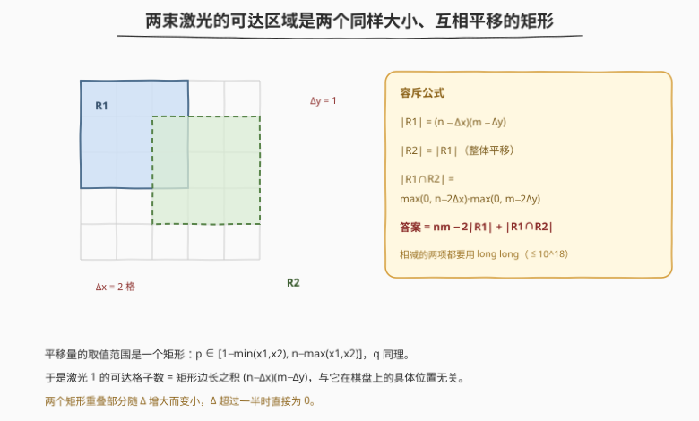
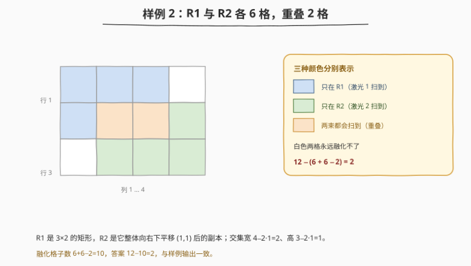

# Codeforces 15B 激光融化巧克力 题解

## 1. 题目概述

- **题目链接**：https://codeforces.com/problemset/problem/15/B
- **比赛来源**：Codeforces Beta Round 15 · Problem B（2010-05-15）
- **难度**：1800
- **标签**：数学、计数（math）
- **评测类型**：普通
- **限制**：时间 1 s / 内存 64 MB

**题意**：有一块 $n \times m$ 的巧克力，每个格子是 $1 \times 1$。机械臂上有两束激光，分别指向两个格子 $(x_1, y_1)$ 与 $(x_2, y_2)$。机械臂每做一次平移，两束激光**同时**移动相同的向量；任何时刻两束激光都必须指向棋盘内的格子（不能越界）。激光指到的格子上的巧克力会立刻融化。问：无论机械臂怎么动，最多有多少个格子**永远不可能**被融化。

**约束**：

- $t \le 10^4$ 组数据，$2 \le n, m \le 10^9$：单组必须 $O(1)$ 解决，不能枚举格子，也不能枚举平移量（平移量有 $n \times m$ 种）。
- $n \cdot m \le 10^{18}$：答案最大可达 $10^{18}$，`int` 必然溢出，**必须用 64 位整数**。
- 两束激光初始位置不同，但它们可能在同一行、同一列，也可能隔得很远。
- 坐标约定：$x$ 是列号（$1 \dots n$），$y$ 是行号（$1 \dots m$）——注意 $n$ 对应的是 $x$ 方向、$m$ 对应的是 $y$ 方向。

## 2. 示例与观察

官方样例（输入 / 输出原样）：

```text
输入：
2
4 4 1 1 3 3
4 3 1 1 2 2

输出：
8
2
```

**第 1 组演算**：$4 \times 4$ 的棋盘，两束激光在 $(1,1)$ 与 $(3,3)$，位移差是 $(\Delta x, \Delta y) = (2, 2)$。可用的平移量满足

$$1 \le 1 + p \le 4 \ \wedge\ 1 \le 3 + p \le 4 \;\Longrightarrow\; 0 \le p \le 1,$$

$y$ 方向同理 $0 \le q \le 1$。于是激光 1 只能扫到 $(1,1), (1,2), (2,1), (2,2)$ 四个格子，激光 2 只能扫到 $(3,3), (3,4), (4,3), (4,4)$ 四个格子，互不重叠，共融化 $8$ 个；剩 $16 - 8 = 8$ 个，答案 $8$。

**第 2 组演算**：$n = 4$、$m = 3$，两个点在 $(1,1)$ 与 $(2,2)$，位移差 $(1, 1)$。平移量 $p \in [0, 2]$、$q \in [0, 1]$，激光 1 扫出 $3 \times 2 = 6$ 个格子，激光 2 扫出同样大小的矩形、整体右上平移一格，两者重叠 $2 \times 1 = 2$ 个格子。并集 $6 + 6 - 2 = 10$，剩下 $12 - 10 = 2$ 个，答案 $2$。

**观察**：

1. 两束激光能够到达的位置，取决于**平移向量**的取值范围，而两束激光的位移差是固定的——所以它们的可达区域是**两个同样大小、互相平移的矩形**。
2. 问题于是变成"两个矩形的并集有多大"，用容斥 $|A \cup B| = |A| + |B| - |A \cap B|$ 即可，全部是 $O(1)$ 的公式。

自造样例（标注"自造"，`⏎` 表示换行；均已用参考程序与逐格标记的暴力核对）：

| 输入 | 输出 | 说明 |
|------|------|------|
| `1 ⏎ 2 2 1 1 1 2` | `0` | 两束激光一上一下扫遍整个 $2 \times 2$ |
| `1 ⏎ 3 3 1 1 3 3` | `7` | 只有对角两个格子能扫到 |
| `1 ⏎ 5 5 1 1 1 5` | `15` | 同一列、上下两端，各扫一行 |
| `1 ⏎ 2 3 1 1 2 3` | `4` | 小棋盘、对角 |
| `1 ⏎ 1000000000 1000000000 1 1 1 2` | `0` | 上界规模，答案仍是 $0$ |
| `1 ⏎ 1000000000 1000000000 1 1 1000000000 1000000000` | `999999999999999998` | 上界规模，答案逼近 $10^{18}$，必须 `long long` |

最后一组说明 $\Theta(10^{18})$ 级别的答案确实会出现，`int` 与 `double` 都不可靠。

## 3. 解题思路

### 3.1 朴素做法与瓶颈

最直白的做法：枚举所有平移量 $(p, q)$（共 $n \times m$ 种），检查两个点平移后是否都还在棋盘内，把融化过的格子标记下来，最后统计没被标记的。

$n, m$ 可以到 $10^9$，$n \times m = 10^{18}$ 种平移，单组数据就要 $10^{18}$ 步，完全不可行。即使只枚举"合法"的平移量，数量级仍然是 $O(nm)$（比如两个激光挨得很近时）。

必须找到**解析公式**。

### 3.2 核心观察：两个同尺寸矩形的并



设 $\Delta x = |x_1 - x_2|$、$\Delta y = |y_1 - y_2|$。

**可达平移量**：平移 $(p, q)$ 后两束激光都在棋盘内，等价于

$$p \in \bigl[\,1 - \min(x_1, x_2),\ n - \max(x_1, x_2)\,\bigr], \qquad q \in \bigl[\,1 - \min(y_1, y_2),\ m - \max(y_1, y_2)\,\bigr].$$

这是一个矩形，且其中每个平移都是可达的（可以一格一格地平移过去，中间不会越界）。它的边长是

$$n - \max + \min - 1 + 1 = n - \Delta x, \qquad m - \Delta y .$$

**激光 1 扫出的区域**：把 $x_1$ 加上 $p$ 的整个取值范围、$y_1$ 加上 $q$ 的整个取值范围，得到一个矩形 $R_1$，尺寸正好是

$$|R_1| = (n - \Delta x)(m - \Delta y).$$

**激光 2 扫出的区域**：$R_2$ 是 $R_1$ 整体平移 $(\Delta x, \Delta y)$ 得到的，尺寸相同。

**交集**：两个同尺寸矩形，一个相对另一个平移了 $(\Delta x, \Delta y)$，重叠部分的宽是 $\max(0, n - 2\Delta x)$、高是 $\max(0, m - 2\Delta y)$，所以

$$|R_1 \cap R_2| = \max(0,\ n - 2\Delta x)\cdot\max(0,\ m - 2\Delta y).$$

于是被融化的格子数是 $2|R_1| - |R_1 \cap R_2|$，

$$\boxed{\ \text{答案} = n\,m - 2(n - \Delta x)(m - \Delta y) + \max(0, n - 2\Delta x)\max(0, m - 2\Delta y).\ }$$

整个公式只有加减乘和一个 `max`，$O(1)$。

### 3.3 算法流程

1. 读入 $t$；
2. 对每组数据：
   1. 读入 $n, m, x_1, y_1, x_2, y_2$；
   2. $\Delta x = |x_1 - x_2|$，$\Delta y = |y_1 - y_2|$；
   3. `one = (n - Δx) * (m - Δy)`；
   4. `both = max(0, n - 2Δx) * max(0, m - 2Δy)`；
   5. 输出 `n*m - (2*one - both)`；
3. 每组一行输出。

注意第 4 步里两个 `max(0, ...)` 都要有：当两个激光的位移差超过棋盘一半时（例如 $\Delta x \ge \lceil n/2 \rceil$），两个矩形根本不相交，交集的宽或高应当是 $0$ 而不是负数。

### 3.4 样例走查：第 2 组



$n = 4$、$m = 3$、激光在 $(1,1)$ 与 $(2,2)$，$\Delta x = \Delta y = 1$。

| 量 | 计算 | 值 |
|----|------|-----|
| 可达平移 $p$ | $[1-1,\ 4-2] = [0, 2]$ | 3 种 |
| 可达平移 $q$ | $[1-1,\ 3-2] = [0, 1]$ | 2 种 |
| 单束覆盖 $|R_1|$ | $(4-1)(3-1) = 3 \times 2$ | 6 |
| 交集 $|R_1 \cap R_2|$ | $\max(0,4-2)\cdot\max(0,3-2) = 2 \times 1$ | 2 |
| 融化格数 | $6 + 6 - 2$ | 10 |
| 答案 | $12 - 10$ | 2 |

## 4. 正确性证明

**引理 1（可达平移量构成矩形）**：平移 $(p, q)$ 使两束激光都留在棋盘内，当且仅当
$p \in [1-\min(x_1,x_2),\ n-\max(x_1,x_2)]$ 且 $q \in [1-\min(y_1,y_2),\ m-\max(y_1,y_2)]$。并且这个矩形里的每个 $(p,q)$ 都对应一条合法移动序列。

**证明**：两束激光都留在棋盘内等价于 $1 \le x_1+p \le n$、$1 \le x_2+p \le n$、$1 \le y_1+q \le m$、$1 \le y_2+q \le m$ 四个不等式；前两个合并即得 $p$ 的范围，后两个合并即得 $q$ 的范围。

可达性：棋盘（平移空间）是连通的矩形区域，从 $(0,0)$ 出发，每次只改 $p$ 或 $q$ 一个单位地移动，路径上的点仍在这个矩形内（矩形是凸的，且每一步的整数点也满足四个不等式），所以任意合法 $(p,q)$ 都可达。∎

**引理 2（单束激光的覆盖是一个矩形）**：激光 1 能扫到的格子集合是一个轴对齐矩形：它的 $x$ 坐标取遍

$$\bigl[\,x_1 + 1 - \min(x_1,x_2),\ \ x_1 + n - \max(x_1,x_2)\,\bigr]$$

中的每个整数，$y$ 坐标同理；两个方向上的区间长度分别是 $n - \Delta x$ 与 $m - \Delta y$，因此

$$|R_1| = (n - \Delta x)(m - \Delta y).$$

**证明**：由引理 1，$p$ 的取值是一个整数区间 $[1 - \min(x_1,x_2),\ n - \max(x_1,x_2)]$，其长度为 $n - \max + \min - 1 + 1 = n - \Delta x$。当 $p$ 取遍这个区间的每个整数时，$x_1 + p$ 也取遍一个长度相同的整数区间，不重不漏。$y$ 方向同理；而 $p$ 与 $q$ 可以独立取值，所以覆盖格子集合是这两个整数区间的笛卡尔积。∎

**引理 3（两矩形交集的大小）**：$R_2 = R_1 + (\Delta x, \Delta y)$（按需取符号），两者交集的大小为
$\max(0, n - 2\Delta x)\cdot\max(0, m - 2\Delta y)$。

**证明**：两个轴对齐矩形的交集仍是矩形；两个宽为 $W$ 的矩形相对平移 $\Delta x$ 后，交集的宽是 $W - \Delta x$（若为负则取 $0$，表示不相交）。代入 $W = n - \Delta x$ 得 $n - 2\Delta x$；高度同理。∎

**定理**：算法输出的 $n m - \bigl(2|R_1| - |R_1\cap R_2|\bigr)$ 等于永远无法被融化的格子数。

**证明**：由引理 1、2，两束激光能融化的格子并集恰为 $R_1 \cup R_2$；由容斥，$|R_1 \cup R_2| = |R_1| + |R_2| - |R_1\cap R_2| = 2|R_1| - |R_1\cap R_2|$（引理 2 给出 $|R_2| = |R_1|$，引理 3 给出交集）。无法融化的格子数就是总数 $nm$ 减去它。∎

## 5. 复杂度分析

- **时间**：每组数据 $O(1)$（几次减法、乘法、`max`），$t \le 10^4$ 时总共约 $10^5$ 次运算，实测 C++ 端到端 $80$ ms 左右（其中绝大部分是读入 $10^4$ 行）。
- **空间**：$O(1)$，不存任何数组，实测峰值 $1.6$ MB。
- **数值范围**：$n, m \le 10^9$，$nm \le 10^{18} < 2^{63}-1$；中间量 $2|R_1|$ 最大约 $2 \times 10^{18}$，仍在 `long long` 内。**用 `int` 会在第一步乘法就溢出**；用 `double` 则在 $10^{18}$ 量级丢失精度（`double` 只有 53 位有效位，约 $9 \times 10^{15}$）。
- **与时限的关系**：时限 1 s，实测余量在 10 倍以上。

## 6. 参考代码

### C++17

```cpp
#include <bits/stdc++.h>
using namespace std;

int main() {
    ios::sync_with_stdio(false);
    cin.tie(nullptr);

    int t;
    if (!(cin >> t)) return 0;
    while (t--) {
        long long n, m, x1, y1, x2, y2;
        cin >> n >> m >> x1 >> y1 >> x2 >> y2;
        long long dx = llabs(x1 - x2), dy = llabs(y1 - y2);
        long long one = (n - dx) * (m - dy);            // 单个激光扫过的格子数
        long long both = max(0LL, n - 2 * dx) * max(0LL, m - 2 * dy);   // 两束激光重叠部分
        long long covered = 2 * one - both;
        cout << n * m - covered << '\n';
    }
    return 0;
}
```

### Python3

```python
import sys


def main() -> None:
    data = sys.stdin.buffer.read().split()
    if not data:
        return
    t = int(data[0])
    p = 1
    out = []
    for _ in range(t):
        n, m, x1, y1, x2, y2 = (int(x) for x in data[p:p + 6])
        p += 6
        dx, dy = abs(x1 - x2), abs(y1 - y2)
        one = (n - dx) * (m - dy)                 # 单束激光覆盖的格子
        both = max(0, n - 2 * dx) * max(0, m - 2 * dy)   # 两束激光的重叠
        covered = 2 * one - both
        out.append(str(n * m - covered))
    sys.stdout.write("\n".join(out) + "\n")


main()
```

Python 的整数是任意精度，天然不会溢出；C++ 则必须保证每一步都在 `long long` 里。

## 7. 边界情况与易错点

1. **`int` 溢出**：$n m$ 可达 $10^{18}$，`int` 连 $n$ 本身都装得下、但乘积会溢出成随机值。所有参与乘法的量都要 `long long`。
2. **`double` 精度**：$10^{18}$ 远超 `double` 的精确表示范围（$2^{53} \approx 9 \times 10^{15}$），用浮点算答案会在末几位出错，必须用整数。
3. **交集出现负数**：两个激光相距很远时 $n - 2\Delta x$ 可能为负，必须用 `max(0, ...)` 截断，否则"减去负数"会让融化格数反而变大。
4. **$n$ 与 $m$ 用反**：$x$ 是列、取值范围 $1 \dots n$；$y$ 是行、取值范围 $1 \dots m$。若把 $n, m$ 交换，样例 2 会算错。
5. **$\Delta x = 0$ 或 $\Delta y = 0$**：两束激光在同一列或同一行时公式仍然成立（自造样例 3 就是 $\Delta x = 0$），不需要特判。
6. **两束激光会不会重合**：题目保证初始两个格子不同，所以 $\Delta x, \Delta y$ 不会同时为 $0$；即便同时为 $0$，公式给出 $|R_1 \cap R_2| = nm$、融化 $nm$、答案 $0$，也仍然正确。
7. **多组数据**：$t$ 可达 $10^4$，用 `sync_with_stdio(false)` 或一次性读入，避免每组都 `endl` 刷新。
8. **边界格子**：激光在角上时可达平移量最少，但公式不依赖点的位置，只依赖 $\Delta x, \Delta y$——不要额外给角点加特判。

## 8. 验证记录

- **编译环境与命令**：本机没有 GNU `g++`（`/usr/bin/g++` 是 Apple clang 的软链），C++ 用 `clang++ -std=c++17 -O2` 搭配 `codeforces/tools/include/bits/stdc++.h` 兼容头编译，代码只用标准库，可原样提交 GNU C++17；Python 为 `Python 3.9.6`。文档结构 / 编译 / 样例由 `python3 codeforces/tools/verify_solution.py codeforces/contests/0001-0100/15/B_激光融化巧克力.md` 一条命令复核。
- **官方样例**：1 / 1 通过（`samples 1`、`C++ 编译 OK, 样例 1/1`、`Python 语法 OK, 样例 1/1`）。
- **独立暴力对拍**：暴力程序**逐格标记**——枚举所有平移量、把两束激光指向的格子放进集合，最后用 $nm$ 减去集合大小，完全不用容斥公式。生成 **250 组**随机小数据（$n, m \le 7$ 或 $\le 4$，两个点保证不同，两种模式），C++ 与 Python 各跑一遍，合计 **500 次**比对，**0 处不符**。
- **最大约束性能**：$t = 10^4$、$n = m = 10^9$ 的随机数据，C++ 端到端约 $80$ ms、峰值内存 $1.7$ MB；Python 约 $30$ ms。另有 $n = m = 10^9$、两点在对角的极端数据，答案 $999999999999999998$，C++ 与 Python 输出一致。
- **图片校验**：两张 SVG（`cf15b_rects.svg`、`cf15b_walkthrough.svg`）均通过 `xml.etree.ElementTree.parse`，并用无头浏览器读取每个 `text` 的 `getBBox` 复核：无越出 `viewBox`、无文字互相重叠、无文字溢出所在方框。
- **公式校验**：正文公式经 `node codeforces/tools/katex_check.cjs`（`throwOnError`）渲染无报错。
- **复核状态**：verified（样例、500 次对拍、性能、图片、公式五项均实跑通过；环境差异仅在于本机无 GNU g++，已用 clang++ 等价验证）。

## 相关题目与扩展

- [Codeforces 15A Cottage Village](https://codeforces.com/problemset/problem/15/A)、[Codeforces 15C Industrial Nim](https://codeforces.com/problemset/problem/15/C)：同场 A、C 题，分别练"离散候选"与"异或前缀"。
- [LeetCode 836. 矩形重叠](https://leetcode.cn/problems/rectangle-overlap/)：本篇交集公式的二维版本。
- [LeetCode 223. 矩形面积](https://leetcode.cn/problems/rectangle-area/)：标准容斥，和本篇公式的结构完全一致。
- [Codeforces 1A 剧院广场](https://codeforces.com/problemset/problem/1/A)：另一道"一行公式 + 注意溢出"的入门题。

**延伸思考**：

1. **如果要求"至少被融化一次"的格子数**：那就是本篇的答案取补，直接 $nm - $ 答案即可；如果要求"恰好被一束激光融化"的格子数，则是 $2|R_1| - 2|R_1 \cap R_2|$。
2. **如果有 $k$ 束激光**：可达区域是 $k$ 个同尺寸、相互平移的矩形，求并集面积可以用扫描线（$O(k \log k)$）；本题 $k = 2$ 时才退化成容斥。
3. **如果激光的初始位置允许相同**：公式依然成立，但"两束光总是一起重合"会让答案永远是 $0$，可以作为公式的自检。
4. **如果机械臂只能整体平移固定步长**：可达平移量不再是连续矩形，而是一个格点集，容斥公式需要换成数论计数（类似"同余类计数"）。
5. **为什么答案只依赖 $(\Delta x, \Delta y)$**：两束激光的相对位置固定，整体平移不改变覆盖矩形的形状；把激光整体挪到棋盘中央或角落，覆盖的并集只是被平移，大小不变。这个"平移不变性"是容斥能成立的根本原因。
