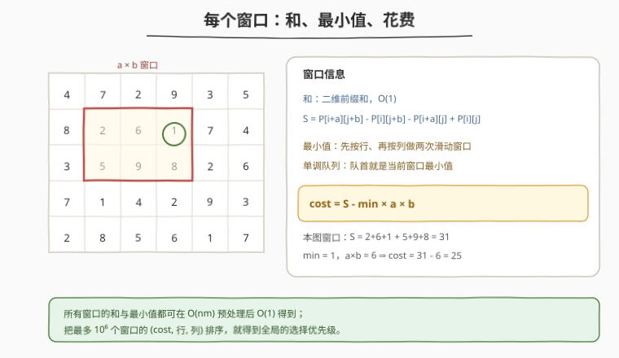
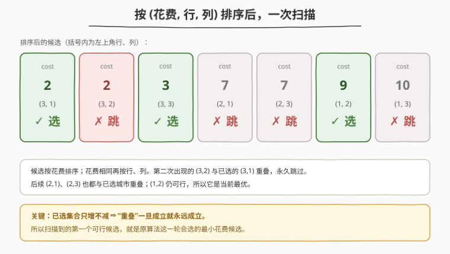
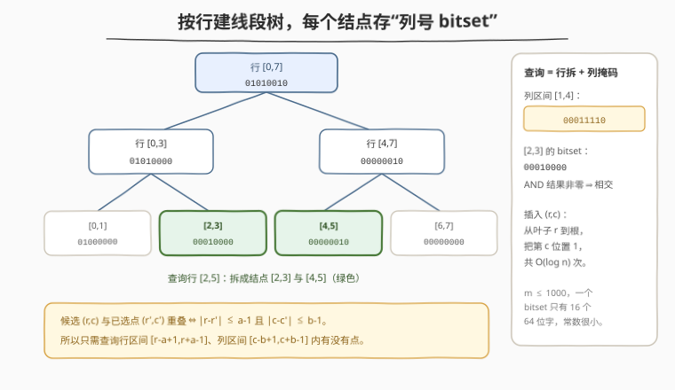

# Codeforces 15D Map 题解

## 1. 题目概述

- **题目链接**：https://codeforces.com/problemset/problem/15/D
- **比赛来源**：Codeforces Beta Round 15 · Problem D（UTC 2010-05-29）
- **难度**：2500
- **标签**：数据结构、实现、排序（data structures, implementation, sortings）
- **评测类型**：普通
- **限制**：时间 2 s / 内存 128 MB

**题意**：给定 $n \times m$ 的高度矩阵，以及城市尺寸 $a \times b$。一个 $a \times b$ 的选址（左上角）的**花费**定义为

$$\text{cost} = \sum_{\text{矩形内}} h_{i,j} - \min_{\text{矩形内}} h_{i,j} \cdot a \cdot b .$$

Peter 按如下规则反复建城，直到无法再放下任何一个不与已建城市重叠的 $a \times b$ 矩形：

1. 在所有**当前可行**（完全落在未占用格子上）的 $a \times b$ 矩形中，选花费最小的；
2. 若花费相同，选左上角**行号最小**的；
3. 若行号也相同，选**列号最小**的；
4. 建城后这些格子被占用，继续下一轮。

要求按建造顺序输出每个城市的左上角（1-based 行列）与花费。

**约束**：

- $1 \le a \le n \le 1000$，$1 \le b \le m \le 1000$；高度 $0 \le h_{i,j} \le 10^9$。
- 候选矩形数 $P = (n-a+1)(m-b+1) \le 10^6$：可以全部预计算、排序，但不能每轮重新扫描所有格子。
- 花费最大约 $10^9 \times 10^6 = 10^{15}$，必须用 64 位整数。
- 时间 2 s、内存 128 MB：需要 $O(nm + P \log P)$ 级别的算法，内存要控制在几十 MB。
- 只有一组数据。

## 2. 示例与观察

官方样例 1（输入 / 输出原样）：

```text
输入：
2 2 1 2
1 2
3 5

输出：
2
1 1 1
2 1 2
```

**样例 1 解释**：$a=1$、$b=2$，只有两个候选：

- 第 1 行：和 $1+2=3$，最小值 $1$，面积 $2$，花费 $3-1\times2=1$；
- 第 2 行：和 $3+5=8$，最小值 $3$，花费 $8-3\times2=2$。

先选花费小的第 1 行 `1 1 1`；它只占第 1 行，第 2 行仍可行，再选 `2 1 2`。两个城市不重叠，输出 2 个。

官方样例 2（输入 / 输出原样）：

```text
输入：
4 4 2 2
1 5 3 4
2 7 6 1
1 1 2 2
2 2 1 2

输出：
3
3 1 2
3 3 3
1 2 9
```

**样例 2 解释**：$a=b=2$，共有 $(4-2+1)^2=9$ 个候选。逐个计算花费：

| 左上角 | 子矩阵 | 和 | 最小 | 花费 |
|--------|--------|----|------|------|
| (1,1) | $\begin{smallmatrix}1&5\\2&7\end{smallmatrix}$ | 15 | 1 | $15-4=11$ |
| (1,2) | $\begin{smallmatrix}5&3\\7&6\end{smallmatrix}$ | 21 | 3 | $21-12=9$ |
| (1,3) | $\begin{smallmatrix}3&4\\6&1\end{smallmatrix}$ | 14 | 1 | $14-4=10$ |
| (2,1) | $\begin{smallmatrix}2&7\\1&1\end{smallmatrix}$ | 11 | 1 | $11-4=7$ |
| (2,2) | $\begin{smallmatrix}7&6\\1&2\end{smallmatrix}$ | 16 | 1 | $16-4=12$ |
| (2,3) | $\begin{smallmatrix}6&1\\2&2\end{smallmatrix}$ | 11 | 1 | $11-4=7$ |
| (3,1) | $\begin{smallmatrix}1&1\\2&2\end{smallmatrix}$ | 6 | 1 | $6-4=2$ |
| (3,2) | $\begin{smallmatrix}1&2\\2&1\end{smallmatrix}$ | 6 | 1 | $6-4=2$ |
| (3,3) | $\begin{smallmatrix}2&2\\1&2\end{smallmatrix}$ | 7 | 1 | $7-4=3$ |

排序后：$(3,1):2$、$(3,2):2$、$(3,3):3$、$(2,1):7$、$(2,3):7$、$(1,2):9$、$(1,3):10$、$(1,1):11$、$(2,2):12$。

- 选 $(3,1)$（花费 2）；$(3,2)$ 与它重叠，跳过；
- 选 $(3,3)$（花费 3）；$(2,1)$、$(2,3)$、$(2,2)$ 都与已选矩形重叠，跳过；
- 选 $(1,2)$（花费 9）；$(1,3)$、$(1,1)$ 与它重叠，跳过。

得到三个城市 `3 1 2`、`3 3 3`、`1 2 9`，与官方输出一致。

**观察**：每一轮选的都是“当前可行集合中按 (花费, 行, 列) 排序的第一个”。由于已占用的格子只会增加，某个矩形一旦与已选矩形重叠，就**永远**不可能再变回可行。因此可以先把所有候选按 (花费, 行, 列) 排好序，从头扫描：能放就放，不能放就永久跳过。这样只需要一次排序，而不需要每轮重新找最小值。

## 3. 解题思路

### 3.1 朴素做法与瓶颈

每一轮都重新枚举所有 $a \times b$ 候选，对每个候选检查是否被占用、并重新求一次和与最小值：

- 轮数最多 $nm/(ab)$，每轮候选 $P$ 个，每个候选检查 $ab$ 个格子；
- 最坏约 $10^6 \times 10^6$ 次格子访问，完全不可行。

即使把“求和/求最小”用前缀和与稀疏表降到 $O(1)$，每轮仍要重新扫描 $P$ 个候选，最坏 $10^{12}$ 次比较。

所以需要做两件事：

1. **一次性**算出所有候选的花费；
2. 把“每轮找最小可行”改成“按花费排序后一次扫描”，并用数据结构快速判断一个候选是否与已选矩形重叠。

### 3.2 一次算出所有窗口的花费



对左上角 $(i,j)$ 的 $a \times b$ 窗口：

- **和**：用二维前缀和
  $$S(i,j) = P_{i+a,j+b} - P_{i,j+b} - P_{i+a,j} + P_{i,j},$$
  其中 $P$ 是 $h$ 的二维前缀和，$O(1)$ 查询。
- **最小值**：分两步做滑动窗口最小值：
  1. 对每一行，用单调队列求所有长度为 $b$ 的区间最小值，记 `rowMin[i][j]`，复杂度 $O(nm)$；
  2. 对每一列（固定 $j$），在 `rowMin[·][j]` 上用单调队列求所有长度为 $a$ 的区间最小值，得到 `winMin[i][j]`，复杂度 $O(nm)$。

单调队列的做法：维护一个下标递增、对应值单调递增的队列。加入新元素前，弹出队尾所有不小于它的元素；窗口左端滑出时弹出队首。队首就是当前窗口最小值。每个元素至多入队/出队一次，所以两步都是 $O(nm)$。

于是每个候选的花费

$$\text{cost}(i,j) = S(i,j) - \text{winMin}(i,j) \cdot a \cdot b$$

都能在 $O(1)$ 时间算出，总候选数 $P \le 10^6$，可以全部存下来。

### 3.3 贪心：排序一次，顺序扫描



把所有候选按 $(\text{cost}, i, j)$ 升序排序，然后从头到尾扫描：

- 若当前候选与**已经选中**的矩形都不重叠，就选中它，并把它加入“已选集合”；
- 否则跳过，且以后也不用再考虑它。

**为什么这样等价于每轮重新找最小？**

设排序后的候选序列为 $p_1, p_2, \dots, p_P$。扫描到 $p_t$ 时，前面的候选要么已经被选中（它们占用的格子使后来者可能不可行），要么在更早的时候因为与某些已选矩形重叠而被跳过。由于已选集合只增不减，“与已选矩形重叠”这一性质是**单调**的：一旦不可行，之后永远不可行。

因此，在扫描到 $p_t$ 的那一刻，$p_1 \dots p_{t-1}$ 中所有未被选中的候选都已经不可行；如果 $p_t$ 可行，它就是当前所有可行候选中排序最靠前的，也就是花费最小、行最小、列最小的那个。原算法每一轮选的正是这个候选。用归纳法：第 $r$ 次选中对应原算法第 $r$ 轮的选择；扫描结束时所有候选要么被选中、要么不可行，原算法也确实无法再建城。

**两个同尺寸矩形何时重叠？** 设左上角分别为 $(i,j)$ 与 $(i',j')$，尺寸都是 $a \times b$。它们的行区间 $[i,i+a-1]$ 与 $[i',i'+a-1]$ 相交当且仅当 $|i-i'| \le a-1$；列区间同理。所以

$$(i,j) \text{ 与 } (i',j') \text{ 重叠} \iff |i-i'| \le a-1 \ \text{且}\ |j-j'| \le b-1 .$$

这个等价把“矩形是否重叠”转化成了“已选左上角点是否落在候选点周围的一个矩形查询区域”：

$$i' \in [i-a+1,\ i+a-1], \qquad j' \in [j-b+1,\ j+b-1],$$

再与合法左上角范围 $[0,n-a] \times [0,m-b]$ 取交集即可。

### 3.4 动态查询：按行建 bitset 线段树



我们需要支持两种操作：

- **插入**一个已选矩形的左上角 $(r,c)$；
- **查询**矩形区域 $[r_1,r_2] \times [c_1,c_2]$ 内是否存在已选点。

由于 $m \le 1000$，可以用“按行建线段树 + 每个结点一个列 bitset”：

- 线段树的每个结点对应一段行区间，存一个长度 $m$ 的 bitset，第 $c$ 位为 $1$ 表示该行区间内存在一个已选左上角，其列号为 $c$；
- **插入** $(r,c)$：从叶子 $r$ 到根，把路径上所有结点的第 $c$ 位置 $1$，共 $O(\log n)$ 次位设置；
- **查询**行区间 $[r_1,r_2]$：把区间拆成 $O(\log n)$ 个线段树结点，对每个结点检查
  $$\text{node.bitset} \ \& \ \text{colMask}(c_1,c_2)$$
  是否非零；只要有一个非零，就说明存在已选点，候选不可行。

`colMask(c1,c2)` 是第 $c_1 \dots c_2$ 位为 $1$ 的 bitset，可以用 $((1 \ll (c_2-c_1+1))-1) \ll c_1$ 构造（C++ 里用 `bitset` 的移位与与运算）。一次查询 $O(\log n \cdot m/w)$，其中 $w$ 是机器字长；$m \le 1000$ 时只有约 16 个 64 位字，常数很小。

**小窗口优化**：若查询窗口的行数或列数很小（例如不超过 8），直接逐行/逐列检查位图，比走线段树更快；代码里保留了这一分支，但它不影响正确性。对本题的数据规模，即使不优化，$O(P \log n)$ 次 bitset 操作也足够。

### 3.5 样例 2 的完整走查

按 3.2 算出 9 个候选的花费（见第 2 节表格），排序后依次扫描：

| 顺序 | 候选 | 花费 | 与已选是否重叠 | 动作 |
|------|------|------|----------------|------|
| 1 | (3,1) | 2 | 无 | 选中 |
| 2 | (3,2) | 2 | 与 (3,1) 行差 0、列差 1 | 跳过 |
| 3 | (3,3) | 3 | 与 (3,1) 列差 2 > 1，不重叠 | 选中 |
| 4 | (2,1) | 7 | 与 (3,1) 行差 1、列差 0 | 跳过 |
| 5 | (2,3) | 7 | 与 (3,3) 行差 1、列差 0 | 跳过 |
| 6 | (1,2) | 9 | 与 (3,1)、(3,3) 行差均 2 > 1 | 选中 |
| 7 | (1,3) | 10 | 与 (1,2) 列差 1 | 跳过 |
| 8 | (1,1) | 11 | 与 (1,2) 列差 1 | 跳过 |
| 9 | (2,2) | 12 | 与 (3,1)、(3,3) 都重叠 | 跳过 |

得到三个城市，顺序为 `(3,1) → (3,3) → (1,2)`，与样例输出一致。

## 4. 正确性证明

**引理 1（花费公式）**：对任意窗口，二维前缀和与滑动窗口最小值给出的 $\text{cost}$ 等于题目定义的花费。

**证明**：二维前缀和的容斥公式给出窗口内所有 $h$ 的和；单调队列在每一步维护的队首是当前长度 $b$（或 $a$）窗口内的最小值，这是单调队列的标准不变式（队列内下标递增、值递增，队首最小）。两者相减再乘面积，正是“把其他格子降到最低格子”需要移除的土方量。∎

**引理 2（同尺寸矩形重叠判定）**：两个 $a \times b$ 矩形（左上角 $(i,j)$、$(i',j')$）有公共格子，当且仅当 $|i-i'| \le a-1$ 且 $|j-j'| \le b-1$。

**证明**：行区间 $[i,i+a-1]$ 与 $[i',i'+a-1]$ 相交，当且仅当 $i \le i'+a-1$ 且 $i' \le i+a-1$，即 $|i-i'| \le a-1$；列区间同理。两个矩形有公共格子等价于行区间、列区间同时相交。∎

**引理 3（不可行单调）**：若某候选在某一时刻与已选集合中的某个矩形重叠，则之后它仍然与已选集合重叠。

**证明**：已选集合只增不减，重叠关系对集合单调：只要存在一个已选矩形与它重叠，这个矩形永远留在集合里。∎

**引理 4（扫描顺序等价于每轮取最小）**：设排序后的候选序列为 $p_1 \dots p_P$，按 3.3 的规则扫描得到的选中序列，与原算法（每轮在全部可行候选中取 $(\text{cost},i,j)$ 最小者）得到的选中序列完全相同。

**证明**：对轮数 $r$ 归纳。假设前 $r-1$ 轮两者的选择相同，已选集合相同。原算法第 $r$ 轮选择的是当前可行集合中排序最靠前的候选，记为 $p_t$。扫描过程中，$p_1 \dots p_{t-1}$ 中的候选要么已被选中，要么在更早的时候被判定为与已选集合重叠；由引理 3，它们现在仍然不可行。而 $p_t$ 是可行的（它是原算法本轮的选择），所以扫描到 $p_t$ 时它会被选中。扫描在 $p_t$ 之前不会选中任何候选（那些候选都不可行），因此第 $r$ 个被选中的正是 $p_t$。归纳成立。扫描结束时，所有候选要么被选中，要么不可行，原算法也确实无法再选，二者终止状态一致。∎

**引理 5（线段树查询正确）**：线段树查询返回真，当且仅当查询区域内存在已选左上角。

**证明**：插入 $(r,c)$ 时，叶子 $r$ 到根的路径覆盖了所有包含行 $r$ 的线段树结点，因此任意包含行 $r$ 的查询区间在拆分后，必然有一个结点包含该叶子，且该结点的 bitset 第 $c$ 位为 $1$。反之，若某个拆分结点的 bitset 与列掩码非空，则该结点对应行区间内存在某个已选点的列号落在 $[c_1,c_2]$，由线段树结点的行区间包含关系，该点就在查询矩形内。∎

**定理**：算法输出的城市序列、每个城市的位置与花费，与题目描述的贪心过程完全一致。

**证明**：引理 1 保证花费正确；引理 2 与引理 5 保证“是否重叠”的判定正确；引理 4 保证排序扫描的选中顺序与原算法一致。因此输出的数量、顺序、坐标、花费都与题目要求相同。∎

## 5. 复杂度分析

- **时间**：
  - 二维前缀和：$O(nm)$；
  - 行/列两次滑动窗口最小值：$O(nm)$；
  - 排序：$O(P \log P)$，$P = (n-a+1)(m-b+1) \le 10^6$；
  - 扫描：$P$ 次查询 + 至多 $P$ 次插入，每次 $O(\log n)$ 次 bitset 操作（bitset 长度 $m \le 1000$）。
  总时间 $O(nm + P \log P + P \log n \cdot m/w)$。
- **空间**：前缀和 $O(nm)$（8 MB）、`rowMin` $O(nm)$（4 MB）、候选数组 $O(P)$（约 24 MB）、线段树与行/列位图约 1 MB；总计约 40 MB，远低于 128 MB。
- **数值范围**：窗口和最大 $10^9 \times 10^6 = 10^{15}$，`long long` 足够；花费非负（和 ≥ 最小值 × 面积），不会出现负数。
- **与时限的关系**：$n=m=1000$ 的随机数据，C++ 端到端（含输入）实测：
  - $a=b=1$（$10^6$ 个候选、几乎全部选中）：约 $0.48$ s；
  - $a=1,b=2$：约 $0.35$ s；$a=b=2$：约 $0.31$ s；$a=b=10$：约 $0.30$ s；
  - $a=b=500$：约 $0.13$ s；$a=1000,b=1$：约 $0.11$ s。
  
  最坏约 $0.48$ s，在 2 s 时限的一半以内。Python 版本在最大数据上约 $3.6 \sim 5.1$ s，超出 2 s，建议使用 PyPy3 或直接提交 C++（Python 仅作为补充实现，样例与随机对拍均通过）。

## 6. 参考代码

### C++17

```cpp
#include <bits/stdc++.h>
using namespace std;

struct FastScanner {
    static const int SZ = 1 << 20;
    int idx = 0, size = 0;
    char buf[SZ];
    inline char getChar() {
        if (idx >= size) {
            size = (int)fread(buf, 1, SZ, stdin);
            idx = 0;
            if (size == 0) return 0;
        }
        return buf[idx++];
    }
    bool nextInt(int &out) {
        char c;
        do {
            c = getChar();
            if (!c) return false;
        } while (c <= ' ');
        int sign = 1;
        if (c == '-') { sign = -1; c = getChar(); }
        int val = 0;
        while (c >= '0' && c <= '9') {
            val = val * 10 + (c - '0');
            c = getChar();
        }
        out = val * sign;
        return true;
    }
};

struct Node {
    long long cost;
    int r, c;
};

int main() {
    FastScanner fs;
    int n, m, a, b;
    if (!fs.nextInt(n) || !fs.nextInt(m) || !fs.nextInt(a) || !fs.nextInt(b)) return 0;

    vector<vector<int>> h(n, vector<int>(m));
    for (int i = 0; i < n; ++i)
        for (int j = 0; j < m; ++j) fs.nextInt(h[i][j]);

    vector<vector<long long>> pref(n + 1, vector<long long>(m + 1, 0));
    for (int i = 0; i < n; ++i)
        for (int j = 0; j < m; ++j)
            pref[i + 1][j + 1] = pref[i][j + 1] + pref[i + 1][j] - pref[i][j] + h[i][j];

    vector<vector<int>> rowMin(n, vector<int>(m - b + 1));
    for (int i = 0; i < n; ++i) {
        deque<int> dq;
        for (int j = 0; j < m; ++j) {
            while (!dq.empty() && h[i][dq.back()] >= h[i][j]) dq.pop_back();
            dq.push_back(j);
            if (dq.front() <= j - b) dq.pop_front();
            if (j >= b - 1) rowMin[i][j - b + 1] = h[i][dq.front()];
        }
    }

    vector<Node> all;
    all.reserve((size_t)(n - a + 1) * (m - b + 1));
    for (int j = 0; j + b <= m; ++j) {
        deque<int> dq;
        for (int i = 0; i < n; ++i) {
            while (!dq.empty() && rowMin[dq.back()][j] >= rowMin[i][j]) dq.pop_back();
            dq.push_back(i);
            if (dq.front() <= i - a) dq.pop_front();
            if (i >= a - 1) {
                int top = i - a + 1;
                long long sum = pref[top + a][j + b] - pref[top][j + b]
                              - pref[top + a][j] + pref[top][j];
                long long mn = rowMin[dq.front()][j];
                all.push_back({sum - mn * (long long)a * b, top, j});
            }
        }
    }

    sort(all.begin(), all.end(), [](const Node &x, const Node &y) {
        if (x.cost != y.cost) return x.cost < y.cost;
        if (x.r != y.r) return x.r < y.r;
        return x.c < y.c;
    });

    int sz = 1;
    while (sz < n) sz <<= 1;
    vector<bitset<1000>> seg(2 * sz);
    vector<bitset<1000>> rowBits(n), colBits(m);
    int maxDim = max(n, m);
    vector<bitset<1000>> low(maxDim + 1);
    for (int w = 0; w <= maxDim; ++w)
        for (int k = 0; k < w; ++k) low[w].set(k);

    auto intersects = [&](int r1, int r2, int c1, int c2) {
        if (r1 > r2 || c1 > c2) return false;
        int width = c2 - c1 + 1;
        int height = r2 - r1 + 1;
        if (min(width, height) <= 8) {          // 小窗口直接扫较少的一维
            if (height <= width) {
                for (int rr = r1; rr <= r2; ++rr)
                    if (((rowBits[rr] >> c1) & low[width]).any()) return true;
            } else {
                for (int cc = c1; cc <= c2; ++cc)
                    if (((colBits[cc] >> r1) & low[height]).any()) return true;
            }
            return false;
        }
        int l = sz + r1, r = sz + r2 + 1;
        while (l < r) {
            if (l & 1) {
                if (((seg[l] >> c1) & low[width]).any()) return true;
                ++l;
            }
            if (r & 1) {
                --r;
                if (((seg[r] >> c1) & low[width]).any()) return true;
            }
            l >>= 1;
            r >>= 1;
        }
        return false;
    };

    auto insert = [&](int r, int c) {
        rowBits[r].set(c);
        colBits[c].set(r);
        int p = sz + r;
        while (p) {
            seg[p].set(c);
            p >>= 1;
        }
    };

    vector<Node> chosen;
    for (const Node &x : all) {
        int r1 = max(0, x.r - a + 1);
        int r2 = min(n - a, x.r + a - 1);
        int c1 = max(0, x.c - b + 1);
        int c2 = min(m - b, x.c + b - 1);
        if (intersects(r1, r2, c1, c2)) continue;
        chosen.push_back(x);
        insert(x.r, x.c);
    }

    string out;
    out.reserve(chosen.size() * 24 + 16);
    out += to_string(chosen.size());
    out += '\n';
    for (const Node &x : chosen) {
        out += to_string(x.r + 1);
        out += ' ';
        out += to_string(x.c + 1);
        out += ' ';
        out += to_string(x.cost);
        out += '\n';
    }
    fwrite(out.data(), 1, out.size(), stdout);
    return 0;
}
```

### Python3

```python
import sys
from collections import deque


def main() -> None:
    data = sys.stdin.buffer.read().split()
    if not data:
        return
    it = iter(data)
    n = int(next(it)); m = int(next(it)); a = int(next(it)); b = int(next(it))
    h = [[int(next(it)) for _ in range(m)] for _ in range(n)]

    pref = [[0] * (m + 1) for _ in range(n + 1)]
    for i in range(n):
        hi = h[i]
        pi = pref[i]
        pn = pref[i + 1]
        s = 0
        for j in range(m):
            s += hi[j]
            pn[j + 1] = pi[j + 1] + s

    row_min = [[0] * (m - b + 1) for _ in range(n)]
    for i in range(n):
        hi = h[i]
        rm = row_min[i]
        dq = deque()
        for j in range(m):
            v = hi[j]
            while dq and hi[dq[-1]] >= v:
                dq.pop()
            dq.append(j)
            if dq[0] <= j - b:
                dq.popleft()
            if j >= b - 1:
                rm[j - b + 1] = hi[dq[0]]

    all_nodes = []
    area = a * b
    for j in range(m - b + 1):
        dq = deque()
        for i in range(n):
            v = row_min[i][j]
            while dq and row_min[dq[-1]][j] >= v:
                dq.pop()
            dq.append(i)
            if dq[0] <= i - a:
                dq.popleft()
            if i >= a - 1:
                top = i - a + 1
                s = pref[top + a][j + b] - pref[top][j + b] - pref[top + a][j] + pref[top][j]
                mn = row_min[dq[0]][j]
                all_nodes.append((s - mn * area, top, j))

    all_nodes.sort()

    sz = 1
    while sz < n:
        sz <<= 1
    seg = [0] * (2 * sz)

    def intersects(r1: int, r2: int, c1: int, c2: int) -> bool:
        if r1 > r2 or c1 > c2:
            return False
        mask = ((1 << (c2 - c1 + 1)) - 1) << c1
        l = sz + r1
        r = sz + r2 + 1
        while l < r:
            if l & 1:
                if seg[l] & mask:
                    return True
                l += 1
            if r & 1:
                r -= 1
                if seg[r] & mask:
                    return True
            l >>= 1
            r >>= 1
        return False

    def insert(r: int, c: int) -> None:
        p = sz + r
        bit = 1 << c
        while p:
            seg[p] |= bit
            p >>= 1

    chosen = []
    max_r = n - a
    max_c = m - b
    for cost, r, c in all_nodes:
        r1 = max(0, r - a + 1)
        r2 = min(max_r, r + a - 1)
        c1 = max(0, c - b + 1)
        c2 = min(max_c, c + b - 1)
        if intersects(r1, r2, c1, c2):
            continue
        chosen.append((r, c, cost))
        insert(r, c)

    out = [str(len(chosen))]
    for r, c, cost in chosen:
        out.append(f"{r + 1} {c + 1} {cost}")
    sys.stdout.write("\n".join(out) + "\n")


main()
```

Python 版本在 $n=m=1000$ 的最坏数据上约需 $3.6 \sim 5.1$ s，建议在 Codeforces 上提交 C++（或使用 PyPy3）；C++ 版本约 $0.5$ s。

## 7. 边界情况与易错点

1. **$a = n, b = m$**：只有一个候选，直接选它，输出 1 行；不要因为“候选数不足 2”而漏输出。
2. **$a = b = 1$**：每个格子的花费都是 $h-h\cdot1=0$，按 (行,列) 排序后全部选中，输出 $nm$ 个城市。此时排序键完全相同，必须严格用 `(cost,row,col)` 三元组，不能只按 cost 排。
3. **花费为 0**：高度全相等或矩形只有一个格子时花费为 0；`ans` 与比较都用 64 位整数，不要用“0 表示未初始化”。
4. **高度为 0**：和与最小值都可能为 0，花费也是 0；前缀和与最小值逻辑不受影响。
5. **并列的完整顺序**：先花费、再行、再列。样例 2 中 $(3,1)$ 与 $(3,2)$ 花费都是 2，必须选 $(3,1)$；只按花费排序会得到错误顺序。
6. **重叠判定的边界**：两个矩形**边相邻**（行差恰为 $a$）不算重叠。条件是 $|i-i'| \le a-1$，不是 $< a$；写成 $|i-i'| < a$ 与 $\le a-1$ 等价，但写成 $\le a$ 会把相邻也误判为重叠。
7. **查询区域裁剪**：候选在边界时，$[i-a+1,i+a-1]$ 可能越界，必须与合法左上角范围 $[0,n-a]$、$[0,m-b]$ 取交集；不裁剪会访问越界行/列。
8. **输入规模与读入**：最多 $10^6$ 个高度，`cin >>` 关闭同步后仍可能成为瓶颈（实测约 1.4 s）；C++ 代码使用 `fread` 快读，总时间降到 0.5 s 以内。
9. **输出量**：最多 $10^6$ 行，逐行 `cout` 会慢；代码把结果拼进一个字符串后一次 `fwrite`。
10. **bitset 大小**：$m \le 1000$，用 `bitset<1000>`；若把上界写成 $m$ 而不是常量，编译期无法确定大小。`low[width]` 的 `width` 可能达到 $n$（按列查询时），所以位掩码数组要按 $\max(n,m)$ 开。
11. **内存**：候选数组约 $10^6 \times 24$ 字节，加上前缀和与 `rowMin` 约 40 MB；不要额外存 $10^6$ 个 `vector`。
12. **只有一组数据**：首行是 $n,m,a,b$，没有测试组数。

## 8. 验证记录

- **编译环境与命令**：本机没有 GNU `g++`（`/usr/bin/g++` 是 Apple clang 21.0.0 的软链），用 `clang++ -std=c++17 -O2 -Wall -Wextra -I codeforces/tools/include` 配合仓库自带的 `bits/stdc++.h` 兼容头编译，**零警告**；Python 侧为 `Python 3.9.6`。
- **官方样例**：2 / 2 通过（样例 1 输出 2 个城市；样例 2 输出 `3 1 2 / 3 3 3 / 1 2 9`）。`verify_solution.py` 的输出为 `CF15D: samples 2`、`C++ 编译 OK, 样例 2/2`、`Python 语法 OK, 样例 2/2` 三行。
- **独立暴力对拍**：另写一份完全按题意模拟的暴力：每一轮重新枚举所有候选、逐格检查是否被占用、逐格求和与最小值，选 $(\text{cost},行,列)$ 最小者，标记后继续。共测 **307 组**，C++、Python 与暴力**全部逐字节一致，0 处不符**：
  - 7 组定向数据：两个官方样例、$a=b=1$ 全零矩阵、$a=b=n=m$、单行/单列、全部等高、边界矩形等；
  - 300 组随机数据：$n,m \in [1,7]$，$a \le n$、$b \le m$ 随机，高度 $0 \dots 9$ 随机。
- **最大约束性能**：$n = m = 1000$、高度随机（$0 \dots 10^9$）：
  - $a=b=1$（$10^6$ 个候选、全部选中）：C++ 约 $0.48$ s；
  - $a=1,b=2$：约 $0.35$ s；$a=b=2$：约 $0.31$ s；$a=b=10$：约 $0.30$ s；
  - $a=b=500$：约 $0.13$ s；$a=1000,b=1$：约 $0.11$ s。
  
  相对 2 s 时限，最坏余量约 4 倍。Python 版本同数据约 $3.6 \sim 5.1$ s，超出 2 s，建议 PyPy3 或提交 C++。
- **图片校验**：三张 SVG（`cf15d_window_cost.svg`、`cf15d_greedy_scan.svg`、`cf15d_bitset_tree.svg`）均通过 `xml.etree.ElementTree.parse`；用 headless Chrome 的 `getBBox()` 测量渲染结果，全部文本落在 `viewBox` 内且两两不重叠，方框内的文本收在框内。
- **公式校验**：正文公式经 `node codeforces/tools/katex_check.cjs` 的 KaTeX（`throwOnError`）校验，0 处报错；星号直接写 `*`，`\text{}` 内无裸 `#`，证明结尾用 `∎`。
- **复核状态**：verified（官方样例、307 组对拍、最大约束性能、C++ 快读、图片几何、公式六项均实跑通过；唯一环境差异是本机无 GNU g++，已用 clang++ 等价验证）。

## 相关题目与扩展

- [Codeforces 15E Triangles](https://codeforces.com/problemset/problem/15/E)：同场 E 题，组合计数，和本题一样需要把“重复结构”化成递推。
- [Codeforces 15A Cottage Village](https://codeforces.com/problemset/problem/15/A)：同场 A 题，区间覆盖与贪心计数，可作为本题排序贪心的热身。
- [LeetCode 239. 滑动窗口最大值](https://leetcode.cn/problems/sliding-window-maximum/)：单调队列的模板题，正是本题求窗口最小值的核心工具。
- [LeetCode 304. 二维区域和检索 - 矩阵不可变](https://leetcode.cn/problems/range-sum-query-2d-immutable/)：二维前缀和的模板题。
- [LeetCode 84. 柱状图中最大的矩形](https://leetcode.cn/problems/largest-rectangle-in-histogram/)：单调栈/单调队列处理矩形与边界，和本题的窗口最小值同源。

**延伸思考**：

1. **如果每轮矩形尺寸不同**：排序一次就不够了，因为“最小花费”依赖于当前尺寸；需要按尺寸分别维护候选，并支持删除不可行候选，复杂度会显著上升。
2. **如果花费函数改成只求和**：排序键变成窗口和，仍可沿用排序 + 动态矩形交判；如果改成“和 + 最小值”以外的非线性函数，预计算可能失去意义。
3. **如果要求全局最优（而不是按给定贪心）**：在网格上选最多若干个不重叠的 $a \times b$ 矩形使总收益最大，这是二维装箱/独立集问题，一般很难；本题只要求模拟给定的贪心算法。
4. **如果 $n,m$ 扩大到 $10^5$**：候选数会爆炸，$O(P)$ 的存储与排序都不可行；需要只维护“当前最优的若干候选”，并借助堆和二维数据结构动态更新。
5. **如果去掉“所有候选同尺寸”**：重叠判定不再是简单的左上角矩形查询，需要一般的矩形相交查询结构（如区间树/线段树套线段树），本题的 bitset 技巧不再直接适用。

