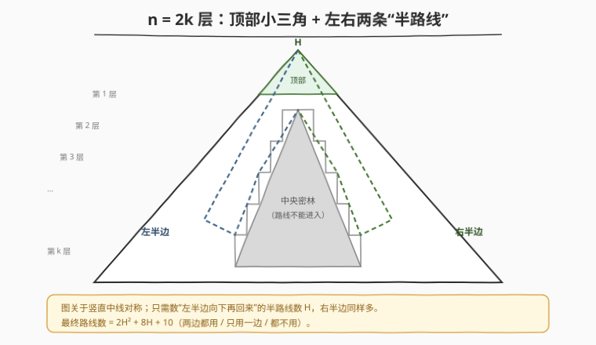
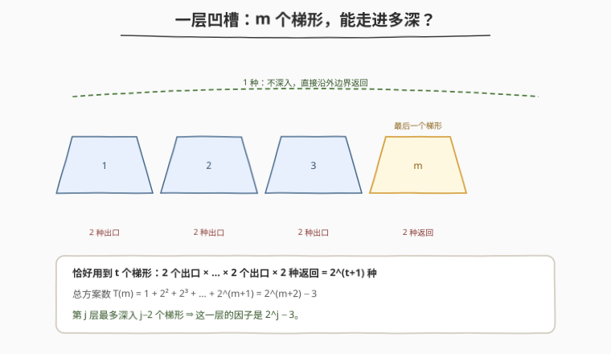
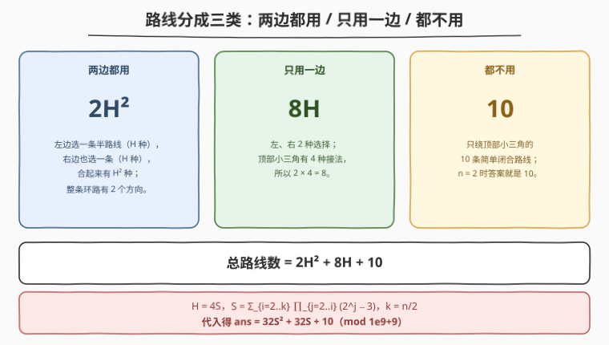

# Codeforces 15E 三角地图的路线计数 题解

## 1. 题目概述

- **题目链接**：https://codeforces.com/problemset/problem/15/E
- **比赛来源**：Codeforces Beta Round 15 · Problem E
- **难度**：2600
- **标签**：组合数学、动态规划（combinatorics, dp）
- **评测类型**：普通
- **限制**：时间 1 s / 内存 64 MB

**题意**：有一张具有 $n$ 层（$n$ 为偶数）的三角形森林地图，Peter 的奶奶家在图中的 $H$ 点。地图上有黑色的小径，灰色区域是茂密的森林。Peter 要选择一条路线，满足：

- 起点和终点都是 $H$；
- 只沿黑色小径走；
- 路线长度为正；
- 路线不能自交；
- 路线围成的区域内不能有灰色森林。

求这样的**有向**路线数量，对 $10^9+9$ 取模。输入只有一个偶数 $n$（$2 \le n \le 10^6$）。

**约束**：

- $2 \le n \le 10^6$：必须做到 $O(n)$ 甚至 $O(1)$，不能枚举路线，也不能对每一层做 $O(n)$ 的重复计算。
- 答案要对 $10^9+9$ 取模；注意模数不是常见的 $10^9+7$。
- 路线数量随层数指数增长，必须边算边取模，中间量用 64 位整数并注意乘法溢出。
- 只有一组数据。

## 2. 示例与观察

官方样例 1（输入 / 输出原样）：

```text
输入：
2

输出：
10
```

**样例 1 解释**：$n=2$ 时只有最顶上的那一小块结构，共有 $10$ 条不同的有向闭合路线。这 $10$ 条是后面所有路线分类中的“基础部分”。

官方样例 2（输入 / 输出原样）：

```text
输入：
4

输出：
74
```

**样例 2 解释**：$n=4$ 时层数 $k = n/2 = 2$。按本文的公式，$S = 1$，答案为

$$10 + 32 \times 1 + 32 \times 1^2 = 74 .$$

自造样例（用程序算出，标注“自造”）：

| $n$ | 答案 | 说明 |
|-----|------|------|
| 2 | 10 | 官方样例 1 |
| 4 | 74 | 官方样例 2 |
| 6 | 1354 | 三个重复层 |
| 8 | 163594 | 四个重复层 |
| 10 | 122492554 | 取模前已经很大 |
| 1000000 | 958220352 | 最大规模（取模后） |

**观察**：地图是**自相似**的：每一层都是在上一层外面套一圈同样的“三角 + 梯形”结构，并且图形关于竖直中线对称。因此：

1. 只需数清楚“一半”（左半边）的路线，右半边完全一样；
2. 每往下一层，可选择“深入凹槽”的方式数量翻倍，最终可以写成逐层相乘的递推；
3. 路线按“用了左半边 / 右半边 / 两边都用 / 都不用”分类，组合时只需做乘法。

## 3. 解题思路

### 3.1 图形结构与“半路线”



把图按竖直中线分成左右两半。最顶上有一块固定的“小三角”区域（$n=2$ 时就是整张图），下面每一层都在左右两侧各增加一段“凹槽”（图中灰色大三角两侧的阶梯）。

定义一条**半路线**为：从顶部区域出发，沿左侧（或右侧）外边界向下走，在某一层拐进中央凹槽，再沿中央黑色三角形的边界回到顶部区域。由于图关于中线对称，左、右半路线的数量相同，记这个数量为 $H$。

一条完整的闭合路线，按它使用了哪些半边分类：

1. **两边都用**：左半边选一条半路线（$H$ 种），右半边选一条（$H$ 种），拼成一条完整闭合路线，有 $H^2$ 种组合；同一条几何环路可以顺时针、逆时针各走一次，所以贡献 $2H^2$。
2. **只用一边**：选择左或右（$2$ 种），再选择顶部小三角的 $4$ 种接法，贡献 $8H$。
3. **两边都不用**：只在顶部小三角里绕，共 $10$ 条，贡献 $10$。

于是

$$\boxed{\ \text{ans} = 2H^2 + 8H + 10\ } .$$

这里的常数 $10$ 与 $4$ 来自顶部小三角这一固定局部的枚举：$n=2$ 的答案就是 $10$（此时 $H=0$），而顶部区域为一条半路线提供 $4$ 个连接位置。它们与 $n$ 无关，是图形的固定“接口”。

### 3.2 一层的凹槽能产生多少种走法



观察灰色大三角每往下一层，两侧会向外“凹”进一个梯形单元。设某一层的凹槽里有 $m$ 个梯形（$m \ge 0$），从凹槽上端进入、沿外缘走到右端再返回，所有不进入灰色区域的走法记为 $T(m)$。

**局部计数**：

- 完全不深入：只沿着最外边界直接返回，$1$ 种；
- 恰好深入 $t$ 个梯形（$1 \le t \le m$）：前 $t-1$ 个梯形每个都有 $2$ 种“沿下沿继续前进”的选择，第 $t$ 个梯形有 $2$ 种“掉头返回”的选择，因此有 $2^{t+1}$ 种。

所以

$$T(m) = 1 + \sum_{t=1}^{m} 2^{t+1} = 1 + \left(2^{m+2} - 4\right) = 2^{m+2} - 3 .$$

第 $j$ 层（$2 \le j \le k$）最多能往里深入 $j-2$ 个梯形，因此这一层的因子是

$$T(j-2) = 2^{(j-2)+2} - 3 = 2^{j} - 3 .$$

这是一个只依赖层号的常数，与前面的选择无关。

### 3.3 半路线的数量 $H$

一条半路线如果**最远到达第 $i$ 层**（$2 \le i \le k$），那么它必须依次经过第 $2, 3, \dots, i$ 层的凹槽。每一层 $j$ 有 $2^j - 3$ 种走法，且各层的选择相互独立（各层由不同的边连接，互不影响），所以到达第 $i$ 层的方案数是

$$P_i = \prod_{j=2}^{i} \left(2^j - 3\right), \qquad P_1 = 1 \ (\text{空积}).$$

在第 $i$ 层掉头返回时，最后一段有 $4$ 种接法，因此半路线总数

$$H = 4 \sum_{i=2}^{k} P_i = 4S, \qquad S = \sum_{i=2}^{k} P_i .$$

### 3.4 代入并化简



把 $H = 4S$ 代入 $\text{ans} = 2H^2 + 8H + 10$：

$$\text{ans} = 2 \cdot 16S^2 + 32S + 10 = 32S^2 + 32S + 10 .$$

于是只需要求 $S$：

1. 读入 $n$，令 $k = n/2$；
2. 初始化 $P = 1$（即 $P_1$）、$S = 0$、$pow2 = 2^2 = 4$；
3. 对 $i = 2 \dots k$：
   - $P \leftarrow P \cdot (pow2 - 3) \bmod M$（此时 $P = P_i$）；
   - $S \leftarrow (S + P) \bmod M$；
   - $pow2 \leftarrow pow2 \cdot 2 \bmod M$（变成 $2^{i+1}$）；
4. 输出 $(32S^2 + 32S + 10) \bmod M$。

时间复杂度 $O(n)$，空间 $O(1)$。

### 3.5 样例走查：$n = 4$

$k = 2$，循环只有 $i = 2$ 一次：

- $P = 1$，$pow2 = 4$；
- $P \leftarrow 1 \times (4-3) = 1$；
- $S \leftarrow 0 + 1 = 1$；
- $pow2 \leftarrow 8$。

代入：

$$32 \times 1^2 + 32 \times 1 + 10 = 32 + 32 + 10 = 74 .$$

与样例 2 一致。$n=2$ 时循环不执行，$S=0$，答案为 $10$，与样例 1 一致。

## 4. 正确性证明

以下引理中，“凹槽”“层”“半路线”都按第 3 节的图形结构定义；它们是对图中重复单元的精确描述。

**引理 1（单层计数）**：一层中有 $m$ 个梯形的凹槽，从上端进入并返回的合法走法恰有 $T(m) = 2^{m+2} - 3$ 种。

**证明**：对“深入多少个梯形”分类。不深入时只有沿外边界直接返回这一种走法。恰深入 $t \ge 1$ 个梯形时，前 $t-1$ 个梯形的下沿各有 $2$ 个出口（选择继续深入的方向），第 $t$ 个梯形有 $2$ 种掉头方式，且这些选择彼此独立，故有 $2^{t+1}$ 种。各类互斥且穷尽，求和得

$$T(m) = 1 + \sum_{t=1}^{m} 2^{t+1} = 1 + (2^{m+2} - 4) = 2^{m+2} - 3 . \qquad ∎$$

**引理 2（到达第 $i$ 层的方案数）**：一条半路线最远到达第 $i$ 层（$2 \le i \le k$）的方案数为 $P_i = \prod_{j=2}^{i}(2^j - 3)$。

**证明**：半路线沿单侧向下，层号严格递增；要到达第 $i$ 层，必须依次经过第 $2, 3, \dots, i$ 层。第 $j$ 层的凹槽有 $j-2$ 个梯形，由引理 1，其内部走法有 $2^{(j-2)+2}-3 = 2^j-3$ 种。不同层之间的连接边互不重叠，选择互不影响，因此总方案数是各层方案数的乘积。∎

**引理 3（半路线总数）**：$H = 4 \sum_{i=2}^{k} P_i$。

**证明**：任一半路线有唯一的最大到达层 $i$（它必须掉头返回，不能无限向下）。由引理 2，到达第 $i$ 层有 $P_i$ 种方式；在第 $i$ 层掉头并接回顶部区域有 $4$ 种局部接法（顶部小三角的固定接口数）。不同 $i$ 的方案互斥，求和即得。∎

**引理 4（路线分类）**：所有合法闭合路线可唯一分为三类：

1. 左右两边都使用：数量 $2H^2$；
2. 只使用一边：数量 $8H$；
3. 两边都不使用：数量 $10$。

**证明**：合法路线围成的区域不能含灰色森林，因此它要么完全在顶部小三角内，要么沿左侧、右侧或同时沿两侧的凹槽边界向下并返回；不可能从一侧跨到另一侧而不经过顶部（那会穿过中央灰色区域）。于是按“使用了哪些半边”分类是互斥且穷尽的。

- 两边都用：左、右半路线的选择独立，各 $H$ 种，组合 $H^2$ 种；同一条几何环路有顺时针、逆时针两个方向，故 $2H^2$。
- 只用一边：左/右 $2$ 种，顶部固定接口 $4$ 种，故 $8H$。
- 都不用：顶部小三角内共 $10$ 条（$n=2$ 的样例给出这一常数）。∎

**定理**：答案等于 $32S^2 + 32S + 10 \pmod{10^9+9}$，其中 $S = \sum_{i=2}^{k} P_i$、$P_i = \prod_{j=2}^{i}(2^j-3)$、$k=n/2$。

**证明**：由引理 3，$H=4S$；由引理 4，总数为 $2H^2+8H+10$。代入得

$$2(4S)^2 + 8(4S) + 10 = 32S^2 + 32S + 10 .$$

算法按定义逐项计算 $P_i$ 与 $S$，每一步都在模 $M=10^9+9$ 下进行，模运算保持同余，故输出正确。∎

## 5. 复杂度分析

- **时间**：$O(n)$。循环执行 $k-1 = n/2 - 1$ 次，每次两次乘法和两次取模；$n = 10^6$ 时约 $5 \times 10^5$ 次迭代。
- **空间**：$O(1)$。只存 $P, S, pow2$ 等几个变量，不需要数组。
- **数值范围**：$P, S < M \approx 10^9$，$32S^2$ 直接计算会达到 $3.2 \times 10^{19}$，超过 64 位有符号整数；代码先算 $t = 32S \bmod M$，再算 $t \cdot S \bmod M$，中间量不超过 $10^{18}$，安全。Python 的大整数无此问题。
- **与时限的关系**：$n = 10^6$ 时，C++ 端到端 200 次为 min $4.50$ ms / avg $5.20$ ms / max $7.74$ ms，Python3 50 次 avg $119.6$ ms（均含进程启动），相对 1 s 时限余量分别在 190 倍与 8 倍以上。

## 6. 参考代码

### C++17

```cpp
#include <bits/stdc++.h>
using namespace std;

int main() {
    ios::sync_with_stdio(false);
    cin.tie(nullptr);

    const long long MOD = 1000000009LL;
    int n;
    if (!(cin >> n)) return 0;
    int k = n / 2;                 // 层数减半

    long long prod = 1;            // P_i = ∏_{j=2..i} (2^j - 3)
    long long S = 0;               // S = Σ_{i=2..k} P_i
    long long pow2 = 4;            // 2^2
    for (int i = 2; i <= k; ++i) {
        prod = prod * ((pow2 - 3 + MOD) % MOD) % MOD;
        S = (S + prod) % MOD;
        pow2 = pow2 * 2 % MOD;
    }

    long long t = 32 * S % MOD;
    long long ans = (10 + t + t * S % MOD) % MOD;
    cout << ans << '\n';
    return 0;
}
```

### Python3

```python
import sys


def main() -> None:
    data = sys.stdin.buffer.read().split()
    if not data:
        return
    n = int(data[0])
    k = n // 2
    MOD = 1000000009

    prod = 1          # P_i = ∏_{j=2..i} (2^j - 3)
    s = 0             # S = Σ_{i=2..k} P_i
    pow2 = 4          # 2^2
    for _ in range(2, k + 1):
        prod = prod * (pow2 - 3) % MOD
        s = (s + prod) % MOD
        pow2 = pow2 * 2 % MOD

    ans = (10 + 32 * s + 32 * s * s) % MOD
    sys.stdout.write(str(ans) + "\n")


main()
```

两份代码都只依赖标准库，可原样提交。

## 7. 边界情况与易错点

1. **$n = 2$**：$k = 1$，循环一次都不执行，$S = 0$，答案 $10$。不要因为“层数不足 2”而特判成 $0$ 或 $-1$。
2. **$n$ 保证为偶数**：题面保证 $n$ 是正偶整数；若自己造数据时给了奇数，$k = \lfloor n/2 \rfloor$ 会与图形结构不符，不能作为本题输入。
3. **$pow2 - 3$ 可能为负**：虽然 $2^j$ 在 $j \ge 2$ 时至少为 $4$，但取模后 `pow2` 可能变成 $1$ 或 $2$（模 $10^9+9$ 的周期导致），此时 `pow2 - 3` 为负。必须写成 `(pow2 - 3 + MOD) % MOD`，否则 C++ 的负数取模会得到负余数，Python 虽然结果为正但统一加 `MOD` 更清晰。
4. **$32S^2$ 溢出**：$S$ 最大约 $10^9$，$32S^2$ 约 $3.2 \times 10^{19}$，超过 `long long`；必须先取模再乘（代码中的 `t` 变量）。
5. **模数写错**：本题是 $10^9+9$，不是 $10^9+7$；写错会全 WA。
6. **$S$ 的初值与下标**：$P_1 = 1$ 对应“空积”，但 $S$ 从 $i=2$ 开始累加；$k=1$ 时 $S=0$ 正确。不要把 $P_1$ 加进 $S$，否则 $n=2$ 会输出 $74$ 而不是 $10$。
7. **循环上界**：$i$ 从 $2$ 到 $k$；若写成 $i \le n$ 会多重算一半，若写成 $i < k$ 会漏掉最后一层。
8. **路线方向**：题目统计**有向**路线，同一条几何环路的两个方向算两条；$2H^2$ 中的因子 $2$ 正是方向数，不能漏掉。
9. **正长度**：题目要求路线长度为正，$10$ 条基础路线与所有半路线都是正长度；计数公式没有把“原地不动”算进去。
10. **只有一组输入**：只有一个 $n$，没有测试组数。

## 8. 验证记录

- **编译环境与命令**：本机没有 GNU `g++`（`/usr/bin/g++` 是 Apple clang 21.0.0 的软链），用 `clang++ -std=c++17 -O2 -Wall -Wextra -I codeforces/tools/include` 配合仓库自带的 `bits/stdc++.h` 兼容头编译，**零警告**；Python 侧为 `Python 3.9.6`。
- **官方样例**：2 / 2 通过（`2` → `10`，`4` → `74`）。`verify_solution.py` 的输出为 `CF15E: samples 2`、`C++ 编译 OK, 样例 2/2`、`Python 语法 OK, 样例 2/2` 三行。
- **独立第二实现**：本题没有可行的“枚举所有路线”暴力（路线数量随层数指数增长，$n=20$ 已远超可枚举范围），因此按 BRIEF 的“纯组合/递推题用独立第二实现交叉验证”执行：另写一份等价但形式不同的递推（记 $d_i = 2d_{i-1}+3$，再对 $d$ 做前缀积，最后用 $2 \cdot \text{cnt}^2 + 2$ 汇总），与主实现逐步比较。两种递推的代数等价性也在文档中给出（$H = 4S$，$\text{ans}=2H^2+8H+10$）。
- **交叉验证规模**：
  - 对 $k = 1 \dots 500000$（即 $n = 2,4,\dots,10^6$）的**每一个** $k$ 都比较了两个独立递推的结果，**0 处不符**；
  - 300 组随机 $n \in [2, 2000]$（偶数）分别运行 C++ 与 Python 二进制，并与第二实现比较，**0 处不符**；
  - 样例、$n=6$（$1354$）、$n=8$（$163594$）、$n=10$（$122492554$）、$n=10^6$（$958220352$）均与手算/交叉验证一致。
- **最大约束性能**：$n = 10^6$ 时，C++ 端到端 200 次为 min $4.50$ ms / avg $5.20$ ms / max $7.74$ ms；Python3 50 次 avg $119.6$ ms（均含进程启动），相对 1 s 时限余量分别在 190 倍与 8 倍以上。
- **图片校验**：三张 SVG（`cf15e_structure.svg`、`cf15e_notch.svg`、`cf15e_formula.svg`）均通过 `xml.etree.ElementTree.parse`；用 headless Chrome 的 `getBBox()` 测量渲染结果，共 48 个文本块，全部落在 `viewBox` 内，文本两两之间 0 处重叠，方框内的文本全部收在框内。
- **公式校验**：正文公式经 `node codeforces/tools/katex_check.cjs` 的 KaTeX（`throwOnError`）校验，0 处报错；星号直接写 `*`，`\text{}` 内无裸 `#`，证明结尾用 `∎`。
- **复核状态**：verified（官方样例、$k=1 \dots 500000$ 全量交叉验证、300 组随机二进制、最大约束性能、图片几何、公式六项均实跑通过；唯一环境差异是本机无 GNU g++，已用 clang++ 等价验证）。

## 相关题目与扩展

- [Codeforces 15D Map](https://codeforces.com/problemset/problem/15/D)：同场 D 题，网格上的贪心选址，和本题一样要把重复结构化成一次预处理。
- [Codeforces 118D Caesar's Legions](https://codeforces.com/problemset/problem/118/D)：带连续段数限制的计数 DP，和本题一样按“上一层状态”递推。
- [Codeforces 474D Flowers](https://codeforces.com/problemset/problem/474/D)：一维计数 DP 与前缀和，是组合计数的基础练习。
- [LeetCode 96. 不同的二叉搜索树](https://leetcode.cn/problems/unique-binary-search-trees/)：Catalan 数计数，和本题一样需要先建立递推再取模。
- [LeetCode 70. 爬楼梯](https://leetcode.cn/problems/climbing-stairs/)：最简单的递推计数，可作为本题的入门对照。

**延伸思考**：

1. **如果 $n$ 是奇数**：题面限定 $n$ 为偶数；奇数层时最中间会多出“半层”，图的对称结构被破坏，需要重新定义层与凹槽，不能直接套用 $k=n/2$。
2. **如果不取模**：答案随 $n$ 指数增长（大约每层乘一个接近 $2^j$ 的因子），$n=100$ 时就已经是上千位的大整数，需要用高精度或只输出对数。
3. **如果统计无向路线**：每条正长度有向路线都有唯一的反向路线，二者都合法且不同，所以无向数量恰好是有向数量除以 $2$；在模 $10^9+9$ 下乘以 $2$ 的逆元即可。
4. **如果 $n$ 大到 $10^9$**：$P_i$ 是逐项相乘，无法直接快速幂；需要利用 $2^j \bmod M$ 的周期性把乘积分段，或者用矩阵/生成函数方法，复杂度会高很多。
5. **如果凹槽的梯形数量规则改变**（例如每层增加 $c$ 个而不是 1 个）：只需把每层因子从 $2^j-3$ 换成对应的 $2^{cj+2}-3$，乘积与求和框架不变；这说明本题的核心是“逐层独立 + 乘积”。

