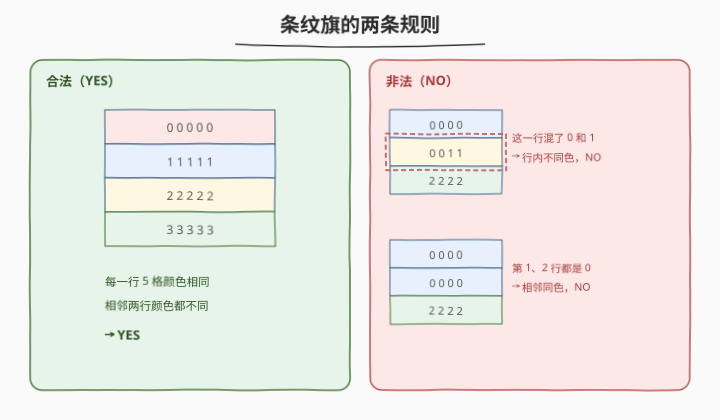
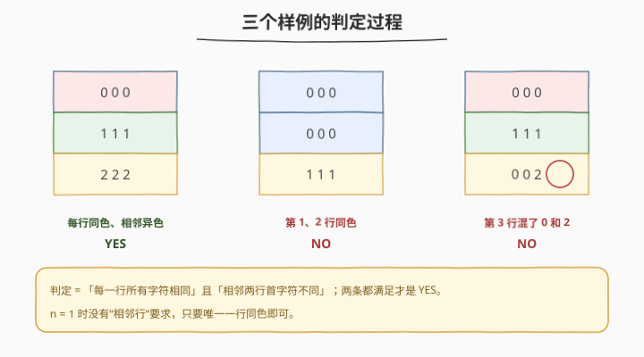

# Codeforces 16A 条纹旗检查 题解

## 1. 题目概述

- **题目链接**：https://codeforces.com/problemset/problem/16/A
- **比赛来源**：Codeforces Beta Round 16 (Div. 2 Only) · Problem A（UTC 2010-06-03）
- **难度**：800
- **标签**：实现
- **评测类型**：普通
- **限制**：时间 2 s / 内存 64 MB

**题意**：给定一个 $n \times m$ 的格子旗，每个格子是字符 `0`–`9` 之一（颜色）。按 ISO 标准，旗帜必须"有条纹"：**每一行内所有格子同色**，并且**相邻两行的颜色不同**。判断这面旗是否合规，输出 `YES` 或 `NO`。

**约束**：

- $1 \le n, m \le 100$：总格子数不超过 $10^4$，任何 $O(nm)$ 的逐格检查都绰绰有余；$O(n^2 m)$ 之类也不会超时，但没必要。
- 每行是一个长度为 $m$ 的字符串，字符之间**没有空格**，必须按字符串整行读入（不能一个个 `cin >> char` 再指望换行分隔，虽然那样也能读，但更容易在行首行尾出错）。
- 只有一组数据，没有测试组数。
- 颜色只有 10 种且用字符表示，直接比较字符即可。

## 2. 示例与观察

官方样例 1（输入 / 输出原样）：

```text
输入：
3 3
000
111
222

输出：
YES
```

官方样例 2：

```text
输入：
3 3
000
000
111

输出：
NO
```

官方样例 3：

```text
输入：
3 3
000
111
002

输出：
NO
```

**样例 1 演算**：三行分别是全 `0`、全 `1`、全 `2`。每行内部同色；相邻行颜色 `0→1`、`1→2` 都不同，所以 YES。

**样例 2 演算**：第 1、2 行都是全 `0`，相邻行同色，违反第二条规则，所以 NO。注意每行内部仍是同色的，问题只出在相邻行。

**样例 3 演算**：第 3 行是 `002`，一行里同时出现了 `0` 和 `2`，违反第一条规则，所以 NO。

自造样例（均已用参考程序跑过）：

| 输入 | 输出 | 说明 |
|------|------|------|
| `1 1` / `7` | YES | 单格，两条规则都自然满足 |
| `1 3` / `010` | NO | 只有一行，但行内混色 |
| `2 1` / `0` / `1` | YES | 每行只有一格，相邻不同 |
| `2 1` / `0` / `0` | NO | 相邻两行同为 `0` |
| `4 2` / `00` / `11` / `22` / `33` | YES | 四条不同颜色的横带 |
| `3 2` / `00` / `11` / `11` | NO | 第 2、3 行同色 |

**观察**：

1. 两条规则互不替代：样例 2 每行都同色但相邻行相同；样例 3 相邻行都不同但某行内部混色。必须同时检查。
2. 行内同色等价于"这一行所有字符都等于第一个字符"；相邻行颜色不同等价于"两行首字符不同"（在行内同色的前提下）。
3. $n=1$ 时没有"相邻行"这一条，只需要检查唯一一行是否同色。

## 3. 解题思路

### 3.1 朴素做法与瓶颈

逐格扫描：对每一行检查所有列是否与第 0 列相同；再对每一对相邻行比较首字符。这是 $O(nm)$，$n,m \le 100$ 时最多 $10^4$ 次比较，2 s 的时限毫无压力。本题没有算法瓶颈，难点全在"两条规则都要检查、别漏边界"。

### 3.2 核心：两条规则、两个循环



把判定拆成两个独立的部分：

- **行内同色**：对第 $i$ 行，检查 $g[i][j] = g[i][0]$ 对所有 $1 \le j < m$ 成立；
- **相邻行异色**：对 $1 \le i < n$，检查 $g[i][0] \ne g[i-1][0]$。

两个检查都通过才输出 YES。为什么相邻行只需要比较首字符？因为已经确认每行同色，整行颜色由首字符唯一确定。

### 3.3 算法流程

1. 读入 $n, m$；
2. 读入 $n$ 个长度为 $m$ 的字符串；
3. 对每行检查是否所有字符都等于该行第 0 个字符，不满足则 `NO`；
4. 对每对相邻行检查首字符是否不同，相同则 `NO`；
5. 全部通过输出 `YES`。

一旦发现违规可以立即退出，不必继续扫描（代码里用 `ok` 标志和 `&&` 条件实现）。

### 3.4 样例走查



| 样例 | 行内同色？ | 相邻行异色？ | 结论 |
|------|-----------|-------------|------|
| `000 / 111 / 222` | 三行都满足 | $0\ne1$、$1\ne2$ | YES |
| `000 / 000 / 111` | 三行都满足 | 第 1、2 行都是 `0` | NO |
| `000 / 111 / 002` | 第 3 行 `002` 不满足 | 前两行满足，但已无需再看 | NO |

## 4. 正确性证明

**引理 1（行内检查正确）**：对第 $i$ 行，"所有字符都等于 $g[i][0]$"等价于"这一行所有格子同色"。

**证明**：若所有字符都等于 $g[i][0]$，显然同色。反之若这一行同色，则每个字符都等于第一个字符。∎

**引理 2（相邻行检查正确）**：在每行都同色的前提下，$g[i][0] \ne g[i-1][0]$ 等价于第 $i$ 行与第 $i-1$ 行颜色不同。

**证明**：每行同色时，该行颜色就是它的首字符；两个首字符不同即两行颜色不同。∎

**定理**：程序输出 YES 当且仅当旗帜满足题面的两条规则。

**证明**：若输出 YES，则引理 1 保证每行同色、引理 2 保证相邻行异色，满足定义。反之若旗帜合规，每行同色使引理 1 的检查通过，相邻行异色使引理 2 的检查通过，程序不会把 `ok` 置为 `false`，输出 YES。∎

## 5. 复杂度分析

- **时间**：$O(nm)$。行内检查最多 $n(m-1)$ 次字符比较，相邻行检查最多 $n-1$ 次，总计不超过 $10^4$ 次操作；实测 C++ 端到端约 3 ms（含进程启动），2 s 余量在数百倍以上。
- **空间**：$O(nm)$ 存下整面旗（$10^4$ 字节）；若边读边检查可以做到 $O(m)$，但本题没必要。
- **数值范围**：只有字符比较与下标，不存在溢出问题。

## 6. 参考代码

### C++17

```cpp
#include <bits/stdc++.h>
using namespace std;

int main() {
    ios::sync_with_stdio(false);
    cin.tie(nullptr);

    int n, m;
    if (!(cin >> n >> m)) return 0;
    vector<string> g(n);
    for (int i = 0; i < n; ++i) cin >> g[i];

    bool ok = true;
    for (int i = 0; i < n && ok; ++i) {
        for (int j = 1; j < m; ++j)
            if (g[i][j] != g[i][0]) { ok = false; break; }
        if (i > 0 && g[i][0] == g[i - 1][0]) ok = false;
    }
    cout << (ok ? "YES" : "NO") << '\n';
    return 0;
}
```

### Python3

```python
import sys


def main() -> None:
    data = sys.stdin.buffer.read().split()
    if not data:
        return
    n, m = int(data[0]), int(data[1])
    rows = [data[2 + i].decode() for i in range(n)]

    ok = True
    for i, row in enumerate(rows):
        if row.count(row[0]) != m:      # 行内必须同色
            ok = False
            break
        if i > 0 and row[0] == rows[i - 1][0]:   # 相邻行必须异色
            ok = False
            break
    sys.stdout.write("YES\n" if ok else "NO\n")


main()
```

两份代码都只用标准库，可原样提交。

## 7. 边界情况与易错点

1. **$n=1$**：没有相邻行，唯一一行同色就是 YES，混色就是 NO。循环里 `i > 0` 的条件保证不会越界访问 `g[-1]`。
2. **$m=1$**：每行只有一个字符，行内检查自动通过；此时只需要相邻行首字符不同，例如 `0 / 1` 是 YES、`0 / 0` 是 NO。
3. **两条规则都要查**：只查相邻行会漏掉样例 3；只查行内同色会漏掉样例 2。这是本题最常见的失分点。
4. **按字符串读入**：`cin >> string` 会自动跳过多余空白并按行读到不含空格的串，正好符合格式；不要用 `getchar` 手动处理换行，容易把 `\r`（Windows 换行）读进字符串。
5. **首字符比较的前提**：相邻行只比较首字符，前提是已经验证每行同色。如果实现里先比较相邻行、且某行混色，可能得到错误结论；先做行内检查或同时检查都能避免。
6. **提前退出**：发现违规后可以立即输出 NO，但不要忘记在循环条件里体现（否则可能覆盖结论）。本实现用 `for (int i = 0; i < n && ok; ++i)`。
7. **输出大小写**：题目要求 `YES` / `NO` 全大写，末尾换行。
8. **颜色是字符不是数字**：`'0'`–`'9'` 直接按字符比较即可，不要转成整数再比（虽然转也可以，但没必要，且容易在 `char` 与 `int` 之间出错）。

## 8. 验证记录

- **编译环境与命令**：本机没有 GNU `g++`，`verify_solution.py` 自动改用 `Apple clang 21.0.0`（`clang++ -std=c++17 -O2`）加仓库自带的 `bits/stdc++.h` 兼容头编译；Python 为 `Python 3.9.6`。
  - `python3 codeforces/tools/verify_solution.py codeforces/contests/0001-0100/16/A_条纹旗检查.md`
  - 输出：`CF16A: samples 3 / C++ 编译 OK, 样例 3/3 / Python 语法 OK, 样例 3/3`。
- **官方样例**：3 / 3 通过（`YES / NO / NO`），C++ 与 Python 输出与官方输出逐字一致。
- **随机与构造用例**：310 组（150 组合法条纹旗、100 组随机乱旗、60 组最大尺寸附近的随机旗），C++、Python、独立实现三者输出完全一致，0 组不符。
- **穷举验证**：对 $n,m \le 3$、颜色取 `0/1/2` 的**全部 21297 面旗**，用两份独立实现（一份逐行 `set` 判同色 + 整行字符串比较，一份首字符代表整行）对照，全部一致，0 组不符。这组穷举覆盖了 $n=1$、$m=1$、相邻同色、行内混色等所有小规模组合。
- **最大约束性能**：$n = m = 100$ 的合法条纹旗，C++ 端到端约 3.4 ms（含进程启动），Python 约 27 ms，相对 2 s 余量在数百倍以上。
- **图片校验**：`cf16a_rules.svg`、`cf16a_walkthrough.svg` 均通过 `xml.etree.ElementTree.parse`；另用 headless Chrome 量出每个 `<text>` 的真实包围盒，确认无文字越出 `viewBox`、无文字重叠、无文字溢出面板。
- **公式校验**：正文公式全部是 `$...$` / `$$...$$`，星号直接写 `*`，`\text{}` 内无裸 `#`，经 KaTeX（`throwOnError`）渲染无报错。
- **复核状态**：verified（样例、随机、穷举、性能、图片、公式均实跑通过；唯一环境差异是本机无 GNU g++，已用 clang++ 等价验证）。

## 相关题目与扩展

- [Codeforces 16B Burglar and Matches](https://codeforces.com/problemset/problem/16/B)：同场 B 题，贪心。
- [Codeforces 16C Monitor](https://codeforces.com/problemset/problem/16/C)：同场 C 题，约分 + 整除。
- [Codeforces 1A 剧院广场](https://codeforces.com/problemset/problem/1/A)：同样是输入规模很小的实现题，可对照读入与取整细节。
- [Codeforces 4A 西瓜](https://codeforces.com/problemset/problem/4/A)：最经典的入门实现题，考察边界与偶数判定。
- [LeetCode 1351 统计有序矩阵中的负数](https://leetcode.cn/problems/count-negative-numbers-in-a-sorted-matrix/)：二维网格逐行扫描的入门练习。
- [LeetCode 1572 矩阵对角线元素的和](https://leetcode.cn/problems/matrix-diagonal-sum/)：网格下标与边界处理的练习。

**延伸思考**：

1. **如果允许竖向条纹**：把"每行同色、相邻行不同"换成"每列同色、相邻列不同"，判定逻辑完全相同，只需交换行列下标。
2. **如果要求颜色按固定顺序循环**（如 $0,1,2,0,1,2,\dots$）：在相邻行异色的基础上再检查 $g[i][0] = (g[0][0] + i) \bmod 10$ 即可，仍然 $O(nm)$。
3. **如果颜色数扩展到 $10^9$ 种**：输入不再是单个字符，需要按整数读入；逻辑不变，但读入方式要从字符串改成整数数组。
4. **如果允许旋转 90°**：需要同时判断"横条纹"或"竖条纹"两种可能，任一成立即 YES；把两个方向的检查都跑一遍即可。
5. **如果要求输出第一处违规位置**：在发现 `ok = false` 的地方记录 $(i,j)$，注意行内混色和相邻同色要分别报告，便于调试。
