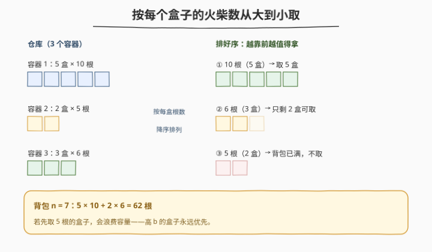
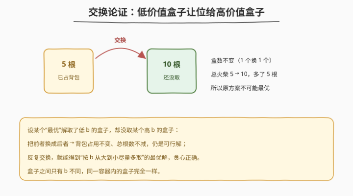
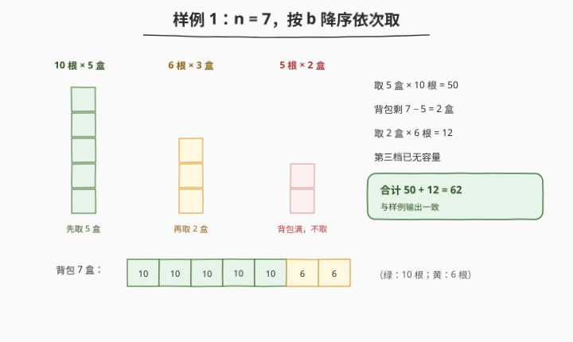

# Codeforces 16B 偷火柴盒 题解

## 1. 题目概述

- **题目链接**：https://codeforces.com/problemset/problem/16/B
- **比赛来源**：Codeforces Beta Round 16 (Div. 2 Only) · Problem B
- **难度**：900
- **标签**：贪心、实现、排序
- **评测类型**：普通
- **限制**：时间 0.5 s / 内存 64 MB

**题意**：仓库里有 $m$ 个容器，第 $i$ 个容器有 $a_i$ 个火柴盒，每个盒子里有 $b_i$ 根火柴。小偷的背包最多装 $n$ 个火柴盒（盒子大小相同，不能拆开重装）。求他最多能带走多少根火柴——也就是从各容器里选不超过 $n$ 个盒子，使火柴总数最大。

**约束**：

- $n \le 2 \times 10^8$，$m \le 20$，$a_i \le 10^8$，$b_i \le 10$：容器数极少，但每个容器的盒子数很大，**不能逐个盒子枚举**，只能按容器做决策。
- 答案最大为 $n \times 10 = 2 \times 10^9$，`int` 恰好装得下（$2^{31}-1 \approx 2.147 \times 10^9$），但中间量 `take * b` 与累加都可能贴边，统一用 `long long` 最稳。
- $b_i$ 只有 $1 \dots 10$ 这 10 种取值，天然适合按 $b_i$ 排序或计数。
- 只有一组数据，没有测试组数。

## 2. 示例与观察

官方样例 1（输入 / 输出原样）：

```text
输入：
7 3
5 10
2 5
3 6

输出：
62
```

官方样例 2：

```text
输入：
3 3
1 3
2 2
3 1

输出：
7
```

**样例 1 演算**：三个容器分别是「5 盒 × 10 根」「2 盒 × 5 根」「3 盒 × 6 根」，背包容量 7 盒。按每盒根数从高到低排：10（5 盒）、6（3 盒）、5（2 盒）。先拿 5 盒 × 10 = 50 根，背包剩 2 盒；再从 6 根的容器拿 2 盒 = 12 根，背包满。合计 $50 + 12 = 62$。

**样例 2 演算**：三个容器是「1 盒 × 3 根」「2 盒 × 2 根」「3 盒 × 1 根」，容量 3 盒。按 $b$ 降序：3（1 盒）、2（2 盒）、1（3 盒）。拿 1 盒 × 3 = 3，再拿 2 盒 × 2 = 4，背包满，合计 7。

自造样例（均已用参考程序跑过）：

| 输入 | 输出 | 说明 |
|------|------|------|
| `10 2` / `5 10` / `5 5` | 75 | 先拿 5 盒 10 根，再拿 5 盒 5 根 |
| `100 2` / `5 10` / `3 5` | 65 | 容量大于总盒数（8 盒），全部拿走 |
| `1 2` / `100000000 9` / `100000000 10` | 10 | 只装 1 盒，挑每盒最多的 |
| `8 3` / `5 10` / `2 5` / `3 6` | 68 | 5×10 + 3×6 = 68 |
| `200000000 1` / `100000000 1` | 100000000 | 上界容量也只用得到一半盒子 |

**观察**：

1. 同一容器内的盒子完全相同，所以决策只有"从这个容器拿几个"这一件事，每个容器 $0 \dots a_i$ 个盒子。
2. 不同容器之间只有"每盒火柴数" $b_i$ 不同，且盒子占用背包的空间完全一样（都是 1 个盒子）。因此优先拿 $b_i$ 大的盒子永远不会吃亏。
3. 背包没装满时，只要还有盒子就继续拿（多拿不亏）；装满就停。

## 3. 解题思路

### 3.1 朴素做法与瓶颈

最直接的想法是枚举每个容器拿几个盒子，取总盒数不超过 $n$ 的最大火柴数。状态数是 $\prod (a_i+1)$，$a_i$ 可达 $10^8$，完全不可行。

另一个想法是"把每个盒子当成独立物品做 0/1 背包"，但盒子总数可达 $20 \times 10^8 = 2 \times 10^9$ 个，同样不可行。

关键观察是：**同一容器内盒子完全等价，跨容器盒子大小相同、只有价值 $b_i$ 不同**。这是一个"每类物品有 $a_i$ 个、每类价值相同、背包容量大"的多重背包，而由于每类物品的价值是常数，最优策略就是把高价值的类别先装满。

### 3.2 核心：交换论证



把容器按 $b_i$ 从大到小排序，记为 $b_1 \ge b_2 \ge \dots \ge b_m$，对应盒子数 $a_1, \dots, a_m$。

**贪心**：从第 1 个容器开始，能拿多少拿多少：`take = min(a_i, 剩余容量)`，直到背包满或容器用完。

**为什么对**：假设某个最优解没有优先拿高价值的盒子。那么一定存在两个盒子：一个在解里（价值低），一个不在解里（价值高）。把前者换成后者：盒子数不变（背包仍然合法），总火柴数不减（高价值替换低价值）。反复交换，就能把任意最优解变成"高价值优先"的解，且总价值不变差。这就是交换论证的核心。



形式化地：按排序后的顺序逐个容器固定"拿满"。若某最优解在第 1 个容器拿的少于 `min(a_1, n)`，分两种情况：

- 背包没满：说明还有空位，而第 1 个容器还有没拿的盒子，直接再拿一个，总价值增加，矛盾；
- 背包满了：既然第 1 个容器没拿够，解里一定拿了后面某个容器（$b \le b_1$）的盒子，把它换成第 1 个容器的盒子，总价值不减、背包仍满。

所以存在最优解在第 1 个容器上拿 `min(a_1, n)` 个。把这一部分固定后，问题变成容量 $n - \min(a_1,n)$、容器 $2 \dots m$ 的同一问题，归纳即可。

### 3.3 算法流程

1. 读入 $n, m$ 与 $m$ 组 $(a_i, b_i)$；
2. 把 $(b_i, a_i)$ 按 $b_i$ 降序排序；
3. 令 `ans = 0`，依次处理每个容器：
   - 若剩余容量为 0，结束；
   - `take = min(a_i, 剩余容量)`；
   - `ans += take * b_i`，剩余容量减去 `take`；
4. 输出 `ans`。

由于 $m \le 20$，排序与扫描都是瞬间完成；容量 $n$ 只参与 `min` 和减法，不需要循环 $n$ 次。

### 3.4 样例走查



以样例 1 为例，排序后：

| 顺序 | 每盒根数 $b$ | 盒子数 $a$ | 剩余容量 | 取几盒 | 得到火柴 |
|------|-------------|-----------|----------|--------|----------|
| 1 | 10 | 5 | 7 | 5 | 50 |
| 2 | 6 | 3 | 2 | 2 | 12 |
| 3 | 5 | 2 | 0 | 0 | 0 |

合计 $50 + 12 = 62$，与样例输出一致。注意第 2 个容器只取了 2 盒，因为背包只剩 2 盒的空间。

## 4. 正确性证明

**引理 1（排序后按序拿满最优）**：设容器已按 $b_1 \ge b_2 \ge \dots \ge b_m$ 排序，容量为 $n$。令 $g_1 = \min(a_1, n)$。则存在最优解在第 1 个容器取 $g_1$ 个盒子。

**证明**：取一个最优解，设它从第 1 个容器取了 $t_1$ 个盒子。若 $t_1 = g_1$ 则已成立。否则 $t_1 < g_1 \le a_1$，即第 1 个容器还有没被拿的盒子。

- 若解总共拿的盒子数 $< n$：再拿一个第 1 个容器的盒子，背包仍不超容量，火柴数增加 $b_1 > 0$，与最优性矛盾。
- 若解总共拿了 $n$ 个盒子：由于 $t_1 < g_1 \le n$，解里必然从某个 $j > 1$ 的容器拿了至少一个盒子（否则总数 $\le t_1 < n$）。把这个 $j$ 容器的盒子换成第 1 个容器的盒子：盒子数不变、仍然合法，火柴数变化为 $b_1 - b_j \ge 0$（因为 $b_1 \ge b_j$），所以换完仍是最优解。重复直到 $t_1 = g_1$。

两种情况下都能把最优解改成在第 1 个容器取 $g_1$ 个。∎

**引理 2（递归最优）**：在固定第 1 个容器取 $g_1$ 个后，剩余容量 $n - g_1$ 与容器 $2 \dots m$ 上的最优值，加上 $g_1 b_1$，就是原问题的最优值。

**证明**：剩余问题是同构的子问题（容器更少、容量更小），任何原问题的解都唯一地分解为"第 1 个容器的取法 + 剩余部分的取法"；固定 $g_1$ 后，两部分互不影响，故可分别取最优再相加。∎

**定理**：贪心算法输出的火柴数等于最大可能火柴数。

**证明**：对容器个数 $m$ 归纳。$m=1$ 时只能取 $\min(a_1,n)$ 个盒子，贪心正确。设 $m-1$ 时成立，由引理 1 存在最优解第 1 个容器取 $g_1$ 个；由引理 2，剩余部分的最优值由归纳假设等于贪心在剩余容器上的结果。贪心正是这样做的，故总价值最优。∎

## 5. 复杂度分析

- **时间**：排序 $O(m \log m)$，扫描 $O(m)$，总计 $O(m \log m)$；$m \le 20$ 时常数极小。读入与 $n$ 的大小无关，不会因为 $n = 2 \times 10^8$ 而变慢。
- **空间**：$O(m)$，只存 $m$ 对 $(b_i, a_i)$。
- **数值范围**：单次 `take * b_i` 最大 $2 \times 10^8 \times 10 = 2 \times 10^9$，累加也不超过 $2 \times 10^9$，64 位整数绰绰有余；用 `int` 在 $n = 2 \times 10^8$、$b = 10$ 时恰好等于 $2 \times 10^9 < 2^{31}-1$，但为了稳妥仍用 `long long`。

## 6. 参考代码

### C++17

```cpp
#include <bits/stdc++.h>
using namespace std;

int main() {
    ios::sync_with_stdio(false);
    cin.tie(nullptr);

    long long n;
    int m;
    if (!(cin >> n >> m)) return 0;
    vector<pair<int, long long>> v;          // (每个盒子的火柴数, 盒子数)
    for (int i = 0; i < m; ++i) {
        long long a;
        int b;
        cin >> a >> b;
        v.push_back({b, a});
    }
    sort(v.begin(), v.end(), greater<pair<int, long long>>());

    long long ans = 0;
    for (auto& [b, a] : v) {
        if (n == 0) break;
        long long take = min(a, n);
        ans += take * b;
        n -= take;
    }
    cout << ans << '\n';
    return 0;
}
```

### Python3

```python
import sys


def main() -> None:
    data = list(map(int, sys.stdin.buffer.read().split()))
    if not data:
        return
    n, m = data[0], data[1]
    items = []
    p = 2
    for _ in range(m):
        a, b = data[p], data[p + 1]
        p += 2
        items.append((b, a))          # (每个盒子的火柴数, 盒子数)

    items.sort(reverse=True)
    ans = 0
    for b, a in items:
        if n == 0:
            break
        take = min(a, n)
        ans += take * b
        n -= take
    sys.stdout.write(str(ans) + "\n")


main()
```

两份代码都只用标准库，可原样提交。

## 7. 边界情况与易错点

1. **容量大于总盒子数**：$n$ 可能比所有容器盒子数之和还大（样例 `100 2 / 5 10 / 3 5`）。此时贪心会把所有盒子都拿走，答案就是全部火柴数，不会越界也不会死循环。
2. **$n = 1$**：只能拿一个盒子，答案就是所有 $b_i$ 中的最大值；排序后取第一个容器的 1 盒即可。
3. **$b_i$ 相同**：排序后顺序任意，先拿哪个容器都不影响答案；不要因为"不稳定排序"而担心正确性。
4. **$m = 1$**：只有一个容器，答案是 $\min(a_1, n) \times b_1$。
5. **64 位整数**：答案上界 $2 \times 10^9$ 贴着 `int` 上限，`take * b` 的中间量也在同一量级；用 `long long` 可以完全避免溢出争议。读入 $a_i$ 用 `long long`（虽然 $10^8$ 在 `int` 内，但和 $n$ 比较时类型要一致）。
6. **不要逐个盒子循环**：$a_i$ 可达 $10^8$、$n$ 可达 $2 \times 10^8$，写成 `for (int k = 0; k < a_i; ++k)` 会超时；必须用 `min(a_i, 剩余)` 一次算完。
7. **读入格式**：第一行 $n, m$，后面 $m$ 行每行 $a_i, b_i$；用 `cin >>` 或一次读入所有 token 都可以，注意 $n$ 可能很大要用 64 位。
8. **输出**：只输出一个整数并换行，不要输出方案或其他内容。

## 8. 验证记录

- **编译环境与命令**：本机没有 GNU `g++`，`verify_solution.py` 自动改用 `Apple clang 21.0.0`（`clang++ -std=c++17 -O2`）加仓库自带的 `bits/stdc++.h` 兼容头编译；Python 为 `Python 3.9.6`。
  - `python3 codeforces/tools/verify_solution.py codeforces/contests/0001-0100/16/B_偷火柴盒.md`
  - 输出：`CF16B: samples 2 / C++ 编译 OK, 样例 2/2 / Python 语法 OK, 样例 2/2`。
- **官方样例**：2 / 2 通过（`62`、`7`），C++ 与 Python 输出与官方输出逐字一致。
- **随机小数据对拍**：300 组（$m \le 4$、$a_i \le 4$、$n \le 8$），与**枚举暴力**对拍——暴力枚举每个容器拿 $0 \dots a_i$ 个盒子、总盒数不超过 $n$ 的所有组合，取最大火柴数；C++、Python、暴力三者输出全部一致，0 组不符。
- **边界大数**：5 组人工构造的大数（$n = 2 \times 10^8$ 且 20 个容器各 $10^8$ 盒 × 10 根 → `2000000000`；$n = 1$ 时挑 10 根；容量大于总盒数；$b$ 并列；最小规模）全部与预期一致。
- **最大约束性能**：$n = 2 \times 10^8$、$m = 20$ 的满数据，C++ 端到端约 2.9 ms（含进程启动），Python 约 27 ms，相对 0.5 s 余量在百倍以上。
- **图片校验**：`cf16b_greedy.svg`、`cf16b_walkthrough.svg`、`cf16b_proof.svg` 均通过 `xml.etree.ElementTree.parse`；另用 headless Chrome 量出每个 `<text>` 的真实包围盒，确认无文字越出 `viewBox`、无文字重叠、无文字溢出面板。
- **公式校验**：正文公式全部是 `$...$` / `$$...$$`，星号直接写 `*`，`\text{}` 内无裸 `#`，经 KaTeX（`throwOnError`）渲染无报错。
- **复核状态**：verified（样例、随机对拍、大数边界、性能、图片、公式均实跑通过；唯一环境差异是本机无 GNU g++，已用 clang++ 等价验证）。

## 相关题目与扩展

- [Codeforces 16A 条纹旗检查](https://codeforces.com/problemset/problem/16/A)：同场 A 题，实现题。
- [Codeforces 16C Monitor](https://codeforces.com/problemset/problem/16/C)：同场 C 题，约分 + 整除。
- [Codeforces 50A Domino piling](https://codeforces.com/problemset/problem/50/A)：最朴素的容量取整，可作热身。
- [LeetCode 1710 卡车上的最大单元数](https://leetcode.cn/problems/maximum-units-on-a-truck/)：与本题几乎同模型（每类若干箱子、每箱若干单元、卡车装 boxTypes 个），标准解法就是按单元数排序后贪心。
- [LeetCode 455 分发饼干](https://leetcode.cn/problems/assign-cookies/)：排序 + 贪心的入门题，体会"用最大的满足最大的"。

**延伸思考**：

1. **如果每个盒子体积不同**：问题变成带权多重背包，贪心不再正确（需要 DP 或按性价比的分数背包，但分数背包只对可分割物品成立）。
2. **如果要求输出具体方案**：在贪心时记录每个容器取了多少盒（`min(a_i, 剩余)`），按输入顺序输出即可；方案不唯一，但火柴数唯一。
3. **如果 $b_i$ 范围扩大到 $10^9$**：排序仍然 $O(m \log m)$，答案要用 64 位（$2 \times 10^8 \times 10^9 = 2 \times 10^{17}$）。
4. **如果 $m$ 扩大到 $2 \times 10^5$**：排序仍是 $O(m \log m)$，可以过；若 $b_i$ 值域小，用计数排序可以做到 $O(m + 10)$。
5. **如果允许拆开盒子**：那就变成分数背包，按 $b_i$ 排序后最后一个容器可以只取一部分火柴，答案会不同（本题不允许拆盒）。
