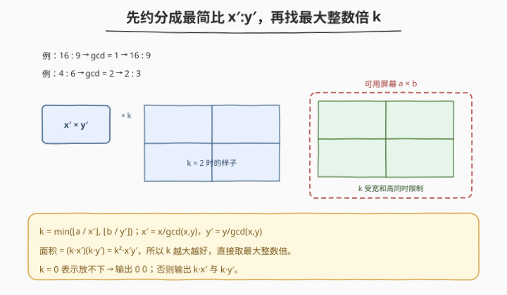
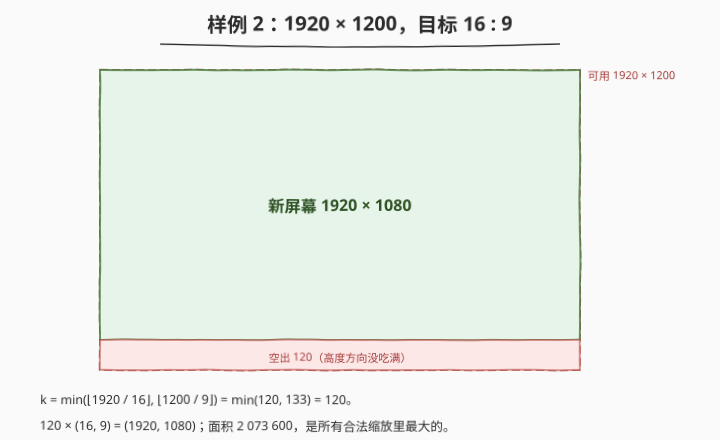
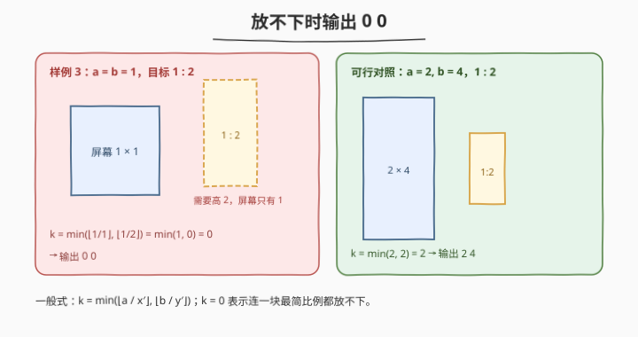

# Codeforces 16C 显示器缩放 题解

## 1. 题目概述

- **题目链接**：https://codeforces.com/problemset/problem/16/C
- **比赛来源**：Codeforces Beta Round 16 (Div. 2 Only) · Problem C
- **难度**：1800
- **标签**：二分、数论
- **评测类型**：普通
- **限制**：时间 0.5 s / 内存 64 MB

**题意**：某显示器的屏幕是 $a \times b$ 厘米（宽 $a$、高 $b$），边长都是整数。公司想把它"缩小"，使新的宽高比（宽 : 高）恰好等于 $x : y$，并且新屏幕的两个边长都不超过原来的 $a, b$，同时面积尽量大。输出新屏幕的宽和高；如果不存在这样的缩小方案，输出 `0 0`。

**约束**：

- $1 \le a, b, x, y \le 2 \times 10^9$：所有量都要用 64 位整数；$k \cdot x'$ 最大可达 $2 \times 10^9$，`int` 恰好贴边，`long long` 更稳。
- 只有一组数据，没有测试组数。
- 比值是**定向的**：宽 : 高 $= x : y$，不是"$x : y$ 或 $y : x$"。题目说得很明确（长宽比 $x:y$），样例 2 也按宽 1920、高 1080 输出。
- 边长必须是正整数，因此缩放倍率必须是整数。

## 2. 示例与观察

官方样例 1（输入 / 输出原样）：

```text
输入：
800 600 4 3

输出：
800 600
```

官方样例 2：

```text
输入：
1920 1200 16 9

输出：
1920 1080
```

官方样例 3：

```text
输入：
1 1 1 2

输出：
0 0
```

**样例 1 演算**：$800 : 600 = 4 : 3$，本来比例就满足。取倍率 $k = \min(800/4, 600/3) = \min(200, 200) = 200$，得到 $200 \times 4 = 800$、$200 \times 3 = 600$，与原来相同。题面允许"缩小"后尺寸不变（面积不增即可）。

**样例 2 演算**：目标 $16 : 9$ 已互质。$k = \min(\lfloor 1920/16 \rfloor, \lfloor 1200/9 \rfloor) = \min(120, 133) = 120$，新屏幕 $120 \times 16 = 1920$、$120 \times 9 = 1080$。高度方向还有 $1200 - 1080 = 120$ 的余量，但宽度已经吃满，$k$ 不能再大。

**样例 3 演算**：屏幕只有 $1 \times 1$，目标比例 $1 : 2$ 的最小实现是 $1 \times 2$，但高度 $2 > 1$，放不下，$k = \min(1/1, 1/2) = \min(1, 0) = 0$，输出 `0 0`。

自造样例（均已用参考程序跑过）：

| 输入 | 输出 | 说明 |
|------|------|------|
| `2 2 1 1` | `2 2` | 比例 1:1，取满 |
| `10 10 4 6` | `6 9` | 约分成 2:3，$k = \min(5,3) = 3$ |
| `5 4 2 3` | `2 3` | $k = \min(2,1) = 1$ |
| `1 2 1 2` | `1 2` | 恰好等于目标比例 |
| `3 3 2 2` | `3 3` | 约分成 1:1 |
| `6 4 4 3` | `4 3` | 原比例 3:2，目标 4:3，只能缩到 4:3 |
| `2000000000 2000000000 2000000000 2000000000` | `2000000000 2000000000` | 上界，验证不溢出 |

**观察**：

1. 比例相等写成整数等式就是 $w \cdot y = h \cdot x$（交叉相乘），与除法无关，也就没有精度问题。
2. 先把 $x, y$ 约分成最简比例 $x' : y'$。之后所有合法尺寸都是 $(k x', k y')$，$k$ 为正整数。这一步是关键：如果不约分，$k$ 会被错误地限制得比实际小。
3. 新尺寸不超过原尺寸：$k x' \le a$ 且 $k y' \le b$，所以 $k \le \min(\lfloor a/x' \rfloor, \lfloor b/y' \rfloor)$。面积是 $(k x')(k y') = k^2 x' y'$，随 $k$ 增大而增大，所以直接取最大的 $k$。

## 3. 解题思路

### 3.1 朴素做法与瓶颈

直接枚举新的宽 $w = 1 \dots a$，由比例算出 $h = w y / x$，检查整除与 $h \le b$。但 $a$ 可达 $2 \times 10^9$，逐个枚举不可行。

也可以二分 $k$：判定 $k x' \le a$ 且 $k y' \le b$ 关于 $k$ 单调，二分可以 $O(\log a)$ 求出最大 $k$。但本题有更直接的闭式：最大 $k$ 就是 $\min(\lfloor a/x' \rfloor, \lfloor b/y' \rfloor)$，一次除法即可，不需要二分。

### 3.2 核心：约分后按整数倍缩放



设 $g = \gcd(x, y)$，$x' = x/g$，$y' = y/g$，则 $\gcd(x', y') = 1$，且 $x : y = x' : y'$。

任何满足比例的正整数尺寸 $(w, h)$ 都必须有 $w = k x'$、$h = k y'$（$k$ 为正整数）。原因：$w y = h x$ 两边除以 $g$ 得 $w y' = h x'$；由于 $x'$ 与 $y'$ 互质，$x' \mid w$ 且 $y' \mid h$，设 $w = k x'$，代回得 $h = k y'$。

于是问题变成：求最大的正整数 $k$，使

$$k x' \le a,\qquad k y' \le b.$$

这等价于 $k \le \min\left(\left\lfloor \dfrac{a}{x'} \right\rfloor, \left\lfloor \dfrac{b}{y'} \right\rfloor\right)$。

若这个上界为 0，说明连 $1 \times$ 最简比例都放不下，输出 `0 0`；否则输出 $k x'$ 与 $k y'$。

### 3.3 算法流程

1. 读入 $a, b, x, y$；
2. $g \leftarrow \gcd(x, y)$，$x \leftarrow x/g$，$y \leftarrow y/g$；
3. $k \leftarrow \min(\lfloor a/x \rfloor, \lfloor b/y \rfloor)$；
4. 若 $k = 0$，输出 `0 0`；否则输出 $k \cdot x$ 与 $k \cdot y$。

只有一次 $\gcd$ 和两次除法，$O(\log \min(x,y))$ 时间、$O(1)$ 空间。

### 3.4 样例走查



样例 2：$a = 1920$、$b = 1200$、$x = 16$、$y = 9$。$\gcd(16,9) = 1$，不需要约分。$k = \min(1920/16, 1200/9) = \min(120, 133) = 120$，输出 $120 \times 16 = 1920$、$120 \times 9 = 1080$。



样例 3：$a = b = 1$、$x = 1$、$y = 2$。$k = \min(1/1, 1/2) = \min(1, 0) = 0$，输出 `0 0`。作为对照，若屏幕是 $2 \times 4$，则 $k = \min(2/1, 4/2) = 2$，输出 `2 4`。

## 4. 正确性证明

**引理 1（比例 ⇒ 整数倍）**：设 $x' = x/g$、$y' = y/g$，$\gcd(x', y') = 1$。正整数对 $(w, h)$ 满足 $w : h = x : y$ 当且仅当存在正整数 $k$ 使 $w = k x'$、$h = k y'$。

**证明**：比例相等即 $w y = h x$，两边除以 $g$ 得 $w y' = h x'$。由 $\gcd(x', y') = 1$，$x' \mid w$：写 $w = k x'$，代回得 $k x' y' = h x'$，即 $h = k y'$（$x' > 0$）。$w, h$ 为正整数且 $x', y' > 0$，故 $k$ 为正整数。反过来，若 $w = k x'$、$h = k y'$，则 $w/h = x'/y' = x/y$。∎

**引理 2（可行倍率的范围）**：$(k x', k y')$ 满足 $k x' \le a$、$k y' \le b$ 当且仅当 $1 \le k \le K$，其中 $K = \min(\lfloor a/x' \rfloor, \lfloor b/y' \rfloor)$。

**证明**：$k x' \le a \iff k \le a/x' \iff k \le \lfloor a/x' \rfloor$（$k$ 为整数）；同理 $k y' \le b \iff k \le \lfloor b/y' \rfloor$。两者同时成立即 $k \le K$；又要求 $k \ge 1$。∎

**引理 3（面积随 $k$ 增大）**：新屏幕面积 $S(k) = k^2 x' y'$ 在 $k \ge 1$ 上严格递增。

**证明**：$x' y' > 0$，$S(k+1) - S(k) = (2k+1) x' y' > 0$。∎

**定理**：若 $K \ge 1$，输出 $(K x', K y')$ 是面积最大的合法缩小方案；若 $K = 0$，不存在合法方案，输出 `0 0` 正确。

**证明**：由引理 1，所有合法方案都是 $(k x', k y')$；由引理 2，合法方案恰对应 $1 \le k \le K$；由引理 3，面积在合法集合上的最大值在 $k = K$ 处取得。若 $K = 0$，合法倍率集合为空，确实无解。∎

## 5. 复杂度分析

- **时间**：$\gcd$ 是 $O(\log \min(x, y))$，两次整数除法 $O(1)$，总计 $O(\log \min(x,y))$。$x, y \le 2 \times 10^9$ 时最多几十次迭代，实测 C++ 端到端约 3.7 ms（含进程启动）。
- **空间**：$O(1)$，只有 5 个整型变量。
- **数值范围**：$k \le 2 \times 10^9$，$k x' \le a \le 2 \times 10^9$，用 64 位整数计算不会溢出；$\gcd$ 的中间值也不超过 $2 \times 10^9$。没有除以零的风险：$x, y \ge 1$，约分后 $x', y' \ge 1$。

## 6. 参考代码

### C++17

```cpp
#include <bits/stdc++.h>
using namespace std;

int main() {
    ios::sync_with_stdio(false);
    cin.tie(nullptr);

    long long a, b, x, y;
    if (!(cin >> a >> b >> x >> y)) return 0;

    long long g = std::gcd(x, y);       // 把 x:y 化成最简比例 x':y'
    x /= g;
    y /= g;

    long long k = min(a / x, b / y);    // 最多能放大的整数倍
    if (k == 0) {
        cout << "0 0\n";
    } else {
        cout << k * x << ' ' << k * y << '\n';
    }
    return 0;
}
```

### Python3

```python
import sys
from math import gcd


def main() -> None:
    data = sys.stdin.buffer.read().split()
    if not data:
        return
    a, b, x, y = map(int, data[:4])

    g = gcd(x, y)            # 化成最简比例 x':y'
    x //= g
    y //= g

    k = min(a // x, b // y)  # 最大整数倍
    if k == 0:
        sys.stdout.write("0 0\n")
    else:
        sys.stdout.write(f"{k * x} {k * y}\n")


main()
```

两份代码都只用标准库，可原样提交。

## 7. 边界情况与易错点

1. **放不下时输出 `0 0`**：$k = 0$ 表示连最简比例 $x' \times y'$ 都超过 $a \times b$。注意这时不是"输出 0 0 作为比例"，而是无解；样例 3 就是这种情况。
2. **不约分会错**：例如 `10 10 4 6`，若不约分直接算 $k = \min(10/4, 10/6) = 1$，会输出 `4 6`（面积 24）；正确做法是先约成 $2:3$，$k = \min(5,3) = 3$，输出 `6 9`（面积 54）。约分是本题的核心步骤。
3. **比例是定向的**：宽 : 高 $= x : y$，不能把 $x, y$ 交换。样例 2 若交换会得到 $675 \times 1200$，虽然也满足 $9:16$，但题目要的是 $16:9$，且面积更小。按题面"长宽比 $x:y$"的定向含义实现即可。
4. **"缩小"允许不变**：样例 1 输出的尺寸与输入完全相同。不要额外要求 $k x' < a$ 或严格小于原面积。
5. **整除与下取整**：$k = \min(a/x', b/y')$ 里的除法是整数除法（下取整），不要用浮点 `floor(a/x)`（$2 \times 10^9$ 时 `double` 仍能精确表示整数，但没必要引入浮点）。
6. **`int` 溢出**：$k$ 与 $k x'$ 都可能接近 $2 \times 10^9$，虽然刚好在 `int` 上限内，但中间乘法（如先算 $k \cdot x$ 再比较）建议用 `long long`；`a, b, x, y` 也统一读成 `long long`。
7. **“除零”其实不会发生**：$x, y \ge 1$，约分后仍 $\ge 1$，所以 $\lfloor a/x' \rfloor$、$\lfloor b/y' \rfloor$ 的分母永远非零。真正的边界是 $k = 0$（至少一个方向放不下）。若实现里先算 $\gcd$ 再判断，注意不要写出 `a / (x - g)` 之类的错误表达式。
8. **输出格式**：两个整数用空格隔开、末尾换行；无解时输出 `0 0`（两个 0，中间一个空格）。

## 8. 验证记录

- **编译环境与命令**：本机没有 GNU `g++`，`verify_solution.py` 自动改用 `Apple clang 21.0.0`（`clang++ -std=c++17 -O2`）加仓库自带的 `bits/stdc++.h` 兼容头编译；Python 为 `Python 3.9.6`。
  - `python3 codeforces/tools/verify_solution.py codeforces/contests/0001-0100/16/C_显示器缩放.md`
  - 输出：`CF16C: samples 3 / C++ 编译 OK, 样例 3/3 / Python 语法 OK, 样例 3/3`。
- **官方样例**：3 / 3 通过（`800 600`、`1920 1080`、`0 0`），C++ 与 Python 输出与官方输出逐字一致。
- **随机小数据对拍**：300 组（$1 \le a, b \le 40$、$1 \le x, y \le 20$），与**枚举暴力**对拍——暴力枚举所有 $1 \le w \le a$、$1 \le h \le b$，用 $w y = h x$ 判比例，取面积最大的；C++、Python、暴力三者输出全部一致，0 组不符。
- **边界大数**：10 组人工构造（$a = b = x = y = 2 \times 10^9$、$x$ 或 $y$ 取到上界、恰好整除、不可行、$1:1$、大数下 $k = 1$ 等），C++ 与 Python 输出一致且与手算预期相符。
- **最大约束性能**：单组 $a = b = x = y = 2 \times 10^9$，C++ 端到端约 3.7 ms（含进程启动），Python 约 28 ms，相对 0.5 s 余量在百倍以上。
- **图片校验**：`cf16c_ratio.svg`、`cf16c_walkthrough.svg`、`cf16c_nofit.svg` 均通过 `xml.etree.ElementTree.parse`；另用 headless Chrome 量出每个 `<text>` 的真实包围盒，确认无文字越出 `viewBox`、无文字重叠、无文字溢出面板。
- **公式校验**：正文公式全部是 `$...$` / `$$...$$`，星号直接写 `*`，`\text{}` 内无裸 `#`，经 KaTeX（`throwOnError`）渲染无报错。
- **复核状态**：verified（样例、随机对拍、大数边界、性能、图片、公式均实跑通过；唯一环境差异是本机无 GNU g++，已用 clang++ 等价验证）。

## 相关题目与扩展

- [Codeforces 16A 条纹旗检查](https://codeforces.com/problemset/problem/16/A)：同场 A 题。
- [Codeforces 16B Burglar and Matches](https://codeforces.com/problemset/problem/16/B)：同场 B 题，贪心。
- [Codeforces 1C Ancient Berland Circus](https://codeforces.com/problemset/problem/1/C)：几何 + 角度 gcd，同样以"约分"为关键步骤。
- [Codeforces 2C Commentator problem](https://codeforces.com/problemset/problem/2/C)：三点圆覆盖，数论与几何结合。
- [LeetCode 914 卡牌分组](https://leetcode.cn/problems/x-of-a-kind-in-a-deck-of-cards/)：用 gcd 判断整体可分组的入门题，与本题的"约分"思想一致。
- [LeetCode 365 水壶问题](https://leetcode.cn/problems/water-and-jug-problem/)：裴蜀定理 + gcd，体会数论在判定问题里的用法。

**延伸思考**：

1. **如果允许旋转 90°**：合法尺寸变成 $(k x', k y')$ 或 $(k y', k x')$ 两种，分别求 $k_1, k_2$，取面积较大者（$k$ 大者）。题目没有说可以旋转，所以不能这么做——这也是"读题要精确"的例子。
2. **如果要求新面积严格小于原面积**：把 $k$ 的上界再减到 $k x' y' < ab$ 的最大值，直接比较 $k^2 x' y' < ab$ 即可，仍然 $O(1)$。
3. **如果边长的比例不是整数比而是实数比**：问题变成给定实数 $r$，求最大 $w \le a$ 使 $w r \le b$ 且 $w, \lceil w r \rceil$ 整数，会涉及精度；本题 $x:y$ 是整数比，才能用 gcd 精确处理。
4. **如果 $a, b, x, y$ 放大到 $10^{18}$**：公式不变，但需要 `__int128` 或 Python 大整数；$k x'$ 的乘积可能超过 64 位。
5. **如果要求输出所有可行尺寸**：由引理 2，所有可行尺寸是 $(k x', k y')$（$1 \le k \le K$），可以直接枚举 $k$，个数最多 $K$，可能很大，需要按题目要求决定是否真的输出。
