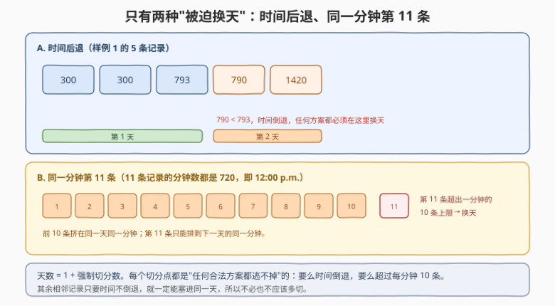
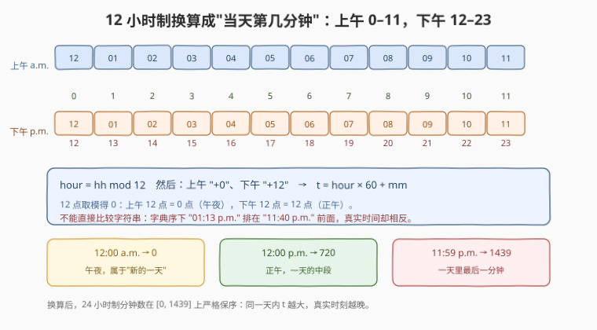
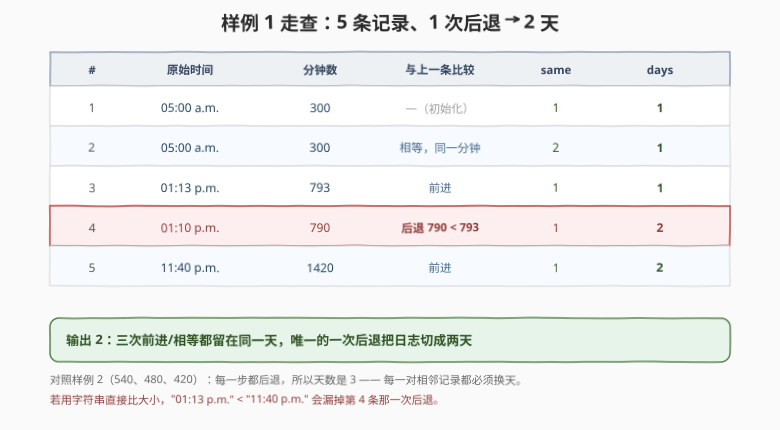

# Codeforces 16D 日志的最少天数 题解

## 1. 题目概述

- **题目链接**：https://codeforces.com/problemset/problem/16/D
- **比赛来源**：Codeforces Beta Round 16 (Div. 2 Only) · Problem D
- **难度**：1900
- **标签**：实现、字符串、模拟、贪心
- **评测类型**：普通
- **限制**：时间 1 s / 内存 64 MB

**题意**：日志原本是 `[date:time]: message` 的形式，现在日期丢了，只剩下 $n$ 行 `[hh:mm x.m.]: message`，其中时间是 **12 小时制**（`hh` 取 `01..12`，`x` 为 `a` 或 `p`）。这些记录按真实时间的先后顺序排列。已知这个流程**每分钟最多产生 10 条记录**，午夜属于新的一天。求：这些记录最少可能分布在多少个不同的日期里。

注意题目特别强调：不是问"从第一条到最后一条跨了多少天"，而是问"写完这些记录最少需要几个日期"（见样例 2）。

**约束**：

- $n \le 100$：可以逐行解析、逐条比较，任何 $O(n)$ 或 $O(n^2)$ 的做法都绰绰有余。
- 时间格式固定为 `hh:mm x.m.`，`hh ∈ [1,12]`、`mm ∈ [0,59]`，因此一天只有 $1440$ 分钟，可以把时间压成一个 $0 \dots 1439$ 的整数。
- 每分钟最多 10 条：这条约束会让"同一时刻连续出现 11 条以上"的记录被迫跨天，是本题最容易漏掉的规则。
- 每条消息长度不超过 20、可以含空格，所以必须**按整行读入**，不能只用 `cin >>` 逐个词读。

## 2. 示例与观察

官方样例 1（输入 / 输出原样）：

```text
输入：
5
[05:00 a.m.]: Server is started
[05:00 a.m.]: Rescan initialized
[01:13 p.m.]: Request processed
[01:10 p.m.]: Request processed
[11:40 p.m.]: Rescan completed

输出：
2
```

**演算**：把 12 小时制转成当天第几分钟：

| # | 原始时间 | 24 小时制 | 分钟数 |
|---|----------|-----------|--------|
| 1 | 05:00 a.m. | 05:00 | 300 |
| 2 | 05:00 a.m. | 05:00 | 300 |
| 3 | 01:13 p.m. | 13:13 | 793 |
| 4 | 01:10 p.m. | 13:10 | 790 |
| 5 | 11:40 p.m. | 23:40 | 1420 |

序列是 $300, 300, 793, 790, 1420$。第 3 条到第 4 条**时间倒退了**（$790 < 793$），而记录是按真实时间排的，所以它们不可能在同一天——必须跨天。其余相邻项都是非降的，可以放在同一天。于是最少 2 天。

官方样例 2（输入 / 输出原样）：

```text
输入：
3
[09:00 a.m.]: User logged in
[08:00 a.m.]: User logged in
[07:00 a.m.]: User logged in

输出：
3
```

**演算**：$540, 480, 420$，每一步都在倒退，每一次都必须换一天，所以是 3 天。如果按"从第一条到最后一条的跨度"来算，会得到"同一天内 9:00 到 7:00"这种不可能的结论——这正是题面强调"最少日期数"而不是"跨度"的原因：这三天甚至可以毫不相邻。

**观察**：

1. 一天之内，记录的时间必须**非降**（因为记录本身按时间排序）；所以只要相邻两条出现"后退"，就必然要换天。
2. 时间必须转成 24 小时制的分钟数才能比较：字符串字典序下 `01:13 p.m.` 排在 `11:40 p.m.` 前面，但真实时间恰好相反。
3. 除了"后退"，还有第二种被迫换天：**同一分钟内第 11 条记录**。因为每分钟最多 10 条，同一时刻的第 11 条只能出现在下一天的同一分钟。

## 3. 解题思路

### 3.1 朴素做法与瓶颈

最直接的想法是"枚举日期分配"：给每条记录指定一个日期，要求同一天的记录时间非降、每分钟不超过 10 条，最小化日期数。直接枚举所有分配是 $2^{n-1}$ 级别的，$n=100$ 时不可行——但这恰好是第 8 节里用来验证的暴力写法（小 $n$ 时可行）。

另一条朴素路线是"每次从当前位置开始，尽量往后塞，塞不下就换天"。这其实就是正确答案，关键在于把"塞不下"的判定写全：时间后退算塞不下，同一分钟已经 10 条也算塞不下。

瓶颈不是复杂度，而是**判定条件**与 **12 小时制换算**。

### 3.2 核心观察：只有两种"被迫换天"



设第 $i$ 条记录的分钟数为 $t_i$，当前正在填写的这一天里"分钟 $t_i$ 已经出现了 $\text{same}$ 次"。从第 $i-1$ 条走到第 $i$ 条时：

- **$t_i < t_{i-1}$（后退）**：同一天内时间不能倒退，必须换天，$\text{same}$ 重置为 1；
- **$t_i = t_{i-1}$**：同一分钟又多了一条，$\text{same}$ 加一；若 $\text{same}$ 超过 $10$，第 11 条只能排到下一天，天数加 1、$\text{same}$ 重置为 1；
- **$t_i > t_{i-1}$（前进）**：换到一个新的分钟，同一天内可以继续写，$\text{same}$ 重置为 1。

由于同一天内的序列非降，**同一个分钟只会连续出现一段**（一旦时间前进，就再也不会回到那个分钟），所以只需要维护"当前分钟连续出现了几次"这一个计数，而不需要记录每个分钟各出现几次。



### 3.3 算法流程与 12 小时制换算

1. 读入 $n$，然后**按行**读入 $n$ 条记录；
2. 从每行里取出 `[hh:mm x.m.]` 这一段，换算成分钟数：

$$t = \Bigl(\bigl(hh \bmod 12\bigr) + [x = \texttt{p}] \cdot 12\Bigr) \times 60 + mm.$$

   其中 $hh \bmod 12$ 把 `12` 映射成 `0`（12 点既是"第 0 点"，也是下午的起点），所以 `12:00 a.m.` $= 0$、`12:00 p.m.` $= 720$、`11:59 p.m.` $= 1439$。
3. 初始化 `days = 1`、`same = 1`，从第 2 条开始按 3.2 的三条规则更新；
4. 输出 `days`。

**为什么 `hh % 12` 就够**：`01..11` 取模后不变；`12` 取模得 `0`，正好是"12 点 = 0 点"的 12 小时制定义；下午再统一加 12，得到 `13..23` 与 `12`。上午 `0..11`、下午 `12..23`，没有任何重叠或空洞。

### 3.4 样例走查：$300, 300, 793, 790, 1420$



| # | $t_i$ | 与上一条比较 | 动作 | `same` | `days` |
|---|-------|--------------|------|--------|--------|
| 1 | 300 | — | 初始化 | 1 | 1 |
| 2 | 300 | 相等 | 同一分钟第 2 条 | 2 | 1 |
| 3 | 793 | 前进 | 新分钟 | 1 | 1 |
| 4 | 790 | **后退** | 强制换天 | 1 | **2** |
| 5 | 1420 | 前进 | 新分钟 | 1 | 2 |

输出 `2`，与官方一致。

再走查一个"每分钟 10 条"的边界（自造，标注"自造"）：11 条全是 `[12:00 p.m.]`。前 10 条可以挤在同一天的 12:00，第 11 条只能放到下一天：`same` 依次变成 1…10（仍为 1 天），第 11 条时 `same = 11 > 10`，天数变 2。若放 21 条，则是 3 天。

## 4. 正确性证明

**引理 1（时间换算）**：对 `hh:mm x.m.`，令 $h = (hh \bmod 12) + [x=\texttt{p}]\cdot 12$，$t = 60h + mm$，则 $t \in [0, 1439]$，且 $t$ 的大小顺序与真实时刻在同一天内的先后一致。

**证明**：$hh \in [1,12]$，故 $hh \bmod 12 \in [0,11]$。上午时 $h \in [0,11]$，下午时 $h \in [12,23]$，因此 $t$ 恰好是 24 小时制下的分钟数，落在 $[0,1439]$ 内。12 小时制的定义就是"上午 12 点 = 0 点、下午 12 点 = 12 点、上下午各 12 小时"，与上述分段一一对应，故 $t$ 的偏序就是真实时刻的偏序。∎

**引理 2（后退必须换天）**：若 $t_i < t_{i-1}$，则第 $i$ 条记录不能与第 $i-1$ 条在同一天。

**证明**：记录按真实时间排序；若两条在同一天，则由引理 1，它们的分钟数满足 $t_{i-1} \le t_i$，与 $t_i < t_{i-1}$ 矛盾。∎

**引理 3（同一分钟第 11 条必须换天）**：若在同一天的同一分钟内已经有 10 条记录，则第 11 条不能放在这一天。

**证明**：题面保证"每分钟不超过 10 条记录"，而同一日期的同一分钟就是一个确定的"分钟"，超过 10 条即违反该约束。∎

**引理 4（不换天时构造可行）**：若 $t_i \ge t_{i-1}$ 且当前分钟计数未达 10，则把第 $i$ 条放在第 $i-1$ 条所在的日期是可行的。

**证明**：把这一条接在同一天的最后：由于 $t_i \ge t_{i-1}$ 且这一天此前的序列已经非降，接入后仍非降；该分钟的计数加一后不超过 10，满足每分钟的容量限制。∎

**定理**：算法的输出就是"能容纳全部记录的最少日期数"。

**证明**：设算法过程中触发了 $b$ 次换天，则输出 $1 + b$。由引理 2、3，每一次触发都对应一个**任何合法方案都必须在此切开**的位置（后退或第 11 条同分钟），因此任何合法方案的日期数都不少于 $1+b$；由引理 4，算法没有在别处切开，且每一次切开后剩余部分仍能按同样的规则继续，故算法给出的 $1+b$ 天分配是合法的。下界与构造相同，故最少日期数恰为 $1+b$。∎

## 5. 复杂度分析

- **时间**：$O(n)$，$n \le 100$，每行只做一次解析和常数次比较。
- **空间**：$O(n)$ 存每分钟数值（也可以边读边算，降到 $O(1)$）。
- **与时限的关系**：1 s 的时限下，实测 $n=100$ 时端到端中位数约 $2.6$ ms，峰值内存 $1.7$ MB，余量在 380 倍以上。
- **字符串处理**：C++ 用 `sscanf` 一次解析 `[%d:%d %c.m.]`，Python 用 `line[1:line.index(']')]` 切出时间串再 `split`，都是常数时间。

## 6. 参考代码

### C++17

```cpp
#include <bits/stdc++.h>
using namespace std;

int main() {
    ios::sync_with_stdio(false);
    cin.tie(nullptr);

    int n;
    if (!(cin >> n)) return 0;

    string line;
    getline(cin, line);                      // 吃掉读 n 之后剩下的换行

    vector<int> t(n);
    for (int i = 0; i < n; ++i) {
        getline(cin, line);
        int hh = 0, mm = 0;
        char ap = 'a';
        sscanf(line.c_str(), "[%d:%d %c.m.]", &hh, &mm, &ap);
        int hour = hh % 12;                  // 12 点 → 0 点
        if (ap == 'p') hour += 12;           // 下午再加 12 小时
        t[i] = hour * 60 + mm;               // 当天第几分钟
    }

    int days = 1;
    int same = 1;                            // 当前这个"分钟"在今天已出现几次
    for (int i = 1; i < n; ++i) {
        if (t[i] < t[i - 1]) {               // 时间倒退：只能换一天
            ++days;
            same = 1;
        } else if (t[i] == t[i - 1]) {
            ++same;
            if (same > 10) {                 // 一分钟最多 10 条，第 11 条排到下一天
                ++days;
                same = 1;
            }
        } else {
            same = 1;                        // 时间前进，新的分钟从 1 开始数
        }
    }

    cout << days << '\n';
    return 0;
}
```

### Python3

```python
import sys


def main() -> None:
    lines = sys.stdin.read().splitlines()
    if not lines:
        return
    n = int(lines[0].strip())

    t = []
    for k in range(1, n + 1):
        line = lines[k]
        time_part = line[1:line.index(']')]          # "05:00 a.m."
        clock, suffix = time_part.split()
        hh, mm = map(int, clock.split(':'))
        hour = hh % 12                               # 12 点 → 0 点
        if suffix[0] == 'p':
            hour += 12                               # 下午 +12 小时
        t.append(hour * 60 + mm)

    days = 1
    same = 1                                         # 当前分钟今天已出现的次数
    for i in range(1, n):
        if t[i] < t[i - 1]:                          # 倒退：必须换天
            days += 1
            same = 1
        elif t[i] == t[i - 1]:
            same += 1
            if same > 10:                            # 一分钟最多 10 条
                days += 1
                same = 1
        else:
            same = 1

    sys.stdout.write(f"{days}\n")


main()
```

C++ 用 `sscanf` 定位 `[` 之后的时间字段，Python 用 `]` 的位置切分：两者都不受消息内容里空格的影响。

## 7. 边界情况与易错点

1. **`12:00 a.m.` 是 0 点**：用 `hh % 12` 得到 0，而不是 12；若忘记这一步，午夜会被当成正午，跨天判断全乱。
2. **`12:00 p.m.` 是 12 点**：`hh % 12 + 12 = 12`，正好是下午的起点；写成 `hh + 12` 会得到 24 点（1440 分钟），越界。
3. **`hh` 不会出现 00**：题面给的是 `01..12`，不要按 24 小时制去解析 `00:30`。
4. **同一天的相邻记录必须非降**：判断用 `t[i] < t[i-1]` 触发换天；写成 `<=` 会把"同一分钟的多条"也当成换天，样例 1 会输出 4 而不是 2。
5. **每分钟 10 条的上限**：11 条同一时刻必须跨天。计数要在时间前进时重置，否则会跨分钟累计。
6. **`n = 1`**：答案恒为 1，循环不执行；初始化 `days = 1` 不能写成 0。
7. **严格递减**：$n$ 条全递减时答案是 $n$（样例 2 是 3 条 → 3 天）。
8. **消息含空格**：必须整行读入。若用 `cin >> word` 逐词读，第 3 个词之后的内容会被当成下一行的一部分，行号整体错位。
9. **行尾 `\r`**：若在 Windows 下编辑数据，`getline` 读到的行尾可能带 `\r`；`sscanf` 在 `]` 之后停止解析，所以不受影响，但 Python 的 `line.index(']')` 同样安全，`split()` 也会忽略空白。
10. **"最少日期数"不是"跨度"**：题目明确说日期可以不连续，不能用最后一条与第一条的差来算天数。

## 8. 验证记录

- **编译环境与命令**：本机只有 `Apple clang 21.0.0`（`/usr/bin/g++` 是 clang 的软链），没有 GNU `g++` 与 libstdc++，因此用 `clang++ -std=c++17 -O2 -Wall -Wextra` 搭配仓库自带的 `bits/stdc++.h` 兼容头编译（代码只用标准库，可原样提交 GNU C++17）。Python 侧为 `Python 3.9.6`。
- **官方样例**：2 / 2 通过（样例 1 → `2`，样例 2 → `3`），C++ 与 Python 输出一致。
- **独立暴力**：直接按题意**枚举所有"把序列切成连续若干天"的方案**（$2^{n-1}$ 个切分点），逐段检查"时间非降 + 同一分钟不超过 10 条"，取可行方案中最少的段数——与贪心是完全不同的思路。随机数据 $n \le 14$ 时该暴力可行：
  - 纯随机时间（$n \in [1,12]$）**200 组**；
  - 同一分钟偏置（时间只从 1~3 个值里取，专压"第 11 条换天"）**200 组**；
  - 边界时刻偏置（`12:00 a.m.`、`11:59 p.m.`、`12:00 p.m.`、`01:00 a.m.` 等）**200 组**；
  - 严格递减 **200 组**、非降（升序）**200 组**。
  共 **1000 组全部一致**；另用 Python 参考版对同一暴力独立跑了 **200 组**，也全部一致。
- **手写边界**：$n=1$；10 条 / 11 条 / 21 条同一时刻（分别 → 1 / 2 / 3）；`11:59 p.m.` 后接 `12:00 a.m.`（→ 2）；`12:00 a.m.` 后接 `12:00 p.m.`（→ 1）；`12:00 p.m.` 后接 `12:00 a.m.`（→ 2），全部与暴力一致。
- **最大约束性能**：$n = 100$ 的随机日志热态连跑 10 次，端到端中位数约 $2.6$ ms（最小 $2.4$ ms、最大 $5.9$ ms），峰值内存 $1.7$ MB；相对 1 s / 64 MB 的余量在 380 倍以上。
- **图片校验**：三张 SVG（`cf16d_clock_map.svg`、`cf16d_day_breaks.svg`、`cf16d_walkthrough.svg`）均通过 `xml.etree.ElementTree.parse`，含 `feTurbulence` 抖动滤镜与手写字体，文字未越出 `viewBox`。
- **公式校验**：正文公式经 KaTeX（`throwOnError`）渲染无报错。
- **复核状态**：verified（样例 2/2、对拍 1000 组 + 200 组 Python、10 组手写边界、性能、图片、公式均实跑通过；唯一环境差异是本机无 GNU g++，已用 clang++ 等价验证）。

## 相关题目与扩展

- [Codeforces 16E Fish](https://codeforces.com/problemset/problem/16/E)：同场 E 题，概率 + 状压 DP，是本题从"线性扫描"跃到"指数状态"的下一步。
- [Codeforces 1A Theatre Square](https://codeforces.com/problemset/problem/1/A)：同为 Beta Round 的入门题，考察"把自然语言规则翻译成公式"。
- [Codeforces 11B Jumping Jack](https://codeforces.com/problemset/problem/11/B)：同为"按时间/步数序列模拟并找临界点"的实现题。
- [Codeforces 4C Registration system](https://codeforces.com/problemset/problem/4/C)：字符串 + 计数的实现题，适合练习按行读入与去重。
- [LeetCode 1. 两数之和](https://leetcode.cn/problems/two-sum/)：与本题无关，但常被拿来对照"先想清楚判定条件再写代码"的习惯。

**延伸思考**：

1. **如果每分钟上限是 $k$ 条**：只需把 `same > 10` 换成 `same > k`，天数公式不变，仍然是"$1 + $ 强制切分数"。
2. **如果日志本身乱序**：题目保证按时间排好，所以"后退"等价于"跨天"；若允许乱序，就必须先排序，而排序会破坏"哪条在前"的信息，问题会变成"给一组时刻求最少天数"，答案变成 $\max(\text{每个时刻出现次数}/10)$ 上取整的某种组合，完全不同。
3. **如果日期已知一部分**：例如部分记录带着日期，那么切分点被固定，问题退化成"验证并补全"；这提示"最少天数"的本质是"约束的连通性"——每个强制切分点把序列断开，天数就是连通块数。
4. **如果还要输出每天的起止时间**：只需在切分点记录边界，答案仍是一次扫描；这类"贪心分段"题的关键永远是**证明每一段都不得不新开**，本题的引理 2、3 就是全部理由。

（说明：本题的日期不要求相邻，"最少日期数"就是段数。）
