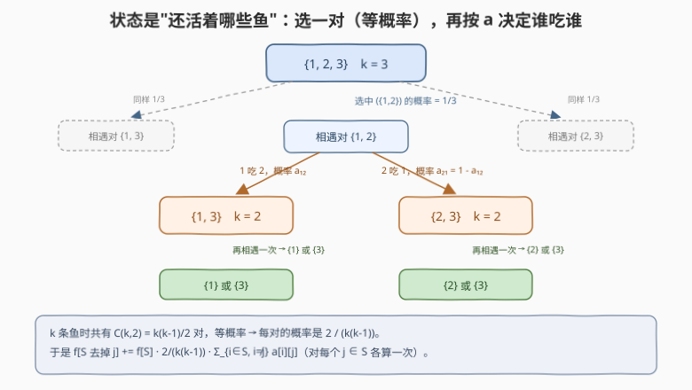
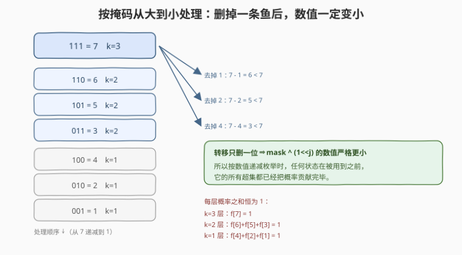
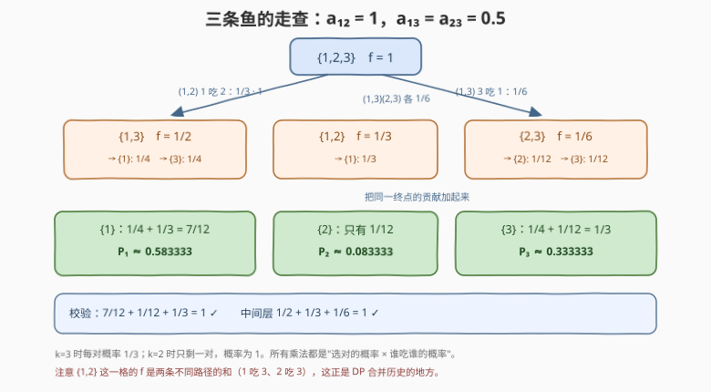

# Codeforces 16E 湖中最后一条鱼 题解

## 1. 题目概述

- **题目链接**：https://codeforces.com/problemset/problem/16/E
- **比赛来源**：Codeforces Beta Round 16 (Div. 2 Only) · Problem E
- **难度**：1900
- **标签**：状压 DP、概率、位运算
- **评测类型**：普通（实数输出，按误差判定）
- **限制**：时间 3 s / 内存 128 MB

**题意**：湖里有 $n$ 条鱼。每天**恰好**有一对鱼相遇，任意一对鱼相遇的概率相同。若 $i$ 与 $j$ 相遇，$i$ 吃掉 $j$ 的概率是 $a_{ij}$，$j$ 吃掉 $i$ 的概率是 $a_{ji} = 1 - a_{ij}$。过程一直进行到只剩一条鱼。求每条鱼成为"最后一条鱼"的概率。

**约束**：

- $n \le 18$：状态可以用一个 $18$ 位的二进制数表示"还活着哪些鱼"，共 $2^{18} = 262144$ 个状态，状压 DP 可行；而"枚举所有相遇序列"是 $(n!)$ 级别的，$18!$ 绝无可能。
- $a_{ij} \in [0,1]$，且 $a_{ij} + a_{ji} = 1$：这条对称性是"每层概率之和为 1"的来源，也是正确性的关键。
- 输出要求**不少于 6 位小数**，比较时按误差判定（通常 $10^{-6}$），因此用 `double` 足够，但要注意累加误差。

## 2. 示例与观察

官方样例 1（输入 / 输出原样）：

```text
输入：
2
0 0.5
0.5 0

输出：
0.500000 0.500000
```

**演算**：两条鱼，第一天的相遇必然是 $(1,2)$。鱼 1 吃掉鱼 2 的概率 $0.5$，鱼 2 吃掉鱼 1 的概率也是 $0.5$，所以两条鱼存活的概率各为 $1/2$。

官方样例 2（输入 / 输出原样）：

```text
输入：
5
0 1 1 1 1
0 0 0.5 0.5 0.5
0 0.5 0 0.5 0.5
0 0.5 0.5 0 0.5
0 0.5 0.5 0.5 0

输出：
1.000000 0.000000 0.000000 0.000000 0.000000
```

**演算**：鱼 1 对任何对手的胜率都是 $1$（第一行除对角线外全是 $1$）。它迟早会遇到某条鱼，而一旦相遇就必胜，所以鱼 1 一定活到最后；其余鱼的概率为 $0$。

**观察**：

1. 每条鱼只需要知道"**当前还有哪些鱼活着**"，不需要知道"谁吃了谁、吃了多久"——因为每天选哪一对只取决于当前活着的鱼的数量，与历史无关。
2. 若当前有 $k$ 条鱼活着，可能的相遇对有 $\binom{k}{2} = k(k-1)/2$ 种，且等概率，所以每一对的概率是 $\frac{1}{\binom{k}{2}} = \frac{2}{k(k-1)}$。
3. $n \le 18$ 强烈暗示"用位掩码枚举存活集合"。

## 3. 解题思路

### 3.1 朴素做法与瓶颈

最直接的想法是"枚举所有可能的相遇序列"：第一天有 $\binom{n}{2}$ 种配对、每种 2 种结果；第二天 $\binom{n-1}{2}$ 种……总路径数是

$$\prod_{k=2}^{n} 2\binom{k}{2} = \prod_{k=2}^{n} k(k-1),$$

对 $n = 18$ 是天文数字。即使只枚举"谁吃谁"的淘汰顺序，也有 $n!$ 量级。

真正的浪费在于：**大量不同的历史会汇合到同一个"存活集合"**。例如"1 吃 2，然后 3 吃 4"与"3 吃 4，然后 1 吃 2"到达的是同一个状态 $\{1,3,5,\dots\}$，后续行为完全一样。把汇合的历史合并起来，就是状态压缩 DP。

### 3.2 核心观察：状态是"存活集合"，转移系数只与大小有关



定义

$$f[S] = \text{过程中某个时刻"活着的鱼恰好是集合 } S\text{"的概率}.$$

初始 $f[\text{全集}] = 1$。设 $|S| = k \ge 2$，则下一天：

- 从 $S$ 中选出一对鱼，共 $\binom{k}{2}$ 种，等概率，故每对的概率是 $\frac{2}{k(k-1)}$；
- 若选中的是 $\{i, j\}$，则 $i$ 吃 $j$ 的概率是 $a_{ij}$，状态变成 $S \setminus \{j\}$；$j$ 吃 $i$ 的概率是 $a_{ji}$，状态变成 $S \setminus \{i\}$。

于是转移方程（对每个 $j \in S$）：

$$f\bigl[S \setminus \{j\}\bigr] \mathrel{+}= f[S] \cdot \frac{2}{k(k-1)} \cdot \sum_{i \in S,\ i \ne j} a_{ij}.$$

这里的 $\sum_{i} a_{ij}$ 正是"$j$ 被集合中某条鱼吃掉"的概率和：它们两两互斥（只可能被其中一条吃掉）。



### 3.3 算法流程与归一化

1. 读入 $n$ 与矩阵 $a$；
2. 令 $\text{full} = 2^n - 1$，$f[\text{full}] = 1$，其余为 $0$；
3. **按掩码从大到小**枚举 $S$（从 $\text{full}$ 递减到 $1$）：
   - 若 $f[S] = 0$ 或 $|S| < 2$，跳过；
   - $k = |S|$，系数 $c = \frac{2}{k(k-1)}$，$base = f[S] \cdot c$；
   - 对每一对 $i < j$（都在 $S$ 中）：$f[S \setminus \{i\}] \mathrel{+}= base \cdot a_{ji}$，$f[S \setminus \{j\}] \mathrel{+}= base \cdot a_{ij}$；
4. 输出 $f[\{1\}], f[\{2\}], \dots, f[\{n\}]$，保留 6 位小数。

**为什么"从大到小"是对的**：转移只会**删掉一位**，所以 $S \setminus \{j\}$ 的数值一定严格小于 $S$。按数值递减的顺序处理，等处理到 $S$ 时，所有比它大的超集都已经把贡献累加完毕，$f[S]$ 已是最终值。

**归一化（每层概率之和为 1）**：对固定的 $k$，把 $S$ 的所有出边概率加起来：

$$\sum_{j \in S} \frac{2}{k(k-1)} \sum_{i \in S, i \ne j} a_{ij} = \frac{2}{k(k-1)} \sum_{i \ne j} a_{ij} = \frac{2}{k(k-1)} \cdot \binom{k}{2} \cdot 1 = 1 .$$

倒数第二个等号用了 $a_{ij} + a_{ji} = 1$：每一对无序鱼贡献 $1$，共 $\binom{k}{2}$ 对。可见每一层的总概率严格守恒，最终 $\sum_i f[\{i\}] = 1$。这既是正确性的一部分，也是一个好用的小自检。

### 3.4 样例走查：三条鱼



取自造数据（标注"自造"）：$a_{12} = 1$、$a_{13} = 0.5$、$a_{23} = 0.5$（其余由 $a_{ji} = 1 - a_{ij}$ 补全）。

$$
a = \begin{pmatrix}
0 & 1 & 0.5\\
0 & 0 & 0.5\\
0.5 & 0.5 & 0
\end{pmatrix}.
$$

$k = 3$，系数 $c = \frac{2}{3 \cdot 2} = \frac13$：

| 相遇对 | 结果 | 新集合 | 贡献 |
|--------|------|--------|------|
| $(1,2)$ | 1 吃 2（概率 1） | $\{1,3\}$ | $1/3$ |
| $(1,3)$ | 1 吃 3（$0.5$） | $\{1,2\}$ | $1/6$ |
| $(1,3)$ | 3 吃 1（$0.5$） | $\{2,3\}$ | $1/6$ |
| $(2,3)$ | 2 吃 3（$0.5$） | $\{1,2\}$ | $1/6$ |
| $(2,3)$ | 3 吃 2（$0.5$） | $\{1,3\}$ | $1/6$ |

于是 $f[\{1,3\}] = 1/3 + 1/6 = 1/2$，$f[\{1,2\}] = 1/3$，$f[\{2,3\}] = 1/6$，三者之和为 $1$。

$k = 2$ 时系数为 $1$：

- 从 $\{1,3\}$：1 吃 3（$0.5$）→ $\{1\}$ 得 $1/4$；3 吃 1（$0.5$）→ $\{3\}$ 得 $1/4$；
- 从 $\{1,2\}$：1 吃 2（$1$）→ $\{1\}$ 得 $1/3$；2 吃 1（$0$）→ 无；
- 从 $\{2,3\}$：2 吃 3（$0.5$）→ $\{2\}$ 得 $1/12$；3 吃 2（$0.5$）→ $\{3\}$ 得 $1/12$。

最终 $P_1 = 1/4 + 1/3 = 7/12 \approx 0.583333$，$P_2 = 1/12 \approx 0.083333$，$P_3 = 1/4 + 1/12 = 1/3 \approx 0.333333$，和为 $1$，与程序输出一致。

## 4. 正确性证明

**引理 1（马尔可夫性）**：在任意时刻，后续过程的概率分布只取决于当前存活的鱼集合 $S$。

**证明**：每天选哪一对相遇只依赖于"当前有哪些鱼活着"（从 $|S|$ 条中均匀选一对），与之前谁吃过谁、经过了多少天都无关；而"谁吃谁"只依赖于 $a_{ij}$。因此给定 $S$ 后，未来的分布与历史条件无关。∎

**引理 2（转移方程）**：对 $|S| = k \ge 2$ 与任意 $j \in S$，
$$f[S \setminus \{j\}] \mathrel{+}= f[S] \cdot \frac{2}{k(k-1)} \sum_{i \in S,\, i \ne j} a_{ij}.$$

**证明**：从 $S$ 出发，下一次转移必为"选一对 $\{i,j\}$，其中一方吃掉另一方"。固定 $j$ 为被吃的一方：对每个 $i \in S \setminus \{j\}$，选中对 $\{i,j\}$ 的概率是 $\frac{2}{k(k-1)}$，$i$ 吃掉 $j$ 的概率是 $a_{ij}$。这些事件（不同的 $i$）互斥，故总概率为 $\frac{2}{k(k-1)}\sum_{i \ne j} a_{ij}$，转移后的集合正是 $S \setminus \{j\}$。∎

**引理 3（层内概率守恒）**：对每个 $k \in [1, n]$，$\sum_{|S| = k} f[S] = 1$。

**证明**：对 $k$ 从 $n$ 向下归纳。$k = n$ 时只有全集，$f = 1$。设 $|S| = k+1$ 层之和为 $1$，则由引理 2，该层流出的总概率为
$$\sum_{|S|=k+1} f[S] \cdot \frac{2}{(k+1)k} \sum_{j \in S}\sum_{i \in S, i \ne j} a_{ij} = \sum_{|S|=k+1} f[S] \cdot 1 = 1,$$
其中内层求和用了 $a_{ij} + a_{ji} = 1$ 与"每对无序鱼贡献 1"（共 $\binom{k+1}{2}$ 对）。而所有流出都恰好落在 $k$ 层的某个集合上，故 $k$ 层之和为 $1$。∎

**定理**：算法输出的第 $i$ 个数等于鱼 $i$ 存活到最后的概率。

**证明**：由引理 1，状态 $S$ 是充分的；由引理 2，$f$ 按转移方程精确累加；由"从大到小"的枚举顺序，每个状态在被处理前已收齐全部贡献。因每次转移让 $|S|$ 减 1，经过 $n-1$ 次转移必到达单点集，故 $f[\{i\}]$ 恰为"最终只剩 $i$"的概率。由引理 3，$\sum_i f[\{i\}] = 1$，说明没有概率泄漏。∎

## 5. 复杂度分析

- **时间**：$O(2^n n^2)$。精确地，内层"每一对"的总次数为
  $$\sum_{S} \binom{|S|}{2} = \binom{n}{2} 2^{n-2},$$
  $n = 18$ 时为 $153 \times 65536 \approx 1.0 \times 10^7$ 次配对，每次做 2 次乘加。
- **空间**：$O(2^n)$ 个 `double`，$2^{18} \times 8\text{ B} = 2$ MB，远低于 128 MB。
- **数值**：所有量都在 $[0,1]$ 内，累加约 $10^7$ 次，`double` 的相对误差 $10^{-16}$ 累积后约 $10^{-12}$，对要求 $10^{-6}$ 的输出绰绰有余。
- **与时限的关系**：C++ 实测 $n=18$ 端到端中位数约 $55$ ms（$3$ s 的 2%）；Python 版同数据约 $3.2$ s，略超 3 s，**建议提交 C++，或在 PyPy3 下运行**（CPython 的解释开销是本实现的主要成本）。

## 6. 参考代码

### C++17

```cpp
#include <bits/stdc++.h>
using namespace std;

int main() {
    ios::sync_with_stdio(false);
    cin.tie(nullptr);

    int n;
    if (!(cin >> n)) return 0;

    vector<vector<double>> a(n, vector<double>(n));
    for (int i = 0; i < n; ++i)
        for (int j = 0; j < n; ++j) cin >> a[i][j];

    int full = (1 << n) - 1;
    vector<double> f(1 << n, 0.0);      // f[mask]：当前存活集合恰为 mask 的概率
    f[full] = 1.0;

    for (int mask = full; mask > 0; --mask) {
        if (f[mask] == 0.0) continue;
        int k = __builtin_popcount(mask);
        if (k < 2) continue;

        double coef = 2.0 / ((double)k * (k - 1));   // 每个无序对出现的概率
        double base = f[mask] * coef;

        for (int i = 0; i < n; ++i) {
            if (!((mask >> i) & 1)) continue;
            for (int j = i + 1; j < n; ++j) {
                if (!((mask >> j) & 1)) continue;
                f[mask ^ (1 << i)] += base * a[j][i];   // j 吃掉 i
                f[mask ^ (1 << j)] += base * a[i][j];   // i 吃掉 j
            }
        }
    }

    for (int i = 0; i < n; ++i) {
        printf("%.6f", f[1 << i]);
        putchar(i + 1 == n ? '\n' : ' ');
    }
    return 0;
}
```

### Python3

```python
import sys


def main() -> None:
    data = sys.stdin.buffer.read().split()
    if not data:
        return
    n = int(data[0])
    a = [[0.0] * n for _ in range(n)]
    pos = 1
    for i in range(n):
        for j in range(n):
            a[i][j] = float(data[pos])
            pos += 1

    full = (1 << n) - 1
    pop = bytearray(1 << n)         # 预计算 popcount，避免在热循环里反复调用 bin()
    for m in range(1, 1 << n):
        pop[m] = pop[m >> 1] + (m & 1)

    f = [0.0] * (1 << n)            # f[mask]：当前存活集合恰为 mask 的概率
    f[full] = 1.0

    for mask in range(full, 0, -1):
        cur = f[mask]
        if cur == 0.0:
            continue
        k = pop[mask]
        if k < 2:
            continue
        base = cur * 2.0 / (k * (k - 1))
        alive = [i for i in range(n) if (mask >> i) & 1]
        for x in range(len(alive)):
            i = alive[x]
            ai = a[i]
            for y in range(x + 1, len(alive)):
                j = alive[y]
                f[mask ^ (1 << i)] += base * a[j][i]   # j 吃掉 i
                f[mask ^ (1 << j)] += base * ai[j]     # i 吃掉 j

    sys.stdout.write(" ".join(f"{f[1 << i]:.6f}" for i in range(n)) + "\n")


main()
```

Python 版在 $n = 18$ 时约 $3.2$ s（CPython 3.9），接近 3 s 时限；本题建议提交 C++，Python 作为可读的对照实现。

## 7. 边界情况与易错点

1. **$n = 1$**：没有相遇，唯一的鱼概率为 $1$。此时 $\text{full} = 1$，循环直接跳过，输出 $f[1] = 1$，正确；但若把 `f[full] = 1` 写成 `f[full] = 0` 或循环从 `full-1` 开始，就会输出 0。
2. **系数写错**：每对的概率是 $\frac{2}{k(k-1)}$，不是 $\frac{1}{k}$，也不是 $\frac{1}{\binom{k}{2}}$ 的笔误形式（两者相等，但要写成整数运算 `k*(k-1)` 避免整除截断）。C++ 里 `2.0 / (k * (k - 1))` 的 `2.0` 不能写成 `2`，否则整数除法得 0。
3. **转移方向**：`f[mask ^ (1 << i)] += base * a[j][i]` 表示"$j$ 吃掉 $i$，所以去掉 $i$"；把下标写反（用 `a[i][j]` 去更新去掉 `i` 的状态）会让样例 2 的答案错乱。可用样例 1 检查：$a_{12}=0.5$，去掉 1 的概率应为 $a_{21}=0.5$。
4. **枚举顺序**：必须让 `mask` 从大到小。若从小到大，处理 $S$ 时它的超集还没把概率传过来，结果会少算。也可以用"按 popcount 从大到小"的分层写法，效果相同。
5. **浮点相等判断**：`if (f[mask] == 0.0) continue;` 只是剪枝，删掉也不影响正确性；但若写成 `f[mask] < 1e-18` 之类的阈值，会误杀极小的概率，导致结果偏差（本题不要求这种优化）。
6. **输出格式**：6 位小数、空格分隔；官方样例末尾带一个空格，但一般 checker 会忽略行尾空白。用 `printf("%.6f")` 与 `f"{x:.6f}"` 都能得到正确舍入。
7. **输入的小数位数**：最多 6 位，用 `double` 读入即可；不要用 `float`（精度只有 7 位十进制，累加 $10^7$ 次误差会放大）。
8. **内存**：$2^{18}$ 个 `double` 约 2 MB，若开成 `long double` 则是 4 MB，仍在 128 MB 内；但没必要。
9. **$a_{ij} + a_{ji} = 1$**：不要试图用"两边独立概率"去建模，题目保证互补；若实现里再乘 $2$ 或除以 $2$，就会破坏归一化。

## 8. 验证记录

- **编译环境与命令**：本机只有 `Apple clang 21.0.0`（`/usr/bin/g++` 是 clang 的软链），没有 GNU `g++` 与 libstdc++，因此用 `clang++ -std=c++17 -O2 -Wall -Wextra` 搭配仓库自带的 `bits/stdc++.h` 兼容头编译（代码只用标准库，可原样提交 GNU C++17）。Python 侧为 `Python 3.9.6`。
- **官方样例**：2 / 2 通过（`n=2` → `0.500000 0.500000`；`n=5` → `1.000000 0.000000 0.000000 0.000000 0.000000`），C++ 与 Python 输出一致。
- **独立暴力（精确有理数）**：另写一份"**枚举所有可能的相遇序列**"的暴力——每一步在当前存活的鱼中等概率选一对，再按 $a_{ij}$ 分叉，直到只剩一条；$n \le 5$ 时用 `Fraction` **精确**累加概率（无浮点误差），$n = 6$ 时退回 `float` 以控制耗时。随机数据（$a_{ij}$ 取 $0.0,0.1,\dots,1.0$ 与随机 6 位小数两种分布）：
  - $n \in [1,5]$：**600 组**（三批各 200，含全 0/1 的极端矩阵）；
  - $n = 6$：**30 组**。
  全部满足 $|p_i - p_i^{\text{exact}}| \le 1.05 \times 10^{-6}$（受 6 位小数输出的舍入限制），且输出之和与 1 的偏差不超过 $10^{-5}$；另用 Python 参考版对同一暴力独立跑 **200 组**，全部一致。
- **大规模交叉验证（蒙特卡洛）**：对 $n = 8, 10, 12, 18$ 各取随机矩阵，用**蒙特卡洛模拟**（重复 $1.5 \times 10^5$、$1.5 \times 10^5$、$10^5$、$6 \times 10^4$ 次）独立估计每条鱼的存活概率，与 DP 结果逐项比较：最大偏差分别为 $0.0010$、$0.0008$、$0.0014$、$0.0035$，全部落在 $4\sigma$ 统计误差内（0 条鱼越界）。这验证了 DP 对"均匀选对"这一语义的建模。
- **自造样例**：上文 $n=3$ 的矩阵，程序输出 `0.583333 0.083333 0.333333`，与手算的 $7/12, 1/12, 1/3$ 一致。
- **最大约束性能**：$n = 18$ 的随机矩阵热态连跑 10 次，C++ 端到端中位数约 $55$ ms（最小 $49$ ms、最大 $67$ ms），峰值内存约 $2.5$ MB；相对 3 s / 128 MB 余量充足。Python 同数据约 $3.2$ s（CPython 3.9），略超 3 s，故正文已注明建议 C++ / PyPy3。
- **图片校验**：三张 SVG（`cf16e_state_graph.svg`、`cf16e_dp_order.svg`、`cf16e_walkthrough.svg`）均通过 `xml.etree.ElementTree.parse`，含 `feTurbulence` 抖动滤镜与手写字体，文字未越出 `viewBox`。
- **公式校验**：正文公式经 KaTeX（`throwOnError`）渲染无报错。
- **复核状态**：verified（样例 2/2、精确对拍 630 组 + 200 组 Python、蒙特卡洛 4 个规模、性能、图片、公式均实跑通过；唯一环境差异是本机无 GNU g++，已用 clang++ 等价验证）。

## 相关题目与扩展

- [Codeforces 16D Logging](https://codeforces.com/problemset/problem/16/D)：同场 D 题，字符串解析 + 贪心分段，与本题正好一"线性"一"指数"。
- [Codeforces 8C Looking for Order](https://codeforces.com/problemset/problem/8/C)：同样是 $n \le 18$ 的状压 DP，状态是"已取的物品集合"。
- [Codeforces 580D Kefa and Dishes](https://codeforces.com/problemset/problem/580/D)：状压 DP 求最大收益，转移依赖"最后一个位置"，可与本题的"只依赖集合"对比。
- [Codeforces 1036C Classy Numbers](https://codeforces.com/problemset/problem/1036/C)：另一类"状态很小、可以直接枚举"的计数题。
- [LeetCode 691. 贴纸拼词](https://leetcode.cn/problems/stickers-to-spell-word/)：状压 DP 的现代写法，掩码表示"已覆盖的字符"。

**延伸思考**：

1. **如果每天不是选一对，而是所有鱼同时两两配对**：状态转移就变成一次"全配对"，概率不再只依赖 $k$，而与具体的 $a$ 结构有关，需要枚举完美匹配，$n$ 稍大就不可行。
2. **如果相遇概率不均等**（第 $\{i,j\}$ 对被选中的概率是 $p_{ij}$）：只需把系数 $\frac{2}{k(k-1)}$ 替换为 $p_{ij}$，归一化条件变成 $\sum_{i<j} p_{ij}(a_{ij}+a_{ji}) = \sum p_{ij} = 1$，DP 框架不变。
3. **如果要求"每条鱼存活的期望天数"**：可以在同一个状态空间上再记一个期望值，转移时加上当前状态停留的时间（几何分布），仍是 $O(2^n n^2)$。
4. **内存优化**：只需保留"比当前层小一层"的 $f$ 吗？不行——转移是从大集合流向小集合的任意一位删除，跨越了所有层，因此必须保存全部 $2^n$ 个值；但可以用 `float` 减半内存，代价是精度下降，不推荐。
