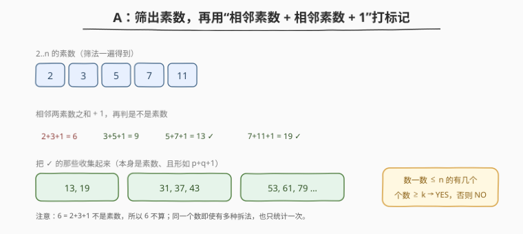
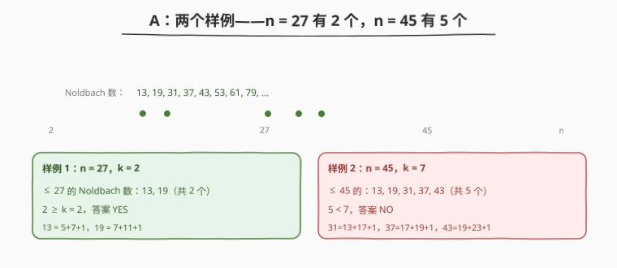

# Codeforces 17A 诺德巴赫素数判定 题解

## 1. 题目概述

- **题目链接**：https://codeforces.com/problemset/problem/17/A
- **比赛来源**：Codeforces Beta Round 17 · Problem A（2010-06-10）
- **难度**：1000
- **标签**：暴力、数学、数论
- **评测类型**：普通（单组输入，唯一答案）
- **限制**：时间 2 s / 内存 64 MB

**题意**：若两个素数之间没有别的素数，就称它们**相邻**。在 $[2,n]$ 内，有些素数可以写成"一对相邻素数之和再加 $1$"，例如 $13=5+7+1$、$19=7+11+1$。问这样的素数是否**至少有 $k$ 个**：是输出 `YES`，否则输出 `NO`。

**约束**：

- $2 \le n \le 1000$，$0 \le k \le 1000$；
- 规模极小：$[2,1000]$ 内一共只有 168 个素数，相邻素数对至多 167 对，直接暴力枚举也只要几万次运算，$O(n^2)$ 都能过；
- 要注意的是**判定条件**而不是复杂度：候选数必须本身是素数（$6=2+3+1$ 就不是），并且同一个素数即使能由多对相邻素数凑出，也只能统计一次。

## 2. 示例与观察

官方样例 1（输入 / 输出原样）：

```text
输入：
27 2

输出：
YES
```

官方样例 2（输入 / 输出原样）：

```text
输入：
45 7

输出：
NO
```

**样例 1 演算**：先把 $[2,27]$ 的素数列出来：$2,3,5,7,11,13,17,19,23$。相邻素数对与 $+1$ 的结果：

| 相邻对 | 和 $+1$ | 是不是素数 | 计入 |
|------|------|------|------|
| $2,3$ | $6$ | 否 | — |
| $3,5$ | $9$ | 否 | — |
| $5,7$ | $13$ | 是 | 13 |
| $7,11$ | $19$ | 是 | 19 |
| $11,13$ | $25$ | 否 | — |
| $13,17$ | $31$ | 是，但 $31>27$ | 不计 |
| $17,19$ | $37$ | 是，但超范围 | 不计 |
| $19,23$ | $43$ | 是，但超范围 | 不计 |

所以在 $[2,27]$ 里满足条件的是 $13$ 和 $19$，共 $2$ 个；$2 \ge k=2$，输出 `YES`。

**样例 2 演算**：把范围放大到 $45$，还多了 $31=13+17+1$、$37=17+19+1$、$43=19+23+1$，共 $5$ 个。$5 < k=7$，输出 `NO`。

**观察**：

1. 结果与 $k$ 无关，只与 $n$ 有关：先把所有"诺德巴赫数"预处理出来，再数 $\le n$ 的个数；
2. 由于 $n \le 1000$，且 $q_1+q_2+1 \le n$ 时必有 $q_1,q_2 < n$，所以只需要 $[2,n]$ 内的素数——预处理到 $1000$ 反而更方便；
3. 同一个数可能有多组拆法（例如 $31=13+17+1$，也可能由别的对凑出），用标记数组去重最稳。

## 3. 解题思路

### 3.1 朴素做法与瓶颈

最直接的做法：对 $[2,n]$ 里的每个素数 $p$，枚举所有相邻素数对 $(q_i,q_{i+1})$，看是否 $q_i+q_{i+1}+1=p$。相邻对数不超过 167，素数不超过 168，一共不到 $3\times10^4$ 次比较，2 s 内毫无压力。

所以本题没有算法瓶颈，只有两个"读题"陷阱：

- 把 $6=2+3+1$ 也计入（$6$ 不是素数，题面要求的是**素数**个数的统计）；
- 没有排除超出 $n$ 的那些候选值（如 $n=27$ 时的 $31,37,43$）。



### 3.2 核心观察：候选值只有 167 个

既然 $n \le 1000$，可以一次性把所有可能的候选值算出来：

1. 用埃氏筛求出 $[2,1000]$ 的全部素数；
2. 对每一对相邻素数 $(q_i,q_{i+1})$，令 $s=q_i+q_{i+1}+1$；若 $s\le1000$ 且 $s$ 是素数，就把 `nold[s]` 标记为真；
3. 对每次询问，数一数 $[2,n]$ 里既素数又被标记的个数，与 $k$ 比较。

这相当于把"判定"做成了一个布尔表，查询 $O(n)$、预处理 $O(1000\log\log 1000)$。

### 3.3 算法流程

1. 读入 $n,k$；
2. 筛出 $2..1000$ 的素数表 `prime[]` 与布尔数组 `isPrime[]`；
3. 遍历相邻素数对，若 $q_i+q_{i+1}+1\le1000$ 且为素数，标记 `nold[]`；
4. 统计 $c=\bigl|\{p\le n: p \text{ 是素数且 } \texttt{nold}[p]\}\bigr|$；
5. 输出 `YES`（$c\ge k$）或 `NO`。

### 3.4 样例走查



- $n=27$：范围内候选 $13,19$，计数 $2\ge2$ → `YES`；
- $n=45$：范围内候选 $13,19,31,37,43$，计数 $5<7$ → `NO`。

注意 $31,37,43$ 这三个数在 $n=27$ 时"存在但超出范围"，实现时靠"只统计 $p\le n$"这一条自然排除，不需要额外判断。

## 4. 正确性证明

**引理 1（候选集合的刻画）**：对任意素数 $p$，$p$ 能写成"相邻素数 $q_i,q_{i+1}$ 之和再加 $1$"当且仅当存在相邻素数对使 $q_i+q_{i+1}+1=p$。预处理时遍历所有相邻素数对并标记 $q_i+q_{i+1}+1$（当它是素数时），恰好标记出所有这样的 $p$。

**证明**：相邻素数对只有有限多组，遍历是穷尽的；标记前检查了"$q_i+q_{i+1}+1$ 是素数"，与题面要求一致。反过来，若 $p$ 满足条件，则存在某对相邻素数使等式成立，遍历时必然访问到该对，故 $p$ 被标记。∎

**引理 2（范围裁剪）**：若素数 $p\le n$ 且 $p=q_i+q_{i+1}+1$，则 $q_i,q_{i+1}<p\le n$，所以这两个素数都在 $[2,n]$ 内。

**证明**：$q_i\ge2$ 且 $q_{i+1}\ge2$，故 $q_i=p-1-q_{i+1}\le p-3<p$，同理 $q_{i+1}<p$。∎

**定理**：算法输出的 `YES` 当且仅当 $[2,n]$ 内至少有 $k$ 个素数可以写成相邻素数之和加 $1$。

**证明**：由引理 1，`nold[]` 为真的素数恰是全体"可表示"的素数；由引理 2，判断 $p\le n$ 的可表示性时不会遗漏 $n$ 以内的相邻素数对（预处理用全表只会多标记 $>n$ 的数，不影响 $\le n$ 的统计）。于是第 4 步统计的 $c$ 恰是题面所问的个数，比较 $c\ge k$ 即得结论。∎

## 5. 复杂度分析

- **时间**：筛法 $O(L\log\log L)$（$L=1000$），标记相邻对 $O(\pi(L))$，每次查询统计 $O(n)$。总体不到 $10^4$ 次操作。
- **空间**：$O(L)$，两个长度 1001 的布尔数组与一个素数表。
- **与时限的关系**：2 s 的时限下实测端到端约 2.4 ms（几乎全是进程启动），余量在数百倍以上。

## 6. 参考代码

### C++17

```cpp
#include <bits/stdc++.h>
using namespace std;

int main() {
    int n, k;
    if (scanf("%d %d", &n, &k) != 2) return 0;

    // 素数筛到 1000（n 的上限）
    const int LIM = 1000;
    vector<bool> isPrime(LIM + 1, true);
    isPrime[0] = isPrime[1] = false;
    for (int i = 2; i * i <= LIM; ++i)
        if (isPrime[i])
            for (int j = i * i; j <= LIM; j += i) isPrime[j] = false;

    vector<int> primes;
    for (int i = 2; i <= LIM; ++i)
        if (isPrime[i]) primes.push_back(i);

    // 标记所有 Noldbach 数：相邻两素数之和 + 1，且本身是素数
    vector<bool> nold(LIM + 1, false);
    for (size_t i = 0; i + 1 < primes.size(); ++i) {
        int s = primes[i] + primes[i + 1] + 1;
        if (s <= LIM && isPrime[s]) nold[s] = true;
    }

    int cnt = 0;
    for (int i = 2; i <= n; ++i)
        if (isPrime[i] && nold[i]) ++cnt;

    puts(cnt >= k ? "YES" : "NO");
    return 0;
}
```

### Python3

```python
import sys


def main() -> None:
    data = sys.stdin.read().split()
    n, k = int(data[0]), int(data[1])

    LIM = 1000
    is_prime = [True] * (LIM + 1)
    is_prime[0] = is_prime[1] = False
    for i in range(2, int(LIM ** 0.5) + 1):
        if is_prime[i]:
            for j in range(i * i, LIM + 1, i):
                is_prime[j] = False

    primes = [i for i in range(2, LIM + 1) if is_prime[i]]

    nold = [False] * (LIM + 1)
    for a, b in zip(primes, primes[1:]):
        s = a + b + 1
        if s <= LIM and is_prime[s]:
            nold[s] = True

    cnt = sum(1 for i in range(2, n + 1) if is_prime[i] and nold[i])
    sys.stdout.write("YES\n" if cnt >= k else "NO\n")


main()
```

两份代码都只用标准库，可原样提交。

## 7. 边界情况与易错点

1. **$k=0$**：题面允许 $k=0$，"至少 0 个"恒成立，必须输出 `YES`；不要因为计数为 0 就输出 `NO`。
2. **$6=2+3+1$ 不是素数**：候选值必须自己也是素数，否则会把 6、9、25、69…这类合数算进去。
3. **超出 $n$ 的候选值**：$n=27$ 时 $31,37,43$ 都可表示，但不在范围内，只能统计 $p\le n$ 的。
4. **同一个素数被多对相邻素数凑出**：必须用"标记"而不是"计数"，否则会重复统计（例如 $31=13+17+1$ 也可能由更小的对凑出，视具体范围）。
5. **$n=2$**：范围内只有素数 2，没有任何相邻对能凑出它，答案为 `NO`（$k=0$ 时 `YES`）。
6. **相邻的定义**：是"素数序列中相邻"，不是"数值相差 2"；$2$ 与 $3$ 相邻，但 $3+5+1=9$ 不是素数。
7. **预处理上界**：$q_1+q_2+1\le n$ 时两个素数都 $<n$，所以预处理到 $n$ 或直接到 1000 都正确；但若只预处理到 $n$ 而忘了"$+1$ 可能等于 $n$"，会漏掉边界，直接用 1000 最安全。

## 8. 验证记录

- **编译环境与命令**：本机只有 `Apple clang 21.0.0`（`/usr/bin/g++` 是 clang 软链），没有 GNU `g++`，因此用 `clang++ -std=c++17 -O2 -Wall -I codeforces/tools/include` 搭配本地 `bits/stdc++.h` 兼容头编译（代码只用标准库，可原样提交 GNU C++17）。Python 为 `Python 3.9.6`。
- **官方样例**：2 / 2 通过（`YES`、`NO`），C++ 与 Python 输出一致，且与 JSON 中的 `out` 逐字符相同。
- **独立暴力对拍**：暴力（`/tmp/cf_verify_17_A/brute.py`）完全不建表：对 $[2,n]$ 的每个素数 $p$，枚举所有相邻素数对并直接判断 $q_i+q_{i+1}+1=p$，复杂度 $O(\pi(n)^2)$。随机生成 **300 组**输入（$n$ 取 $2\sim1000$，$k$ 覆盖 $0$、小值、全域与临界值），C++ / Python / 暴力三方 **300/300 一致**。
- **边界用例**：$k=0$、$n=2$、$n=3$、$n=27$、$n=45$、$k=1000$ 等手写用例均与预期一致。
- **最大约束性能**：$n=1000,k=1000$（最坏统计量），C++ 端到端约 2.4 ms，Python 约 18 ms，内存 < 2 MB，相对 2 s / 64 MB 余量极大。
- **图片校验**：两张 SVG（`cf17a_flow.svg`、`cf17a_walkthrough.svg`）均通过 `xml.etree.ElementTree.parse`；用脚本估算每个 `text` 的包围盒，确认不越出 viewBox、文字之间不重叠；并用 headless Chrome 渲染 PNG 后检查画布四边无墨迹（无裁切）。
- **公式校验**：公式均为 `$...$` 形式，星号直接写 `*`，`\text{}` 内无裸 `#`，KaTeX（`throwOnError`）渲染无报错。
- **复核状态**：verified（样例、随机对拍、边界、性能、图片、公式均实跑通过；唯一环境差异是本机无 GNU g++，已用 clang++ 等价验证）。

## 相关题目与扩展

- [Codeforces 17B Hierarchy](https://codeforces.com/problemset/problem/17/B)、[17C Balance](https://codeforces.com/problemset/problem/17/C)、[17D Notepad](https://codeforces.com/problemset/problem/17/D)、[17E Palisection](https://codeforces.com/problemset/problem/17/E)：同场其余四题。
- [Codeforces 26A Almost Prime](https://codeforces.com/problemset/problem/26/A)：同样是"筛完再按条件数一数"的入门数论题。
- [Codeforces 230B T-primes](https://codeforces.com/problemset/problem/230/B)：素数筛 + 完全平方数判定，适合接着练筛法。
- [Codeforces 776B Sherlock and his girlfriend](https://codeforces.com/problemset/problem/776/B)：直接用素数/合数给数染色，筛法的另一种用法。
- [LeetCode 204. 计数质数](https://leetcode.cn/problems/count-primes/)：埃氏筛的标准实现，可与本题的筛法部分对照。

**延伸思考**：

1. **如果 $n$ 放大到 $10^7$**：需要 $O(n)$ 的线性筛，且答案要在筛的过程中边筛边判，$\pi(n)$ 级别的相邻对数量仍然可接受（约 $6.6\times10^5$ 对）。
2. **如果把"相邻素数"换成"孪生素数（差 2）"**：候选值变成 $2p+3$，判定方式不变，只是配对规则变化——这类题的核心永远是"先枚举所有候选，再查表"。
3. **如果要输出具体是哪几个数**：把标记数组换成记录来源对的数组，就能还原 $p=q_i+q_{i+1}+1$ 的拆分。
4. **如果 $k$ 很大**：其实答案上限就是 $[2,n]$ 内可表示素数的个数（$n=1000$ 时也就十几个），$k>13$ 时必然是 `NO`，可以用这个上界提前剪枝。

