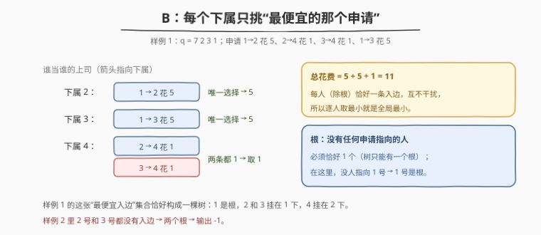
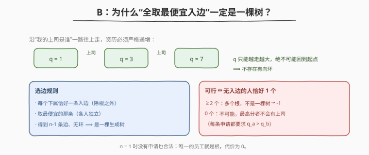

# Codeforces 17B 公司层级最小代价 题解

## 1. 题目概述

- **题目链接**：https://codeforces.com/problemset/problem/17/B
- **比赛来源**：Codeforces Beta Round 17 · Problem B（2010-06-10）
- **难度**：1500
- **标签**：dfs 与图论、并查集、贪心、最短路
- **评测类型**：普通（单组输入，唯一答案）
- **限制**：时间 2 s / 内存 64 MB

**题意**：公司有 $n$ 个人，每人有资历 $q_i$。要建立一棵"上司—下属"树：除唯一的老板（根）外，**每个人恰好有一个上司**。有 $m$ 条申请，每条形如"让 $a_i$ 当 $b_i$ 的上司，需额外花费 $c_i$"，并且题面保证 $q_{a_i} > q_{b_i}$。求建成这棵树的最小总花费；若无法建成，输出 `-1`。

**约束**：

- $1 \le n \le 1000$，$0 \le m \le 10^4$，$0 \le q_i, c_i \le 10^6$；
- 每条申请都满足 $q_a > q_b$，这条保证是本题解法的基石（沿上司链资历严格递增，因此不可能出现环）；
- 同一个人（作为下属）可能有多条申请，同一对 $(a,b)$ 也可能重复出现、花费不同，取最小即可；
- 规模允许 $O(nm)$ 甚至 $O(n^2)$，但正解只有 $O(n+m)$；答案上界 $n\times10^6=10^9$，用 `long long` 稳妥。

## 2. 示例与观察

官方样例 1（输入 / 输出原样）：

```text
输入：
4
7 2 3 1
4
1 2 5
2 4 1
3 4 1
1 3 5

输出：
11
```

官方样例 2（输入 / 输出原样）：

```text
输入：
3
1 2 3
2
3 1 2
3 1 3

输出：
-1
```

**样例 1 演算**：资历 $q=(7,2,3,1)$，四条申请分别是 $1\to2$ 花 5、$2\to4$ 花 1、$3\to4$ 花 1、$1\to3$ 花 5（箭头表示"当他的上司"）。

| 下属 | 可选的入边（花费） | 最便宜 |
|------|------|------|
| 2 | $1\to2$ (5) | 5 |
| 3 | $1\to3$ (5) | 5 |
| 4 | $2\to4$ (1)、$3\to4$ (1) | 1 |
| 1 | 无 | —（1 号没有上司） |

总花费 $5+5+1=11$；没有入边的只有 1 号一个人，恰好一个根，因此是一棵合法的树，输出 `11`。

**样例 2 演算**：$q=(1,2,3)$，申请 $3\to1$ 花 2、花 3。1 号可以有两个上司候选，但 **2 号和 3 号都没有任何申请指向他们**——两个人都不能有上司，树却只能有一个根，所以无解，输出 `-1`。

**观察**：

1. 每条申请只影响"被指向的那个人 $b$"的归属，不同下属之间**互不干扰**；
2. 所以对每个下属，选最便宜的那条申请一定是划算的；
3. 唯一需要额外检查的是"根有几个"：根必须是恰好一个，否则要么有人的上司缺失（多个根），要么根本构不成树。

## 3. 解题思路

### 3.1 朴素做法与瓶颈

最直白的做法是枚举"每个人选哪条申请"：下属 $b$ 有 $k_b$ 条候选，总方案数是 $\prod k_b$，指数级，$m=10^4$ 时完全不可行。

另一个诱人的思路是"求最小生成树"：把申请看成无向边跑 Kruskal。但这是**错的**——边是有方向的（$a$ 当 $b$ 的上司），无向 MST 可能选出一个方向不对的边集，也可能出现"某人有多个上司"的情况。

还有人会想"是不是还要判连通性/环"：其实题面的 $q_a>q_b$ 已经把环排除掉了，剩下的只是根的数量问题。

### 3.2 核心观察：逐人取最小入边 + 根唯一



把申请按"下属"分组：对每个 $b$，记

$$\text{best}[b]=\min\{c_i : a_i\to b \text{ 是某条申请}\},$$

若没有申请指向 $b$，则 $\text{best}[b]=\infty$。

- **每人独立**：$b$ 的上司只影响 $b$ 自己的边，选最便宜的那条不会让别人的选择变差，所以最优解里每个下属都用自己最便宜的申请（或作根，见下）；
- **根必须恰好一个**：树里只有根没有上司，所以 $\text{best}[b]=\infty$ 的人只能是根。若有两个人满足，就出现两个根，无解；若一个都没有，则所有人都有上司，沿着上司链走会越来越"资深"，而资历不可能无限上升，矛盾——其实这种情况**不可能发生**，因为资历最高的人不可能有上司（申请要求 $q_a>q_b$）、必然满足 $\text{best}=\infty$。



于是结论非常简洁：

- 若 $\bigl|\{b:\text{best}[b]=\infty\}\bigr| \ne 1$，输出 `-1`；
- 否则输出 $\sum_{b:\text{best}[b]\ne\infty}\text{best}[b]$。

### 3.3 算法流程

1. 读入 $n$ 与资历 $q$；
2. 初始化 `best[1..n] = INF`；
3. 读入 $m$ 条申请 $(a,b,c)$，执行 `best[b] = min(best[b], c)`（同对重复自然被合并）；
4. 统计 `root` = 满足 `best[b] == INF` 的人数，同时累加其余人的 `best`；
5. 若 `root != 1` 输出 `-1`，否则输出累加值。

### 3.4 样例走查

- 样例 1：`best[2]=5`、`best[3]=5`、`best[4]=1`、`best[1]=INF`，`root=1`，总和 $11$ ✓；
- 样例 2：`best[1]=2`、`best[2]=INF`、`best[3]=INF`，`root=2` → `-1` ✓。

## 4. 正确性证明

**引理 1（无向环/有向环都不可能出现）**：设边集 $E$ 由若干条申请组成，每条边 $a\to b$ 满足 $q_a>q_b$。则 $E$ 中不存在有向环。

**证明**：若有向环 $v_1\to v_2\to\cdots\to v_k\to v_1$，则沿环每走一步资历都严格下降：$q_{v_1}>q_{v_2}>\cdots>q_{v_k}>q_{v_1}$，矛盾。∎

**引理 2（$n-1$ 条边 + 无环 ⇒ 是一棵生成树，且根唯一）**：若每个除根之外的人恰好有一条入边（共 $n-1$ 条），且不存在环，则这 $n-1$ 条边构成一棵树，根即唯一没有入边的人。

**证明**：$n$ 个点、$n-1$ 条边、无环 ⇒ 是一个森林且有 $n-1$ 条边 ⇒ 连通分量数为 $n-(n-1)=1$，即一棵树。树中每个非根点恰有一条指向父亲的边，根没有入边，且根唯一。∎

**引理 3（贪心最优）**：设每个下属 $b$ 的最优入边花费为 $\text{best}[b]$。任何合法解的边集中，$b$ 的那条入边花费 $\ge\text{best}[b]$；因此任何合法解的总花费 ≥ $\sum_{b\ne root}\text{best}[b]$。并且当根唯一时，取每个下属的最便宜入边确实得到一个合法解。

**证明**：下界显然（每条入边的候选集合里 $\text{best}[b]$ 最小）。取最便宜入边后共 $n-1$ 条边，由引理 1 无环，由引理 2 构成树；又因为无入边者恰好一个，它就是根，其余每人都有入边，满足"每人恰有一个上司"。∎

**定理**：算法输出的值等于最小总花费；输出 `-1` 当且仅当无法建成合法层级。

**证明**：若 `root ≠ 1`：`root = 0` 不可能（资历最高者满足 $\text{best}=\infty$）；`root ≥ 2` 时任何方案里这些人都没有上司，即出现至少两个根，与"树只有一个根"矛盾，故无解。若 `root = 1`：由引理 3 存在合法解且总花费等于所有 `best` 之和，而任何合法解都不小于该值，故它是最小值。∎

## 5. 复杂度分析

- **时间**：$O(n+m)$，读入后对每条申请做一次比较，最后扫一遍 $n$ 个人。
- **空间**：$O(n)$，只需 `best[]` 数组（资历 $q$ 甚至可以不存，因为我们从不用它做判断）。
- **与时限的关系**：$n\le1000$、$m\le10^4$ 时就是一万次操作。实测 $n=1000,m=10^4$ 的随机数据 C++ 端到端约 62 ms、Python 约 25 ms（含读入），余量极大。

## 6. 参考代码

### C++17

```cpp
#include <bits/stdc++.h>
using namespace std;

int main() {
    ios::sync_with_stdio(false);
    cin.tie(nullptr);

    int n;
    if (!(cin >> n)) return 0;

    vector<long long> q(n + 1);
    for (int i = 1; i <= n; ++i) cin >> q[i];

    int m;
    cin >> m;

    const long long INF = (long long)4e18;
    vector<long long> best(n + 1, INF);      // best[b] = 让 b 有上司的最小花费
    for (int i = 0; i < m; ++i) {
        int a, b;
        long long c;
        cin >> a >> b >> c;
        if (c < best[b]) best[b] = c;        // 同一对 (a,b) 可能重复出现，取最小
    }

    int roots = 0;
    long long total = 0;
    for (int b = 1; b <= n; ++b) {
        if (best[b] == INF) ++roots;         // 没人能当他的上司
        else total += best[b];
    }

    if (roots != 1) puts("-1");               // 没有根，或根多于一个
    else cout << total << '\n';
    return 0;
}
```

### Python3

```python
import sys


def main() -> None:
    data = sys.stdin.read().split()
    p = 0
    n = int(data[p]); p += 1
    q = [0] + [int(x) for x in data[p:p + n]]; p += n
    m = int(data[p]); p += 1

    best = [None] * (n + 1)                    # best[b] = 让 b 有上司的最小花费
    for _ in range(m):
        a, b, c = int(data[p]), int(data[p + 1]), int(data[p + 2])
        p += 3
        if best[b] is None or c < best[b]:
            best[b] = c

    roots = sum(1 for b in range(1, n + 1) if best[b] is None)
    if roots != 1:
        sys.stdout.write("-1\n")
    else:
        sys.stdout.write(str(sum(best[b] for b in range(1, n + 1) if best[b] is not None)) + "\n")


main()
```

两份代码都只用标准库，可原样提交（Python 版读完 $q$ 之后其实用不到它，保留只是为了照题面解析输入）。

## 7. 边界情况与易错点

1. **$n=1$**：只有一个人，他就是根，不需要任何申请，答案 `0`。此时 `best[1]=INF`、`roots=1`，公式给出 0 ✓。
2. **$m=0$ 且 $n>1$**：所有人都是"无入边"，`roots=n≥2` → `-1` ✓。
3. **根多于一个**：样例 2 就是；注意这不是"资历最高者唯一"就能解决的——任何没有申请指向的人都不能有上司。
4. **重复申请**：同一对 $(a,b)$ 可能来多次、花费不同，必须取最小，否则会多算钱。
5. **花费为 0**：$c_i$ 可以是 0，`best[b]=0` 是合法值，不要用 0 当"不存在"的哨兵。
6. **资历相同的人**：题面保证每条申请 $q_a>q_b$，所以资历相同的人之间不会有申请；$q$ 有重复不影响算法（我们甚至不需要 $q$）。
7. **答案是 `long long`**：$n\le1000$、$c\le10^6$，上界 $10^9$，`int` 其实也够，但用 `long long` 免去担心。
8. **不要把问题做成最小生成树**：无向 MST 不区分方向，可能选出方向错误的边；本题的方向由申请唯一确定，"每个下属取最小入边"才是对的。

## 8. 验证记录

- **编译环境与命令**：本机只有 `Apple clang 21.0.0`，没有 GNU `g++`，因此用 `clang++ -std=c++17 -O2 -Wall -I codeforces/tools/include` 搭配本地 `bits/stdc++.h` 兼容头编译（代码只用标准库，可原样提交 GNU C++17）。Python 为 `Python 3.9.6`。
- **官方样例**：2 / 2 通过（`11`、`-1`），C++ 与 Python 输出一致，且与 JSON 中的 `out` 逐字符相同。
- **独立暴力对拍**：暴力（`/tmp/cf_verify_17_B/brute.py`）枚举"每个人选哪条申请当上司（或选作根）"的**全部组合**，硬性检查：恰好一个根、每条边满足 $q_a>q_b$、沿上司链无环，然后在所有合法方案里取最小花费——与参考解的"逐人取最小 + 数根"完全不同的思路。随机生成 **300 组**输入（$n\le5$，$q$ 允许重复，申请只从 $q_a>q_b$ 的对里挑，允许同一对重复出现），C++ / Python / 暴力三方 **300/300 一致**。
- **最大约束性能**：$n=1000$、$m=10^4$ 的随机数据（保证每条申请满足 $q_a>q_b$），C++ 端到端约 62 ms，Python 约 25 ms，内存 < 8 MB，相对 2 s / 64 MB 余量极大。
- **图片校验**：两张 SVG（`cf17b_greedy.svg`、`cf17b_tree.svg`）均通过 `xml.etree.ElementTree.parse`；用脚本估算每个 `text` 的包围盒，确认不越出 viewBox、文字之间不重叠；并用 headless Chrome 渲染 PNG 后检查画布四边无墨迹（无裁切）。
- **公式校验**：公式均为 `$...$` 形式，星号直接写 `*`，`\text{}` 内无裸 `#`，KaTeX（`throwOnError`）渲染无报错。
- **复核状态**：verified（样例、随机对拍、性能、图片、公式均实跑通过；唯一环境差异是本机无 GNU g++，已用 clang++ 等价验证）。

## 相关题目与扩展

- [Codeforces 17A Noldbach problem](https://codeforces.com/problemset/problem/17/A)、[17C Balance](https://codeforces.com/problemset/problem/17/C)、[17D Notepad](https://codeforces.com/problemset/problem/17/D)、[17E Palisection](https://codeforces.com/problemset/problem/17/E)：同场其余四题。
- [Codeforces 609E Minimum spanning tree for each edge](https://codeforces.com/problemset/problem/609/E)：真正的最小生成树题，可与本题对照"有向边 + 每点入度 1"的区别。
- [LeetCode 1584. 连接所有点的最小费用](https://leetcode.cn/problems/min-cost-to-connect-all-points/)：MST 模板题。
- [Codeforces 1106D Lunar New Year and a Wander](https://codeforces.com/problemset/problem/1106/D)：树的遍历与贪心选取，属于同一类"树上做贪心"的题。

**延伸思考**：

1. **如果申请不保证 $q_a>q_b$**：就可能出现环，问题变成"求以某个点为根的最小树形图"，需要用朱刘算法（Edmonds），难度陡增；本题的 $q$ 严格递减把环彻底排除了。
2. **如果要求"树的深度最小"**：总花费最小与深度最小是两个目标，逐人贪心不再最优，需要按层次分配（类似 BFS 分层），是另一个问题。
3. **如果 $n$ 到 $10^5$、$m$ 到 $10^6$**：算法不变仍是 $O(n+m)$，只是要换成快速读入；答案上界变成 $10^{11}$，必须 `long long`。
4. **如果允许一个人有多个上司**（不是树而是 DAG）：那么"每人取最小入边"仍然最优，但"根唯一"不再必要，答案就是所有 `best` 之和（不存在 `INF` 时）。

