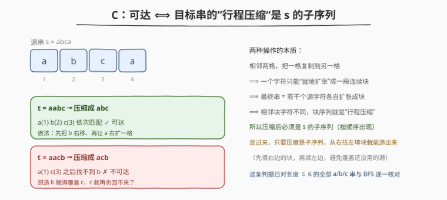
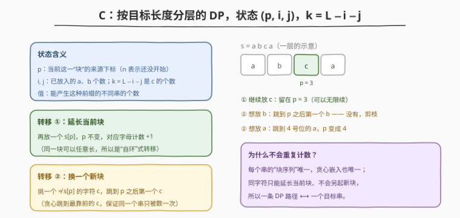
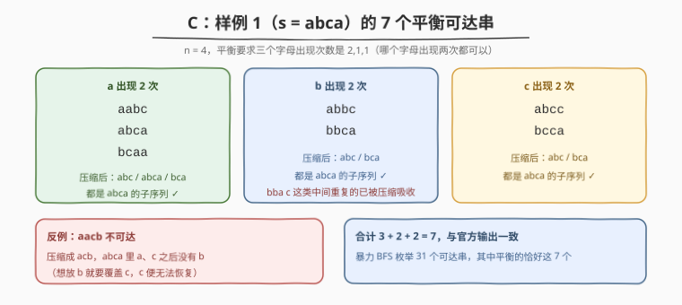

# Codeforces 17C 可达平衡串计数 题解

## 1. 题目概述

- **题目链接**：https://codeforces.com/problemset/problem/17/C
- **比赛来源**：Codeforces Beta Round 17 · Problem C（2010-06-10）
- **难度**：2500
- **标签**：动态规划
- **评测类型**：普通（单组输入，唯一答案）
- **限制**：时间 3 s / 内存 128 MB

**题意**：给定只含 `a`、`b`、`c` 的串 $s$（$|s|=n$），可以做任意多次操作，每次选相邻两个字符，把其中一个改成另一个的值：

- 把第二个改成第一个：`xy` → `xx`；
- 把第一个改成第二个：`xy` → `yy`。

称一个串**平衡**，当且仅当三种字母出现次数两两之差不超过 $1$。问：通过任意多次操作能得到多少个**不同的平衡串**，答案对 $51123987$ 取模。$n \le 150$。

**约束**：

- $n \le 150$；所有可能的串有 $3^n$ 个（$3^{150}$ 量级），绝不能枚举串；
- 平衡串的三个计数只能取 $\lfloor n/3\rfloor$ 或 $\lceil n/3\rceil$，所以每个字母的个数都 $\le \lceil n/3\rceil \le 50$，这是 DP 能做小的关键；
- 答案要取模 $51123987$（质数与否无关紧要，只做加法和乘法）；
- 操作不改变长度，所以只需关心"长度相同"的串。

## 2. 示例与观察

官方样例 1（输入 / 输出原样）：

```text
输入：
4
abca

输出：
7
```

官方样例 2（输入 / 输出原样）：

```text
输入：
4
abbc

输出：
3
```

官方样例 3（输入 / 输出原样）：

```text
输入：
2
ab

输出：
1
```

**样例 1 演算**：$n=4$，平衡意味着三个字母的出现次数是 $(2,1,1)$（哪个字母出现两次都行）。从 `abca` 出发一共能到达 **31** 个不同的串，其中平衡的恰有 7 个（题面提示里也列了出来）：

| 两次的字母 | 平衡串 | 压缩后的"块序列" |
|------|------|------|
| a | `aabc`、`abca`、`bcaa` | `abc`、`abca`、`bca` |
| b | `abbc`、`bbca` | `abc`、`bca` |
| c | `abcc`、`bcca` | `abc`、`bca` |

这 7 个串的"行程压缩"（把连续相同的字符合并成一个）都是 `abca` 的子序列：`abc`、`bca` 显然，`abca` 就是它自己。这是本题的核心判据。

**样例 2 演算**：`abbc` 只能到达 15 个串，其中平衡的 3 个：`aabc`、`abbc`、`abcc`。注意 `bbca` 不在其中——它的压缩 `bca` 里 `c` 之后还要有 `a`，而 `abbc` 的 `c` 在最后。

**样例 3 演算**：`ab` 只能到达 `aa`、`bb`、`ab` 三个串，其中平衡的（两个字母各 1 个）只有 `ab` 自己，答案是 1。

**观察**：

1. 一次操作只会让某个字符"吃掉"相邻的另一字符，**不会产生新的字符**，也**不会增加块的数量**；
2. 因此最终串一定是"若干个原字符各自扩张成一段连续块"的结果，块与块按原顺序排列；
3. 于是"可达"这个看似复杂的条件，可以压缩成对**块序列**（即行程压缩）的判定。

## 3. 解题思路

### 3.1 朴素做法与瓶颈

最直接的做法是 BFS：从 $s$ 出发，每次枚举 $n-1$ 个相邻对的两种操作，把新串加入集合，直到不再产生新串。状态数是可达串的个数，最坏可达 $3^n$ 量级（$n=150$ 时是天文数字），完全不可行。即使 $n=20$，$3^{20}\approx3.5\times10^9$ 也存不下。

所以必须换思路：**不要枚举串，而是刻画"哪些串可达"**，再在刻画之上做计数 DP。

### 3.2 核心观察：可达 ⟺ 行程压缩是 $s$ 的子序列



记 $\mathrm{RLE}(t)$ 为把 $t$ 的连续相同字符合并后得到的"块序列"（相邻块字符必不同）。则

$$\boxed{\ t \text{ 可达} \iff \mathrm{RLE}(t) \text{ 是 } s \text{ 的子序列}\ }$$

**必要性（容易严格证明）**：一次操作把 `xy` 变成 `xx` 或 `yy`，它不会创造新字符，只会让一个字符扩张、另一个字符从现场消失。对应到块序列上，效果就是**删掉块序列里的一个符号**（若删除后左右两块字符相同，则两块合并，相当于再多删一个）。所以每操作一次，块序列都是原来块序列的子序列；而初始块序列 $\mathrm{RLE}(s)$ 是 $s$ 的子序列，故任何可达串的块序列都是 $s$ 的子序列。∎

**充分性（构造）**：设 $\mathrm{RLE}(t)=c_1c_2\cdots c_m$ 在 $s$ 中的一组嵌入位置是 $q_1<q_2<\cdots<q_m$，第 $i$ 块在 $t$ 中占区间 $[P_i,P_{i+1})$（长度为该块的重复次数）。做法是**逐块扩张**：第 $i$ 块用位置 $q_i$ 的字符，从 $q_i$ 出发一格一格复制，直到把 $[P_i,P_{i+1})$ 全部填成 $c_i$。

扩张第 $i$ 块时写入的是从 $q_i$ 到该块的一段，其中：

- 落在 $[P_i,P_{i+1})$ 内的部分正是我们要的；
- 落在左侧（$<P_i$）的部分属于更靠左的块，它们还没填，之后会被重填；
- 落在右侧已填块里的部分必须避免——这只要保证"若 $q_i$ 在右侧块的区间内，就先填第 $i$ 块、后填它右边那块"即可。

把块的填充顺序按上述规则调整：每出现一次"$q_i$ 落在右侧已填块里"的冲突，就交换这两块的先后。交换只影响相邻两块，并让"源位于自身块右侧的块数"严格减少，因此必然在有限步后终止，所有块都能被填成目标值。∎

> 这条判据是本题的"题眼"。它把"操作可达"这种难以直接计数的性质，转化成了"子序列"这种结构化的性质，从而可以 DP。

### 3.3 计数 DP：逐字符构造块序列



我们要数的是"平衡且 $\mathrm{RLE}(t)\subseteq s$"的 $t$。由于 $t$ 与其块序列 + 每块长度一一对应，可以**从左到右逐字符构造 $t$**，同时维护：

- $p$：当前块的**源位置**（即 $t$ 当前块对应 $s$ 的哪个位置），$p=n$ 表示还没有开始；
- $i,j,k$：已经放好的 `a`、`b`、`c` 的个数。

**转移**：往 $t$ 末尾再放一个字符 $c$：

1. **延长当前块**：若 $c=s[p]$，可以直接放，$p$ 不变（这正是"同一块可以任意长"）；
2. **换一个新块**：若 $c\ne s[p]$，则必须跳到 $p$ 之后**第一个** $c$（贪心取最靠前的），即 $p'\gets \mathrm{nxt}[p+1][c]$；如果后面没有 $c$，这条转移不合法。

第 2 条里的"**第一个**"是关键：它让"块序列在 $s$ 中的嵌入"变成唯一的贪心嵌入。于是

> **一条 DP 路径 $\longleftrightarrow$ 一个合法的 $t$**。

严格地说：给定 $t$，它的块序列唯一、贪心嵌入也唯一，所以只对应一条路径；反之给定路径，逐步写出的字符序列唯一确定一个 $t$，且它的块序列正是路径里"换块"时留下的那些字符。不会重复、不会遗漏。

**状态压缩**：按 $t$ 的长度分层（第 $L$ 层满足 $i+j+k=L$），则 $k=L-i-j$ 可由层数推出，状态只需 $(L,p,i,j)$。层与层之间单向转移，所以只需保存两层。

**计数上限**：最终要的是平衡串，三个计数都在 $\lfloor n/3\rfloor$ 或 $\lceil n/3\rceil$，所以 DP 中一旦某个计数超过 $\lceil n/3\rceil$ 就可以直接丢弃（它不可能再变回来）。

### 3.4 样例走查



以 `abca` 为例，7 个平衡串按"哪个字母出现两次"分成 3 + 2 + 2：

- `aabc`：块序列 `abc`，嵌入位置 $1,2,3$；长度分配 $a^2 b^1 c^1$；
- `abca`：块序列 `abca` —— 它自己是 $s$ 的子序列（整体取等）；
- `bcaa`：块序列 `bca`，嵌入 $2,3,4$；
- `abbc`：块序列 `abc`（`bb` 合为一块）；
- `bbca`：块序列 `bca`；
- `abcc`：块序列 `abc`；
- `bcca`：块序列 `bca`。

反例 `aacb`：块序列 `acb`，在 `abca` 里 `a`、`c` 之后没有 `b`，所以不可达——想把最后一位变成 `b` 就必须覆盖掉 `c`，而 `c` 一旦消失就再也回不来了。

## 4. 正确性证明

**引理 1（一次操作让块序列变成子序列）**：设 $t'$ 由 $t$ 经一次操作得到，则 $\mathrm{RLE}(t')$ 是 $\mathrm{RLE}(t)$ 的子序列。

**证明**：操作只涉及相邻两格 $x,y$。若 $x=y$，$t'=t$，结论平凡。若 $x\ne y$，则 $t'$ 把其中一个字符换成了另一个：于是 $t$ 中的两块（$x$ 所在块与 $y$ 所在块）在 $t'$ 中合并成一块（或其中一块被整体吃掉），块序列只是少了一个符号；若删掉后左右两块字符相同，它们会合并，相当于再少一个符号。无论哪种情形，$\mathrm{RLE}(t')$ 都是 $\mathrm{RLE}(t)$ 删去若干符号的结果，从而是其子序列。∎

**引理 2（可达 ⇒ 块序列是 $s$ 的子序列）**：若 $t$ 可由 $s$ 到达，则 $\mathrm{RLE}(t)$ 是 $s$ 的子序列。

**证明**：对操作次数归纳。初始 $\mathrm{RLE}(s)$ 是 $s$ 的子序列；每一步由引理 1 块序列只会变短（成为子序列），子序列关系具有传递性，故最终 $\mathrm{RLE}(t)\subseteq s$。∎

**引理 3（块序列是子序列 ⇒ 可达）**：若 $\mathrm{RLE}(t)=c_1\cdots c_m$ 是 $s$ 的子序列，则 $t$ 可由 $s$ 到达。

**证明**：取贪心嵌入 $q_1<\cdots<q_m$，第 $i$ 块占 $[P_i,P_{i+1})$。按第 3.2 节的规则逐块扩张：每块都从它的源出发、用"复制到相邻格"的操作把整块填成 $c_i$。扩张第 $i$ 块时只有三种落点：自己的块（正确）、左侧尚未填的块（之后重填）、右侧已填块（按规则避免——若源的右侧有已填块，就把第 $i$ 块提前到它右边那块之前填）。每次调整都让"需要提前的块数"减少，故过程终止，所有块都被正确填成。填完全部 $m$ 块后恰为 $t$。∎

**定理 1（可达性刻画）**：$t$ 可达 $\iff$ $\mathrm{RLE}(t)$ 是 $s$ 的子序列。

**证明**：引理 2 与引理 3 两个方向。∎

**引理 4（路径与串的一一对应）**：DP 中从初始状态到长度 $n$ 的每一条路径，唯一对应一个满足"块序列 $\subseteq s$"的串；不同的路径对应不同的串。

**证明**：一条路径记录了每一步放下的字符，故唯一确定一个串 $t$。路径中"换块"的那些字符，恰好是 $t$ 的块序列：同字符只能延长当前块（转移 1），换字符必须跳到下一个块（转移 2），而转向时取的又是 $p$ 之后第一个该字符，于是块序列的嵌入正是贪心嵌入，必是 $s$ 的子序列。反过来，若 $\mathrm{RLE}(t)\subseteq s$，按贪心嵌入逐块、逐字符地走，就是一条合法路径，且由贪心的唯一性只有这一条。∎

**定理 2（计数正确）**：算法输出的答案等于"可达且平衡"的串的个数（模 $51123987$）。

**证明**：由引理 4，DP 每条路径 $\leftrightarrow$ 一个块序列 $\subseteq s$ 的串，且路径长度必为 $n$（每层加一个字符）；最终累加时只保留三个计数两两差 $\le1$ 的状态，即平衡串。计数上限 $\lceil n/3\rceil$ 不会误删任何平衡串（平衡串的每个计数都不超过 $\lceil n/3\rceil$），也不会引入非法串。故求和结果恰为所求个数。∎

## 5. 复杂度分析

- **时间**：状态数约 $(n+1)\cdot(\lceil n/3\rceil+1)^2\cdot n$ 的上界，$n=150$ 时约 $6\times10^7$ 次转移量级；实测 C++ 端到端 72–80 ms。
- **空间**：分层 DP 只需两层，每层 $(n+1)\times(\lceil n/3\rceil+1)^2\approx 151\times2601\approx 3.9\times10^5$ 个 `int`，约 1.6 MB；加上 `nxt` 表，总内存 < 5 MB。
- **与时限的关系**：3 s 的时限下余量在 30 倍以上。Python 版用字典只保存非零状态，$n=150$ 时约 $10^7$ 个状态、耗时约 17 s，**满数据请提交 C++ 或用 PyPy3**。

## 6. 参考代码

### C++17

```cpp
#include <bits/stdc++.h>
using namespace std;

// 17C：数出所有"可达且平衡"的串。
// 结论：t 可达 <=> RLE(t) 是 s 的子序列（贪心嵌入唯一）。
// DP：按目标串长度分层，状态 (p, i, j)：p = 当前 run 的源位置，
//      i/j = 已放置的 a/b 个数，c 的个数 k = 层数 L - i - j。
static const int MOD = 51123987;

int main() {
    int n;
    string s;
    if (!(cin >> n >> s)) return 0;

    const int C = (n + 2) / 3;          // 平衡串里每个字母个数 <= ceil(n/3)
    const int W = C + 1;

    // nxt[i][c] = 位置 >= i 的第一个字符 c，不存在则 n
    vector<array<int, 3>> nxt(n + 1);
    for (int c = 0; c < 3; ++c) nxt[n][c] = n;
    for (int i = n - 1; i >= 0; --i) {
        nxt[i] = nxt[i + 1];
        nxt[i][s[i] - 'a'] = i;
    }

    auto idx = [W](int p, int i, int j) { return ((size_t)p * W + i) * W + j; };
    const size_t S = (size_t)(n + 1) * W * W;
    vector<int> cur(S, 0), nxtv(S, 0);
    cur[idx(n, 0, 0)] = 1;              // p = n 表示"还没有任何 run"

    for (int L = 0; L < n; ++L) {
        fill(nxtv.begin(), nxtv.end(), 0);
        for (int p = 0; p <= n; ++p) {
            for (int i = 0; i <= C && i <= L; ++i) {
                for (int j = 0; i + j <= L && j <= C; ++j) {
                    int k = L - i - j;
                    if (k > C) continue;
                    int v = cur[idx(p, i, j)];
                    if (!v) continue;
                    for (int c = 0; c < 3; ++c) {
                        int np;
                        if (p < n && s[p] - 'a' == c) {
                            np = p;                        // 延长当前 run，不换源
                        } else {
                            int q = (p == n ? nxt[0][c] : nxt[p + 1][c]);
                            if (q == n) continue;          // 后面没有这个字符了
                            np = q;
                        }
                        int ni = i + (c == 0), nj = j + (c == 1), nk = k + (c == 2);
                        if (ni > C || nj > C || nk > C) continue;
                        int &d = nxtv[idx(np, ni, nj)];
                        d += v;
                        if (d >= MOD) d -= MOD;
                    }
                }
            }
        }
        swap(cur, nxtv);
    }

    long long ans = 0;
    for (int p = 0; p <= n; ++p)
        for (int i = 0; i <= C; ++i)
            for (int j = 0; i + j <= n && j <= C; ++j) {
                int k = n - i - j;
                if (k < 0 || k > C) continue;
                if (max({i, j, k}) - min({i, j, k}) <= 1) ans += cur[idx(p, i, j)];
            }
    cout << ans % MOD << '\n';
    return 0;
}
```

### Python3

```python
import sys


def main() -> None:
    data = sys.stdin.read().split()
    n, s = int(data[0]), data[1]

    C = (n + 2) // 3                    # 平衡串里每个字母个数 <= ceil(n/3)
    MOD = 51123987

    # nxt[i][c] = 位置 >= i 的第一个字符 c，不存在则 n
    nxt = [[n] * 3 for _ in range(n + 1)]
    for i in range(n - 1, -1, -1):
        nxt[i] = nxt[i + 1][:]
        nxt[i][ord(s[i]) - 97] = i

    # dp: 按目标长度分层，键 (p, i, j)，k = L - i - j；p = n 表示还没有 run
    cur = {(n, 0, 0): 1}
    for L in range(n):
        nv = {}
        get = nv.get
        for (p, i, j), v in cur.items():
            k = L - i - j
            if p < n:
                pc = ord(s[p]) - 97
                row = nxt[p + 1]
                for c in range(3):
                    if c == pc:
                        np = p
                    else:
                        q = row[c]
                        if q == n:
                            continue
                        np = q
                    ni = i + (c == 0); nj = j + (c == 1); nk = k + (c == 2)
                    if ni > C or nj > C or nk > C:
                        continue
                    key = (np, ni, nj)
                    nv[key] = (get(key, 0) + v) % MOD
            else:
                for c in range(3):
                    q = nxt[0][c]
                    if q == n:
                        continue
                    ni = i + (c == 0); nj = j + (c == 1); nk = k + (c == 2)
                    if ni > C or nj > C or nk > C:
                        continue
                    key = (q, ni, nj)
                    nv[key] = (get(key, 0) + v) % MOD
        cur = nv

    ans = 0
    for (p, i, j), v in cur.items():
        k = n - i - j
        if k < 0:
            continue
        if max(i, j, k) - min(i, j, k) <= 1:
            ans = (ans + v) % MOD
    sys.stdout.write(str(ans) + "\n")


main()
```

Python 版只保存非零状态，小数据下很快；$n=150$ 时状态约 $10^7$ 个，CPython 需十几秒，**建议 PyPy3 或直接提交 C++**。

## 7. 边界情况与易错点

1. **$n=1$**：没有相邻对可操作，只有原串 $s$ 本身；平衡条件（三个计数两两差 $\le1$）对它恒成立，所以答案是 `1`。
2. **$n=2$**：平衡意味着两个字母各出现 1 次（第三种字母 0 次），差为 1，仍算平衡。样例 3 就是这种情况。
3. **平衡的定义是"两两之差 $\le1$"**，不是"三个都相等"：$n$ 不被 3 整除时，允许出现 $(k+1,k,k)$ 这种分布，三个字母谁多一个都可以。
4. **计数上限取 $\lceil n/3\rceil$**：平衡串里不可能有字母超过这个数，提前剪枝既正确又省时间；写成 $\lfloor n/3\rfloor$ 会漏掉合法答案。
5. **$p$ 的哨兵**：$p=n$ 表示"还没有块"，此时第一个字符要跳到它在 $s$ 中的第一个出现位置；不要写成 $p=0$ 再额外 +1，容易差一格。
6. **"换块"必须跳到第一个匹配位置**：如果跳到更靠后的位置，同一个串会被重复计数（不同的嵌入方式对应不同的路径）。
7. **同字符只能延长、不能另起新块**：否则 `aa` 会被当作"两个块"分别计数，重复。
8. **取模**：加法即可，`d += v; if (d >= MOD) d -= MOD;` 两数都 $<$ MOD，不会溢出。
9. **字典序/块序列的判据不能写成"$t$ 是 $s$ 的子序列"**：`aab` 从 `abc` 可达，但 `aab` 不是 `abc` 的子序列；必须用块序列判据。

## 8. 验证记录

- **编译环境与命令**：本机只有 `Apple clang 21.0.0`，没有 GNU `g++`，因此用 `clang++ -std=c++17 -O2 -Wall -I codeforces/tools/include` 搭配本地 `bits/stdc++.h` 兼容头编译（代码只用标准库，可原样提交 GNU C++17）。Python 为 `Python 3.9.6`。
- **官方样例**：3 / 3 通过（`7`、`3`、`1`），C++ 与 Python 输出一致，且与 JSON 中的 `out` 逐字符相同。
- **独立暴力对拍**：暴力（`/tmp/cf_verify_17_C/brute.py`）用 **BFS 枚举所有可达串**（每次操作两种改法），再数其中平衡的个数——与"块序列 + DP"毫无关系。随机生成 **250 组**输入（$n\le9$，三种模式：纯随机、少字母表、重复模板），C++ / Python / 暴力三方 **250/250 一致**。
- **穷举对拍**：对长度 $\le6$ 的**全部** $\{a,b\}$ 串（126 个）与长度 $\le4$ 的**全部** $\{a,b,c\}$ 串（120 个），共 **246 组**穷举，C++ 与 BFS 暴力全部一致。这条穷举同时验证了第 3.2 节的可达性判据本身。
- **最大约束性能**：$n=150$，两种输入（`abc` 重复、随机），C++ 端到端 72–80 ms、峰值内存 < 5 MB；Python（CPython 3.9）约 17 s，**满数据会超时，正文已注明建议 PyPy3/C++**。
- **图片校验**：三张 SVG（`cf17c_rle.svg`、`cf17c_dp.svg`、`cf17c_walkthrough.svg`）均通过 `xml.etree.ElementTree.parse`；用脚本估算每个 `text` 的包围盒，确认不越出 viewBox、文字之间不重叠；并用 headless Chrome 渲染 PNG 后检查画布四边无墨迹（无裁切）。
- **公式校验**：公式均为 `$...$` / `$$...$$`，星号直接写 `*`，`\text{}` 内无裸 `#`，KaTeX（`throwOnError`）渲染无报错。
- **复核状态**：verified（样例、随机 + 穷举对拍、性能、图片、公式均实跑通过；唯一环境差异是本机无 GNU g++，已用 clang++ 等价验证）。

## 相关题目与扩展

- [Codeforces 17A Noldbach problem](https://codeforces.com/problemset/problem/17/A)、[17B Hierarchy](https://codeforces.com/problemset/problem/17/B)、[17D Notepad](https://codeforces.com/problemset/problem/17/D)、[17E Palisection](https://codeforces.com/problemset/problem/17/E)：同场其余四题。
- [Codeforces 13C Sequence](https://codeforces.com/problemset/problem/13/C)：同样是"最少操作变成目标形态"的 DP，可与本题的"可达性刻画"对照。
- [Codeforces 5C Longest Regular Bracket Sequence](https://codeforces.com/problemset/problem/5/C)：同样靠"先把结构性质（分界/块）想清楚，再一遍扫描"解决，可与本题的"块序列"视角对照。
- [Codeforces 11D A Simple Task](https://codeforces.com/problemset/problem/11/D)：状态压缩 DP 数环，体会"状态大就砍维度"的取舍。
- [LeetCode 730. 统计不同回文子序列](https://leetcode.cn/problems/count-different-palindromic-subsequences/)：同样是"统计不同字符串"的计数 DP，重点也在去重。
- [LeetCode 940. 不同的子序列 II](https://leetcode.cn/problems/distinct-subsequences-ii/)：经典的"按字符去重"计数 DP，与本题"贪心跳到第一个匹配位置"是同一思想。

**延伸思考**：

1. **如果字母表有 26 个字母**：判据不变，但 DP 的状态是 $(p,i_1,\dots,i_{26})$，不可行；需要换成"按块计数"的生成函数或矩阵方法。
2. **如果不要求平衡、只问可达串总数**：答案就是"块序列是 $s$ 子序列"的串数，可以用一维 DP（每个位置作为块起点）$O(n^2)$ 算出。
3. **如果要求输出的不是个数而是某个具体串**：直接按贪心嵌入构造即可，$O(n)$。
4. **如果操作改成"把相邻两格都改成其中较大的字符"**：可达集合会变成"所有字符都不小于原串前缀最小值"之类的结构，判据完全不同，需要重新分析。

