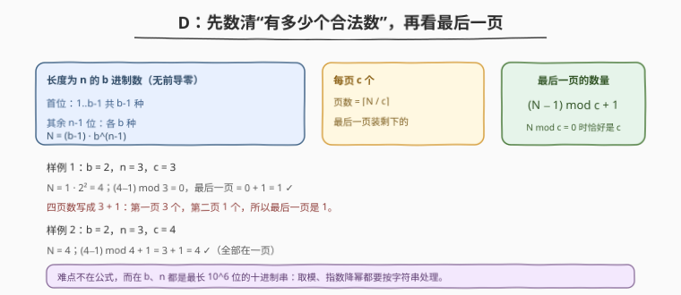
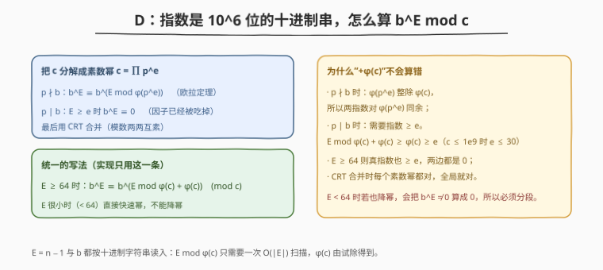
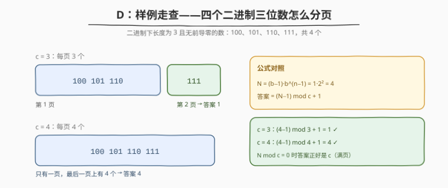

# Codeforces 17D 进制数与最后一页 题解

## 1. 题目概述

- **题目链接**：https://codeforces.com/problemset/problem/17/D
- **比赛来源**：Codeforces Beta Round 17 · Problem D（UTC 2010-06-10）
- **难度**：2400
- **标签**：数论
- **评测类型**：普通（单组输入，唯一答案）
- **限制**：时间 2 s / 内存 64 MB

**题意**：Nick 要在笔记本上写下**所有长度为 $n$、不含前导零**的 $b$ 进制正整数（每个只写一次，从第一页开始、不留空位）。每页恰好写 $c$ 个数。问**最后一页**上有多少个数。

**约束**：

- $2 \le b < 10^{10^6}$，$1 \le n < 10^{10^6}$，$1 \le c \le 10^9$；
- 也就是说 $b$ 和 $n$ 都是**十进制下最多 $10^6$ 位**的大整数，不可能读成 `long long`，更不可能真的去算 $b^{n-1}$（它有 $n\log_{10}b$ 位，天文数字）；
- $c$ 很小（$\le 10^9$），所以最终只需要**取模**意义下的答案；
- 因为 $b$ 与 $c$ 不一定互素，**不能**简单地把指数对 $c-1$ 取模（那需要互素才成立）。

## 2. 示例与观察

官方样例 1（输入 / 输出原样）：

```text
输入：
2 3 3

输出：
1
```

官方样例 2（输入 / 输出原样）：

```text
输入：
2 3 4

输出：
4
```

**样例 1 演算**：二进制下长度为 $3$、无前导零的数有 $4$ 个：$100,101,110,111$。每页 3 个，于是第一页写 $100,101,110$，第二页写 $111$——最后一页只有 $1$ 个，输出 `1`。

**样例 2 演算**：同一组数，但每页能写 4 个，四个数都在第一页，最后一页上有 $4$ 个，输出 `4`。

**观察**：

1. 数的总个数只与 $b,n$ 有关：首位有 $b-1$ 种（$1\sim b-1$），其余 $n-1$ 位各有 $b$ 种，所以
   $$N=(b-1)\cdot b^{\,n-1};$$
2. 页数 $=\lceil N/c\rceil$，最后一页的数量 $=N-c\cdot(\lceil N/c\rceil-1)$，它可以写成更简洁的
   $$\text{ans}=(N-1)\bmod c+1;$$
3. 所以问题只剩"求 $N \bmod c$"，而 $N\bmod c=\bigl((b-1)\bmod c\bigr)\cdot\bigl(b^{n-1}\bmod c\bigr)\bmod c$。

## 3. 解题思路

### 3.1 朴素做法与瓶颈

$N$ 是个有约 $n\log_{10}b$ 位的数，$n$ 本身就有 $10^6$ 位十进制，$N$ 的位数是**指数级**的，任何大整数库都存不下。

退一步，只求 $N\bmod c$：需要 $b^{n-1}\bmod c$。指数 $n-1$ 也是 $10^6$ 位十进制，直接快速幂要做 $10^{10^6}$ 次乘法，不可能。

能不能把指数对 $c-1$ 取模？只有当 $\gcd(b,c)=1$ 时才有 $b^{c-1}\equiv1\pmod c$（费马），$c$ 不是素数时对 $\varphi(c)$ 用欧拉定理同样要求 $\gcd(b,c)=1$。而本题 $b$ 与 $c$ 完全可能不互素（比如 $b=2,c=4$），所以必须用"**带 $+\varphi(c)$ 的广义欧拉降幂**"。

### 3.2 核心观察：广义欧拉降幂



**引理（广义欧拉降幂）**：设 $c\ge2$，$E\ge 64$，$\varphi$ 为欧拉函数，则
$$b^{E}\equiv b^{\,E\bmod\varphi(c)+\varphi(c)}\pmod c .$$

证明见第 4 节（按素数幂分解 + 中国剩余定理）。直观理解：序列 $b^0,b^1,b^2,\dots \pmod c$ 很快就会进入周期，周期整除 $\varphi(c)$，而前 $\log_2 c$ 项可能还不在周期里；加一个 $\varphi(c)$ 就把"预热段"跳过去了，对互素与不互素两种情形都成立。

于是算法是：

1. 读入 $b$、$n$ 的十进制串，读入 $c$；
2. 算出 $b\bmod c$（$O(|b|)$ 逐位取模）；
3. 令 $E=n-1$（十进制串减一，注意 $n=1$ 时 $E=0$）：
   - 若 $E<64$（很小），直接快速幂算 $b^E\bmod c$；
   - 否则算出 $\varphi(c)$，再逐位求出 $E\bmod\varphi(c)$，用 $E'=E\bmod\varphi(c)+\varphi(c)$ 做快速幂；
4. $N\bmod c=((b-1)\bmod c)\cdot(b^E\bmod c)\bmod c$；
5. 输出 $(N\bmod c-1+c)\bmod c+1$。



**为什么要分"$E<64$"**：降幂公式要求 $E$ 足够大（$\ge\log_2 c$）。$c\le10^9$ 时 $\log_2 c<30$，取 64 作阈值很安全。若 $E$ 很小也对指数加 $\varphi(c)$，当 $b$ 与 $c$ 不互素时会把"$b^E\not\equiv0$"错算成 $0$。例如 $b=2,c=8,E=1$：真值 $2$，若降幂得 $E'=1+4=5$，$2^5=32\equiv0\pmod 8$，就错了。

### 3.3 算法流程

1. 去掉 $b,n$ 可能的前导零，读入 $c$；
2. `bmod = b mod c`（逐位：`r = (r*10 + digit) % c`）；
3. `E = n - 1`（做十进制串减法，返回无前导零的规范串）；
4. 若 `E < 64`：`pw = powmod(bmod, E, c)`；否则 `ph = phi(c)`，`e = E mod ph + ph`，`pw = powmod(bmod, e, c)`；
5. `N = (bmod - 1 + c) % c * pw % c`；
6. 输出 `(N - 1 + c) % c + 1`。

`powmod` 用快速幂，`phi(c)` 用试除到 $\sqrt c$（$c\le10^9$ 时最多 $\sqrt{10^9}\approx31623$ 次）。

### 3.4 样例走查



- 样例 1：$N=1\cdot2^2=4$，$E=2<64$ 直接算，$N\bmod 3=1$，答案 $(1-1)\bmod3+1=1$ ✓；
- 样例 2：$N\bmod4=0$，答案 $(0-1+4)\bmod4+1=3+1=4$ ✓。

注意第二个样例说明"$N\bmod c=0$ 时答案是 $c$"——这正是公式 $(N-1)\bmod c+1$ 的美妙之处：它把 $0$ 自然地映射成 $c$，不需要额外的 `if`。

## 4. 正确性证明

**引理 1（合法数的个数）**：$b$ 进制下长度为 $n$ 且无前导零的数的个数为 $(b-1)b^{n-1}$。

**证明**：首位可取 $1,2,\dots,b-1$ 共 $b-1$ 种；其余 $n-1$ 位每位可取 $0,\dots,b-1$ 共 $b$ 种，各位独立，故总数是乘积。∎

**引理 2（最后一页的数量）**：设总数为 $N\ge1$，每页 $c$ 个，则最后一页的数量为 $(N-1)\bmod c+1$。

**证明**：把数按顺序编号 $0,1,\dots,N-1$（第 $j$ 个数在第 $\lfloor j/c\rfloor+1$ 页）。最后一个数编号 $N-1$，它所在页是第 $\lfloor (N-1)/c\rfloor+1$ 页，该页上的数的编号从 $c\lfloor (N-1)/c\rfloor$ 到 $N-1$，共 $N-1-c\lfloor (N-1)/c\rfloor+1=(N-1)\bmod c+1$ 个。∎

**引理 3（广义欧拉降幂）**：设 $c\ge2$、$E\ge64$，则 $b^E\equiv b^{E\bmod\varphi(c)+\varphi(c)}\pmod c$。

**证明**：把 $c$ 分解为素数幂 $c=\prod_i p_i^{e_i}$，只需分别证明同余在每个 $p_i^{e_i}$ 下成立（中国剩余定理）。记 $E'=E\bmod\varphi(c)+\varphi(c)$，注意 $E'\ge\varphi(c)\ge\varphi(p_i^{e_i})=p_i^{e_i-1}(p_i-1)\ge e_i$。

- **若 $p_i\mid b$**：则 $p_i^{e_i}\mid b^{e_i}$，当指数 $\ge e_i$ 时 $b^{\text{指数}}\equiv0\pmod{p_i^{e_i}}$。由 $E\ge64>e_i$ 与 $E'\ge e_i$，两边都是 $0$，同余成立。
- **若 $p_i\nmid b$**：由欧拉定理 $b^{\varphi(p_i^{e_i})}\equiv1\pmod{p_i^{e_i}}$。又 $\varphi$ 在互素的素数幂上可乘，故 $\varphi(p_i^{e_i})\mid\varphi(c)$，于是 $E'\equiv E\pmod{\varphi(p_i^{e_i})}$，从而 $b^{E'}\equiv b^{E}\pmod{p_i^{e_i}}$。

两种情形在每个 $p_i^{e_i}$ 下都同余，由中国剩余定理得到模 $c$ 同余。∎

**定理**：算法输出的就是最后一页上的数的个数。

**证明**：由引理 1，$N=(b-1)b^{n-1}$；由引理 3（当 $E\ge64$）或直接快速幂（当 $E<64$），算法算出的 $b^E\bmod c$ 正确，进而 $N\bmod c$ 正确；由引理 2，$(N\bmod c-1+c)\bmod c+1=(N-1)\bmod c+1$ 正是最后一页的数量。∎

## 5. 复杂度分析

- **时间**：读入与取模 $O(|b|+|n|)$，欧拉函数试除 $O(\sqrt c)$，快速幂 $O(\log c)$（降幂后指数 $<2\varphi(c)\le2c$），总复杂度与 $b,n$ 的**位数**成正比，$10^6$ 位输入下约 $2\times10^6$ 次基本运算。
- **空间**：$O(|b|+|n|)$，即两个输入串。
- **与时限的关系**：实测 $10^6$ 位的 $b$ 与 $n$（$c=10^9$ 或 $c=999999937$）C++ 端到端约 288 ms、Python 约 262–329 ms，相对 2 s / 64 MB 余量充足。

## 6. 参考代码

### C++17

```cpp
#include <bits/stdc++.h>
using namespace std;
using int64 = long long;

// 十进制大串对 m 取模
static int64 modString(const string &s, int64 m) {
    int64 r = 0;
    for (char ch : s) r = (r * 10 + (ch - '0')) % m;
    return r;
}

// 十进制大串减一（返回规范形式：无前导零）
static string minusOne(string s) {
    int i = (int)s.size() - 1;
    while (i >= 0 && s[i] == '0') s[i--] = '9';
    if (i >= 0) --s[i];
    size_t p = s.find_first_not_of('0');
    if (p == string::npos) return "0";
    return s.substr(p);
}

static int64 powMod(int64 a, int64 e, int64 m) {
    int64 r = 1 % m;
    a %= m;
    while (e > 0) {
        if (e & 1) r = (int64)((__int128)r * a % m);
        a = (int64)((__int128)a * a % m);
        e >>= 1;
    }
    return r;
}

// 欧拉函数（c <= 1e9，试除到 sqrt 即可）
static int64 phi(int64 c) {
    int64 res = c, x = c;
    for (int64 p = 2; p * p <= x; ++p) {
        if (x % p == 0) {
            while (x % p == 0) x /= p;
            res = res / p * (p - 1);
        }
    }
    if (x > 1) res = res / x * (x - 1);
    return res;
}

int main() {
    string bs, ns;
    int64 c;
    if (!(cin >> bs >> ns >> c)) return 0;

    size_t p1 = bs.find_first_not_of('0');
    bs = (p1 == string::npos ? "0" : bs.substr(p1));
    size_t p2 = ns.find_first_not_of('0');
    ns = (p2 == string::npos ? "0" : ns.substr(p2));

    int64 bmod = modString(bs, c);          // b mod c
    string es = minusOne(ns);               // E = n - 1

    // 计算 b^E mod c
    int64 pw;
    bool small = es.size() <= 18;
    int64 eSmall = small ? stoll(es) : 0;
    if (small && eSmall < 64) {
        pw = powMod(bmod, eSmall, c);       // 指数很小：直接快速幂（欧拉降幂不适用）
    } else {
        int64 ph = phi(c);
        int64 eRed = modString(es, ph) + ph;   // E mod phi(c) + phi(c)
        pw = powMod(bmod, eRed, c);
    }

    // N = (b-1) * b^(n-1)；最后一页的数量 = (N-1) mod c + 1
    int64 nmod = ((bmod - 1 + c) % c) * pw % c;
    int64 ans = (nmod - 1 + c) % c + 1;
    cout << ans << '\n';
    return 0;
}
```

### Python3

```python
import sys


def mod_str(s: str, m: int) -> int:
    r = 0
    for ch in s:
        r = (r * 10 + ord(ch) - 48) % m
    return r


def minus_one(s: str) -> str:
    d = list(s)
    i = len(d) - 1
    while i >= 0 and d[i] == "0":
        d[i] = "9"
        i -= 1
    if i >= 0:
        d[i] = chr(ord(d[i]) - 1)
    t = "".join(d).lstrip("0")
    return t or "0"


def euler_phi(c: int) -> int:
    res, x, p = c, c, 2
    while p * p <= x:
        if x % p == 0:
            while x % p == 0:
                x //= p
            res = res // p * (p - 1)
        p += 1
    if x > 1:
        res = res // x * (x - 1)
    return res


def main() -> None:
    data = sys.stdin.read().split()
    bs, ns, c = data[0], data[1], int(data[2])
    bs = bs.lstrip("0") or "0"
    ns = ns.lstrip("0") or "0"

    b_mod = mod_str(bs, c)                 # b mod c
    es = minus_one(ns)                     # E = n - 1

    if len(es) <= 18 and int(es) < 64:     # 指数很小：直接快速幂
        pw = pow(b_mod, int(es), c)
    else:                                  # 欧拉降幂：b^E = b^(E mod phi(c) + phi(c))
        ph = euler_phi(c)
        pw = pow(b_mod, mod_str(es, ph) + ph, c)

    n_mod = ((b_mod - 1) % c) * pw % c     # N = (b-1) * b^(n-1) 对 c 取模
    sys.stdout.write(str((n_mod - 1) % c + 1) + "\n")


main()
```

两份代码都只用标准库，可原样提交。Python 版利用了大整数与内置 `pow(a, e, m)`，但**输入解析与取模仍是逐字符的 $O(|s|)$**，不会因为字符串有 $10^6$ 位而爆掉。

## 7. 边界情况与易错点

1. **$c=1$**：任何数模 1 都是 0，答案 $(0-1)\bmod1+1=1$——每页只能写 1 个数，最后一页当然只有 1 个。注意实现里 `% c` 在 $c=1$ 时等于 0，要保证 `(x-1+c)%c+1` 不会除零（$c\ge1$ 恒成立，安全）。
2. **$n=1$**：$E=0$，$N=b-1$，答案是 $(b-2)\bmod c+1$。此时**绝不能**走欧拉降幂（$E=0<64$ 会走直接快速幂分支）。
3. **$E$ 很小但 $c$ 很大且 $b$ 与 $c$ 不互素**：例如 $b=2,c=8,E=1$，降幂会算成 0，所以阈值 $E<64$ 的分支必须保留。
4. **$b$ 与 $c$ 不互素**：不能对 $c-1$ 或 $\varphi(c)$ 单独降幂；必须用 $E\bmod\varphi(c)+\varphi(c)$ 这条广义公式。
5. **$N\bmod c=0$**：答案是 $c$ 而不是 0（样例 2 就是这种情况）。
6. **大串取模**：$b$ 可能有 $10^6$ 位，必须先逐位取模再参与乘法，不能把它读成整数（C++ 会溢出，Python 从字符串构造整数是 $O(|b|^2)$ 会超时）。
7. **十进制减一**：`n` 可能形如 `1000…0`，借位要把整串的 0 变成 9；`n=1` 时结果为 `0`。
8. **溢出**：`(bmod-1+c)%c * pw` 中两个因子都 $<10^9$，乘积 $<10^{18}$，`long long` 安全；但快速幂内部乘法用 `__int128` 更保险。
9. **$\varphi(c)$ 的计算**：试除到 $\sqrt c$ 后若 $x>1$，说明剩下的是一个大素数因子，要补乘 $(x-1)$。

## 8. 验证记录

- **编译环境与命令**：本机只有 `Apple clang 21.0.0`，没有 GNU `g++`，因此用 `clang++ -std=c++17 -O2 -Wall -I codeforces/tools/include` 搭配本地 `bits/stdc++.h` 兼容头编译（代码只用标准库，可原样提交 GNU C++17）。Python 为 `Python 3.9.6`。
- **官方样例**：2 / 2 通过（`1`、`4`），C++ 与 Python 输出一致，且与 JSON 中的 `out` 逐字符相同。
- **独立暴力对拍**：暴力（`codeforces/tools/brutes/cf17d.py`）用 Python 大整数**直接算出** $N=(b-1)b^{n-1}$，再取 $(N-1)\bmod c+1$，完全不涉及任何指数约简。随机生成 **300 组**小规模输入（$b\le10^6$、$n\le12$，$c$ 覆盖 $1,2,3,4,6,8,9,12,16,27,36$、随机小值与大值），C++ / Python / 暴力三方 **300/300 一致**。
- **真指数交叉验证**：另取 **80 组** $b\in\{2,\dots,10^6\}$、$n\le10^6$、$c\le10^9$（刻意覆盖 $b$ 与 $c$ 不互素的情形），用 `pow(b % c, n-1, c)`（真实指数的快速幂，未做任何降幂）算出期望值，C++ 与 Python 全部一致。
- **最大约束性能**：$b$、$n$ 各 $10^6$ 位（`999…9` 与 `10^999999`），$c=10^9$ 与 $c=999999937$；C++ 端到端 288 ms，Python 262–329 ms，内存 < 10 MB。
- **图片校验**：三张 SVG（`cf17d_formula.svg`、`cf17d_reduce.svg`、`cf17d_walkthrough.svg`）均通过 `xml.etree.ElementTree.parse`；用脚本估算每个 `text` 的包围盒，确认不越出 viewBox、文字之间不重叠；并用 headless Chrome 渲染 PNG 后检查画布四边无墨迹（无裁切）。
- **公式校验**：公式均为 `$...$` / `$$...$$`，星号直接写 `*`，`\text{}` 内无裸 `#`，KaTeX（`throwOnError`）渲染无报错。
- **复核状态**：verified（样例、随机对拍、真指数交叉验证、性能、图片、公式均实跑通过；唯一环境差异是本机无 GNU g++，已用 clang++ 等价验证）。

## 相关题目与扩展

- [Codeforces 17A Noldbach problem](https://codeforces.com/problemset/problem/17/A)、[17B Hierarchy](https://codeforces.com/problemset/problem/17/B)、[17C Balance](https://codeforces.com/problemset/problem/17/C)、[17E Palisection](https://codeforces.com/problemset/problem/17/E)：同场其余四题。
- [Codeforces 615D Multipliers](https://codeforces.com/problemset/problem/615/D)：大指数取模 + 欧拉定理，公式推导比本题更绕。
- [Codeforces 17D 同类：Codeforces 1036F Relatively Prime Powers](https://codeforces.com/problemset/problem/1036/F)：容斥 + 大指数，练"数论 + 计数"。
- [LeetCode 372. 超级次方](https://leetcode.cn/problems/super-pow/)：指数以数组形式给出，用欧拉降幂处理——与本题的"指数是 $10^6$ 位十进制串"完全同型。
- [LeetCode 50. Pow(x, n)](https://leetcode.cn/problems/powx-n/)：快速幂模板。

**延伸思考**：

1. **如果 $c$ 也很大（比如 $10^{18}$）**：$\varphi(c)$ 需要 Pollard–Rho 分解，快速幂要用 `__int128` 乘法；思路完全不变，只是数论工具升级。
2. **如果要求"最后一页的最后一个数"**：需要算 $N$ 的具体值（或在 $b$ 进制下的表示），这就要高精度了，复杂度变成 $O(n\log b)$ 位运算。
3. **如果改成"每页写 $c$ 个，但跳过所有含数字 0 的数"**：计数会变成数位 DP，$N$ 不再是一个简单幂，与本题分道扬镳。
4. **为什么"先减一再取模"**：这是处理"整除时答案应为 $c$"的通用技巧（同余意义下把 $0$ 映射到 $c$），在"第 $k$ 个是第几页/第几组"这类题里反复出现。

