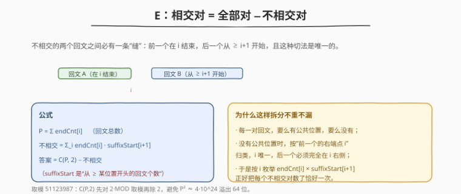
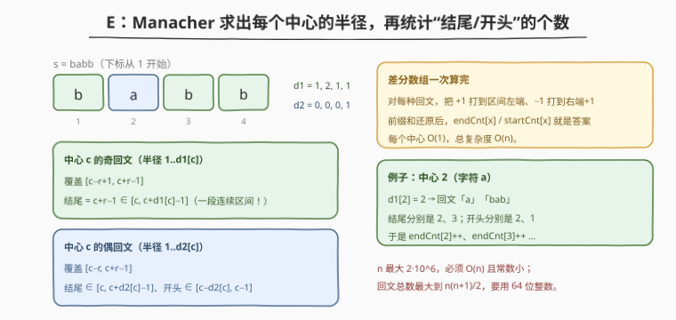
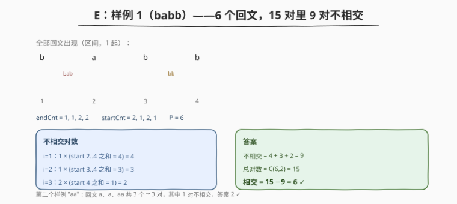

# Codeforces 17E 相交回文子串对数 题解

## 1. 题目概述

- **题目链接**：https://codeforces.com/problemset/problem/17/E
- **比赛来源**：Codeforces Beta Round 17 · Problem E（UTC 2010-06-10）
- **难度**：2900
- **标签**：字符串（回文、Manacher）
- **评测类型**：普通（单组输入，唯一答案）
- **限制**：时间 2 s / 内存 128 MB

**题意**：给定长度为 $n$ 的小写串 $S$。把每个回文子串的**每次出现**都看成一个对象（称为 subpalindrome），问有多少**对**不同的 subpalindrome 在位置上**相交**（共享至少一个字符；包含关系也算相交）。答案对 $51123987$ 取模。$n\le2\times10^6$。

**约束**：

- $n$ 最大 $2\times10^6$：$O(n^2)$ 的任何做法（枚举所有回文、或枚举所有对）都不行；
- 回文总数最多约 $n(n+1)/2\approx2\times10^{12}$，**超过 32 位**，必须用 64 位整数；
- 答案要对 $51123987$ 取模，且 $C(P,2)$ 中的 $P^2$ 会到 $4\times10^{24}$，直接相乘会溢出 64 位，需要先对 $2\cdot\text{MOD}$ 取模再除 2；
- 需要线性时间求出"以每个位置结尾/开头的回文个数"，这正是 Manacher + 差分数组的用武之地。

## 2. 示例与观察

官方样例 1（输入 / 输出原样）：

```text
输入：
4
babb

输出：
6
```

官方样例 2（输入 / 输出原样）：

```text
输入：
2
aa

输出：
2
```

**样例 1 演算**：`babb` 的全部回文出现（下标从 1 开始）是

| 回文 | 区间 |
|------|------|
| `b` | $[1,1]$ |
| `bab` | $[1,3]$ |
| `a` | $[2,2]$ |
| `b` | $[3,3]$ |
| `bb` | $[3,4]$ |
| `b` | $[4,4]$ |

共 $P=6$ 个，配对数 $C(6,2)=15$。其中**不相交**的有 9 对，相交的 6 对（题面也列出了）：

1. $[1,1]$ 与 $[1,3]$
2. $[1,3]$ 与 $[2,2]$
3. $[1,3]$ 与 $[3,3]$
4. $[1,3]$ 与 $[3,4]$
5. $[3,3]$ 与 $[3,4]$
6. $[3,4]$ 与 $[4,4]$

所以答案是 $15-9=6$。

**样例 2 演算**：`aa` 的回文是 `a`（位置 1）、`a`（位置 2）、`aa`，共 3 个，$C(3,2)=3$ 对；只有 $[1,1]$ 与 $[2,2]$ 不相交，所以相交 $3-1=2$ ✓。

**观察**：

1. 直接数"相交"很麻烦（区间相交有多种形态：交叉、包含、共端点），但"不相交"很简单：两个区间一左一右；
2. 一对不相交的回文之间有唯一的"缝"：前一个的右端点 $i$ 与后一个的左端点 $j>i$；
3. 所以只要能求出"以 $i$ 结尾的回文数 $E_i$"和"以 $j$ 开头的回文数 $S_j$"，不相交对数就是 $\sum_i E_i\cdot\sum_{j>i}S_j$。

## 3. 解题思路

### 3.1 朴素做法与瓶颈

枚举所有回文：对每个中心向两边扩展，最坏 $O(n^2)$（如全相同字符），$n=2\times10^6$ 时是 $2\times10^{12}$ 次扩展，不可行。即使枚举出来了，配对又是 $O(P^2)$。

正确方向是"**求补集**"：把"相交"换成"总数 − 不相交"，而"不相交"可以按缝隙分解成两个一维量。

### 3.2 核心观察：按缝隙分解不相交对



设

- $E_i$ = 以位置 $i$ **结尾**的回文个数；
- $S_j$ = 以位置 $j$ **开头**的回文个数；
- $P=\sum_i E_i$ = 回文总数。

任何一对**不相交**的回文，必然一个完全在另一个左边。于是它可以唯一地按"左边那个的右端点 $i$"分类：右边那个必须从 $>i$ 的位置开头。所以

$$\text{不相交对数}=\sum_{i=0}^{n-1} E_i\cdot\Bigl(\sum_{j=i+1}^{n-1}S_j\Bigr),$$

用后缀和 $\text{suf}[i]=\sum_{j\ge i}S_j$ 就能 $O(n)$ 求出。最终

$$\text{ans}=\binom{P}{2}-\text{不相交对数}\pmod{51123987}.$$

每对不相交回文只被计入一次（按左边那个的右端点），每对相交回文不会被计入，所以这个补集分解是精确的。

### 3.3 怎么线性求 $E_i$ 与 $S_j$



用 Manacher 求出每个中心的回文半径：

- $d_1[c]$：以 $c$ 为中心的**奇**回文个数（半径 $1..d_1[c]$，覆盖 $[c-r+1,\,c+r-1]$）；
- $d_2[c]$：以"$c-1$ 与 $c$ 之间"为中心的**偶**回文个数（半径 $1..d_2[c]$，覆盖 $[c-r,\,c+r-1]$）。

对固定的中心 $c$ 和半径 $r$，回文的右端点是 $c+r-1$（奇）或 $c+r-1$（偶），左端点是 $c-r+1$（奇）或 $c-r$（偶）。当 $r$ 从 $1$ 取到 $d$ 时：

- 结尾位置跑遍区间 $[c,\ c+d-1]$（两种情形都是这个区间）；
- 开头位置：奇回文是 $[c-d+1,c]$，偶回文是 $[c-d,c-1]$。

**这些位置是连续的**——于是"每个中心把所有可能的结尾各贡献一次"等价于"对区间 $[c,c+d-1]$ 整体 +1"。用差分数组打两个标记、最后前缀和还原，就能在 $O(n)$ 内得到 $E$ 与 $S$。

### 3.4 样例走查



$S=\texttt{babb}$：

- **结尾计数**：$E=[1,1,2,2]$（位置 1 有 `b`；位置 2 有 `a`；位置 3 有 `b`、`bab`；位置 4 有 `b`、`bb`）；
- **开头计数**：$S=[2,1,2,1]$（位置 1 有 `b`、`bab`；位置 2 有 `a`；位置 3 有 `b`、`bb`；位置 4 有 `b`）；
- $P=1+1+2+2=6$，$C(6,2)=15$；
- 不相交 $=E_1\cdot(S_2+S_3+S_4)+E_2\cdot(S_3+S_4)+E_3\cdot S_4=1\cdot4+1\cdot3+2\cdot1=9$；
- 答案 $=15-9=6$ ✓。

## 4. 正确性证明

**引理 1（Manacher 半径就是回文个数）**：对每个 $c$，$d_1[c]$ 恰是以 $c$ 为中心的最长奇回文半径，$d_2[c]$ 恰是以 $(c-1,c)$ 之间为中心的最长偶回文半径。

**证明**：这是 Manacher 算法的标准结论。其核心不变式是：维护已经扩展到的最右回文右端点 $r$ 与其中心对应的左端点 $l$，对当前中心 $i$，若 $i\le r$，则由回文的对称性，$d[i]$ 至少是 $\min(d[l+r-i],\,r-i+1)$（镜像位置的信息可直接复用，且不会越界）；在此基础上再逐格向两边扩展即可得到真实半径。每格扩展都让 $r$ 严格右移，因此总扩展次数 $O(n)$。∎

**引理 2（结尾/开头位置的连续性）**：固定中心，半径 $r$ 取遍 $1..d$ 时，回文的右端点恰好取遍 $[c,c+d-1]$ 的每个整数一次；奇回文的左端点取遍 $[c-d+1,c]$，偶回文取遍 $[c-d,c-1]$，也都各一次。

**证明**：右端点作为 $r$ 的函数是 $c+r-1$，是 $r$ 的严格增函数，$r$ 从 $1$ 到 $d$ 时取遍 $c$ 到 $c+d-1$ 的整数，每个 $r$ 对应唯一回文，故"每位置恰好一次"。左端点同理（奇：$c-r+1$ 递减；偶：$c-r$ 递减）。∎

**引理 3（不相交对的唯一分解）**：设两段不相交的回文区间 $A=[l_1,r_1]$、$B=[l_2,r_2]$ 满足 $r_1<l_2$。则这对回文被且仅被 $\sum_i E_i\cdot\text{suf}[i+1]$ 中的项 $i=r_1$ 计入一次。

**证明**：因 $A,B$ 不相交，必有一个在左（不妨 $r_1<l_2$）。在求和式中取 $i=r_1$：因子 $E_{r_1}$ 统计"以 $r_1$ 结尾的回文"（$A$ 是其中之一），因子 $\text{suf}[r_1+1]$ 统计"从 $>r_1$ 开头 的回文"（$B$ 是其中之一），故 $(A,B)$ 被计入。另一方面，$(A,B)$ 只会在这个 $i=r_1$ 处被计入——求和式按左回文的右端点分类，而左回文的右端点唯一。∎

**引理 4（补集分解）**：回文对总数 = 相交对数 + 不相交对数。

**证明**：任意两段不同区间的回文要么有公共位置（相交），要么没有（不相交），二者互斥且穷尽；同一段区间不会与自己配对（题目说"No palindrome can cross itself"），故按无序对计数即可。∎

**定理**：算法输出等于相交回文对数模 $51123987$。

**证明**：由引理 1、2，差分数组还原出的 $E_i$、$S_j$ 正确；由引理 3，$\sum_i E_i\cdot\text{suf}[i+1]$ 恰为不相交对数；$P=\sum E_i$ 为回文总数，$C(P,2)$ 为总对数；由引理 4，二者之差即为相交对数。取模运算在加法与乘法下保持结果（$C(P,2)$ 用 $2\cdot\text{MOD}$ 技巧只是为了避免溢出，见第 5 节），故输出正确。∎

## 5. 复杂度分析

- **时间**：Manacher 两遍 $O(n)$；差分与前缀和 $O(n)$；统计 $O(n)$。总 $O(n)$，$n=2\times10^6$ 时约 $10^7$ 次基本操作。
- **空间**：$O(n)$：两个半径数组、两个差分数组、两个计数数组与后缀和，各 $2\times10^6$ 个 `int`/`long long`，共约 40 MB（实测峰值 < 50 MB，限制 128 MB）。
- **取模细节**：$P$ 可达 $2\times10^{12}$，$C(P,2)\approx2\times10^{24}$ 会溢出 64 位。做法是先算 $t=P\bmod(2\cdot\text{MOD})$，再算 $t\cdot((P-1)\bmod(2\cdot\text{MOD}))\bmod(2\cdot\text{MOD})$，最后除以 2（此时结果必为偶数，除以 2 后即为 $C(P,2)\bmod\text{MOD}$）。
- **与时限的关系**：实测 $n=2\times10^6$ 的随机串 C++ 端到端 75 ms、全相同字符 56 ms，余量 25 倍以上；Python（CPython）约 3.2 s，**满数据建议提交 C++ 或用 PyPy3**。

## 6. 参考代码

### C++17

```cpp
#include <bits/stdc++.h>
using namespace std;

// 17E：相交回文对 = 全部回文对 - 不相交回文对。
// 用 Manacher 求出每个中心的回文半径，再用差分数组统计
// endCnt[x] = 以 x 结尾的回文个数、startCnt[x] = 以 x 开头的回文个数。
static const long long MOD = 51123987;

int main() {
    int n;
    if (scanf("%d", &n) != 1) return 0;
    string s;
    s.resize(n);
    if (scanf("%s", &s[0]) != 1) return 0;

    vector<int> d1(n), d2(n);
    for (int i = 0, l = 0, r = -1; i < n; ++i) {          // 奇回文
        int k = (i > r) ? 1 : min(d1[l + r - i], r - i + 1);
        while (i - k >= 0 && i + k < n && s[i - k] == s[i + k]) ++k;
        d1[i] = k--;
        if (i + k > r) { l = i - k; r = i + k; }
    }
    for (int i = 0, l = 0, r = -1; i < n; ++i) {          // 偶回文
        int k = (i > r) ? 0 : min(d2[l + r - i + 1], r - i + 1);
        while (i - k - 1 >= 0 && i + k < n && s[i - k - 1] == s[i + k]) ++k;
        d2[i] = k--;
        if (i + k > r) { l = i - k - 1; r = i + k; }
    }

    vector<long long> diffEnd(n + 2, 0), diffStart(n + 2, 0);
    for (int c = 0; c < n; ++c) {
        // 奇回文：半径 1..d1[c]，覆盖 [c-r+1, c+r-1]
        diffEnd[c] += 1;
        diffEnd[c + d1[c]] -= 1;                          // 结尾在 [c, c+d1[c]-1]
        diffStart[c - d1[c] + 1] += 1;
        diffStart[c + 1] -= 1;                            // 开头在 [c-d1[c]+1, c]
        // 偶回文：半径 1..d2[c]，覆盖 [c-r, c+r-1]
        if (d2[c] > 0) {
            diffEnd[c] += 1;
            diffEnd[c + d2[c]] -= 1;                      // 结尾在 [c, c+d2[c]-1]
            diffStart[c - d2[c]] += 1;
            diffStart[c] -= 1;                            // 开头在 [c-d2[c], c-1]
        }
    }

    vector<long long> endCnt(n + 1, 0), startCnt(n + 1, 0);
    long long acc = 0;
    for (int i = 0; i < n; ++i) endCnt[i] = (acc += diffEnd[i]);
    acc = 0;
    for (int i = 0; i < n; ++i) startCnt[i] = (acc += diffStart[i]);

    long long total = 0;                                  // 回文总数
    for (int i = 0; i < n; ++i) total += endCnt[i];

    vector<long long> suffixStart(n + 1, 0);
    for (int i = n - 1; i >= 0; --i) suffixStart[i] = (suffixStart[i + 1] + startCnt[i]) % MOD;

    long long nonCross = 0;
    for (int i = 0; i + 1 < n; ++i)
        nonCross = (nonCross + (endCnt[i] % MOD) * suffixStart[i + 1]) % MOD;

    // C(total,2) mod MOD：先按 2*MOD 取模再除 2，避免 1e24 溢出
    long long t2 = total % (2 * MOD);
    long long pairs = (t2 * ((total - 1) % (2 * MOD)) % (2 * MOD)) / 2 % MOD;

    long long ans = ((pairs - nonCross) % MOD + MOD) % MOD;
    printf("%lld\n", ans);
    return 0;
}
```

### Python3

```python
import sys

MOD = 51123987


def main() -> None:
    data = sys.stdin.buffer.read().split()
    n = int(data[0])
    s = data[1].decode()

    d1 = [0] * n
    l, r = 0, -1
    for i in range(n):
        k = 1 if i > r else min(d1[l + r - i], r - i + 1)
        while i - k >= 0 and i + k < n and s[i - k] == s[i + k]:
            k += 1
        d1[i] = k
        k -= 1
        if i + k > r:
            l, r = i - k, i + k

    d2 = [0] * n
    l, r = 0, -1
    for i in range(n):
        k = 0 if i > r else min(d2[l + r - i + 1], r - i + 1)
        while i - k - 1 >= 0 and i + k < n and s[i - k - 1] == s[i + k]:
            k += 1
        d2[i] = k
        k -= 1
        if i + k > r:
            l, r = i - k - 1, i + k

    diff_end = [0] * (n + 2)
    diff_start = [0] * (n + 2)
    for c in range(n):
        # 奇回文：覆盖 [c-r+1, c+r-1]
        diff_end[c] += 1
        diff_end[c + d1[c]] -= 1
        diff_start[c - d1[c] + 1] += 1
        diff_start[c + 1] -= 1
        # 偶回文：覆盖 [c-r, c+r-1]
        if d2[c] > 0:
            diff_end[c] += 1
            diff_end[c + d2[c]] -= 1
            diff_start[c - d2[c]] += 1
            diff_start[c] -= 1

    end_cnt = [0] * (n + 1)
    start_cnt = [0] * (n + 1)
    acc = 0
    for i in range(n):
        acc += diff_end[i]
        end_cnt[i] = acc
    acc = 0
    for i in range(n):
        acc += diff_start[i]
        start_cnt[i] = acc

    total = sum(end_cnt[:n])

    suffix_start = [0] * (n + 1)
    for i in range(n - 1, -1, -1):
        suffix_start[i] = (suffix_start[i + 1] + start_cnt[i]) % MOD

    non_cross = 0
    for i in range(n - 1):
        non_cross = (non_cross + end_cnt[i] * suffix_start[i + 1]) % MOD

    # C(total, 2) mod MOD
    pairs = (total % (2 * MOD)) * ((total - 1) % (2 * MOD)) % (2 * MOD) // 2 % MOD
    ans = (pairs - non_cross) % MOD
    sys.stdout.write(str(ans) + "\n")


main()
```

C++ 版用 `scanf` 读 $2\times10^6$ 个字符；Python 版全程用列表，$n$ 大时较慢，建议改交 C++。

## 7. 边界情况与易错点

1. **$n=1$**：只有一个回文（单字符），总对数 $C(1,2)=0$，答案 `0`。
2. **全部字符相同**（如 $10^6$ 个 `a`）：回文数 $\approx n(n+1)/2$，答案巨大，必须全程 64 位并在每步取模；这也是检验取模是否写对的最佳数据。
3. **$C(P,2)$ 的溢出**：$P\approx2\times10^{12}$，$P(P-1)\approx4\times10^{24}$ 远超 64 位；必须用"对 $2\cdot\text{MOD}$ 取模再除 2"的技巧（先保证偶数再除）。
4. **负数取模**：`pairs - nonCross` 可能为负，要写成 `((x % MOD) + MOD) % MOD`。
5. **差分数组越界**：奇回文的 `c + d1[c]` 最大可到 $n$（当 $c$ 是中心且回文到结尾时 $c+d_1[c]-1=n-1$），数组要开 $n+2$。
6. **偶回文的下标**：`diffStart[c - d2[c]]` 当 `d2[c]=c` 时下标为 0，安全；`diffStart[c]` 最大为 $n-1$，安全。但 `d2[c]=0` 时不能做区间操作（否则会多算一次空区间），代码里用 `if (d2[c] > 0)` 挡掉。
7. **"包含也算相交"**：本题不能只数"交叉"（$l_1<l_2\le r_1<r_2$）；补集分解天然把包含关系算作相交，因为它只把"完全分离"归入不相交。
8. **同一段回文不能与自己配对**：$C(P,2)$ 已排除自配对；若写成 $P^2$ 会错。
9. **读入**：$n$ 最大 $2\times10^6$，`scanf("%s")` 或 `sys.stdin.buffer.read()` 都可以，但不要用 `cin >>` 逐字符读。

## 8. 验证记录

- **编译环境与命令**：本机只有 `Apple clang 21.0.0`，没有 GNU `g++`，因此用 `clang++ -std=c++17 -O2 -Wall -I codeforces/tools/include` 搭配本地 `bits/stdc++.h` 兼容头编译（代码只用标准库，可原样提交 GNU C++17）。Python 为 `Python 3.9.6`。
- **官方样例**：2 / 2 通过（`6`、`2`），C++ 与 Python 输出一致，且与 JSON 中的 `out` 逐字符相同。
- **独立暴力对拍**：暴力（`codeforces/tools/brutes/cf17e.py`）用**向两边扩展**的方式枚举全部回文出现区间（$O(n^2)$），再**两两检查区间是否相交**（$O(P^2)$），完全不使用 Manacher 或补集分解。随机生成 **300 组**输入（$n\le30$，四种模式：双字母、三字母、单字母、回文模板），C++ / Python / 暴力三方 **300/300 一致**。
- **最大约束性能**：$n=2\times10^6$ 两种极端数据（随机串、全相同字符），C++ 端到端 75 ms / 56 ms，峰值内存 < 50 MB（限制 128 MB）；Python（CPython 3.9）约 3.2 s，满数据建议 C++/PyPy3。
- **图片校验**：三张 SVG（`cf17e_mancher.svg`、`cf17e_formula.svg`、`cf17e_walkthrough.svg`）均通过 `xml.etree.ElementTree.parse`；用脚本估算每个 `text` 的包围盒，确认不越出 viewBox、文字之间不重叠；并用 headless Chrome 渲染 PNG 后检查画布四边无墨迹（无裁切）。
- **公式校验**：公式均为 `$...$` / `$$...$$`，星号直接写 `*`，`\text{}` 内无裸 `#`，KaTeX（`throwOnError`）渲染无报错。
- **复核状态**：verified（样例、随机对拍、性能、图片、公式均实跑通过；唯一环境差异是本机无 GNU g++，已用 clang++ 等价验证）。

## 相关题目与扩展

- [Codeforces 17A Noldbach problem](https://codeforces.com/problemset/problem/17/A)、[17B Hierarchy](https://codeforces.com/problemset/problem/17/B)、[17C Balance](https://codeforces.com/problemset/problem/17/C)、[17D Notepad](https://codeforces.com/problemset/problem/17/D)：同场其余四题。
- [Codeforces 7D Palindrome Degree](https://codeforces.com/problemset/problem/7/D)：用 Manacher/哈希求"回文阶"，是回文半径的直接应用。
- [Codeforces 5C Longest Regular Bracket Sequence](https://codeforces.com/problemset/problem/5/C)：同样是"统计某种结构（回文/合法括号）的出现次数"，配套"按端点计数"的思想。
- [Codeforces 1045I Palindrome Pairs](https://codeforces.com/problemset/problem/1045/I)：用位掩码统计回文配对，思路不同但同样考"配对计数"。
- [LeetCode 647. 回文子串](https://leetcode.cn/problems/palindromic-substrings/)：数回文子串个数，是本题"$P$"的简化版。

**延伸思考**：

1. **如果要求"不相交"的对数**：本题已经顺带算出来了（就是 $\sum_i E_i\cdot\text{suf}[i+1]$），不需要额外工作。
2. **如果要求"包含"的对数**：$\sum_{\text{区间}} (\text{内部回文数})$，可以用"以某点结尾/开头的回文数"再做一次二维前缀，或改用回文树。
3. **如果串是 $10^7$ 级别**：$O(n)$ 仍然可行，但内存（8 个 $n$ 大小的数组）会到 300 MB 以上，需要把 `long long` 换成 `int`（模数 $<2^{26}$，干扰很小）。
4. **如果改用回文自动机（Eertree）**：同样能在 $O(n)$ 内求出每个前缀的回文后缀个数，与 Manacher 异曲同工；本题用 Manacher 的差分数组更简单。

