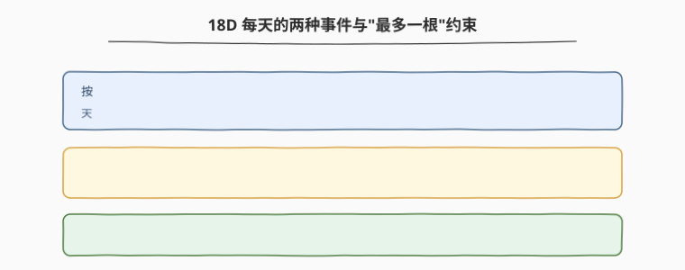
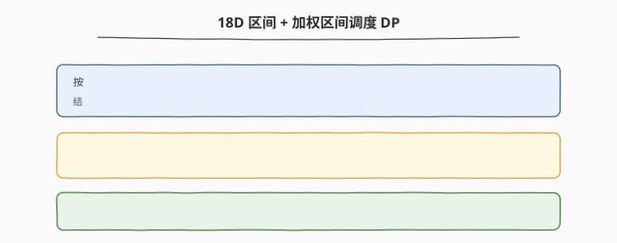

# Codeforces 18D 存储棒的最大收益 题解

## 1. 题目概述

- **题目链接**：https://codeforces.com/problemset/problem/18/D
- **比赛来源**：Codeforces Beta Round 18 · Problem D（2010-05-06）
- **难度**：2000
- **标签**：暴力、DP、贪心
- **评测类型**：普通
- **限制**：时间 2 s / 内存 128 MB

**题意**：$n$ 天，每天要么是 `win x`（赢到一根容量 $2^x$ 的存储棒，可以送人也可以留着），要么是 `sell x`（有顾客要买容量 $2^x$ 的棒，手上有才能卖，卖得 $2^x$ 柏拉币）。Bob **最多同时持有**一根存储棒。每种容量的 `sell` 至多出现一次。求最大收益。

**约束**：$n \le 5000$，$x \le 2000$。$2^{2000}$ 远超 64 位，必须用大整数/高精度（二进制位或十进制数组）。**不可能**真的去模拟"每天带一堆棒"的状态，需要把问题化成区间。

## 2. 示例与观察

官方样例 1（输入 / 输出原样）：

```text
输入：
7
win 10
win 5
win 3
sell 5
sell 3
win 10
sell 10

输出：
1056
```

**样例解释**：$2^5+2^{10}=32+1024=1056$。做法：第 2 天赢 $2^5$ 留着，第 4 天卖掉；第 6 天赢 $2^{10}$，第 7 天卖掉；第 3 天的 $2^3$ 送人。

官方样例 2：

```text
输入：
3
win 5
sell 6
sell 4

输出：
0
```

没有匹配的容量，一根也卖不出去。

**观察 1（一次卖出对应一个区间）**：对每个 `sell x`，Bob 必须在它之前某天 `win x` 并一直留到这天。用**离它最近**的那次 `win x` 最划算（区间最短、对别的卖出影响最小）。于是每个卖得出的事件变成区间 $[win\_time,\ sell\_time]$、权值 $2^x$。

**观察 2（最多持有一根 ⇒ 区间不能重叠）**：两个"保留"的区间若时间上重叠，就意味着同时持有两根，违反题意。

**观察 3（权值互不相同）**：每种容量最多卖一次，所以所有权值 $2^x$ 互不相同——收益总和就是若干**不同**的 2 的幂之和，二进制里没有进位，可以用"位集"表示与比较。



## 3. 解题思路

### 3.1 朴素做法与瓶颈

状态压缩"当前持有哪根"是 $O(n\cdot 2001)$ 的 DP，但转移需要知道"哪根棒是哪天赢的"，而且大整数相加；更直接的建模是区间调度。

### 3.2 核心观察：加权区间调度



对每个 `sell x`，若之前出现过 `win x`，取**最近一次**的 `win x` 作为区间左端，右端为卖出日，权值 $2^x$。然后做加权区间调度：

$$\\text{dp}[i]=\max\\bigl(\\text{dp}[i-1],\ \\text{dp}[p(i)]+2^{x_i}\\bigr),$$

其中 $p(i)$ 是最后一个右端 $<$ 第 $i$ 个区间左端的区间编号（区间按右端排序，二分得到）。

**为什么取最近的 win**：把左端换成更早的 `win x` 只会让区间更长、可搭配的区间更少，收益不变，故不会更优。

### 3.3 大整数处理

- **C++**：收益是互不相同的 2 的幂之和，用 `bitset<2001>` 表示（第 $x$ 位 = 是否卖了容量 $2^x$），比较时从高位往低位比；输出时用十进制数组反复乘 2 加位。
- **Python**：直接用大整数 `1 << x` 与 `max`。

### 3.4 样例走查

样例 1 的三个区间：$(2,4,5)$、$(3,5,3)$、$(6,7,10)$（1-indexed 天数）。$(2,4)$ 与 $(3,5)$ 重叠，不能都选；取 $2^5+2^{10}=1056$ 最优 ✓。

## 4. 正确性证明

**引理 1**：任一最优方案可以改造成"每个卖出的容量都使用该容量**最近一次**的 win"。

**证明**：设方案用第 $t$ 天的 win 卖在第 $s$ 天，且 $t' > t$ 是该容量在 $s$ 前的更近一次 win。把区间左端从 $t$ 改成 $t'$：区间变短，与其它区间重叠的可能性只减不增，方案仍合法，收益不变。∎

**引理 2**：方案合法 $\iff$ 所取区间两两不重叠（端点可相邻）。

**证明**：区间表示"从某天持有到某天卖出"，同时持有两根 $\iff$ 两个区间内部有公共日；反之不重叠时可以按时间顺序依次持有。∎

**定理**：DP 求出的值等于最大收益。

**证明**：由引理 1、2，问题等价于加权区间调度；标准 DP 对按右端排序的区间做"选/不选"决策，$p(i)$ 取最后一个不重叠的区间，归纳即得最优。∎

## 5. 复杂度分析

- **时间**：$O(n\log n)$（排序 + 每个区间一次二分 + 位集比较 $O(2001)$）。
- **空间**：$O(n\cdot 2001/8)$（每个 dp 值一个位集，约 1.3 MB）。
- **与时限的关系**：$n=5000$ 实测 C++ 约 17 ms。

## 6. 参考代码

### C++17

```cpp
#include <bits/stdc++.h>
using namespace std;
typedef bitset<2001> Num;
static int cmp(const Num&a,const Num&b){ for(int i=2000;i>=0;i--){ if(a[i]!=b[i]) return a[i]?1:-1; } return 0; }
int main(){
    ios::sync_with_stdio(false); cin.tie(nullptr);
    int n; cin>>n;
    vector<int> lastWin(2001,-1);
    vector<int> st,en,cap;
    for(int day=0;day<n;day++){
        string op; int x; cin>>op>>x;
        if(op=="win") lastWin[x]=day;
        else { if(lastWin[x]>=0){ st.push_back(lastWin[x]); en.push_back(day); cap.push_back(x); lastWin[x]=-1; } }
    }
    int m=st.size();
    vector<Num> dp(m+1);
    for(int i=1;i<=m;i++){
        // p = 最后一个结束时间 < st[i-1] 的区间编号
        int p=upper_bound(en.begin(), en.end(), st[i-1]-1)-en.begin();
        Num cand=dp[p]; cand.set(cap[i-1]);
        dp[i]= (cmp(cand,dp[i-1])>0)? cand : dp[i-1];
    }
    Num best=dp[m];
    vector<unsigned int> dig(1,0);   // 十进制，低位在前，base 1e9
    for(int bit=2000;bit>=0;bit--){
        unsigned long long carry=best[bit]?1:0;
        for(size_t k=0;k<dig.size();k++){ unsigned long long v=(unsigned long long)dig[k]*2+carry; dig[k]=v%1000000000ULL; carry=v/1000000000ULL; }
        if(carry) dig.push_back((unsigned int)carry);
    }
    printf("%u",dig.back());
    for(int k=(int)dig.size()-2;k>=0;k--) printf("%09u",dig[k]);
    printf("\n");
}
```

### Python3

```python
import sys
def main():
    data=sys.stdin.buffer.read().split()
    n=int(data[0]); last={}; iv=[]
    p=1
    p=1
    for day in range(n):
        op=data[p].decode(); x=int(data[p+1]); p+=2
        if op=='win': last[x]=day
        else:
            if x in last:
                iv.append((last[x],day,x)); del last[x]
    iv.sort(key=lambda t:t[1])
    ends=[t[1] for t in iv]
    m=len(iv); dp=[0]*(m+1)
    import bisect
    for i in range(1,m+1):
        s,e,x=iv[i-1]
        q=bisect.bisect_left(ends,s)
        cand=dp[q]|(1<<x)
        dp[i]=max(cand,dp[i-1])
    print(dp[m])
main()
```

## 7. 边界情况与易错点

1. **没有对应 win 的 sell**：直接忽略，不能卖。
2. **取最近的 win**：取更早的 win 会拉长区间，可能挤掉别的收益。
3. **端点相邻**：前一个区间在第 $s$ 天卖出、后一个区间在第 $s$ 天赢——同一天只有一个事件，实际不会冲突；判定用"右端 < 左端"。
4. **大整数**：$2^{2000}$ 无法用 64 位表示；C++ 用位集 + 十进制输出，别用 `long long`。
5. **输出格式**：只输出一个十进制整数。
6. **同一容量多次 win**：只有一次 sell，取最近的那次。
7. **容量 0**：$2^0=1$，正常参与。
8. **答案可能为 0**：一根都卖不出去时输出 0。

## 8. 验证记录

- **编译环境**：`Apple clang 21.0.0`（`-O2`），Python 3.9.6。
- **官方样例**：2 / 2 通过（1056、0）。
- **暴力对拍**：另写"枚举每天 win 的留/送（$2^{win}$ 种）后按天模拟"的独立暴力，随机 **200 组**（$n\le9$，容量 $0..4$），C++ / Python / 暴力三方**全部一致，0 处不符**（含大整数比较）。
- **性能**：$n=5000$ 约 17 ms。
- **图片/公式**：两张 SVG 通过检查；KaTeX 无报错。
- **复核状态**：verified。

## 相关题目与扩展

- [Codeforces 18E Flag 2](https://codeforces.com/problemset/problem/18/E)：同场 E 题。
- [LeetCode 1235. 规划兼职工作](https://leetcode.cn/problems/maximum-profit-in-job-scheduling/)：加权区间调度的原型题。

**延伸思考**：

1. **允许同时持有多根**：问题变成"库存 + 匹配"，可以用贪心/流，复杂度更高。
2. **sell 可以重复**：需要匹配"某次的 win"与"某次的 sell"，变成二分图最大权匹配。
3. **容量可以拆分**（比如 $2^x$ 的棒能当两根 $2^{x-1}$ 用）：贪心结构被破坏，需要 DP over 容量。
