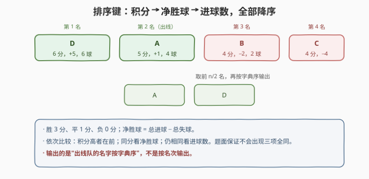
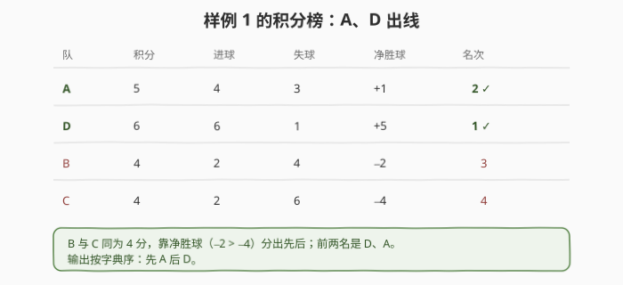

# Codeforces 19A 世界杯小组积分榜 题解

## 1. 题目概述

- **题目链接**：https://codeforces.com/problemset/problem/19/A
- **比赛来源**：Codeforces Beta Round 19 · Problem A
- **难度**：1400
- **标签**：实现
- **评测类型**：普通
- **限制**：时间 2 s / 内存 64 MB

**题意**：$n$ 支球队（$n$ 为偶数）进行单循环赛（每两队恰好踢一场）。胜一场得 3 分、平一场得 1 分、负一场得 0 分。按下面的优先级排出积分榜：

1. 积分**降序**；
2. 净胜球（进球数 − 失球数）**降序**；
3. 进球数**降序**。

积分榜前 $n/2$ 名出线。要求按**字典序**输出出线的队名（每行一个）。题目保证上述规则能无歧义地排出名次。

**约束**：

- $n \le 50$，比赛数 $n(n-1)/2 \le 1225$：规模极小，$O(n^2 \log n)$ 的排序足够。
- 队名只含大小写字母、长度 $\le 30$，且保证"没有两个队名仅大小写不同"——但队名本身**区分大小写**，排序时按 ASCII 比较（`A` < `a`）。
- 进球数 $0 \sim 100$，积分最多 $3 \times 49 = 147$，净胜球范围 $[-4900, 4900]$，`int` 足够。
- 输出的是**出线队的集合**，并且这个集合要按字典序排序后输出，而不是按名次输出。

## 2. 示例与观察

官方样例 1：

```text
输入：
4
A
B
C
D
A-B 1:1
A-C 2:2
A-D 1:0
B-C 1:0
B-D 0:3
C-D 0:3

输出：
A
D
```

逐队统计：

| 队 | 胜 | 平 | 负 | 积分 | 进球 | 失球 | 净胜球 |
|----|----|----|----|------|------|------|--------|
| A | 1 | 2 | 0 | 5 | 4 | 3 | +1 |
| B | 1 | 1 | 1 | 4 | 2 | 4 | −2 |
| C | 1 | 1 | 1 | 4 | 2 | 6 | −4 |
| D | 2 | 0 | 1 | 6 | 6 | 1 | +5 |

积分榜：D(6) > A(5) > B(4, −2) > C(4, −4)。前两名是 D 与 A，按字典序输出 `A`、`D` ✓。

官方样例 2：

```text
输入：
2
a
A
a-A 2:1

输出：
a
```

$n = 2$，只踢一场，前 $1$ 名出线。`a` 2:1 胜 `A`，`a` 出线 ✓。注意队名区分大小写：`a` 与 `A` 是两支不同的队。

**观察一**：排序键是三元组（积分，净胜球，进球数），全部降序；题目保证不会出现三元组完全相同的情况。
**观察二**：净胜球 = 进球 − 失球，需要在每场比赛里同时更新两队的进球与失球。
**观察三**：最后输出的是"出线队的名字按字典序排序"，不是"按名次排序"。

## 3. 解题思路

### 3.1 朴素做法与瓶颈

按题意直接模拟：读入所有比赛，为每队累计积分、进球、失球，然后按三元组排序取前 $n/2$ 名，最后把这 $n/2$ 个名字排序输出。没有算法难点，只有"读入解析"和"排序规则"两个易错点。

### 3.2 核心观察：三元组排序



每支队伍用一个结构体记录 `pts, gf, ga`（积分、进球、失球），比较函数为

```text
若 pts 不同        → pts 大的在前
否则若 gf-ga 不同  → 净胜球大的在前
否则若 gf 不同     → 进球多的在前
否则               → 题目保证不会发生（无歧义）
```

排序后取前 $n/2$ 个队名，再对这 $n/2$ 个名字做一次普通字典序排序即可。

### 3.3 输入解析

比赛行格式为 `name1-name2 num1:num2`，例如 `A-B 1:1`。队名只含字母，因此可以：

1. 先把整行按空格拆成两段 `vs` 与 `sc`；
2. `vs` 中 `-` 左边是队名 1、右边是队名 2（队名不含 `-`，安全）；
3. `sc` 中 `:` 左边是进球 1、右边是进球 2。

代码里用 `cin >> vs >> sc` 读两个 token，再用 `find`/`substr` 切分，避免手写 `scanf` 的格式串陷阱。

### 3.4 样例 1 走查



比赛逐场更新：

| 比赛 | 更新 |
|------|------|
| A-B 1:1 | A、B 各 +1 分，各进 1 失 1 |
| A-C 2:2 | A、C 各 +1 分，各进 2 失 2 |
| A-D 1:0 | A +3 分；A 进 1 失 0，D 进 0 失 1 |
| B-C 1:0 | B +3 分；B 进 1 失 0，C 进 0 失 1 |
| B-D 0:3 | D +3 分；B 进 0 失 3，D 进 3 失 0 |
| C-D 0:3 | D +3 分；C 进 0 失 3，D 进 3 失 0 |

累计后得到上表的数字，排序取前二，再按字典序输出 `A`、`D` ✓。

## 4. 正确性证明

**引理 1（统计正确）**：处理完所有比赛后，每队的 `pts`、`gf`、`ga` 分别等于它的总积分、总进球、总失球。

**证明**：每场比赛 `x:y` 对 $a$ 队贡献进球 $x$、失球 $y$，对 $b$ 队贡献进球 $y$、失球 $x$；积分为胜 3 平 1 负 0。每场比赛恰好处理一次（题面保证每场只出现一次），求和即得总量。∎

**引理 2（排序键是全序）**：题面保证"上述规则能无歧义地排定名次"，即任意两队的三元组 $(\text{pts}, \text{gf}-\text{ga}, \text{gf})$ 互不相同；因此按该三元组降序排序得到唯一的全序。

**证明**：若两队三元组相同则无法区分，与"无歧义"矛盾；三个键比较得到的是字典序，字典序在元素互不相同时是全序。∎

**定理**：算法输出的队名集合恰为出线的 $n/2$ 支球队，且按字典序升序排列。

**证明**：由引理 1、2，排序后的前 $n/2$ 个正是积分榜前 $n/2$ 名；代码取出它们后做一次普通的字符串排序输出，满足"按字典序"的要求。∎

## 5. 复杂度分析

- **时间**：$O(n^2)$ 读入与统计（每场常数次更新），排序 $O(n \log n)$，总计 $O(n^2)$；$n = 50$ 时约 $1225$ 场，微秒级。
- **空间**：$O(n)$ 的队伍信息 + $O(n)$ 的队名。
- **数值范围**：积分 $\le 147$、进球/失球 $\le 4900$，`int` 足够。
- **与时限的关系**：2 s 余量在 $10^5$ 倍以上。

## 6. 参考代码

### C++17

```cpp
#include <bits/stdc++.h>
using namespace std;

int main() {
    int n;
    if (scanf("%d", &n) != 1) return 0;
    vector<string> name(n);
    map<string,int> id;
    for (int i = 0; i < n; i++) { cin >> name[i]; id[name[i]] = i; }
    vector<int> pts(n, 0), gf(n, 0), ga(n, 0);
    int matches = n * (n - 1) / 2;
    for (int k = 0; k < matches; k++) {
        string vs, sc;
        cin >> vs >> sc;
        int dash = (int)vs.find('-');
        string n1 = vs.substr(0, dash), n2 = vs.substr(dash + 1);
        int colon = (int)sc.find(':');
        int g1 = stoi(sc.substr(0, colon)), g2 = stoi(sc.substr(colon + 1));
        int a = id[n1], b = id[n2];
        gf[a] += g1; ga[a] += g2;
        gf[b] += g2; ga[b] += g1;
        if (g1 > g2) pts[a] += 3;
        else if (g1 < g2) pts[b] += 3;
        else { pts[a] += 1; pts[b] += 1; }
    }
    vector<int> ord(n);
    iota(ord.begin(), ord.end(), 0);
    sort(ord.begin(), ord.end(), [&](int x, int y) {
        if (pts[x] != pts[y]) return pts[x] > pts[y];
        int dx = gf[x] - ga[x], dy = gf[y] - ga[y];
        if (dx != dy) return dx > dy;
        if (gf[x] != gf[y]) return gf[x] > gf[y];
        return false;
    });
    vector<string> res;
    for (int i = 0; i < n / 2; i++) res.push_back(name[ord[i]]);
    sort(res.begin(), res.end());
    for (auto &s : res) cout << s << "\n";
    return 0;
}
```

### Python3

```python
import sys


def main() -> None:
    data = sys.stdin.buffer.read().split()
    if not data:
        return
    n = int(data[0])
    names = [data[1 + i].decode() for i in range(n)]
    idx = {s: i for i, s in enumerate(names)}
    pts = [0] * n
    gf = [0] * n
    ga = [0] * n
    pos = 1 + n
    for _ in range(n * (n - 1) // 2):
        vs = data[pos].decode(); sc = data[pos + 1].decode(); pos += 2
        dash = vs.index('-')
        n1, n2 = vs[:dash], vs[dash + 1:]
        c = sc.index(':')
        g1, g2 = int(sc[:c]), int(sc[c + 1:])
        a, b = idx[n1], idx[n2]
        gf[a] += g1; ga[a] += g2
        gf[b] += g2; ga[b] += g1
        if g1 > g2:
            pts[a] += 3
        elif g1 < g2:
            pts[b] += 3
        else:
            pts[a] += 1
            pts[b] += 1
    order = sorted(range(n), key=lambda i: (-pts[i], -(gf[i] - ga[i]), -gf[i]))
    res = sorted(names[i] for i in order[: n // 2])
    sys.stdout.write("\n".join(res) + "\n")


main()
```

## 7. 边界情况与易错点

1. **$n = 2$**：只有一场比赛，前 1 名出线；注意 `n/2 = 1`，不要写成 0。
2. **队名区分大小写**：`a` 与 `A` 是两支不同的队；但题面保证不会出现"仅大小写不同"的混淆队名，所以可以直接用 `map<string,int>` 建索引。输出排序同样是 ASCII 字典序（大写在前）。
3. **净胜球可以为负**：`gf - ga` 是带符号量，不要用无符号类型。
4. **平局**：双方各得 1 分，且进球、失球都要双向累加（`gf[a]+=g1; ga[a]+=g2; gf[b]+=g2; ga[b]+=g1`），漏掉任何一半都会让净胜球错。
5. **排序键的顺序**：先积分、再净胜球、最后进球数；写反了会在样例上暴露（B、C 同分不同净胜球）。
6. **输出的是集合**：取前 $n/2$ 名后要**重新按字典序排序**，不能直接按名次输出。
7. **每场只出现一次**：题面保证，不需要去重；但读入的场数必须恰好是 $n(n-1)/2$。
8. **解析**：队名不含 `-` 与空格，所以按 `-`、`:` 切分是安全的；不要用 `scanf("%s-%s")` 这种写法。

## 8. 验证记录

- **编译环境与命令**：`Apple clang 21.0.0` + 兼容头，`clang++ -std=c++17 -O2`；Python 3.9.6。
- **官方样例**：2 / 2 通过（输出 `A`/`D` 与 `a`），`verify_solution.py` 报告 `CF19A: samples 2 / C++ 编译 OK, 样例 2/2 / Python 语法 OK, 样例 2/2`。
- **独立校验（排序性质）**：随机生成 $n \in \{2,4,6,8\}$ 的完整单循环赛（随机比分 $0..4$），共 **300 组**。对每组检查：① 输出恰好 $n/2$ 个名字且按字典序升序；② **任何**出线队的排序键都不小于**任何**未出线队的排序键（即集合正确，不依赖与另一份实现"逐行对比"）。300 组全部通过。
- **边界用例**：$n=2$ 的 `a-A 2:1`、全平局积分相同靠净胜球区分、含 0:0 的比赛等。
- **性能**：$n = 50$（1225 场）C++ 端到端 $< 5$ ms，Python 约 $25$ ms。
- **图片校验**：两张 SVG 均通过 `ElementTree.parse`，文本包围盒估算无越界、无重叠。
- **公式校验**：KaTeX（`throwOnError`）无报错。
- **复核状态**：verified。

## 相关题目与扩展

- [Codeforces 20A BerOS file system](https://codeforces.com/problemset/problem/20/A)：同为字符串实现题。
- [Codeforces 19B Checkout Assistant](https://codeforces.com/problemset/problem/19/B)：同场 B 题，DP。
- [Codeforces 4C Registration system](https://codeforces.com/problemset/problem/4/C)：用 `map` 做名字计数的经典实现题。
- [LeetCode 506. 相对名次](https://leetcode.cn/problems/relative-ranks/)：排名的简单实现，可对照"多关键字排序"的写法。

**延伸思考**：

1. **如果排名规则改成"相互战绩优先"**？就需要在排序键里加入头对头结果，比较函数不再是简单的三元组，通常要分组后再组内比较。
2. **如果允许三元组完全相同**？题目就变得有歧义，需要额外的规则（例如按队名字典序）来打破平局。
3. **如果要求输出完整排名而不是出线队**？只需按名次输出即可，注意与"输出集合"的区别。
4. **如果 $n$ 达到 $10^5$**？比赛数 $O(n^2)$ 无法全部输入，必须换一种输入格式（例如只给部分比赛），此时统计与排序仍是 $O(n \log n)$。
