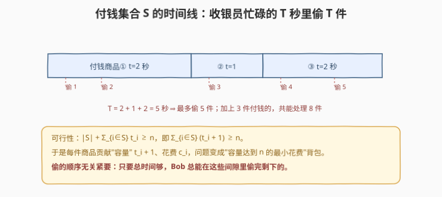
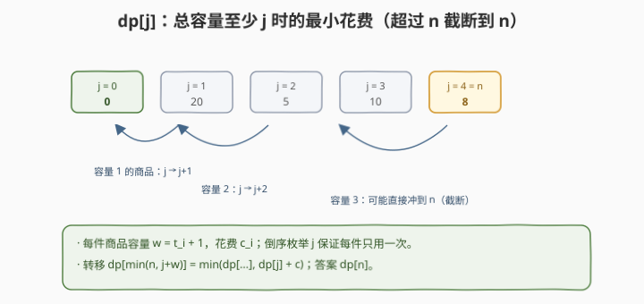

# Codeforces 19B 收银台的最少花费 题解

## 1. 题目概述

- **题目链接**：https://codeforces.com/problemset/problem/19/B
- **比赛来源**：Codeforces Beta Round 19 · Problem B（UTC 2010-06-24）
- **难度**：1900
- **标签**：动态规划
- **评测类型**：普通
- **限制**：时间 1 s / 内存 256 MB

**题意**：Bob 推车里共有 $n$ 件商品，第 $i$ 件的价格是 $c_i$、收银员处理它需要 $t_i$ 秒。收银员处理某件商品时，Bob 可以趁机**偷**别的商品——每偷一件需要 1 秒。Bob 可以自己决定商品交给收银员的顺序。求他最少要付多少钱，才能"处理掉"全部 $n$ 件商品（付钱的 + 偷走的）。

**约束**：

- $n \le 2000$，$t_i \le 2000$，$c_i \le 10^9$：允许 $O(n^2)$ 的 DP；价格总和可达 $2 \times 10^{12}$，**必须用 64 位整数**。
- $t_i = 0$ 表示收银员处理这件商品时 Bob 没时间偷东西。
- 注意：**只有付钱的商品才提供"作案时间"**；被偷的商品不需要付钱，也不会产生时间。

## 2. 示例与观察

官方样例 1：

```text
输入：
4
2 10
0 20
1 5
1 3

输出：
8
```

四件商品是 $(t, c) = (2,10), (0,20), (1,5), (1,3)$。最优方案是付第 3、4 件（共 $5 + 3 = 8$ 元）：收银员处理它们共 $1 + 1 = 2$ 秒，Bob 正好用这 2 秒偷走前两件 ✓。付第 1、3、4 件要 $10+5+3=18$ 元，不如 8 元。

官方样例 2：

```text
输入：
3
0 1
0 10
0 100

输出：
111
```

三件商品的 $t_i$ 都是 0，收银员处理任何一件时 Bob 都偷不了东西，所以只能全部付钱：$1+10+100 = 111$ ✓。

**观察一**：如果 Bob 付钱的集合是 $S$，那么收银员总耗时 $T = \sum_{i \in S} t_i$，这段时间他能偷最多 $T$ 件商品。他需要偷的是 $n - |S|$ 件（剩下的全部）。
**观察二**：所以方案可行当且仅当

$$\sum_{i \in S} t_i \ \ge\ n - |S| \quad\Longleftrightarrow\quad \sum_{i \in S} (t_i + 1) \ \ge\ n .$$

**观察三**：这样一来问题就变成了：每件商品有一个"容量" $t_i + 1$ 和一个"花费" $c_i$，选出若干件使总容量 $\ge n$，最小化总花费——一个标准的 0/1 背包（或者叫"覆盖型背包"）。

## 3. 解题思路

### 3.1 朴素做法与瓶颈

枚举所有"付钱集合"是 $2^n$，$n = 2000$ 完全不可行。但由观察三，每个商品的价值是"容量"，需求是"总容量 ≥ n"，状态只有 $0 \dots n$ 共 $n+1$ 种，自然想到 DP。

### 3.2 核心观察：把"偷"折算成容量



设付钱的集合为 $S$。Bob 的总"收入"分两部分：

- 付了钱的 $|S|$ 件：直接到手；
- 偷走的商品：每件 1 秒，只能在收银员忙碌的 $T = \sum_{i\in S} t_i$ 秒内进行，所以最多偷 $T$ 件。

要把 $n$ 件全部"处理掉"，需要 $|S| + T \ge n$，即 $\sum_{i \in S}(t_i + 1) \ge n$。反过来，只要这个不等式成立，Bob 就能按任意顺序付款、在收银员处理每件商品的间隙偷走剩余的 $n - |S| \le T$ 件 ✓。

### 3.3 DP：容量覆盖背包



定义

$$dp[j] = \text{总容量恰好/至少达到 } j \text{ 时的最小花费}\quad (0 \le j \le n).$$

- 初值 $dp[0] = 0$，其余为 $\infty$；
- 对每件商品 $(t_i, c_i)$，容量 $w = t_i + 1$，倒序枚举 $j = n \dots 0$：

$$dp[\min(n,\ j + w)] = \min\bigl(dp[\min(n,\ j+w)],\ dp[j] + c_i\bigr).$$

- 答案是 $dp[n]$。

把超过 $n$ 的容量截断到 $n$ 是标准技巧：只要"够用"就行，多出来的容量没有区别。

### 3.4 样例 1 走查

商品与容量：$(2,10)\to 3$、$(0,20)\to 1$、$(1,5)\to 2$、$(1,3)\to 2$；目标是容量 $\ge 4$。

| 处理完 | $dp[0]$ | $dp[1]$ | $dp[2]$ | $dp[3]$ | $dp[4]$ |
|--------|---------|---------|---------|---------|---------|
| 初始 | 0 | ∞ | ∞ | ∞ | ∞ |
| 商品1 (3,10) | 0 | ∞ | ∞ | 10 | ∞ |
| 商品2 (1,20) | 0 | 20 | ∞ | 10 | 30 |
| 商品3 (2,5) | 0 | 20 | 5 | 10 | 15 |
| 商品4 (2,3) | 0 | 20 | 5 | 10 | **8** |

最后 $dp[4] = 8$ ✓，对应"付第 3、4 件"。

## 4. 正确性证明

**引理 1（可行性等价）**：付钱集合 $S$ 可行 $\iff \sum_{i \in S}(t_i + 1) \ge n$。

**证明**：

(⇒) 收银员总耗时为 $T = \sum_{i\in S} t_i$，Bob 在 $T$ 秒内至多偷 $T$ 件，加上付钱的 $|S|$ 件，要凑齐 $n$ 件需 $|S| + T \ge n$，即 $\sum_{i\in S}(t_i+1) \ge n$。

(⇐) 设 $\sum_{i\in S}(t_i+1) \ge n$。Bob 先把 $S$ 中的商品依次交给收银员；在这 $T$ 秒里他按每秒一件的速度偷走不在 $S$ 中的商品。需要偷的件数是 $n - |S| \le T$，所以来得及（偷完就停，剩余时间闲置）✓。∎

**引理 2（DP 正确性）**：处理完前 $k$ 件商品后，$dp[j]$ 等于"只从前 $k$ 件里选，使总容量 $\ge j$ 的最小花费"（$j \le n$，超过 $n$ 的部分截断）。

**证明**：对 $k$ 归纳。$k=0$ 时只有空集，容量 0，$dp[0]=0$、其余 $\infty$ ✓。加入第 $k$ 件（容量 $w$、花费 $c$）时，最优解要么不选它（值仍为 $dp[j]$），要么选它（则之前的容量至少是 $j - w$，花费为 $dp[\max(0, j-w)] + c$）。倒序枚举保证每件只用一次。两者取小即转移式。∎

**定理**：输出 $dp[n]$ 是最小花费。

**证明**：由引理 2，$dp[n]$ 是"总容量 $\ge n$"的最小花费；由引理 1，这正是可行方案的最小花费。∎

## 5. 复杂度分析

- **时间**：$O(n^2)$。$n = 2000$ 时 $4 \times 10^6$ 次状态转移。
- **空间**：$O(n)$ 的一维 DP 数组（倒序枚举即可原地更新）。
- **数值范围**：花费总和最大 $2000 \times 10^9 = 2\times10^{12}$，`long long` 足够；`INF` 取 $4\times10^{18}$ 时要注意不能让 `dp[j] + c` 溢出——代码里只对 $dp[j] \ne \infty$ 的状态做转移，且 $dp[j] \le 2\times10^{12}$，不会溢出。
- **与时限的关系**：$4\times10^6$ 次操作，1 s 内余量很大（C++ 实测 $<10$ ms；Python 约 $0.7$ s，建议 PyPy3）。

## 6. 参考代码

### C++17

```cpp
#include <bits/stdc++.h>
using namespace std;

int main() {
    int n;
    if (scanf("%d", &n) != 1) return 0;
    const long long INF = (long long)4e18;
    vector<long long> dp(n + 1, INF);
    dp[0] = 0;
    for (int i = 0; i < n; i++) {
        long long t, c;
        scanf("%lld %lld", &t, &c);
        for (int j = n; j >= 0; j--) {
            if (dp[j] == INF) continue;
            int nj = (int)min<long long>(n, (long long)j + t + 1);
            if (dp[j] + c < dp[nj]) dp[nj] = dp[j] + c;
        }
    }
    printf("%lld\n", dp[n]);
    return 0;
}
```

### Python3

```python
import sys


def main() -> None:
    data = sys.stdin.buffer.read().split()
    if not data:
        return
    n = int(data[0])
    INF = float('inf')
    dp = [INF] * (n + 1)
    dp[0] = 0
    p = 1
    for _ in range(n):
        t, c = int(data[p]), int(data[p + 1]); p += 2
        cap = t + 1
        for j in range(n, -1, -1):
            if dp[j] == INF:
                continue
            nj = min(n, j + cap)
            if dp[j] + c < dp[nj]:
                dp[nj] = dp[j] + c
    sys.stdout.write(str(dp[n]) + "\n")


main()
```

## 7. 边界情况与易错点

1. **$n = 1$**：只有一件商品。若 $t = 0$，容量 $1 \ge 1$，付钱 $\Rightarrow$ 答案 $c$；若 $t > 0$，同样付钱（没有别的商品可偷），答案仍是 $c$。代码自然给出。
2. **$t_i = 0$**：容量为 1（只能覆盖自己），不能偷任何东西；样例 2 全是这种，答案 111。
3. **价格很大**：$c_i \le 10^9$、总和 $2\times10^{12}$，必须 `long long`；`int` 会溢出。
4. **容量截断**：$j + t_i + 1$ 可能超过 $n$，要截断到 $n$；否则数组越界。
5. **倒序枚举**：0/1 背包必须倒序，否则同一件商品会被重复选择。
6. **`INF` 的加法**：只对可达状态转移，避免 `INF + c` 溢出（虽然 `4e18 + 1e9` 仍在 `long long` 内，但养成习惯更好）。
7. **读入顺序**：每行是 `t_i c_i`（时间在前、价格在后），不要读反。
8. **答案含义**：输出的是"最少付多少钱"，不是"最少付几件"。

## 8. 验证记录

- **编译环境与命令**：`Apple clang 21.0.0` + 兼容头，`clang++ -std=c++17 -O2`；Python 3.9.6。
- **官方样例**：2 / 2 通过（`8` 与 `111`），`verify_solution.py` 报告 `CF19B: samples 2 / C++ 编译 OK, 样例 2/2 / Python 语法 OK, 样例 2/2`。
- **独立暴力对拍**：另写一份**枚举所有子集**的暴力（$n \le 11$ 时 $2^{11} = 2048$ 种），对每个子集判断 $\sum (t_i+1) \ge n$ 并取最小花费。随机 $t_i \in [0,6]$、$c_i \in [1,30]$、$n \in [1,11]$ 共 **300 组**，全部一致。
- **边界用例**：`1 / 0 5` → 5、`1 / 5 7` → 7、全 $t=0$、含 $t=2000$ 的极值、$c = 10^9$ 的大价格组合。
- **最大约束性能**：$n = 2000$、$t_i$ 随机 $[0,2000]$、$c_i$ 随机 $[1,10^9]$，C++ 端到端 $< 10$ ms，Python 约 $0.74$ s（已注明建议 PyPy3）。
- **图片校验**：两张 SVG 均通过 `ElementTree.parse`，文本包围盒估算无越界、无重叠。
- **公式校验**：KaTeX（`throwOnError`）无报错。
- **复核状态**：verified。

## 相关题目与扩展

- [Codeforces 19A World Football Cup](https://codeforces.com/problemset/problem/19/A)：同场 A 题，排序实现。
- [Codeforces 20B Equation](https://codeforces.com/problemset/problem/20/B)：同为数学/DP 的小题。
- [LeetCode 322. 零钱兑换](https://leetcode.cn/problems/coin-change/)：同样是"凑够容量"的 DP，只不过状态是"恰好"而非"至少"。
- [Codeforces 1132E Knapsack](https://codeforces.com/problemset/problem/1132/E)：容量巨大但物品种类少的背包，可与本题对照状态设计。

**延伸思考**：

1. **如果偷一件商品需要 $k$ 秒而不是 1 秒**？容量变成 $t_i + \lfloor \text{?} \rfloor$——准确地说，付钱集合的容量是 $t_i$（秒）+ 1（自身），可偷件数为 $\lfloor T/k \rfloor$，不等式改为 $\sum t_i \ge k(n - |S|)$，DP 状态要按"剩余需要偷的件数"设计，仍是 $O(n^2)$。
2. **如果要求输出具体方案（付哪些）**？DP 记录前驱即可，注意多解时输出任意一组。
3. **如果 $n$ 达到 $10^5$**？$O(n^2)$ 不可行，需要利用"容量 $\ge n$"这一结构做贪心（例如按 $c_i$ 排序后贪心选），但正确性需要额外论证。
4. **如果价格可以为负（打折）**？背包的贪心性质被破坏，必须老老实实 DP。
