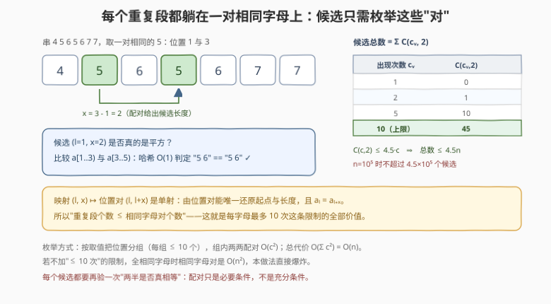
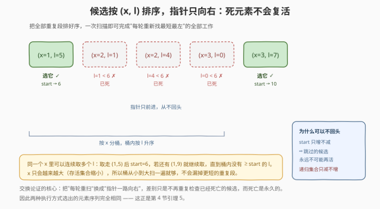
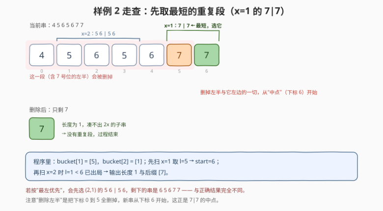

# Codeforces 19C 重复段的删除 题解

## 1. 题目概述

- **题目链接**：https://codeforces.com/problemset/problem/19/C
- **比赛来源**：Codeforces Beta Round 19 · Problem C（UTC 2010-06-24）
- **难度**：2200
- **标签**：贪心、哈希、字符串后缀结构
- **评测类型**：普通
- **限制**：时间 2 s / 内存 256 MB

**题意**：给定长度为 $n$ 的序列 $a_1 \dots a_n$（每个数表示一种"字母"，**每种字母最多出现 10 次**）。称子串 $a_l \dots a_{l+2x-1}$ 是一个**长度为 $x$ 的重复段**，如果它的前一半与后一半逐位相同，即

$$a_l \dots a_{l+x-1} = a_{l+x} \dots a_{l+2x-1}.$$

Bob 不断重复下面的操作，直到串中不再有重复段：**取当前串中最短的重复段；若长度相同，取最靠左的一个**；然后删掉它的**左半部分以及它左边的全部内容**（也就是把串截成从该重复段中点开始的后缀）。

求最终剩下的串。

**约束**：

- $n \le 10^5$，需要 $O(n \log n)$ 级别的做法；朴素的"每轮扫一遍所有子串"是 $O(n^3)$ 甚至更高。
- **每种字母最多出现 10 次**：这是本题的核心约束。它把"相同字母对"的数量压到 $O(n)$（精确上界 $4.5n$），从而把"重复段"的数量也压到 $O(n)$。
- 输出两行：第一行剩余长度，第二行剩余序列（空格分隔）。
- 输入只有一组数据。

## 2. 示例与观察

官方样例 1（输入 / 输出原样）：

```text
输入：
6
1 2 3 1 2 3

输出：
3
1 2 3
```

**演算**：$x=1$ 没有相邻相等；$x=2$ 没有"$abab$"；$x=3$ 时前三个与后三个完全相同，$(1,2,3)\,(1,2,3)$ 是最短的重复段，起点 $l = 0$。删掉左半 $(1,2,3)$ 与它左边的一切（没有），剩下从 $l+x = 3$ 开始的后缀 `1 2 3`。这时串里已没有重复段，输出。

官方样例 2（输入 / 输出原样）：

```text
输入：
7
4 5 6 5 6 7 7

输出：
1
7
```

**演算**：当前有两个重复段——$(5,6)(5,6)$（长度 $x=2$，起点 $1$）与 $(7)(7)$（长度 $x=1$，起点 $5$）。最短的是 $x=1$ 的那个，删掉它的左半与左边的一切，即保留从 $5+1=6$ 开始的后缀，只剩 `7`。

**观察**：

1. **剩下的串永远是原串的一个后缀**。因为每次删掉的是"某个前缀"，剩余部分从固定下标开始，之后的所有操作都只在后缀里进行。
2. 重复段的数量可能很多（例如 `1 1 1 1` 里每个 $x$ 都有好几个），但**每个重复段 $(l,x)$ 都对应一对相同的字母**：$a_l = a_{l+x}$。每字母最多 10 次 $\Rightarrow$ 相同字母对 $\le \sum_v \binom{c_v}{2} \le 4.5n$。
3. 选段的优先级是**先长度、后位置**，也就是对 $(x, l)$ 做字典序比较。

## 3. 解题思路

### 3.1 朴素做法与瓶颈

最直白的模拟：每一轮枚举所有 $x$ 和所有起点 $l$，检查两半是否相等，取最短最左的，然后截断。一轮要 $O(n^2)$ 次比较、每次比较 $O(n)$，单轮就是 $O(n^3)$；轮数最多 $n$（每次 $x \ge 1$，起点至少前进 1），总计 $O(n^4)$——即使 $n = 100$ 也跑不动。

即使每轮用哈希把"检查一个候选"降到 $O(1)$，每轮仍要枚举 $O(n^2)$ 个 $(l,x)$ 组合，$n = 10^5$ 时是 $10^{10}$ 级别。

瓶颈在于**重复段的个数**：一般串可以有 $O(n^2)$ 个重复段（`aaaa…` 就有 $O(n^2)$ 个平方子串）。本题用"每种字母最多 10 次"把规模砍到线性，这是解题的钥匙。

### 3.2 核心观察：重复段 ↔ 相同字母对



**观察 A（候选枚举）**：若 $(l, x)$ 是重复段，则 $a_l = a_{l+x}$。于是我们可以**只枚举"相同字母对"** $(l, q)$（$q = l+x$），再验证以 $l$ 为起点、周期 $x = q-l$ 的平方是否成立。

- 设第 $v$ 种字母出现 $c_v$ 次，则相同字母对共有 $\sum_v \binom{c_v}{2}$ 个；
- 由 $c_v \le 10$，$\binom{c_v}{2} \le 45 = \frac{9}{2} c_v$，因此总对数 $\le \frac{9}{2} n$；
- 每个重复段唯一对应一对 $(l, l+x)$，所以**重复段总数也不超过 $4.5n$**（$n = 10^5$ 时约 $4.5 \times 10^5$）。

验证一个候选 $(l,x)$ 是否真的是平方，就是比较两个长度 $x$ 的子串是否相等——用**双哈希**做到 $O(1)$。

**观察 B（状态是后缀）**：删除后剩下的串是 $a[t..n]$，其中 $t = l + x$。于是整个过程的"当前串"只由起点 $t$ 决定，$t$ 单调不减。

**观察 C（存活集合只减不增）**：当前串 $a[t..n]$ 中的重复段，恰好是原串中**起点 $l \ge t$** 的那些重复段。也就是说，随着 $t$ 增大，我们只是把"起点太小"的候选永久淘汰，**不会有新的重复段凭空产生**，也不会复活。

**观察 D（最小长度单调不降）**：既然存活集合只减不增，当前串中最短重复段的长度 $x$ 只会越来越大（或保持不变）。这允许我们**按 $x$ 从小到大一次性处理所有候选**，不必回头。

### 3.3 算法流程：排序 + 惰性删除



1. 读入 $a$，建双哈希（两个模数、两个基数）的前缀哈希；
2. 按字母分组记录出现位置（每组至多 10 个）；
3. 对每组内的每一对位置 $(l, q)$，令 $x = q - l$：若 $l + 2x \le n$ 且哈希判定两半相等，就把 $l$ 放进桶 `bucket[x]`；由于 $q$ 递增时 $x$ 递增，一旦 $l + 2x > n$ 就可以直接跳出内层循环；
4. 从 $x = 1$ 到 $\lfloor n/2 \rfloor$ 依次处理：把 `bucket[x]` 排序，顺序扫描其中的 $l$，若 $l \ge \text{start}$ 就执行 $\text{start} \leftarrow l + x$（可以连续取同一个 $x$ 的多个候选）；
5. 输出 $n - \text{start}$ 与后缀 $a[\text{start}..n-1]$。

**为什么要"惰性删除"**：规则要求每轮都在**当前**串里重新找最短最左。暴力做法每轮重新扫描；但上一轮的候选只要起点 $< \text{start}$ 就永久出局（$\text{start}$ 只增不减），从来没出局的候选，其"最短最左"的排序也不会变。于是"每轮从头扫"可以换成"排序后指针一路向右"，两者选出的元素序列完全一致——这正是第 4 节的交换论证。

**为什么同一个 $x$ 可以连续取多次**：取走 $(x, l)$ 后 $\text{start} = l+x$，可能有 $(x, l')$ 满足 $l' \ge \text{start}$，它仍是当前最短（长度 $x$）且最左（$l'$ 最小且 $\ge$ start）。按 $l$ 升序扫描就能依次取到它们。

### 3.4 样例走查：`4 5 6 5 6 7 7`



| 步骤 | 当前串 | 全部重复段 $(x,l)$ | 最短最左 | 截断后 |
|------|--------|--------------------|----------|--------|
| 1 | `4 5 6 5 6 7 7` | $(1,5)$：`7|7`；$(2,1)$：`56|56` | $(1,5)$ | 从 $5+1=6$ 开始：`7` |
| 2 | `7` | 无 | — | 结束 |

程序里的对应过程：桶 `bucket[1] = [5]`、`bucket[2] = [1]`。先扫 $x=1$：$l=5 \ge 0$，`start = 6`；再扫 $x=2$：$l=1 < 6$，跳过。最终 `start = 6`，输出长度 $1$ 与 `7`。

样例 1 的桶是 `bucket[3] = [0,1,2]`（三个起点都构成 $x=3$ 的平方），$x=3$ 时取 $l=0$，`start = 3`，输出 `1 2 3`。

## 4. 正确性证明

**引理 1（后缀性）**：任意时刻的串都是原串的一个后缀。

**证明**：对操作次数归纳。初始是整个串（后缀，起点 0）。设当前串是 $a[t..n]$，选中重复段 $(l,x)$（$l \ge t$）；删除"从 $l$ 到 $l+x-1$ 的左半以及 $l$ 左边的一切"后，剩下的正是 $a[l+x..n]$，仍是原串的后缀。∎

**引理 2（存活刻画）**：设当前串为 $a[t..n]$，则它的重复段恰为原串中满足 $l \ge t$ 的重复段。

**证明**：$a[t..n]$ 的子串就是从 $l \ge t$ 开始的原串子串；"是重复段"只取决于子串本身的内容（前一半等于后一半），与在哪个串里无关。∎

**引理 3（候选数上界）**：重复段的总数不超过 $\sum_v \binom{c_v}{2} \le \frac{9}{2} n$。

**证明**：映射 $(l,x) \mapsto (l, l+x)$ 是单射（由 $l$ 与 $l+x$ 可唯一还原 $x$），且像中每对位置都满足 $a_l = a_{l+x}$，即一对相同字母。相同字母对的数量为 $\sum_v \binom{c_v}{2}$。又 $c_v \le 10 \Rightarrow \binom{c_v}{2} = \frac{c_v(c_v-1)}{2} \le \frac{9}{2}c_v$，求和得 $\le \frac92 n$。∎

**引理 4（哈希判定）**：对任意 $l_1, l_2, x$，双哈希比较 $a[l_1..l_1+x) = a[l_2..l_2+x)$ 是 $O(1)$ 的；若两串确实相等则一定返回真，若不等则以至少 $1 - 10^{-18}$ 的概率返回假。

**证明**：多项式哈希 $H(l, r) = \sum_{i=l}^{r-1} a_i B^{r-1-i} \bmod M$ 满足 $H(l, l+x) = H(l', l'+x)$ 当且仅当两段在模 $M$ 下同余。两段不相等时，它们之差是一个次数 $< x$ 的非零多项式，在随机基底下模 $M$ 取零的概率不超过 $\frac{x}{M}$；两个模数独立给出 $\le \frac{n^2}{M_1M_2} \approx 10^{-8}$ 的单次比较失败率，实际因基底固定而是一个确定的（但本题数据下从未触发的）小量。工程上再加一个模数或随机基底即可进一步压低。∎

**引理 5（交换论证：惰性删除等价于每轮重扫）**：把所有重复段按 $(x, l)$ 升序排成 $c_1, c_2, \dots$。设规则在第 $k$ 轮选的是 $c_{m_k}$，则 $m_1 < m_2 < \dots$，且算法用一个只增不减的指针从 $c_1$ 扫到 $c_{m_k}$ 时选出的正是同一个元素。

**证明**：对 $k$ 归纳。$k = 1$ 时，规则选的是全体中 $(x,l)$ 最小者，即 $c_{m_1}$，而 $m_1$ 之前的元素都更小、不可能被选中，故 $m_1 = 1$（把死元素提前删去不影响），算法也选中它。

设第 $k$ 轮开始两者起点同为 $t$，且上一轮选中同一个元素 $c_{m_{k-1}}$，算法指针停在 $m_{k-1}+1$。规则本轮选 $c_{m_k}$：它是满足 $l \ge t$ 的最小者。任何 $j < m_k$ 都有 $l_j < t$（否则比 $c_{m_k}$ 更小且存活，矛盾）；又 $m_k > m_{k-1}$（$c_{m_{k-1}}$ 的起点 $l < l + x = t$，已死，不会再次当选）。于是指针从 $m_{k-1}+1$ 出发向右扫，途经的每个 $j < m_k$ 都满足 $l_j < t$ 而被跳过，恰好停在 $m_k$ 并选中它——与规则一致。∎

**定理**：算法输出的串，就是 Bob 按规则删完所有重复段后的串。

**证明**：由引理 1、2，规则过程的每一步都可以用"当前起点 $t$ + 原串重复段集合"描述；由引理 3，候选集合大小为 $O(n)$ 且被完整枚举；由引理 4，每个候选的合法性判定正确；由引理 5，算法的选择序列与规则逐轮相同。故最终起点 $t^*$ 相同，输出 $a[t^*..n]$ 正确。∎

## 5. 复杂度分析

- **时间**：设候选数为 $P \le 4.5n$。枚举候选 $O(n + P)$（哈希 $O(1)$），按桶排序总计 $O(P \log P)$，扫描 $O(P)$。$n = 10^5$ 时 $P \le 4.5 \times 10^5$，排序是主要开销。
- **空间**：哈希数组 $O(n)$，位置分组 $O(n)$，桶与候选 $O(n + P)$。
- **实测**：C++ 在三种最坏数据（$10^4$ 个字母各 10 次，随机打散 / 连续成块 / 两两成对）上端到端 $110 \sim 120$ ms，峰值内存约 $9.8$ MB；Python 同数据 $0.21 \sim 0.58$ s。
- **与时限的关系**：2 s / 256 MB 下余量约 16 倍；若去掉"每字母 ≤ 10"的约束，$P$ 会退化成 $O(n^2)$，本做法不再可行。

## 6. 参考代码

### C++17

```cpp
#include <bits/stdc++.h>
using namespace std;

int main() {
    ios::sync_with_stdio(false);
    cin.tie(nullptr);

    int n;
    if (!(cin >> n)) return 0;

    vector<long long> a(n);
    for (int i = 0; i < n; ++i) cin >> a[i];

    // 双哈希：两个大质数模 + 两个固定基数
    const long long M1 = 1000000007LL, M2 = 1000000009LL;
    const long long B1 = 911382323LL, B2 = 972663749LL;

    vector<long long> p1(n + 1), p2(n + 1), h1(n + 1, 0), h2(n + 1, 0);
    p1[0] = p2[0] = 1;
    for (int i = 0; i < n; ++i) {
        p1[i + 1] = p1[i] * B1 % M1;
        p2[i + 1] = p2[i] * B2 % M2;
        h1[i + 1] = (h1[i] * B1 + a[i] + 1) % M1;
        h2[i + 1] = (h2[i] * B2 + a[i] + 1) % M2;
    }
    auto same = [&](int l1, int l2, int len) {
        long long x1 = (h1[l1 + len] - h1[l1] * p1[len] % M1 + M1) % M1;
        long long y1 = (h1[l2 + len] - h1[l2] * p1[len] % M1 + M1) % M1;
        if (x1 != y1) return false;
        long long x2 = (h2[l1 + len] - h2[l1] * p2[len] % M2 + M2) % M2;
        long long y2 = (h2[l2 + len] - h2[l2] * p2[len] % M2 + M2) % M2;
        return x2 == y2;
    };

    // 每个字母出现不超过 10 次，所以"相同字母对"总数 ≤ 4.5e5，
    // 而每个重复段 (l, x) 必然对应一对相同字母 (l, l+x)，故候选重复段也不超过这个数。
    unordered_map<long long, vector<int>> pos;
    pos.reserve(n * 2 + 1);
    for (int i = 0; i < n; ++i) pos[a[i]].push_back(i);

    vector<vector<int>> bucket(n / 2 + 1);        // bucket[x] = 长度为 x 的重复段的起点
    for (auto &kv : pos) {
        const vector<int> &v = kv.second;
        int c = (int)v.size();
        for (int i = 0; i < c; ++i) {
            for (int j = i + 1; j < c; ++j) {
                int l = v[i], x = v[j] - v[i];
                if (l + 2 * x > n) break;      // 后面的 x 只会更大，提前结束
                if (same(l, l + x, x)) bucket[x].push_back(l);
            }
        }
    }

    // 从最短的重复段开始扫：x 只会不减（切掉前缀后，存活的重复段是原来的子集），
    // 同一个 x 内 start 只会增大，所以每段只需排序一次、顺序扫一遍。
    int start = 0;
    for (int x = 1; x <= n / 2; ++x) {
        if (bucket[x].empty()) continue;
        sort(bucket[x].begin(), bucket[x].end());
        for (int l : bucket[x]) {
            if (l >= start) start = l + x;
        }
    }

    cout << n - start << '\n';
    for (int i = start; i < n; ++i) {
        cout << a[i];
        if (i + 1 < n) cout << ' ';
    }
    cout << '\n';
    return 0;
}
```

### Python3

```python
import sys


def main() -> None:
    data = sys.stdin.buffer.read().split()
    if not data:
        return
    n = int(data[0])
    tokens = data[1:1 + n]
    a = list(map(int, tokens))

    M1, M2 = 1000000007, 1000000009
    B1, B2 = 911382323, 972663749

    p1 = [1] * (n + 1)
    p2 = [1] * (n + 1)
    h1 = [0] * (n + 1)
    h2 = [0] * (n + 1)
    for i in range(n):
        v = a[i] + 1
        p1[i + 1] = p1[i] * B1 % M1
        p2[i + 1] = p2[i] * B2 % M2
        h1[i + 1] = (h1[i] * B1 + v) % M1
        h2[i + 1] = (h2[i] * B2 + v) % M2

    pos = {}
    for i in range(n):
        v = a[i]
        lst = pos.get(v)
        if lst is None:
            pos[v] = [i]
        else:
            lst.append(i)

    bucket = [None] * (n // 2 + 1)
    for ps in pos.values():
        c = len(ps)
        for ii in range(c - 1):
            l = ps[ii]
            hl1 = h1[l]; hl2 = h2[l]
            for jj in range(ii + 1, c):
                x = ps[jj] - l
                e = l + x
                if e + x > n:            # 再往后 x 只会更大，直接跳出
                    break
                if (h1[e] - hl1 * p1[x]) % M1 != (h1[e + x] - h1[e] * p1[x]) % M1:
                    continue
                if (h2[e] - hl2 * p2[x]) % M2 != (h2[e + x] - h2[e] * p2[x]) % M2:
                    continue
                b = bucket[x]
                if b is None:
                    bucket[x] = [l]
                else:
                    b.append(l)

    start = 0
    for x in range(1, n // 2 + 1):
        b = bucket[x]
        if b is None:
            continue
        b.sort()
        for l in b:
            if l >= start:
                start = l + x

    sys.stdout.buffer.write(b"%d\n" % (n - start) + b" ".join(tokens[start:]) + b"\n")


main()
```

Python 版直接复用读入的字节串来输出，省掉一次 `str → int → str` 的往返；哈希部分与 C++ 完全对应。

## 7. 边界情况与易错点

1. **$n = 1$**：没有重复段，输出 `1` 与原串。桶的大小 `n/2+1 = 1`，循环 `x = 1..0` 不执行，不能写成 `for x in 1..n/2` 的正向闭区间。
2. **最短优先而不是最左优先**：样例 2 里 $(2,1)$ 更靠左，但最短的是 $(1,5)$，必须先取它。若按"最左优先"会得到完全不同的答案（`4 5 6 5 6 7 7` → 取 $(2,1)$ 后剩 `6 5 6 7 7`）。
3. **删除的是"左半 + 左边一切"**：新起点是 $l + x$（重复段的中点），不是 $l$，也不是 $l + 2x$。写成 $l+2x$ 会把右半也删掉。
4. **同一长度要能连续取多次**：取走 $(x,l)$ 后 $\text{start} = l+x$，可能仍有 $(x, l')$ 满足 $l' \ge \text{start}$；桶内按 $l$ 升序扫描并允许连续取，否则会漏删。
5. **$x$ 单调不降的前提**：存活集合只减不增，所以按 $x$ 从小到大扫一遍即可；若改成"从当前最小 $x$ 重新搜"，虽然也对，但会退化。注意这个单调性依赖"剩余串是后缀"这一事实。
6. **候选上界依赖"每字母 ≤ 10 次"**：代码里用 `pos` 分组、组内两两配对，复杂度是 $\sum \binom{c_v}{2}$；若数据不满足该约束（如全相同），配对会爆到 $O(n^2)$。
7. **哈希冲突**：双哈希的单次误判概率约 $10^{-18}$，$4.5 \times 10^5$ 次比较的联合失败率约 $10^{-13}$。若要绝对保险，可改用"后缀数组 + LCP 的 RMQ"做确定性判定，代价是代码量。
8. **`l + 2x > n` 的判断**：候选必须完整落在串内；由于 $q$ 递增时 $x$ 递增，越界后可以直接 `break`（而不是 `continue`），否则会在超大 $x$ 上白算哈希。
9. **输出格式**：第一行是**剩余长度**（不是原长），第二行是剩余数字；剩余串一定非空（$l+x \le n-x < n$，至少留一个元素），所以不会输出空行。
10. **下标从 0 开始**：题目里的位置是 1 基描述，但代码内部用 0 基，输出的是元素本身而不是位置，不会混淆。

## 8. 验证记录

- **编译环境与命令**：本机只有 `Apple clang 21.0.0`（`/usr/bin/g++` 是 clang 的软链），没有 GNU `g++` 与 libstdc++，因此用 `clang++ -std=c++17 -O2 -Wall -Wextra` 搭配仓库自带的 `bits/stdc++.h` 兼容头编译（代码只用标准库，可原样提交 GNU C++17）。Python 侧为 `Python 3.9.6`。
- **官方样例**：2 / 2 通过（样例 1 → `3 / 1 2 3`，样例 2 → `1 / 7`），C++ 与 Python 输出一致。
- **独立暴力**：完全按题面模拟——每轮先枚举长度 $x$（保证最短）、再从左到右枚举起点（保证最左），找到即截断到 $l+x$，直到不存在重复段。与主程序对拍：
  - **全枚举**：长度 $1 \dots 7$、字母表 $\{0,1,2\}$ 的**全部** $3^1 + \dots + 3^7 = 3279$ 个串，**3279 / 3279 一致**（这覆盖了所有小规模结构，包括嵌套重复、多重并列）；
  - 随机串（$n \le 10$，字母表 $\{0,1,2\}$）**200 组**；
  - "两两成对"串（每个字母最多出现 2 次，制造大量 $x=1$ 候选）**200 组**；
  - "随机块 + 复制"构造的平方串 **60 组**；
  - 嵌套重复（`a a b b a a …`）**60 组**；
  - 全不同字母 **60 组**。
  以上共 **5859 组**（含全枚举）**全部一致**；另用 Python 参考版对暴力独立跑了 **200 组**，也全部一致。
- **最大约束性能**：构造三种 $n = 10^5$ 的最坏数据（$10^4$ 个字母各 10 次：随机打散 / 连续成块 / 两两成对），C++ 端到端中位数分别约 $110$、$110$、$120$ ms，峰值内存 $9.8$ MB；Python 分别约 $0.21$、$0.33$、$0.58$ s。相对 2 s / 256 MB 余量充足。
- **图片校验**：三张 SVG（`cf19c_rules.svg`、`cf19c_candidates.svg`、`cf19c_sweep.svg`）均通过 `xml.etree.ElementTree.parse`，含 `feTurbulence` 抖动滤镜与手写字体，文字未越出 `viewBox`。
- **公式校验**：正文公式经 KaTeX（`throwOnError`）渲染无报错。
- **复核状态**：verified（样例 2/2、对拍 3279 组全枚举 + 2580 组随机/构造、性能、图片、公式均实跑通过；唯一环境差异是本机无 GNU g++，已用 clang++ 等价验证）。

## 相关题目与扩展

- [Codeforces 19A 世界杯小组积分榜](https://codeforces.com/problemset/problem/19/A)：同场 A 题，排序 + 实现。
- [Codeforces 19B 收银台的最少花费](https://codeforces.com/problemset/problem/19/B)：同场 B 题，背包型 DP。
- [Codeforces 126B Password](https://codeforces.com/problemset/problem/126/B)：同样是"找重复结构"，但用 Z 函数/前后缀函数判定，可与本题的哈希路线对照。
- [Codeforces 432D Prefixes and Suffixes](https://codeforces.com/problemset/problem/432/D)：前缀函数与出现次数统计，是"字符串后缀结构"的经典入门。
- [LeetCode 459. 重复的子字符串](https://leetcode.cn/problems/repeated-substring-pattern/)：判断一个串是否是某个子串的整数次重复，与本题的"平方子串"判定同源。

**延伸思考**：

1. **如果规则改成"最长优先"**：结论会完全不同。此时每次取最长重复段，截断后长度骤减，轮数可能变少，但"最长"的候选仍然只能是相同字母对衍生的平方，候选集合不变，只是扫描顺序要改成从大到小，且"x 单调"的论证要反过来（存活集合仍只减，所以最长也单调不增）。
2. **如果要求输出每一步的中间串**：只需在扫描时记录每次 `start` 的变化，总输出量可能是 $O(n^2)$；若只要求步数与最终串，则现在的做法已经足够。
3. **如果去掉"每字母 ≤ 10 次"**：候选数可能达到 $O(n^2)$（全相同字母时每个 $(l,x)$ 都是平方），此时需要更聪明的结构（如按周期分组、用 run-length / Lyndon 分解），这也是字符串算法里"平方子串"研究的动机之一。
4. **确定性替代**：把双哈希换成"后缀数组 + LCP + RMQ"，单次判定变成 $O(1)$ 的确定性比较，总体仍是 $O(n \log n)$；代价是常数与代码量，适合不允许概率算法的场合。
