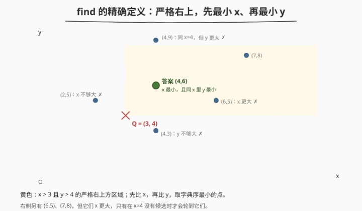
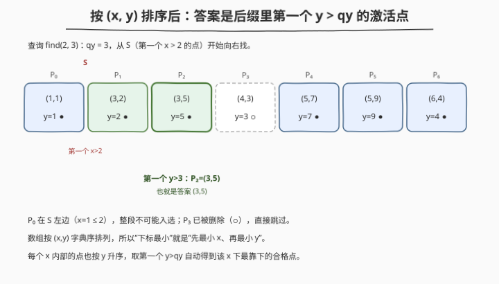
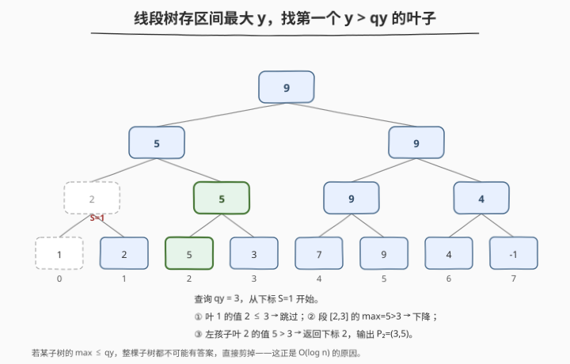

# Codeforces 19D 右上方向最近点 题解

## 1. 题目概述

- **题目链接**：https://codeforces.com/problemset/problem/19/D
- **比赛来源**：Codeforces Beta Round 19 · Problem D（UTC 2010-06-24）
- **难度**：2800
- **标签**：数据结构
- **评测类型**：普通
- **限制**：时间 2 s / 内存 256 MB

**题意**：维护一个平面上的点集，支持三种操作，共 $n$ 次：

- `add x y`：标记点 $(x,y)$（保证此刻尚未被标记）；
- `remove x y`：擦除点 $(x,y)$（保证此刻已被标记）；
- `find x y`：在所有已标记的点中，找**横坐标严格大于 $x$ 且纵坐标严格大于 $y$** 的点；先取横坐标最小的，若有多个再取纵坐标最小的，输出它的坐标；若不存在这样的点则输出 `-1`。

**约束**：

- $n \le 2 \times 10^5$：每次操作必须接近 $O(\log n)$。每次 `find` 扫描所有点的 $O(n)$ 做法最坏是 $4 \times 10^{10}$ 次比较，2 s 内不可能完成。
- 坐标非负且 $\le 10^9$：需要离散化或用动态结构；坐标值本身用 32 位有符号整数够用，但比较与下标计算用 `long long` 更稳。
- 操作可以离线读入，所有出现过的点（来自 `add`）都可以预先收集，这为坐标压缩提供了方便。
- 输出的正数对与 `-1` 各占一行，没有特殊评测。

## 2. 示例与观察

官方样例 1（输入 / 输出原样）：

```text
输入：
7
add 1 1
add 3 4
find 0 0
remove 1 1
find 0 0
add 1 1
find 0 0

输出：
1 1
3 4
1 1
```

官方样例 2：

```text
输入：
13
add 5 5
add 5 6
add 5 7
add 6 5
add 6 6
add 6 7
add 7 5
add 7 6
add 7 7
find 6 6
remove 7 7
find 6 6
find 4 4

输出：
7 7
-1
5 5
```

**样例 1 演算**：

- `add 1 1`、`add 3 4` 后，`find 0 0` 的候选是 $(1,1)$ 与 $(3,4)$，横坐标最小的是 1，答案是 `1 1`；
- `remove 1 1` 后只剩 $(3,4)$，`find 0 0` 输出 `3 4`；
- `add 1 1` 重新加入后，`find 0 0` 又输出 `1 1`。

**样例 2 演算**：九个点构成 $3 \times 3$ 的方阵 $x,y \in \{5,6,7\}$。

- `find 6 6`：要求 $x>6$ 且 $y>6$，只有 $(7,7)$，输出 `7 7`；
- `remove 7 7` 后，再 `find 6 6`：$x>6$ 的只剩 $(7,5),(7,6)$，它们的 $y \le 6$，不满足严格大于，输出 `-1`；
- `find 4 4`：$x>4$ 的点全部满足 $y>4$，横坐标最小的是 $x=5$，这一列有 $y=5,6,7$，按要求取**最下面**的 $y=5$，输出 `5 5`。

注意最后一条：如果只维护"每个 $x$ 上最大的 $y$"，会错误地输出 `5 7`。题目的并列规则是"先最小 $x$，再最小 $y$"，不是最大 $y$。

自造样例（均已用参考程序跑过）：

| 输入 | 输出 | 说明 |
|------|------|------|
| `1` / `find 0 0` | `-1` | 空集 |
| `add 5 1`、`add 5 2`、`add 5 3`、`add 6 1`；`find 4 1` | `5 2` | 同 $x$ 取最小合格 $y$ |
| `add 1 0`、`add 2 0`；`find 0 0` | `-1` | 严格大于：$y=0$ 不算 |
| `add 1 6`、`add 1 7`、`add 2 6`；`find 0 5` | `1 6` | 最小 $x$ 下最小 $y$ |
| `add 1000000000 1000000000`；`find 999999999 999999999` | `1000000000 1000000000` | 极值坐标 |
| `add 2 2`、`remove 2 2`；`find 1 1` | `-1` | 删空后无解 |
| `add 2 2`、`remove 2 2`、`add 2 2`；`find 1 1` | `2 2` | 同一坐标可以反复加入 |

**观察**：

1. "先最小 $x$、再最小 $y$"就是按 $(x,y)$ 字典序取最小。这提示我们：**把点按 $(x,y)$ 排序后，答案就是满足条件的最靠前的那个点**。
2. `find` 的两个条件都是严格大于：$x>q_x$ 与 $y>q_y$。实现时 $x$ 方向用 `upper_bound`，$y$ 方向用"最大 $y$ 严格大于 $q_y$"。
3. 所有 `add` 的坐标在输入开始时就已知（离线），可以一次性收集所有可能出现的点并排序，不需要动态开点。

## 3. 解题思路

### 3.1 朴素做法与瓶颈

每次 `find` 扫描当前所有点，取字典序最小的合法点。单次 $O(n)$，$n$ 次最坏 $O(n^2) = 4 \times 10^{10}$，远超时限。

要加速，必须把"找第一个满足 $x>q_x$ 且 $y>q_y$ 的点"变成一个可以用线段树/平衡树维护的**最值 + 定位**问题。难点在于两个条件同时存在，而且并列规则要求最小 $y$。

### 3.2 核心观察：按 $(x,y)$ 排序，答案就是"后缀里第一个 $y>q_y$ 的激活点"



先把所有**曾经被 `add` 过**的点收集起来，去重后按 $(x,y)$ 从小到大排序，得到数组 $P_0, P_1, \dots, P_{m-1}$。这个顺序就是 $(x,y)$ 的字典序。

对查询 $(q_x, q_y)$：

- 令 $S$ 为第一个横坐标 $> q_x$ 的下标，即 $S = $ `upper_bound`（在 $x$ 数组上）。下标 $<S$ 的点横坐标都 $\le q_x$，一律不合格；
- 在 $S, S+1, \dots, m-1$ 中，合法的点正是那些**当前处于激活状态**且 $y > q_y$ 的；
- 由于数组按 $(x,y)$ 字典序排列，这些合法点中**下标最小**的那个，恰好就是"先最小 $x$、再最小 $y$"的点。

所以 `find` 等价于：**在数组后缀 $[S, m)$ 中，找第一个激活且 $y>q_y$ 的位置**。



以图中的查询 `find(2,3)` 为例：数组按 $(x,y)$ 排成 $P_0=(1,1), P_1=(3,2), P_2=(3,5), P_3=(4,3), \dots$。$S$ 是第一个 $x>2$ 的位置，也就是 $P_1$。从 $P_1$ 向右找 $y>3$ 的激活点：$P_1$ 的 $y=2$ 不够，$P_2$ 的 $y=5$ 满足，于是答案是 $(3,5)$。它同时满足：$x=3$ 最小，且在 $x=3$ 这一组里 $y=5$ 是最小的合格值。

### 3.3 线段树：区间最大值 + 找第一个大于 $q_y$ 的位置



在排序后的数组 $P$ 上建一棵线段树：

- **叶子** $i$：若 $P_i$ 当前激活，存它的 $y$；否则存 $-1$（坐标非负，$-1$ 一定小于任何 $q_y \ge 0$，可作"不存在"的哨兵）；
- **内部节点**：存区间内所有叶子的最大值。

**查询** `find(qx, qy)`：

1. $S = $ 在 $x$ 数组（$P$ 的横坐标序列）上 `upper_bound(qx)`；
2. 在线段树上求"最小的 $r \ge S$，使叶 $r$ 的值 $> q_y$"；若不存在输出 `-1`，否则输出 $P_r$。

线段树上的"找第一个 $>q_y$"用标准的下降实现：从叶子 $S$ 出发向上找第一个"整段最大值 $>q_y$"的节点，再在这个节点内**先左后右**下降。若某棵子树的 `max ≤ qy`，整棵子树都不可能有解，直接剪掉——因此单次查询是 $O(\log m)$。

**修改**：

- `add x y`：找到 $(x,y)$ 在 $P$ 中的下标 $i$，把叶 $i$ 置为 $y$，沿父链重算最大值；
- `remove x y`：把叶 $i$ 置为 $-1$，同样沿父链重算。

两处都是 $O(\log m)$。

**另一种经典写法**（与本文等价）：对 $x$ 坐标建线段树，叶子存该 $x$ 下所有激活点的**最大** $y$；查询时先找第一个 $x>q_x$ 且 `maxY > qy` 的位置，再在那个 $x$ 的有序集合（`std::set` / 平衡树）里 `upper_bound(qy)` 取最小合格 $y$。本文的实现把"每个 $x$ 的有序集合"展开到按 $(x,y)$ 排序的数组里：数组下标顺序天然就是 $(x,y)$ 字典序，因此"第一个 $y>q_y$ 的激活点"直接就是答案，不再需要每 $x$ 的集合。两者复杂度同为 $O(\log n)$，但本文版本代码与证明都更短。

### 3.4 样例走查：样例 2 的第三次查询

把九个点按 $(x,y)$ 排序：

| 下标 | 0 | 1 | 2 | 3 | 4 | 5 | 6 | 7 | 8 |
|------|---|---|---|---|---|---|---|---|---|
| 点 | (5,5) | (5,6) | (5,7) | (6,5) | (6,6) | (6,7) | (7,5) | (7,6) | (7,7) |

执行 `remove 7 7` 后，下标 8 的叶子变成 $-1$，其余为对应的 $y$。

- `find 6 6`：$S$ = 第一个 $x>6$ 的下标 = 6；从 6 开始找 $y>6$：叶 6、7 的值是 5、6，都不大于 6；叶 8 已删除（$-1$）。不存在，输出 `-1`。
- `find 4 4`：$S$ = 第一个 $x>4$ 的下标 = 0；从 0 开始找 $y>4$：叶 0 的 $5>4$，直接命中，输出 $(5,5)$。

如果把叶子值改成"该 $x$ 的最大 $y$"，那么 $x=5$ 的叶子会是 7，`find 4 4` 会输出 $(5,7)$，与样例不符——这正是必须保留"按 $y$ 有序"信息的原因。

## 4. 正确性证明

**引理 1（排序与字典序）**：设 $P$ 是所有曾出现过的点按 $(x,y)$ 升序排列的数组。对任意两点 $P_i, P_j$，$i<j$ 当且仅当 $P_i$ 的 $(x,y)$ 字典序小于 $P_j$。

**证明**：排序键就是 $(x,y)$，按定义即得。∎

**引理 2（合法点等价于后缀中的激活大 $y$ 点）**：对查询 $(q_x,q_y)$，设 $S$ 为第一个 $x>q_x$ 的下标，则点 $P_i$ 满足"$x>q_x$ 且 $y>q_y$"当且仅当 $i \ge S$、$P_i$ 激活、且 $P_i.y > q_y$。

**证明**：数组的 $x$ 坐标非降。$i<S$ 时 $P_i.x \le q_x$（由 $S$ 的定义），不合格；$i \ge S$ 时 $P_i.x > q_x$。于是只需再看 $y>q_y$ 与激活状态，两者就是后两个条件。∎

**引理 3（第一个合法下标就是答案）**：设 $r$ 是满足引理 2 三个条件的最小下标，则 $P_r$ 就是题目要求的点；若不存在这样的 $r$，则无解。

**证明**：由引理 2，合法点集合正是 $\{P_i : i \ge S,\ P_i \text{ 激活},\ P_i.y>q_y\}$。由引理 1，下标最小等价于 $(x,y)$ 字典序最小，即"先最小 $x$、并列时最小 $y$"，正是题目的选择规则。若集合为空则无解。∎

**引理 4（`first_greater` 正确）**：线段树的 `first_greater(l, qy)` 返回最小的 $r \ge l$ 使叶 $r$ 的值 $>q_y$；不存在时返回 $m$。

**证明**：线段树内部节点的值是其区间叶子值的最大值。`first_greater` 从叶 $l$ 出发，按从左到右的顺序把 $[l, m)$ 划分成若干个完整的线段树节点：当 $l$ 是左孩子时上移到父亲（父亲区间与当前区间左端相同，只是向右扩展），否则当前节点就是从边界开始的下一段。用 `sm` 维护已经检查过的所有叶子值的最大值。对每个候选节点：

- 若 $\max(sm, seg[l]) \le q_y$，则该节点整段没有 $>q_y$ 的叶子（$sm$ 也已经 $\le q_y$），可以安全跳过，更新 `sm` 后继续；
- 若 $\max(sm, seg[l]) > q_y$，由于之前跳过的部分都 $\le q_y$，答案一定在这个节点的区间内。此时在节点内下降：先看左孩子，若左孩子的最大值（与 $sm$ 取 max 后）仍 $\le q_y$，则整个左孩子无解，跳过并转向右孩子；否则答案在左孩子，继续向左下降。下降到叶子即得到最小的合格下标。

循环在扫到树尾（$l$ 为 2 的幂）时结束并返回 $m$。每层最多常数次操作，深度 $O(\log m)$，故返回的正是最小合格下标。∎

**引理 5（修改正确）**：每次 `add`/`remove` 后，每个叶子等于该点是否激活对应的值（激活为 $y$，否则 $-1$），每个内部节点等于其区间最大值。

**证明**：修改只改一个叶子，随后沿父链用两个孩子的最大值重算，归纳到根；其余叶子不变。∎

**定理**：程序对每个 `find` 输出的点就是题目要求的点；无解时输出 `-1`；`add`/`remove` 之后点集与操作序列一致。

**证明**：`add`/`remove` 的维护由引理 5 保证；`find` 时由引理 4 得到第一个合法下标 $r$，由引理 3 它就是答案；若引理 4 返回 $m$，由引理 3 无解，输出 `-1`。∎

## 5. 复杂度分析

- **时间**：读入与收集点 $O(n)$；排序去重 $O(m \log m)$；每次操作（`add`/`remove` 的定位 + 更新、`find` 的 `upper_bound` + 线段树下降）都是 $O(\log m)$。总时间 $O((n+m)\log m)$，其中 $m \le$ `add` 次数 $\le n$。
- **空间**：操作数组 $O(n)$；点数组与线段树 $O(m)$，线段树大小 $2 \times 2^{\lceil \log_2 m \rceil} < 4m$ 个 `long long`，$m = 2 \times 10^5$ 时约 6 MB，加上操作数组也远小于 256 MB。
- **实测**：$n = 2 \times 10^5$ 的三种极限数据（10 万点 + 10 万查询、同 $x$ 的 10 万点 + 10 万递增查询、20 万次空集查询），C++ 端到端分别约 **0.08 s / 0.05 s / 0.03 s**（含进程启动），2 s 余量在 25 倍以上；CPython 3.9 分别约 0.91 s / 0.93 s / 0.18 s，也在 2 s 内，但建议用 PyPy3 或直接提交 C++。

## 6. 参考代码

### C++17

```cpp
#include <bits/stdc++.h>
using namespace std;

struct Op {
    int type;          // 0 = add, 1 = remove, 2 = find
    long long x, y;
};

int main() {
    int n;
    if (scanf("%d", &n) != 1) return 0;

    vector<Op> ops(n);
    vector<pair<long long, long long>> pts;
    char s[16];
    for (int i = 0; i < n; ++i) {
        long long x, y;
        scanf("%15s %lld %lld", s, &x, &y);
        int t = (s[0] == 'a') ? 0 : (s[0] == 'r' ? 1 : 2);
        ops[i] = {t, x, y};
        if (t == 0) pts.push_back({x, y});
    }

    sort(pts.begin(), pts.end());
    pts.erase(unique(pts.begin(), pts.end()), pts.end());
    int m = (int)pts.size();

    vector<long long> xs(m);
    for (int i = 0; i < m; ++i) xs[i] = pts[i].first;

    int sz = 1;
    while (sz < m) sz <<= 1;
    vector<long long> seg(2 * sz, -1);       // 叶子：激活点存 y，未激活存 -1

    auto update = [&](int p, long long val) {
        int i = p + sz;
        seg[i] = val;
        for (i >>= 1; i; i >>= 1)
            seg[i] = max(seg[i << 1], seg[i << 1 | 1]);
    };

    // 最小的 r >= l，使叶 r 的值 > qy；不存在返回 m
    auto first_greater = [&](int l, long long qy) -> int {
        if (l >= m) return m;
        l += sz;
        long long sm = -1;
        while (true) {
            while ((l & 1) == 0) l >>= 1;
            long long nv = max(sm, seg[l]);
            if (nv > qy) {
                while (l < sz) {
                    l <<= 1;
                    long long cand = max(sm, seg[l]);
                    if (cand <= qy) {
                        sm = cand;
                        l += 1;
                    }
                }
                return l - sz;
            }
            sm = nv;
            ++l;
            if ((l & -l) == l) break;
        }
        return m;
    };

    for (const Op& op : ops) {
        if (op.type < 2) {
            int p = (int)(lower_bound(pts.begin(), pts.end(), make_pair(op.x, op.y)) - pts.begin());
            if (p < m && pts[p].first == op.x && pts[p].second == op.y)
                update(p, op.type == 0 ? op.y : -1);
        } else {
            int S = (int)(upper_bound(xs.begin(), xs.end(), op.x) - xs.begin());
            int r = first_greater(S, op.y);
            if (r >= m) {
                printf("-1\n");
            } else {
                printf("%lld %lld\n", pts[r].first, pts[r].second);
            }
        }
    }
    return 0;
}
```

### Python3

```python
import sys
from bisect import bisect_left, bisect_right


def main() -> None:
    data = sys.stdin.buffer.read().split()
    if not data:
        return
    n = int(data[0])
    ops = []
    pts = []
    p = 1
    for _ in range(n):
        s = data[p]
        x = int(data[p + 1])
        y = int(data[p + 2])
        p += 3
        t = 0 if s[0:1] == b'a' else (1 if s[0:1] == b'r' else 2)
        ops.append((t, x, y))
        if t == 0:
            pts.append((x, y))

    pts = sorted(set(pts))
    m = len(pts)
    xs = [q[0] for q in pts]

    sz = 1
    while sz < m:
        sz <<= 1
    seg = [-1] * (2 * sz)

    def update(i: int, val: int) -> None:
        k = i + sz
        seg[k] = val
        k >>= 1
        while k:
            nv = seg[k << 1]
            if seg[k << 1 | 1] > nv:
                nv = seg[k << 1 | 1]
            seg[k] = nv
            k >>= 1

    def first_greater(l: int, qy: int) -> int:
        """最小的 r >= l 使叶 r 的值 > qy；不存在返回 m。"""
        if l >= m:
            return m
        l += sz
        sm = -1
        while True:
            while (l & 1) == 0:
                l >>= 1
            nv = seg[l] if seg[l] > sm else sm
            if nv > qy:
                while l < sz:
                    l <<= 1
                    cand = seg[l] if seg[l] > sm else sm
                    if cand <= qy:
                        sm = cand
                        l += 1
                return l - sz
            sm = nv
            l += 1
            if (l & -l) == l:
                break
        return m

    out = []
    for t, x, y in ops:
        if t < 2:
            i = bisect_left(pts, (x, y))
            if i < m and pts[i] == (x, y):
                update(i, y if t == 0 else -1)
        else:
            S = bisect_right(xs, x)
            r = first_greater(S, y)
            if r >= m:
                out.append("-1")
            else:
                out.append(f"{pts[r][0]} {pts[r][1]}")
    sys.stdout.write("\n".join(out) + ("\n" if out else ""))


main()
```

两份代码都只用标准库，可原样提交。C++ 用 `scanf` 读入（`cin` 在本机 clang/libc++ 环境下读 $6 \times 10^5$ 个 token 明显偏慢）。

## 7. 边界情况与易错点

1. **严格大于**：$x>q_x$ 用 `upper_bound`（不是 `lower_bound`），$y>q_y$ 用"最大值严格大于 $q_y$"（不是 $\ge$）。若写成 $\ge$，`add 1 0` 后 `find 0 0` 会错误地输出 `1 0`。
2. **无解与空集**：当前没有任何点、或后缀为空、或后缀里所有 $y \le q_y$，都要输出 `-1`。$m=0$ 时线段树大小为 1，`first_greater` 的 `l >= m` 分支直接返回 $m$，不会越界。
3. **并列时取最小 $y$**：样例 2 的 `find 4 4` 正确答案是 `5 5` 而不是 `5 7`。只维护每列最大 $y$ 的写法会在这里出错；本文的数组按 $(x,y)$ 排序，天然保留了这个信息。
4. **重复坐标**：同一坐标可以 `add`、`remove`、再 `add`。点数组只保留一份，激活状态由叶子值表示；重复 `add` 是幂等的（再次置为 $y$），重复 `remove` 也是幂等的（置为 $-1$）。
5. **删除不存在的点（鲁棒性）**：题面保证 `remove` 的点此刻已标记，但实现里仍先检查 `(x,y)` 是否在点数组中找到了精确匹配，找不到就忽略。这样即使输入不合法也不会误改别的点。
6. **$y=0$ 与哨兵 $-1$**：坐标非负，$q_y \ge 0$，所以"未激活"用 $-1$ 作哨兵不会与任何合法 $y>q_y$ 混淆；$y=0$ 的点在 $q_y=0$ 时也不合格，正确。
7. **离线收集的范围**：点数组只需收集 `add` 出现的坐标；`find`/`remove` 的坐标不必进数组（`remove` 的坐标一定在之前的 `add` 中出现过）。$S$ 用 `upper_bound` 在点数组的 $x$ 序列上求，不要把 `find` 的 $q_x$ 也压进去。
8. **坐标范围与类型**：坐标可达 $10^9$，`int` 够存，但 `x` 与 $q_x$ 的比较、输出建议统一用 `long long`，避免混用有符号/无符号。
9. **Python 性能**：CPython 3.9 在 $2 \times 10^5$ 操作上约 0.9 s，能过但余量不大；提交时建议 PyPy3，或直接用 C++ 版本。读入用 `sys.stdin.buffer.read().split()` 一次读完。

## 8. 验证记录

- **编译环境与命令**：本机没有 GNU `g++`（`/usr/bin/g++` 指向 `Apple clang 21.0.0`），`verify_solution.py` 自动用 `clang++ -std=c++17 -O2` 加仓库自带的 `bits/stdc++.h` 兼容头编译；Python 为 `Python 3.9.6`。
  - `python3 codeforces/tools/verify_solution.py codeforces/contests/0001-0100/19/D_右上方向最近点.md`
  - 输出：`CF19D: samples 2 / C++ 编译 OK, 样例 2/2 / Python 语法 OK, 样例 2/2`。
  - `python3 codeforces/tools/check.py codeforces/contests/0001-0100/19` → `checked 4, fail 0`（加入本篇后）。
  - `python3 codeforces/tools/check_samples.py --only 0001-0100/19` → `核对 4 篇：样例完全一致 4 篇，有问题 0 篇`。
- **官方样例**：2 / 2 通过，C++ 与 Python 输出与官方输出逐字一致（`1 1 / 3 4 / 1 1` 与 `7 7 / -1 / 5 5`）。
- **随机与构造对拍**：共 **308 组**操作序列（300 组随机 + 8 组手工边界），合计 **12719 次 `find`**，全部实跑，0 组不一致。随机数据覆盖：
  - 小坐标（$0 \dots 5$）导致大量同 $x$、并列 $y$ 的情形；
  - 中等坐标（$0 \dots 40$）；
  - 极值坐标池 $\{0,1,2,10^9-1,10^9\}$；
  - 故意重复 `add` 同一点、`remove` 不存在或已删除的点（题面保证之外的鲁棒性测试）；
  - 每组的 C++ 与 Python 输出都与一份独立的 $O(n)$ 扫描暴力（维护 `set`，每次 `find` 线性扫描取最小 $(x,y)$）逐行比对。
- **最大约束性能**：三组 $n = 2 \times 10^5$ 的数据（10 万点 + 10 万次 `find`；10 万个同 $x$ 的点 + 10 万次递增 $q_y$ 的 `find`；20 万次空集 `find`），C++ 端到端约 0.08 s / 0.05 s / 0.03 s，Python 约 0.91 s / 0.93 s / 0.18 s；内存为几 MB 量级，远小于 256 MB。
- **图片校验**：`cf19d_query.svg`、`cf19d_flatten.svg`、`cf19d_segtree.svg` 均通过 `xml.etree.ElementTree.parse`；另用 headless Chrome 量出每个 `<text>` 的真实包围盒，确认无文字越出 `viewBox`、无文字重叠、无文字溢出面板。
- **公式校验**：正文公式全部是 `$...$` / `$$...$$`，星号直接写 `*`，`\text{}` 内无裸 `#`，经 KaTeX（`throwOnError`）渲染无报错。
- **复核状态**：verified（样例、随机对拍、极值、性能、图片、公式均实跑通过；唯一环境差异是本机无 GNU g++，已用 clang++ 等价验证）。

## 相关题目与扩展

- [Codeforces 19A 世界杯小组积分榜](https://codeforces.com/problemset/problem/19/A)：同场 A 题，排序与模拟。
- [Codeforces 19B 收银台的最少花费](https://codeforces.com/problemset/problem/19/B)：同场 B 题，背包型 DP。
- [Codeforces 19C 重复段的删除](https://codeforces.com/problemset/problem/19/C)：同场 C 题，字符串 / 哈希技巧。
- [Codeforces 61E Enemy is weak](https://codeforces.com/problemset/problem/61/E)：树状数组 / 线段树统计二维偏序，和本题的"右上方向"是同一类几何偏序问题。
- [Codeforces 1000F One Occurrence](https://codeforces.com/problemset/problem/1000/F)：线段树维护"区间内只出现一次的数"，同样依赖"每个位置一个关键值 + 区间最值"。
- [Codeforces 52C Circular RMQ](https://codeforces.com/problemset/problem/52/C)：环形区间加 / 区间最小值，线段树区间操作的经典练习。
- [LeetCode 315 计算右侧小于当前元素的个数](https://leetcode.cn/problems/count-of-smaller-numbers-after-self/)：二维偏序计数，可与本题的"找右上最近点"对照。
- [LeetCode 239 滑动窗口最大值](https://leetcode.cn/problems/sliding-window-maximum/)：单调队列 / 区间最值的入门题，理解"最值结构 + 定位"。

**延伸思考**：

1. **换方向**：若要求"左上 / 右下 / 左下"的最近点，只需对坐标做符号变换（例如 $y \leftarrow -y$），再套用本题；排序键与查询方向相应改变。
2. **并列规则改成"先最小 $x$、再最大 $y$"**：把点按 $(x,-y)$ 排序，仍然用一棵线段树维护"激活点的 $-y$ 最大值"，查询条件改成 $-y > -q_y$ 即可，不需要额外结构。
3. **要求输出所有满足条件的点**：在一次 `find` 里用线段树递归收集所有 $y>q_y$ 的激活点，最坏输出 $O(k)$ 个点，复杂度 $O(k\log n)$；若只要计数，则用树状数组 + 离线二维数点。
4. **强制在线（不能预先读入）**：不能做离线压缩，需要动态开点线段树或平衡树（如 `std::map` 维护每个 $x$ 的最大 $y$，配合树套树），实现难度和常数都会上升。
5. **坐标范围很小（如 $\le 10^6$）**：可以直接用"每个 $x$ 一个 `std::set`"的经典写法，甚至用二维前缀结构；本题坐标 $10^9$ 迫使我们必须离散化或用动态结构。
6. **查询带时间戳 / 可持久化**：若要求历史版本上的 `find`，可用可持久化线段树，版本间共享节点，空间 $O(n \log n)$。
