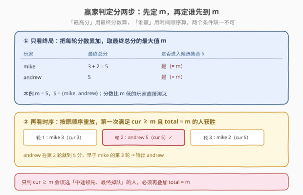
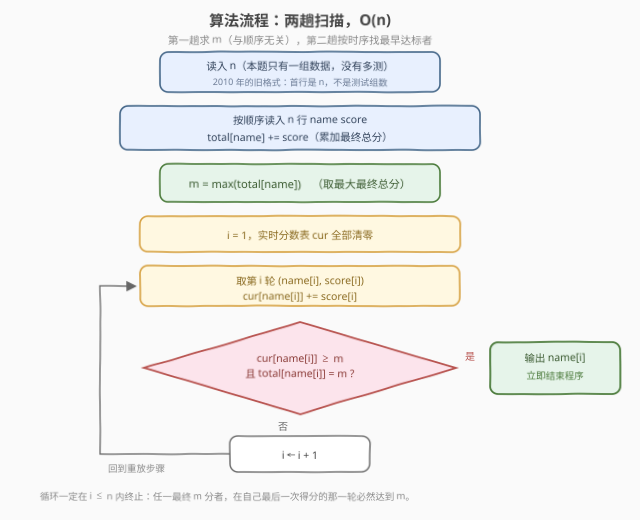
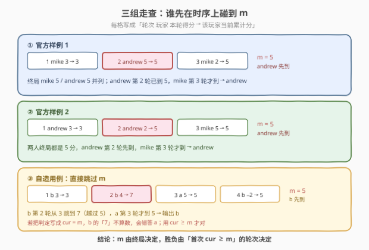

# Codeforces 2A 赢家 题解

## 1. 题目概述

- **标题 / 题号**：赢家（Codeforces 2A，英文名 Winner）
- **链接**：https://codeforces.com/problemset/problem/2/A
- **来源**：Codeforces Beta Round 2 · Problem A（2010-02-26）
- **难度**：1500（题面标注 `*1500`）
- **标签**：哈希表、模拟（hashing, implementation）
- **评测类型**：普通评测（无交互、无多解、无子任务）
- **限制**：时间 1 s / 内存 64 MB

**题意**：Berland 的纸牌游戏 "Berlogging" 按轮进行，共 $n$ 轮，第 $i$ 轮记录一个形如 `name score` 的二元组：玩家 `name` 本轮得到（或失去）`score` 分，`score` 为负表示失分。每人初始 $0$ 分，分数按轮次**实时累加**。

终局判定规则分两种情况：

1. 若终局**只有一个人**的累计分最高，他就是赢家；
2. 若有多人并列最高（设这个最高终局分为 $m$），则赢家是这些人中**最先达到「至少 $m$ 分」**的那一位。

输出赢家的名字（保证终局至少有一人的分数为正，故 $m \ge 1$）。

**约束**：

- $1 \le n \le 1000$，只有**一组**数据（2010 年的旧格式：首行就是轮数，没有多测组数 $t$，不要写 `while (t--)`）；
- 名字为 $1 \sim 32$ 个小写字母，不同玩家数 $k \le n \le 1000$；
- $-1000 \le \text{score} \le 1000$，故 $|\text{total}| \le 10^6$，32 位整数足够，但统一用 `long long` 更稳；
- 因为 $n \le 1000$，$O(n^2) = 10^6$ 的做法也能过，本题的难点**不在复杂度，而在规则的细节**：$m$ 由终局决定，胜负由时序决定，两者必须分开处理。

## 2. 示例与观察

官方样例（输入 / 输出原样）：

```text
输入：
3
mike 3
andrew 5
mike 2

输出：
andrew
```

```text
输入：
3
andrew 3
andrew 2
mike 5

输出：
andrew
```

两个样例都是「终局并列最高」，赢家都由**到达 $m$ 的先后**决定，而与终局分数无关：

| 样例 | 逐轮累计 | 终局 | $m$ | 首次达到 $m$ 的轮次 |
|---|---|---|---|---|
| 1 | mike 3；andrew 5；mike 5 | mike 5，andrew 5 | 5 | andrew 第 2 轮，mike 第 3 轮 |
| 2 | andrew 3；andrew 5；mike 5 | andrew 5，mike 5 | 5 | andrew 第 2 轮，mike 第 3 轮 |

由此得到四条观察：

1. **$m$ 只能由终局算出**：读取过程中并不知道最终最高分是多少，所以「边读边判赢家」一定错；
2. **赢家必然在终局并列最高者之中**：终局低于 $m$ 的人，即使中途一度领先也不算；
3. **判定用的是「至少 $m$ 分」**（`cur >= m`），不是「恰好 $m$ 分」（`cur == m`）——玩家可能**一步跨过** $m$；
4. **每轮至多改变一位玩家的累计分**，所以两位不同玩家的「首次达标轮次」不可能相同，答案天然唯一，不需要任何平局兜底。

为了把第 3 条坐实，自造两组【非官方】用例：

```text
输入（自造 ③：一步跨过 m）：
4
b 3
b 4
a 5
b -2

输出：
b

解释：终局 a = 5、b = 5，m = 5。b 第 2 轮从 3 直接跳到 7（越过了 5），
      比 a 第 3 轮到达 5 更早，所以 b 赢。若把判定写成 cur == m，
      b 的 7 不算「到达」，就会错答 a。
```

```text
输入（自造 ④：中途领先但终局掉队）：
4
a 5
b 4
a -2
b 1

输出：
b

解释：终局 a = 3、b = 5，m = 5。a 第 1 轮就摸到过 5 分，但终局只有 3，
      不在并列最高者之列；b 第 4 轮才到 5，却是唯一的 5 分玩家。
      若漏掉「终局分数必须等于 m」这一条件，会错答 a。
```

## 3. 解题思路

### 3.1 朴素做法与瓶颈

最直白的实现是**对每位候选者分别重放**：先汇总得到 $m$，再对每个终局分数等于 $m$ 的玩家，从头逐轮累加，找出他第一次达到 $m$ 的轮次，最后取轮次最小者。复杂度 $O(n \cdot k) \le O(n^2) = 10^6$，在 $n \le 1000$ 下完全跑得动，这也是本文对拍用的暴力。

真正的**错误**做法是另一类贪心：只维护一个「当前领先者」，每轮更新后输出领先者。反例（自造 ④）中 a 第 1 轮领先，最终却是 b 赢——领先权会来回易手，单指针无法回溯。

瓶颈在于「重复扫描」：$m$ 一旦确定，所有候选者的首次达标轮次完全可以**在同一遍重放里一次求出**，因为每轮只有一位玩家的分数在变，只需要检查这一位。于是 $O(n^2)$ 可以压到 $O(n)$。

### 3.2 核心观察：$m$ 定候选，时序定赢家



把规则翻译成算式。设

$$S = \{\, p : \text{total}_p = m \,\}, \qquad m = \max_{p} \text{total}_p$$

其中 $\text{total}_p$ 是玩家 $p$ 的终局总分。再定义 $\text{cur}_p(i)$ 为玩家 $p$ 在第 $i$ 轮结束后的累计分，以及

$$\tau_p = \min \{\, i : \text{cur}_p(i) \ge m \,\}$$

即 $p$ 第一次「至少拿到 $m$ 分」的轮次。那么题面的赢家就是

$$p^{*} = \text{使 } \tau_p \text{ 取到最小值的那个 } p \in S$$

三个要点：

- **候选集合只用终局信息**，与轮次无关，所以必须先读完所有轮次；
- **比较用 $\tau$ 而不是终局分**，终局分并列时才靠 $\tau$ 分胜负，不并列时 $\tau$ 最小者也恰好就是唯一最高分者（他终局 $= m$，且必然在自己最后一轮达标）；
- **$S$ 中任意两人的 $\tau$ 不同**：若 $\tau_p = \tau_q = i$，则第 $i$ 轮结束时 $p$、$q$ 都「刚刚」跨过 $m$，可这一轮只有一个人的分数变了，矛盾。

### 3.3 算法流程



1. 读入 $n$，随后读入全部 $n$ 条 `name score`，同时累加 `total[name] += score`，并把每轮记录存进数组（后面要重放，必须留底）；
2. 求 $m = \max\{\text{total}_p\}$，用 `long long` 的极小值初始化；
3. 清空实时表 `cur`，令 $i = 1, 2, \dots, n$ 依次重放：
   - `cur[name[i]] += score[i]`；
   - 若 `cur[name[i]] >= m` 且 `total[name[i]] == m`，输出 `name[i]` 并结束；
4. 循环必然在 $i \le n$ 内命中（见第 4 节引理 4），故不需要兜底输出。

第 3 步的两个条件缺一不可：第一个条件保证「已经拿到至少 $m$ 分」，第二个条件保证「最终仍是 $m$ 分、属于并列最高者」。

### 3.4 样例走查



| 用例 | 轮次序列（玩家 本轮得分 → 该玩家累计） | 终局 / $m$ | 首次达标 | 输出 |
|---|---|---|---|---|
| 官方 1 | mike 3 → 3；andrew 5 → 5；mike 2 → 5 | mike 5、andrew 5 / 5 | andrew 第 2 轮 | andrew |
| 官方 2 | andrew 3 → 3；andrew 2 → 5；mike 5 → 5 | andrew 5、mike 5 / 5 | andrew 第 2 轮 | andrew |
| 自造 ③ | b 3 → 3；b 4 → 7；a 5 → 5；b −2 → 5 | a 5、b 5 / 5 | b 第 2 轮（跨过 5） | b |
| 自造 ④ | a 5 → 5；b 4 → 4；a −2 → 3；b 1 → 5 | a 3、b 5 / 5 | b 第 4 轮 | b |

第 3 行说明「$\ge$」不可写成「$=$」，第 4 行说明「终局 $= m$」不可省略：两次错误都只差一个符号，却给出相反答案。

### 3.5 算法细节

1. **必须两趟**：$m$ 依赖全部输入，所以不能用「边读边判」的在线写法；把 $n$ 条记录存进 `vector<string>` 与 `vector<int>`，第二趟重放。空间 $O(n)$，$n \le 1000$ 可忽略。
2. **哈希表选择**：`unordered_map<string, long long>`，名字总数 $k \le 1000$；`reserve(2n + 8)` 避免反复 rehash。用 `map` 也能过（$O(n \log n)$），但没必要。
3. **$m$ 的初值**：用 `LLONG_MIN`（Python 用 `-10**18`），不要用 $0$。题面保证终局至少一人为正，所以 $0$ 在本数据范围内也不会错，但那是**依赖题面巧合**的写法，改动数据范围就会翻车。
4. **`cur` 的默认值就是 $0$**：哈希表里没出现过的键取 $0$，恰好符合「每人初始 $0$ 分」；C++ 用 `cur[name] += x` 即可自动建键，Python 用 `dict.get(name, 0)`。
5. **判定顺序**：先 `cur >= m` 再 `total == m`，两者都要；`cur` 会随重放变化，`total` 是常量，别把两者搞混。
6. **命中即 `break`**：一旦输出就结束，不要继续扫描后面轮次；`break` 只跳出重放循环，程序随即 `return 0`。
7. **输出格式**：只输出名字加一个换行，前后不要空格、不要多余提示。
8. **数值**：`total` 与 `cur` 用 `long long`（$|\text{total}| \le 10^6$，`int` 其实够），`m` 也是 `long long`；Python 无溢出问题。

## 4. 正确性证明

**引理 1（候选集合非空且赢家在其中）**：$S = \{p : \text{total}_p = m\}$ 非空；题面定义的赢家必属于 $S$。

**证明**：$m$ 是有限集 $\{\text{total}_p\}$ 上的最大值，故至少有一个 $p$ 取到 $m$，$S \ne \varnothing$。若终局最高分唯一，则该唯一玩家终局为 $m$，属于 $S$；若并列，题面规定从并列最高者（即终局 $= m$ 者）中选，同样属于 $S$。终局小于 $m$ 的玩家在任何解释下都不可能是赢家。∎

**引理 2（$\tau_p$ 就是题面的「最先达到至少 $m$ 分」）**：对 $p \in S$，$\tau_p = \min\{i : \text{cur}_p(i) \ge m\}$ 等于题面所说「$p$ 第一次拿到至少 $m$ 分的轮次」。

**证明**：$\text{cur}_p(i)$ 是 $p$ 在前 $i$ 轮结束后的累计分，正是「截止第 $i$ 轮他总共得了多少分」。题面的「scored at least $m$ points first」按语义即「累计分第一次 $\ge m$ 的时刻」，与该集合的最小值定义逐字对应。∎

**引理 3（每次命中都落在首次达标轮）**：设算法在第 $I$ 轮输出，则第 $I$ 轮被检查的玩家 $p = \text{name}[I]$ 满足 $I = \tau_p$。

**证明**：输出条件给出 $\text{cur}_p(I) \ge m$ 且 $p \in S$。反设 $\text{cur}_p(I-1) \ge m$。由于 $\text{cur}_p$ 只在 $p$ 自己得分的轮次变化，取 $p$ 在 $I$ 之前的最后一次得分轮 $j$（这样的 $j$ 存在：$\text{cur}_p(I-1) \ge m \ge 1 > 0$ 说明 $p$ 在前 $I-1$ 轮里至少出现过一次）。$j$ 之后到 $I-1$ 轮都不涉及 $p$，故 $\text{cur}_p(j) = \text{cur}_p(I-1) \ge m$；于是第 $j$ 轮检查的正是 $p$，且 $p \in S$，算法会在第 $j$ 轮就输出，与 $I$ 的最小性矛盾。故必有 $\text{cur}_p(I-1) < m$，结合 $\text{cur}_p(I) \ge m$ 得 $I = \tau_p$。∎

**引理 4（不同玩家的 $\tau$ 互不相同，循环必然终止）**：对 $p \ne q$ 有 $\tau_p \ne \tau_q$；且每个 $p \in S$ 的 $\tau_p$ 都存在，从而算法必在 $n$ 轮内输出。

**证明**：设 $\tau_p = \tau_q = i$。由 $\tau$ 的定义与 $\text{cur}$ 只在该玩家得分轮变化可知，第 $i$ 轮改变的玩家必须是 $p$，也必须是 $q$，故 $p = q$。存在性：设 $L_p$ 为 $p$ 最后一次得分的轮次，则 $\text{cur}_p(L_p) = \text{total}_p = m \ge m$，故 $\tau_p \le L_p \le n$。于是 $\min_{p \in S}\tau_p \le n$，算法在 $I \le n$ 内必定输出（自造用例中 $p$ 提前达标的情形只会让 $I$ 更小）。∎

**定理（算法输出正确）**：算法输出的玩家就是题面定义的赢家。

**证明**：记 $T = \min_{p \in S} \tau_p$，取到 $T$ 的玩家记为 $p_0$（由引理 4 唯一）。

先证 $I \le T$：在第 $T$ 轮，$p_0$ 的累计分由 $< m$ 变为 $\ge m$，即 $\text{cur}_{p_0}(T) \ge m$ 且 $p_0 \in S$，而该轮改变的玩家正是 $p_0$，算法会在第 $T$ 轮检查到他并输出，故 $I \le T$。

再证 $I \ge T$：由引理 3，$I = \tau_{p_I}$ 且 $p_I \in S$，而 $T$ 是 $S$ 上 $\tau$ 的最小值，故 $I = \tau_{p_I} \ge T$。

于是 $I = T$，且输出的玩家 $p_I$ 满足 $\tau_{p_I} = T$，由引理 4 的取法唯一性得 $p_I = p_0$。由引理 1、2，$p_0$ 正是题面规定的赢家（终局并列最高者中首次达到至少 $m$ 分的人；若终局最高分唯一，则 $S = \{p_0\}$，同样成立）。∎

## 5. 复杂度分析

- **时间**：第一趟读入与累加共 $n$ 次哈希插入/查找，$O(n)$ 期望；求 $m$ 需遍历至多 $k \le n$ 个键，$O(n)$；第二趟重放 $n$ 次哈希查找，$O(n)$。合计 $O(n)$ 期望时间，$n = 1000$ 时约 $3 \times 10^3$ 次哈希操作，实测（含进程启动）单次约 $5.6$ ms，纯计算不到 $1$ ms，相对 $1$ s 时限有 $150$ 倍以上余量。
- **空间**：两个哈希表各至多 $k$ 个键，加上长度 $n$ 的记录数组，总计 $O(n)$；$n = 1000$ 时占用约几十 KB，远低于 $64$ MB。
- **对照**：暴力「每位候选者各自重放」是 $O(n k) \le O(n^2) = 10^6$，同样能过，但要多写一层循环；正解把「候选者首次达标轮次」合并到一遍重放里，是本题真正的优化点。
- **语言**：Python3 同为 $O(n)$ 期望，$n = 1000$ 时实测约 $26$ ms（含解释器启动），CPython 直接提交即可，无需 PyPy。

## 6. 参考代码

### C++17

```cpp
#include <bits/stdc++.h>
using namespace std;

int main() {
    ios::sync_with_stdio(false);
    cin.tie(nullptr);

    int n;
    if (!(cin >> n)) return 0;

    vector<string> name(n);
    vector<int> score(n);
    unordered_map<string, long long> total;   // 每位玩家的最终总分
    total.reserve(n * 2 + 8);
    for (int i = 0; i < n; ++i) {
        cin >> name[i] >> score[i];
        total[name[i]] += score[i];
    }

    long long best = LLONG_MIN;               // 最终总分的最大值 m
    for (const auto& kv : total)
        best = max(best, kv.second);

    unordered_map<string, long long> cur;     // 重放时的实时分数
    cur.reserve(n * 2 + 8);
    for (int i = 0; i < n; ++i) {
        cur[name[i]] += score[i];
        if (cur[name[i]] >= best && total[name[i]] == best) {
            cout << name[i] << "\n";
            break;
        }
    }
    return 0;
}
```

### Python3

```python
import sys


def main() -> None:
    data = sys.stdin.buffer.read().split()
    if not data:
        return
    n = int(data[0])
    names = []
    score = []
    total = {}
    pos = 1
    for _ in range(n):
        s = data[pos].decode()
        v = int(data[pos + 1])
        pos += 2
        names.append(s)
        score.append(v)
        total[s] = total.get(s, 0) + v

    best = max(total.values())

    cur = {}
    for i in range(n):
        s = names[i]
        cur[s] = cur.get(s, 0) + score[i]
        if cur[s] >= best and total[s] == best:
            sys.stdout.write(s + "\n")
            return


main()
```

## 7. 边界情况与易错点

1. **`>=` 写成 `==`**：自造 ③ 中 b 第 2 轮从 3 跳到 7，`cur == 5` 永远不成立，判定会推迟到 a 的第 3 轮，错答 a（正确 b）。题面原文是 "scored at least $m$ points first"，「至少」必须落实成 `>=`。
2. **漏掉 `total == best` 条件**：自造 ④ 中 a 第 1 轮就摸到 5，但终局只有 3；少了终局约束就会输出 a（正确 b）。这是本题第二高频 WA。
3. **边读边判**：读到一半时 $m$ 还没确定，任何在线判定都是错的。必须先把 $n$ 条记录读完（并留底，因为要重放），再进入第二趟。
4. **误以为多测**：本题是 2010 年的旧格式，首行 $n$ 是**轮数**而不是测试组数；写成 `while (t--) { int n; cin >> n; ... }` 会把第一条 `name` 当成整数读，直接崩。
5. **负分与负累计**：`score` 可为负，`cur` 可为负（先失分后追分）。不要把 `cur` 声明成 `unsigned`，也不要用 `cur > 0` 之类的隐含假设代替 `cur >= m`。
6. **$m$ 的初值**：用 `LLONG_MIN`（Python 用 `-10**18`）。虽然题面保证至少一人为正、初值取 $0$ 也能过大样例，但那是巧合，不是逻辑正确。
7. **哈希表的健壮性**：$n \le 1000$、名字只含小写字母，不存在哈希碰撞攻击风险；仍建议 `reserve`，并注意 `cur` 与 `total` 是两张不同的表，不要复用同一个变量。
8. **输出与结束**：只输出赢家名字加换行；`break` 之后不要再多输出任何东西。空输入（EOF）时 C++ 直接 `return 0`、Python 判 `data` 为空，避免异常。
9. **名字长度为 32**：用 `string` 存储即可，别用 `char name[32]`，那会少一个字节放 `\0`。

## 8. 验证记录

- **编译环境与命令**：本机 `g++` 即 Apple clang 21.0.0（无 GNU libstdc++，故本地用一个等价的 `bits/stdc++.h` 兼容头配合 `-I` 编译；代码本身只依赖标准库）。命令：`g++ -std=c++17 -O2 -o sol sol.cpp`；另用 `.cf-meta/check.py` 的 `g++ -std=c++17 -fsyntax-only` 语法检查通过。
- **官方样例**：2 / 2 通过（样例 1 → `andrew`，样例 2 → `andrew`），C++ 与 Python3 输出一致。
- **额外测试**：
  - 与独立暴力对拍 **680 组**：400 组随机小数据（$n \le 12$，2–4 名玩家，分数 $\pm 5$）、80 组中等数据（$n \in [20,200]$，2–6 名玩家，长度 1–32 的随机名字）、200 组「高分并列」对抗数据（2–3 名玩家，分数取 $\pm 1, \pm 2$，制造大量并列与反复易手）。C++ 与暴力、Python 三者输出全部一致，0 处不符。
  - 自造定向用例 3 组：跨过 $m$（`b 3 / b 4 / a 5 / b -2` → `b`）、中途领先终局掉队（`a 5 / b 4 / a -2 / b 1` → `b`）、$n = 1$（`a 7` → `a`）。
- **最大约束性能**：$n = 1000$、1000 个不同名字（长度随机 1–32）、分数随机 $\pm 1000$，C++ 连续跑 200 次共 $1.114$ s，平均 $5.6$ ms/次（含进程启动），纯计算 $<1$ ms；$1$ s 时限下余量 $>150$ 倍。Python3 单次 $26$ ms。
- **图片校验**：3 张 SVG 均通过 `xml.etree.ElementTree.parse`；并用无头 Chrome 读取每个 `text` 的 `getBBox`，确认无文字越出 `viewBox`、无文字互相重叠、无文字溢出所在方框。
- **公式校验**：正文公式经 KaTeX `renderToString(..., {throwOnError: true})` 校验，无报错。
- **复核状态**：`verified`。

## 相关题目与扩展

- [Codeforces 43A Football](https://codeforces.com/problemset/problem/43/A)：同为 Beta 轮次的哈希签到题，统计各队得分后输出较高者，可对比「只比终局」与本题「终局 + 时序」的差别。
- [Codeforces 4C Registration system](https://codeforces.com/problemset/problem/4/C)：`unordered_map` 计数的经典入门题，练熟字符串键的哈希写法。
- [Codeforces 166A Rank List](https://codeforces.com/problemset/problem/166/A)：并列名次的处理，需要自定义比较与稳定计数，可对照本题「并列时用第二条规则决胜」。
- [Codeforces 2B The least round way](https://codeforces.com/problemset/problem/2/B)：同场 B 题（2000 分），从签到题跳到二维 DP，可感受 Beta 轮次的难度跨度。
- [LeetCode 506. 相对名次](https://leetcode.cn/problems/relative-name-codes/)：名次与并列的映射，练习「排序 + 哈希」的组合。

**延伸思考**：

1. **在线版本**：若输入必须以流式处理、不允许回放，就必须在第一次读到某位玩家累计分刷新全局最高时记下「候选赢家」，但真正的 $m$ 要到结尾才知道，所以中途的候选者可能被后来的更高分否定。可行做法是维护「历史累计分的后缀最大值」并用单调栈结构回退，本质仍需要 $O(n)$ 的存储，只是把两次遍历压成一次。
2. **规则改成「终局最高，平局看最后一次得分高低」**：那就只需记录每位玩家最后一轮的时间戳，问题退化为排序，与本题的 $\tau$ 思路形成对照——本题的 $\tau$ 是「首次到达」，改版是「最后到达」，一个取前缀首次、一个取后缀末次。
3. **多组数据 + 大 $n$**：若把 $n$ 提到 $10^5$ 且多测，本题仍是 $O(n)$ 哈希，但要注意 `unordered_map` 的最坏情况与清空开销，可改用「先把名字离散化、再用数组计数」的写法，把期望复杂度变成严格 $O(n \log n)$（排序）或 $O(n)$（哈希 + 连续化）。
