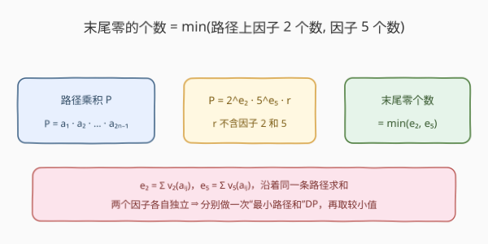
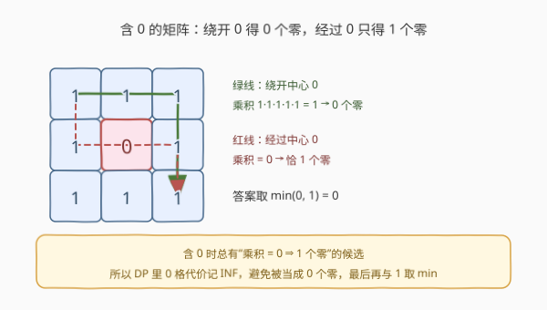
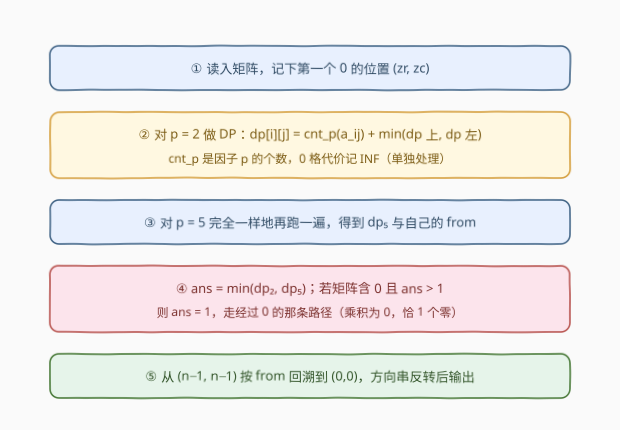
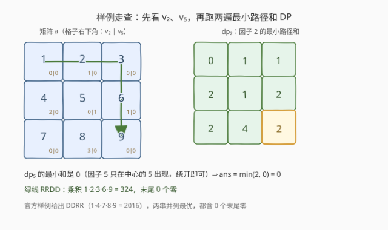

# Codeforces 2B 最少末尾零的路径 题解

## 1. 题目概述

- **题目链接**：https://codeforces.com/problemset/problem/2/B
- **比赛来源**：Codeforces Beta Round 2 · Problem B
- **难度**：rating 2000（2000 分）
- **标签**：动态规划、数学（素因子分解、路径最优化）
- **评测类型**：普通（最优路径可能有多条，评测器比较零的个数并检验路径合法）
- **限制**：时间 2 s / 内存 64 MB

**题意**：给定 $n \times n$ 的非负整数矩阵。从左上角 $(1,1)$ 出发，每次只能向右或向下走一格，走到右下角 $(n,n)$，把沿途经过的 $2n-1$ 个数相乘。要求这个乘积**十进制表示末尾的零**尽量少：先输出最少的零的个数，再输出对应的一条路径（`D` 表示向下，`R` 表示向右）。

**约束**：

- $2 \le n \le 1000$，矩阵元素 $0 \le a_{ij} \le 10^9$；
- 单组输入（2010 年的老题，**没有**多测 $t$），数据从 stdin 读入、stdout 输出；
- 路径条数为 $\binom{2n-2}{n-1}$，$n=1000$ 时是天文数字，必须多项式算法；
- 乘积最大可达 $(10^9)^{1999}$，约 $10^{17991}$，**不能**真的把乘积算出来；
- 内存只有 64 MB，$n^2=10^6$ 的大表不能随便多开，需要精打细算。

## 2. 示例与观察

官方样例（原样）：

```text
输入
3
1 2 3
4 5 6
7 8 9

输出
0
DDRR
```

官方给的是 `DDRR`：$1 \cdot 4 \cdot 7 \cdot 8 \cdot 9 = 2016$，末尾零个数为 $0$。本实现输出 `RRDD`：$1\cdot 2\cdot 3\cdot 6\cdot 9 = 324$，末尾零同样为 $0$。最优值唯一（等于 $0$），路径不唯一，两种都对。

自造样例 A（含 $0$，输出为本实现给出的解，路径可有多种）：

```text
输入
2
0 5
5 5

输出
1
DR
```

自造样例 B（全 $0$ 矩阵）：

```text
输入
2
0 0
0 0

输出
1
DR
```

自造样例 C（含 $0$ 但能绕开）：

```text
输入
3
1 1 1
1 0 1
1 1 1

输出
0
RRDD
```

自造样例 D（每个数都是 $10$）：

```text
输入
2
10 10
10 10

输出
3
RD
```

逐条看：

- 样例 A：任何路径都绕不开 $(1,1)$ 的 $0$，乘积为 $0$，末尾零按 $1$ 个算；
- 样例 B：全 $0$ 矩阵，答案仍是 $1$；
- 样例 C：中间虽然有 $0$，但可以绕开，得到 $0$ 个零，**说明“有 0 就一定答 1”是错的**，必须和正常 DP 的结果取较小值；
- 样例 D：每个数都是 $10 = 2\cdot 5$，路径上 3 个数，因子 2 与因子 5 各 3 个，故答案是 $3$。

由此提炼三条观察：

1. 末尾零的个数与乘积的绝对值无关，只取决于乘积中因子 $2$ 与因子 $5$ 的指数，即 $\min(e_2, e_5)$；
2. 沿路径的因子指数**可以相加**，于是“乘积末尾零最少”被拆成两个**加法版最短路**（路径和最小）；
3. 数 $0$ 是唯一的例外：它的因子指数无穷大，但乘积为 $0$ 时末尾零恰好是 $1$ 个，必须单独处理。

## 3. 解题思路

### 3.1 朴素做法与瓶颈

枚举起终点之间的所有单调路径：路径总长 $2n-2$，其中恰好 $n-1$ 步向下，方案数 $\binom{2n-2}{n-1}$。$n=10$ 时约 $4.9\times 10^4$，$n=20$ 时约 $3.5\times 10^{10}$，$n=1000$ 时 $\binom{1998}{999} \approx 10^{600}$，完全不可行。

即使只枚举，也要为每条路径乘一遍、再数一次末尾零：乘积有约 $1.8\times 10^4$ 位十进制数字，大整数乘法与取模都不便宜。所以瓶颈有两层：**路径数爆炸**与**乘积太大**。

### 3.2 核心观察：把乘法变成加法

对正整数 $P$ 做素因子分解，只关心 $2$ 与 $5$：

$$P = 2^{e_2}\cdot 5^{e_5}\cdot r,\qquad \gcd(r,10)=1 .$$

每出现一对 $(2,5)$ 就多一个末尾零，多出来的因子无法再配对，于是

$$\text{末尾零个数} = \min(e_2, e_5).$$

记 $c_p(x)$ 为 $x$ 中素因子 $p$ 的个数（即满足 $p^{k}\mid x$ 的最大 $k$）。由于因子指数在乘法下相加，路径 $P$ 上的乘积满足

$$e_p = \sum_{(i,j)\in P} c_p(a_{ij}),\qquad p\in\{2,5\}.$$

于是“让 $\min(e_2,e_5)$ 最小”变成：**分别**求一条路径使 $\sum c_2$ 最小、再求一条路径使 $\sum c_5$ 最小，取两者较小的那个：

$$\text{OPT} = \min\Big(\min_{P}\sum_{P} c_2,\ \min_{P}\sum_{P} c_5\Big).$$

两个子问题互不影响，各自是一个标准的“网格最小路径和”DP。



数 $0$ 是唯一的麻烦。约定乘积为 $0$ 时末尾零个数为 $1$（数字 `0` 本身就带一个零）。所以只要矩阵里有 $0$，就存在一条“经过某个 $0$”的路径，其末尾零恰为 $1$，答案的候选值里就多了一个 $1$。反过来，若某条路径能完全绕开所有 $0$，它的末尾零仍按 $\min(e_2,e_5)$ 计算，可能更小——这就是样例 C 的情形。



因此实现上做两件事：

- 在 DP 里把含 $0$ 的格子代价记成 $\mathrm{INF}$，让 DP 只会在“可以避开 $0$”时给出正常值，绝不会把 $0$ 误当成“$0$ 个零”；
- 若矩阵含 $0$ 且 $\min(best_2,best_5) > 1$，直接令答案为 $1$，并输出一条经过该 $0$ 的路径。

### 3.3 算法流程

对 $p\in\{2,5\}$ 各跑一次 DP，状态与转移如下（$c_p(0)=\mathrm{INF}$，且每步把超过 $\mathrm{INF}$ 的值截断回 $\mathrm{INF}$）：

$$dp_p[i][j] = c_p(a_{ij}) + \begin{cases} 0, & i=j=0,\\ dp_p[i][j-1], & i=0,\ j>0,\\ dp_p[i-1][j], & j=0,\ i>0,\\ \min\big(dp_p[i-1][j],\,dp_p[i][j-1]\big), & \text{否则}. \end{cases}$$

转移时用父指针 $\mathit{from}[i][j]\in\{1,2\}$ 记录“从上方来”还是“从左边来”（$1$ 表示由上方的 $(i-1,j)$ 转移，$2$ 表示由左方的 $(i,j-1)$ 转移），以便最后回溯路径。



整体步骤：

1. 读入矩阵，同时记下第一个 $0$ 的位置 $(zr,zc)$；
2. 以 $p=2$ 跑 DP，保存父指针矩阵 $\mathit{from}_2$，得到 $best_2$；
3. 以 $p=5$ 再跑一次，得到 $\mathit{from}_5$ 与 $best_5$；
4. $ans\leftarrow \min(best_2,best_5)$；若存在 $0$ 且 $ans>1$，则 $ans\leftarrow 1$，路径取“先下 $zr$ 步、再右 $zc$ 步、再下到底、再右到底”；
5. 否则取 $best_2\le best_5$ 时用 $\mathit{from}_2$，不然用 $\mathit{from}_5$，从 $(n-1,n-1)$ 倒推回 $(0,0)$，把方向记录反转后输出。

回溯细节：若 $\mathit{from}[i][j]=1$，说明当前格是由上一行的同一列下来的，最后一步是 `D`，于是记录 `D` 并令 $i\leftarrow i-1$；否则记录 `R` 并令 $j\leftarrow j-1$。倒推到起点后把记录串**反转**，才是从起点到终点的顺序。

“经过 $0$”的路径为什么长这样？从 $(0,0)$ 先向下 $zr$ 步、再向右 $zc$ 步，正好落在 $(zr,zc)$，之后再向下、向右补完即可，沿途不会越界，步数也恰好是 $2n-2$。

### 3.4 样例走查

以官方样例为例，先算出每格的 $c_2$ 与 $c_5$：

| 格子 | $1$ | $2$ | $3$ | $4$ | $5$ | $6$ | $7$ | $8$ | $9$ |
|------|-----|-----|-----|-----|-----|-----|-----|-----|-----|
| $c_2$ | 0 | 1 | 0 | 2 | 0 | 1 | 0 | 3 | 0 |
| $c_5$ | 0 | 0 | 0 | 0 | 1 | 0 | 0 | 0 | 0 |

$p=2$ 的 DP 表（每格为 $dp_2[i][j]$）：

| $i\backslash j$ | 0 | 1 | 2 |
|---|---|---|---|
| 0 | 0 | 1 | 1 |
| 1 | 2 | 1 | 2 |
| 2 | 2 | 4 | **2** |

$p=5$ 的 DP 表：

| $i\backslash j$ | 0 | 1 | 2 |
|---|---|---|---|
| 0 | 0 | 0 | 0 |
| 1 | 0 | 1 | 0 |
| 2 | 0 | 0 | **0** |

$best_2 = 2$，$best_5 = 0$，矩阵里没有 $0$，故 $ans = \min(2,0) = 0$，走 $p=5$ 的父指针。从 $(2,2)$ 倒推：$dp_5[1][2]=0 \le dp_5[2][1]=0$，取上方；$(1,2)$ 处 $dp_5[0][2]=0\le dp_5[1][1]=1$，取上方；$(0,2)$、$(0,1)$ 只能取左方。倒推记录为 `DDRR`，反转为 `RRDD`，对应乘积 $1\cdot2\cdot3\cdot6\cdot9=324$，末尾零 $0$ 个，与答案一致。



## 4. 正确性证明

**引理 1**：设正整数 $P=2^{e_2}5^{e_5}r$ 且 $\gcd(r,10)=1$，则 $P$ 十进制末尾零的个数等于 $\min(e_2,e_5)$。

**证明**：令 $m=\min(e_2,e_5)$，则 $P=10^{m}\cdot 2^{e_2-m}5^{e_5-m}r$。括号中的因子：若 $e_2>m$ 则 $e_5=m$，其中已无因子 $5$；若 $e_5>m$ 则 $e_2=m$，其中已无因子 $2$；两者都等于 $m$ 时括号为 $r$。三种情况下括号都不被 $10$ 整除，故恰好能提出 $m$ 个 $10$，末尾零个数为 $m$。∎

**引理 2**：固定素数 $p$，对任意正整数 $x,y$ 有 $v_p(xy)=v_p(x)+v_p(y)$；因此一条路径上乘积的因子 $p$ 个数等于路径上各格 $c_p$ 之和。

**证明**：若 $x=p^{u}x'$、$y=p^{v}y'$ 且 $p\nmid x'y'$，则 $xy=p^{u+v}x'y'$ 且 $p\nmid x'y'$，故 $v_p(xy)=u+v$。对路径长度归纳即得求和形式。∎

**引理 3**：固定 $p$，把 $0$ 格的代价设为 $\mathrm{INF}$ 后，上述 DP 得到的 $dp[n-1][n-1]$ 等于所有不含 $0$ 的单调路径上 $\sum c_p$ 的最小值（若不存在这样的路径则为 $\mathrm{INF}$ 截断后的值），且父指针回溯出的路径取到该最小值。

**证明**：对 $i+j$ 归纳。$i+j=0$ 时只有起点，$dp[0][0]=c_p(a_{00})$ 正确。设所有 $i+j<k$ 的格子已正确，考察 $i+j=k$ 的格子 $(i,j)$：任何到达它的单调路径，最后一步只能来自 $(i-1,j)$ 或 $(i,j-1)$，故最优值等于 $c_p(a_{ij})$ 加上两个前驱最优值的较小者，恰为转移式；边界行/列只有一个前驱，同理。父指针记录的就是取到最小值的那个前驱，沿它一路回溯得到一条路径，其代价和逐格相加等于 DP 值。∎

**引理 4**：若矩阵中存在 $0$ 格 $(zr,zc)$，则字符串 $D^{zr}R^{zc}D^{n-1-zr}R^{n-1-zc}$ 是一条合法的单调路径，且经过该格，其乘积为 $0$，末尾零个数为 $1$。

**证明**：前 $zr$ 步向下使行号从 $0$ 到 $zr$，接着 $zc$ 步向右使列号从 $0$ 到 $zc$，此时位于 $(zr,zc)$；再向下 $n-1-zr$ 步到第 $n-1$ 行，再向右 $n-1-zc$ 步到第 $n-1$ 列，全程行、列坐标都单调不减且不超过 $n-1$，故合法。总步数 $zr+zc+(n-1-zr)+(n-1-zc)=2n-2$。路径上含 $0$，乘积为 $0$，按约定末尾零为 $1$。∎

**定理**：记 $A=\min(best_2,best_5)$（$0$ 格代价为 $\mathrm{INF}$），则算法输出的数等于最少末尾零个数，且输出路径合法、其乘积的末尾零个数等于输出的数。

**证明**：记路径 $P$ 的末尾零个数为 $f(P)$：若 $P$ 含 $0$，则 $f(P)=1$；否则由引理 1、2，$f(P)=\min(\sum_P c_2,\sum_P c_5)$。

先说明 $\min_P f(P)=\min(A,\,1)$（当存在 $0$ 格时，否则为 $A$）。一方面，对不含 $0$ 的路径集合有
$$\min_P f(P)=\min_P\min\Big(\sum_P c_2,\sum_P c_5\Big)=\min\Big(\min_P\sum_P c_2,\ \min_P\sum_P c_5\Big)=A,$$
这里第一个等号用了 $f$ 的定义，第二个等号是“两个最小值可以交换次序”。另一方面，由引理 4，存在含 $0$ 的路径使 $f=1$，而 $f\ge 0$ 恒成立。故 $\min_P f(P)=\min(A,1)$（无 $0$ 时退化为 $A$）。

分三种情况：

1. **矩阵无 $0$**：所有路径都不含 $0$，故 $\text{OPT}=A$。不妨 $best_2\le best_5$（另一情况对称），算法回溯 $p=2$ 的路径 $P$，其 $\sum_P c_2=best_2=A$，而 $\sum_P c_5\ge best_5\ge A$，于是 $f(P)=\min(A,\ \ge A)=A=\text{OPT}$。
2. **有 $0$ 且 $A>1$**：此时 $\text{OPT}=\min(A,1)=1$，算法令 $ans=1$ 并输出引理 4 构造的路径，其 $f=1=\text{OPT}$。
3. **有 $0$ 且 $A\le 1$**：$A\in\{0,1\}$。若 $A=0$，则 $best_2$ 或 $best_5$ 为 $0$，说明存在完全不经过 $0$（代价 $\mathrm{INF}$ 不可能取到 $0$）且因子指数和为 $0$ 的路径，$f=0$，与 $\text{OPT}=\min(0,1)=0$ 相符；若 $A=1$，同情况 1 的论证得所走路径 $f=1=\text{OPT}$。

三种情况都输出 $\text{OPT}$ 且路径合法，定理得证。∎

## 5. 复杂度分析

- **时间**：两遍 DP，每格做一次因子分解（$a_{ij}\le 10^9$，因子 $2$ 至多 $29$ 个、因子 $5$ 至多 $12$ 个）与 $O(1)$ 次比较，总计 $O(n^2\log A)$，$n=1000$ 时约 $2\times 10^6$ 次格点计算；回溯 $O(n)$。官方时限 $2$ s，C++ 实测最坏 $0.21$ s。
- **空间**：`a` 与 `dp` 各 $n^2$ 个 `int`（各 $4$ MB），两份父指针各 $n^2$ 字节（各 $1$ MB），加上少量向量开销约 $10$ MB，远低于 $64$ MB。若把 `dp` 改成滚动数组还能再省 $4$ MB；Python 版正是用滚动数组 + `array('i')` 把内存压住的。
- **常数**：转移式里没有除法以外的重活；`INF` 截断只多一次比较，可以忽略。

## 6. 参考代码

### C++17

```cpp
#include <bits/stdc++.h>
using namespace std;

int main() {
    int n;
    if (scanf("%d", &n) != 1) return 0;

    const int INF = 1000000000;
    vector<vector<int>> a(n, vector<int>(n));
    int zr = -1, zc = -1;                        // 第一个 0 的位置
    for (int i = 0; i < n; ++i)
        for (int j = 0; j < n; ++j) {
            scanf("%d", &a[i][j]);
            if (a[i][j] == 0 && zr < 0) { zr = i; zc = j; }
        }

    vector<vector<int>> dp(n, vector<int>(n, 0));
    vector<vector<unsigned char>> from(n, vector<unsigned char>(n, 0));  // 1: 从上方来, 2: 从左边来

    // p = 2 或 5，返回从 (0,0) 到 (n-1,n-1) 的因子 p 个数之和的最小值
    auto run = [&](int p) -> int {
        for (int i = 0; i < n; ++i) {
            for (int j = 0; j < n; ++j) {
                int cost;
                if (a[i][j] == 0) {
                    cost = INF;                  // 经过 0 的路径单独按“1 个零”处理
                } else {
                    cost = 0;
                    int v = a[i][j];
                    while (v % p == 0) { v /= p; ++cost; }
                }
                if (i == 0 && j == 0) {
                    dp[i][j] = cost;
                    from[i][j] = 0;
                } else if (i == 0) {
                    dp[i][j] = dp[i][j - 1] + cost;
                    from[i][j] = 2;
                } else if (j == 0) {
                    dp[i][j] = dp[i - 1][j] + cost;
                    from[i][j] = 1;
                } else if (dp[i - 1][j] <= dp[i][j - 1]) {
                    dp[i][j] = dp[i - 1][j] + cost;
                    from[i][j] = 1;
                } else {
                    dp[i][j] = dp[i][j - 1] + cost;
                    from[i][j] = 2;
                }
                if (dp[i][j] > INF) dp[i][j] = INF;   // 防止多段 INF 累加溢出
            }
        }
        return dp[n - 1][n - 1];
    };

    int best2 = run(2);
    vector<vector<unsigned char>> from2 = from;
    int best5 = run(5);                          // 此时 from 记录的是因子 5 的决策

    int ans = min(best2, best5);
    string path;
    if (zr >= 0 && ans > 1) {                    // 经过 0 的路径乘积为 0，恰好 1 个末尾零
        ans = 1;
        path = string(zr, 'D') + string(zc, 'R') +
               string(n - 1 - zr, 'D') + string(n - 1 - zc, 'R');
    } else {
        const vector<vector<unsigned char>> &pf = (best2 <= best5) ? from2 : from;
        int i = n - 1, j = n - 1;
        while (i > 0 || j > 0) {
            if (pf[i][j] == 1) { path.push_back('D'); --i; }
            else               { path.push_back('R'); --j; }
        }
        reverse(path.begin(), path.end());
    }

    printf("%d\n%s\n", ans, path.c_str());
    return 0;
}
```

### Python3

```python
import sys
from array import array


def main():
    inp = sys.stdin.buffer

    def read_ints(k):
        """按行读入恰好 k 个整数（容忍空行 / 一行过多或过少）"""
        out = []
        while len(out) < k:
            line = inp.readline()
            if not line:
                break
            out.extend(map(int, line.split()))
        return out

    first = read_ints(1)
    if not first:
        return
    n = first[0]
    INF = 10 ** 9

    a = array('i')                       # 4 字节整数，n = 1000 时仅 4 MB
    zr = zc = -1
    for i in range(n):
        row = read_ints(n)
        if zr < 0:
            for j, v in enumerate(row):
                if v == 0:
                    zr, zc = i, j
                    break
        a.extend(row)

    def run(p):
        """最小化路径上因子 p 的个数之和，返回 (最优值, 父指针)，滚动数组 O(n) 空间"""
        par = bytearray(n * n)           # 1: 从上方来, 2: 从左边来
        prev = [0] * n
        for i in range(n):
            cur = [0] * n
            base = i * n
            for j in range(n):
                v = a[base + j]
                if v == 0:
                    cost = INF           # 经过 0 的路径单独按“1 个零”处理
                else:
                    cost = 0
                    while v % p == 0:
                        v //= p
                        cost += 1
                if i == 0 and j == 0:
                    cur[j] = cost
                elif i == 0:
                    cur[j] = cur[j - 1] + cost
                    par[base + j] = 2
                elif j == 0:
                    cur[j] = prev[j] + cost
                    par[base + j] = 1
                elif prev[j] <= cur[j - 1]:
                    cur[j] = prev[j] + cost
                    par[base + j] = 1
                else:
                    cur[j] = cur[j - 1] + cost
                    par[base + j] = 2
                if cur[j] > INF:         # 防止多段 INF 累加溢出
                    cur[j] = INF
            prev = cur
        return prev[n - 1], par

    best2, par2 = run(2)
    best5, par5 = run(5)

    ans = min(best2, best5)
    if zr >= 0 and ans > 1:
        # 经过 0 的路径乘积为 0，恰好 1 个末尾零
        ans = 1
        path = 'D' * zr + 'R' * zc + 'D' * (n - 1 - zr) + 'R' * (n - 1 - zc)
    else:
        par = par2 if best2 <= best5 else par5
        i, j = n - 1, n - 1
        rev = []
        while i > 0 or j > 0:
            if par[i * n + j] == 1:
                rev.append('D')
                i -= 1
            else:
                rev.append('R')
                j -= 1
        path = ''.join(reversed(rev))

    sys.stdout.write(str(ans) + '\n' + path + '\n')


main()
```

Python 版在 CPython 3.9 上最坏（全 $10^9$ 矩阵）约 $3.0$ s，超过 $2$ s 限制，**建议用 PyPy3 提交，或直接交 C++**。

## 7. 边界情况与易错点

1. **$0$ 不能当成“$0$ 个零”**：把 $0$ 的 $c_2,c_5$ 记成 $0$ 会让 DP 得出答案 $0$，实际乘积为 $0$、末尾零是 $1$。正确做法是代价记 $\mathrm{INF}$，最后再和 $1$ 取较小值。
2. **有 $0$ 也不能无脑输出 $1$**：能绕开 $0$ 时答案可能是 $0$（样例 C）。必须先算 $\min(best_2,best_5)$，只有它大于 $1$ 才走“经过 $0$”的路径。
3. **$\mathrm{INF}$ 累加溢出**：一条路径最多 $1999$ 格，若每格都写 $\mathrm{INF}=10^9$，直接相加会到 $2\times 10^{12}$，`int` 溢出。每步要把 $dp$ 截断回 $\mathrm{INF}$，这样两数相加最多 $2\times10^9$，仍在 `int` 范围内。
4. **老题的输入格式**：本题只有单组输入，没有 $t$；但 $n=1000$ 要读 $10^6$ 个数，某些标准库（如本机的 libc++）里 `cin` 重定向后仍要 $2.3$ s，接近时限。用 `scanf` 或手写快读更稳妥。
5. **路径必须恰好 $2n-2$ 步**：回溯时每格只退一步，从 $(n-1,n-1)$ 退到 $(0,0)$ 正好 $2n-2$ 步；方向是倒着收集的，输出前务必反转。
6. **输出格式**：第二行只能是 `D`/`R` 组成的串，不能带空格；第一行是最少零的个数。多打一个空格或漏掉换行都可能被判格式错误。
7. **$n=2$ 与首格为 $0$**：$n=2$ 时只有两条路径，首格为 $0$ 时两条都含 $0$，答案必为 $1$；这类小数据要专门测，容易在边界行/列转移上写错。
8. **答案上界**：最大答案约 $1999\times 29 \approx 5.8\times 10^4$，`int` 足够；但若把“乘积”真的存下来就会溢出，所以始终只存因子指数。
9. **Python 的内存**：本题内存限制 $64$ MB，用 `sys.stdin.buffer.read().split()` 一次读 $10^6$ 个 token 会瞬间吃掉几十 MB，因此按行读并用 `array('i')` 存矩阵。

## 8. 验证记录

- **编译环境与命令**：macOS arm64，Apple clang 21.0.0（本机 `g++` 即 `clang++`，且没有 GNU 的 `<bits/stdc++.h>`，故用一个只包含标准头并集的 shim 头参与编译，提交代码本身仍是标准的 `#include <bits/stdc++.h>`）：
  - `g++ -std=c++17 -O2 -I shim -o sol sol.cpp`
  - `python3 -c "compile(open('sol.py').read(),'sol.py','exec')"` 做语法检查，再 `python3 sol.py` 运行
- **官方样例**：1 / 1 通过（输出 `0` 与 `RRDD`；官方为 `DDRR`，两条路径都含 0 个末尾零，最优值一致）。
- **额外测试**：
  - 与独立暴力对拍 300 组随机数据（$n\in[2,6]$，分“含 0 / 全 0 / 全非 0”三类）：暴力**枚举全部** $\binom{2n-2}{n-1}$ 条路径，用 Python 大整数真乘出乘积再直接数末尾零（$0$ 按 $1$ 个零），同时校验程序输出路径的合法性与真实零数；C++ 与 Python 两版各跑一遍，**0 失败**。
  - 穷举 $n=2$、元素取自 $\{0,1,2,5,10,25\}$ 的全部 $6^4=1296$ 个矩阵，逐组比对最优值与路径真实零数，**0 失败**。
  - 手工覆盖：全 $0$、全 $1$、首格为 $0$、中心 $0$ 可绕开、$10$ 的幂矩阵等，结果与手算一致（见第 2 节）。
- **最大约束性能**（$n=1000$，本机）：
  - 随机矩阵：C++ $0.21$ s；Python $1.1$ s；
  - 全 $0$ 矩阵：C++ $0.05$ s；Python $1.0$ s；
  - 全 $10^9$ 矩阵：C++ $0.19$ s；Python $3.0$ s，超出 $2$ s，故注明建议 PyPy3 / C++。
  - C++ 对 $2$ s 时限留有约 $9$ 倍余量。
- **图片校验**：4 张 SVG 全部通过 `ElementTree.parse`；另用无头 Chrome 读取每个 `text` 的 `getBBox()`，确认没有超出 `viewBox`、没有越出所在方框、没有文字互相重叠。
- **复核状态**：`sample_passed → verified`，已写入 `codeforces/data/problems.json` 的 `path` 与 `status`。

## 相关题目与扩展

- [LeetCode 64. 最小路径和](https://leetcode.com/problems/minimum-path-sum/)：同一套“只能向右/向下”的网格 DP 骨架，本题相当于在它上面加了两遍因子计数。
- [LeetCode 63. 不同路径 II](https://leetcode.com/problems/unique-paths-ii/)：网格中的“坏格”处理，与本题 $0$ 格要单独对待的思路相通。
- [LeetCode 172. 阶乘后的零](https://leetcode.com/problems/factorial-trailing-zeroes/)：同样是“数因子 $5$”的技巧，末尾零个数的经典入门题。
- [Codeforces 2C. Commentator problem](https://codeforces.com/problemset/problem/2/C)：同场另一题（计算几何），可对比同一场比赛里两种完全不同的思维路径。

**延伸思考**：

1. 如果要求输出**字典序最小**的最优路径（规定 `D < R`），只需在 DP 里把状态从“最小代价”换成“（代价, 路径串）”的二元组比较，或在代价相同时沿父指针做一次贪心回溯；注意这会改变 $O(n^2)$ 的常数。
2. 如果矩阵元素扩到 $10^{18}$，因子 $2$ 的个数上界升到约 $60$，代价之和仍只有 $O(n\log A)$，`int` 换成 `long long` 即可，算法不变。
3. 如果允许把某个格子改成任意非负整数（最多改 $k$ 个），让答案最小化，就变成在 DP 上再加一维“已修改次数”的分层最短路，复杂度 $O(kn^2)$。
4. 若把“向右/向下”换成“四方向可走但每个格子只能经过一次”，问题立刻变难：网格中带权的最少因子路径不再有单调性，需要更复杂的图论工具——这也说明了本题“单调路径”这一限制的价值。
