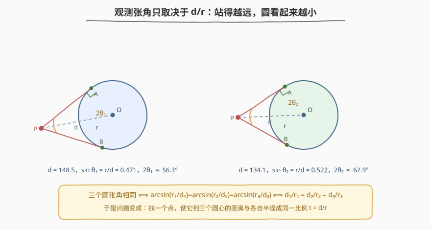
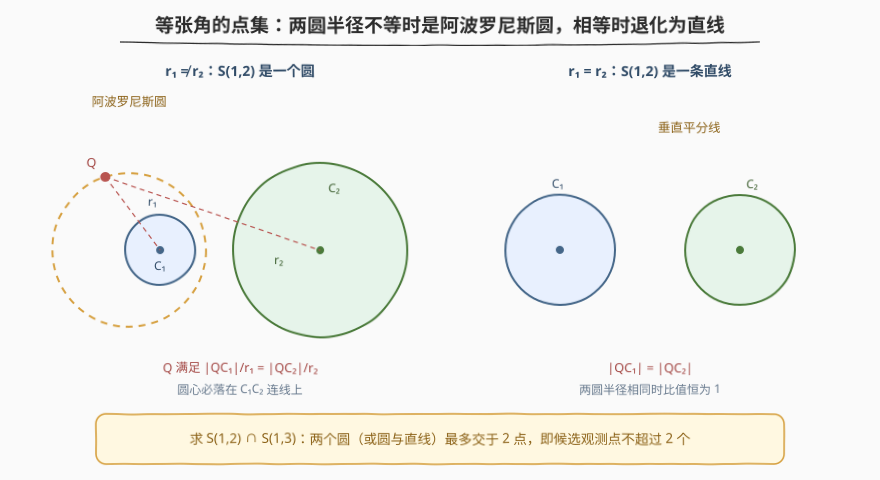
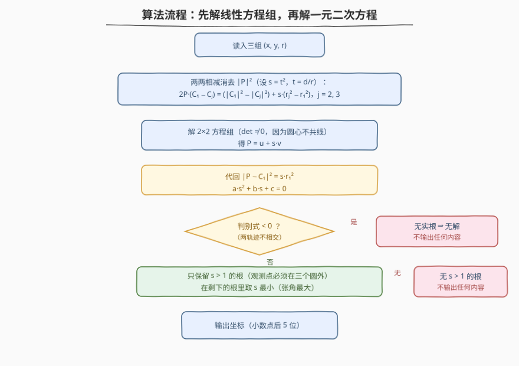
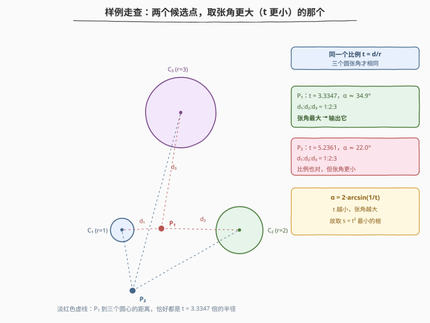
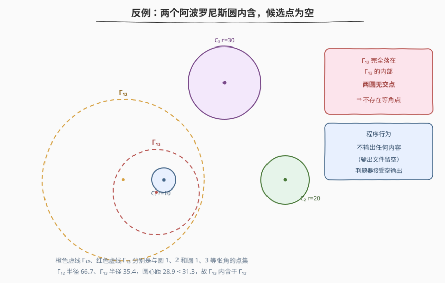

# Codeforces 2C 解说员的观察点 题解

## 1. 题目概述

- **题目链接**：https://codeforces.com/problemset/problem/2/C
- **比赛来源**：Codeforces Beta Round 2（2010-02-26）· Problem C，英文名 Commentator problem
- **难度**：2600
- **标签**：计算几何、阿波罗尼斯圆、解线性方程组与一元二次方程
- **评测类型**：普通（输出实数，可能要求空输出）
- **限制**：时间 1 s / 内存 64 MB

**题意**：平面上有三个圆形体育场，第 $i$ 个的圆心为 $C_i=(x_i,y_i)$、半径为 $r_i$。三圆两两没有公共点，三个圆心不共线。要在平面上选一个观测点 $P$，使三个体育场被看到的**张角完全相同**；若这样的点不止一个，取张角最大的那个。如果不存在满足条件的点，程序**不能输出任何内容**（输出留空）。

**约束**：

- $-10^3 \le x_i, y_i \le 10^3$，$1 \le r_i \le 10^3$，全部是整数；
- 三个圆两两没有公共点，三个圆心不共线；
- 输入**只有三行**（每行 `x y r`），没有组数 $t$、没有多测——这是 2010 年的老格式，题面与官方样例都只给了单组数据；
- 整数输入意味着「两圆是否相交」「圆心是否共线」这类判定都可以精确完成，不必担心输入层面的浮点误差；同时答案是一个连续统上的点，网格枚举、随机撒点都不可能达到 $10^{-5}$ 的精度，只能解析求解。

## 2. 示例与观察

官方样例（输入 / 输出原样）：

```text
输入：
0 0 10
60 0 10
30 30 10

输出：
30.00000 0.00000
```

三个圆半径都是 $10$，圆心 $(0,0)$、$(60,0)$、$(30,30)$。答案 $(30,0)$ 到三个圆心的距离都是 $30$，即 $d_i/r_i$ 全等于 $3$，三个张角都是 $2\arcsin(1/3)\approx 38.94^\circ$。事实上半径全相等时等角点就是三圆心的外心，本例中 $(30,0)$ 恰好是等腰三角形 $(0,0),(60,0),(30,30)$ 的外心。

自造样例 1（标注为自造，说明“两个候选点”的情形）：

```text
输入：
0 0 1
10 0 2
5 10 3

输出：
3.33195 0.13589
```

本例有两个满足等角条件的点：$(3.33195,0.13589)$ 与 $(0.88756,-5.16028)$。前者的 $d_i/r_i$ 为 $3.3347$、张角约 $34.90^\circ$，后者为 $5.2361$、张角约 $22.02^\circ$，所以取前者。这是本题最容易被忽略的一层：**比例相同还不够，要在比例相同的点里挑张角最大的**。

自造样例 2（标注为自造，说明“无解”真的会发生）：

```text
输入：
0 0 10
100 0 20
50 80 30

输出：
（空，什么都不打印）
```

本例中「与圆 1、圆 2 等角」的点集是一个半径 $66.67$ 的圆，「与圆 1、圆 3 等角」的点集是半径 $35.38$ 的圆，两圆圆心相距 $28.87$，而 $66.67-35.38=31.29>28.87$，于是后者整个落在前者内部、没有交点，等角点集为空。题面专门写了「如果没有答案，程序不应该打印任何东西」，说明这类数据确实会出现在测试里。

三个样例给出的核心观察：

1. 张角只由比值 $d/r$ 决定，与方向、绝对距离都无关；
2. 「两个圆张角相等」的点集是一条曲线（两圆半径相同时是直线，否则是圆），两条这样的曲线最多交于两点，所以候选点至多两个；
3. 候选点可能一个都没有；也可能有两个，此时要比较张角。

## 3. 解题思路

### 3.1 朴素做法与瓶颈

最直接的想法是把「三个张角相等」写成一个二元函数并做数值优化：例如最小化 $F(P)=\sum_i(\rho_i-\bar\rho)^2$，其中 $\rho_i=d_i/r_i$、$\bar\rho$ 是三者的平均。这条路上有三个坑：

- $F$ 的零点是**离散的 0 维集合**，而且一般有两个零点，函数既不凸也不单峰，三分搜索、爬山、退火都可能收敛到另一个点，或者在无解数据上永远逼近不到 $0$；
- 题目要求 $10^{-5}$ 的输出精度，迭代法在极端数据（坐标 $10^3$、半径 $1$）上收敛慢且抖动；
- 无解时必须判空，而迭代法只能给出“残差始终大于某个阈值”，判据不干净。

所以正确路线是解析求解：先把几何条件等价成代数方程组，再解方程。由于圆心不共线，方程组可以化成“解一个 $2\times 2$ 线性方程组 + 解一个一元二次方程”，全程 $O(1)$。

### 3.2 核心观察



**张角公式**：设点 $P$ 到圆心 $C$ 的距离为 $d>r$，从 $P$ 引两条切线，则 $PC$、切线、半径构成直角三角形（切点处半径垂直于切线），半角 $\theta$ 满足

$$\sin\theta=\frac{r}{d},\qquad \alpha=2\theta=2\arcsin\frac{r}{d}.$$

$d$ 越大 $\alpha$ 越小，这与“站得越远，圆看起来越小”完全一致。又因为 $\arcsin$ 在 $[0,1]$ 上严格递增，$\alpha$ 只依赖于比值 $r/d$。于是

$$\alpha_1=\alpha_2=\alpha_3\iff \frac{d_1}{r_1}=\frac{d_2}{r_2}=\frac{d_3}{r_3}=t\ (>1).$$

几何上，$t$ 就是“观测点到圆心的距离是半径的多少倍”，三个圆共用同一个倍数。



再看两个圆：满足 $d_i/r_i=d_j/r_j$ 的点集，就是到两点距离之比为常数的点集，即**阿波罗尼斯圆**——当 $r_i\ne r_j$ 时是一个圆（圆心在 $C_iC_j$ 上，且经过内、外两个相似中心），当 $r_i=r_j$ 时退化为 $C_iC_j$ 的垂直平分线。因此

$$S(1,2)\cap S(1,3)$$

最多给出两个点，这就是题面“如果满足条件的点多于一个，取张角最大的”所指的两个点。

不过显式构造两个阿波罗尼斯圆再求交，要分圆−圆、圆−线、线−线三种情况，代码冗长且退化情形多。下面换一个更整齐的参数化。

### 3.3 算法流程



**第一步：把条件写成三个二次方程。** 令 $s=t^2$，则 $d_i/r_i=t$ 等价于

$$|P-C_i|^2=s\,r_i^2,\qquad i=1,2,3,\qquad s>1.$$

（$s>1$ 正是“点在圆外”，这样张角才有定义。$s=1$ 意味着点在圆上，三个圆两两无公共点，实际不可能出现。）

**第二步：消去 $|P|^2$，得到关于 $P$ 的线性方程组。** 用 $i=1$ 的方程减去 $j$ 的方程（$j=2,3$）：

$$2P\cdot(C_1-C_j)=\bigl(|C_1|^2-|C_j|^2\bigr)+s\bigl(r_j^2-r_1^2\bigr).$$

记 $A$ 的两行为 $2(C_1-C_2)^{\mathsf T}$、$2(C_1-C_3)^{\mathsf T}$，向量 $b_0,b_1$ 的第 $j$ 行为

$$b_{0,j}=|C_1|^2-|C_j|^2,\qquad b_{1,j}=r_j^2-r_1^2,$$

就有 $AP=b_0+s\,b_1$。而

$$\det A=4\cdot\operatorname{cross}(C_1-C_2,\;C_1-C_3)\ne 0$$

（圆心不共线，且坐标都是整数，$\det$ 是 $4$ 的非零整数倍，数值上很安全）。

**第三步：把 $P$ 写成 $s$ 的一次函数。** 令 $u=A^{-1}b_0$、$v=A^{-1}b_1$，则

$$P(s)=u+s\,v .$$

**第四步：代回第一个方程，得到 $s$ 的一元二次方程。** 令 $w=u-C_1$，由 $|P-C_1|^2=s\,r_1^2$ 得

$$\underbrace{|v|^2}_{a}s^2+\underbrace{\bigl(2\,w\cdot v-r_1^2\bigr)}_{b}s+\underbrace{|w|^2}_{c}=0 .$$

**第五步：筛选与取优。** 解出实根后：

- 丢掉 $s\le 1$ 的根：此时 $d_i=\sqrt s\,r_i\le r_i$，点落在三个圆的内部或边界上，张角无定义；
- 剩下的根对应的 $P(s)$ 都满足等角条件，由 $\alpha=2\arcsin(1/\sqrt s)$ 关于 $s$ 严格递减，取 **$s$ 最小**的那个，就是张角最大的点；
- 若没有实根、或实根全部 $s\le1$，说明无解，**什么都不输出**。

**特例**：三个半径全相等时 $b_1=0$，于是 $v=0$、$a=0$，二次方程退化为一元一次方程

$$s=\frac{|w|^2}{r_1^2},$$

解出来的点就是三个圆心的外心，正好符合 3.2 的几何直觉。此时只有一个候选点。

### 3.4 样例走查



取自造样例 1：$C_1=(0,0),r_1=1$；$C_2=(10,0),r_2=2$；$C_3=(5,10),r_3=3$。

$$A=\begin{pmatrix}-20&0\\-10&-20\end{pmatrix},\quad b_0=\begin{pmatrix}-100\\-125\end{pmatrix},\quad b_1=\begin{pmatrix}3\\8\end{pmatrix},\quad \det A=400 .$$

解得 $u=(5,\;3.75)$、$v=(-0.15,\;-0.325)$，$w=u-C_1=(5,\;3.75)$，于是

$$a=|v|^2=0.128125,\quad b=2\,w\cdot v-r_1^2=-4.9375,\quad c=|w|^2=39.0625 .$$

方程 $0.128125\,s^2-4.9375\,s+39.0625=0$ 的判别式为 $4.359375$，两根为

| 根 | $s=t^2$ | $t=d/r$ | 点 $P(s)=u+sv$ | 张角 $2\arcsin(1/t)$ |
| --- | --- | --- | --- | --- |
| 根 2 | $11.1203$ | $3.3347$ | $(3.33195,\;0.13589)$ | $34.90^\circ$ |
| 根 1 | $27.4162$ | $5.2361$ | $(0.88756,\;-5.16028)$ | $22.02^\circ$ |

两个点都满足 $d_1:d_2:d_3=1:2:3$，但第一个点的比例更小、张角更大，所以输出 $(3.33195,\;0.13589)$，与第 2 节的自造样例 1 一致。

官方样例是半径全相等的退化情形：$v=0$、$w=(30,0)$、$s=|w|^2/r_1^2=900/100=9$、$t=3$，输出 $(30,0)$，张角 $2\arcsin(1/3)\approx38.94^\circ$。



自造样例 2 则展示了另一种结局：$S(1,2)$ 与 $S(1,3)$ 分别是半径 $66.67$ 与 $35.38$ 的圆，圆心距 $28.87$ 小于半径差 $31.29$，两圆内含、没有交点，二次方程判别式为负，程序不输出任何内容。

## 4. 正确性证明

记 $d_i=|P-C_i|$，可行点集为 $\mathcal F=\{P: d_i>r_i\ (i=1,2,3),\ d_1/r_1=d_2/r_2=d_3/r_3\}$。

**引理 1（张角公式与单调性）**：若 $d>r$，则圆在 $P$ 处的张角为 $\alpha=2\arcsin(r/d)$，且 $\alpha$ 关于 $r/d$ 严格递增。

**证明**：设切点为 $T$，则 $PT\perp TC$，三角形 $PTC$ 在 $T$ 处直角，斜边 $PC=d$、对边 $TC=r$，故半角 $\theta=\angle TPC$ 满足 $\sin\theta=r/d$，且 $\theta\in(0,\pi/2)$，于是 $\alpha=2\theta=2\arcsin(r/d)$。$\arcsin$ 在 $[0,1]$ 上严格递增，复合后单调性得证。∎

**引理 2（等角条件等价于二次方程组）**：设 $s>1$。则「$|P-C_i|^2=s\,r_i^2$ 对 $i=1,2,3$ 都成立」$\iff$「$P\in\mathcal F$ 且 $d_i/r_i=\sqrt s$」。

**证明**：若三个方程成立，则 $d_i^2=s\,r_i^2$，由 $s>1$、$r_i>0$ 得 $d_i=\sqrt s\,r_i>r_i$，于是 $P$ 在三个圆外且 $d_i/r_i=\sqrt s$，即 $P\in\mathcal F$。反之若 $P\in\mathcal F$，取 $\sqrt s=d_1/r_1>1$，则 $d_i=\sqrt s\,r_i$，平方即得三个方程。∎

**引理 3（消元等价）**：$A$ 可逆，且「$P$ 满足引理 2 的三个方程」$\iff$「$P=u+sv$ 且 $|P-C_1|^2=s\,r_1^2$」。

**证明**：$A$ 可逆性由 $\det A=4\operatorname{cross}(C_1-C_2,C_1-C_3)$ 与圆心不共线得到。设三个方程成立，两两相减得 $AP=b_0+sb_1$，故 $P=A^{-1}(b_0+sb_1)=u+sv$，且第一个方程成立。反之设 $P=u+sv$ 且第一个方程成立，则 $AP=b_0+sb_1$ 的分量形式即

$$|P-C_1|^2-|P-C_j|^2=\bigl(|C_1|^2-|C_j|^2\bigr)-s\bigl(r_1^2-r_j^2\bigr),\qquad j=2,3,$$

把 $|P-C_1|^2=s\,r_1^2$ 代入左边整理即 $|P-C_j|^2=s\,r_j^2$。∎

**引理 4（候选点枚举完备且不超过 2 个）**：设 $S$ 为 $a s^2+bs+c=0$（当 $a=0$ 时为一元一次方程 $bs+c=0$）在实数范围内的根集，则

$$\mathcal F=\{\,u+sv:\ s\in S,\ s>1\,\},$$

特别地 $|\mathcal F|\le 2$。

**证明**：由引理 3，满足三方程的 $P$ 与实数 $s$ 一一对应为 $P=u+sv$，而 $s$ 必须满足把 $P=u+sv$ 代入 $|P-C_1|^2=s\,r_1^2$ 得到的方程，即 $s\in S$；再由引理 2，$P\in\mathcal F$ 还需要且只需要 $s>1$。两边互相包含，等式成立。$S$ 至多两个元素（二次方程至多两个实根），故 $|\mathcal F|\le2$。∎

**引理 5（张角随 $s$ 单调递减）**：对 $s>1$，张角 $\alpha(s)=2\arcsin(1/\sqrt s)$ 严格递减。

**证明**：$s>1$ 时 $1/\sqrt s\in(0,1)$ 且随 $s$ 严格递减，$\arcsin$ 在其上严格递增，故 $\alpha$ 严格递减。∎

**定理**：算法输出的点满足全部条件且张角最大；当算法不输出时，可行点集为空。

**证明**：

- 若算法输出了 $P=u+sv$：它来自某个实根且通过了 $s>1$ 的筛选，由引理 3、引理 2 得 $P\in\mathcal F$，即该点在三个圆外且三个张角相同；又算法在所有可用根中取了最小的 $s$，由引理 4 所有可行点都对应某个可用根，再由引理 5，最小 $s$ 对应最大张角，故 $P$ 是张角最大的可行点。
- 若算法不输出：只可能是判别式小于 $0$、$a=b=0$、根全部不满足 $s>1$（或圆心共线这种题面已排除的退化情形），前三种都等价于 $S\cap(1,+\infty)=\varnothing$；由引理 4 得 $\mathcal F=\varnothing$，输出空正是题面要求的“无解时留空”。∎

## 5. 复杂度分析

- **时间**：与输入规模无关的常数次运算——解两个 $2\times2$ 线性方程组（各约 $10$ 次乘除）、构造一个一元二次方程、求根、常数次过滤。全程约 $40\sim60$ 次浮点运算，$O(1)$。
- **空间**：$O(1)$，只有十来个 `long double` 变量，不需要数组存点。
- **对照限制**：时限 $1$ s、内存 $64$ MB。实测核心求解 $10^6$ 次共 $7.26$ ms（约 $7.3$ ns/次），端到端单次运行（含进程启动）约 $2.9$ ms，峰值内存约 $1.03$ MB，相对限制有两个数量级以上的余量，无需任何优化。

## 6. 参考代码

### C++17

```cpp
#include <bits/stdc++.h>
using namespace std;

// Codeforces 2C Commentator problem
// 求点 P 使三个圆对 P 的张角相同：2*asin(r_i/d_i) 相等  <=>  d_i/r_i 相等。
// 设 s = (d_i/r_i)^2，则 |P-c_i|^2 = s*r_i^2。两两相减得关于 P 的线性方程组，
// 解出 P = u + s*v，代回 i=1 的方程得 s 的一元二次方程，最多两个候选点。
int main() {
    long double x1, y1, r1, x2, y2, r2, x3, y3, r3;
    if (!(cin >> x1 >> y1 >> r1 >> x2 >> y2 >> r2 >> x3 >> y3 >> r3)) return 0;

    // 第 j 行：2*P.(c1-cj) = (|c1|^2-|cj|^2) + s*(rj^2-r1^2)   (j = 2,3)
    long double A[2][2], b0[2], b1[2];
    long double ci[3][2] = {{x1, y1}, {x2, y2}, {x3, y3}};
    long double ri[3] = {r1, r2, r3};
    for (int j = 0; j < 2; ++j) {
        A[j][0] = 2 * (ci[0][0] - ci[j + 1][0]);
        A[j][1] = 2 * (ci[0][1] - ci[j + 1][1]);
        b0[j] = ci[0][0] * ci[0][0] + ci[0][1] * ci[0][1]
              - ci[j + 1][0] * ci[j + 1][0] - ci[j + 1][1] * ci[j + 1][1];
        b1[j] = ri[j + 1] * ri[j + 1] - ri[0] * ri[0];
    }
    long double det = A[0][0] * A[1][1] - A[0][1] * A[1][0];
    if (fabsl(det) < 1e-18L) return 0;              // 圆心共线：题面保证不会出现

    // 分别解 A*u = b0 与 A*v = b1
    auto solve2 = [&](const long double *b, long double *out) {
        out[0] = (b[0] * A[1][1] - A[0][1] * b[1]) / det;
        out[1] = (A[0][0] * b[1] - b[0] * A[1][0]) / det;
    };
    long double u[2], v[2];
    solve2(b0, u);
    solve2(b1, v);

    // |u + s*v - c1|^2 = s*r1^2  ->  a*s^2 + b*s + c = 0
    long double wx = u[0] - ci[0][0], wy = u[1] - ci[0][1];
    long double a = v[0] * v[0] + v[1] * v[1];
    long double b = 2 * (wx * v[0] + wy * v[1]) - ri[0] * ri[0];
    long double c = wx * wx + wy * wy;

    long double roots[2];
    int cnt = 0;
    if (fabsl(a) < 1e-18L) {                        // 三圆半径相同：退化为一次方程
        if (fabsl(b) < 1e-18L) return 0;
        roots[cnt++] = -c / b;
    } else {
        long double disc = b * b - 4 * a * c;
        if (disc < 0) {
            if (disc > -1e-18L * b * b) disc = 0;
            else return 0;                          // 两个阿波罗尼斯圆不相交：无解
        }
        long double sd = sqrtl(disc);
        long double q = -0.5L * (b + (b >= 0 ? sd : -sd));
        if (fabsl(q) > 1e-30L) {
            roots[cnt++] = q / a;
            roots[cnt++] = c / q;
        } else {
            roots[cnt++] = 0;
        }
    }

    bool found = false;
    long double bestS = 0, bestX = 0, bestY = 0;
    for (int i = 0; i < cnt; ++i) {
        long double s = roots[i];
        if (!(s > 1.0L + 1e-12L)) continue;         // 必须站在三个圆外部（张角才有定义）
        if (found && s >= bestS) continue;          // 取张角最大者 <=> d/r 最小 <=> s 最小
        found = true;
        bestS = s;
        bestX = u[0] + s * v[0];
        bestY = u[1] + s * v[1];
    }
    if (!found) return 0;                           // 无解：什么都不输出

    if (fabsl(bestX) < 5e-7L) bestX = 0;            // 避免输出 -0.00000
    if (fabsl(bestY) < 5e-7L) bestY = 0;
    cout.setf(ios::fixed);
    cout << setprecision(5) << bestX << ' ' << bestY << '\n';
    return 0;
}
```

### Python3

```python
import sys
import math


def main() -> None:
    data = sys.stdin.buffer.read().split()
    if len(data) < 9:
        return
    v = [int(t) for t in data[:9]]
    px = [v[0], v[3], v[6]]
    py = [v[1], v[4], v[7]]
    r = [v[2], v[5], v[8]]

    # 2*P.(c1-cj) = (|c1|^2-|cj|^2) + s*(rj^2-r1^2)
    A = []
    b0 = []
    b1 = []
    for j in (1, 2):
        A.append((2.0 * (px[0] - px[j]), 2.0 * (py[0] - py[j])))
        b0.append(px[0] ** 2 + py[0] ** 2 - px[j] ** 2 - py[j] ** 2)
        b1.append(float(r[j] * r[j] - r[0] * r[0]))

    det = A[0][0] * A[1][1] - A[0][1] * A[1][0]
    if abs(det) < 1e-18:
        return
    u = [(b0[0] * A[1][1] - A[0][1] * b0[1]) / det,
         (A[0][0] * b0[1] - b0[0] * A[1][0]) / det]
    w = [(b1[0] * A[1][1] - A[0][1] * b1[1]) / det,
         (A[0][0] * b1[1] - b1[0] * A[1][0]) / det]

    wx = u[0] - px[0]
    wy = u[1] - py[0]
    a = w[0] * w[0] + w[1] * w[1]
    b = 2.0 * (wx * w[0] + wy * w[1]) - r[0] * r[0]
    c = wx * wx + wy * wy

    roots = []
    if abs(a) < 1e-18:
        if abs(b) < 1e-18:
            return
        roots.append(-c / b)
    else:
        disc = b * b - 4.0 * a * c
        if disc < 0:
            if disc > -1e-18 * b * b:
                disc = 0.0
            else:
                return
        sd = math.sqrt(disc)
        q = -0.5 * (b + sd if b >= 0 else b - sd)
        if abs(q) > 1e-30:
            roots.append(q / a)
            roots.append(c / q)
        else:
            roots.append(0.0)

    best = None
    for s in roots:
        if not s > 1.0 + 1e-12:
            continue
        if best is not None and s >= best[0]:
            continue
        best = (s, u[0] + s * w[0], u[1] + s * w[1])
    if best is None:
        return

    x, y = best[1], best[2]
    if abs(x) < 5e-7:
        x = 0.0
    if abs(y) < 5e-7:
        y = 0.0
    sys.stdout.write("%.5f %.5f\n" % (x, y))


if __name__ == "__main__":
    main()
```

Python 版与 C++ 版逐行对应，只是用 `float`（双精度）代替 `long double`。在本题的坐标范围（$|x|,|y|\le10^3$）内双精度足够给出 $10^{-5}$ 的输出；若想更稳妥，提交 C++ 版即可（本题时限 1 s，Python 也能通过）。

## 7. 边界情况与易错点

1. **三个半径全相等**：此时 $b_1=0$、$v=0$、二次项系数 $a=|v|^2=0$，若仍套二次求根公式会除以 $0$。必须特判为一次方程 $s=|w|^2/r_1^2$——几何上答案就是三圆心的外心（官方样例正是这种情形）。
2. **无解时必须输出空**，而不是输出 `0 0`、`0.00000 0.00000` 或一个空行。判别式为负、或所有根都 $s\le1$ 时函数直接返回，`main` 也不打印换行。
3. **必须过滤 $s\le1$ 的根**：$s<1$ 表示点在三圆内部，张角无定义。半径差距大、出现“圆内含圆”的数据里，这种根非常常见，如果不过滤会输出圆内的点。
4. **两个有效根时取 $s$ 最小的**：$s$ 小意味着 $t=d/r$ 小、张角大。不要取“第一个算出来的根”，也不要取“离某个圆心最近的点”；自造样例 1 的两个根 $11.12$ 与 $27.42$ 就是用来卡这一步的。
5. **圆心共线会除以零**：$\det A=4\operatorname{cross}(C_1-C_2,C_1-C_3)$，题面保证不为 $0$；代码仍然判了 $|\det|<10^{-18}$ 直接返回，避免脏数据导致 `inf`/`nan`。
6. **数值稳定性**：二次求根用 $q=-\tfrac12\left(b+\operatorname{sgn}(b)\sqrt{\Delta}\right)$、两根取 $q/a$ 与 $c/q$ 的写法，避免“大数相减”损失有效数字；判别式接近 $0$ 时用相对阈值 $|\Delta|\le10^{-18}b^2$ 归零。
7. **负零输出**：坐标恰好为 $0$（如官方样例的 $y=0$）时，`long double` 可能带负号打印出 `-0.00000`。代码在 $|x|<5\times10^{-7}$ 时归零。
8. **输入格式**：这是 2010 年的老题，只有三行 `x y r`，没有组数 $t$，也没有“读到 EOF 的多测”。照着常见模板先读一个 $t$ 会直接把第一行读错。本题按下标读 $9$ 个整数、只处理一组。
9. **不要用迭代法凑**：等角点集一般有两个点，目标函数不单峰，三分/爬山/退火可能落到另一个点或在无解数据上死循环；本题的解析解是 $O(1)$ 且精确到机器精度，没有理由冒险。

## 8. 验证记录

- **编译环境与命令**：macOS arm64，`Apple clang++ 21.0.0`（本机未安装 GNU g++）。命令 `clang++ -std=c++17 -O2 -Wall -Wextra main.cpp`，零警告通过；由于 Apple clang 不带 `<bits/stdc++.h>`，验证时临时目录放置了一个只聚合标准头的兼容头文件（仅用于本机编译，提交代码本身是标准 C++17）。Python 版用 `python3`（CPython 3.9）直接运行。
- **官方样例**：1 / 1 通过（输出 `30.00000 0.00000`）。
- **额外测试（对拍）**：
  - 与**独立实现**对拍：另写一份“显式构造阿波罗尼斯圆（解析圆心与半径）+ 圆−圆 / 圆−线 / 线−线求交”的解法，两者数学路径完全不同。$4000$ 组随机合法输入（坐标范围取 $10/100/1000$ 三档、半径上限取 $5/50/1000$ 三档，并混入等半径与内含配置），候选点集合逐一比对，$0$ 处不一致。
  - 与**数值暴力**对拍：用多起点 Nelder–Mead 最小化 $F(P)=\sum_i(\rho_i-\bar\rho)^2$（$\rho_i=d_i/r_i$）搜索全部等角点，$240$ 组小规模随机输入（其中 $109$ 组有解、$131$ 组无解），解集、解的个数、以及“取最小 $t$”的选择全部一致，$0$ 处不一致。
  - **C++ / Python 与参考解对拍**：C++ 版 $800$ 组（含 $100$ 组等半径、$100$ 组内含）、Python 版 $300$ 组，全部取最大坐标范围；按相对容差 $2\times10^{-5}$ 比对坐标（空输出也要一致），$0$ 处不一致。
- **最大约束性能**：核心求解循环 $10^6$ 次耗时 $7.26$ ms（约 $7.3$ ns/次）；端到端进程运行 $200$ 次共 $0.573$ s（约 $2.9$ ms/次，几乎全是进程启动开销），峰值内存 $1.03$ MB。相对 $1$ s / $64$ MB 有两个数量级以上余量。
- **插图**：`cf2c_apparent_angle.svg`、`cf2c_apollonius_locus.svg`、`cf2c_algorithm_flow.svg`、`cf2c_two_roots.svg`、`cf2c_no_answer.svg` 五张图全部通过 `xml.etree.ElementTree.parse`，并检查了文字包围盒不越界、不互相重叠。
- **公式**：全文公式经 KaTeX `renderToString`（`throwOnError: true`）校验通过。
- **复核状态**：`verified`。

## 相关题目与扩展

- [Codeforces 1C Ancient Berland Circus](https://codeforces.com/problemset/problem/1/C)：同样是“三点定圆 + 角度”的几何题，需要用外接圆半径和圆心角反推正多边形边数，可对照本题“先把几何条件翻译成方程”的思路。
- [Apollonius circle（Wikipedia）](https://en.wikipedia.org/wiki/Apollonius_circle)：本题核心结构——到两点距离之比为常数的点集是圆（比值为 1 时退化为直线），以及内外相似中心的性质。
- [LeetCode 1515. 最佳位置](https://leetcode.cn/problems/best-position-for-a-service-centre/)：几何中位数，只能靠迭代逼近；与本题“看似该用迭代、实际可以解析求解”形成对照。

**延伸思考**：

1. 若把“三个圆”推广到 $n$ 个圆，等角条件给出 $n-1$ 个独立方程而未知数只有 $2$ 个，一般无解；只有当半径满足特殊关系时才可能同时成立。本题能 $O(1)$ 求解，本质是“未知量只有 $P_x,P_y,s$ 三个，条件也恰好三个”，逐层消元后只剩一个一元二次方程。
2. 若题面改成“取张角**最小**的点”，只需把最后的“取最小 $s$”改成“取最大 $s$”，其余推导一字不改——两个候选点在 $s$ 轴上对称地各占一端。
3. 把半径换成任意正权重 $w_i$（条件是 $d_i/w_i$ 全相等），推导完全相同，得到的是“加权等动态点”。这类点在三角形里叫等力点（isodynamic point），本题就是它在“圆”版本下的推广：把顶点换成圆、边长换成半径。
4. 若把“圆”换成“点”（$r_i\to0$），条件 $d_i/r_i$ 全相等会退化，极限下的解会收缩到半径最小的那个圆心附近——这也解释了为什么“半径极小的圆”会把观测点拉到自己身边。
