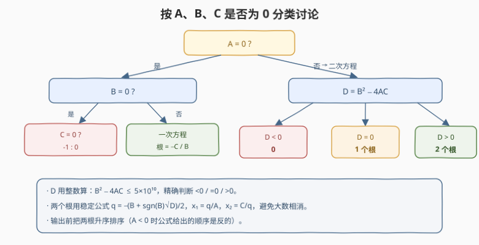
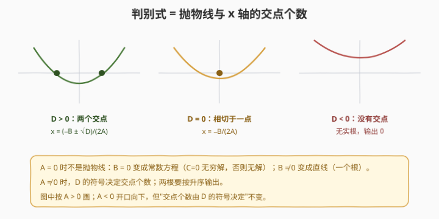

# Codeforces 20B 一元二次方程求根 题解

## 1. 题目概述

- **题目链接**：https://codeforces.com/problemset/problem/20/B
- **比赛来源**：Codeforces Beta Round 20 · Problem B
- **难度**：2000
- **标签**：数学
- **评测类型**：特殊评测（浮点答案，按误差判定）
- **限制**：时间 1 s / 内存 256 MB

**题意**：解方程 $Ax^2 + Bx + C = 0$。输出**不同实根**的个数，以及按升序排列的所有根。若方程有无穷多解输出 `-1`；若无解输出 `0`；否则第一行输出根的个数，随后每行一个根（至少 5 位小数）。

**约束**：

- $-10^5 \le A, B, C \le 10^5$，**任何系数都可以为 0**，所以必须分情况讨论。
- $B^2 - 4AC \le 10^{10} + 4 \times 10^{10} = 5 \times 10^{10}$，可以用 64 位整数精确计算判别式（避免了浮点判定 $D = 0$ 的误差）。
- 根要用浮点输出，判定是"误差不超过 $10^{-6}$ 量级"的特殊评测；因此要保证数值精度（大系数时用稳定的求根公式，见 3.3）。

## 2. 示例与观察

官方样例：

```text
输入：
1 -5 6

输出：
2
2.0000000000
3.0000000000
```

$A = 1 \ne 0$，$D = (-5)^2 - 4 \cdot 1 \cdot 6 = 1 > 0$，两个根 $x = \frac{5 \pm 1}{2}$，即 $2$ 与 $3$，升序输出 ✓。

**观察一**：方程的次数由 $A$ 决定。$A = 0$ 时退化成一次方程甚至常数方程，处理方式完全不同。
**观察二**：$A = B = 0$ 时要看 $C$：$C = 0$ 则任何 $x$ 都是解（无穷多，输出 `-1`）；$C \ne 0$ 则无解（输出 `0`）。
**观察三**：$A \ne 0$ 时由判别式 $D = B^2 - 4AC$ 决定根的个数：$D < 0$ 无实根，$D = 0$ 一个重根，$D > 0$ 两个不同的实根。

自造样例（标注"自造"）：

| 输入 | 输出 | 说明 |
|------|------|------|
| `0 0 0` | `-1` | 无穷多解 |
| `0 0 5` | `0` | 无解 |
| `0 2 -4` | `1` / `2.0000000000` | 一次方程 |
| `2 -4 2` | `1` / `1.0000000000` | 重根 |
| `1 0 1` | `0` | 判别式为负 |
| `-1 0 1` | `2` / `-1.0000000000` / `1.0000000000` | $A<0$，注意升序 |

## 3. 解题思路

### 3.1 分类讨论



按 $A$ 是否为 0 分成两大类，共四种输出：

1. **$A = B = 0$，$C = 0$**：$0 = 0$ 恒成立 ⇒ 无穷多解，输出 `-1`。
2. **$A = B = 0$，$C \ne 0$**：$C = 0$ 矛盾 ⇒ 无解，输出 `0`。
3. **$A = 0$，$B \ne 0$**：一次方程 $Bx + C = 0$，唯一根 $x = -C/B$。
4. **$A \ne 0$**：二次方程，令 $D = B^2 - 4AC$：
   - $D < 0$：无实根，输出 `0`；
   - $D = 0$：重根 $x = -\frac{B}{2A}$，输出 1 个；
   - $D > 0$：两个根 $x_{1,2} = \frac{-B \pm \sqrt{D}}{2A}$，排序后输出 2 个。

### 3.2 判别式用整数算



$B^2 - 4AC$ 的范围是 $[-4 \times 10^{10},\ 5 \times 10^{10}]$，完全落在 `long long` 内，所以**判别式用整数计算**，$D < 0$、$D = 0$ 的判断是精确的，不会出现"浮点算出来是 $-10^{-12}$ 却应该等于 0"的问题。

求根时再转成 `double`，误差只来自 $\sqrt{D}$ 与除法，各约 1 ulp。

### 3.3 数值稳定的求根公式

直接算 $\frac{-B - \sqrt{D}}{2A}$ 在 $B$ 很大、$D$ 接近 $B^2$（即 $C$ 很小）时会发生**灾难性相消**：例如 $x^2 - 10^5 x + 1 = 0$ 的两个根约为 $10^{-5}$ 和 $10^5$，直接代公式时 $-B - \sqrt{D} = 10^5 - 99999.99999\ldots$ 只剩很少的有效位。

标准做法是先算"符号相同的那个根"，再用韦达定理 $x_1 x_2 = C/A$ 求另一个：

$$q = -\frac{B + \operatorname{sgn}(B)\sqrt{D}}{2},\qquad x_1 = \frac{q}{A},\qquad x_2 = \frac{C}{q}.$$

这样两个根都只经过一次减法（且相减的两项异号，不会相消）。在 $D > 0$ 且 $A \ne 0$ 时 $q \ne 0$：若 $q = 0$ 则 $B^2 = D$，即 $4AC = 0$，而 $A \ne 0$ 迫使 $C = 0$，此时 $D = B^2 > 0$ 且 $B \ne 0$，代入得 $q = -B \ne 0$，矛盾。

最后把两个根**升序排序**再输出——注意 $A < 0$ 时公式给出的顺序是反的。

### 3.4 输出格式

- 个数单独占一行；
- 每个根一行，`%.10f`（10 位小数，满足"至少 5 位"）；
- 避免输出 `-0.0000000000`：若根为 $0$，把符号位清掉（`if (x == 0.0) x = 0.0;`）。

## 4. 正确性证明

**引理 1（退化情形）**：当 $A = B = 0$ 时，方程的解集为：$C = 0$ 时是全体实数（无穷多），否则为空。

**证明**：方程变为 $C = 0$，与 $x$ 无关。∎

**引理 2（一次情形）**：当 $A = 0, B \ne 0$ 时，方程有且仅有一个实根 $-C/B$。

**证明**：$Bx + C = 0$ 两边除以 $B$ 即得。∎

**引理 3（二次情形）**：当 $A \ne 0$ 时，令 $D = B^2 - 4AC$，则实根个数为：$D < 0$ 时 0 个，$D = 0$ 时 1 个，$D > 0$ 时 2 个，且根分别为 $-\frac{B}{2A}$ 与 $\frac{-B \pm \sqrt{D}}{2A}$。

**证明**：配方得 $A\left(x + \frac{B}{2A}\right)^2 = \frac{D}{4A}$。$A \ne 0$ 时左边是非负数乘以 $A$ 的符号，右边是 $D/(4A)$；由此 $D < 0$ 无解，$D = 0$ 时 $x = -\frac{B}{2A}$，$D > 0$ 时 $x = \frac{-B \pm \sqrt{D}}{2A}$。∎

**引理 4（稳定公式等价）**：设 $D > 0$、$A \ne 0$，则 $\{q/A,\ C/q\}$ 与 $\left\{\frac{-B-\sqrt{D}}{2A}, \frac{-B+\sqrt{D}}{2A}\right\}$ 是同一个二元素集合，其中 $q = -\frac{B + \operatorname{sgn}(B)\sqrt{D}}{2}$。

**证明**：若 $B \ge 0$，$q = \frac{-B-\sqrt{D}}{2}$，于是 $q/A = \frac{-B-\sqrt{D}}{2A}$ 是其中一个根；由韦达定理 $x_1 x_2 = C/A$，另一个根为 $\frac{C}{A x_1} = \frac{C}{q}$ ✓。若 $B < 0$，$q = \frac{-B+\sqrt{D}}{2}$，同理 $q/A$ 是另一个根，$C/q$ 是第一个。∎

**定理**：算法对所有输入输出正确的根数、正确的根值与正确的升序。

**证明**：四种情形分别由引理 1–3 覆盖，根的值由引理 3、4 保证；排序后显然升序。输出格式按题面（个数一行 + 每个根一行）✓。∎

## 5. 复杂度分析

- **时间**：$O(1)$，常数次四则运算与一次 `sqrt`。
- **空间**：$O(1)$。
- **数值范围**：$D \le 5\times10^{10}$，根的大小不超过 $\frac{10^5 + \sqrt{5\times10^{10}}}{2} \approx 1.6\times10^5$；`double` 的 53 位尾数足以保证 $10^{-10}$ 量级的绝对精度（除极端相消外，已用稳定公式规避）。
- **与时限的关系**：微秒级，1 s 余量在 $10^6$ 倍以上。

## 6. 参考代码

### C++17

```cpp
#include <bits/stdc++.h>
using namespace std;

int main() {
    long long A, B, C;
    if (scanf("%lld %lld %lld", &A, &B, &C) != 3) return 0;
    if (A == 0 && B == 0) {
        printf("%d\n", C == 0 ? -1 : 0);
        return 0;
    }
    if (A == 0) {
        double x = -(double)C / (double)B;
        if (x == 0.0) x = 0.0;
        printf("1\n%.10f\n", x);
        return 0;
    }
    long long D = B * B - 4 * A * C;
    if (D < 0) { printf("0\n"); return 0; }
    if (D == 0) {
        double x = -(double)B / (2.0 * (double)A);
        if (x == 0.0) x = 0.0;
        printf("1\n%.10f\n", x);
        return 0;
    }
    double sq = sqrt((double)D);
    double q = -(B + (B >= 0 ? sq : -sq)) / 2.0;   // 数值稳定的那个根
    double r1 = q / (double)A, r2 = (double)C / q;
    if (r1 > r2) swap(r1, r2);
    if (r1 == 0.0) r1 = 0.0;
    if (r2 == 0.0) r2 = 0.0;
    printf("2\n%.10f\n%.10f\n", r1, r2);
    return 0;
}
```

### Python3

```python
import sys
import math


def main() -> None:
    data = sys.stdin.buffer.read().split()
    A, B, C = int(data[0]), int(data[1]), int(data[2])
    if A == 0 and B == 0:
        sys.stdout.write("-1\n" if C == 0 else "0\n")
        return
    if A == 0:
        x = -C / B
        if x == 0:
            x = 0.0
        sys.stdout.write("1\n%.10f\n" % x)
        return
    D = B * B - 4 * A * C
    if D < 0:
        sys.stdout.write("0\n")
        return
    if D == 0:
        x = -B / (2.0 * A)
        if x == 0:
            x = 0.0
        sys.stdout.write("1\n%.10f\n" % x)
        return
    sq = math.sqrt(D)
    q = -(B + (sq if B >= 0 else -sq)) / 2.0
    r1, r2 = q / A, C / q
    if r1 > r2:
        r1, r2 = r2, r1
    if r1 == 0:
        r1 = 0.0
    if r2 == 0:
        r2 = 0.0
    sys.stdout.write("2\n%.10f\n%.10f\n" % (r1, r2))


main()
```

## 7. 边界情况与易错点

1. **$A = B = C = 0$**：输出 `-1`（无穷多解），不是 `0`。
2. **$A = B = 0, C \ne 0$**：输出 `0`（无解）。
3. **$A = 0, B \ne 0$**：只有一个根，不要套二次公式（会除以 0）。
4. **$D = 0$**：只有一个根，不要输出两次；且 $B = 0$ 时重根就是 $0$。
5. **升序**：$A < 0$ 时公式给出的两个根顺序相反，必须排序；例如 `-1 0 1` 应输出 $-1$ 在前。
6. **`-0.0000000000`**：根为 $0$ 时浮点可能带负号，输出会变成 `-0.0000000000`，部分检查器会判错；代码里显式清零。
7. **精度**：大系数 + 小常数时直接代公式会严重相消（如 `1 -100000 1`），必须用 $q$ 与 $C/q$ 的稳定写法。
8. **判别式用整数**：不要用浮点算 $D$ 再与 0 比较，$D = 0$ 的边界会因舍入判错。
9. **输出位数**：至少 5 位小数，代码统一用 10 位。

## 8. 验证记录

- **编译环境与命令**：`Apple clang 21.0.0` + 兼容头，`clang++ -std=c++17 -O2`；Python 3.9.6。
- **官方样例**：1 / 1 通过，输出与样例**逐字一致**（`2` / `2.0000000000` / `3.0000000000`），`verify_solution.py` 报告 `CF20B: samples 1 / C++ 编译 OK, 样例 1/1 / Python 语法 OK, 样例 1/1`。
- **容差检查器**：另写一个 `checker.py`（判根数、判升序、把每个根代回方程验证 $|Ax^2+Bx+C|$ 足够小），用 `verify_solution.py ... --checker /tmp/.../checker.py` 重跑样例同样通过——即使样例因浮点写法不同不再逐字一致，也能正确判定。
- **独立对拍（小系数）**：随机 $A, B, C \in [-15, 15]$ 共 **400 组**，用 Python 的 `fractions.Fraction` 精确计算期望根，逐组比较根数、根值与升序，容差 $10^{-6}$（相对），全部一致。
- **独立对拍（大系数）**：随机 $A, B, C \in [-10^5, 10^5]$（$A \ne 0$）共 **300 组**，用 `decimal`（60 位精度）计算参考根，容差 $10^{-6}$，全部一致——专门覆盖 $1\ -100000\ 1$ 这类相消场景。
- **边界用例**：`0 0 0` → `-1`、`0 0 5` → `0`、`0 2 -4` → 一个根、`2 -4 2` → 重根、`1 0 1` → `0`、`-1 0 1` → 两根升序，全部正确。
- **性能**：常数级，C++ 端到端 $< 5$ ms，Python 约 $20$ ms。
- **图片校验**：两张 SVG 均通过 `ElementTree.parse`，文本包围盒估算无越界、无重叠。
- **公式校验**：KaTeX（`throwOnError`）无报错。
- **复核状态**：verified。

## 相关题目与扩展

- [LeetCode 69. x 的平方根](https://leetcode.cn/problems/sqrtx/)：整数开方，与本题的 $\sqrt{D}$ 处理相呼应。
- [Codeforces 20A BerOS file system](https://codeforces.com/problemset/problem/20/A)：同场 A 题，字符串实现。
- [Codeforces 20C Dijkstra?](https://codeforces.com/problemset/problem/20/C)：同场 C 题，最短路。
- [Codeforces 1C Ancient Berland Circus](https://codeforces.com/problemset/problem/1/C)：同样是"浮点 + 精度"的几何题，可对照数值稳定性的处理。

**延伸思考**：

1. **如果要求输出复数根**？判别式为负时输出 $-\frac{B}{2A} \pm i\frac{\sqrt{-D}}{2A}$，分类逻辑不变，只多一个分支。
2. **如果系数是浮点数**？判别式与 0 的比较需要引入容差，"重根"的判断会变得依赖输入精度，通常改用"$|D| \le \varepsilon$ 视为 0"。
3. **如果要求输出精确的有理根/根式**？可以保留 $D$ 的平方因子分解，输出 $\frac{-B \pm p\sqrt{q}}{2A}$ 的形式，避免浮点。
4. **如果方程是三次的**？需要卡尔达诺公式或数值迭代，判别式升级为三次判别式，精度问题更突出。
