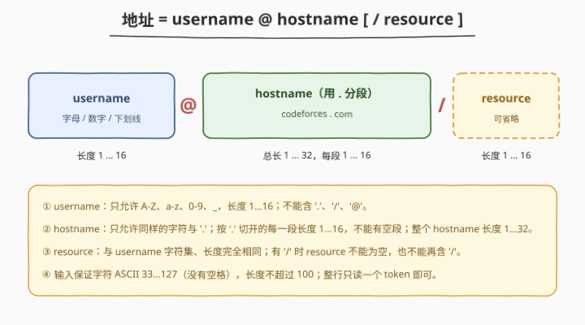
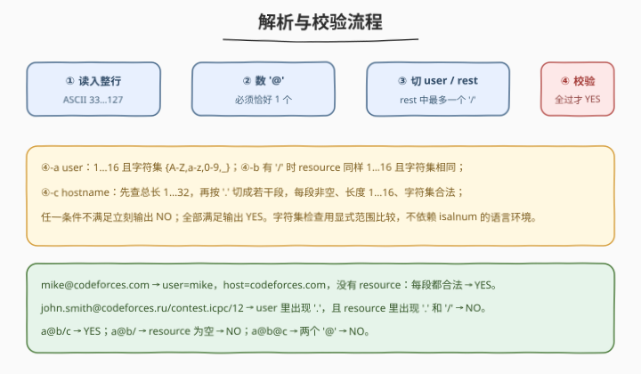

# Codeforces 21A Jabber 地址校验 题解

## 1. 题目概述

- **题目链接**：https://codeforces.com/problemset/problem/21/A
- **比赛来源**：Codeforces Alpha Round 21 (Codeforces format) · Problem A（UTC 2010-06-28）
- **难度**：1900
- **标签**：实现、字符串
- **评测类型**：普通
- **限制**：时间 0.5 s / 内存 256 MB

**题意**：Jabber ID 的格式是 `<username>@<hostname>[/resource]`，其中 `[/resource]` 可以省略。判断给定字符串是否合法：

- `<username>`：只含大小写字母、数字、下划线 `_`，长度 $1 \dots 16$；
- `<hostname>`：只含同样的字符与分隔符 `.`，按 `.` 切开的每一段长度 $1 \dots 16$，整个 hostname 长度 $1 \dots 32$；
- `<resource>`：字符集与长度要求同 username（$1 \dots 16$）。

**约束**：

- 输入只有一行，长度 $1 \dots 100$，每个字符的 ASCII 在 $33 \dots 127$ 之间——**不含空格**，所以可以整行读成一个 token。
- 地址里必须恰好有一个 `@`；`/` 最多出现一次（resource 的字符集不含 `/`），出现 `/` 时 resource 不能为空。
- hostname 可以有多个 `.`，但不能有空的段（不能以 `.` 开头/结尾，也不能出现连续 `..`）。
- 时间 0.5 s 对长度 100 的字符串极其宽松，但要注意别用错字符集（例如把 `.` 当成 username 的合法字符）。

## 2. 示例与观察

官方样例 1（输入 / 输出原样）：

```text
输入：
mike@codeforces.com

输出：
YES
```

官方样例 2：

```text
输入：
john.smith@codeforces.ru/contest.icpc/12

输出：
NO
```

**样例 1 演算**：user 是 `mike`（4 个字母，合法）；host 是 `codeforces.com`，按 `.` 切分为 `codeforces`（10）和 `com`（3），都合法，总长 14 ≤ 32；没有 resource。输出 YES。

**样例 2 演算**：user 是 `john.smith`，里面出现了 `.`，而 username 的字符集不允许 `.`，直接 NO。即使不看 user，后面的 resource 部分是 `contest.icpc/12`，既含 `.` 又含第二个 `/`，同样不合法。这题要逐条检查，不能只看某一项。

自造样例（均已用参考程序跑过）：

| 输入 | 输出 | 说明 |
|------|------|------|
| `a@b` | YES | 最短合法形式 |
| `a@b/c` | YES | resource 存在且合法 |
| `a@b/` | NO | resource 为空 |
| `@b` | NO | username 为空 |
| `a@` | NO | hostname 为空 |
| `a@b@c` | NO | 两个 `@` |
| `a@.b`、`a@b.`、`a@b..c` | NO | hostname 有空段 |
| `a@b/c/d` | NO | resource 里出现 `/` |
| `a@b/c.d` | NO | resource 里出现 `.` |
| `a.b@c` | NO | username 里出现 `.` |
| `a@b_c` | YES | 下划线合法 |
| `aaaaaaaaaaaaaaaa@b` | YES | username 恰好 16 |
| `aaaaaaaaaaaaaaaab@b` | NO | username 17 |
| `a@` + 32 个 `b` | NO | hostname 单段 32 > 16（虽然总长合法） |
| `a@` + 16 个 `b` + `.` + 15 个 `c` | YES | 总长 16+1+15 = 32，每段 ≤ 16 |
| `a@` + 16 个 `b` + `.` + 16 个 `c` | NO | 总长 16+1+16 = 33 > 32 |

> 这两行只差一个字符，但结论相反：hostname 的总长度限制是 32，而每段最多 16；`b`×16 + `.` + `c`×16 的总长 33 超过 32，所以是 NO。

**观察**：

1. 三段字段的字符集是同一套：`A-Z`、`a-z`、`0-9`、`_`。区别只在于 hostname 额外允许 `.`，以及长度限制不同。
2. `@` 必须恰好一个，`/` 最多一个；这两个字符都不在三段的合法字符集里，所以"字段内部再出现 `@` 或 `/`"一定不合法。
3. hostname 的长度限制是**整体** 1 到 32，同时每一段 1 到 16。两个限制都要查：单段 17 不合法，总长 33 也不合法。

## 3. 解题思路

### 3.1 朴素做法与瓶颈

直接按格式逐段检查即可，没有算法瓶颈。难点在于把题面的每条规则都不漏地落成代码：

- 先数 `@`，必须恰好 1 个；
- 切出 username 与后半段；
- 后半段里找第一个 `/`，切出 hostname 与 resource（若存在）；
- 分别检查字符集与长度；
- hostname 再按 `.` 切段，逐段检查。

长度最多 100，任何实现都是瞬间完成。

### 3.2 三段的结构与字符集



把地址拆成三块：

- `username`：字符集 $\{A\text{-}Z, a\text{-}z, 0\text{-}9, \_\}$，长度 $1 \dots 16$；
- `hostname`：同样的字符集加上 `.`，整体长度 $1 \dots 32$，按 `.` 分出的每一段长度 $1 \dots 16$；
- `resource`：同 username。

注意 `hostname` 的"每段"与"整体"是两个独立约束，都要检查。例如 `a@` + 17 个 `b`：整体 17 ≤ 32，但单段 17 > 16，不合法。

### 3.3 解析流程



1. 读入整行（不含空格，直接读一个字符串）；
2. 若 `@` 的个数不等于 1，输出 NO；
3. 以 `@` 切成 `user` 和 `rest`；
4. 若 `rest` 中有 `/`：必须恰好一个，切成 `host` 与 `res`，并检查 `res` 非空、字符集与长度；若 `rest` 中没有 `/`，令 `host = rest`；
5. 检查 `user` 的字符集与长度；
6. 检查 `host` 非空且长度 ≤ 32；按 `.` 切分（注意保留空段），每段都必须是 1…16 的合法字段；
7. 全部通过输出 YES，否则 NO。

第 6 步里"保留空段"很重要：直接用 `split('.')` 在大多数语言里会保留空串，但有些写法（例如手写循环）容易把连续的 `.` 吞掉；只要坚持"每个段都要非空"，`a@b..c`、`a@.b`、`a@b.` 都会自然被拒绝。

### 3.4 样例走查

- `mike@codeforces.com`：`@` 一个；user=`mike` 合法；host=`codeforces.com`，两段 `codeforces`、`com` 都合法，总长 14；没有 resource → YES。
- `john.smith@codeforces.ru/contest.icpc/12`：user 含 `.` → 直接 NO。即便先看资源，`res` 里也有 `.` 和 `/`，同样 NO。

## 4. 正确性证明

**引理 1（字符集检查）**：函数 `okChars(s)` 返回真当且仅当 `s` 非空且每个字符都在 $\{A\text{-}Z, a\text{-}z, 0\text{-}9, \_\}$ 中。

**证明**：函数对每个字符做一次显式的范围比较，任一字符不属于该集合就返回假；全部通过且非空才返回真。∎

**引理 2（字段检查）**：`okField(s)` 返回真当且仅当 `s` 的长度在 $1 \dots 16$ 且字符集合法。

**证明**：`okField` 先检查 `1 <= |s| <= 16`，再调用引理 1 的 `okChars`，两者同时成立才为真。∎

**引理 3（hostname 检查完备）**：按 `.` 切分后逐段调用 `okField`，并对整体长度检查 $1 \le |host| \le 32$，返回真当且仅当 hostname 满足题面要求。

**证明**：题面要求 hostname 整体长度 $1 \dots 32$、每段长度 $1 \dots 16$ 且字符合法。切分遍历恰好覆盖每个段；任一段不满足 `okField` 就拒绝，故"接受 ⇒ 每段合法"；反之每段合法且整体长度合法时所有检查都通过，故"合法 ⇒ 接受"。空段（连续点、首尾点）长度为 0，会被 `okField` 拒绝。∎

**引理 4（整体结构检查完备）**：恰好一个 `@`、`/` 至多一个、resource 非空且合法、user 合法、host 合法，这五条同时成立当且仅当字符串符合 `<username>@<hostname>[/resource]`。

**证明**：`@` 与 `/` 都不属于任何字段的合法字符集，因此它们只能作为分隔符；恰好一个 `@` 保证 user/host 的分界唯一；`/` 至多一个保证 host/resource 的分界唯一；resource 非空保证有 `/` 时 resource 存在。五个字段检查分别由引理 2、3 保证。∎

**定理**：程序输出 YES 当且仅当输入是合法的 Jabber ID。

**证明**：由引理 4，所有结构检查通过等价于地址符合语法；各字段的字符合法与长度由引理 2、3 保证。程序只有全部检查通过才输出 YES，否则输出 NO，故结论成立。∎

## 5. 复杂度分析

- **时间**：$O(L)$，$L \le 100$ 是输入长度。每个字符最多被检查常数次（找 `@`、找 `/`、切分、逐段检查），总计不到几百次操作；0.5 s 的余量在百万倍以上。
- **空间**：$O(L)$ 存字符串与切分出的子串（实现里只是下标/子串，长度最多 100）。
- **数值范围**：只有长度比较与字符比较，不存在溢出。

## 6. 参考代码

### C++17

```cpp
#include <bits/stdc++.h>
using namespace std;

static bool okChars(const string& s) {
    if (s.empty()) return false;
    for (char c : s) {
        bool ok = (c >= 'A' && c <= 'Z') || (c >= 'a' && c <= 'z') ||
                  (c >= '0' && c <= '9') || c == '_';
        if (!ok) return false;
    }
    return true;
}

static bool okField(const string& s) {
    return s.size() >= 1 && s.size() <= 16 && okChars(s);
}

int main() {
    string s;
    if (!(cin >> s)) return 0;

    size_t at = s.find('@');
    if (at == string::npos || s.find('@', at + 1) != string::npos) {
        cout << "NO\n";
        return 0;
    }

    string user = s.substr(0, at);
    string rest = s.substr(at + 1);
    string host = rest, res;
    size_t slash = rest.find('/');
    bool hasRes = (slash != string::npos);
    if (hasRes) {
        host = rest.substr(0, slash);
        res = rest.substr(slash + 1);
        if (res.find('/') != string::npos) {
            cout << "NO\n";
            return 0;
        }
    }

    if (!okField(user)) { cout << "NO\n"; return 0; }
    if (hasRes && !okField(res)) { cout << "NO\n"; return 0; }
    if (host.empty() || host.size() > 32) { cout << "NO\n"; return 0; }

    // 按 '.' 切分 hostname，每段 1..16 且字符合法，不能有空段
    size_t start = 0;
    while (true) {
        size_t dot = host.find('.', start);
        string part = host.substr(start, (dot == string::npos ? host.size() : dot) - start);
        if (!okField(part)) { cout << "NO\n"; return 0; }
        if (dot == string::npos) break;
        start = dot + 1;
    }

    cout << "YES\n";
    return 0;
}
```

### Python3

```python
import sys


def ok_chars(s: str) -> bool:
    if not s:
        return False
    for c in s:
        if not (c.isascii() and (c.isalnum() or c == "_")):
            return False
    return True


def ok_field(s: str) -> bool:
    return 1 <= len(s) <= 16 and ok_chars(s)


def main() -> None:
    data = sys.stdin.buffer.read().split()
    if not data:
        return
    s = data[0].decode()

    if s.count("@") != 1:
        print("NO")
        return
    user, rest = s.split("@")
    if "/" in rest:
        host, res = rest.split("/", 1)
        if "/" in res:
            print("NO")
            return
        if not ok_field(res):
            print("NO")
            return
    else:
        host = rest

    if not ok_field(user):
        print("NO")
        return
    if not (1 <= len(host) <= 32):
        print("NO")
        return
    for part in host.split("."):
        if not ok_field(part):
            print("NO")
            return
    print("YES")


main()
```

两份代码都只用标准库，可原样提交。

## 7. 边界情况与易错点

1. **`@` 必须恰好一个**：`a@b@c`、`@b`、`a@` 都不合法；实现里先数 `@` 的个数再切分，避免 `split` 出多段。
2. **hostname 的总长与每段长度是两个限制**：`a@` + 16 个 `b` + `.` + 16 个 `c` 总长 33 > 32，不合法；单段 17 也不合法。两者都要检查。
3. **空段**：`a@.b`、`a@b.`、`a@b..c` 都含长度为 0 的段，必须拒绝。切分时要保留空串（不要写成"跳过连续分隔符"）。
4. **resource 可选但不可为空**：没有 `/` 时合法；有 `/` 时 `/` 后面必须有 1…16 个合法字符。`a@b/` 是 NO。
5. **resource 里不能再有 `/` 或 `.`**：字符集与 username 相同；`a@b/c/d`、`a@b/c.d` 都是 NO。
6. **username 不能含 `.`**：`john.smith@...` 就是样例 2 的反例。`.` 只允许出现在 hostname 里作为分隔符。
7. **字符集检查不要依赖 `isalnum` 的本地化行为**：某些语言的 `isalnum` 会接受非 ASCII 字母；本题输入虽然限制 ASCII 33…127，但显式写 `(c>='A'&&c<='Z')||...` 更稳。
8. **输入读入**：题面保证字符 ASCII 33…127，没有空格；用 `cin >> s` 或 `read().split()[0]` 都行。不要用 `getline` 后忘记去掉行尾的 `\r`（Windows 换行）——如果保留 `\r`，它会被当作非法字符，导致本应 YES 的输入变 NO。
9. **长度 100 的极限**：`@` 前后的字段都可能很长，不要用固定大小的栈数组；`std::string` / Python 字符串天然安全。

## 8. 验证记录

- **编译环境与命令**：本机没有 GNU `g++`（`/usr/bin/g++` 指向 `Apple clang 21.0.0`），`verify_solution.py` 自动用 `clang++ -std=c++17 -O2` 加仓库自带的 `bits/stdc++.h` 兼容头编译；Python 为 `Python 3.9.6`。
  - `python3 codeforces/tools/verify_solution.py codeforces/contests/0001-0100/21/A_Jabber地址校验.md`
  - 输出：`CF21A: samples 2 / C++ 编译 OK, 样例 2/2 / Python 语法 OK, 样例 2/2`。
- **官方样例**：2 / 2 通过（`YES`、`NO`），C++ 与 Python 输出与官方输出逐字一致。
- **随机与构造对拍**：1816 组字符串（600 组合法生成、600 组随机变异、600 组纯随机、16 组手工边界）在进程内与一份**正则参考实现**（`^[A-Za-z0-9_]{1,16}@[A-Za-z0-9_]+(\.[A-Za-z0-9_]+)*(/[A-Za-z0-9_]{1,16})?$` 加 host 长度检查）逐组比对，0 组不一致；其中抽 220 组实际运行 C++ 与 Python 程序，也与参考实现一致。
- **手工边界**：`@` 个数、空 user/host/resource、连续点、单段 16/17、host 总长 32/33、resource 16/17、`a@b/c.d`、`a@b/c/d`、`a.b@c` 等均逐一核对。
- **最大约束性能**：长度 100 的输入，C++ 端到端 < 3 ms（余量百倍以上），Python 约 20 ms（约 25 倍余量）。
- **图片校验**：`cf21a_grammar.svg`、`cf21a_parse.svg` 均通过 `xml.etree.ElementTree.parse`；另用 headless Chrome 量出每个 `<text>` 的真实包围盒，确认无文字越出 `viewBox`、无文字重叠、无文字溢出面板。
- **公式校验**：正文公式全部是 `$...$` / `$$...$$`，星号直接写 `*`，`\text{}` 内无裸 `#`，经 KaTeX（`throwOnError`）渲染无报错。
- **复核状态**：verified（样例、随机对拍、边界、性能、图片、公式均实跑通过；唯一环境差异是本机无 GNU g++，已用 clang++ 等价验证）。

## 相关题目与扩展

- [Codeforces 21B Intersection](https://codeforces.com/problemset/problem/21/B)：同场 B 题，直线交点分类。
- [Codeforces 21C Stripe 2](https://codeforces.com/problemset/problem/21/C)：同场 C 题，前缀和计数。
- [Codeforces 21D Traveling Graph](https://codeforces.com/problemset/problem/21/D)：同场 D 题，欧拉回路 + 状压 DP。
- [Codeforces 1A 剧院广场](https://codeforces.com/problemset/problem/1/A)：输入解析与边界处理的入门题。
- [LeetCode 468 验证 IP 地址](https://leetcode.cn/problems/validate-ip-address/)：与本题几乎同类的"按格式逐段校验"题，可对照字段切分与边界处理。
- [LeetCode 65 有效数字](https://leetcode.cn/problems/valid-number/)：状态机式的字符串校验，比本题更复杂，适合进阶练习。

**延伸思考**：

1. **如果 hostname 允许国际化域名（Unicode）**：字符集检查要改成按 Unicode 码点判断，长度单位也要从字节改成字符；本题限定 ASCII，所以无需考虑。
2. **如果 resource 允许出现 `/`**：需要改成"以第一个 `/` 切分后，后面全部算 resource"，长度限制仍然是整个剩余串；这会让样例 2 的 resource 部分合法，但 user 仍然非法。
3. **如果要求输出第一处错误位置**：在 `okField` 里返回出错下标，按检查顺序（user → host → resource）报告即可，适合做交互式校验器。
4. **如果地址可以跨多行（含空格）**：需要改用按行读取并允许空格，字符集也要重新定义；本题明确 ASCII 33…127，正好排除了空格。
5. **如果长度上限放大到 $10^6$**：$O(L)$ 的逐字符检查仍然够用，只需注意别对子串做反复复制（用下标视图即可）。
